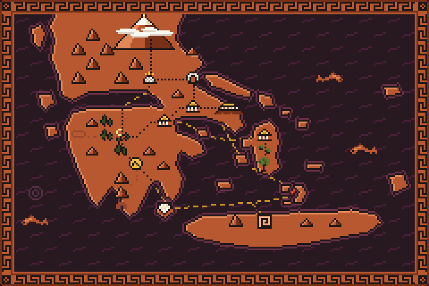

# The Aethos region map

Where every place in the bible sits, how the story travels between them, and the map-section grid that future maps slot into. The painted map is the in-game region map: the Fly map, the wall map and the Pokédex area view all show it.




*Gold boxes are towns and landmarks, blue boxes are routes, gray boxes are post-game places that stay hidden.*

## Summary

- **Aethos is Greece, folded to fit a Game Boy screen.** The mainland and the Peloponnese hold the west and centre; the Aegean, with Kalliste and the Cyclades, holds the east; Knossa (Crete) runs along the south. North is up, and real places are where they really are, relative to each other. The map is squeezed north to south (Thessaly and the Cretan Sea are shortened) and stretched a little east to west, so the 28×15 grid has room.
- **The story is a loop round the Gulf of Korinthos, then a voyage.** Act I goes Kalliste → trireme → Emporion (the Isthmus) → Eleusa → Thyrsa. Act II crosses the Gulf by ferry to Arkadia, comes back through Emporion to Astyra, then sails to Kaldera. Act III sails Kythera → Knossa → Lakonia, walks north through Arkadia and over the Gulf to Delphoi, and climbs the Ascent to Olympus.
- **Every bible place has a cell, a glyph and a `MAPSEC`.** Fifteen towns and landmarks and fourteen new routes are registered now, so a map built later only has to name its section.
- **The post-game is on the map but unrevealed.** Cape Tainaron, Olympia and Atlantis are painted faint, their roads in ghost dots, and the cursor shows no name for them until the game is cleared.

## How it is painted

A black-figure map on terracotta, in the same family as the dialogue box and menus:

- **The land** is reserved clay with an incised ink coast, lit along its top-left edges.
- **The sea** is black glaze with a wine cast, scattered with wine-purple wave strokes: Homer's *oinops pontos*, the wine-dark sea. A line of wine surf hugs every coast.
- **Roads** are ink dots. **Trireme lanes** are gold dashes. **Post-game roads** are sparse ghost dots, a shade under the clay.
- **Mountains** are small black-figure peaks lit on the left: the Pindos, Parnassos above Delphoi, Kithairon, Taygetos and Parnon either side of Lakonia, Pelion, and Ida on Knossa.
- **Olympus** rises above the rest, snow on its summit, a cloud bank about its waist, and a gold glint at the peak for the Pantheon.
- **Black-figure dolphins**, painted in clay, leap in the empty sea.
- **A meander border** runs round the edge. It is the dialogue box's own key and corner squares.

Each place has a small glyph in its cell:

| Place | Glyph |
|---|---|
| Elaia Village | the village olive |
| Akti Town, Emporion City, Eleusa Village | a Doric temple front with a gold pediment |
| Thyrsa City | the amphitheater's cavea round its orchestra |
| Delphoi | the omphalos in its net, under Apollo's sun |
| Arkadia | Artemis's crescent over the cypresses |
| Astyra | the Parthenon on the Akropolis rock |
| Kaldera | Thera's caldera ring, open to the west, with the forge burning in its heart |
| Kythera Isle | Aphrodite's scallop shell |
| Knossa Isle | the Labyrinth, as on Knossian coins |
| Lakonia | a hoplite shield blazoned with Λ |
| Mt. Olympus | the mountain itself |
| Cape Tainaron (hidden) | only a shadow where the gate will be |
| Olympia (hidden) | the stadium's faint oval |
| Atlantis (hidden) | Plato's rings of land and water, faint under the sea |

## The places

Each section's cells are given as (column, row) on the 28×15 grid. Cell (x, y) is screen tile (x + 1, y + 2), because the region map's cursor starts at `MAPCURSOR_X_MIN` 1 and `MAPCURSOR_Y_MIN` 2.

| Section | `MAPSEC` | Cells | Real place | Why there |
|---|---|---|---|---|
| Elaia Village | `MAPSEC_ELAIA_VILLAGE` | (17, 9) | Naxos, central Cyclades | Kalliste is a Cycladic island, so it sits mid-Aegean. Elaia is at its south end. |
| Route 1 | `MAPSEC_KALLISTE_ROUTE_1` | (17, 8) | | The road north through the groves. Kronion Hill is on it. |
| Akti Town | `MAPSEC_AKTI_TOWN` | (17, 7) | | The north harbor, facing the mainland. The trireme leaves from here. |
| Emporion City | `MAPSEC_EMPORION_CITY` | (10, 6) | Corinth, on the Isthmus | The great trading port sits where two seas and every road meet. The trireme lands at its eastern harbor. |
| Eleusa Village | `MAPSEC_ELEUSA_VILLAGE` | (12, 5) | Eleusis | West of Astyra on the Saronic shore, as in life. |
| Thyrsa City | `MAPSEC_THYRSA_CITY` | (12, 3) | Thebes | Dionysus's birthplace. Kithairon, where the Bacchae ran, stands between it and Eleusa. |
| Delphoi | `MAPSEC_DELPHOI` | (9, 3) | Delphi | On Parnassos's slopes above the Gulf of Korinthos. |
| Arkadia | `MAPSEC_ARKADIA` | (7, 7) | the heart of the Peloponnese | Mountain wilderness and cypress forest. |
| Astyra | `MAPSEC_ASTYRA` | (14, 5), (15, 5) | Athens | Two cells, for the capital and its Akropolis. |
| Kaldera | `MAPSEC_KALDERA` | (19, 11) | Thera (Santorini) | South of Kalliste, north of Knossa. |
| Kythera Isle | `MAPSEC_KYTHERA_ISLE` | (10, 12) | Kythera | Off Cape Malea, the Peloponnese's eastern finger. |
| Knossa Isle | `MAPSEC_KNOSSA_ISLE` | (17, 13) | Knossos, on Crete's north coast | The island runs the width of the south. |
| Lakonia | `MAPSEC_LAKONIA` | (8, 9) | Sparta | In the valley between Taygetos and Parnon. Its port is Gytheion, on the Lakonian Gulf. |
| The Ascent | `MAPSEC_THE_ASCENT` | (9, 2), (9, 1) | Thessaly | The road north from Delphoi climbs to Olympus. |
| Mt. Olympus | `MAPSEC_MOUNT_OLYMPUS` | (8, 0), (9, 0) | Olympus | The top of the map. |
| Cape Tainaron (post-game) | `MAPSEC_CAPE_TAINARON` | (7, 12) | Cape Matapan | The tip of the Mani, south of Lakonia: the real cave of Hades's gate. |
| Olympia (post-game) | `MAPSEC_OLYMPIA` | (4, 7) | Olympia | On the west coast, facing the Ionian Sea. |
| Atlantis (post-game) | `MAPSEC_ATLANTIS` | (1, 11) | beyond the known sea | Plato put it west, past the Pillars of Herakles, so it lies in the far southwest open sea. |

Route sections:

| Section | `MAPSEC` | Cells | Joins |
|---|---|---|---|
| Route 2 | `MAPSEC_AETHOS_ROUTE_2` | (11, 5) | Emporion and Eleusa, along the Skironian cliffs |
| Route 3 | `MAPSEC_AETHOS_ROUTE_3` | (12, 4) | Eleusa and Thyrsa, over Kithairon |
| Route 4 | `MAPSEC_AETHOS_ROUTE_4` | (11, 3), (10, 3) | Thyrsa and Delphoi, under Parnassos |
| Route 5 | `MAPSEC_AETHOS_ROUTE_5` | (7, 5), (7, 6) | the Gulf ferry's south landing (Aigion) and Arkadia |
| Route 6 | `MAPSEC_AETHOS_ROUTE_6` | (8, 7), (9, 6) | Arkadia and Emporion |
| Route 7 | `MAPSEC_AETHOS_ROUTE_7` | (13, 5) | Eleusa and Astyra: the Sacred Way |
| Route 8 | `MAPSEC_AETHOS_ROUTE_8` | (7, 8) | Arkadia and Lakonia |
| Route 9 (post-game) | `MAPSEC_AETHOS_ROUTE_9` | (8, 10), (7, 11) | Lakonia and Cape Tainaron, down the Mani |
| Route 10 (post-game) | `MAPSEC_AETHOS_ROUTE_10` | (6, 7), (5, 7) | Arkadia and Olympia, down the Alpheios |
| Route 11 (sea) | `MAPSEC_AETHOS_ROUTE_11` | (13–16, 7) | Kalliste and the Saronic Gulf |
| Route 12 (sea) | `MAPSEC_AETHOS_ROUTE_12` | (16, 9), (16, 10), (17, 10), (18, 10) | Kalliste, the Cyclades and Kaldera |
| Route 13 (sea) | `MAPSEC_AETHOS_ROUTE_13` | (11–18, 12) | the Cretan Sea: Kythera, Kaldera and Knossa |
| Route 14 (sea) | `MAPSEC_AETHOS_ROUTE_14` | (9, 10), (10, 11) | the Lakonian Gulf and the Kythera strait |
| Route 15 (sea) | `MAPSEC_AETHOS_ROUTE_15` | (4–8, 4) | the Gulf of Korinthos |

The grid at a glance (`::` is land, blank is sea, two letters a town, two digits a route):

```text
     0  1  2  3  4  5  6  7  8  9  10 11 12 13 14 15 16 17 18 19 20 21 22 23 24 25 26 27
 0  |   ::    :: :: :: :: :: Ol Ol ::                                                   |
 1  |         :: :: :: :: :: :: ^^ :: ::                                                |
 2  |         :: :: :: :: :: :: ^^ :: :: ::                                             |
 3  |         :: :: :: :: :: :: De 04 04 Th :: ::                                       |
 4  |         :: 15 15 15 15 15 :: :: :: 03 ::    ::                               ::   |
 5  |                     05 :: :: :: 02 Eu 07 As As                                    |
 6  |            :: :: :: 05 :: 06 Em ::       :: ::                                    |
 7  |            oy 10 10 Ar 06 :: :: :: :: 11 11 11 11 Ak                              |
 8  |            :: :: :: 08 :: :: :: :: ::          :: R1                              |
 9  |            :: :: :: :: La :: ::                12 El                              |
10  |               :: :: :: 09 14 :: ::             12 12 12                      ::   |
11  |   at          :: :: 09 ::    14 ::                      Ka                        |
12  |                     ta ::    Ky 13 13 13 13 13 13 13 13 ::                        |
13  |                                    :: :: :: :: :: Kn :: :: :: :: :: :: ::         |
14  |                                    :: :: :: :: :: :: :: :: :: :: :: ::            |
```

`^^` is the Ascent, `Ol` Olympus, `oy` Olympia, `ta` Tainaron, `at` Atlantis.

## The journey

**Act I.** Elaia → Route 1 → **Akti** (Laurel 1). The *Euploia* sails west from Akti, round Keos and up the Saronic Gulf, to **Emporion**'s eastern harbor (Laurel 2). Route 2 runs east along the Skironian cliffs to **Eleusa** (Laurel 3), where the Titans rob the Mystery sanctum. Route 3 climbs north over Kithairon to **Thyrsa** (Laurel 4). Astyra's Sacred Way (Route 7) is closed for now, and Route 4 shows Delphoi on its mountain but not the way in.

**Act II.** From Thyrsa, Route 4 runs west under Parnassos to Kirrha, Delphoi's harbor, where a ferry crosses the Gulf of Korinthos (Route 15) to Aigion. Route 5 climbs south into **Arkadia** (Laurel 5). Route 6 leads back to Emporion, and from Eleusa the Sacred Way is now open to **Astyra**. A trireme sails from Astyra's harbor down through the Cyclades, past home waters, to **Kaldera** (Laurel 6).

**Act III.** From Kaldera the lanes cross the Cretan Sea west to **Kythera** (Laurel 7), then east again to **Knossa** and the Labyrinth. A trireme carries you north to Gytheion and up to **Lakonia** (Route 14). Route 8 runs north through Arkadia, the Gulf ferry crosses back to Kirrha, and **Delphoi** (Laurel 8) is open at last. After the Loom and the Frozen Hour, **the Ascent** climbs north through Thessaly to **Olympus**.

**Post-game.** Route 9 runs down the Mani to **Cape Tainaron**, Route 10 west along the Alpheios to **Olympia**, and **Atlantis** lies under the far southwest sea. The western islands, Kerkyra, Kephallenia and Zakynthos, are unnamed, ready for the Odyssey.

The trireme lanes painted on the map: Akti–Emporion; the Gulf ferry, Kirrha–Aigion; Astyra–Kaldera through the Cyclades; Kaldera–Kythera across the Cretan Sea, with a branch to Knossa; and Kythera–Gytheion.

## Decisions for the user to approve

The map fixes the world's geography, so these are worth a look before maps get built against them.

1. **Kalliste is Naxos's island**, in the middle of the Cyclades, with Akti at its north harbor and Elaia at its south end. The slice's scripts already have Route 1 run north from Elaia to Akti.
2. **Emporion is Corinth, on the Isthmus.** It makes the trireme's landfall the mainland's crossroads, and it explains why every later route passes back through it.
3. **Thyrsa is Thebes**, not Athens's Theater of Dionysus, because Astyra is Athens. Thebes is Dionysus's birthplace, and Kithairon between it and Eleusa is the mountain of *The Bacchae*.
4. **A ferry across the Gulf of Korinthos** links Thyrsa to Arkadia. The order Thyrsa → Arkadia → Astyra otherwise means walking back through Eleusa and Emporion twice. The ferry also shows Delphoi to the player in Act I, gated, long before Laurel 8.
5. **Act III travels by sea**: Astyra → Kaldera → Kythera → Knossa → Lakonia, all by trireme, then on foot to Delphoi. It is a lot of sailing, which fits an archipelago and the wine-dark sea.
6. **Route numbers**: 2 to 10 for land routes in story order, 11 to 15 for the sea. The Ascent is a named section, as Victory Road was.
7. **Lake Stymphalia is in Lakonia**, as the bible says, though the real lake is in Corinthia.
8. **Atlantis is in the far southwest open sea**, following Plato's "beyond the Pillars of Herakles". Placing it under Kaldera instead would follow the modern Thera theory.
9. **Unnamed land**: Euboea, Keos, Aigina, Andros, Tenos, Mykonos, Paros, Melos, Ios, Amorgos, Samos and Rhodes are painted but have no section. The Ionian islands are left for the Odyssey.
10. **The Frozen Hour's three sanctuaries** have no cells yet. Natural homes are the Pool of Mnemosyne (Arkadia), Lake Stymphalia (Lakonia), and a third lake, for example Kopais beside Thyrsa.

## Adding a map later

1. Set the map's `region_map_section` in its `map.json` to the section above. Interiors and caves use their town's or route's section, or a new one at the same cell.
2. **For a town you can fly to**:
   - add its visited flag in `GetMapsecType` and `sFlyLocations` in `src/region_map.c`
   - add its heal location to `sMapHealLocations` there
   - set the flag in the town's map script.

   Until then, the town shows on the map but can't be flown to. Akti, with `FLAG_ICHOR_VISITED_AKTI`, is the model. Elaia flies once you have a Pokémon (`FLAG_SYS_POKEMON_GET`), because it is home.
3. **For a new section** (a dungeon or an island), add it to `SECTIONS` in `tools/ichor/art/ui_world_map.py` and rerun the script. The script regenerates the art, the grid in `src/data/region_map/region_map_layout.h` and the names in `region_map_sections.json`, so the three always agree. New sections are appended, so existing `MAPSEC` values never move.
4. **For the map-name popup**, give the section a theme in `src/map_name_popup.c`. New sections default to the stele.

## Limits

- **Tiles.** The map is cut to 230 unique 8×8 tiles.
  - The Fly and wall map use an affine background: 8bpp, at most 256 tiles, and no flips.
  - The Pokédex area view loads the same tiles with a 232-tile limit.
  - Open sea and plain land repeat. The ranges, forests and fields are drawn on whole cells, so they repeat too.
  - Coasts and glyphs cost the rest. Any new detail must keep the count at 232 or under; the script stops if it goes over.
- **Colors.** Both screens load the map's colors at BG palette 7, colors 112 to 159, so the PNG's indices start at 112. The map uses 23 of those 48 colors.
- **Section IDs.** `MAPSEC_NONE` must stay below 0xFD, the special met locations. With the 29 new sections it is 241, which leaves 11 more before the Hoenn sections are cut.

## Files

| File | What |
|---|---|
| `tools/ichor/art/ui_world_map.py` | Paints the map and writes its tiles, tilemaps, palette, the section grid and the section names. |
| `tools/ichor/art/ui_world_map_sprites.py` | Draws the cursor, the fly marks, Theo's and Ianthe's map icons, and the Fly map's frame. |
| `graphics/pokenav/region_map/` | The map, as the Fly and wall map load it, and its sprites |
| `graphics/pokedex/region_map.*` | The same map, as the Pokédex area view loads it |
| `src/data/region_map/region_map_sections.json`, `region_map_layout.h` | Section names, boxes and grid |
| `src/region_map.c` | Heal locations, fly targets and the post-game's hidden sections (marked `Ichor:`) |
