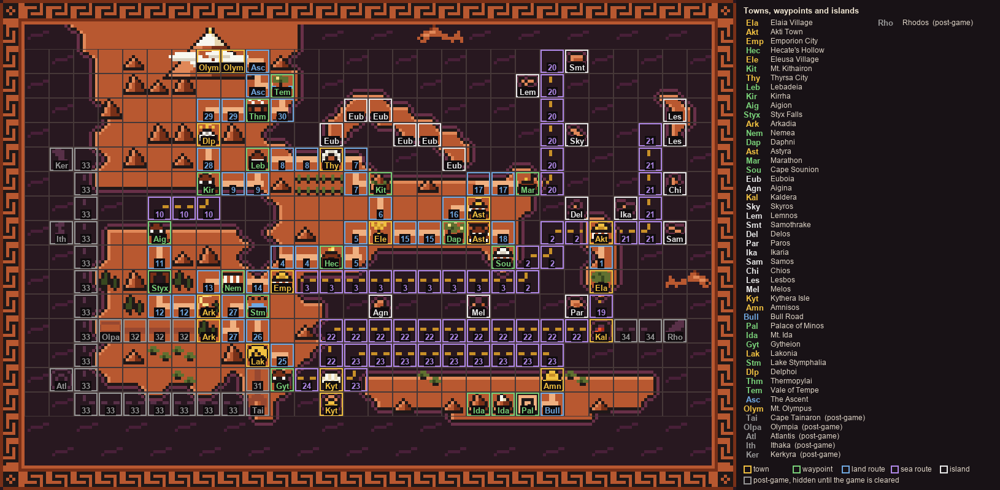
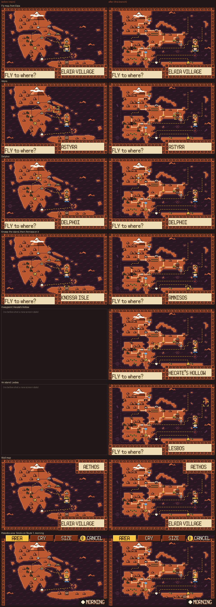

# The Aethos region map

This file places every place in the bible on the map and shows how the story travels between them. It also defines the map-section grid that future maps slot into. The painted map is the in-game region map: the Fly map, the wall map and the Pokédex area view all show it.




*The box colors mark gold for towns, green for waypoints, blue for land routes, purple for sea routes and white for islands. Gray boxes are post-game sections, which stay hidden until the game is cleared. Route cells show their number; every other cell shows the code from the key.*



## Summary

- **The map was revised to feel bigger.** On the first map, towns sat one cell apart, so the world looked small and close. Now towns on land are **3 to 7 cells apart**, and the voyages run **10 to 14 cells of sea**:
  - Between each pair of towns on land there are two or three routes, with a waypoint in the middle.
  - The sea routes are long voyages.
  - Every painted island can be visited.
- **Aethos is still Greece, with each place in its real position relative to the others.** The user approved this order: Kalliste at Naxos, Emporion at Corinth, Thyrsa at Thebes, the Gulf ferry, Act III by trireme, and Atlantis in the far southwest sea. All of it stands.
- **Greece is unfolded to fill the screen.** The mainland is stretched east to west across the middle, the Gulf of Korinthos cuts it from the Peloponnese, the islands fill the east, and Knossa (Crete) runs along the bottom.
- **What the map holds:**

  | Type | Count |
  |---|---|
  | Towns | 13, plus 3 post-game places |
  | Waypoints | 16 |
  | Routes | 36: Route 1 to 34 in story order, plus the Ascent and the Bull Road |
  | Islands that are not towns | 15 |

  That is 83 sections in all, and each has a cell, a glyph and a `MAPSEC`.
- **The post-game is on the map but hidden.** Tainaron, Olympia, Atlantis, Rhodos, the Odyssey's two islands and the four routes to them are painted faintly. The cursor shows no name for them until the game is cleared.
- **Finding room for the IDs.** 83 sections need more IDs than the game has left. Routes and islands now reuse the FRLG-only Kanto block of IDs. Details are under "Section IDs" below.

## How it is painted

The map is drawn black-figure style on terracotta, in the same style as the dialogue box and the menus.

- **Land** is bare clay with an ink coastline, lit along its top-left edges.
- **Sea** is black glaze with wine-purple wave strokes: Homer's wine-dark sea. A line of wine surf follows every coast.
- **Land routes** are pale, worn paths, two pixels wide, that wind from cell to cell between the places.
  - Each route cell joins only the cells next to it on the journey, so the path turns the way the route does.
- **Sea routes** are gold dashes.
- **Post-game routes** are drawn in ghost colors, a shade off the clay or the sea.
- **Landscape:**
  - Mountain ranges: the Pindos, Parnassos, Helikon, Parnes, Geraneia, Kyllene, Erymanthos, Taygetos, Parnon, and the White Mountains and Dikte on Knossa.
  - Thyrsa's vineyards, Arkadia's cypress forests, and olive groves in Messenia and on Knossa.
- **Olympus** rises above everything else: snow on its summit, cloud around its middle, and a gold glint at the peak for the Pantheon.
- **Black-figure dolphins**, painted in clay, leap in the empty sea.
- **A meander border**, the dialogue box's own key, runs round the edge.

Each place has its own glyph:

| Place | Glyph |
|---|---|
| Elaia | the village olive |
| Akti | Hestia's temple front |
| Emporion | a temple front with a gold pediment |
| Hecate's Hollow | a cave mouth with Hecate's torch above |
| Eleusa | Demeter's sheaf |
| Mt. Kithairon | a peak wreathed in ivy |
| Thyrsa | the amphitheater |
| Lebadeia | a hamlet |
| Kirrha, Aigion, Gytheion | a harbor hamlet and its boat |
| Styx Falls | black water falling between cliffs |
| Arkadia | Artemis's crescent over cypresses, and a cypress grove |
| Nemea | the standing columns of Zeus's temple |
| Daphni | Apollo's laurels |
| Astyra | the Parthenon on its rock, over the city |
| Marathon | the burial mound and a spear |
| Cape Sounion | Poseidon's white temple |
| Kaldera | Thera's ring, open to the west, with the forge burning inside |
| Kythera | Aphrodite's scallop, which is the island itself (Skandeia); below it, Paphia's gold-roofed shrine |
| Amnisos | a beehive |
| Palace of Minos | the Labyrinth, as on Knossian coins |
| Mt. Ida | a snow-capped peak |
| Lakonia | a shield with Λ |
| Lake Stymphalia | reeds, still water and birds |
| Delphoi | the omphalos under Apollo's sun |
| Thermopylai | the gates, with steam from the springs |
| Vale of Tempe | Daphne's laurel by the river |
| Mt. Olympus | the mountain itself |
| Tainaron (hidden) | the shadow of a cave mouth |
| Olympia (hidden) | the faint oval of the stadium |
| Atlantis (hidden) | Plato's rings, faint under the sea |

## The journey

Route numbers follow the story. Within each act the main path comes first and the optional routes after it.

### Prologue: Kalliste

Elaia → **Route 1** → Akti (Laurel 1).

### Act I

1. The *Euploia* sails west from Akti and crosses to the mainland by sea:
   - **Route 2:** west past Delos to the waters off Keos.
   - **Route 3:** round Cape Sounion and up the Saronic Gulf to Emporion's eastern harbor.
2. Emporion (Laurel 2).
3. **Route 4** crosses the Isthmus. The Bronze Hammer clears its rockslide.
4. Hecate's Hollow: the Torch.
5. **Route 5** runs along the Skironian cliffs to Eleusa (Laurel 3).
6. **Route 6** is choked with vines until Demeter's Sickle cuts them at the end of Act I.

### Act II

1. **Route 6** reaches Mt. Kithairon.
2. **Route 7** descends past the Kronia grounds, a Titan feast camp, to Thyrsa (Laurel 4 and the Girdle).
3. **Route 8** runs along Lake Kopais to Lebadeia.
4. **Route 9** passes the crossroads under Parnassos to Kirrha. Delphoi is visible up the mountain, but the way up is shut.
5. **Route 10** is the Gulf ferry, across to Aigion.
6. **Route 11** is the pass blocked by column drums, which the Girdle moves. It leads to Styx Falls.
7. **Route 12** enters the cypress forest of Arkadia (Laurel 5).
8. **Routes 13 and 14** lead back through Nemea to Emporion. From Eleusa:
   - **Route 15** is the road of the Mysteries. It was closed in Act I.
   - Daphni.
   - **Route 16** runs on to Astyra: the Akropolis and the salt well, where you get the Conch.
9. The trireme sails back past home, and **Route 19** runs from Elaia's south shore to Kaldera (Laurel 6 and the Wings).

The optional routes in Act II:
- **Route 17** goes to Marathon.
- **Route 18** goes to Cape Sounion.
- Euboia is across the Euripus from Thyrsa.
- With the Conch:
  - **Route 20** is the north Aegean: Skyros, Lemnos and Samothrake.
  - **Route 21** is the east Aegean: Ikaria, Samos, Chios and Lesbos.
  - Delos, Paros and Aigina are beside Routes 2, 19 and 3.

### Act III

1. **Route 22** sails west from Kaldera past Melos to Kythera (Laurel 7 and the Horn).
2. **Route 23** runs along Knossa's north coast to Amnisos.
3. The **Bull Road** leads to the Palace of Minos and the Labyrinth. Mt. Ida is optional.
4. The trireme carries you back to Kythera, and **Route 24** crosses to Gytheion.
5. **Route 25** goes up the Eurotas to Lakonia.
6. **Routes 26 and 27** lead past Lake Stymphalia to Arkadia.
7. Then, back the way you came:
   - Routes 12 and 11 to Aigion;
   - the ferry (Route 10) to Kirrha;
   - **Route 28** up the Kastalian falls (the Horn) to Delphoi (Laurel 8).

### The League

1. **Route 29** climbs over Parnassos to Thermopylai.
2. **Route 30** crosses the Thessalian plain to the Vale of Tempe.
3. **The Ascent** climbs to Mt. Olympus.

### Post-game

| Route | From | To |
|---|---|---|
| **Route 31** | Lakonia | down the Mani to Cape Tainaron |
| **Route 32** | Arkadia | down the Alpheios to Olympia |
| **Route 33** | Tainaron | the western sea: Atlantis to the southwest, and Ithaka and Kerkyra to the north |
| **Route 34** | Kaldera | Rhodos |

**How far apart the towns are now**

| Leg | Between them | Cells |
|---|---|---|
| Akti → Emporion | Routes 2 and 3 | 14 of sea |
| Emporion → Eleusa | Route 4, Hecate's Hollow, Route 5 | 5 |
| Eleusa → Thyrsa | Route 6, Kithairon, Route 7 | 4 |
| Thyrsa → Kirrha | Route 8, Lebadeia, Route 9 | 5 |
| Kirrha → Aigion | the ferry | 3 |
| Aigion → Arkadia | Route 11, Styx Falls, Route 12 | 4 |
| Arkadia → Emporion | Route 13, Nemea, Route 14 | 3 |
| Eleusa → Astyra | Route 15, Daphni, Route 16 | 4 |
| Kaldera → Kythera | Route 22 | 12 of sea |
| Kythera → Amnisos | Route 23 | 10 of sea |
| Kythera → Lakonia | Route 24, Gytheion, Route 25 | 3 |
| Lakonia → Arkadia | Route 26, Stymphalia, Route 27 | 4 |
| Delphoi → Olympus | Route 29, Thermopylai, Route 30, Tempe, the Ascent | 7 |

On the first map, each land leg was one or two cells, and the longest voyage was eight.

## Every place

Cells are (column, row) on the 28×15 grid. Cell (x, y) is screen tile (x + 1, y + 2).

- **Act** is when the place first opens.
- **Gate** is the relic or event that opens it. The gates come from `SYSTEMS.md`, `STORY.md` and `LABYRINTH.md`.
- Hooks marked *proposal* are new suggestions for the designer who owns that area.

### Towns

A town has an Asclepeion and becomes a fly target once its maps land.

| Town | `MAPSEC` | Cells | Real place | Act | Gate | Hook |
|---|---|---|---|---|---|---|
| Elaia Village | `MAPSEC_ELAIA_VILLAGE` | (23, 9) | Naxos, south | Prologue | none | Home, the old olive, and the Spinner's sanctuary in the Frozen Hour |
| Akti Town | `MAPSEC_AKTI_TOWN` | (23, 7) | Naxos, north harbor | Prologue | none | Hestia's temple (Laurel 1). The trireme leaves from here. |
| Emporion City | `MAPSEC_EMPORION_CITY` | (10, 9) | Corinth | I | the crossing | The great Agora where two seas meet; Hermes (Laurel 2); the Trowel |
| Eleusa Village | `MAPSEC_ELEUSA_VILLAGE` | (14, 7) | Eleusis | I | the Hammer (Route 4) | Demeter's Mysteries robbed (Laurel 3); the Unwoven reveal |
| Thyrsa City | `MAPSEC_THYRSA_CITY` | (12, 4) | Thebes | II | the Sickle (Route 6) | The Dionysia (Laurel 4); the Girdle |
| Arkadia | `MAPSEC_ARKADIA` | (7, 10), (7, 11) | central Peloponnese | II | the Girdle (Route 11) | Moonlit cypresses, the Pool of Mnemosyne, Kallisto (Laurel 5) |
| Astyra | `MAPSEC_ASTYRA` | (18, 6), (18, 7) | Athens | II | story: Route 15 opens | The capital: Akropolis, Stoa, Asclepeion, and the salt well (the Conch) |
| Kaldera | `MAPSEC_KALDERA` | (23, 11) | Thera | II | the story trireme, or the Conch | Talos's forge (Laurel 6); the Wings; a door in the ash cliff for the Labrys |
| Kythera Isle | `MAPSEC_KYTHERA_ISLE` | (12, 13), (12, 14) | Kythera: Skandeia, the harbor, then Paphia to the south | III | the story trireme | Aphrodite's foam (Laurel 7); the Horn of Achelous |
| Amnisos | `MAPSEC_AMNISOS` | (21, 13) | Amnisos, on Crete | III | the story trireme | Knossa's harbor town: bees on every roof, and the Cave of Eileithyia |
| Lakonia | `MAPSEC_LAKONIA` | (9, 12) | Sparta | III | the story trireme to Gytheion | Kleon's home and the battle school; "the helmet comes off" |
| Delphoi | `MAPSEC_DELPHOI` | (7, 3) | Delphi | III | the Horn (Route 28) | The Pythia (Laurel 8), the Omphalos and the Loom |
| Mt. Olympus | `MAPSEC_MOUNT_OLYMPUS` | (7, 0), (8, 0) | Olympus | League | the climax | The Pantheon and the Archon |
| Cape Tainaron | `MAPSEC_CAPE_TAINARON` | (9, 14) | Cape Matapan | post-game | Route 31 | The cave gate to the Underworld |
| Olympia | `MAPSEC_OLYMPIA` | (3, 11) | Olympia | post-game | Route 32 | The Olympiad, and the altar of Kairos where the Moment waits |
| Atlantis | `MAPSEC_ATLANTIS` | (1, 13) | beyond the Pillars | post-game | Route 33, then a dive | The sunken city |

### Waypoints

A waypoint is a cave, pass, hamlet or landmark between towns. The five hamlets have a healer, so they can become fly targets too: Lebadeia, Kirrha, Aigion, Gytheion and Tempe.

| Waypoint | `MAPSEC` | Cells | Between | Act | Gate | Hook |
|---|---|---|---|---|---|---|
| Hecate's Hollow | `MAPSEC_HECATES_HOLLOW` | (12, 8) | Routes 4 and 5 | I | none | Hecate's three roads and the Torch. The Wandering Halls open with the Thread; the thornwebs open with the Three-Flamed Torch. |
| Mt. Kithairon | `MAPSEC_MT_KITHAIRON` | (14, 5) | Routes 6 and 7 | II | the Sickle | Where the Bacchae ran: a maenads' pass. *Proposal:* Dionysus's theoxenia. |
| Lebadeia | `MAPSEC_LEBADEIA` | (9, 4) | Routes 8 and 9 | II | none | The oracle cave of Trophonios, which visitors entered feet first. *Proposal:* an optional dark cave for the Torch. |
| Kirrha | `MAPSEC_KIRRHA` | (7, 5) | Route 9, the ferry, Route 28 | II | none | Delphoi's harbor. The ferry leaves from here, and the shrine is visible above, out of reach. |
| Aigion | `MAPSEC_AIGION` | (5, 7) | the ferry, Route 11 | II | none | The ferry's south landing. Inland, the drum-blocked pass. |
| Styx Falls | `MAPSEC_STYX_FALLS` | (5, 9) | Routes 11 and 12 | II | the Girdle | The black water the gods swore by. It seeds the Underworld's Styx and Charon. |
| Nemea | `MAPSEC_NEMEA` | (8, 9) | Routes 13 and 14 | II | none | Zeus's columns, and the Lion's cave, sealed until Labor 1 |
| Daphni | `MAPSEC_DAPHNI` | (17, 7) | Routes 15 and 16 | II | story: Route 15 opens | Apollo's laurel grove on the road of the Mysteries, and Daphne's namesake |
| Marathon | `MAPSEC_MARATHON` | (20, 5) | Route 17, Route 20 | II, optional | none | The burial mound. The harbor for the north Aegean. *Proposal:* the runner's road as a Talaria race; Labor 7's bull ends here. |
| Cape Sounion | `MAPSEC_CAPE_SOUNION` | (19, 8) | Route 18 | II, optional | none | Poseidon's temple, where Aegeus leapt. Poseidon's theoxenia "off Astyra" (STORY III-2). |
| Palace of Minos | `MAPSEC_PALACE_OF_MINOS` | (20, 14) | the Bull Road | III | story | The palace above the Labyrinth (`LABYRINTH.md` §3) |
| Mt. Ida | `MAPSEC_MT_IDA` | (19, 14), (18, 14) | off the palace | III, optional | the Labrys seal | The Idaean cave where Rhea hid Zeus; Capricornus; a Minoan vault |
| Gytheion | `MAPSEC_GYTHEION` | (10, 13) | Routes 24 and 25 | III | the story trireme | Lakonia's harbor |
| Lake Stymphalia | `MAPSEC_LAKE_STYMPHALIA` | (9, 10) | Routes 26 and 27 | III | none | The marsh of the bronze-feathered birds, in Lakonia as the bible has it; Labor 6 |
| Thermopylai | `MAPSEC_THERMOPYLAI` | (9, 2) | Routes 29 and 30 | League | the climax | The hot gates. *Proposal:* hot springs that heal, and Lakonian veterans holding the pass. |
| Vale of Tempe | `MAPSEC_VALE_OF_TEMPE` | (10, 1) | Route 30, the Ascent | League | none | Where Daphne became the laurel. The last healer before the Ascent. |

### Routes

Land routes are 2 to 5 screens long (`MAP_DESIGN.md` §1). Each one has a great herm (`SYSTEMS.md` §4). There are 23 before the post-game; SYSTEMS planned about 22.

| Route | `MAPSEC` | Cells | Joins | Act | Gate | Hook |
|---|---|---|---|---|---|---|
| Route 1 | `MAPSEC_KALLISTE_ROUTE_1` | (23, 8) | Elaia, Akti | Prologue | none | The groves and Kronion Hill (built) |
| Route 2 (sea) | `MAPSEC_AETHOS_ROUTE_2` | (22, 7) → (20, 9) | Akti, Route 3 | I | the story trireme; the Conch to surf it | The crossing: the wrong tide and a dark Titan ship |
| Route 3 (sea) | `MAPSEC_AETHOS_ROUTE_3` | (19, 9) → (11, 9) | Route 2, Emporion | I | as above | Round Sounion and up the Saronic, past Aigina |
| Route 4 | `MAPSEC_AETHOS_ROUTE_4` | (10, 8), (11, 8) | Emporion, Hecate's Hollow | I | the rockslide (Hammer) | The Isthmus road. *Proposal:* the ship-track over the Isthmus. A Sickle thicket guards a terrace orchard. |
| Route 5 | `MAPSEC_AETHOS_ROUTE_5` | (13, 8), (13, 7) | Hecate's Hollow, Eleusa | I | none | The Skironian cliffs over the sea |
| Route 6 | `MAPSEC_AETHOS_ROUTE_6` | (14, 6) | Eleusa, Kithairon | end of I | the vines (Sickle) | The road north into the mountains |
| Route 7 | `MAPSEC_AETHOS_ROUTE_7` | (13, 5), (13, 4) | Kithairon, Thyrsa | II | none | The Kronia grounds, a Titan feast camp with free bread (STORY II-1) |
| Route 8 | `MAPSEC_AETHOS_ROUTE_8` | (11, 4), (10, 4) | Thyrsa, Lebadeia | II | none | The reeds of Lake Kopais. *Proposal:* the Sphinx's rock. |
| Route 9 | `MAPSEC_AETHOS_ROUTE_9` | (9, 5), (8, 5) | Lebadeia, Kirrha | II | none | The crossroads under Parnassos where three roads meet |
| Route 10 (sea) | `MAPSEC_AETHOS_ROUTE_10` | (7, 6) → (5, 6) | Kirrha, Aigion | II | the ferry | The Gulf of Korinthos |
| Route 11 | `MAPSEC_AETHOS_ROUTE_11` | (5, 8) | Aigion, Styx Falls | II | column drums (Girdle) | The gorge up into Arkadia |
| Route 12 | `MAPSEC_AETHOS_ROUTE_12` | (5, 10), (6, 10) | Styx Falls, Arkadia | II | none | Into the cypress forest |
| Route 13 | `MAPSEC_AETHOS_ROUTE_13` | (7, 9) | Arkadia, Nemea | II | none | Down out of the highlands |
| Route 14 | `MAPSEC_AETHOS_ROUTE_14` | (9, 9) | Nemea, Emporion | II | none | Back to the Isthmus |
| Route 15 | `MAPSEC_AETHOS_ROUTE_15` | (15, 7), (16, 7) | Eleusa, Daphni | II | closed in Act I (story) | The road of the Mysteries, past the salt lakes |
| Route 16 | `MAPSEC_AETHOS_ROUTE_16` | (17, 6) | Daphni, Astyra | II | none | Over the pass to the capital's gate |
| Route 17 | `MAPSEC_AETHOS_ROUTE_17` | (18, 5), (19, 5) | Astyra, Marathon | II, optional | none | The plain of Attica |
| Route 18 | `MAPSEC_AETHOS_ROUTE_18` | (19, 7) | Astyra, Cape Sounion | II, optional | none | Down the coast to the cape |
| Route 19 (sea) | `MAPSEC_AETHOS_ROUTE_19` | (23, 10) | Elaia, Kaldera | II | the story trireme, or the Conch | Home waters, past Paros |
| Route 20 (sea) | `MAPSEC_AETHOS_ROUTE_20` | (21, 5) → (21, 0) | Marathon to Samothrake | II, optional | the Conch | The north Aegean: Skyros, Lemnos and Samothrake |
| Route 21 (sea) | `MAPSEC_AETHOS_ROUTE_21` | (24, 7) → (25, 3) | Akti to Lesbos | II, optional | the Conch | The east Aegean: Ikaria, Samos, Chios and Lesbos |
| Route 22 (sea) | `MAPSEC_AETHOS_ROUTE_22` | (22, 11) → (12, 12) | Kaldera, Kythera | III | the story trireme | Past Melos, to Cape Malea |
| Route 23 (sea) | `MAPSEC_AETHOS_ROUTE_23` | (13, 13) → (21, 12) | Kythera, Amnisos | III | the story trireme | Along Knossa's north coast |
| Bull Road | `MAPSEC_BULL_ROAD` | (21, 14) | Amnisos, Palace of Minos | III | none | `LABYRINTH.md` §2: the herd, the Bronze Heel, and a door for the Labrys |
| Route 24 (sea) | `MAPSEC_AETHOS_ROUTE_24` | (11, 13) | Kythera, Gytheion | III | the story trireme | The strait off Malea |
| Route 25 | `MAPSEC_AETHOS_ROUTE_25` | (10, 12) | Gytheion, Lakonia | III | none | Up the Eurotas valley |
| Route 26 | `MAPSEC_AETHOS_ROUTE_26` | (9, 11) | Lakonia, Lake Stymphalia | III | none | North past the battle school's training grounds |
| Route 27 | `MAPSEC_AETHOS_ROUTE_27` | (8, 10), (8, 11) | Lake Stymphalia, Arkadia | III | none | Over the hills into Arkadia |
| Route 28 | `MAPSEC_AETHOS_ROUTE_28` | (7, 4) | Kirrha, Delphoi | III | the Kastalian falls (Horn) | The climb through the olive valley to the shrine |
| Route 29 | `MAPSEC_AETHOS_ROUTE_29` | (7, 2), (8, 2) | Delphoi, Thermopylai | League | the climax | Over Parnassos. *Proposal:* the Korykian cave of Pan and the nymphs. |
| Route 30 | `MAPSEC_AETHOS_ROUTE_30` | (10, 2) | Thermopylai, Tempe | League | none | The Thessalian plain, under Pelion's centaurs |
| The Ascent | `MAPSEC_THE_ASCENT` | (9, 1), (9, 0) | Tempe, Olympus | League | none | Victory Road through the clouds, with former Titanborn on the road |
| Route 31 | `MAPSEC_AETHOS_ROUTE_31` | (9, 13) | Lakonia, Tainaron | post-game | game clear | Down the Mani |
| Route 32 | `MAPSEC_AETHOS_ROUTE_32` | (6, 11) → (4, 11) | Arkadia, Olympia | post-game | game clear | Down the Alpheios. *Proposal:* heralds open it for the Olympiad. |
| Route 33 (sea) | `MAPSEC_AETHOS_ROUTE_33` | (8, 14) → (2, 4) | Tainaron, Atlantis, Ithaka, Kerkyra | post-game | *proposal:* whirlpools (Triton's Conch) | The western sea. The Odyssey's mythic islands lie beyond it in fog (Aeolus's Bag) and are not painted. |
| Route 34 (sea) | `MAPSEC_AETHOS_ROUTE_34` | (24, 11), (25, 11) | Kaldera, Rhodos | post-game | *proposal:* whirlpools (Triton's Conch) | The southeast sea |

### Islands

Every painted island can be visited. The hooks build on `SYSTEMS.md` (amphorae §5, constellations §8, rites §3, theoxenia §10) and are proposals for the designers of those systems.

| Island | `MAPSEC` | Cells | Reached by | Act | Gate | Myth | Something to do |
|---|---|---|---|---|---|---|---|
| Kalliste, Thera, Kythera, Knossa | (their towns) | | | | | | Each is the home of a town above |
| Euboia | `MAPSEC_EUBOIA` | (12, 3) to (17, 4) | on foot, over the Euripus from Thyrsa | II | none. *Proposal:* the bridge crosses only when the current turns. | The Euripus, whose current reverses through the day; Aulis, where the fleet waited for wind | A time-of-day tide gate, and Artemis's shrine at Amarynthos |
| Aigina | `MAPSEC_AIGINA` | (14, 10) | Route 3 | II | the Conch | Aiakos's Myrmidons, ants turned into people; Aphaia, who fled Minos | An ant colony, and Aphaia's temple, a seed for Knossa |
| Delos | `MAPSEC_DELOS` | (22, 6) | Route 2 | II | the Conch | Apollo and Artemis's birthplace, the island that floated; Theseus's crane dance | Apollo and Artemis rites. Practising the crane dance helps at Ariadne's Choros (`LABYRINTH.md` §5.7). |
| Paros | `MAPSEC_PAROS` | (22, 10) | Route 19 | II | the Conch | Marble quarried by lamplight, the stone Galatea was carved from | A dark quarry (the Torch), and a sculptor who knew Galatea |
| Skyros | `MAPSEC_SKYROS` | (22, 3) | Route 20 | II | the Conch | Achilles hidden among King Lykomedes's daughters; Theseus's grave | Spot the disguised hero among the dancers. It seeds the Olympiad's Achilles. |
| Lemnos | `MAPSEC_LEMNOS` | (20, 1) | Route 20 | II | the Conch | Where Hephaestus fell from Olympus; Philoctetes's cave | Hephaestus's rite, and Herakles's bow as a seed for the Labors |
| Samothrake | `MAPSEC_SAMOTHRAKE` | (22, 0) | Route 20 | II | the Conch | The Mysteries of the Great Gods, which kept sailors safe at sea; the Winged Victory | An initiation that grants a sailor's blessing (Poseidon Favor) |
| Ikaria | `MAPSEC_IKARIA` | (24, 6) | Route 21 | II | the Conch | Where Icarus fell | The dig spots for the Icarus amphora (#6, "the Ikarian coasts"); a dawn roost of sea-birds; a seed for Daedalus |
| Samos | `MAPSEC_SAMOS` | (26, 7) | Route 21 | II | the Conch | Hera's birthplace and the Heraion | Hera's rite (Cancer at Favor 30), and Eupalinos's tunnel, dug from both ends: a cave with two entrances |
| Chios | `MAPSEC_CHIOS` | (26, 5) | Route 21 | II | the Conch | Homer's stone, where the blind bard taught; Orion blinded by the wine-king | The bard's stories, and a lead for Orion (§8) |
| Lesbos | `MAPSEC_LESBOS` | (26, 3), (26, 2) | Route 21 | II | the Conch | Orpheus's head and lyre washed ashore here, still singing | The next step of the Orpheus amphora's lead (#8): Lyra and Meloetta |
| Melos | `MAPSEC_MELOS` | (18, 10) | Routes 22 and 3 | III | the story trireme stops here | Obsidian, and the armless Aphrodite | An obsidian dig site, and an Aphrodite rite before Kythera |
| Rhodos | `MAPSEC_RHODOS` | (26, 11) | Route 34 | post-game | Route 34's gate | Helios's island; the fallen Colossus; the Telchines, the first smiths, whose forge is in Kaldera | The Colossus's ruins, a natural home for the post-game's colossi |
| Ithaka | `MAPSEC_ITHAKA` | (1, 7) | Route 33 | post-game | Route 33's gate | Odysseus's island and Penelope's loom | For the Odyssey's designer. Penelope unweaving is the last Unwoven motif (STORY). |
| Kerkyra | `MAPSEC_KERKYRA` | (1, 4) | Route 33 | post-game | Route 33's gate | Scheria of the Phaeacians, who carried Odysseus home | For the Odyssey's designer |

### The grid in text

`:::` is unnamed land; a blank is open sea. Two-digit cells are route numbers; the other codes are in the image's key.

```text
      0    1    2    3    4    5    6    7    8    9    10   11   12   13   14   15   16   17   18   19   20   21   22   23   24   25   26   27
  0 |                :::  :::  :::  :::  Olym Olym Asc  :::                                                    20   Smt
  1 |                :::  :::  :::  :::  :::  :::  Asc  Tem                                               Lem  20
  2 |                :::  :::  :::  :::  29   29   Thm  30             Eub  Eub  :::                           20                       Les
  3 |                :::  :::  :::  :::  Dlp  :::  :::            Eub            Eub  Eub  :::                 20   Sky            21   Les
  4 |      Ker  33   :::  :::  :::  :::  28   :::  Leb  8    8    Thy  7                   Eub                 20                  21
  5 |           33   :::  :::  :::  :::  Kir  9    9    :::  :::  :::  7    Kit  :::  :::  :::  17   17   Mar  20                  21   Chi
  6 |           33             10   10   10             :::  :::  :::  :::  6    :::  :::  16   Ast  :::  :::       Del       Ika  21
  7 |      Ith  33   :::  :::  Aig  :::  :::  :::       :::  :::  :::  5    Ele  15   15   Dap  Ast  18        2    2    Akt  21   21   Sam
  8 |           33   :::  :::  11   :::  :::  :::       4    4    Hec  5                             Sou  2    2         1
  9 |           33   :::  :::  Styx :::  13   Nem  14   Emp  3    3    3    3    3    3    3    3    3    2              Ela
 10 |           33   :::  :::  12   12   Ark  27   Stm  :::  :::            Agn                 Mel                 Par  19
 11 |           33   Olpa 32   32   32   Ark  27   26   :::  :::  22   22   22   22   22   22   22   22   22   22   22   Kal  34   34   Rho
 12 |           33   :::  :::  :::  :::  :::  :::  Lak  25   :::  22   23   23   23   23   23   23   23   23   23
 13 |      Atl  33   :::  :::  :::  :::  :::       31   Gyt  24   Kyt  23   :::  :::  :::  :::  :::  :::  :::  Amn  :::  :::  :::  :::
 14 |           33   33   33   33   33   33   33   Tai                      :::  :::  :::  :::  Ida  Ida  Pal  Bull :::  :::  :::
```

## Decisions for the user to approve

This revision changes what the user saw last time, so each change is listed.

1. **Greece is unfolded east to west.**
   - The mainland fills the middle of the screen and Knossa runs along the bottom.
   - The islands sit closer to the mainland than they do in life, so that every painted island fits on the screen with a name.
   - The order of places is still the real order.
2. **36 routes.**
   - Routes 1 to 34 are numbered in story order: within each act the main path comes first, then the optional routes.
   - The Ascent and the Bull Road keep their names, as Victory Road does. The Bull Road is the name in `LABYRINTH.md`.
   - That is one more than the 25 to 35 asked for. To reach 35, cut Route 34 and have Rhodos reached some other way, or fold Route 18 into Astyra.
3. **The Act I crossing is Routes 2 and 3.**
   - Hoenn numbers the routes its boats cross, and so does this map.
   - So the first route on the mainland is Route 4.
4. **The new waypoints:**
   - Hecate's Hollow (already in SYSTEMS), Mt. Kithairon, Lebadeia, Kirrha, Aigion, Styx Falls, Nemea, Daphni, Marathon, Cape Sounion, Gytheion, Lake Stymphalia, Thermopylai and the Vale of Tempe.
   - On Knossa, the Palace of Minos and Mt. Ida, both from `LABYRINTH.md`.
   - Their names use the Greek forms already used for places such as Delphoi: Thermopylai, Euboia, Aigina, Samothrake, Rhodos.
5. **Knossa Isle is now four sections:** Amnisos (the town), the Bull Road, the Palace of Minos and Mt. Ida. The Fly map names the harbor town "AMNISOS".
6. **Five hamlets have a healer** and can become fly targets: Lebadeia, Kirrha, Aigion, Gytheion and Tempe. The great herms (SYSTEMS §4) cover the rest of the routes.
7. **Euboia is reached on foot**, over the Euripus from Thyrsa, in Act II.
8. **The Conch opens ten islands at once, at the end of Act II.** They are all optional and tuned for Act III. If that is too much at once, hold the east Aegean (Route 21) until after Laurel 7.
9. **The post-game sea routes are gated by whirlpools that Triton's Conch calms.** The Odyssey's mythic islands lie beyond fog banks that Aeolus's Bag clears, and they are not painted. Ithaka, Kerkyra and Rhodos are painted faintly until the game is cleared.
10. **Lake Stymphalia stays "in Lakonia"**, as the bible has it: it is the waypoint just north of the city.
11. **The Frozen Hour's sanctuaries** now follow `STORY.md`: Kaldera, the Pool of Mnemosyne in Arkadia, and Elaia's olive. The earlier proposal of Lake Kopais is dropped.
12. **Every hook marked *proposal*** is a suggestion for the designer who owns that system. It is not a commitment.

## Section IDs

`MAPSEC` is a byte, and `MAPSEC_NONE` must stay below 0xFD, where the special met locations start. Upstream already uses 209 IDs, and Aethos needs 83 (80 of them new). That is 40 more than the free space allows.

**The fix: routes and islands reuse the Kanto block (IDs 89 to 191).** Only an FRLG build uses those IDs. The Emerald build has no Kanto maps, encounters or fly targets, so the block is spare.

- **Routes and islands** use the first 50 of the Kanto block.
  - In this build, the Kanto names that used those IDs, such as `MAPSEC_VIRIDIAN_CITY`, are aliases for the Aethos sections. They are defined in `include/constants/region_map_sections_ichor.h`.
  - The aliases keep upstream code that names Kanto places compiling. That code is either FRLG-only or never runs in this build.
- **Only an FRLG build treats the block as Kanto.**
  - This is set in `include/regions.h`.
  - Kanto's heal locations and town cases in `src/region_map.c` are FRLG-only.
  - Without this, Aethos's routes would read as Kanto towns, and the Pokédex area view would leave them out.
- **Towns, waypoints and the post-game's places** take the IDs after Kalliste's three, starting at 212.
  - The map-name pop-up (`src/map_name_popup.c`) can only give its own theme to sections in this range. Sections in the Kanto block always get the stele, which suits routes and islands.
  - For example, Hecate's Hollow can be given the cave's basalt.
- **Room left:**

  | Range | Free IDs |
  |---|---|
  | The Kanto block | 53 |
  | After Kalliste | 10 |

- **Effect on upstream merges.**
  - A conflict in the Kanto entries of `region_map_sections.json` resolves to ours.
  - Porymap lists the Aethos names.
  - FRLG-only maps in `data/maps/*_Frlg` still name Kanto sections, but the Emerald build never assembles them.

IDs are handed out in table order. Before release they can move freely, because everything names them. Once the game ships, add new sections at the end of `SECTIONS`, so the met locations in players' saves keep their names.

## Adding a map later

1. **Set the map's section.** In its `map.json`, set `region_map_section` to its section from the tables above. Interiors and side areas use their town's or route's section.
2. **For a town or hamlet you can fly to:**
   - In `src/region_map.c`, add its visited flag in `GetMapsecType` and in `sFlyLocations`, and its heal location in `sMapHealLocations`.
   - Set the flag in the town's map script.
   - Until then, the town shows on the map but can't be flown to. Akti, with `FLAG_ICHOR_VISITED_AKTI`, is the model.
3. **For a new section or a moved one:** edit `SECTIONS`, and `PATHS` if it is on a journey, in `tools/ichor/art/ui_world_map.py`, then rerun the script. It regenerates all of these from the same table, so they always agree:
   - the art
   - the grid in `src/data/region_map/region_map_layout.h`
   - the names in `region_map_sections.json`
   - the alias header
4. **For the map-name pop-up:** give a town or waypoint a theme in `src/map_name_popup.c`. Routes and islands use the stele.
5. **Where the player icon appears:** the region map places it by the section's bounding box. On a winding route the icon can land on a neighboring cell, as it does on Hoenn's bent routes.

## Limits

- **Tiles: the map uses 186.**
  - The Fly map and the wall map use an affine background: 8bpp, at most 256 tiles, and no flipped tiles. The Pokédex area view allows at most 232.
  - Four techniques keep the count down:
    - The coast is drawn by marching squares on a 4-pixel grid, so a stretch of coast repeats a few shapes.
    - Small islands are drawn whole inside one tile.
    - Roads, sea routes and landscape stamps are drawn in tile-local positions.
    - Wave strokes appear only on open sea.
  - The script stops if the count passes 232.
- **Colors: 23 of 48.** Both screens load the colors at background palette 7, colors 112 to 159.
- **Section IDs:** 242 of 252 are in use. See "Section IDs" above.

## Files

| File | What |
|---|---|
| `tools/ichor/art/ui_world_map.py` | Paints the map, and writes the tiles, tilemaps, palette, section grid, section names and alias header |
| `tools/ichor/art/ui_world_map_sprites.py` | Draws the cursor, the fly marks, Theo's and Ianthe's map icons, and the Fly map's frame |
| `tools/ichor/art/ui_world_review.py` | Builds the before-and-after sheet from in-game screenshots |
| `graphics/pokenav/region_map/` | The map as the Fly map and the wall map load it |
| `graphics/pokedex/region_map.*` | The same map as the Pokédex area view loads it |
| `src/data/region_map/region_map_sections.json`, `region_map_layout.h` | The section names, the bounding boxes and the grid |
| `include/constants/region_map_sections_ichor.h` | The Kanto names, kept as aliases |
| `include/regions.h`, `src/region_map.c`, `region_map_sections.constants.json.txt` | The FRLG-only Kanto block; heal locations, fly targets and the hidden post-game sections (all marked `Ichor:`) |
