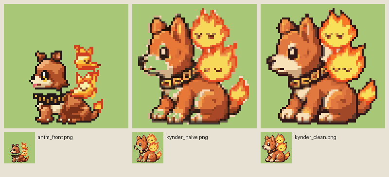
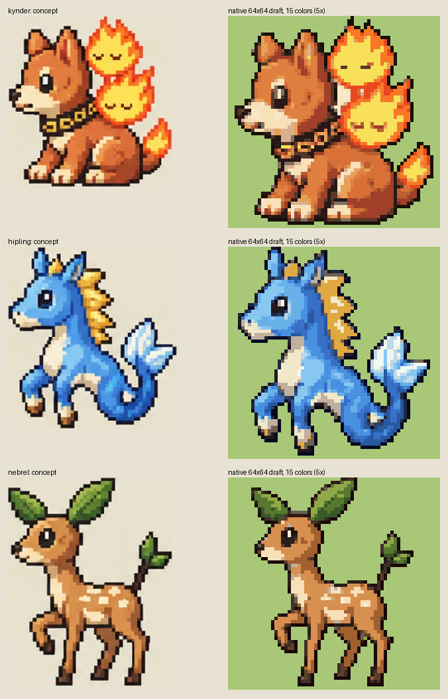

# Ichor style guide: sprites and maps

This guide sets the visual standard for every Pokémon, character, tile and map in Ichor, and the process that gets us there. Read it before any art or map work.

- `design/ART_PLAN.md` covers what gets drawn.
- `design/MAP_DESIGN.md` covers how maps play.
- This file covers **how everything looks** and **how it is made**.

The bar is the target sheets in `design/art/img/style/target_*.webp`: the starter lines and the first five trainer portraits, which the user approved on 2026-11-16. Every sprite should look as if it belongs on those sheets. Every map should look as polished as those sprites.



*Left: Kynder in the game before this guide. Middle: the old method, a plain resize and color reduction. Right: the method below. All three are real 64×64, 15-color sprites.*

---

## 1. Why the old sprites fall short

These are the problems we found by measuring the current sprites against the targets.

1. **Concepts drawn too big for the frame.** The target concepts are pixel art at about 4 screen pixels per game pixel. At that scale the basic forms come out around 62×65 game pixels. The evolutions come out 87–104 px across, against a 64×64 frame. Every resize to fit throws away 20–60% of the pixels, and eyes, spots and fin edges go first. *Detail is lost at the resize, not in the drawing.*
2. **Nearest-neighbor resizing of an illustration.** Image-model "pixel art" is not on a true grid: its pixels vary in size and have soft edges. Nearest-neighbor sampling lands on those edges, which produces broken outlines, noise and a halo in the background color.
3. **Keying the background by color distance.** The concepts sit on a cream backdrop. Removing it by "pixels close to the backdrop color" also removes cream muzzles, bellies and eye whites, punching holes in the face.
4. **Plain k-means palettes.** Fifteen colors chosen by clustering get spent on near-duplicate mid-tones. The two-pixel eye shine and the dark pupil get merged away, and the face goes dead.
5. **Sprites that don't fill the frame.** The old Kynder used about 40% of its 64×64 frame. Gen 3 fronts fill most of theirs.

The fix is the pipeline in §3. Its tool is `tools/ichor/art/concept_to_native.py`.



---

## 2. The shared look

These rules apply to everything: Pokémon, people, tiles, UI.

**Light and form**
- Light comes from the **top left**. Highlights go up and left; shadows go down and right. Cast shadows fall down and right by about one tile in maps, and sit at the feet in sprites.
- Shade with **clusters**, not single pixels. Every shading shape is at least 2 px wide. Don't pillow-shade, where an outline follows the edge all the way round. Shade to the form.
- **Hue-shift the ramps.** Shadows shift toward violet or blue and lose saturation. Highlights shift toward yellow. A ramp that is just a darker and lighter copy of one hue looks muddy.

**Outlines**
- Use a **selective outline**: the darkest ink (near `(32,24,24)`) on the shadow side, the dark of each material's own ramp on the lit side, and none inside lit areas. Interior lines are a step lighter than the silhouette line.
- **Objects get outlines, terrain doesn't.** Trees, rocks, signs and buildings take a 1 px outline on their silhouette. Grass, paths, sand and water read through value and texture alone.
- **Never anti-alias against transparency.** Any color between the sprite and a backdrop it can't know about becomes a halo on some other background.

**Color**
- Every RGB channel is a **multiple of 8**, so colors convert to GBA BGR555 exactly.
- Color 0 is transparent. Use flat magenta `(248,0,248)` so it can never be confused with a real color.
- Build from the master palette families in `design/phase1/PLAN.md` (Aegean blue, marble, olive, cypress, terracotta, sun-gold, limestone, black-figure ink). New families should be hue-shifted ramps of 3–5 steps.

**Dither**
- Dither only for textures such as stone, bark and fur grain, never for gradients. Ordered dither, two colors, no more than 1 px in 4.

---

## 3. Sprites

### 3.1 Formats and budgets

Every sprite type has a fixed size and color budget.

| Surface | File(s) | Size | Colors | Notes |
|---|---|---|---|---|
| Pokémon front | `graphics/pokemon/<sp>/anim_front.png` | 64×128: two 64×64 frames | 15 + transparent | Frame 2 is the idle/attack pose. It must keep the palette and stay on the same base line |
| Pokémon back | `back.png` | 64×64 | Same palette as the front | Seen from behind, low and to the left; can crop at the bottom edge |
| Shiny | `shiny.pal` | — | Same index order as `normal.pal` | Swap whole ramps, never single indices |
| Party icon | `icon.png` | 32×64: two 32×32 frames | One of the **shared icon palettes** (`iconPalIndex`) | Design within that shared palette. No private colors |
| Follower / overworld | `overworld.png` + `overworld_*.pal` | Keep the existing frame strip (e.g. 192×32) | 15 | Four directions, readable at walker scale |
| Footprint | `footprint.png` | 16×16 | 1-bit | |
| Trainer front | `graphics/trainers/front_pics/<name>.png` | 64×64 | 15 | Three-quarter view, feet near the bottom |
| Trainer back | `graphics/trainers/back_pics/<name>.png` | 64×256: four frames | 15 | Keep each frame's anchor and throw contact |
| Walker (NPC/player) | `graphics/object_events/pics/people/ichor/<name>.png` | 16×32 frames (e.g. 144×32 for nine) | Shared walker palette | Keep the frame count, order and feet position |

**How big the subject is in the frame** decides how much detail survives. Measure the subject's bounding box at 1× and aim for these sizes:

| Stage | Largest dimension | Examples |
|---|---|---|
| Basic, small | 40–50 px | Kynder, Nebrel, Hipling, early bugs and birds |
| Middle stage / mid-size | 50–58 px | Dikyon, Kladoe, Thalamare |
| Final stage / large | 58–64 px | Pylakyon, Daphnyad, Seismare |
| Legendary / colossal | 64 px, and may crop | Olympian-tier species |
| Trainer portrait | 56–62 px tall | All fronts |

Keep 1–2 px of clear space at the frame edges. Front sprites stand on a shared base line, 1–2 px above the bottom edge.

### 3.2 The concept: draw for the grid

A concept is the start of a sprite, not the sprite. It must be made **at native scale** so nothing needs shrinking.

- **Size.** Ask for the subject to fit a **64×64 grid at exactly 8 screen pixels per game pixel**, a 512×512 image. Basics should take up only part of that grid, following the size table in §3.1. If a concept comes out bigger than the frame at its own scale, **regenerate it**; don't shrink it. The converter refuses an oversized subject when you pass `--pitch`.
- **Background.** Ask for a flat, untextured background color that appears nowhere in the subject. Magenta or pure green both work. Never use cream, white or gray.
- **Palette.** Ask for at most 15 colors, with a dark outline and top-left light.
- **Pose.** Front sprites face **left** or three-quarter left, toward the player's side of the screen. Back sprites face away, toward the upper right. Trainers stand three-quarter on with one hand in action: holding a ball, a prop or a gesture.
- **Identity first.** Each species' description in `design/dex/species/` and its earlier concepts in `design/dex/concepts/` decide its silhouette, colors and signature feature. The concept must keep them.

**Prompt template.** Fill in the bracketed parts:

> Gen 3 Pokémon battle sprite, true pixel art on a 64×64 grid, each pixel exactly 8×8 screen pixels (512×512 image), max 15 colors, 1-pixel dark selective outline, light from top left, hue-shifted shading, cluster shading with no noise, no anti-aliasing, flat #F800F8 background. Facing left, three-quarter view. [Species: one-line identity from design/dex/species/<sp>.md, main colors, signature feature]. Subject about [N] pixels tall for a [basic / middle / final] stage.

### 3.3 The converter

```bash
python3 tools/ichor/art/concept_to_native.py concept.png draft.png --pitch 8      # true-grid concept
python3 tools/ichor/art/concept_to_native.py concept.png draft.png --fit 58       # legacy concept, smallest possible resize
```

The converter does five things:
1. It removes the background by **flood fill from the border**, so interior colors that match the backdrop stay in.
2. It samples the **median of each cell's center** at the concept's own pitch.
3. It quantizes to **15 GBA-exact colors**, reserving slots for the lightest and darkest few pixels so eye shines and pupils survive.
4. It strips blur halos and removes orphan pixels and specks.
5. It closes a **selective outline**: ink on the shadow side, the local ramp's dark on the lit side.

Use `--pitch` whenever the concept was made to the template in §3.2. Use `--fit` only for older concepts, and expect to hand-fix more.

### 3.4 The hand-fix pass (required)

The converter gets the silhouette, proportions and palette right. **People** make a sprite feel alive. Every draft gets this pass at 1× and 4× before review. As a coding agent, record it as a short, explicit list of pixel edits in the species' build script, so it can be replayed.

**Eyes**
- At least 2×2 dark pixels with a 1 px shine on the upper-left.
- Both eyes are visible on a three-quarter face.
- A single-pixel eye is never acceptable.

**Mouth and expression**
- A 1–2 px mouth line or an open-mouth shape.
- The expression matches the species' personality in its dex entry.

**Silhouette**
- Limbs have gaps between them, so no blob reads as one mass.
- The signature feature (flames, leaves, fins, horns) breaks the outline and is readable at 1×.

**Palette and color**
- Merge near-duplicate colors.
- Turn the freed slots into a clean 3–4 step ramp per material: fur, flame, leaf, metal.
- Check that the shiny palette swaps whole ramps.

**Cleanup**
- Remove noise inside flat areas: every cluster at least 2 px.
- Fix outline breaks. The silhouette is closed, with no doubled lines at the corners.

**Frame 2 and companion views**
- Draw frame 2 from frame 1 by moving parts (breath, flame flicker, raised head), not by redrawing.
- The back, icon and follower use the same ramps and the same signature feature.

### 3.5 Review gate

A sprite is ready to land only when all of these hold:

1. **Contact sheet.** For every species in the batch, the current sprite and the new one sit side by side at 1× and 3× on the grass battle backdrop. `design/art/img/style/starters_current_vs_draft.png` shows the layout.
2. **In-game screenshot.** The front and back appear in a real battle, and the icon in the party menu.
3. **Checks pass.** `python3 tools/ichor/sprite_audit.py check --pokemon <names>` passes, along with the build and `tools/ichor/smoke_test.sh`.
4. **Director's look-pass.** Checklist:
   - Does it match the target sheets?
   - Does the face read at 1×?
   - Is the signature feature clear?
   - Does it fill its size class?
   - Is the evolution line consistent?
5. **Labelled honestly.** Record whether the sprite is a redraw, a polish or retained, as `ART_PLAN.md`'s concept fidelity gate requires. A passing audit is not artistic approval.

Batches go **by evolution line**, never by single sprites: all stages, then backs, icons, followers and shinies, landed together.

---

## 4. Maps

The maps must look as finished as the sprites. `MAP_DESIGN.md` decides where things go for play; this section decides how they look.

### 4.1 What's wrong today

We rendered the current maps with `tools/ichor/render_map.py` and compared them. These are the issues, worst first.

1. **Placeholder maps on main.** The Thyrsa and Arkadia that landed on main are stand-ins: one ring of trees, open grass and rectangular paths. The `world-act2` branch has the real ones: a walled city with an acropolis temple, an agora, market stalls and farm plots; a cypress forest with a temple on a raised plinth and a waterfall pool. **Restore the branch versions** before polishing anything. See `art/img/style/thyrsa_main_vs_branch.png` and `arkadia_main_vs_branch.png`.
2. **Forests in a grid.** Trees sit in rows and columns, one by one. Gen 3 forests are **interlocking canopy masses**: overlapping tree blocks forming a solid wall with a ragged, staggered edge and an occasional lone tree in front.
3. **Flat ground.** Most grass is one metatile repeated. The eye needs a base, a variant and an accent.
4. **Flower confetti.** Red flowers are spread evenly across Akti, Thyrsa and Route 1. Flowers belong in **beds**: by doors, along walls, around shrines and in meadows, in clumps of 3–7.
5. **Rectangular paths.** Paths are straight bars with square corners. Real paths have **desire lines**: they curve, widen at junctions and doors, narrow between obstacles, and wear into the grass at the edges.
6. **No height.** Almost everything is flat. Gen 3 maps use cliffs, ledges, terraces, stairs and raised plinths to make depth and frame each screen.

### 4.2 Composition rules

The play screen is **15×10 metatiles**. Judge every rule at that size.

**One landmark per screen**
- Every 15×10 window holds one thing you'd remember: a temple, a big tree, a statue, a ruin, a waterfall or a distinctive house.
- It sits off-center, with open ground in front of it.

**Masses and space**
- Trees, cliffs and buildings form **large masses** with open clearings between them.
- About 60% of a screen should be one simple ground surface and 40% detail. Never spread detail evenly.

**Edges**
- Every boundary is staggered: tree walls, cliffs and coastlines.
- No straight run longer than 6 metatiles without a step, a notch or a lone object in front.

**Ground variety**
- The base ground metatile makes up 70–85% of an open area.
- Two or three variants (tufts, pebbles, worn patches) make up 10–25%, in clusters.
- Accents (flowers, a stray stone) make up 2–5%, in clumps.
- One flat metatile covering more than 90% of an open area is a fail.

**Paths**
- Paths join doors, gates and route exits along the line a person would walk.
- At least 2 metatiles wide on routes and 3+ on town main streets.
- Use worn-edge transition tiles where path meets grass, never a hard square edge.

**Height**
- Every town and route has at least one level change: a ledge, terrace, stair, cliff or plinth.
- Sacred buildings sit **raised**, with steps leading up to them.

**Story in props**
- Props come in believable groups:
  - amphorae beside a storeroom
  - nets and boats on a beach
  - a well with a bucket
  - a shrine with offerings
  - fences around a field that has a farmer
- No orphaned single props in open grass.

**Contrast**
- The player must always tell walkable from blocked at a glance.
- Walkable ground is lighter and lower in contrast. Blockers are darker, outlined and higher in contrast.

### 4.3 Tile art rules

**Size, palettes and limits**
- Tiles are 8×8 and metatiles 16×16, with two layers.
- A primary tileset has 6 palettes and a secondary has 7. Plan the palette families first (`CLAUDE.md`). Every 8×8 tile uses one palette of 16 colors.
- A secondary tileset may use at most 504 tiles. Keep 496–511 free on maps with wide doors.

**Ground textures**
- Ground tiles **tile seamlessly in all four directions**.
- Spread texture marks evenly but irregularly, so no single tile's pattern repeats in a visible grid when it is laid out 4×4.
- Build grass from 3 values. Shading clusters are no smaller than 2 px; avoid single-pixel salt-and-pepper.

**Shadows and edges**
- Buildings and big trees cast a soft, 1–2-value-darker shadow down and right onto the ground. Use a shadow metatile; don't bake one ground color into the object.
- Edge and transition sets are complete: straight edges, outer corners and inner corners for every pair of ground types that meet. If a corner is missing, get it drawn rather than covering it with a prop (`MAP_DESIGN.md`).
- Trees have **at least two silhouettes per species** (olive, cypress), plus interlocking **canopy wall** pieces: top edge, bottom edge, left/right edge and fill.

**Water**
- Water has a lit edge on the far shore, foam where it meets sand, and a 2–4 frame animation.

### 4.4 Process for a map upgrade

1. **Render the map as it is** with `tools/ichor/render_map.py LAYOUT_<NAME> -o build/render/<name>_before.png`.
2. **Critique every 15×10 screen** against §4.2 and write down the findings.
3. **Fix the tiles first.** Missing corners, canopy-wall pieces, ground variants and transitions get drawn into the tileset (§4.3) before any layout change.
4. **Re-lay the map.** Restructure the masses, then paths and height, then landmarks, then props.
5. **Re-render** and compare before and after. Do at least **three critique passes**.
6. **Check it.** `python3 tools/ichor/map_audit.py` and the map's test pass, and you walk the map in the game.

For a new biome, start with a **beauty shot**: a 240×160 mock-up of one typical screen at native resolution, drawn to these rules and approved before the tileset is cut. It does for a tileset what the concept does for a sprite.

---

## 5. Order of work

1. **System in place:** this guide and the converter. Done 2026-11-16.
2. **Restore the real Act II maps** (Thyrsa, Arkadia) from `world-act2` over the placeholders.
3. **Pokémon, one evolution line at a time**:
   - starters first, from the approved targets
   - then the dex in the order the story reaches each species
   - each line through §3.2–§3.5.
4. **Characters** through the same gate. Samuel's image-model portraits already match the trainer targets closely; the hand-fix pass on faces is what remains.
5. **Maps, town by town** in story order through §4.4: Kalliste first, since it sets the look.
