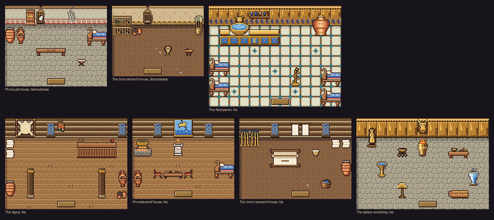

# The Black Sea's rooms: Salmydessos and Aia (batch 1)

Seven interiors for the Oikoumene's Black Sea towns (`design/OIKOUMENE.md` §4.3, `design/oikoumene/BUILD.md` §5), laid out from `gTileset_Chalkeon` in `tools/ichor/maps/pontos_rooms.py` and built by `tools/ichor/art/chalkeon_build.py`. Who lives in each room and what happens there is below; the render-and-critique passes follow; the generated tables (walk maps, spots, metatiles) are at the end.



| Room | Map | Size | Floor and wall | Exit (warp 0) | Render |
|---|---|---|---|---|---|
| Phineus's house | `MAP_SALMYDESSOS_PHINEUSS_HOUSE` | 10x8 | stone flags; whitewash with a faded meander | mat (4..5,7) → `MAP_SALMYDESSOS` warp 0 | `img/salmydessos_phineus.png` |
| The bird-catcher's | `MAP_SALMYDESSOS_BIRD_CATCHERS_HOUSE` | 9x7 | beaten earth; wattle and daub | mat (3..4,6) → `MAP_SALMYDESSOS` warp 1 | `img/salmydessos_birdcatcher.png` |
| The Asclepeion | `MAP_AIA_ASCLEPEION` | 13x10 | glazed tiles; bronze over an enamel frieze | mat (6..7,9) → `MAP_AIA` warp 0 | `img/aia_asclepeion.png` |
| The Agora | `MAP_AIA_AGORA` | 12x9 | planks; Colchian logs | mat (5..6,8) → `MAP_AIA` warp 1 | `img/aia_agora.png` |
| Phrixos's sons' house | `MAP_AIA_PHRIXOS_SONS_HOUSE` | 10x8 | planks; Colchian logs | mat (4..5,7) → `MAP_AIA` warp 2 | `img/aia_phrixos.png` |
| The linen-weaver's | `MAP_AIA_LINEN_WEAVERS_HOUSE` | 11x8 | beaten earth; Colchian logs | mat (5..6,7) → `MAP_AIA` warp 3 | `img/aia_linen.png` |
| The palace workshop | `MAP_AIA_PALACE_WORKSHOP` | 13x9 | stone flags; riveted bronze | mat (6..7,8) → `MAP_AIA` warp 4 | `img/aia_workshop.png` |

## The set: chalkeon

`chalkeon` (a bronze-smith's shop, and the bronze it works) is the Black Sea's interior secondary, on the `oikos` primary. Its look comes from three kinds of wall: Aietes's riveted **bronze** (plain in the workshop, over a blue-and-red **enamel** frieze in the Asclepeion); the Colchian **log** house of whole trees laid flat, the gaps stopped with clay (Vitruvius 2.1.4), for Aia's homes and its Agora; and in Salmydessos, on the Thracian shore, a king's **whitewash** gone grey and a bird-catcher's **wattle and daub**. Four floors: Colchian planks, glazed tiles set in bronze, stone flags, beaten earth.

Household furniture shared with a Greek house (couches, stools, jars, the hearth, the door mat) is oikia's, pixel for pixel, so oikia's wood, clay, nature and bronze palettes are kept whole; chalkeon's own wall, floor and cloth palettes replace the other three. Every chalkeon colour is its own: none repeats an aethos colour, and none of the three new palettes shares a colour with another palette except the outline ink. The builder writes the seven palettes into Porytiles' config as packing hints (`porytiles/tilesets/gTileset_Chalkeon/config.yaml`), which keeps the compile immediate.

**For batch 2's palace hall** (`PERIODOS.md` §4.3). The set is drawn to be extended rather than replaced:
- `wall_bronze` is the palace's wall as it stands: 16-px riveted plates under a bronze cornice, cheap in tiles.
- `bull_head` is a bronze bull's head mounted on a round boss, embers in its nostrils; a fire line down a corridor starts at its muzzle. `bull_fountain` is the same head, smaller, pouring into a bronze basin: recolour the water for the four fountains (milk from the bronze palette's marble, wine from its painted red, oil from its bronze lights).
- `golden_maid` and `tripod_wheels` are Hephaestus's automata, at home in the halls too.
- The set is 409 tiles of the 504 a secondary may use (door animations own 504-511), which leaves the hall about 95 (see the generated stats below).

## The rooms and their people

### Phineus's house, Salmydessos

**The room.** The blind seer's spare room: a long table, bare, its top scored end to end by forty years of Harpies' claws; there are no chairs, because he ate standing so he could run. The shutters stay barred (he has no use for the light); the Harpies' talons have raked the plaster beside them, and one of their dark feathers is still caught in the beam. His couch is in the far corner; his jars along the west wall are full for the first time in his life; there's one new stool he keeps forgetting to sit on. The dove's cage hangs by the window.

| Who | Where | What happens | Flags |
|---|---|---|---|
| Phineus (PHINEUS) | (6,4), at the end of his table | The bible's lines ("The gods punished me for telling too much…", "I can't tell you if it'll work. That's new.", "I can tell you what worked once. Take the dove."), then the dove, with the key-item fanfare. After: the stool; after the Fleece Emblem, the princess. | sets `FLAG_ICHOR_GOT_PHINEUS_DOVE`. The dove is flavour (`ICHOR_STUB_LEGEND`): the Clashing Rocks' side channel is stretch, and its passage will check this flag. Once it's given, `ON_LOAD` swaps the cage for an empty one (`Salmydessos_PhineussHouse_EventScript_EmptyCage`, written by the builder). |

### The bird-catcher's house, Salmydessos

**The room.** Ixos traps songbirds on the cliffs: a decoy owl draws them to mob it, and they land on his lime-sticks. Wattle-and-daub walls, a beaten-earth floor strewn with husks; his stock in wicker cages stacked on a pole rack by the west wall, a spare cage on the wall, the lime-sticks standing in their pot by the east wall, the decoy on its post in the middle of the floor, a table of seed. His Unfezant has the run of the place.

| Who | Where | What happens | Flags |
|---|---|---|---|
| Ixos (IXOS) | (4,3) | The owl, the sticks, and the hawks that rob them. In-game trade `INGAME_TRADE_ICHOR_PHASIANOS`: your Pidgeot for PHASIANOS, his Unfezant from a Colchian ship (male, holding a Sharp Beak). | sets `FLAG_ICHOR_TRADED_UNFEZANT` |
| his Unfezant | (6,4) | Puffs its chest at the wooden owl. Hidden once traded. | hides on `FLAG_ICHOR_TRADED_UNFEZANT` |
| your Pidgeot | (6,4), after the trade | Watches the door. | hides on `FLAG_TEMP_1`, which `ON_TRANSITION` sets until the trade |

### The Asclepeion, Aia

**The room.** Bronze and enamel, the way Aietes builds. The healer's counter runs along the west half of the back wall, bronze with blue enamel panels, Asclepius's rod on the panel under her; a bronze bull's head pours the spring into its basin at her side, where the heal animation sets the party's balls; Medea's country's herbs crowd the shelf behind her. The Pithos is the great bronze-banded jar in the east corner. Couches line both side walls, a ward for the sick, and Asclepius's serpent coils on its post in the middle of the floor. It shares the slice's counter and Pithos as functions, not as a plan: Akti's counter is in the middle of a white marble hall with a mosaic; Aia's is off to one side of a glazed bronze one.

| Who | Where | What happens |
|---|---|---|
| the healer | (4,2), talked to across the counter from (4,4) | `Ichor_EventScript_AsclepeionHealer`, the slice's |
| a Colchian woman | (10,7), by the couches | Her husband ate the hill honey. |
| an old man | (9,3), by the Pithos | The root that grew where Prometheus bled: ichor (*Argonautica* 3.845–857). |
| the Pithos | (10..11,2) | `Ichor_EventScript_Pithos`, the slice's |

### The Agora, Aia

**The room.** A Colchian timber market hall, two posts down its length. Korax's stall runs along the east half of the back wall, a balance at one end and a jug of honey at the other: the Pontic honey that made Xenophon's soldiers drunk (*Anabasis* 4.8.20). On the west wall, a fleece stretched on a frame, Phasis gold dust caught in its wool (Strabo 11.2.19); pheasants hung by the window; linen, pitch and grain jars by the walls.

| Who | Where | What happens |
|---|---|---|
| Korax (KORAX) | (9,2), across the counter from (9,4) | The stall: Ultra and Great Balls, Full Restore, Max and Hyper Potions, Full Heal, Revive, Max Repel, and Honey. "Don't eat the honey." |
| a Colchian man | (2,3), at the fleece | How the hill people catch gold in fleeces, and the Greek who made a song of it. |
| a Greek sailor | (6,5) | Cheap honey. Why won't the man selling it let him eat it? |

### Phrixos's sons' house, Aia

**The room.** Exiles from Greece in a Colchian log house. Their father kept a Greek hearth and a Greek table; the painted panel of the golden ram that carried him here, Helle falling below it, hangs over the horned altar of Zeus of Escape, to whom he sacrificed the ram. Their father's couch is by the east wall; the sons sleep in the loft.

| Who | Where | What happens | Flags |
|---|---|---|---|
| Argos (ARGOS), the eldest | (5,3), by the altar | The Fleece's story: the ram, Helle, the strait, the altar, the grove. Then a stone from under the altar fire, "warm for forty years": a **Heat Rock**. After: the voyage home that ended on the Isle of Ares. | sets `FLAG_ICHOR_GOT_HEAT_ROCK` |
| Phrontis (PHRONTIS) | (2,5), on his chair | Born here; Greece is "mostly rocks". |
| Melas (MELAS) | (2,3), at the hearth | Their mother Chalkiope is at the palace; her sister is "the clever one" (Medea). |

### The linen-weaver's house, Aia

**The room.** Byssa weaves linen the way the Egyptians do (the Colchians and the Egyptians alone work linen alike: Herodotus 2.105), on a ground loom pegged into the earth floor, which takes the middle of the room. Flax leans on the west wall, still in blue flower; linen bleaches on a line across the back between two windows; bolts of it wait by the east wall, and flax rets in a tub by the door. Her Persian sleeps wherever the light is.

| Who | Where | What happens | Flags |
|---|---|---|---|
| Byssa (BYSSA) | (6,4), at the end of her loom | Linen, Egypt, and the lazy cat. In-game trade `INGAME_TRADE_ICHOR_TIGRIS`: your Liepard for TIGRIS, her Persian off a boat from past the mountains (holding a Quick Claw). | sets `FLAG_ICHOR_TRADED_PERSIAN` |
| her Persian | (2,6) | Asleep on the linen. Hidden once traded. | hides on `FLAG_ICHOR_TRADED_PERSIAN` |
| your Liepard | (2,6), after the trade | Watches the flax pile. | hides on `FLAG_TEMP_1`, which `ON_TRANSITION` sets until the trade |

### The palace workshop, Aia

**The room.** Hephaestus's self-moving works, which Aietes keeps a tinker to oil. A bronze bull's head in the back wall breathes on the fire-jar below it; a golden maid (*Iliad* 18.417) stands against the west wall and turns her head; a self-moving tripod on gold wheels (*Iliad* 18.373) rolls an inch now and then; Tekton's bench has another with one wheel on. Round the room stand the five works a Rotom can get into.

| Who | Where | What happens |
|---|---|---|
| Tekton (TEKTON) | (10,4), at his bench | The works and the little lightning that lives in them; with a Rotom in the party, how to use them. |
| a Rotom | (7,5), wandering | It zips through the wash-basin. |

**Rotom's forms.** The expansion changes Rotom's form with the Rotom Catalog: a party-menu item whose form-change table (`src/data/pokemon/form_change_tables.h`) is `FORM_CHANGE_ITEM_USE_MULTICHOICE` on `ITEM_ROTOM_CATALOG`, index 0 to 5 (bulb, oven, washing machine, fridge, fan, mower), and whose party-menu task (`Task_TryItemUseFormChange`) plays the mosaic, the cry, "transformed!", deletes the other forms' moves and teaches the new one (`sRotomFormChangeMoves`, with the move-replacement prompt when the moveset is full). The workshop uses exactly that, through one small special in `src/party_menu.c`, `Ichor_ChooseRotomForAppliance`: the script puts the work's Catalog index in `VAR_0x8005`, the party menu opens, and the Rotom picked goes through the Catalog's own change.

| Work | Index | Form | Move |
|---|---|---|---|
| the fire-jar | 1 | Heat | Overheat |
| the wash-basin | 2 | Wash | Hydro Pump |
| the cold krater | 3 | Frost | Blizzard |
| the fan | 4 | Fan | Air Slash |
| the reaping-sledge | 5 | Mow | Leaf Storm |

A Rotom already in a work's form comes back out of it (index 0: plain Rotom, Thunder Shock), as in the games. Anything else picked "won't have any effect". No item is needed and no flag is spent. Rotom itself is batch 2's (`COVERAGE.md` E8: the Chalybes' forges, Augur's Eye).

## Stand-ins and stubs

**Stand-ins** (`ICHOR_STUB_SPRITE`): the sprites agent's Black Sea people aren't in yet, so the rooms use the slice's townsfolk.

| Person | Room | Stand-in | Intended |
|---|---|---|---|
| Phineus | Phineus's house | `OBJ_EVENT_GFX_ICHOR_ELDER_M` | `OBJ_EVENT_GFX_ICHOR_PHINEUS` |
| Ixos, the bird-catcher | the bird-catcher's | `OBJ_EVENT_GFX_ICHOR_MAN` | `OBJ_EVENT_GFX_ICHOR_COLCHIAN_M` (the land's townsman) |
| the Colchian woman | the Asclepeion | `OBJ_EVENT_GFX_ICHOR_WOMAN` | `OBJ_EVENT_GFX_ICHOR_COLCHIAN_F` |
| the old man | the Asclepeion | `OBJ_EVENT_GFX_ICHOR_ELDER_M` | `OBJ_EVENT_GFX_ICHOR_COLCHIAN_M` |
| Korax, the stallkeeper | the Agora | `OBJ_EVENT_GFX_ICHOR_MERCHANT` | `OBJ_EVENT_GFX_ICHOR_COLCHIAN_M` |
| the Colchian man | the Agora | `OBJ_EVENT_GFX_ICHOR_MAN` | `OBJ_EVENT_GFX_ICHOR_COLCHIAN_M` |
| Argos | Phrixos's sons' | `OBJ_EVENT_GFX_ICHOR_MAN` | `OBJ_EVENT_GFX_ICHOR_COLCHIAN_M` |
| Phrontis, Melas | Phrixos's sons' | `OBJ_EVENT_GFX_ICHOR_YOUTH_M` | `OBJ_EVENT_GFX_ICHOR_COLCHIAN_M` |
| Byssa, the linen-weaver | the linen-weaver's | `OBJ_EVENT_GFX_ICHOR_WOMAN` | `OBJ_EVENT_GFX_ICHOR_COLCHIAN_F` |
| Tekton, the tinker | the workshop | `OBJ_EVENT_GFX_ICHOR_MAN` | `OBJ_EVENT_GFX_ICHOR_COLCHIAN_M` |

The healer, the Greek sailor and the Pokémon (Unfezant, Pidgeot, Persian, Liepard, Rotom) are their real sprites.

**Stubs.**
- `ICHOR_STUB_LEGEND`: the dove is a flag, not an item, until the Clashing Rocks' side channel is built.
- The Asclepeion sets no respawn: there is no `HEAL_LOCATION_AIA` yet (the chart agent's). Its map script says where `setrespawn` goes.
- Music: the rooms keep the registration's stand-in songs (`MUS_ICHOR_AKTI`, `MUS_ICHOR_EMPORION`, the Asclepeion's and the Agora's), for the music agent's *The Black Sea*.

## Render-and-critique passes

Each pass: render, look, write down what's wrong, fix it. Pass 1 looked at the composed source (2x previews), pass 2 at the compiled tileset's 2x renders, pass 3 at in-game screenshots from the check.

**All rooms, pass 1.** The first floors read as brick walls: the flags were squared courses with dark joints, and the planks' butt joints every block made a bond. The enamel checker of 8-px teal and white squares shouted over everything. The bronze plates, 8 px wide, read as a palisade. *Fixed:* the flags became oikia-style irregular stones (a seamless Voronoi, soft joints, darker only where three meet); the planks became long boards with soft seams and only the alternate block showing a joint and a knot; the glazed floor became one white tile a block with a sea-green diamond inset where four meet; the plates became a block wide, with a sheen and a rivet at each corner.

**All rooms, the first compile.** Porytiles stopped at 512 unique tiles two thirds of the way through: the set needed 526 against a ceiling of 504, and batch 2 needs room. *Fixed* (to 409): the plank, earth, log and plaster textures repeat every 8 px; the glazed tile is symmetric both ways, so a block is one 8x8 tile and its flips; the Pithos, the fleece and the loom are drawn symmetric (the Pithos lit from the front), and the bare table is two mirrored ends round a repeating middle; the cage stack became two long cages whose bars repeat every 4 px; the linen line hangs its two cloths at the same place in each block; the flag floor lost its scorched alternate. Five oikia pieces that weren't carrying their rooms went: the soot over the sons' hearth, their oars and model ship (a second window instead), the honey shelf no one could reach behind the stall, and the Asclepeion's lampstand.

**Phineus's house**
1. The claw marks were three faint grey scratches and the feather didn't read. The lower half of the room was empty, but that's the brief: a spare room, a bare table. *Fixed:* four deep talon gouges with the torn plaster lit along their lips, and a ragged dark feather in the beam.
2. Compiled: the room reads as bare and old, the barred shutters, the empty cage-to-be and the claw marks in one line along the back wall. The plaster's lit flecks, repeating every 8 px, made a polka-dot pattern. *Fixed:* only the grey blooms stay.

**The bird-catcher's**
1. The wattle's worn patches were hard blocks that read as windows, and its daub was speckled like wallpaper; the decoy owl read as a face on a stick; the lime-sticks read as a pot plant. *Fixed:* plain daub with a few cracks and one ragged hole showing the withies, its broken edge lit; the owl redrawn round, with big yellow eyes and a beak; the sticks redrawn as five straight reeds in a narrow pot, their top thirds coated in glossy green lime, a feather stuck to one.
2. Compiled: the hole in the daub, now repeating every block, read as a row of brackets along the wall; the green-tipped sticks in a red pot still read as a pot plant. *Fixed:* the daub is whole, worn off only along its ragged foot where the weave shows; the sticks became four straight reeds in a tall wicker-brown jar, their tops in a thick pale coat of lime that glistens, a finch's feather stuck fast.

**The Asclepeion**
1. The bull's head over the basin was tiny and read as a goat. *Fixed:* a wider head with horns sweeping out and up, a brow, eyes and glowing nostrils, the water pouring from its mouth.
2. Compiled: the glazed floor reads as tile set in bronze and the enamel frieze as Colchian, but the west half below the counter was a bare field of tiles. *Fixed:* couches along both side walls, so it's a ward, with the serpent on its post in the middle and the door between.

**The Agora**
1. The pheasants read as a puppet in a red shirt; the fleece read as a round cream disc; the two posts stood at random. *Fixed:* the pheasants redrawn hanging head down from the peg, feet at the cord, copper bodies with a white neck ring and green heads, tails up beside the legs; the fleece redrawn as a hide, its four leg flaps and neck lashed to the frame's corners, curls in the wool and gold dust thickest low down; the posts set symmetrically either side of the door's axis.
2. Compiled: the hall reads (logs, the fleece, the hung birds, the stall with its balance and honey jug, the two posts). The jars on the east wall were two of the same kind. *Fixed:* the lower one is a stack of pots.

**Phrixos's sons' house**
1. The panel read at once (a golden ram over the sea), the hearth and the couch and the table were oikia's and right for Greek exiles. Only the floor (the brick-bond planks above) was wrong.
2. Compiled, after the tile cuts: without its soot and the shelf, the hearth stands clean against the logs, and a second window balances the first across the panel. The panel and the altar under it carry the room.

**The linen-weaver's**
1. The flax read as sheaves in flower; the loom read as a framed cloth on the floor, which is what a ground loom looks like from above. Nothing to fix but the floor.
2. Compiled: the loom, drawn symmetric, still reads as warp, cloth, heddle and shuttle; the two cloths on the line read as linen between the windows. Nothing to fix.

**The palace workshop**
1. The bull's head read as a cat; the cold krater read as a white vase; the fan read as a palm tree. *Fixed:* the bull's head redrawn front on, on a round boss, with wide horns, ears, a long face and a broad muzzle with embers in the nostrils and a ring; the krater redrawn in blue-white rime over bronze with icicles off its lip and cold breath rising; the fan redrawn as a half-disc of alternating bronze blades with a gilt rim, on a pole and a three-footed stand.
2. Compiled: the bull's head over the fire-jar reads as one machine, the five works stand apart enough to be told apart from the door, and the plates read as bronze now they're a block wide. Nothing to fix.

## Stopped at (2026-11-14: the Oikoumene paused)

**Done.**
- `gTileset_Chalkeon`: 256 metatiles, 409 tiles of 504, palettes 6-12, identical on oikos, aethos and building; registered; builder, art and Porytiles hints committed.
- All seven rooms: layouts, map.json events, scripts; door mats to `MAP_SALMYDESSOS` 0-1 and `MAP_AIA` 0-4.
- Flags `FLAG_ICHOR_GOT_PHINEUS_DOVE`, `_TRADED_UNFEZANT`, `_GOT_HEAT_ROCK`, `_TRADED_PERSIAN` (bank 0x434-0x437); trades `INGAME_TRADE_ICHOR_PHASIANOS` and `_TIGRIS`; the special `Ichor_ChooseRotomForAppliance`.
- Every line measured (0 over 216 px); two render-and-critique passes per room; the contact sheet `img/pontos_rooms.png`.
- `make` green at this commit; the smoke test passed on the build before it.

**Partial.**
- `tools/ichor/tests/pontos_rooms.sh`: stopped mid-run. Passed so far: Phineus (dove once, empty cage, mat to warp 0), the bird-catcher (trade, PHASIANOS, mat), the Asclepeion (heal, Pithos menu, mat), the Agora (stall, mat), Phrixos's sons (Heat Rock once, mat). Not yet run: the linen-weaver's trade and the workshop's five forms.
- The third, in-game critique pass: screenshots exist for the first five rooms (`build/test_pontos_rooms/shots/`); not written up.
- `map_audit.py`: the only FAILs are the doors' warp ids, because this branch's Salmydessos and Aia have no warps yet (pontos-towns' branch numbers them per BUILD.md §5).

**Not started.** ROM-before measurement; the final report to the lead.

## Generated tables

The builder rewrites everything below each marker.

<!-- chalkeon_build: begin generated -->

### Phineus's house, Salmydessos

- Map: `MAP_SALMYDESSOS_PHINEUSS_HOUSE`. Layout: `data/layouts/Salmydessos_PhineussHouse/map.bin`, **10x8** blocks, `gTileset_Oikos` + `gTileset_Chalkeon`.
- Floor: flags. Wall: plaster. Render: `design/oikoumene/img/salmydessos_phineus.png` (2x).
- Variant `dove_given`: `Salmydessos_PhineussHouse_EventScript_EmptyCage` in the map's scripts.pory swaps its cells.

Walk map: `#` blocked, `.` open. Digits and letters mark the spots in the table; a bg event is marked on its furniture tile.

```
    0123456789
  0 ##########
  1 ##43##5###
  2 ##......##
  3 #7......##
  4 ...#6#2...
  5 .......8..
  6 ..........
  7 ....11....
```

| # | Kind | Tile | Read from | What |
|---|---|---|---|---|
| 1 | warp | (4,7), (5,7) |  | door to Salmydessos (south-arrow mat) |
| 2 | npc | (6,4) | faces west | Phineus, at the head of his bare table |
| 3 | bg | (3,1) | (3,2) facing north | the dove's cage, hung by the window |
| 4 | bg | (2,1) | (2,2) facing north | the shutters, barred |
| 5 | bg | (6,1) | (6,2) facing north | the claw marks and the feather |
| 6 | bg | (4,4) | (4,5) facing north | the bare table |
| 7 | bg | (1,3) | (1,4) facing north | the full jars |
| 8 | bg | (7,5) | (7,6) facing north | the new stool |

### The bird-catcher's house, Salmydessos

- Map: `MAP_SALMYDESSOS_BIRD_CATCHERS_HOUSE`. Layout: `data/layouts/Salmydessos_BirdCatchersHouse/map.bin`, **9x7** blocks, `gTileset_Oikos` + `gTileset_Chalkeon`.
- Floor: earth. Wall: wattle. Render: `design/oikoumene/img/salmydessos_birdcatcher.png` (2x).

Walk map: `#` blocked, `.` open. Digits and letters mark the spots in the table; a bg event is marked on its furniture tile.

```
    012345678
  0 #########
  1 #########
  2 #4#.....5
  3 ....2....
  4 .....63#.
  5 .........
  6 ...11....
```

| # | Kind | Tile | Read from | What |
|---|---|---|---|---|
| 1 | warp | (3,6), (4,6) |  | door to Salmydessos (south-arrow mat) |
| 2 | npc | (4,3) | faces south | Ixos, the bird-catcher |
| 3 | npc | (6,4) | faces west | his Unfezant (the player's Pidgeot after the trade), by the decoy |
| 4 | bg | (1,2) | (1,3) facing north | the cages |
| 5 | bg | (8,2) | (8,3) facing north | the lime-sticks |
| 6 | bg | (5,4) | (5,5) facing north | the decoy owl |

### The Asclepeion, Aia

- Map: `MAP_AIA_ASCLEPEION`. Layout: `data/layouts/Aia_Asclepeion/map.bin`, **13x10** blocks, `gTileset_Oikos` + `gTileset_Chalkeon`.
- Floor: enamel. Wall: bronze_enamel. Render: `design/oikoumene/img/aia_asclepeion.png` (2x).

Walk map: `#` blocked, `.` open. Digits and letters mark the spots in the table; a bg event is marked on its furniture tile.

```
    0123456789012
  0 #############
  1 #############
  2 .###2##...56.
  3 .######..4...
  4 .............
  5 ##...........
  6 ##......#..##
  7 ##......7.3##
  8 ##.........##
  9 ......11...##
```

| # | Kind | Tile | Read from | What |
|---|---|---|---|---|
| 1 | warp | (6,9), (7,9) |  | door to Aia (south-arrow mat) |
| 2 | counter | (4,2) | (4,4) facing north | the healer, behind the counter |
| 3 | npc | (10,7) | faces east | a Colchian woman, sitting up with the sick by the couches |
| 4 | npc | (9,3) | faces east | an old man by the Pithos |
| 5 | bg | (10,2) | (10,3) facing north | the Pithos (left) |
| 6 | bg | (11,2) | (11,3) facing north | the Pithos (right) |
| 7 | bg | (8,7) | (8,8) facing north | the bronze serpent |

### The Agora, Aia

- Map: `MAP_AIA_AGORA`. Layout: `data/layouts/Aia_Agora/map.bin`, **12x9** blocks, `gTileset_Oikos` + `gTileset_Chalkeon`.
- Floor: planks. Wall: logs. Render: `design/oikoumene/img/aia_agora.png` (2x).

Walk map: `#` blocked, `.` open. Digits and letters mark the spots in the table; a bg event is marked on its furniture tile.

```
    012345678901
  0 ############
  1 #5###6######
  2 #......##2#.
  3 7.3....####.
  4 ............
  5 ..#...4..#.#
  6 #.#......#.#
  7 #.#......#.#
  8 .....11.....
```

| # | Kind | Tile | Read from | What |
|---|---|---|---|---|
| 1 | warp | (5,8), (6,8) |  | door to Aia (south-arrow mat) |
| 2 | counter | (9,2) | (9,4) facing north | the stallkeeper, behind the counter |
| 3 | npc | (2,3) | faces north | a Colchian man, looking at the fleece |
| 4 | npc | (6,5) | faces east | a Greek sailor, haggling over honey |
| 5 | bg | (1,1) | (1,2) facing north | the fleece on its frame |
| 6 | bg | (5,1) | (5,2) facing north | the pheasants |
| 7 | bg | (0,3) | (1,3) facing west | the linen |

### Phrixos's sons' house, Aia

- Map: `MAP_AIA_PHRIXOS_SONS_HOUSE`. Layout: `data/layouts/Aia_PhrixosSonsHouse/map.bin`, **10x8** blocks, `gTileset_Oikos` + `gTileset_Chalkeon`.
- Floor: planks. Wall: logs. Render: `design/oikoumene/img/aia_phrixos.png` (2x).

Walk map: `#` blocked, `.` open. Digits and letters mark the spots in the table; a bg event is marked on its furniture tile.

```
    0123456789
  0 ##########
  1 #####5####
  2 ##..#.....
  3 #74.62....
  4 ........##
  5 #.3###..##
  6 #.........
  7 ....11....
```

| # | Kind | Tile | Read from | What |
|---|---|---|---|---|
| 1 | warp | (4,7), (5,7) |  | door to Aia (south-arrow mat) |
| 2 | npc | (5,3) | faces south | Argos, the eldest, by his father's altar |
| 3 | perch | (2,5) | (2,6) facing north | Phrontis, on his chair at the table |
| 4 | npc | (2,3) | faces west | Melas, minding the hearth |
| 5 | bg | (5,1) | (5,2) facing north | the ram panel |
| 6 | bg | (4,3) | (4,4) facing north | the altar of Zeus of Escape |
| 7 | bg | (1,3) | (1,4) facing north | the hearth |

### The linen-weaver's house, Aia

- Map: `MAP_AIA_LINEN_WEAVERS_HOUSE`. Layout: `data/layouts/Aia_LinenWeaversHouse/map.bin`, **11x8** blocks, `gTileset_Oikos` + `gTileset_Chalkeon`.
- Floor: earth. Wall: logs. Render: `design/oikoumene/img/aia_linen.png` (2x).

Walk map: `#` blocked, `.` open. Digits and letters mark the spots in the table; a bg event is marked on its furniture tile.

```
    01234567890
  0 ###########
  1 #####5#####
  2 #6.......7#
  3 ...###.#...
  4 ...#4#2...#
  5 ..........#
  6 ..3.....8..
  7 .....11....
```

| # | Kind | Tile | Read from | What |
|---|---|---|---|---|
| 1 | warp | (5,7), (6,7) |  | door to Aia (south-arrow mat) |
| 2 | npc | (6,4) | faces west | Byssa, the linen-weaver, at the end of her loom |
| 3 | npc | (2,6) | faces south | her Persian, asleep in the light (the player's Liepard after the trade) |
| 4 | bg | (4,4) | (4,5) facing north | the ground loom |
| 5 | bg | (5,1) | (5,2) facing north | the linen on its line |
| 6 | bg | (1,2) | (1,3) facing north | the flax |
| 7 | bg | (9,2) | (9,3) facing north | the linen bolts |
| 8 | bg | (8,6) | (8,5) facing south | the retting tub |

### The palace workshop, Aia

- Map: `MAP_AIA_PALACE_WORKSHOP`. Layout: `data/layouts/Aia_PalaceWorkshop/map.bin`, **13x9** blocks, `gTileset_Oikos` + `gTileset_Chalkeon`.
- Floor: flags. Wall: bronze. Render: `design/oikoumene/img/aia_workshop.png` (2x).

Walk map: `#` blocked, `.` open. Digits and letters mark the spots in the table; a bg event is marked on its furniture tile.

```
    0123456789012
  0 #############
  1 #############
  2 .9....#......
  3 ....a.4..b#..
  4 ..#.......2..
  5 ..5....3...#.
  6 ....#......6.
  7 ....7....8#..
  8 ......11.....
```

| # | Kind | Tile | Read from | What |
|---|---|---|---|---|
| 1 | warp | (6,8), (7,8) |  | door to Aia (south-arrow mat) |
| 2 | npc | (10,4) | faces north | Tekton, the palace's tinker, at his bench |
| 3 | npc | (7,5) | faces south | a Rotom, loose in the works |
| 4 | bg | (6,3) | (6,4) facing north | the fire-jar |
| 5 | bg | (2,5) | (2,6) facing north | the wash-basin |
| 6 | bg | (11,6) | (11,7) facing north | the cold krater |
| 7 | bg | (4,7) | (4,8) facing north | the fan |
| 8 | bg | (9,7) | (9,6) facing south | the reaping-sledge |
| 9 | bg | (1,2) | (1,3) facing north | the golden maid |
| a | bg | (4,3) | (4,4) facing north | the wheeled tripod |
| b | bg | (9,3) | (9,4) facing north | the workbench |

<!-- chalkeon_build: end generated -->

<!-- chalkeon_tiles: begin generated -->

Built: **249** metatiles (`0x200`-`0x2f8`) of 512, **409** tiles of 504, palettes 6-12.

| Piece | Metatile |
|---|---|
| floor planks, plain | `200` |
| floor planks, alt | `201` |
| floor planks, top | `202` |
| floor planks, left | `203` |
| floor planks, corner | `204` |
| floor enamel, plain | `205` |
| floor enamel, alt | `206` |
| floor enamel, top | `207` |
| floor enamel, left | `208` |
| floor enamel, corner | `209` |
| floor flags, plain | `20A` |
| floor flags, top | `20B` |
| floor flags, left | `20C` |
| floor flags, corner | `20D` |
| floor earth, plain | `20E` |
| floor earth, alt | `20F` |
| floor earth, top | `210` |
| floor earth, left | `211` |
| floor earth, corner | `212` |
| wall bronze, row 0 | `213` |
| wall bronze, row 1 | `214` |
| wall bronze_enamel, row 0 | `215` |
| wall bronze_enamel, row 1 | `216` |
| wall logs, row 0 | `217` |
| wall logs, row 1 | `218` |
| wall plaster, row 0 | `219` |
| wall plaster, row 1 | `21A` |
| wall wattle, row 0 | `21B` |
| wall wattle, row 1 | `21C` |
| void (outside the room) | `21D` |

| Stamp | Cells | Palette | From | Metatiles (where) | What it is |
|---|---|---|---|---|---|
| `mat` | 2x1 | nature | oikia | 274 275 (catalog) | woven reed mat at the door; both cells are south-arrow warps |
| `kline` | 2x2 | wood | oikia | 226 227 / 22A 22B (phineus) | kline (couch-bed): a scrolled headrest with a bronze boss, linen pillow, woven blue coverlet |
| `pithos` | 1x2 | clay | oikia | 224 / 228 (phineus) | pithos: a big storage jar with rope-pattern bands and a stone lid |
| `amphora` | 1x2 | clay | oikia | 225 / 229 (phineus) | amphora with a black-figure band |
| `pots` | 1x1 | clay | oikia | 239 (birdcatcher) | cooking pots: a sooty chytra, a jug and a stack of bowls |
| `stool` | 1x1 | wood | oikia | 22F (phineus) | diphros: a folding stool with crossed legs and a fleece seat |
| `table` | 2x1 | wood | oikia | 284 285 (phrixos) | trapeza: a low table with bread, a red jug, olives and a cup |
| `table_round` | 1x1 | wood | oikia | 23C (birdcatcher) | a small three-legged table with a jug and bread |
| `klismos_r` | 1x1 | wood | oikia | 283 (phrixos) | klismos chair, facing right |
| `klismos_l` | 1x1 | wood | oikia | 286 (phrixos) | klismos chair, facing left |
| `jar_shelf` | 2x2 | wood | oikia | 23F 240 / 243 244 (asclepeion) | wall shelf of remedy jars and flasks |
| `altar` | 1x2 | bronze | oikia | 27C / 27F (phrixos) | household altar of Hestia: horned marble altar, red fillets, a flame in a bronze bowl |
| `hearth` | 2x2 | clay | oikia | 27A 27B / 27D 27E (phrixos) | kitchen hearth: Hestia's fire in a stone curb, a bronze cauldron on its tripod |
| `kalathos` | 1x1 | nature | oikia | 294 (linen) | kalathos: the wool basket, heaped with carded fleece |
| `window_lattice` | 1x2 | wall | chalkeon | 2AC / 2B9 (catalog) | a window cut through the logs: a pegged frame, a diamond lattice of split wood, sky |
| `shutters_shut` | 1x2 | wood | chalkeon | 2AD / 2BA (catalog) | shutters closed and barred with bronze: the blind seer has no use for the light |
| `claw_marks` | 1x2 | floor | chalkeon | 2AE / 2BB (catalog) | the Harpies' talons raked down the plaster; a dark feather caught in the beam |
| `dove_cage` | 1x2 | nature | chalkeon | 2AF / 2BC (catalog) | a wicker cage hung from the beam, a white dove in it: Phineus's gift |
| `dove_cage_empty` | 1x2 | nature | chalkeon | 2AF / 2BD (catalog) | the same cage, its door open, one white feather left |
| `table_bare` | 3x1 | wood | chalkeon | 2DA 2DB 2DC (catalog) | a long trestle table, bare but for the Harpies' claw marks |
| `cage_stack` | 2x2 | nature | chalkeon | 2C8 2C9 / 2CE 2CF (catalog) | wicker cages stacked on a pole rack: a finch, a linnet, a robin, a lark |
| `lime_sticks` | 1x2 | nature | chalkeon | 2CB / 2D1 (catalog) | lime-sticks: reeds in a pot, their tips smeared with mistletoe birdlime |
| `decoy_owl` | 1x1 | nature | chalkeon | 2F0 (catalog) | a little owl on a post, the bird-catcher's decoy |
| `asc_top_l` | 1x1 | bronze | chalkeon | 2D4 (catalog) | the healer's counter, bronze slab (l) |
| `asc_front_l` | 1x1 | bronze | chalkeon | 2E4 (catalog) | the counter's front: enamel panels in bronze (l) |
| `asc_top_m` | 1x1 | bronze | chalkeon | 2D5 (catalog) | the healer's counter, bronze slab (m) |
| `asc_front_m` | 1x1 | bronze | chalkeon | 2D3 (catalog) | the counter's front: enamel panels in bronze (m) |
| `asc_top_r` | 1x1 | bronze | chalkeon | 2D6 (catalog) | the healer's counter, bronze slab (r) |
| `asc_front_r` | 1x1 | bronze | chalkeon | 2E6 (catalog) | the counter's front: enamel panels in bronze (r) |
| `asc_front_rod` | 1x1 | bronze | chalkeon | 2E5 (catalog) | the counter's front under the healer: Asclepius's rod in enamel |
| `bull_fountain` | 2x2 | bronze | chalkeon | 2C4 2C5 / 2CC 2CD (catalog) | the spring: a bronze bull's head pours into a bronze basin (the heal animation's balls land on its water) |
| `pithos_great` | 2x2 | clay | chalkeon | 2B7 2B8 / 2C6 2C7 (catalog) | the Pithos: a great clay jar banded in bronze, its lid sealed with wax |
| `serpent_post` | 1x2 | bronze | chalkeon | 2EA / 2F3 (catalog) | Asclepius's bronze serpent coiled up a post |
| `stall_top_l` | 1x1 | wood | chalkeon | 2D7 (catalog) | the stallkeeper's timber counter (l) |
| `stall_front_l` | 1x1 | wood | chalkeon | 269 (catalog) | the counter's plank front (l) |
| `stall_top_m` | 1x1 | wood | chalkeon | 2D8 (catalog) | the stallkeeper's timber counter (m) |
| `stall_front_m` | 1x1 | wood | chalkeon | 26A (catalog) | the counter's plank front (m) |
| `stall_top_r` | 1x1 | wood | chalkeon | 2D9 (catalog) | the stallkeeper's timber counter (r) |
| `stall_front_r` | 1x1 | wood | chalkeon | 26B (catalog) | the counter's plank front (r) |
| `fleece_frame` | 2x2 | cloth | chalkeon | 2B1 2B2 / 2BF 2C0 (catalog) | a fleece stretched to dry, gold dust from the Phasis caught in its wool |
| `pheasants` | 1x2 | nature | chalkeon | 2B0 / 2BE (catalog) | two pheasants hung from a peg: the bird is named for the river Phasis |
| `log_post` | 1x3 | wall | chalkeon | 26C / 26F / 272 (catalog) | a timber post for the market hall, a bronze collar at its head, on a clay footing |
| `linen_bolts` | 1x1 | cloth | chalkeon | 2F1 (catalog) | bolts of folded Colchian linen |
| `ram_panel` | 2x2 | bronze | chalkeon | 2B3 2B4 / 2C1 2C2 (catalog) | a painted panel: the golden ram over the strait, Phrixos on its back, Helle falling |
| `ground_loom` | 3x2 | cloth | chalkeon | 2DD 2DE 2DF / 2E7 2E8 2E9 (catalog) | a ground loom, the Egyptian kind: beams pegged to the floor, a third of the linen woven |
| `flax` | 1x2 | cloth | chalkeon | 2CA / 2D0 (catalog) | sheaves of flax leaning on the wall, still in blue flower |
| `linen_line` | 2x2 | cloth | chalkeon | 2B5 2B6 / 2C3 2C3 (catalog) | linen hung to bleach on a cord across the wall |
| `retting_tub` | 1x1 | wood | chalkeon | 2F2 (catalog) | a tub of water where the flax rets |
| `bull_head` | 1x2 | bronze | chalkeon | 29B / 29D (catalog) | a bronze bull's head on the wall, embers in its nostrils (batch 2's halls breathe fire with it) |
| `golden_maid` | 1x2 | bronze | chalkeon | 29C / 2D2 (catalog) | one of Hephaestus's golden maids, a jug in her hands; she turns her head to follow you |
| `fire_jar` | 1x2 | bronze | chalkeon | 2EB / 2F4 (catalog) | the fire-jar: a bronze stamnos of coals that never go out (Rotom's heat form) |
| `wash_basin` | 1x2 | bronze | chalkeon | 2EC / 2F5 (catalog) | the wash-basin: a bronze louter of water on a fluted stand (Rotom's wash form) |
| `cold_krater` | 1x2 | bronze | chalkeon | 2ED / 2F6 (catalog) | the cold krater: a bronze krater white with rime, icicles at its lip (Rotom's frost form) |
| `fan` | 1x2 | bronze | chalkeon | 2EE / 2F7 (catalog) | the fan: a rhipis of bronze leaves on a turning pole (Rotom's fan form) |
| `sledge` | 2x1 | wood | chalkeon | 2E0 2E1 (catalog) | the reaping-sledge: a board shod with rows of bronze blades (Rotom's mow form) |
| `workbench` | 2x1 | wood | chalkeon | 2E2 2E3 (catalog) | Tekton's workbench: a half-built wheeled tripod, a hammer, tongs |
| `tripod_wheels` | 1x1 | bronze | chalkeon | 2EF (catalog) | a self-moving tripod: a bronze cauldron on three legs, gold wheels under its feet |

<!-- chalkeon_tiles: end generated -->
