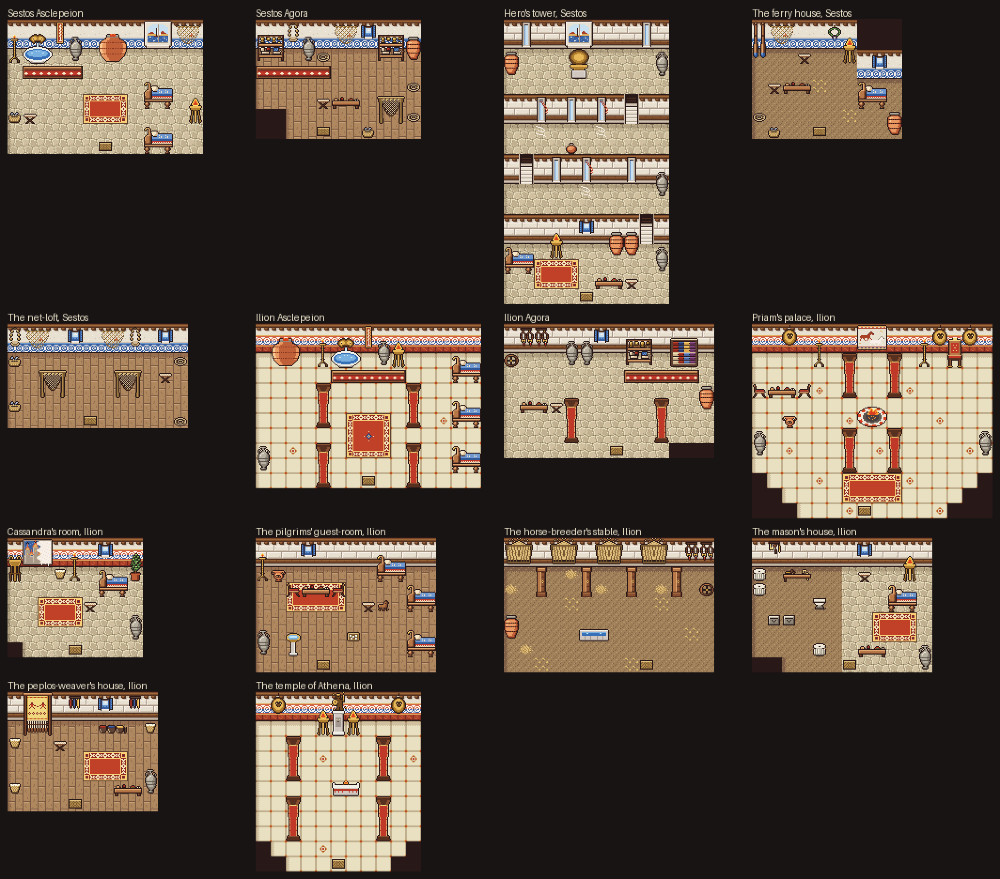

# The Troad's rooms: Sestos and Ilion, built from megaron

Every interior of Sestos and Ilion (batch 1, `BUILD.md` §5), laid out from `gTileset_Megaron` in `tools/ichor/maps/troad_rooms.py`. Who lives in each room and what happens there follows `OIKOUMENE.md` §4.1 and §6; the scripts are each map's `scripts.pory`.



## How it is made

```bash
/usr/bin/python3 tools/ichor/art/megaron_build.py              # compose, compile, check; write the rooms, renders and tables
/usr/bin/python3 tools/ichor/art/megaron_build.py --no-compile # compose and check only
/usr/bin/python3 tools/ichor/maps/troad_rooms.py               # write the rooms' map.json events
tools/ichor/tests/troad_rooms.sh                               # play every room (build/test_troad_rooms/)
```

- **The art** is `tools/ichor/art/megaron_art.py` (palettes, floors, walls, the kilim) and `megaron_pieces.py` (the furniture), drawn as character grids and small generators in oikia's hand. The furniture a Trojan room shares with a Greek home (the couch, stools, the table, jars, the lampstand, nets and oars, the window) is oikia's, pixel for pixel.
- **The builder** is `tools/ichor/art/megaron_build.py`, world-act1's `ergasteria_build.py` method for one set: it composes every room and a catalog of every piece, compiles with Porytiles against aethos, copies back any tile Porytiles borrowed, checks every room renders identically on oikos, aethos and building, and writes each room's `map.bin`, `border.bin` and `layouts.json` entry, the 2x renders, the contact sheet and the tables below. It proves every warp, person, sign and trigger is walkable and reachable from the door mat, and that everyone behind a counter can be talked to across it.
- **The rooms are data.** `troad_rooms.py` holds each room's grid, stamps and spots, and its events (`EVENTS`), from which it writes each `map.json`. Re-dress a room there, not in Porymap: the builder rewrites the blockdata and metatile ids on every run.
- **One variant:** Hero's great lamp lit. The builder writes `Sestos_HerosTower_EventScript_LightLampTiles` into the tower's `scripts.pory`.

## The set: megaron

Seven palettes of at most 15 colors, none an aethos color (the builder asserts both). Five are oikia's unchanged, so its furniture fits as it is.

| Palette | Use |
|---|---|
| wall | oikia's: beams, whitewash, red ochre, ochre, Aegean blue, sky. Also Troy's ashlar, the frescoes and the windows' views |
| floor | oikia's limestone flags and boards; the megaron's painted plaster (cream, a red and an ochre); beaten earth and straw |
| wood | oikia's: furniture woods, bronze fittings, linen, red and blue cloth. The red columns, the counters, the loom |
| clay | oikia's: pottery, hearth stone (the grey ware), fire, soot, slip |
| cloth | oikia's rug colors and a Tyrian purple and a bleached linen: the kilim, the cloth bolts, the dyes |
| nature | oikia's: leaves, wicker and straw, fish, rope |
| bronze | oikia's: bronze, flame, water, marble |

**What makes the rooms Trojan.** Troy's pale limestone ashlar with its timber lacing beam (Ilion's homes), Sestos's whitewash over a dado of running blue waves (the port), and frescoed plaster with a spiral frieze and a stone-painted dado (the palace, the temple, the city Asclepeion). The painted plaster floor of a Bronze Age megaron, squares ruled soft with red where four meet and a rosette here and there. Red Minoan columns, a round painted hearth, a throne, a horse frieze; Trojan grey ware; an Anatolian kilim.

**Each household's own things.** Hero's stair, slits (with and without a draught's ribbon), the draught's breath on the floor, her great lamp (cold and lit) and the brazier; the ferryman's wreath; the net rack and the cork floats; the counters, the spring, the rod of Asclepius and the Pithos; the stall's shelves and the cupboard of cloth; Cassandra's half-whitewashed painting, the laurel and the tripod; the guests' basin, the krater and Odysseus's wooden horse; the stable's stalls, hay racks, trough, straw, bridles and wheel; the mason's drums, capital, block, bench and tools; the weaver's loom, dye pots and skeins; the Palladion, the offering table and the votive shields.

**Budget.** 468 of 504 tiles (504-511 stay free for door animations, though no room has an animated door) and 400 of 512 metatiles. Pieces are drawn symmetric where they can be, so Porytiles stores a mirrored 8x8 tile once, and plain fills repeat every 8 pixels. oikia's chest, round table and plain amphora were left out for room.

## The rooms

| Room | Map | Size | Floor, wall | Who, and what happens | Flag |
|---|---|---|---|---|---|
| Sestos Asclepeion | `MAP_SESTOS_ASCLEPEION` | 13x9 | flags, sea | the healer (shared nurse script); an old woman counting her grandson's ferry trips; a rope-burned sailor | — |
| Sestos Agora | `MAP_SESTOS_AGORA` | 11x8 | boards, sea | Philon the chandler: Ultra, Net and Dive Balls, Hyper and Max Potions, Full Restore, Full Heal, Revive, Max Repel | — |
| Hero's tower | `MAP_SESTOS_HEROS_TOWER` | 11x19 | flags, ashlar | Hero, the lamp-keeper: carry a flame up the windy stair before dusk, Fire Stone; Kubfu's strait hook | `FLAG_ICHOR_HERO_FIRE_STONE` |
| The ferry house | `MAP_SESTOS_FERRY_HOUSE` | 10x8 | earth, sea | Kymon, who swam the strait at twelve: his Cramorant, Aithyia, for your Pelipper | `FLAG_ICHOR_TRADED_KYMON_CRAMORANT` |
| The net-loft | `MAP_SESTOS_NET_LOFT` | 12x7 | boards, sea | Diktys the fisher: `Oik_EventScript_FisherGift` (the Super Rod, or a Big Pearl) | `FLAG_ICHOR_SESTOS_FISHER_GIFT` |
| Ilion Asclepeion | `MAP_ILION_ASCLEPEION` | 15x11 | plaster, fresco | the healer; a charioteer with a strapped wrist; a pilgrim waiting on a dream | — |
| Ilion Agora | `MAP_ILION_AGORA` | 14x9 | flags, ashlar | Thymbra: Ultra, Timer and Quick Balls and the potions; a horse-trader; a woman choosing cloth | — |
| Priam's palace | `MAP_ILION_PRIAMS_PALACE` | 16x13 | plaster, fresco | Priam, who'd rather talk about horses: after the Gate Emblem, the Soothe Bell; two guards; a steward | `FLAG_ICHOR_PRIAM_SOOTHE_BELL` |
| Cassandra's room | `MAP_ILION_CASSANDRAS_ROOM` | 9x8 | flags, fresco | Cassandra: three confident predictions, all wrong, then three Pythian Laurels | `FLAG_ICHOR_CASSANDRA_LAURELS` |
| The guest-room | `MAP_ILION_GUEST_ROOM` | 12x9 | boards, ashlar | Odysseus: Glaukos's bargain and the Xenion, then his battle (Lv 76-78); the host | `FLAG_ICHOR_ODYSSEUS_XENION`, trainer flag |
| The stable | `MAP_ILION_HORSE_STABLE` | 14x9 | earth, ashlar | Idaios: his Rapidash, Aithon, for your Mudsdale; a Ponyta foal | `FLAG_ICHOR_TRADED_IDAIOS_RAPIDASH` |
| The mason's house | `MAP_ILION_MASONS_HOUSE` | 12x9 | flags and earth, ashlar | Laodokos, his chisel lost in the Walls of Laomedon: Hard Stone and the undercroft's deep door; his daughter Kallia | `FLAG_ICHOR_FOUND_MASONS_CHISEL` (set by batch 2), `FLAG_ICHOR_MASON_CHISEL_RETURNED` |
| The weaver's house | `MAP_ILION_WEAVERS_HOUSE` | 10x8 | boards, ashlar | Theano, weaving Athena's peplos: a Cheri, an Oran and an Aspear for dye, a Silk Scarf; her Leavanny | `FLAG_ICHOR_WEAVER_SILK_SCARF` |
| The temple of Athena | `MAP_ILION_TEMPLE_OF_ATHENA` | 11x12 | plaster, fresco | the Palladion's keeper ("it hums at night now"); Odysseus, after his battle: "I stole that once. Or one like it."; a worshipper; Deoxys's hook | — |

**Doors.** Each room's warp 0 is its door mat and its only exit, back to its town's warp with the room's number (`MAP_SESTOS` 0-4, `MAP_ILION` 0-8, `BUILD.md` §5). Hero's tower has no second exit: its top is part of the same map (below), so the brief's "warp 1 onward" for the tower top isn't used.

**Hero's tower.** One tall map: Hero's rooms at the bottom, the windy stair in the middle (stairs cut into each landing's wall), the lamp room at the top, where Hero keeps the lamp. A warp between floors would clear `VAR_TEMP_3`, the carried flame (SYSTEMS §2: the flame dies when you leave), so the climb is one map. The lower landing teaches the draught (one ribboned slit, room to step round); the upper one weaves between two draughts and an oil jar. The draughts' coord events fire only while a flame is carried. "Before dusk": by day the lamp is cold until you light it; in the evening and at night Hero has carried the flame herself and asks you back in daylight. After the quest the lamp burns by day too.

**Odysseus.** In the guest-room until he's beaten (he hides there on `FLAG_TEMP_1`, set in `ON_TRANSITION` once his trainer flag is); then at the temple of Athena, before the Palladion (by the same rule reversed). His team is `POSTGAME.md` §3.1's rental hand, strengthened: Stoutland (Argos), Noctowl (Athena's owl), Grumpig (Circe's swine), Drifblim (Aeolus's bag), Kingdra (Poseidon's sea) and Inteleon (the bow through twelve axes), Lv 76-78, perfect IVs, held items, two Full Restores, smart AI.

**The trades** are `INGAME_TRADE_ICHOR_AITHYIA` (Kymon's Cramorant, holding a Big Pearl, for a Pelipper) and `INGAME_TRADE_ICHOR_AITHON` (Idaios's Rapidash, named for one of Hektor's horses, holding Charcoal, for a Mudsdale), appended to `src/data/trade.h`. The traded Pokémon stays in the room: the Cramorant hides on the trade flag and your Pelipper appears by the fire; Aithon leaves the first stall and your Mudsdale takes the empty third.

**The Xenion.** `ITEM_LINKING_CORD` is renamed Xenion in `src/data/items.h` (decision PG-14): "A guest-gift for / Pokémon that evolve / when they're traded."

## Stubs

| Tag | Where | For |
|---|---|---|
| `ICHOR_STUB_LEGEND` | `Sestos_HerosTower_EventScript_KubfuStrait` | Kubfu's two paths (LEGENDS §4.16): Hero lights the strait for Rapid Strike; the unlit tower is Single Strike |
| `ICHOR_STUB_LEGEND` | `Ilion_TempleOfAthena_EventScript_Palladion` | Deoxys (LEGENDS §4.4): the keeper's splinter, the Defense form |
| `ICHOR_STUB_LEGEND` | `Ilion_MasonsHouse` (header) | the chisel's find in the Walls of Laomedon (batch 2) sets `FLAG_ICHOR_FOUND_MASONS_CHISEL`; the deep door checks `FLAG_ICHOR_MASON_CHISEL_RETURNED` |
| `ICHOR_STUB_CLASS` | `src/data/trainers.party`, Odysseus | a HOPLITE with the hoplite's pic until his own class and pic land |
| `ICHOR_STUB_SPRITE` | below | stand-in overworld sprites |

No `setrespawn` in either Asclepeion: `HEAL_LOCATION_SESTOS` and `HEAL_LOCATION_ILION` are the chart agent's. Their `respawn_npc` should be `LOCALID_SESTOS_HEALER` and `LOCALID_ILION_HEALER`.

### Stand-ins (`ICHOR_STUB_SPRITE`)

| Who | Stand-in | Intended |
|---|---|---|
| Hero | `OBJ_EVENT_GFX_ICHOR_PRIESTESS` | `OBJ_EVENT_GFX_ICHOR_HERO_LAMPKEEPER` |
| Priam | `OBJ_EVENT_GFX_ICHOR_ELDER_M` | `OBJ_EVENT_GFX_ICHOR_PRIAM` |
| Cassandra | `OBJ_EVENT_GFX_ICHOR_YOUTH_F` | `OBJ_EVENT_GFX_ICHOR_CASSANDRA` |
| Odysseus (guest-room and temple) | `OBJ_EVENT_GFX_ICHOR_SAILOR` | `OBJ_EVENT_GFX_ICHOR_ODYSSEUS` |
| Kymon, Laodokos | `OBJ_EVENT_GFX_ICHOR_ELDER_M` | `OBJ_EVENT_GFX_ICHOR_TROJAN_M` |
| Idaios | `OBJ_EVENT_GFX_ICHOR_SHEPHERD` | `OBJ_EVENT_GFX_ICHOR_TROJAN_M` |
| the charioteer, the steward, the horse-trader | `OBJ_EVENT_GFX_ICHOR_MAN` | `OBJ_EVENT_GFX_ICHOR_TROJAN_M` |
| Theano, Kallia, the guest-room's host, the pilgrim, the cloth-buyer, the worshipper | `OBJ_EVENT_GFX_ICHOR_WOMAN` | `OBJ_EVENT_GFX_ICHOR_TROJAN_F` |
| the old woman at the strait | `OBJ_EVENT_GFX_ICHOR_ELDER_F` | `OBJ_EVENT_GFX_ICHOR_TROJAN_F` |
| the Palladion's keeper | `OBJ_EVENT_GFX_ICHOR_PRIESTESS` | `OBJ_EVENT_GFX_ICHOR_TROJAN_F` |
| the palace guards | `OBJ_EVENT_GFX_ICHOR_HOPLITE` | the sprites agent's Trojan Hoplite |

The healers, the stallkeepers, the sailors and Diktys use the slice's healer, merchant, sailor and fisher, which are what they are. The Pokémon (Aithyia, the Pelipper, Aithon, the Ponyta, the Mudsdale, the Leavanny) use the follower sprites.

## Render-and-critique passes

Each pass: render, look, write down what's wrong, fix it. Pass 1 looked at the pieces on a catalog and the composed rooms (2x), pass 2 at the compiled set's 2x renders and the contact sheet, pass 3 at the rooms in game, from the check's screenshots.

**Every room (the set).**
1. The painted plaster floor ruled every square in a 2-pixel red line: graph paper, louder than anything standing on it. *Fixed:* the joints went to the limestone's second tone, red only at the four-way corners, and the plain square lost its lozenge; the rosette stays on the alternate square, so the floor reads as Pylos's painted squares, not a grid. The set was at 493 tiles of 504 with no room to improve anything. *Fixed:* oikia's chest, round table and plain amphora left the set (no room needed them), and the hay rack was made symmetric: 468.
2. The sacred spring's lion was a yellow box. *Fixed:* redrawn as a bronze lion's mask, symmetric, the stream from its mouth. Cassandra's painting didn't read at all: pale sky, pale city. *Fixed:* a night sky, dark walls and towers, fire in red tongues with ochre hearts, black smoke, and the whitewash a brisk uneven edge with drips. The Palladion was a tiny figure on a huge white box. *Fixed:* a larger, darker archaic image with its spear and shield on a narrower pedestal with a carved owl. The column drums read as buckets and the capital as an anvil. *Fixed:* white limestone, a dowel hole, deeper flutes; the capital's abacus and echinus true and its neck rough.
3. In game: see each room below.

**Sestos Asclepeion.**
1. A lone red column stood in the middle of the floor, and a void notch cut the bottom-left corner for no reason. *Fixed:* both gone; a kilim lies where the waiting sit.
2. Reads: the counter, spring and rod on the left by the door, the Pithos beside them, and the window on the strait over the couches, nets beside it.
3. In game: PASS3_SESTOS_ASCLEPEION

**Sestos Agora.**
1. Reads as a shop: shelves behind the counter, nets on the wall, rope on the floor. The bottom-left step looked like a missing corner.
2. Kept the step: it's the corner of the quay outside, and it gives the room its shape. The right half is still thin.
3. In game: PASS3_SESTOS_AGORA

**Hero's tower.**
1. A 1x2 oil jar on the upper landing filled both rows of the corridor and cut the climb in two (the builder's reach check caught it). *Fixed:* a squat 1x1 oil jar, drawn for it.
2. The draughts were only ribbons on the slits, easy to miss. *Fixed:* the draught's breath is drawn on the floor in front of each ribboned slit, exactly on the trigger tiles. The plain slits, with no ribbon and no breath, teach the difference.
3. In game: PASS3_HEROS_TOWER

**The ferry house.**
1. Kymon's stool stood under his wreath, so the wreath couldn't be read. *Fixed:* the wreath moved over the gap between his chair and the fire, readable from the floor.
2. Reads: the back wall steps forward over the sleeping bay; oars and net by the door, the wreath, the fire, his Cramorant.
3. In game: PASS3_FERRY_HOUSE

**The net-loft.**
1. Composed well: two racks down the middle like a ship's ribs, nets and floats on the walls.
2. The racks read more like tables with nets on them than A-frames. Kept: at 16 pixels it's the net that matters, and the net reads.
3. In game: PASS3_NET_LOFT

**Ilion Asclepeion.**
1. Composed well: counter and spring on the door's axis, four red columns, the couches along the east wall.
2. The couches are close to the east edge but every one is readable; kept.
3. In game: PASS3_ILION_ASCLEPEION

**Ilion Agora.**
1. Two columns stood at random. *Fixed:* a pair framing the door's aisle.
2. Reads: the stall and its cloth cupboard at the east end, the horse-tack corner at the west.
3. In game: PASS3_ILION_AGORA

**Priam's palace.**
1. Two identical horse friezes side by side were wallpaper; the four columns stood far from the hearth. *Fixed:* one frieze, on the hearth's axis, shields elsewhere.
2. Closing the columns round the hearth made each side's pair touch end to end, one long red bar. *Fixed:* the pairs spaced so the hearth sits between them, the classic megaron square.
3. In game: PASS3_PRIAMS_PALACE

**Cassandra's room.**
1. Her painting didn't read (see the set). Her chest cost ten tiles for one room. *Fixed:* the painting redrawn; the chest replaced by a lampstand (her first wrong prediction is that it falls) and her wool basket.
2. Reads: the half-whitewashed city, the neglected laurel, the cold tripod, the bed under the window.
3. In game: PASS3_CASSANDRAS_ROOM

**The guest-room.**
1. Composed well: basin by the door, wine and the long table on the kilim, beds along the far wall, Odysseus's corner with his stool and wooden horse.
2. The table on the kilim loses a little contrast; kept, because the rug marks where guests eat.
3. In game: PASS3_GUEST_ROOM

**The stable.**
1. The stall partitions were thin posts that read as hitching posts.
2. *Fixed:* redrawn as plank walls in three-quarter view, a lit top edge and a shadowed face with board joints, posts at both ends and a bronze tethering ring.
3. In game: PASS3_STABLE

**The mason's house.**
1. The drums read as buckets and the capital as an anvil (see the set). *Fixed.*
2. Reads: the workshop on beaten earth, the home on flags, split down the middle, the tool rack with its gap.
3. In game: PASS3_MASONS_HOUSE

**The weaver's house.**
1. The loom reads; the right side was sparse. 
2. *Fixed:* a grey-ware jar by the table; her Leavanny fills the middle.
3. In game: PASS3_WEAVERS_HOUSE

**The temple of Athena.**
1. Each side's two columns touched end to end; the offering table sat on a column's base. *Fixed:* the pairs spaced along the nave, the table moved into it, before the image.
2. The Palladion was lost on its pedestal (see the set). *Fixed.*
3. In game: PASS3_TEMPLE

## Stopped at (2026-11-14, the Oikoumene paused)

**Done.**
- The megaron set: 471 of 504 tiles, 408 metatiles, seven palettes; registered (`headers.h`, `graphics.h`, `metatiles.h`, `porytiles/tilesets/gTileset_Megaron`); `megaron_build.py` compiles it and proves every room renders identically on oikos, aethos and building.
- All 14 rooms laid out (`troad_rooms.py`), with their `map.bin`, `layouts.json` entries, `map.json` events (written by `troad_rooms.py`) and `scripts.pory`; every spot proved reachable; renders in `img/` and the contact sheet `img/troad_rooms.png`.
- Ten bank flags (0x3F4-0x3FD), `TRAINER_ICHOR_ODYSSEUS` (692) and his party, the two in-game trades, the Xenion rename.
- Render-and-critique passes 1 and 2 for every room (above).

**Partial.**
- Pass 3 (in game) is not written: the PASS3_ markers above are placeholders. The last art changes (the stall redrawn, the Sestos Agora's net rack, the weaver's jar) are built into the layouts but not yet looked at in a render.
- The check (`tools/ichor/tests/troad_rooms.sh`, `.lua`, `_consts.c`, `_setup.s`) is written but has never run: no ROM had finished building.
- Text: every line measured with `text_width.py --scan` on the first compile of the scripts; none over the box. Not re-scanned after the last edits (the ferry house's wrong-species line, Odysseus's after-battle branch).

**Not started.** The smoke test; running the room check; pass 3; the in-game look at the stall, net rack and jar.

**`make`.** A clean build (a fresh worktree, converting every asset) was still running at the stop, so whether `make` is green at the last commit is not known. The lead's map audit (`map_audit.py --root . Sestos_ Ilion_`) gives 14 FAILs, one per room, all "warp: names Sestos/Ilion warp i, which has 0": the towns are troad-towns' and empty in this tree, and BUILD.md §5 fixes those ids, so they clear when the towns merge. No other finding.

## Generated tables

The builder rewrites everything between the markers below.

### Rooms

<!-- megaron_build rooms: begin generated -->

### Sestos Asclepeion: the harbor's, with a window on the strait

- Map: `MAP_SESTOS_ASCLEPEION`. Layout: `data/layouts/Sestos_Asclepeion/map.bin`, **13x9** blocks, `gTileset_Oikos` + `gTileset_Megaron`.
- Floor: flags. Wall: sea. Render: `design/oikoumene/img/sestos_asclepeion.png` (2x).

Walk map: `#` blocked, `.` open. Digits and letters mark the spots in the table; a bg event is marked on its furniture tile.

```
    0123456789012
  0 #############
  1 #########78##
  2 ###2#.56...3.
  3 .####........
  4 .........##4.
  5 .........##.#
  6 ##..........#
  7 .........##..
  8 ......1..##..
```

| # | Kind | Tile | Read from | What |
|---|---|---|---|---|
| 1 | warp | (6,8) |  | door to Sestos, warp 0 (south-arrow mat) |
| 2 | counter | (3,2) | (3,4) facing north | the healer, behind the counter |
| 3 | npc | (11,2) | faces west | an old woman at the window, watching the strait |
| 4 | npc | (11,4) | faces west | a sailor with a rope-burned hand, by his mate's couch |
| 5 | bg | (6,2) | (6,3) facing north | the Pithos |
| 6 | bg | (7,2) | (7,3) facing north | the Pithos, right half |
| 7 | bg | (9,1) | (9,2) facing north | the window on the strait |
| 8 | bg | (10,1) | (10,2) facing north | the window on the strait, right half |

### Sestos Agora: a chandler's stall on the quay

- Map: `MAP_SESTOS_AGORA`. Layout: `data/layouts/Sestos_Agora/map.bin`, **11x8** blocks, `gTileset_Oikos` + `gTileset_Megaron`.
- Floor: boards. Wall: sea. Render: `design/oikoumene/img/sestos_agora.png` (2x).

Walk map: `#` blocked, `.` open. Digits and letters mark the spots in the table; a bg event is marked on its furniture tile.

```
    01234567890
  0 ###########
  1 ###########
  2 ##2##...4##
  3 #####...3..
  4 ..........#
  5 ....###.##.
  6 ##......###
  7 ##..1..#...
```

| # | Kind | Tile | Read from | What |
|---|---|---|---|---|
| 1 | warp | (4,7) |  | door to Sestos, warp 1 (south-arrow mat) |
| 2 | counter | (2,2) | (2,4) facing north | the chandler, behind the counter |
| 3 | npc | (8,3) | faces north | a sailor reading the shelves |
| 4 | bg | (8,2) | (8,3) facing north | the shelves of goods |

### Hero's tower, Sestos: the lamp room, the windy stair and her rooms

- Map: `MAP_SESTOS_HEROS_TOWER`. Layout: `data/layouts/Sestos_HerosTower/map.bin`, **11x19** blocks, `gTileset_Oikos` + `gTileset_Megaron`.
- Floor: flags. Wall: ashlar. Render: `design/oikoumene/img/sestos_heros_tower.png` (2x).
- Variant `lit`: `Sestos_HerosTower_EventScript_LightLampTiles` in the map's scripts.pory swaps its cells.

Walk map: `#` blocked, `.` open. Digits and letters mark the spots in the table; a bg event is marked on its furniture tile.

```
    01234567890
  0 ###########
  1 ###########
  2 #...##....#
  3 #...34.2..#
  4 ........9..
  5 ########.##
  6 ########.##
  7 ..6...7....
  8 ....#......
  9 #.#########
 10 #.#########
 11 .....8....#
 12 ...........
 13 #########.#
 14 #########.#
 15 ##.5...##.#
 16 ##........#
 17 ......###..
 18 .....1.....
```

| # | Kind | Tile | Read from | What |
|---|---|---|---|---|
| 1 | warp | (5,18) |  | door to Sestos, warp 2 (south-arrow mat) |
| 2 | npc | (7,3) | faces south | Hero, keeping the lamp, watching the strait |
| 3 | bg | (4,3) | (4,4) facing north | the great lamp |
| 4 | bg | (5,3) | (5,4) facing north | the great lamp, right half |
| 5 | bg | (3,15) | (3,16) facing north | Hero's hearth: take a flame |
| 6 | coord | (2,7) |  | a draught: the upper landing, west slit |
| 7 | coord | (6,7) |  | a draught: the upper landing, east slit |
| 8 | coord | (5,11) |  | a draught: the lower landing |
| 9 | coord | (8,4) |  | the top of the stair, arriving in the lamp room |

### The ferry house, Sestos: Kymon the ferryman's

- Map: `MAP_SESTOS_FERRY_HOUSE`. Layout: `data/layouts/Sestos_FerryHouse/map.bin`, **10x8** blocks, `gTileset_Oikos` + `gTileset_Megaron`.
- Floor: earth. Wall: sea. Render: `design/oikoumene/img/sestos_ferry_house.png` (2x).

Walk map: `#` blocked, `.` open. Digits and letters mark the spots in the table; a bg event is marked on its furniture tile.

```
    0123456789
  0 ##########
  1 #####4####
  2 #..#2.####
  3 ......3###
  4 .###...##.
  5 .......##.
  6 #........#
  7 .#..1....#
```

| # | Kind | Tile | Read from | What |
|---|---|---|---|---|
| 1 | warp | (4,7) |  | door to Sestos, warp 3 (south-arrow mat) |
| 2 | npc | (4,2) | faces south | Kymon the ferryman, by his chair under the wreath |
| 3 | npc | (6,3) | faces west | his Cramorant, by the fire (until the trade) |
| 4 | bg | (5,1) | (5,2) facing north | the wreath: his prize for swimming the strait |

### The net-loft, Sestos

- Map: `MAP_SESTOS_NET_LOFT`. Layout: `data/layouts/Sestos_NetLoft/map.bin`, **12x7** blocks, `gTileset_Oikos` + `gTileset_Megaron`.
- Floor: boards. Wall: sea. Render: `design/oikoumene/img/sestos_net_loft.png` (2x).

Walk map: `#` blocked, `.` open. Digits and letters mark the spots in the table; a bg event is marked on its furniture tile.

```
    012345678901
  0 ############
  1 ############
  2 #..........#
  3 ..##...##.#.
  4 ..#3...##.2.
  5 #...........
  6 .....1.....#
```

| # | Kind | Tile | Read from | What |
|---|---|---|---|---|
| 1 | warp | (5,6) |  | door to Sestos, warp 4 (south-arrow mat) |
| 2 | npc | (10,4) | faces west | the fisher, mending a net |
| 3 | bg | (3,4) | (3,5) facing north | a drying rack |

### Ilion Asclepeion: the city's, columned, with couches for dreaming

- Map: `MAP_ILION_ASCLEPEION`. Layout: `data/layouts/Ilion_Asclepeion/map.bin`, **15x11** blocks, `gTileset_Oikos` + `gTileset_Megaron`.
- Floor: plaster. Wall: fresco. Render: `design/oikoumene/img/ilion_asclepeion.png` (2x).

Walk map: `#` blocked, `.` open. Digits and letters mark the spots in the table; a bg event is marked on its furniture tile.

```
    012345678901234
  0 ###############
  1 ###############
  2 .56.###2##...##
  3 .....#####..4##
  4 ...............
  5 .............##
  6 ....#.....#.3##
  7 ...............
  8 #............##
  9 #............##
 10 ....#..1..#....
```

| # | Kind | Tile | Read from | What |
|---|---|---|---|---|
| 1 | warp | (7,10) |  | door to Ilion, warp 0 (south-arrow mat) |
| 2 | counter | (7,2) | (7,4) facing north | the healer, behind the counter |
| 3 | npc | (12,6) | faces east | a charioteer with a strapped wrist |
| 4 | npc | (12,3) | faces east | a pilgrim waiting on a dream |
| 5 | bg | (1,2) | (1,3) facing north | the Pithos |
| 6 | bg | (2,2) | (2,3) facing north | the Pithos, right half |

### Ilion Agora: a market hall on the citadel road

- Map: `MAP_ILION_AGORA`. Layout: `data/layouts/Ilion_Agora/map.bin`, **14x9** blocks, `gTileset_Oikos` + `gTileset_Megaron`.
- Floor: flags. Wall: ashlar. Render: `design/oikoumene/img/ilion_agora.png` (2x).

Walk map: `#` blocked, `.` open. Digits and letters mark the spots in the table; a bg event is marked on its furniture tile.

```
    01234567890123
  0 ##############
  1 #5############
  2 #...##..##2##.
  3 ..3.....#####.
  4 .............#
  5 .###.........#
  6 .............4
  7 ....#.....#...
  8 .......1...###
```

| # | Kind | Tile | Read from | What |
|---|---|---|---|---|
| 1 | warp | (7,8) |  | door to Ilion, warp 1 (south-arrow mat) |
| 2 | counter | (10,2) | (10,4) facing north | the stallkeeper, behind the counter |
| 3 | npc | (2,3) | faces north | a horse-trader at the bridles |
| 4 | npc | (13,6) | faces west | a woman fingering the cloth |
| 5 | bg | (1,1) | (1,2) facing north | the bridles |

### Priam's palace, Ilion: the megaron

- Map: `MAP_ILION_PRIAMS_PALACE`. Layout: `data/layouts/Ilion_PriamsPalace/map.bin`, **16x13** blocks, `gTileset_Oikos` + `gTileset_Megaron`.
- Floor: plaster. Wall: fresco. Render: `design/oikoumene/img/ilion_priams_palace.png` (2x).

Walk map: `#` blocked, `.` open. Digits and letters mark the spots in the table; a bg event is marked on its furniture tile.

```
    0123456789012345
  0 ################
  1 ########6#######
  2 ....#......#2#..
  3 ................
  4 ####..#..#......
  5 .......##.......
  6 ..#5...7#.......
  7 #..............#
  8 #..............#
  9 ......#..#......
 10 #..............#
 11 ##...3....4...##
 12 ###....1.....###
```

| # | Kind | Tile | Read from | What |
|---|---|---|---|---|
| 1 | warp | (7,12) |  | door to Ilion, warp 2 (south-arrow mat) |
| 2 | npc | (12,2) | faces south | King Priam, beside his throne |
| 3 | npc | (5,11) | faces east | a palace guard at the door, west |
| 4 | npc | (10,11) | faces west | a palace guard at the door, east |
| 5 | npc | (3,6) | faces west | a steward by the wine |
| 6 | bg | (8,1) | (8,2) facing north | the horse frieze |
| 7 | bg | (7,6) | (7,7) facing north | the hearth |

### Cassandra's room, Ilion

- Map: `MAP_ILION_CASSANDRAS_ROOM`. Layout: `data/layouts/Ilion_CassandrasRoom/map.bin`, **9x8** blocks, `gTileset_Oikos` + `gTileset_Megaron`.
- Floor: flags. Wall: fresco. Render: `design/oikoumene/img/ilion_cassandras_room.png` (2x).

Walk map: `#` blocked, `.` open. Digits and letters mark the spots in the table; a bg event is marked on its furniture tile.

```
    012345678
  0 #########
  1 #34######
  2 #..##.##5
  3 ..2...##.
  4 .....#...
  5 ........#
  6 ........#
  7 #...1....
```

| # | Kind | Tile | Read from | What |
|---|---|---|---|---|
| 1 | warp | (4,7) |  | door to Ilion, warp 3 (south-arrow mat) |
| 2 | npc | (2,3) | faces south | Cassandra, by the painted wall |
| 3 | bg | (1,1) | (1,2) facing north | the painting of Troy burning, half whitewashed |
| 4 | bg | (2,1) | (2,2) facing north | the painting, right half |
| 5 | bg | (8,2) | (8,3) facing north | the laurel |

### The pilgrims' guest-room, Ilion

- Map: `MAP_ILION_GUEST_ROOM`. Layout: `data/layouts/Ilion_GuestRoom/map.bin`, **12x9** blocks, `gTileset_Oikos` + `gTileset_Megaron`.
- Floor: boards. Wall: ashlar. Render: `design/oikoumene/img/ilion_guest_room.png` (2x).

Walk map: `#` blocked, `.` open. Digits and letters mark the spots in the table; a bg event is marked on its furniture tile.

```
    012345678901
  0 ############
  1 ############
  2 ##......##..
  3 ..####..2.##
  4 .......#4.##
  5 ............
  6 #.#...#...##
  7 #.53......##
  8 ....1.......
```

| # | Kind | Tile | Read from | What |
|---|---|---|---|---|
| 1 | warp | (4,8) |  | door to Ilion, warp 4 (south-arrow mat) |
| 2 | npc | (8,3) | faces south | Odysseus, by his corner bed and his whittling |
| 3 | npc | (3,7) | faces west | the host, by the basin |
| 4 | bg | (8,4) | (8,5) facing north | the wooden horse |
| 5 | bg | (2,7) | (1,7) facing east | the basin for guests' feet |

### The horse-breeder's stable, Ilion

- Map: `MAP_ILION_HORSE_STABLE`. Layout: `data/layouts/Ilion_HorseStable/map.bin`, **14x9** blocks, `gTileset_Oikos` + `gTileset_Megaron`.
- Floor: earth. Wall: ashlar. Render: `design/oikoumene/img/ilion_horse_stable.png` (2x).

Walk map: `#` blocked, `.` open. Digits and letters mark the spots in the table; a bg event is marked on its furniture tile.

```
    01234567890123
  0 ##############
  1 ##############
  2 .3#..#.5#..#..
  3 ..#4.#..#..#.#
  4 ..............
  5 #.......2.....
  6 #....6#.......
  7 ..............
  8 .........1....
```

| # | Kind | Tile | Read from | What |
|---|---|---|---|---|
| 1 | warp | (9,8) |  | door to Ilion, warp 5 (south-arrow mat) |
| 2 | npc | (8,5) | faces west | Idaios the horse-breeder |
| 3 | npc | (1,2) | faces south | his Rapidash, in the first stall (until the trade) |
| 4 | npc | (3,3) | faces south | a Ponyta, in the second stall |
| 5 | npc | (7,2) | faces south | a Mudsdale, in the third stall (after the trade) |
| 6 | bg | (5,6) | (5,7) facing north | the trough |

### The mason's house, Ilion: the workshop and the home

- Map: `MAP_ILION_MASONS_HOUSE`. Layout: `data/layouts/Ilion_MasonsHouse/map.bin`, **12x9** blocks, `gTileset_Oikos` + `gTileset_Megaron`.
- Floor: flags, earth. Wall: ashlar. Render: `design/oikoumene/img/ilion_masons_house.png` (2x).

Walk map: `#` blocked, `.` open. Digits and letters mark the spots in the table; a bg event is marked on its furniture tile.

```
    012345678901
  0 ############
  1 #4##########
  2 #.##...#2.#.
  3 #..3.....##.
  4 ....5....##.
  5 .##.........
  6 ............
  7 ....#..##..#
  8 ##....1....#
```

| # | Kind | Tile | Read from | What |
|---|---|---|---|---|
| 1 | warp | (6,8) |  | door to Ilion, warp 6 (south-arrow mat) |
| 2 | npc | (8,2) | faces south | Laodokos the old mason, by the window |
| 3 | npc | (3,3) | faces north | his daughter Harmonia, at the workbench |
| 4 | bg | (1,1) | (1,2) facing north | the tool rack, with a gap |
| 5 | bg | (4,4) | (4,5) facing north | the half-carved capital |

### The peplos-weaver's house, Ilion

- Map: `MAP_ILION_WEAVERS_HOUSE`. Layout: `data/layouts/Ilion_WeaversHouse/map.bin`, **10x8** blocks, `gTileset_Oikos` + `gTileset_Megaron`.
- Floor: boards. Wall: ashlar. Render: `design/oikoumene/img/ilion_weavers_house.png` (2x).

Walk map: `#` blocked, `.` open. Digits and letters mark the spots in the table; a bg event is marked on its furniture tile.

```
    0123456789
  0 ##########
  1 ##########
  2 .4#...56.#
  3 #.2#......
  4 ....3.....
  5 .........#
  6 #......###
  7 ....1.....
```

| # | Kind | Tile | Read from | What |
|---|---|---|---|---|
| 1 | warp | (4,7) |  | door to Ilion, warp 7 (south-arrow mat) |
| 2 | npc | (2,3) | faces south | the weaver, at her loom |
| 3 | npc | (4,4) | faces west | her Leavanny |
| 4 | bg | (1,2) | (1,3) facing north | the peplos on the loom |
| 5 | bg | (6,2) | (6,3) facing north | the dye pots |
| 6 | bg | (7,2) | (7,3) facing north | the dye pots, right |

### The temple of Athena, Ilion: the Palladion

- Map: `MAP_ILION_TEMPLE_OF_ATHENA`. Layout: `data/layouts/Ilion_TempleOfAthena/map.bin`, **11x12** blocks, `gTileset_Oikos` + `gTileset_Megaron`.
- Floor: plaster. Wall: fresco. Render: `design/oikoumene/img/ilion_temple_of_athena.png` (2x).

Walk map: `#` blocked, `.` open. Digits and letters mark the spots in the table; a bg event is marked on its furniture tile.

```
    01234567890
  0 ###########
  1 ###########
  2 ....#5#....
  3 ...2..3....
  4 ...........
  5 ..#.....#..
  6 .....6#....
  7 ......4....
  8 ...........
  9 ..#.....#..
 10 #.........#
 11 ##...1...##
```

| # | Kind | Tile | Read from | What |
|---|---|---|---|---|
| 1 | warp | (5,11) |  | door to Ilion, warp 8 (south-arrow mat) |
| 2 | npc | (3,3) | faces east | the keeper of the Palladion |
| 3 | npc | (6,3) | faces north | Odysseus, before the Palladion (after his battle) |
| 4 | npc | (6,7) | faces north | a worshipper at the offering table |
| 5 | bg | (5,2) | (5,3) facing north | the Palladion |
| 6 | bg | (5,6) | (5,7) facing north | the offering table |

<!-- megaron_build rooms: end generated -->

### Tiles

<!-- megaron_build tiles: begin generated -->

Built: **401** metatiles (`0x200`-`0x390`) of 512, **471** tiles of 504, palettes 6-12.

| Piece | Metatile |
|---|---|
| floor flags, plain | `200` |
| floor flags, top | `201` |
| floor flags, left | `202` |
| floor flags, corner | `203` |
| floor boards, plain | `204` |
| floor boards, top | `205` |
| floor boards, left | `206` |
| floor boards, corner | `207` |
| floor plaster, plain | `208` |
| floor plaster, alt | `209` |
| floor plaster, top | `20A` |
| floor plaster, left | `20B` |
| floor plaster, corner | `20C` |
| floor earth, plain | `20D` |
| floor earth, alt | `20E` |
| floor earth, top | `20F` |
| floor earth, left | `210` |
| floor earth, corner | `211` |
| wall sea, row 0 | `212` |
| wall sea, row 1 | `213` |
| wall ashlar, row 0 | `214` |
| wall ashlar, row 1 | `215` |
| wall fresco, row 0 | `216` |
| wall fresco, row 1 | `217` |
| void (outside the room) | `218` |
| rug kilim, top-left | `219` |
| rug kilim, top | `21A` |
| rug kilim, top-right | `21B` |
| rug kilim, left | `21C` |
| rug kilim, middle | `21D` |
| rug kilim, right | `21E` |
| rug kilim, bottom-left | `21F` |
| rug kilim, bottom | `220` |
| rug kilim, bottom-right | `221` |

| Stamp | Cells | Palette | From | Metatiles (in the catalog) | What it is |
|---|---|---|---|---|---|
| `window` | 1x2 | wall | oikia | 2D9 / 2DD | shuttered window, Aegean-blue shutters open |
| `kline` | 2x2 | wood | oikia | 2AD 2AE / 2A9 2AA | kline (couch-bed): a scrolled headrest with a bronze boss, linen pillow, woven blue coverlet |
| `klismos_r` | 1x1 | wood | oikia | 341 | klismos chair, facing right |
| `klismos_l` | 1x1 | wood | oikia | 2CF | klismos chair, facing left |
| `stool` | 1x1 | wood | oikia | 342 | diphros: a folding stool with crossed legs and a fleece seat |
| `table` | 2x1 | wood | oikia | 2CD 2CE | trapeza: a low table with bread, a red jug, olives and a cup |
| `pithos` | 1x2 | clay | oikia | 343 / 349 | pithos: a big storage jar with rope-pattern bands and a stone lid |
| `lampstand` | 1x2 | bronze | oikia | 344 / 34A | lychnouchos: a bronze lampstand on lion-paw feet, lamp lit |
| `kalathos` | 1x1 | nature | oikia | 345 | kalathos: the wool basket, heaped with carded fleece |
| `fish_basket` | 1x1 | nature | oikia | 346 | a wicker basket of the morning's catch |
| `knucklebones` | 1x1 | nature | oikia | 347 | astragaloi: five knucklebones on a leather gaming cloth |
| `nets` | 2x2 | nature | oikia | 325 326 / 333 334 | a fishing net drying on two pegs: cork floats, lead sinkers, a starfish caught in it |
| `oars` | 1x3 | wood | oikia | 348 / 34B / 34C | a pair of oars with blue-painted blades, leaning on the wall |
| `mat` | 1x1 | nature | megaron | 2B2 | the threshold mat: a reed mat at the door, a south-arrow warp |
| `column` | 1x3 | wood | megaron | 2AB / 2AC / 2AF | a Minoan column: red shaft tapering to its foot, black cushion capital; drawn over walkers but its base |
| `counter_l` | 1x1 | wood | megaron | 2A6 | the counter: a cedar slab on a painted front; talk across it |
| `counter_m` | 1x1 | wood | megaron | 2A7 | the counter: a cedar slab on a painted front; talk across it |
| `counter_r` | 1x1 | wood | megaron | 2A8 | the counter: a cedar slab on a painted front; talk across it |
| `basin` | 2x2 | bronze | megaron | 34D 34E / 357 358 | the sacred spring: a marble basin under a bronze lion's-head spout |
| `rod` | 1x2 | wall | megaron | 294 / 29A | a painted panel: the rod of Asclepius, a gold snake round a white staff |
| `great_pithos` | 2x2 | clay | megaron | 34F 350 / 359 35A | the Pithos: a great storage jar with rope bands and a wax seal (the PC) |
| `sea_window` | 2x2 | wall | megaron | 327 328 / 335 336 | a broad window on the Hellespont: Asia's shore across the strait, a sail |
| `goods` | 2x2 | wood | megaron | 351 352 / 35B 35C | a stall's shelves: bronze cups and flasks, bales of linen, red and blue boxes |
| `cloth_bolts` | 2x2 | cloth | megaron | 353 354 / 35D 35E | a cupboard of folded cloth: madder, indigo, saffron, purple and bleached linen |
| `rope` | 1x1 | nature | megaron | 355 | a coil of rope |
| `slit` | 1x2 | wall | megaron | 329 / 337 | an arrow slit in the tower wall, sky beyond |
| `draught` | 1x1 | wall | megaron | 356 | the draught's breath on the floor, in front of a draughty slit; walkable |
| `slit_draught` | 1x2 | wall | megaron | 32A / 338 | a draughty slit: a red ribbon on its bar streams into the room. A carried flame dies in front of it |
| `stair` | 1x2 | wall | megaron | 32B / 339 | stone stairs climbing north into the wall to the floor above |
| `great_lamp` | 2x2 | bronze | megaron | 35F 360 / 36A 36B | Hero's great lamp: a bronze bowl on a marble plinth before a polished reflector, cold |
| `great_lamp_lit` | 2x2 | bronze | megaron | 361 362 / 36C 36D | the great lamp, lit: the flame Leander swims by |
| `brazier` | 1x2 | bronze | megaron | 363 / 36E | a bronze tripod brazier, burning |
| `oil_jar` | 1x1 | clay | megaron | 364 | a squat jar of lamp oil, stoppered |
| `amphora_grey` | 1x2 | clay | megaron | 2D5 / 2D6 | a Trojan grey-ware amphora, burnished like pewter |
| `net_rack` | 2x2 | nature | megaron | 365 366 / 36F 370 | a drying rack: a net hung over a pole between two A-frames, cork floats on its head rope |
| `floats` | 1x2 | nature | megaron | 32C / 33A | strings of cork floats on a peg, a hank of line under them |
| `wreath` | 1x2 | nature | megaron | 32D / 33B | an olive wreath on a peg: the ferryman's prize for swimming the strait as a boy |
| `horse_fresco` | 2x2 | wall | megaron | 2C4 2C5 / 2C7 2C8 | a fresco of two horses at the gallop, a bay and a white: Troy of the fine horses |
| `throne` | 1x2 | wood | megaron | 367 / 371 | Priam's throne: a high cedar back hung with red, bronze-shod feet |
| `round_hearth` | 2x2 | clay | megaron | 2D0 2D1 / 2D3 2D4 | the megaron's great round hearth: a painted stucco rim, the fire never out |
| `fresco_troy` | 2x2 | wall | megaron | 2D7 2D8 / 2DB 2DC | Cassandra's painting of Troy burning, half whitewashed over in fresh, uneven strokes |
| `tripod` | 1x2 | bronze | megaron | 368 / 372 | a bronze tripod of Apollo's, cold |
| `laurel` | 1x2 | nature | megaron | 369 / 373 | a potted laurel, Apollo's tree, a little neglected |
| `louter` | 1x2 | bronze | megaron | 374 / 380 | a bronze basin on a marble stand: a guest's feet are washed before anything else |
| `krater` | 1x1 | clay | megaron | 2D2 | a mixing krater of wine, black-figure, for whoever comes in from the road |
| `horse_toy` | 1x1 | wood | megaron | 375 | a little wooden horse on wheels, half whittled, shavings round it |
| `stall` | 1x2 | wood | megaron | 376 / 381 | a stall partition: cedar planks between two posts |
| `hay_rack` | 2x2 | nature | megaron | 32E 32F / 33C 33D | a hay rack on the wall, piled high |
| `trough` | 2x1 | bronze | megaron | 377 378 | a stone water trough |
| `straw` | 1x1 | nature | megaron | 379 | a heap of clean straw on the floor; walkable |
| `bridles` | 1x2 | wood | megaron | 330 / 33E | two bridles on a peg-board, bronze bits and red tassels |
| `wheel` | 1x1 | wood | megaron | 37A | a chariot wheel, four-spoked, waiting for a new rim |
| `drum` | 1x1 | clay | megaron | 37B | a column drum of white limestone, fluted, the dowel hole cut in its top |
| `capital` | 1x1 | clay | megaron | 37C | a capital half carved: the abacus and echinus true, the neck still rough, chips round it |
| `block` | 1x1 | clay | megaron | 37D | a squared block, the family's mark cut in its face |
| `workbench` | 2x1 | wood | megaron | 37E 37F | the workbench: a mallet, a chisel, a square and a plumb bob over the edge |
| `tools` | 1x2 | wood | megaron | 331 / 33F | the mason's tools on a peg-board: a bronze square, a mallet, a long chisel |
| `loom_big` | 2x3 | wood | megaron | 382 383 / 387 388 / 38A 38B | the upright loom: Athena's saffron peplos, a god and a giant woven in red, the weights swinging |
| `dye_vats` | 2x1 | cloth | megaron | 384 385 | three dye pots: madder, woad and weld, and the stirring stick |
| `skeins` | 1x2 | cloth | megaron | 332 / 340 | skeins of dyed wool drying on a peg: madder, woad and weld |
| `palladion` | 1x3 | bronze | megaron | 386 / 389 / 38C | the Palladion: a small dark image of Pallas, spear raised, that fell from the sky, on a tall pedestal |
| `temple_altar` | 2x1 | bronze | megaron | 323 324 | a horned marble altar bound with a red fillet, a small flame on it |
| `shield` | 1x2 | bronze | megaron | 2C3 / 2C6 | a votive shield hung on the wall, Athena's owl for its blazon |

<!-- megaron_build tiles: end generated -->
