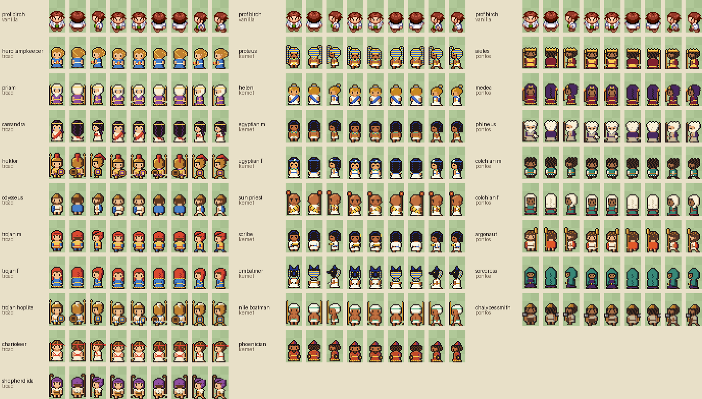

# The Oikoumene's sprites

## Overworld

Batch 1's walking sprites: the named people, townsfolk and trainer classes of the Troad, Egypt and the Black Sea (OIKOUMENE §4.1, §4.3, §4.5, §6). They are 27 standard 16×32 walkers with Ichor's nine frames, on sprites_folk.py's bodies, so they keep Aethos's proportions, outline and step bob. Foreigners look foreign, drawn by the same painter.

- **Source:** `tools/ichor/art/sprites_oikoumene_ow.py`. Every head, costume and prop is ASCII art in that file.
- **Rebuild the sheets and palettes:** `python3 tools/ichor/art/sprites_oikoumene_ow.py --write`
- **Review sheets:** `--preview DIR` writes each land at 4× on grass, `--sheet PNG` writes all 27 at 2× (`img/overworld_batch1.png`), and `--grids DIR` writes 8× pixel grids for editing.
- **Sheets:** `graphics/object_events/pics/people/ichor/oik/<name>.png`, registered in the five sprite tables' Ichor blocks (SPRITES_npc.md §"How a later batch adds an NPC").
- **Test:** `tools/ichor/tests/oikoumene_ow_sprites.sh` (below).

### Stand-ins to swap

Map agents placed stand-ins tagged `ICHOR_STUB_SPRITE`. Swap each for its constant.

| Stand-in | Constant | Palette |
|---|---|---|
| Hero of Sestos, the lamp-keeper | `OBJ_EVENT_GFX_ICHOR_HERO_LAMPKEEPER` | Troad |
| King Priam | `OBJ_EVENT_GFX_ICHOR_PRIAM` | Troad |
| Cassandra | `OBJ_EVENT_GFX_ICHOR_CASSANDRA` | Troad |
| Prince Hektor | `OBJ_EVENT_GFX_ICHOR_HEKTOR` | Troad |
| Odysseus (Ilion's guest-room) | `OBJ_EVENT_GFX_ICHOR_ODYSSEUS` | Troad |
| A Trojan man; the ferryman, the horse-breeder, the mason | `OBJ_EVENT_GFX_ICHOR_TROJAN_M` | Troad |
| A Trojan woman; the peplos-weaver, the mason's wife | `OBJ_EVENT_GFX_ICHOR_TROJAN_F` | Troad |
| Trojan Hoplite (trainer); the Skaian Gate's guard | `OBJ_EVENT_GFX_ICHOR_TROJAN_HOPLITE` | Troad |
| Charioteer (trainer) | `OBJ_EVENT_GFX_ICHOR_CHARIOTEER` | Troad |
| Shepherd of Ida (trainer) | `OBJ_EVENT_GFX_ICHOR_SHEPHERD_IDA` | Troad |
| Pharaoh Proteus | `OBJ_EVENT_GFX_ICHOR_PROTEUS` | Egypt |
| Helen of Sparta | `OBJ_EVENT_GFX_ICHOR_HELEN` | Egypt |
| An Egyptian man; the Apis keepers, the precinct's guard | `OBJ_EVENT_GFX_ICHOR_EGYPTIAN_M` | Egypt |
| An Egyptian woman; the egg-oven keeper | `OBJ_EVENT_GFX_ICHOR_EGYPTIAN_F` | Egypt |
| Priest of the Sun (trainer); Heliopolis's sun-priest | `OBJ_EVENT_GFX_ICHOR_SUN_PRIEST` | Egypt |
| Scribe of Thoth (trainer); Memphis's scribe | `OBJ_EVENT_GFX_ICHOR_SCRIBE` | Egypt |
| Embalmer (trainer); Memphis's embalmer | `OBJ_EVENT_GFX_ICHOR_EMBALMER` | Egypt |
| Nile Boatman (trainer) | `OBJ_EVENT_GFX_ICHOR_NILE_BOATMAN` | Egypt |
| Phoenician Trader (trainer); the incense merchant | `OBJ_EVENT_GFX_ICHOR_PHOENICIAN` | Egypt |
| King Aietes | `OBJ_EVENT_GFX_ICHOR_AIETES` | Black Sea |
| Medea | `OBJ_EVENT_GFX_ICHOR_MEDEA` | Black Sea |
| Phineus | `OBJ_EVENT_GFX_ICHOR_PHINEUS` | Black Sea |
| A Colchian man; Phrixos's sons, the bird-catcher, the palace guard | `OBJ_EVENT_GFX_ICHOR_COLCHIAN_M` | Black Sea |
| A Colchian woman; the linen-weaver | `OBJ_EVENT_GFX_ICHOR_COLCHIAN_F` | Black Sea |
| Argonaut (trainer) | `OBJ_EVENT_GFX_ICHOR_ARGONAUT` | Black Sea |
| Colchian Sorceress (trainer) | `OBJ_EVENT_GFX_ICHOR_SORCERESS` | Black Sea |
| Chalybes Smith (trainer); the palace workshop's smith | `OBJ_EVENT_GFX_ICHOR_CHALYBES_SMITH` | Black Sea |

The households in the second column are suggestions, so that no house needs a sprite batch 1 doesn't have.

### Who they are

| Constant | Look |
|---|---|
| `HERO_LAMPKEEPER` | Golden hair blown out by the strait's wind, a night-blue peplos with a linen girdle, and a clay lamp cupped at her waist, lit |
| `PRIAM` | White hair and long beard under a gold band, a royal purple robe with a gold key hem, a gold-headed sceptre |
| `CASSANDRA` | Loose black hair with a purple sheen, a gold fillet, wide blue-lit eyes, a white peplos and a red himation |
| `HEKTOR` | A bronze helmet with cheek-pieces and a tall red horsehair crest, a bronze cuirass over royal purple, greaves, spear, and a purple shield with a gold boss |
| `ODYSSEUS` | A felt pilos, a dark beard, a white chiton and a blue chlamys pinned with a gold brooch |
| `TROJAN_M` | A red Phrygian cap with lappets, a wheat-gold tunic, blue sleeves and trousers: the Trojan as Greek painters drew him |
| `TROJAN_F` | A red veil with a gold border, a blue sleeved dress with a gold girdle and hem |
| `TROJAN_HOPLITE` | A bronze helmet with a short white crest, a linen corselet over river blue, greaves, spear and a blue shield |
| `CHARIOTEER` | The Delphi charioteer: short curls under a red fillet whose ends fly behind, a long white xystis with crossed red straps, a goad |
| `SHEPHERD_IDA` | Paris's trade: a purple Phrygian cap, a white fleece, a bronze-brown tunic and a crook |
| `PROTEUS` | The striped nemes with the uraeus, a false beard, a broad collar, bare chest, a white kilt with a gold apron, the striped crook |
| `HELEN` | Golden hair in a knot with a lapis ribbon, fair skin, a white peplos and a lapis himation: Greek dress among the Egyptians |
| `EGYPTIAN_M` | A black bob wig, kohl, a broad collar of malachite, gold and lapis, a bare chest and a white kilt |
| `EGYPTIAN_F` | Lighter-skinned, as the tomb painters drew women: a long black wig with a lapis band and a lotus, a collar, a white sheath dress |
| `SUN_PRIEST` | A shaved head, kohl, a leopard skin over a long white robe, and a staff crowned with the red sun disc |
| `SCRIBE` | A black wig with a reed pen behind the ear, a white shirt and mid-calf kilt with a lapis sash, a papyrus roll, his red-and-black palette |
| `EMBALMER` | Anpu's jackal mask, black with gold eyes and the striped headcloth behind, a long white robe, a roll of bandage linen |
| `NILE_BOATMAN` | A linen headcloth with a malachite band, a bare sun-darkened chest, a short kilt, bare feet, and a punting pole taller than him |
| `PHOENICIAN` | A tall purple cone of a cap, black curls and a curled beard, a robe of phoinix red (his name is the colour he sells), a jar on his hip |
| `AIETES` | Son of Helios: a crown of gold rays, black curls and beard, a long robe of gold and bronze, a wine-red cloak, a gold sceptre |
| `MEDEA` | The moon to her father's sun: a gold crescent on a night-purple veil, a long-sleeved wine-red robe with a gold girdle and hem, Hecate's torch |
| `PHINEUS` | Wild white hair and beard, eyes closed, a worn linen robe under a night-purple mantle, a staff, and the dove on his hand |
| `COLCHIAN_M` | Tight black curls and beard (Herodotus 2.104), a sea-green tunic with linen sleeves, a bronze belt, brown leggings |
| `COLCHIAN_F` | A veil of Colchian linen, bronze earrings, a sea-green dress with a wine-red sash and hem |
| `ARGONAUT` | A Greek veteran of the Argo's bench: brown curls and beard, a white exomis, a red chlamys, an oar blade-up |
| `SORCERESS` | A sea-green hood and mantle with gold eyes in its shadow, a night-purple dress, a bronze phial |
| `CHALYBES_SMITH` | A tan felt pilos, black curls and beard, a sooty linen exomis under a leather apron, an iron hammer |

### Palette families

One palette per land, shared by its townsfolk, its classes and its named people, so a land's map spends one OBJ palette slot on all of them. Each sheet's PNG embeds its palette; change a colour in the `*_COLORS` lists and re-run `--write`.

| Palette | Tag | File | Walkers | Colours |
|---|---|---|---|---|
| Troad | `OBJ_EVENT_PAL_TAG_ICHOR_TROAD` 0x1146 | `ichor_troad.pal` | the ten Troad walkers | ink, brown, two skins, linen, gray, bronze, gold, Trojan red (2), river blue (2), royal purple (2) |
| Egypt | `OBJ_EVENT_PAL_TAG_ICHOR_KEMET` 0x1147 | `ichor_kemet.pal` | the nine Egypt walkers, the Phoenician among them | ink, brown, three skins in one chain, linen, gold (2), lapis (2), malachite (2), carnelian, Tyrian purple |
| Black Sea | `OBJ_EVENT_PAL_TAG_ICHOR_PONTOS` 0x1148 | `ichor_pontos.pal` | the eight Black Sea walkers | ink, brown, three skins in one chain, linen, bronze, gold, iron, sea green (2), wine, flame, Hecate's night |

- **Skin chains.** Egypt's and the Black Sea's palettes hold three skin tones in a row, dark to light, so two ramps share a colour. Egyptian men use the darker pair and women and Helen the lighter, the way Egyptian painters told them apart. Colchians use the darker pair and the Greeks among them (the Argonaut, Phineus) the lighter.
- **Tags.** The Oikoumene's ten lands take 0x1146–0x114F, from the top of Ichor's 0x1134–0x114F, so they never collide with the Aethos sessions counting up from 0x1136 (main has 0x1136, Act II's branch 0x1137). Batches 3–5 take 0x1149 onwards, one per land.
- **Budget.** All of a land's people cost its maps one OBJ slot of sixteen, beside the player's, the follower's and the field effects'; Alethea's quay scene adds the cast palette for its length. The Phoenician Trader wanders (OIKOUMENE §6): placed outside Egypt he costs that map a second land slot.
- **Role letters.** The tool adds two role pairs to sprites_folk's bodies: A/Z for the arms (sleeves or skin) and G/J for the rest of the skin. Sleeves and a land's skin tone are a role mapping, not a redraw, and X/Y (shins) default to the skin, so trousers and greaves are roles too.

### Review passes

Passes 1 and 2 looked at the full sheets (every walk frame and facing) at 4× on grass and at 2× together. Pass 3 is to look at them in game on Akti's agora.

**Pass 1: first drafts, 4× sheets.**
- Hero's windblown hair read as comb teeth, and her lamp was too small to read as a lamp.
- Cassandra's back view was speckled with purple noise.
- Hektor's and the Trojan Hoplite's helmets, flat bronze, read as brown hair, and their faces looked small and lost.
- The Trojan woman's back view was a solid red blob.
- The Shepherd of Ida's gold cap read as blond hair.
- The Charioteer's goad and every spear shaft, dark wood beside the outline, vanished.
- The boatman's green headcloth read as green hair.
- Medea's pointed purple cap read as a party hat.
- The Colchian woman's sea-green veil was the Sorceress's hood again.
- The Argonaut's gold oar blade read as a torch.
- The Smith's brown cap melted into his black curls; his hammer was a gray block.

**Pass 2: fixes, 4× and 2× sheets.**
- Hero's hair now streams in one swept mass with two highlight strands, and the lamp has a three-row flame over a white girdle.
- Cassandra's hair falls in two wavy strands.
- The helmets are shaded lit-to-shade (gold, bronze, brown) with an ink brim over the face and shaded cheek-pieces, so they read as metal.
- The Trojan veil ends in a gold border at the shoulders.
- The Ida cap is royal purple: a prince's shepherd.
- Spear shafts and the goad are bronze-tan wood.
- The boatman wears a linen khat with a malachite band.
- Medea wears a night veil with a gold crescent at the brow: the moon to Aietes's sun-ray crown.
- The Colchian woman's veil is linen over a sea-green dress.
- The oar is wood.
- The Smith's pilos is tan felt and his hammer has a lit iron face.

**Between passes 2 and 3**, at 5× and 10×:
- Phineus's dove grew into a readable bird.
- The Scribe's papyrus roll turned papyrus-yellow, so it no longer vanishes against his white shirt.
- The Trojan woman's head was re-centred: it sat a pixel right, and her earring poked out of the outline.
- A sweep confirmed every other head is centred; Hero's is off-centre on purpose, her hair blown out by the wind.

**Pass 3: in game.** Not done yet. The test's 21 screenshots (`build/test_oikoumene_ow/shots/`) are the material for it.

### Test

`tools/ichor/tests/oikoumene_ow_sprites.sh` (Lua on `tools/ichor/mgba_headless.c`; test scripts assembled into spare EWRAM, nothing in the ROM patched):

1. A lead Pokémon, so a follower walks, then a warp to Akti beside the Agora, with Akti's own people and props removed.
2. For each land: every walker spawns from its graphics id in two rows round the player. The land's walkers must share one OBJ palette slot, holding exactly `ichor_<land>.pal`, which is neither the player's slot nor the follower's, and the player's and follower's colours must not change. All walk a square, two tiles each way, showing both walk frames of each direction (left 7/8, down 3/4, right 7/8 mirrored, up 5/6), and end where they began. Screenshots standing and mid-step each way.
3. Four of each land at once: three palettes in three different slots, none of them the player's or the follower's.

**Result, 2026-11-14: PASS**, 258 checks and 21 screenshots.
- Each land's walkers shared one slot: the Troad's and Egypt's were 2 and 3, and the Black Sea's was 2 again once the Troad's walkers had gone.
- With all three lands at once they took slots 2, 3 and 4, clear of the player and the follower.
- Every walker showed both walk frames in all four directions and finished the square where it began.

**ROM.** The batch adds 63,624 B (62.1 KiB), taking the ROM from about 22,191,556 B (66.14%) to 22,255,180 B (66.33% of 32 MB).

### Open

- **Odysseus is drawn here.** No `OBJ_EVENT_GFX_ICHOR_ODYSSEUS` existed on any branch. If the post-game session draws its own for the Olympiad, one of the two should go.
- **Trainer pics.** Hektor's, Proteus's, Medea's and Helen's portraits are being drawn alongside. The walkers' colours are listed above so the two can be matched; whichever changes, the other follows.
- **Mirrored props.** As for every Gen 3 NPC, the right-facing frames are the left ones flipped, so Hero's lamp, the spears and the staffs change hands facing right.
- **The rest of the Oikoumene's people** (Lydia, Libya, the North, Aithiopia, the Far West, the Western Sea and Okeanos; about 13 more for OIKOUMENE §7's 40) come with their batches, each with its land's palette in 0x1149 onwards.
