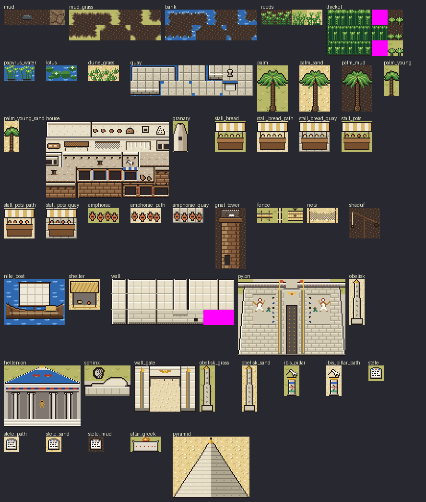

# Kemet tileset catalog

`gTileset_Kemet` is Egypt's outdoor secondary: the Nile's delta and valley as the Greeks
of Naukratis saw them (OIKOUMENE.md §4.5 and §7). Pair it with the `aethos` primary, which
supplies the meadow, sand, the animated sea, limestone paths, ledges, rocks, the
Asclepeion and the Agora. Batch 1 builds Naukratis, Pharos, the Delta Reeds and Memphis
with it; batch 2's Pyramid Field, the Great Pyramid's exterior, the Nile, Heliopolis and
Elephantine share it.

**This file is generated.** `tools/ichor/art/kemet_build.py` draws the tileset, compiles it
and rewrites this catalog. The art is in `kemet_ground.py`, `kemet_flora.py`,
`kemet_town.py` and `kemet_monuments.py`; the palette plan, the ground mechanism and the
painters are in `kemet_lib.py`.



The numbered sheet is [img/kemet_sheet.png](img/kemet_sheet.png).

## The palette plan

Seven groups fill the secondary's palettes 6-12. Every 8x8 tile takes all its colors
from one group (`kemet_lib.validate()` enforces it), so Porytiles can always pack them.

| Group | Holds |
|---|---|
| nile | Black mud (wet, dry, cracked), the bank's foam line, aethos's meadow greens for tufts |
| reed | Papyrus stems and umbels, palm fronds and trunks, dates, mud at their feet |
| stone | Tura limestone (walls, quays, obelisks, pyramids), sand, electrum caps |
| paint | Ochre red and yellow, malachite, lapis, skin, on limestone: reliefs, steles, Thoth's pillar, the sphinx's nemes |
| brick | Whitewash over mud brick, bare brick, palm-log beams, dark doorways |
| hellas | Marble, terracotta, Greek blue and red, gilt: the Hellenion |
| goods | Boats, rope, reed bundles, linen, nets, Naukratis pottery |

## Ground

Each cell sits on one of:
- **borrowed aethos ground** (`grass`, `sand`, `sea`, `path`): the build points the cell's
  bottom layer at aethos's own ground metatile, so the sea under a mud bank or a papyrus
  clump keeps aethos's animation and costs no tiles;
- **drawn ground**: `mud` (Kemet's black mud, the same 16 px repeat everywhere) or `quay`
  (limestone ashlar), painted into the bottom layer;
- **none**: the art fills the cell.

Walk codes: `X` solid, `.` walkable, `T` walkable and drawn over the player, `D` a door
(`MB_NON_ANIMATED_DOOR`). Encounter cells (`reeds`, `dune_grass`) are `MB_TALL_GRASS`;
`lotus` is `MB_OCEAN_WATER`.

## How to use it

- **Edges** (`mud_grass`, `bank`, `quay`) are named by `edge_key()` (the slice's map
  builders): `tl` is a region cell with its north and west neighbours outside, `in_nw` a
  cell whose only outside neighbour is the north-west diagonal.
- **Thickets** are regions at least 2x2: `nw n ne / w c e / sw s se` by which sides face
  out (`c2`, `n2`, `s2` for variety), and above every north-edge cell a `fringe_mud`,
  `fringe_mud2` or `fringe_grass`, whose umbels are drawn over the player.
- **Walls**: a top is `top_NSWE` with a 1 for each side the wall continues; south of a top
  with no wall below goes a face, `face_WE`.
- Doors are part `door` of each house; the build sets their behavior.

**Budget.** 491 of 504 tiles. Sections start on fixed rows: Ground and water at row 0 (0x200), Trees at row 12 (0x260), Households at row 15 (0x278), Yards, market and marsh at row 20 (0x2A0), Monuments at row 33 (0x308), The desert's edge at row 49 (0x388).

## Ground and water

Black mud and its edges against the meadow and the water, the papyrus (the encounter reeds and the solid thickets with their fringes), papyrus and lotus in the water, dune grass on sand, and Naukratis's limestone quays.

### `mud`: Black mud (4x1)
The delta's wet black ground, walkable. c is plain; c2 has a puddle that holds the sky; c4 dries pale and cracks.

Parts: `c` 200, `c2` 201, `c4` 203.

Walk: `....`

```
200 201 202 203
```

### `mud_grass`: Mud on the meadow's edge (6x2)
Mud fading into the meadow. Place by edge_key against the grass; plain mud (`mud`, part c) fills the middle.

Parts: `tl` 208, `t` 209, `tr` 20A, `l` 20B, `r` 20C, `bl` 20D, `b` 210, `br` 211, `in_nw` 212, `in_ne` 213, `in_sw` 214, `in_se` 215.

Walk: `...... / ......`

```
208 209 20A 20B 20C 20D
210 211 212 213 214 215
```

### `bank`: Mud banks on the water (6x2)
A mud bank against the water: mud is walkable, the water beyond it is decoration. Place by edge_key against the sea; plain mud (`mud`, part c) fills the middle.

Parts: `tl` 218, `t` 219, `tr` 21A, `l` 21B, `r` 21C, `bl` 21D, `b` 220, `br` 221, `in_nw` 222, `in_ne` 223, `in_sw` 224, `in_se` 225.

Walk: `...... / ......`

```
218 219 21A 21B 21C 21D
220 221 222 223 224 225
```

### `reeds`: Papyrus reeds (wild encounters) (4x1)
Tall grass for the delta: MB_TALL_GRASS. a and b grow in mud, g in the meadow, s in Pharos's sand. Lay a and b in a checker so a field doesn't stripe.

Parts: `a` 228, `b` 229, `g` 22A, `s` 22B.

Walk: `....`

```
228 229 22A 22B
```

### `thicket`: Papyrus thicket (solid) (5x3)
Papyrus taller than a man: the delta's walls. Lay a region of it with the 3x3 parts by which sides face out (nw n ne / w c e / sw s se; c2 for variety). Above every north-edge cell put a fringe (fringe_mud or fringe_grass by the ground there): the top rank's umbels, drawn over the player. Every region is at least 2x2.

Parts: `nw` 230, `n` 231, `ne` 232, `w` 238, `c` 239, `e` 23A, `sw` 240, `s` 241, `se` 242, `c2` 23B, `fringe_mud` 234, `fringe_mud2` 23C, `fringe_grass` 244.

Walk: `XXX.T / XXXXT / XXX.T`

```
230 231 232 233 234
238 239 23A 23B 23C
240 241 242 243 244
```

### `papyrus_water`: Papyrus standing in water (2x1)
A clump of papyrus out in the channel: solid, the water round it animated.

Parts: `a` 235, `b` 236.

Walk: `XX`

```
235 236
```

### `lotus`: Lotus pads (surfable) (2x1)
White lotus on the water, the Egyptians' flower of the morning. Surfable (MB_OCEAN_WATER): it rolls water encounters like open water.

Parts: `a` 248, `b` 249.

Walk: `..`

```
248 249
```

### `dune_grass`: Dune grass on sand (wild encounters) (2x1)
Pharos's encounter grass: marram tufts on aethos's sand. MB_TALL_GRASS.

Parts: `a` 24A, `b` 24B.

Walk: `..`

```
24A 24B
```

### `quay`: Limestone quay (8x2)
Naukratis's harbor. c is solid ashlar ground; the edges stand on the sea by edge_key; steps runs down into the water on a north edge (the mooring, where Nausikles waits); bollard is a solid mooring stone; c is plain quay.

Parts: `c` 257, `tl` 250, `t` 251, `tr` 252, `l` 253, `r` 254, `bl` 255, `b` 258, `br` 259, `in_nw` 25A, `in_ne` 25B, `in_sw` 25C, `in_se` 25D, `bollard` 256, `steps` 25E.

Walk: `......X. / ........`

```
250 251 252 253 254 255 256 257
258 259 25A 25B 25C 25D 25E 25F
```

## Trees

Date palms on grass, sand and mud, and young palms.

### `palm`: Date palm (2x3)
A date palm, 2x3: its crown's top row is drawn over the player, who walks behind it. Dates hang under the fronds.

Walk: `TT / XX / XX`

```
260 261
268 269
270 271
```

### `palm_sand`: Date palm on sand (2x3)
A date palm, 2x3: its crown's top row is drawn over the player, who walks behind it. Dates hang under the fronds.

Walk: `TT / XX / XX`

```
262 263
26A 26B
272 273
```

### `palm_mud`: Date palm on mud (2x3)
A date palm, 2x3: its crown's top row is drawn over the player, who walks behind it. Dates hang under the fronds.

Walk: `TT / XX / XX`

```
264 265
26C 26D
274 275
```

### `palm_young`: Young date palm (1x2)
A young date palm, 1x2: crown over the player, trunk solid.

Walk: `T / X`

```
266
26E
```

### `palm_young_sand`: Young date palm on sand (1x2)
A young date palm, 1x2: crown over the player, trunk solid.

Walk: `T / X`

```
267
26F
```

## Households

The house kit: roofs and their furniture, whitewashed and bare mud-brick walls, windows and doors. Every household in Naukratis and Memphis is a recipe of these parts, so each looks like whoever lives there.

### `house`: House kit: mud brick, whitewashed or bare (8x5)
Every house in Naukratis and Memphis is a recipe of these parts, three rows tall: `roof_*` (W, run, E, then furniture: jars, pots, dome, malqaf, dovecote, scrolls, and the pairs shade, nets, linen, loggia), the upper wall (`up_*` whitewashed, `rup_*` bare brick: W, run, win, E, and up_ibis painted with Thoth's bird) and the ground floor (`lo_*`, `rlo_*`: W, run, win, E, jars, and the doors). Door parts are MB_NON_ANIMATED_DOOR.

Parts: `roof_W` 278, `roof_run` 279, `roof_E` 27A, `roof_jars` 27B, `roof_pots` 27C, `roof_dome` 27D, `roof_malqaf` 27E, `roof_dovecote` 27F, `roof_scrolls` 280, `roof_shade_l` 281, `roof_shade_r` 282, `roof_nets_l` 283, `roof_nets_r` 284, `roof_linen_l` 285, `roof_linen_r` 286, `roof_loggia_l` 287, `roof_loggia_r` 288, `up_W` 289, `up` 28A, `up_win` 28B, `up_E` 28C, `up_ibis` 28D, `lo_W` 28E, `lo` 28F, `lo_win` 290, `lo_E` 291, `lo_door` 292, `lo_door_blue` 293, `lo_door_red` 294, `lo_door_awning` 295, `lo_jars` 296, `rup_W` 297, `rup` 298, `rup_E` 299, `rlo_W` 29A, `rlo` 29B, `rlo_E` 29C, `rlo_door` 29D, `rlo_door_red` 29E, `rlo_door_wide` 29F.

Walk: `XXXXXXXX / XXXXXXXX / XXXXXXXX / XXDDDDXX / XXXXXDDD`

```
278 279 27A 27B 27C 27D 27E 27F
280 281 282 283 284 285 286 287
288 289 28A 28B 28C 28D 28E 28F
290 291 292 293 294 295 296 297
298 299 29A 29B 29C 29D 29E 29F
```

## Yards, market and marsh

Granary domes, market stalls, Greek amphorae, the gnat-tower, reed fences, nets, the shaduf, boats and the seal-herders' shelter.

### `granary`: Granary dome (1x2)
A beehive grain silo with its filling hole and a ladder: Egypt's bread. Its dome is drawn over the player.

Walk: `T / X`

```
2A0
2A8
```

### `stall_bread`: Market stall: bread (2x2)
A market table under a linen awning on poles.

Walk: `XX / XX`

```
2A1 2A2
2A9 2AA
```

### `stall_bread_path`: Market stall: bread (on path) (2x2)
A market table under a linen awning on poles.

Walk: `XX / XX`

```
2A3 2A4
2AB 2AC
```

### `stall_bread_quay`: Market stall: bread (on quay) (2x2)
A market table under a linen awning on poles.

Walk: `XX / XX`

```
2A5 2A6
2AD 2AE
```

### `stall_pots`: Market stall: pots (2x2)
A market table under a linen awning on poles.

Walk: `XX / XX`

```
2B0 2B1
2B8 2B9
```

### `stall_pots_path`: Market stall: pots (on path) (2x2)
A market table under a linen awning on poles.

Walk: `XX / XX`

```
2B2 2B3
2BA 2BB
```

### `stall_pots_quay`: Market stall: pots (on quay) (2x2)
A market table under a linen awning on poles.

Walk: `XX / XX`

```
2B4 2B5
2BC 2BD
```

### `amphorae`: Greek amphorae (Naukratis ware) (2x1)
Naukratis's own pottery, black-figure on orange clay, waiting for a ship.

Walk: `XX`

```
2B6 2B7
```

### `amphorae_path`: Greek amphorae (Naukratis ware) (on path) (2x1)
Naukratis's own pottery, black-figure on orange clay, waiting for a ship.

Walk: `XX`

```
2C0 2C1
```

### `amphorae_quay`: Greek amphorae (Naukratis ware) (on quay) (2x1)
Naukratis's own pottery, black-figure on orange clay, waiting for a ship.

Walk: `XX`

```
2C2 2C3
```

### `gnat_tower`: Gnat-tower (2x4)
A mud-brick tower in the marsh; at night the family sleeps on top under a net, above the gnats (Herodotus 2.95). The top row is drawn over the player. Solid below.

Walk: `TT / XX / XX / XX`

```
2C4 2C5
2CC 2CD
2D4 2D5
2DC 2DD
```

### `fence`: Reed fence (3x1)
Bundled reeds lashed to stakes. Parts: run (west-east), v (north-south), gate (a closed gate with a papyrus finial, for the Papyrus Shallows Nursery until it opens).

Parts: `run` 2E0, `v` 2E1, `gate` 2E2.

Walk: `XXX`

```
2E0 2E1 2E2
```

### `nets`: Nets drying on poles (2x1)
A fisher's nets hung to dry, on sand (Pharos, the harbor's beach).

Walk: `XX`

```
2E3 2E4
```

### `shaduf`: Shaduf (2x2)
A water-lift: a pole on a forked post, a bucket at one end and a mud counterweight at the other. Stands on the bank.

Walk: `XX / XX`

```
2E5 2E6
2ED 2EE
```

### `nile_boat`: Nile boat (4x3)
A cargo boat with a tall linen sail, moored at the quay. Solid.

Walk: `XXXX / XXXX / XXXX`

```
2F0 2F1 2F2 2F3
2F8 2F9 2FA 2FB
300 301 302 303
```

### `shelter`: Seal-herders' shelter (2x2)
A reed lean-to on Pharos where the pharaoh's seal-herders keep out of the sun. Open-fronted; no door.

Walk: `XX / XX`

```
2F4 2F5
2FC 2FD
```

## Monuments

The White Walls and their gate, the pylon of Proteus's precinct, obelisks, the sphinx, Thoth's ibis pillar, steles, and the Hellenion with its altar.

### `wall`: The White Walls (8x3)
Memphis's whitewashed limestone walls. Tops: part `top_NSWE` with a 1 for each side the wall continues (top_0011 runs west-east). Faces go south of a top with no wall below: face_WE (face_11 runs on both sides). Solid.

Parts: `top_0000` 308, `top_0001` 309, `top_0010` 30A, `top_0011` 30B, `top_0100` 30C, `top_0101` 30D, `top_0110` 30E, `top_0111` 30F, `top_1000` 310, `top_1001` 311, `top_1010` 312, `top_1011` 313, `top_1100` 314, `top_1101` 315, `top_1110` 316, `top_1111` 317, `face_00` 318, `face_01` 319, `face_10` 31A, `face_11` 31B, `face_band` 31C, `face_drain` 31D.

Walk: `XXXXXXXX / XXXXXXXX / XXXXXXXX`

```
308 309 30A 30B 30C 30D 30E 30F
310 311 312 313 314 315 316 317
318 319 31A 31B 31C 31D 31E 31F
```

### `pylon`: Pylon of the precinct of Proteus (7x5)
The pylon gate of Pharaoh Proteus's precinct (batch 2's hall). Door at part `door`. Symmetric: the right half is the left flipped.

Parts: `door` 343.

Walk: `XXXXXXX / XXXXXXX / XXXXXXX / XXXXXXX / XXXDXXX`

```
320 321 322 323 324 325 326
328 329 32A 32B 32C 32D 32E
330 331 332 333 334 335 336
338 339 33A 33B 33C 33D 33E
340 341 342 343 344 345 346
```

### `obelisk`: Obelisk (path) (1x3)
A granite-pink limestone needle with a gilt pyramidion; hieroglyphs run down its face. The upper two rows are drawn over the player.

Walk: `T / T / X`

```
327
32F
337
```

### `hellenion`: The Hellenion's temple (5x4)
Greek gods in an Egyptian town: Ionic columns, a painted pediment, the porch open on Apollo's bronze statue. No door (a bg event reads it). Symmetric.

Walk: `XXXXX / XXXXX / XXXXX / XXXXX`

```
348 349 34A 34B 34C
350 351 352 353 354
358 359 35A 35B 35C
360 361 362 363 364
```

### `sphinx`: The alabaster sphinx of Memphis (3x2)
A recumbent lion with Pharaoh's face and the striped nemes, facing west, on its plinth.

Walk: `XXX / XXX`

```
34D 34E 34F
355 356 357
```

### `wall_gate`: Gate in the White Walls (4x3)
A gate through the walls: the road runs north-south through its middle two columns, under the lintel (drawn over the player). The towers are solid. Lay wall tops and faces either side.

Walk: `XTTX / XTTX / X..X`

```
368 369 36A 36B
370 371 372 373
378 379 37A 37B
```

### `obelisk_grass`: Obelisk (grass) (1x3)
A granite-pink limestone needle with a gilt pyramidion; hieroglyphs run down its face. The upper two rows are drawn over the player.

Walk: `T / T / X`

```
36C
374
37C
```

### `obelisk_sand`: Obelisk (sand) (1x3)
A granite-pink limestone needle with a gilt pyramidion; hieroglyphs run down its face. The upper two rows are drawn over the player.

Walk: `T / T / X`

```
36D
375
37D
```

### `ibis_pillar`: Thoth's ibis pillar (grass) (1x2)
The Egyptian herm: a painted pillar with Thoth's ibis on top, the waystone where Greeks anoint their Hermes. The bird is drawn over the player.

Walk: `T / X`

```
36E
376
```

### `ibis_pillar_path`: Thoth's ibis pillar (path) (1x2)
The Egyptian herm: a painted pillar with Thoth's ibis on top, the waystone where Greeks anoint their Hermes. The bird is drawn over the player.

Walk: `T / X`

```
36F
377
```

### `stele`: Painted stele (grass) (1x1)
A round-topped stele with a winged sun and a few lines of hieroglyphs: Kemet's signpost (a bg event reads it).

Walk: `X`

```
380
```

### `stele_path`: Painted stele (path) (1x1)
A round-topped stele with a winged sun and a few lines of hieroglyphs: Kemet's signpost (a bg event reads it).

Walk: `X`

```
381
```

### `stele_sand`: Painted stele (sand) (1x1)
A round-topped stele with a winged sun and a few lines of hieroglyphs: Kemet's signpost (a bg event reads it).

Walk: `X`

```
382
```

### `stele_mud`: Painted stele (mud) (1x1)
A round-topped stele with a winged sun and a few lines of hieroglyphs: Kemet's signpost (a bg event reads it).

Walk: `X`

```
383
```

### `altar_greek`: Greek altar (2x1)
A marble altar with volutes, fire on it: the Hellenion's.

Walk: `XX`

```
384 385
```

## The desert's edge

A pyramid, for the Pyramid Field (batch 2). Rows 53-63 are free for batch 2's pieces.

### `pyramid`: Pyramid (5x4)
Cased in polished Tura limestone, capped in electrum. The top row is drawn over the player. Stands on aethos's sand.

Walk: `TTTTT / XXXXX / XXXXX / XXXXX`

```
388 389 38A 38B 38C
390 391 392 393 394
398 399 39A 39B 39C
3A0 3A1 3A2 3A3 3A4
```
