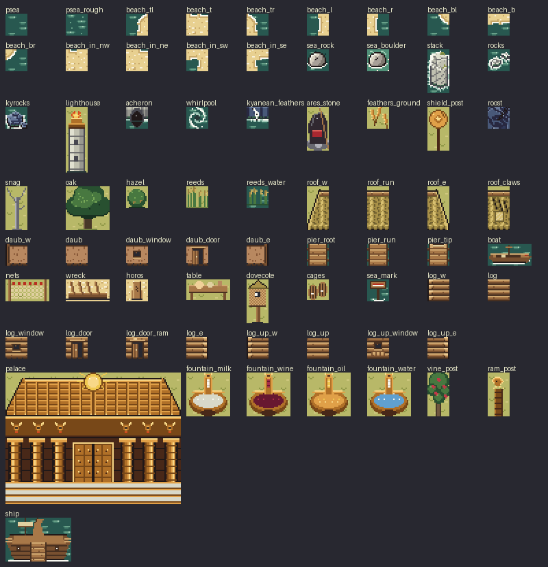

# Pontos tileset catalog

`gTileset_Pontos` is the Black Sea's outdoor secondary (OIKOUMENE.md §4.3 and §7): a dark
green sea under low cloud, white chalk cliffs, the blue-black Clashing Rocks, Thracian
Salmydessos in wattle and thatch, Colchian Aia in log towers, and Aietes's bronze palace
with Hephaestus's four fountains. Pair it with the `aethos` primary, which supplies grass,
tall grass, paths, sand, olives, pines, steles, herms, the Asclepeion and the Agora.

**This file is generated.** `/usr/bin/python3 tools/ichor/art/pontos_build.py` draws the
tileset, compiles it and rewrites this catalog. The art is in `pontos_coast.py` (the coast
autotiles), `pontos_props.py` (sea, rocks, landmarks, the Isle of Ares, flora) and
`pontos_town.py` (houses, the palace, the fountains, harbors); the palette plan and the
ground mechanism are in `pontos_lib.py`.

The numbered sheet is [img/pontos_sheet.png](img/pontos_sheet.png).

## The palettes

| Slot | Group | Holds |
|---|---|---|
| 6-11 | chalk, kyanean, bronze, timber, flora, accent | Packed by Porytiles from `pontos_lib.GROUPS`; every 8x8 tile draws from one group |
| 12 | the Pontic sea | Not packed. aethos's sea palette (slot 5) with every blue turned dark sea green (`pontos_lib.PONTIC`). Pontos metatiles that point at aethos's water tiles with palette 12 show aethos's animated water in Black Sea colors, for no tiles |

**Borrowed ground.** A cell on `grass`, `sand`, `path`, `tall` or `psea` ground has its
bottom layer pointed at aethos's metatile (0x001, 0x124, 0x1D9, 0x00D, and 0x170 in
palette 12). Rebuild Pontos whenever aethos is repainted.

**The coast autotiles.** Each coast piece is the center of a 3x3 neighbourhood of land (1)
and sea (0), drawn so that neighbours meet exactly. Map builders list the neighbourhoods
they need in `tools/ichor/art/pontos_shapes.json` (`--shapes`), the build draws one piece
per distinct drawing, and `build/pontos/coast_index.json` maps every neighbourhood to its
piece. Plain chalk land is aethos's grass; plain sea is `psea`.

## Budget

397 of 504 tiles (the door animations own 504-511). Batch 1 fills sheet rows 0-46; rows 50-63 are batch 2's (the Phasis, the Field of Ares, the Grove of Ares, Leuke, the Caucasus caves).

## Structures

### The Pontic sea (from row 0, 0x200)

aethos's animated water, re-pointed at palette 12 so it is the Black Sea's dark green: open sea, rough water, the beach edges and rocks in the sea. No tiles of their own.

| Key | What | Size | Ids | Walk |
|---|---|---|---|---|
| `psea` | The Pontic sea (aethos 0x170, palette 12) | 1x1 | 200 | `.` |
| `psea_rough` | Rough water (aethos 0x14E, palette 12) | 1x1 | 201 | `.` |
| `beach_tl` | Beach edge tl (aethos 0x11B, palette 12) | 1x1 | 202 | `.` |
| `beach_t` | Beach edge t (aethos 0x11C, palette 12) | 1x1 | 203 | `.` |
| `beach_tr` | Beach edge tr (aethos 0x11D, palette 12) | 1x1 | 204 | `.` |
| `beach_l` | Beach edge l (aethos 0x123, palette 12) | 1x1 | 205 | `.` |
| `beach_r` | Beach edge r (aethos 0x125, palette 12) | 1x1 | 206 | `.` |
| `beach_bl` | Beach edge bl (aethos 0x12B, palette 12) | 1x1 | 207 | `.` |
| `beach_b` | Beach edge b (aethos 0x12C, palette 12) | 1x1 | 208 | `.` |
| `beach_br` | Beach edge br (aethos 0x12D, palette 12) | 1x1 | 209 | `.` |
| `beach_in_nw` | Beach edge in_nw (aethos 0x13D, palette 12) | 1x1 | 20A | `.` |
| `beach_in_ne` | Beach edge in_ne (aethos 0x13E, palette 12) | 1x1 | 20B | `.` |
| `beach_in_sw` | Beach edge in_sw (aethos 0x145, palette 12) | 1x1 | 20C | `.` |
| `beach_in_se` | Beach edge in_se (aethos 0x146, palette 12) | 1x1 | 20D | `.` |
| `sea_rock` | Rock in the sea (aethos 0x18C, palette 12) | 1x1 | 20E | `X` |
| `sea_boulder` | Boulder in the sea, foam ring (aethos 0x0C5, palette 12) | 1x1 | 20F | `X` |

### The coast: cliffs, the Kyaneai and quays (from row 3, 0x218)

Autotiles: one piece per 3x3 neighbourhood of land and sea the maps use (pontos_shapes.json). chalk = the white cliffs, kyanean = the Clashing Rocks, quay = dressed stone. Map builders place them through build/pontos/coast_index.json.

Pieces: chalk 63, kyanean 37, quay 23; ids 0x218-0x292.

### Rocks and landmarks (from row 22, 0x2B0)

Chalk and kyanean crags, the lighthouse, the shrine of Zeus of the Fair Wind, the Acherusian cave, whirlpools, and the dove's feathers in the Clashing Rocks.

| Key | What | Size | Ids | Walk |
|---|---|---|---|---|
| `stack` | Chalk sea stack | 1x2 | 2B0 2B8 | `X` `X` |
| `rocks` | Chalk rocks awash | 1x1 | 2B1 | `X` |
| `kyrocks` | Kyanean rocks awash | 1x1 | 2B2 | `X` |
| `lighthouse` | Colony lighthouse | 1x3 | 2B3 2BB 2C3 | `X` `X` `X` |
| `acheron` | The Acherusian cave in a chalk face | 1x1 | 2B4 | `X` |
| `whirlpool` | Whirlpool | 1x1 | 2B5 | `X` |
| `kyanean_feathers` | Clashing Rocks' face: a dove's feathers in a crack | 1x1 | 2B6 | `X` |

### The Isle of Ares and the woods (from row 25, 0x2C8)

The Amazons' black stone, the birds' feathers in the turf, the shield post, the roost, a dead perch; Pontic oaks, hazel, the Phasis's reeds.

| Key | What | Size | Ids | Walk |
|---|---|---|---|---|
| `ares_stone` | The black stone of Ares | 1x2 | 2C8 2D0 | `X` `X` |
| `feathers_ground` | Bird of Ares feathers stuck in the ground | 1x1 | 2C9 | `X` |
| `shield_post` | Bronze shield on a post | 1x2 | 2CA 2D2 | `X` `X` |
| `roost` | The great roost | 1x1 | 2CB | `X` |
| `snag` | Dead tree, a perch | 1x2 | 2CC 2D4 | `X` `X` |
| `oak` | Pontic oak | 2x2 | 2CD 2CE 2D5 2D6 | `XX` `XX` |
| `hazel` | Hazel bush | 1x1 | 2CF | `X` |
| `reeds` | Reeds on the bank | 1x1 | 2D8 | `X` |
| `reeds_water` | Reeds in the shallows | 1x1 | 2D9 | `X` |

### Salmydessos (from row 29, 0x2E8)

The thatch-roof kit (shared with Aia), wattle-and-daub walls, the pier, a fishing boat, nets, the wreck and its boundary stones, Phineus's table, the dovecote and cages, sea-marks.

| Key | What | Size | Ids | Walk |
|---|---|---|---|---|
| `roof_w` | Thatch roof, west end | 1x2 | 2E8 2F0 | `X` `X` |
| `roof_run` | Thatch roof, run | 1x2 | 2E9 2F1 | `X` `X` |
| `roof_e` | Thatch roof, east end | 1x2 | 2EA 2F2 | `X` `X` |
| `roof_claws` | Thatch roof, run, raked by Harpies | 1x2 | 2EB 2F3 | `X` `X` |
| `daub_w` | Daub wall, west end | 1x1 | 2EC | `X` |
| `daub` | Daub wall | 1x1 | 2ED | `X` |
| `daub_window` | Daub wall, window | 1x1 | 2EE | `X` |
| `daub_door` | Daub wall, door (warp here) | 1x1 | 2EF | `D` |
| `daub_e` | Daub wall, east end | 1x1 | 2F8 | `X` |
| `pier_root` | Pier, root at the shore | 1x1 | 2F9 | `.` |
| `pier_run` | Pier, run | 1x1 | 2FA | `.` |
| `pier_tip` | Pier, tip with posts | 1x1 | 2FB | `.` |
| `boat` | Fishing boat, moored | 2x1 | 2FC 2FD | `XX` |
| `nets` | Nets drying on poles | 2x1 | 2FE 2FF | `XX` |
| `wreck` | Wreck timbers | 2x1 | 300 301 | `XX` |
| `horos` | Boundary stone on the beach | 1x1 | 302 | `X` |
| `table` | Phineus's table | 2x1 | 303 304 | `XX` |
| `dovecote` | Dovecote | 1x2 | 305 30D | `T` `X` |
| `cages` | Bird cages | 1x1 | 306 | `X` |
| `sea_mark` | Sea-mark post with a board | 1x1 | 307 | `X` |

### Aia (from row 35, 0x318)

Colchian log walls (Vitruvius's towers), Aietes's bronze palace, Hephaestus's four fountains and their vines, the ram post, the Euploia at her mooring.

| Key | What | Size | Ids | Walk |
|---|---|---|---|---|
| `log_w` | Log wall, west corner | 1x1 | 318 | `X` |
| `log` | Log wall | 1x1 | 319 | `X` |
| `log_window` | Log wall, window | 1x1 | 31A | `X` |
| `log_door` | Log wall, door (warp here) | 1x1 | 31B | `D` |
| `log_door_ram` | Log wall, door under a carved ram (Phrixos's sons) | 1x1 | 31C | `D` |
| `log_e` | Log wall, east corner | 1x1 | 31D | `X` |
| `log_up_w` | Log wall, upper floor, west corner | 1x1 | 31E | `X` |
| `log_up` | Log wall, upper floor | 1x1 | 31F | `X` |
| `log_up_window` | Log wall, upper floor, window and gallery | 1x1 | 320 | `X` |
| `log_up_e` | Log wall, upper floor, east corner | 1x1 | 321 | `X` |
| `palace` | Aietes's bronze palace | 8x6 | 328 329 32A 32B 32C 32D 32E 32F 330 331 332 333 334 335 336 337 338 339 33A 33B 33C 33D 33E 33F 340 341 342 343 344 345 346 347 348 349 34A 34B 34C 34D 34E 34F 350 351 352 353 354 355 356 357 | `XXXXXXXX` `XXXXXXXX` `XXXXXXXX` `XXXXXXXX` `XXXXXXXX` `........` |
| `fountain_milk` | Fountain of milk | 2x2 | 358 359 360 361 | `XX` `XX` |
| `fountain_wine` | Fountain of wine | 2x2 | 35A 35B 362 363 | `XX` `XX` |
| `fountain_oil` | Fountain of oil | 2x2 | 35C 35D 364 365 | `XX` `XX` |
| `fountain_water` | Fountain of water | 2x2 | 35E 35F 366 367 | `XX` `XX` |
| `vine_post` | Vine on a trellis post | 1x2 | 368 370 | `T` `X` |
| `ram_post` | Ram post, Aia's waystone | 1x2 | 369 371 | `X` `X` |
| `ship` | The Euploia, moored stern-to | 3x2 | 36A 36B 36C 372 373 374 | `XXX` `XXX` |

