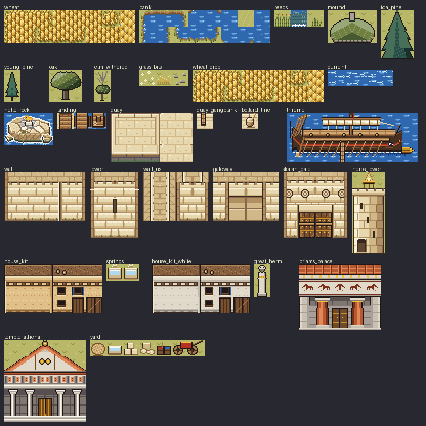

# Troas tileset catalog

`gTileset_Troas` is the Troad's outdoor secondary: the wheat-gold plain, the Skamander's
reeds and banks, Ida's pines, heroes' burial mounds, the fast blue Hellespont, Sestos's
harbor and Hero's tower, and Ilion's great sloping walls of pale limestone (OIKOUMENE.md
§4.1, §7). Pair it with the `aethos` primary, which supplies grass, paths, sand, the sea,
cliffs, olives, cypresses and stone pines, the Asclepeion and the Agora.

**This file is generated.** `tools/ichor/art/troas_build.py` draws the tileset, compiles it
and rewrites this catalog. The art is in `troas_land.py`, `troas_sea.py`, `troas_walls.py`
and `troas_town.py`; the palette plan and painters are in `troas_lib.py`.



## Palettes (slots 6-12)

| Group | Holds |
|---|---|
| wood | Akti's wood group, slot for slot: the Euploia, the landing stage, the Skaian Gate's leaves, hay, dye vats, the chariot, wool |
| marble | Akti's marble group: the temple of Athena, Priam's megaron, the great herm, Hero's lamp, Helle's gilded ram |
| stone | Akti's stone group: Ilion's walls, gates and towers, Hero's tower, the quay, Helle's rock, the current's foam, troughs, springs, the mason's blocks |
| plaster | Trojan houses: ochre lime plaster, packed-clay flat roofs, timber |
| plaster2 | the same with whitewash, slot for slot (`house_kit_white` costs no tiles) |
| field | wheat, reeds, river banks, field flowers |
| grove | Ida's pines, the oak, the elm, the burial mound |

## How to use it

- Ids below are metatile ids (secondary metatiles start at `0x200`). Map builders place
  structures by key and part name from `build/troas/catalog.json`.
- Walk codes: `X` impassable, `.` passable, `D` a door (`MB_NON_ANIMATED_DOOR`, warp here).
- Cells marked *on grass / sand / sea* borrow aethos's ground metatile under their art, so
  they sit seamlessly on aethos's ground and the sea under them animates.
- **Seams.** Troas pieces may not stand in a seam's aethos-only strip (MAP_DESIGN §5)
  unless the neighbour also uses troas.
- **Door tiles.** Door animations overwrite tiles 504-511; the tileset stays under 504.

**Tile budget.** 476 of 504 tiles are used.

## The plain

Wheat (the Troad's tall grass) and the Skamander's banks in soft-edged shapes, reeds, a heroes' burial mound, Ida's black pines, the valonia oak, Protesilaos's withered elm, and flowers and stones for the grass.

### Wheat on the plain (tall grass)

`wheat`, 8 wide by 2 tall. The Troad's tall grass: standing wheat, gold against aethos's grass, in fourteen soft-edged shapes named by the side the grass is on (n, ne, ... in_se for an inner corner, one for a lone clump). c2 and c3 are middles with another ear pattern and cornflowers. Every cell is MB_TALL_GRASS.

Borrowed ground: grass.

```
    200 201 202 203 204 205 206 207
    208 209 20A 20B 20C 20D 20E 20F

    . . . . . . . .
    . . . . . . . .
```
Parts: `nw` 200, `n` 201, `ne` 202, `in_nw` 203, `in_ne` 204, `c` 205, `one` 206, `c2` 207, `w` 208, `e` 209, `sw` 20A, `s` 20B, `se` 20C, `in_sw` 20D, `in_se` 20E, `c3` 20F

Behaviors: MB_TALL_GRASS

### River banks

`bank`, 8 wide by 2 tall. For the Skamander: water cells on aethos's sea with turf and a lip of wet earth drawn over the land side, in the same fourteen shapes as the wheat (the region is the water: n means land to the north). Surfable; mark them as water (elevation 1).

Borrowed ground: sea.

```
    210 211 212 213 214 215 216 217
    218 219 21A 21B 21C 21D 21E 21F

    . . . . . . . .
    . . . . . . . .
```
Parts: `nw` 210, `n` 211, `ne` 212, `in_nw` 213, `in_ne` 214, `c` 215, `one` 216, `c2` 217, `w` 218, `e` 219, `sw` 21A, `s` 21B, `se` 21C, `in_sw` 21D, `in_se` 21E, `c3` 21F

Behaviors: MB_OCEAN_WATER

### Reeds of the Skamander

`reeds`, 3 wide by 1 tall. Cell 0: a reed bed on grass, tall grass (MB_TALL_GRASS). Cell 1: reeds standing in the water at a bank, impassable, on aethos's sea. Cell 2: a small reed tuft on grass, walkable decoration.

Borrowed ground: grass, sea.

```
    220 221 222

    . X .
```
Behaviors: MB_TALL_GRASS

### A heroes' burial mound

`mound`, 3 wide by 2 tall. A tumulus on the plain (Achilles's and Patroclus's at Sigeion, Protesilaos's across the strait, the heroes' mounds on the Skamander). Impassable; dig spots in batch 2 go at its foot as hidden events.

Borrowed ground: grass.

```
    223 224 225
    22B 22C 22D

    X X X
    X X X
```
### Black pine of Ida

`ida_pine`, 2 wide by 3 tall. Ida's pine, 2 x 3. Stagger them 1-2 cells apart for a forest edge; mix with aethos's stone pines and cypresses.

Borrowed ground: grass.

```
    226 227
    22E 22F
    236 237

    X X
    X X
    X X
```
### Young pine

`young_pine`, 1 wide by 2 tall. A small pine of Ida, 1 x 2, for breaking up a tree line.

Borrowed ground: grass.

```
    238
    240

    X
    X
```
### Valonia oak

`oak`, 2 wide by 2 tall. 2 x 2. The oak by the Skaian Gate (Iliad 6.237) and the plain's shade trees.

Borrowed ground: grass.

```
    239 23A
    241 242

    X X
    X X
```
### Elm with a withered crown

`elm_withered`, 1 wide by 2 tall. Plant on and beside Protesilaos's mound on the strait's north shore.

Borrowed ground: grass.

```
    23B
    243

    X
    X
```
### Flowers and stones in the grass

`grass_bits`, 3 wide by 1 tall. Walkable scatter for varied ground: chamomile, a golden tuft of dry grass, a few field stones (wheat's c2 has the cornflowers).

Borrowed ground: grass.

```
    23C 23D 23E

    . . .
```
Parts: `chamomile` 23C, `dry_tuft` 23D, `stones` 23E

### Wheat in a town field (impassable)

`wheat_crop`, 8 wide by 2 tall. A town's standing crop: the wheat's fourteen shapes, impassable and with no wild encounters, for fields inside a town (towns have no land tables). Same names as wheat.

Borrowed ground: grass.

```
    248 249 24A 24B 24C 24D 24E 24F
    250 251 252 253 254 255 256 257

    X X X X X X X X
    X X X X X X X X
```
Parts: `nw` 248, `n` 249, `ne` 24A, `in_nw` 24B, `in_ne` 24C, `c` 24D, `one` 24E, `c2` 24F, `w` 250, `e` 251, `sw` 252, `s` 253, `se` 254, `in_sw` 255, `in_se` 256, `c3` 257

## The Hellespont

The eastward current, Helle's rock with its gilded ram, and a timber landing stage.

### The Hellespont's current (eastward)

`current`, 4 wide by 1 tall. Surfable fast water: MB_EASTWARD_CURRENT carries a surfer east until they leave it. Four variants; scatter them so the streaks never line up. Elevation 1, like the sea. Not in a seam's aethos-only strip.

Borrowed ground: sea.

```
    260 261 262 263

    . . . .
```
Parts: `v0` 260, `v1` 261, `v2` 262, `v3` 263

Behaviors: MB_EASTWARD_CURRENT

### Helle's rock

`helle_rock`, 3 wide by 2 tall. The Hellespont's set piece, mid-strait in the current. Read from a neighbouring cell (a bg event on the rock).

Borrowed ground: sea.

```
    264 265 266
    26C 26D 26E

    X X X
    X X X
```
### Timber landing stage

`landing`, 3 wide by 1 tall. Cell 0: the root, on sand (place at the shore). Cell 1: the run, on the sea, repeat it. Cell 2: the end on the sea, with a mooring post: the landing tile, where a boat ties up. All walkable; a surfer can land on any of them.

Borrowed ground: sand, sea.

```
    270 271 272

    . . .
```
Parts: `root` 270, `run` 271, `end` 272

## Sestos's harbor

Akti's quay, the Euploia and her gangplank's foot, and a bollard, drawn by Akti's own painters so the ship is the same in both ports.

### Harbor quay: ashlar paving, edges and corners

`quay`, 5 wide by 3 tall. Big limestone blocks in running bond. Water is aethos ocean, placed next to these. Row 0: NW outer corner, north edge (water to the north: coping only, the face is hidden), NE outer corner, then inner corners NW and NE (water diagonally beyond). Row 1: west edge (water west), plain quay, east edge (water east), inner corners SW and SE. Row 2: SW outer corner, south edge (water to the south: the wet face shows), SE outer corner, then two plain quay alternates. Edge cells are walkable; mark the water side impassable unless surfing.

```
    280 281 282 283 284
    288 289 28A 28B 28C
    290 291 292 293 294

    X X . X X
    . . . X X
    X X . X X
```
Parts: `NW` 280, `N` 281, `NE` 282, `inNW` 283, `inNE` 284, `W` 288, `C` 289, `E` 28A, `inSW` 28B, `inSE` 28C, `SW` 290, `S` 291, `SE` 292, `C2` 293, `C3` 294

### Quay edge with the gangplank's foot

`quay_gangplank`, 1 wide by 1 tall. The quay's north edge with the trireme's gangplank resting on it. Place it directly below the trireme's bottom row, column 3.

```
    285

    .
```
### Bollard with a mooring line

`bollard_line`, 1 wide by 1 tall. A stone bollard on the quay's north edge, its line running up to a boat moored to the north.

```
    286

    X
```
### The trireme Euploia (Akti's painter)

`trireme`, 8 wide by 3 tall. The Euploia moored bow to the right on aethos's animated sea. Place her with her bottom row on the water row just north of the quay, so the gangplank (bottom row, column 3) lands on quay_gangplank below it.

Borrowed ground: sea.

```
    298 299 29A 29B 29C 29D 29E 29F
    2A0 2A1 2A2 2A3 2A4 2A5 2A6 2A7
    2A8 2A9 2AA 2AB 2AC 2AD 2AE 2AF

    X X X X X X X X
    X X X X X X X X
    X X X X X X X X
```
## Ilion's walls and Hero's tower

The great sloping wall west-east and north-south with its corners, a bastion tower, the open ramp gate, the Skaian Gate's outer face (its doors shut: batch 2's hall), and Hero's tower with its lamp.

### Ilion's great wall (west-east)

`wall`, 5 wide by 3 tall. Three rows: the walkway and parapet, then two rows of the sloping face. Columns: west end, run, run (the same), an offset (Troy's shallow setback), east end. All impassable.

```
    2C0 2C1 2C2 2C3 2C4
    2C8 2C9 2CA 2CB 2CC
    2D0 2D1 2D2 2D3 2D4

    X X X X X
    X X X X X
    X X X X X
```
Parts: `end_W` 2C0, `run` 2C1, `offset` 2C3, `end_E` 2C4

### A tower on Ilion's wall

`tower`, 3 wide by 4 tall. Place its top row in line with the wall's top row; it stands one row proud of the wall's face.

```
    2C5 2C6 2C7
    2CD 2CE 2CF
    2D5 2D6 2D7
    2DD 2DE 2DF

    X X X
    X X X
    X X X
    X X X
```
### Ilion's wall (north-south) and its corners

`wall_ns`, 4 wide by 3 tall. Row 0, cells 0-1: ns_W and ns_E, to repeat down a north-south run (outer face west, or east). Cells 2-3 (three rows): the corner where a west or east wall turns into the great wall's south face; put it at the face's end in place of end_W or end_E.

```
    2E0 2E1 2E2 2E3
    2E8 2E9 2EA 2EB
    2F0 2F1 2F2 2F3

    X X X X
    X X X X
    X X X X
```
Parts: `ns_W` 2E0, `ns_E` 2E1, `corner_W` 2E2, `corner_E` 2E3

### Ilion's open gate (the ramp gate)

`gateway`, 4 wide by 3 tall. Set in the great wall's three rows. The middle two columns are passable: the player walks under the wall top and the lintel.

```
    2E4 2E5 2E6 2E7
    2EC 2ED 2EE 2EF
    2F4 2F5 2F6 2F7

    X . . X
    X . . X
    X . . X
```
### The Skaian Gate (outer face)

`skaian_gate`, 4 wide by 4 tall. Set in the great wall with its top row one row above the wall's top (the gate tower stands taller). The bottom cells of the two leaves, (1,3) and (2,3), are MB_NON_ANIMATED_DOOR: impassable now; the hall's build opens one and puts its warp there.

```
    2F8 2F9 2FA 2FB
    300 301 302 303
    308 309 30A 30B
    310 311 312 313

    X X X X
    X X X X
    X X X X
    X X X X
```
Behaviors: MB_NON_ANIMATED_DOOR

### Hero's tower

`heros_tower`, 2 wide by 5 tall. Sestos's landmark, 2 x 5, on the harbor's point. Door at (0,4). Row 0 is the lamp, above the tower's top, on grass: drawn over the player, who can walk behind it.

Borrowed ground: grass.

```
    2FC 2FD
    304 305
    30C 30D
    314 315
    31C 31D

    . .
    X X
    X X
    X X
    D X
```
Behaviors: MB_NON_ANIMATED_DOOR

## Houses, the palace and the temple

The Trojan house kit in ochre and in whitewash, Priam's megaron, the temple of Athena, a great herm, yard things (hay, trough, the mason's blocks and drums, dye vats, a chariot, wool drying) and the twin springs.

### Trojan house kit (ochre plaster)

`house_kit`, 6 wide by 3 tall. Assemble a house of width n from three rows: roof_W roof... roof_E; up_W ... up_E; lo_W ... lo_E, with windows, a door or the stable's double door in the middles. roof_jars varies a roof. door and stable_door are MB_NON_ANIMATED_DOOR: put the warp there.

```
    340 341 342 343 344 345
    348 349 34A 34B 34C 34D
    350 351 352 353 354 355

    X X X X X X
    X X X X X X
    X X X X D D
```
Parts: `roof_W` 340, `roof` 341, `roof_E` 342, `roof_jars` 343, `up_W` 348, `up` 349, `up_E` 34A, `up_window` 34B, `up_shutters` 34C, `lo_W` 350, `lo` 351, `lo_E` 352, `lo_window` 353, `door` 354, `stable_door` 355

Behaviors: MB_NON_ANIMATED_DOOR

### The twin springs and washing troughs

`springs`, 2 wide by 1 tall. Two cells: the warm spring (a wisp of steam) and the cold, each running into a long stone trough.

Borrowed ground: grass.

```
    346 347

    X X
```
### Trojan house kit (whitewash)

`house_kit_white`, 6 wide by 3 tall. The house kit in whitewash, part for part: same names as house_kit.

```
    358 359 35A 35B 35C 35D
    360 361 362 363 364 365
    368 369 36A 36B 36C 36D

    X X X X X X
    X X X X X X
    X X X X D D
```
Parts: `roof_W` 358, `roof` 359, `roof_E` 35A, `roof_jars` 35B, `up_W` 360, `up` 361, `up_E` 362, `up_window` 363, `up_shutters` 364, `lo_W` 368, `lo` 369, `lo_E` 36A, `lo_window` 36B, `door` 36C, `stable_door` 36D

Behaviors: MB_NON_ANIMATED_DOOR

### A great herm

`great_herm`, 1 wide by 2 tall. The waystone (ICHOR_STUB_HERM until the Oikoumene's herm run exists). Read it from below.

Borrowed ground: grass.

```
    35E
    366

    X
    X
```
### Priam's palace

`priams_palace`, 5 wide by 4 tall. 5 x 4. Door at (2,3). The crown of the citadel after the temple.

```
    370 371 372 373 374
    378 379 37A 37B 37C
    380 381 382 383 384
    388 389 38A 38B 38C

    X X X X X
    X X X X X
    X X X X X
    X X D X X
```
Behaviors: MB_NON_ANIMATED_DOOR

### The temple of Athena

`temple_athena`, 5 wide by 5 tall. 5 x 5, the city's crown on the citadel's summit. Door at (2,4).

Borrowed ground: grass.

```
    390 391 392 393 394
    398 399 39A 39B 39C
    3A0 3A1 3A2 3A3 3A4
    3A8 3A9 3AA 3AB 3AC
    3B0 3B1 3B2 3B3 3B4

    X X X X X
    X X X X X
    X X X X X
    X X X X X
    X X D X X
```
Behaviors: MB_NON_ANIMATED_DOOR

### Yard things

`yard`, 7 wide by 1 tall. hay, trough (horses drink here), blocks and drums (the mason's yard), dye_vats (the peplos-weaver's), a chariot (two cells). All impassable.

Borrowed ground: grass.

```
    3B8 3B9 3BA 3BB 3BC 3BD 3BE

    X X X X X X X
```
Parts: `hay` 3B8, `trough` 3B9, `blocks` 3BA, `drums` 3BB, `dye_vats` 3BC, `chariot_W` 3BD, `chariot_E` 3BE

