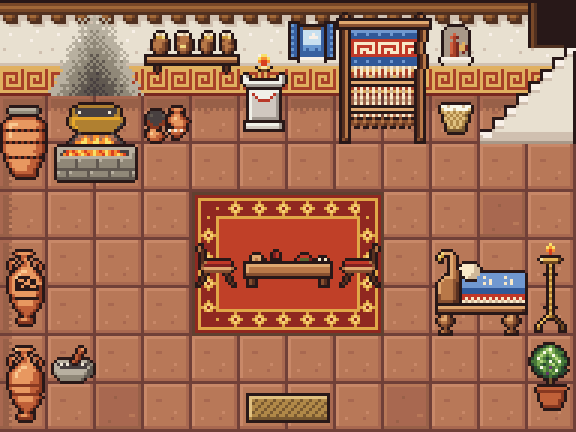
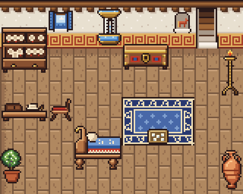
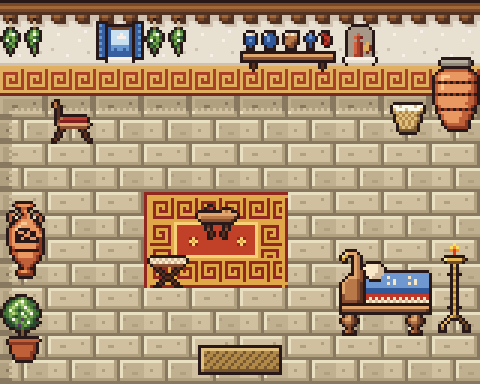
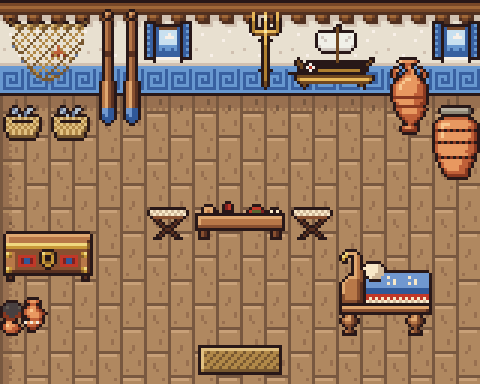

# The slice's homes, built from oikia

Four interiors for the Phase 1 slice, laid out from `gTileset_Oikia` (see `TILES_oikia.md`):

| Room | Map | Size | Floor | Render |
|---|---|---|---|---|
| Player's house 1F | `MAP_ELAIA_VILLAGE_PLAYERS_HOUSE_1F` | 12x9 | terracotta, red dado | `img/rooms_players_house_1f.png` |
| Player's house 2F | `MAP_ELAIA_VILLAGE_PLAYERS_HOUSE_2F` | 10x8 | boards, red dado | `img/rooms_players_house_2f.png` |
| Kydippe's house | `MAP_ELAIA_VILLAGE_NEIGHBORS_HOUSE` | 10x8 | limestone flags, red dado | `img/rooms_kydippe_house.png` |
| The Fisher's house | `MAP_AKTI_TOWN_FISHERS_HOUSE` | 10x8 | boards, Aegean dado | `img/rooms_fishers_house.png` |









## How to wire a room into its map

Each `design/phase1/rooms/<room>.bin` is finished blockdata: metatile ids with collision and elevation already set, in the same format as `data/layouts/*/map.bin`. For each room:

1. **Make a layout.**
   - Copy the `.bin` to `data/layouts/<LayoutName>/map.bin`.
   - Add an entry to `data/layouts/layouts.json` with the room's width and height.
   - Set `secondary_tileset` to `gTileset_Oikia`.
   - Set `primary_tileset` to `gTileset_Building` today, or `gTileset_Oikos` once it merges. Any primary works, because the rooms use no primary metatile.
   - For `border.bin`, use four of the void metatile (`211`, see the table in `TILES_oikia.md`). Vanilla uses black outside its rooms too.
2. **Point the map at the layout** and move its warps to the tiles below. Keep the warp order, so the outdoor maps' `dest_warp_id`s still match:
   - **1F:** warp 0 at (6,8) and warp 1 at (5,8), the doormat to `MAP_ELAIA_VILLAGE`; warp 2 at (10,2), the stairs to 2F warp 0. Elaia's door already targets warp 1.
   - **2F:** warp 0 at (8,1), the stairs to 1F warp 2.
   - **Kydippe's house:** warps 0 and 1 at (4,7) and (5,7), to `MAP_ELAIA_VILLAGE` warp 0.
   - **Fisher's house:** warps 0 and 1 at (4,7) and (5,7), to `MAP_AKTI_TOWN` warp 0.
3. **Place the events** from the tables below.
   - **NPCs:** the object events go on their spots.
   - **Bg events:** they go on the furniture tile. The table also says where the player stands to read each one.
   - **New game:** the start stays at (5,5) on 2F, as `src/new_game.c` already has it. In this layout, (5,5) is the rug square at the foot of the kline.

## Notes for the scripts

- **Arriving on 2F.** The player arrives on the stairwell tile (8,1) and steps south. The stair gate is the tile in front of it, (8,2). "The player steps back one tile" means south to (8,3).
- **Arriving on 1F** from upstairs puts the player on the bottom stair, (10,2). To walk up to the player, Mom goes from her spot at (3,3) east along row 3 to (10,3) and faces north. Row 3 is clear from x 3 to 11. She returns the same way.
- **The hearth is a 2x2 piece** at (1,2)-(2,3). Its bg events sit on the front row, (1,3) and (2,3), read from below. Mom's spot (3,3) is beside it, so she stands at the fire facing west.
- **Mom's loom** is the TV re-skin. It stands against the wall at (7,0)-(8,2); the bg events are on its foot, (7,2) and (8,2).
- **The kibotos** (the PC re-skin) is a 2x2 chest whose lid overlaps the wall. Use bg events on (5,2) and (6,2), not the `MB_PC` behavior, so the script can show its own line before opening item storage.
- **Kydippe's chair** is the klismos at (1,2). She stands beside it under the window at (2,2), because NPCs can't stand on furniture. Chansey's wander range fits in the open floor between the rug and the kline.
- **The Fisher's grandson** stands at (6,6), off the path from the door to Glaukos at the window, (3,2).

## Rooms

The builder writes everything below this line and checks it on every run.
- Every warp, NPC spot and coord tile is walkable and reachable from the room's door.
- Every bg event is read from the tile directly in front of it.

<!-- oikia_build: begin generated -->

### Player's house, 1F: Melitta's hall and kitchen

- Map: `MAP_ELAIA_VILLAGE_PLAYERS_HOUSE_1F`. Layout: `design/phase1/rooms/players_house_1f.bin`, **12x9** blocks, secondary `gTileset_Oikia`.
- Floor: terracotta. Wall: red dado. Render: `design/phase1/img/rooms_players_house_1f.png` (3x).

Walk map: `#` blocked, `.` open. Digits and letters mark the spots in the table; a bg event is marked on its furniture tile.

```
    012345678901
  0 ############
  1 ####8#a#####
  2 ####.9.67#2#
  3 #453........
  4 ............
  5 #...####.###
  6 #........###
  7 ##.........#
  8 #....11....#
```

| # | Kind | Tile | Read from | What |
|---|---|---|---|---|
| 1 | warp | (5,8), (6,8) |  | door to Elaia Village (south-arrow mat) |
| 2 | warp | (10,2) |  | stairs up to 2F; the player arrives here from 2F |
| 3 | npc | (3,3) | faces west | Melitta (Mom), at the hearth |
| 4 | bg | (1,3) | (1,4) facing north | hearth: "The family hearth, banked low." |
| 5 | bg | (2,3) | (2,4) facing north | hearth, right half |
| 6 | bg | (7,2) | (7,3) facing north | Mom's loom (TV re-skin): the traveling cloak |
| 7 | bg | (8,2) | (8,3) facing north | Mom's loom, right half |
| 8 | bg | (4,1) | (4,2) facing north | honey shelf: "NOT FOR {PLAYER}" |
| 9 | bg | (5,2) | (5,3) facing north | altar of Hestia (optional) |
| a | bg | (6,1) | (6,2) facing north | window (optional) |

### Player's house, 2F: the player's room

- Map: `MAP_ELAIA_VILLAGE_PLAYERS_HOUSE_2F`. Layout: `design/phase1/rooms/players_house_2f.bin`, **10x8** blocks, secondary `gTileset_Oikia`.
- Floor: boards. Wall: red dado. Render: `design/phase1/img/rooms_players_house_2f.png` (3x).

Walk map: `#` blocked, `.` open. Digits and letters mark the spots in the table; a bg event is marked on its furniture tile.

```
    0123456789
  0 ##########
  1 ##8#4###1#
  2 9a...56.2#
  3 .........#
  4 ###.......
  5 ...##37...
  6 #..##....#
  7 #........#
```

| # | Kind | Tile | Read from | What |
|---|---|---|---|---|
| 1 | warp | (8,1) |  | stairs down to 1F; the player arrives here from 1F |
| 2 | coord | (8,2) |  | stair gate ("Did you fill your water clock?") |
| 3 | npc | (5,5) | faces south | new-game start, by the kline (src/new_game.c) |
| 4 | bg | (4,1) | (4,2) facing north | klepsydra (wall clock, special StartWallClock) |
| 5 | bg | (5,2) | (5,3) facing north | kibotos chest (PC re-skin, item storage) |
| 6 | bg | (6,2) | (6,3) facing north | kibotos chest, right half |
| 7 | bg | (6,5) | (5,5) facing east | knucklebones (GameCube re-skin) |
| 8 | bg | (2,1) | (2,2) facing north | window: bees and a lyre |
| 9 | bg | (0,2) | (0,3) facing north | scroll cabinet (bookshelf): heroes with mustaches |
| a | bg | (1,2) | (1,3) facing north | scroll cabinet, right half |

### Kydippe's house, Elaia

- Map: `MAP_ELAIA_VILLAGE_NEIGHBORS_HOUSE`. Layout: `design/phase1/rooms/kydippe_house.bin`, **10x8** blocks, secondary `gTileset_Oikia`.
- Floor: flags. Wall: red dado. Render: `design/phase1/img/rooms_kydippe_house.png` (3x).

Walk map: `#` blocked, `.` open. Digits and letters mark the spots in the table; a bg event is marked on its furniture tile.

```
    0123456789
  0 ##########
  1 #######4##
  2 .#2..##.##
  3 ......3...
  4 #...#.....
  5 #..#...###
  6 #......###
  7 #...11....
```

| # | Kind | Tile | Read from | What |
|---|---|---|---|---|
| 1 | warp | (4,7), (5,7) |  | door to Elaia Village (south-arrow mat) |
| 2 | npc | (2,2) | faces south | Kydippe, by her chair under the window |
| 3 | npc | (6,3) | faces south | Chansey, wandering (keep its range inside x 2-8, y 3-6) |
| 4 | bg | (7,1) | (7,2) facing north | niche: a clay Eileithyia, goddess of births (optional) |

### The Fisher's house, Akti

- Map: `MAP_AKTI_TOWN_FISHERS_HOUSE`. Layout: `design/phase1/rooms/fishers_house.bin`, **10x8** blocks, secondary `gTileset_Oikia`.
- Floor: boards. Wall: blue dado. Render: `design/phase1/img/rooms_fishers_house.png` (3x).

Walk map: `#` blocked, `.` open. Digits and letters mark the spots in the table; a bg event is marked on its furniture tile.

```
    0123456789
  0 ##########
  1 #####456##
  2 ###2....##
  3 .........#
  4 ##.####...
  5 ##.....##.
  6 #.....3##.
  7 ....11....
```

| # | Kind | Tile | Read from | What |
|---|---|---|---|---|
| 1 | warp | (4,7), (5,7) |  | door to Akti Town (south-arrow mat) |
| 2 | npc | (3,2) | faces south | Glaukos, by the window |
| 3 | npc | (6,6) | faces west | Glaukos's grandson |
| 4 | bg | (5,1) | (5,2) facing north | trident on the wall (optional) |
| 5 | bg | (6,1) | (6,2) facing north | model ship (optional) |
| 6 | bg | (7,1) | (7,2) facing north | model ship, right half |

### The divers' house, Akti

- Map: `MAP_AKTI_TOWN_DIVERS_HOUSE`. Layout: `design/phase1/rooms/divers_house.bin`, **9x7** blocks, secondary `gTileset_Oikia`.
- Floor: flags. Wall: blue dado. Render: `design/phase1/img/rooms_divers_house.png` (3x).

Walk map: `#` blocked, `.` open. Digits and letters mark the spots in the table; a bg event is marked on its furniture tile.

```
    012345678
  0 #########
  1 #########
  2 ###..#3##
  3 #.2....##
  4 ...##..##
  5 #....#..#
  6 #..11...#
```

| # | Kind | Tile | Read from | What |
|---|---|---|---|---|
| 1 | warp | (3,6), (4,6) |  | door to Akti Town (south-arrow mat) |
| 2 | npc | (2,3) | faces south | Doris, Hydna's grandmother, by her sponge baskets |
| 3 | bg | (6,2) | (6,3) facing north | Hydna's water clock: she times her dives by it |

### The goatherd's farmhouse, Akti

- Map: `MAP_AKTI_TOWN_GOATHERDS_HOUSE`. Layout: `design/phase1/rooms/goatherds_house.bin`, **11x7** blocks, secondary `gTileset_Oikia`.
- Floor: terracotta. Wall: red dado. Render: `design/phase1/img/rooms_goatherds_house.png` (3x).

Walk map: `#` blocked, `.` open. Digits and letters mark the spots in the table; a bg event is marked on its furniture tile.

```
    01234567890
  0 ###########
  1 ###########
  2 ####.....##
  3 #42.....##.
  4 #...######.
  5 #.....3.###
  6 ...11...###
```

| # | Kind | Tile | Read from | What |
|---|---|---|---|---|
| 1 | warp | (3,6), (4,6) |  | door to Akti Town (south-arrow mat) |
| 2 | npc | (2,3) | faces west | Aigon the goatherd, at his hearth |
| 3 | npc | (6,5) | faces south | a Skiddo kid, wandering (keep its range inside x 5-7, y 5-6) |
| 4 | bg | (1,3) | (1,4) facing north | hearth: "Goat's milk warms by the fire." (optional) |

<!-- oikia_build: end generated -->
