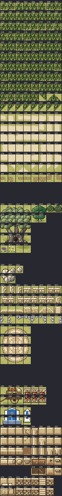

# Agros tileset catalog

`gTileset_Agros` is Ichor's countryside secondary tileset: the rural art for Route 1,
Kronion Hill and the routes to come. Pair it with the `aethos` primary, which supplies
the grass, plain tall grass, the road's middle, olives, pines, cypresses and the sea.
The name is Greek for field, the land outside the town walls.

**This file is generated.** `tools/ichor/art/agros_build.py` paints the tileset,
compiles it and rewrites this catalog. The numbered sheet is
[`img/agros_sheet.png`](img/agros_sheet.png).



## How to use it

**IDs.** Each grid lists metatile ids as Porymap shows them, row by row. Each section
starts on a fixed row of the sheet (soft ground at 0x200, trees, shrubs and herbs at 0x2A0, stone at 0x2D0, farm and roadside props at 0x330, kronion's ruins at 0x350); adding to one section never renumbers
another, so append new pieces to their section.

**Collision and layers.** The walk grid beside each structure gives what to set on each
cell when placing it:

| Code | Meaning |
|---|---|
| `X` | Impassable: set collision 1. |
| `.` | Passable. |
| `T` | Passable, drawn over the player, who walks behind it. |
| `G` | Passable tall grass: the behavior is `MB_TALL_GRASS`, so wild encounters happen here. |
| `J` | Ledge: `MB_JUMP_SOUTH`. Set collision 1, as vanilla does for ledges. |

**Named pieces.** Sets that are picked by context (wall joins, shore sides, rock-band
ends, ground shapes) give each piece a name. `build/agros/catalog.json` carries a
`names` map from name to cell, and `tools/ichor/maps/route1.py` shows how a map
builder chooses them.

**Soft ground and shape keys.** Tall grass, the road and goat tracks are painted per
cell from the cell's 3×3 neighborhood:

- The region is the union of its cells at pixel level, opened with a rounded brush:
  shrunk by a margin, grown back by a corner radius, its edge wobbled by a noise that
  repeats every 16 px. So every piece meets its neighbors seamlessly, and pieces that
  share a corner share 8×8 tiles.
- A shape key is the cell's state then its neighbors' in the order N NE E SE S SW W NW:
  `1` in the region, `0` not, and for road and meadow cells the letters `a b c d` for a
  *half cell*, a grass cell in a stair-step corner whose region is the triangle toward
  its NE, SE, SW or NW corner. Half cells turn one-cell steps into diagonals, so the
  road meanders instead of stair-stepping.
- A diagonal counts only when both of its sides are filled.
- A fully surrounded cell is plain aethos: `0x00D` tall grass, `0x1D9` road.
- Only the shapes the maps use are built. They are listed in
  `tools/ichor/art/agros_shapes.json`; `route1.py --shapes` updates the list, and
  Agros must then be rebuilt.

**Self-contained build.** Agros is compiled against an empty stand-in primary in a
scratch Porytiles project under `build/`. Its metatiles use only its own tiles (0x200
and up) and palettes 6–12, so they keep working whatever aethos becomes; the build
verifies this. Its ground pieces are painted from aethos's own pixels (grass, tall
grass, road), read from the compiled aethos tileset at build time, so they meet aethos
ground exactly. **Rebuild Agros whenever aethos's grass, tall grass or road change.**
`porytiles/tilesets/gTileset_Agros/config.yaml` pairs Agros with aethos for a direct
Porytiles compile.

**The sea.** Agros draws no water except the spring's basin. The rocky shore paints
rocks and foam on the sea side of a grass cell, and the sea itself is the neighboring
aethos `0x170`, so it animates.

**Palettes.** Every 8×8 tile draws from one of seven color groups, one per secondary
palette:

| Group | Use |
|---|---|
| Field | Grass, barley, the road and bare earth, herbs |
| Grove | Olive, fig and cypress foliage, bark, shade |
| Rock | Limestone on grass: rocks, walls, the lip, the hill's rock bands, the threshing floor |
| Clay | The cart and its load, the bee wall's hives |
| Bloom | Broom, oleander and thyme in flower |
| Water | The spring, the rocky shore's greys and foam, the shrine's whitewash and blue |
| Kalliste stone | The copied ruins and terraces, in kalliste's own stone palette |

**Tile budget.** 493 of the 512 secondary tiles are used.

## Soft ground

Tall grass, the road and goat tracks, with edges that follow the land instead of the grid. These are painted per shape (see below), so the grids list shape keys rather than a fixed layout.

### Tall grass with soft edges

`tall`, 8 wide by 11 tall. Barley meadow edges. Each piece is named by its shape key (see agros_ground.py) and keeps MB_TALL_GRASS, so encounters follow the cells while the outline stays soft.

| Shape key | Id | Walk |
|---|---|---|
| `1|00000000` | 0x200 | G |
| `1|00000010` | 0x201 | G |
| `1|00001000` | 0x202 | G |
| `1|00001110` | 0x203 | G |
| `1|00001a10` | 0x204 | G |
| `1|0000d110` | 0x205 | G |
| `1|00100000` | 0x206 | G |
| `1|00100010` | 0x207 | G |
| `1|00101000` | 0x208 | G |
| `1|00101a10` | 0x209 | G |
| `1|00111000` | 0x20A | G |
| `1|00111010` | 0x20B | G |
| `1|00111110` | 0x20C | G |
| `1|001111b0` | 0x20D | G |
| `1|00111a10` | 0x20E | G |
| `1|0011a000` | 0x20F | G |
| `1|00c11000` | 0x210 | G |
| `1|00c11110` | 0x211 | G |
| `1|00c111b0` | 0x212 | G |
| `1|10000000` | 0x213 | G |
| `1|10000010` | 0x214 | G |
| `1|10000011` | 0x215 | G |
| `1|100000a1` | 0x216 | G |
| `1|10001000` | 0x217 | G |
| `1|10001111` | 0x218 | G |
| `1|100011b0` | 0x219 | G |
| `1|1000d111` | 0x21A | G |
| `1|10100011` | 0x21B | G |
| `1|10101111` | 0x21C | G |
| `1|10111111` | 0x21D | G |
| `1|1011111b` | 0x21E | G |
| `1|1011a011` | 0x21F | G |
| `1|101d1000` | 0x220 | G |
| `1|10c11111` | 0x221 | G |
| `1|11100000` | 0x222 | G |
| `1|11100011` | 0x223 | G |
| `1|111000a1` | 0x224 | G |
| `1|11101000` | 0x225 | G |
| `1|111010a1` | 0x226 | G |
| `1|11101111` | 0x227 | G |
| `1|11101a11` | 0x228 | G |
| `1|1110d111` | 0x229 | G |
| `1|11111000` | 0x22A | G |
| `1|11111011` | 0x22B | G |
| `1|11111110` | 0x22C | G |
| `1|1111111b` | 0x22D | G |
| `1|111111b0` | 0x22E | G |
| `1|11111a11` | 0x22F | G |
| `1|1111a000` | 0x230 | G |
| `1|1111a011` | 0x231 | G |
| `1|1111a01b` | 0x232 | G |
| `1|111d1000` | 0x233 | G |
| `1|111d10a1` | 0x234 | G |
| `1|111d1111` | 0x235 | G |
| `1|111d11b0` | 0x236 | G |
| `1|11d00000` | 0x237 | G |
| `1|11d00011` | 0x238 | G |
| `1|11d01000` | 0x239 | G |
| `1|11d01111` | 0x23A | G |
| `1|11d0111b` | 0x23B | G |
| `1|11d0d111` | 0x23C | G |
| `1|1c100010` | 0x23D | G |
| `1|1c100011` | 0x23E | G |
| `1|1c10001b` | 0x23F | G |
| `1|1c10d111` | 0x240 | G |
| `1|1c111000` | 0x241 | G |
| `1|1c111111` | 0x242 | G |
| `1|1c1d1111` | 0x243 | G |
| `1|b1100000` | 0x244 | G |
| `1|b1111000` | 0x245 | G |
| `1|b1111110` | 0x246 | G |
| `1|b11111b0` | 0x247 | G |
| `1|c0000011` | 0x248 | G |
| `1|c0001111` | 0x249 | G |
| `1|c000d111` | 0x24A | G |
| `1|c0111111` | 0x24B | G |
| `1|c0c11111` | 0x24C | G |
| `a|11100000` | 0x24D | G |
| `b|00111000` | 0x24E | G |
| `c|00001110` | 0x24F | G |
| `d|10000011` | 0x250 | G |

### The limestone road, curving

`path`, 8 wide by 6 tall. Road pieces by shape key, including half cells that cut stair-steps on the diagonal. The road's middle is aethos 0x1D9.

| Shape key | Id | Walk |
|---|---|---|
| `1|00000010` | 0x258 | . |
| `1|00001110` | 0x259 | . |
| `1|00100000` | 0x25A | . |
| `1|00100010` | 0x25B | . |
| `1|00101110` | 0x25C | . |
| `1|0010d110` | 0x25D | . |
| `1|00111000` | 0x25E | . |
| `1|00111110` | 0x25F | . |
| `1|001111b0` | 0x260 | . |
| `1|00111a10` | 0x261 | . |
| `1|0011a010` | 0x262 | . |
| `1|001d1110` | 0x263 | . |
| `1|00c11110` | 0x264 | . |
| `1|10000011` | 0x265 | . |
| `1|10001111` | 0x266 | . |
| `1|1000d111` | 0x267 | . |
| `1|10111111` | 0x268 | . |
| `1|10c11111` | 0x269 | . |
| `1|11100010` | 0x26A | . |
| `1|11100011` | 0x26B | . |
| `1|1110001b` | 0x26C | . |
| `1|111000a1` | 0x26D | . |
| `1|11101111` | 0x26E | . |
| `1|1110d111` | 0x26F | . |
| `1|11111000` | 0x270 | . |
| `1|111110a1` | 0x271 | . |
| `1|1111111b` | 0x272 | . |
| `1|111111b0` | 0x273 | . |
| `1|11111a11` | 0x274 | . |
| `1|1111a000` | 0x275 | . |
| `1|1111a0a1` | 0x276 | . |
| `1|111d1111` | 0x277 | . |
| `1|11d00011` | 0x278 | . |
| `1|11d01111` | 0x279 | . |
| `1|1c111111` | 0x27A | . |
| `1|1c111a11` | 0x27B | . |
| `1|b1100010` | 0x27C | . |
| `1|b1111000` | 0x27D | . |
| `1|c0001111` | 0x27E | . |
| `1|c0111111` | 0x27F | . |
| `1|c0c11111` | 0x280 | . |
| `a|11100000` | 0x281 | . |
| `b|00111000` | 0x282 | . |
| `c|00001110` | 0x283 | . |
| `d|10000011` | 0x284 | . |

### Goat track

`track`, 8 wide by 1 tall. A narrow worn track of bare earth through grass, by shape key.

| Shape key | Id | Walk |
|---|---|---|
| `1|00000010` | 0x288 | . |
| `1|00001010` | 0x289 | . |
| `1|00100000` | 0x28A | . |
| `1|00100010` | 0x28B | . |
| `1|00101000` | 0x28C | . |
| `1|00101010` | 0x28D | . |
| `1|10000010` | 0x28E | . |
| `1|10100000` | 0x28F | . |

## Trees, shrubs and herbs

The ancient olive, a fig, broom, oleander, thyme, field herbs and soft shade.

### The big olive: an ancient tree, 4 by 4

`big_olive`, 4 wide by 4 tall. Route 1's landmark. The top row is crown drawn over the player, who can walk behind it; the rest is impassable. Its trunk is hollow at the bottom middle, under the crown's shadow.

```text
ids                       walk
0x2A0 0x2A1 0x2A2 0x2A3   T T T T
0x2A8 0x2A9 0x2AA 0x2AB   X X X X
0x2B0 0x2B1 0x2B2 0x2B3   X X X X
0x2B8 0x2B9 0x2BA 0x2BB   X X X X
```

### Fig tree, 2 by 2

`fig`, 2 wide by 2 tall. A smaller tree for field corners and the spring.

```text
ids           walk
0x2A4 0x2A5   X X
0x2AC 0x2AD   X X
```

### Broom in flower

`broom`, 1 wide by 1 tall. Yellow broom, a low wild shrub. Impassable.

```text
ids     walk
0x2A6   X
```

### Oleander in flower

`oleander`, 1 wide by 1 tall. Pink oleander, the shrub of dry streambeds. Impassable.

```text
ids     walk
0x2A7   X
```

### Wild thyme

`thyme`, 1 wide by 1 tall. A low cushion of thyme on grass; walkable.

```text
ids     walk
0x2C0   .
```

### Field herbs and chamomile

`herbs`, 1 wide by 1 tall. Sprigs and chamomile on grass; walkable.

```text
ids     walk
0x2C1   .
```

### Soft shade under a tree

`tree_shade`, 2 wide by 1 tall. Put under a 2x2 olive's bottom row; walkable grass in shade.

```text
ids           walk
0x2C2 0x2C3   . .
```

## Stone

Rocks, field walls that join any way, the terrace lip, Kronion's rock bands, the rocky shore and the threshing floor.

### Limestone outcrop, 2 by 2

`outcrop`, 2 wide by 2 tall. Rocks breaking through the turf, for wood edges and hillsides.

```text
ids           walk
0x2D0 0x2D1   X X
0x2D8 0x2D9   X X
```

### A single rock

`rock`, 1 wide by 1 tall. One limestone rock.

```text
ids     walk
0x2D2   X
```

### Field wall: whitewash-capped dry stone, every join

`field_wall`, 8 wide by 2 tall. Sixteen pieces named by the sides they join (N E S W), so a wall can run, turn, branch and end anywhere in a field. A north-south run shows its cap and lit flank; an east-west run its south face.

```text
ids                                               walk
0x2E0 0x2E1 0x2E2 0x2E3 0x2E4 0x2E5 0x2E6 0x2E7   X X X X X X X X
0x2E8 0x2E9 0x2EA 0x2EB 0x2EC 0x2ED 0x2EE 0x2EF   X X X X X X X X
```

Pieces: `NS` 0x2E0, `N` 0x2E1, `S` 0x2E2, `EW` 0x2E3, `E` 0x2E4, `W` 0x2E5, `ES` 0x2E6, `SW` 0x2E7, `NE` 0x2E8, `NW` 0x2E9, `NES` 0x2EA, `ESW` 0x2EB, `NSW` 0x2EC, `NEW` 0x2ED, `NESW` 0x2EE, `post` 0x2EF.

### Terrace lip: a stone ledge to jump down

`lip`, 3 wide by 1 tall. One-way, MB_JUMP_SOUTH: grass above, a short course of stone and its shadow below. West end, run, east end.

```text
ids                 walk
0x2F0 0x2F1 0x2F2   J J J
```

Pieces: `W` 0x2F0, `run` 0x2F1, `E` 0x2F2.

### Kronion Hill rock face and rock-cut stair

`rockface`, 5 wide by 1 tall. A south-facing band of natural rock, one cell tall: two runs, west and east ends sloping into the grass, a stair cut through it (walkable), and two jogs where the band steps up a row (upE: higher to the east).

```text
ids                             walk
0x2F3 0x2F4 0x2F5 0x2F6 0x2F7   X X X X .
```

Pieces: `run` 0x2F3, `run2` 0x2F4, `W` 0x2F5, `E` 0x2F6, `stair` 0x2F7.

### Rocky shore: grass meeting the sea

`shore`, 8 wide by 1 tall. Grey rocks and foam on the sea side of a grass cell; the sea is the neighboring aethos cell. Named by where the sea is: W, N, E (two runs each), and the outer corners NW and NE. Impassable.

```text
ids                                               walk
0x2F8 0x2F9 0x2FA 0x2FB 0x2FC 0x2FD 0x2FE 0x2FF   X X X X X X X X
```

Pieces: `W` 0x2F8, `W2` 0x2F9, `N` 0x2FA, `N2` 0x2FB, `NW` 0x2FC, `NE` 0x2FD, `E` 0x2FE, `E2` 0x2FF.

### Alonia: the round threshing floor

`alonia`, 4 wide by 4 tall. A village threshing floor: flagstones in a ring of upright stones, open to walk on. Drawn as one quarter mirrored, so it costs a quarter of its tiles.

```text
ids                       walk
0x300 0x301 0x302 0x303   . . . .
0x308 0x309 0x30A 0x30B   . . . .
0x310 0x311 0x312 0x313   . . . .
0x318 0x319 0x31A 0x31B   . . . .
```

## Farm and roadside props

The cart, the bee wall, the spring and a roadside shrine.

### The carter's cart, loaded

`cart`, 3 wide by 2 tall. Shafts to the west, where the Mudbray stands. Impassable.

```text
ids                 walk
0x330 0x331 0x332   X X X
0x338 0x339 0x33A   X X X
```

### Bee wall with three clay hives

`bee_wall`, 3 wide by 2 tall. The Greek way of keeping bees: long clay hives laid in a stone wall. Komatas's terraces. Impassable.

```text
ids                 walk
0x333 0x334 0x335   X X X
0x33B 0x33C 0x33D   X X X
```

### Spring in a little nymphaion

`spring`, 3 wide by 2 tall. A roadside spring: a whitewashed aedicule with a blue niche, water running into a basin. Impassable.

```text
ids                 walk
0x340 0x341 0x342   X X X
0x348 0x349 0x34A   X X X
```

### Roadside shrine

`shrine`, 1 wide by 2 tall. For a fork or a field gate. Impassable.

```text
ids     walk
0x343   X
0x34B   X
```

## Kronion's ruins (copied from kalliste)

Pixel-for-pixel copies of the kalliste pieces Route 1 and Kronion Hill use, so those maps need only aethos + agros. See TILES_kalliste.md for how they fit together.

### Kronion Hill: cracked stylobate

`stylobate`, 4 wide by 3 tall. The shrine's platform of worn poros slabs. Layout: NW, N, NE, cracked / W, plain, E, weedy / SW, S, SE, slab missing (bare earth). The north and side edges are flush with the hill; the south edge shows a crumbling step face (impassable, or use the steps from the terrace set). Ruins, drums and the dig all sit on these slabs.

```text
ids                       walk
0x350 0x351 0x352 0x353   . . . .
0x358 0x359 0x35A 0x35B   . . . .
0x360 0x361 0x362 0x363   X X X .
```

### Kronion Hill: standing and broken Doric columns

`ruin_columns`, 4 wide by 3 tall. Weathered poros columns on stylobate slabs. Column 0: a standing column (3 cells). Column 1: a column snapped at mid height (its top cell is plain slab). Columns 2 and 3: a stump, and a stump of two drums with rubble (bottom cells; the cells above are plain slab). T cells draw over the player (walk behind); bottom cells are impassable.

```text
ids                       walk
0x354 0x355 0x356 0x357   T . . .
0x35C 0x35D 0x35E 0x35F   T T . .
0x364 0x365 0x366 0x367   X X X X
```

### Kronion Hill: fallen drums and a capital

`ruin_drums`, 4 wide by 1 tall. On stylobate slabs. A fallen run of two drums lying east-west (2 cells), a single drum lying with its fluted end toward the viewer, and a toppled capital.

```text
ids                       walk
0x368 0x369 0x36A 0x36B   X X X X
```

### Kronion Hill: the Titanborn's dig

`dig_site`, 4 wide by 2 tall. A fresh pit hacked through the slabs (2 x 2), a spoil heap with a trowel stuck in it, a plain spoil heap, and two pried-up slabs. The pit's north wall shows the hill's strata. Cells 2-3 of each row are loose pieces to scatter around the pit.

```text
ids                       walk
0x36C 0x36D 0x36E 0x36F   X X X X
0x374 0x375 0x376 0x377   X X X X
```

### Kronion Hill: the broken altar

`altar_broken`, 2 wide by 2 tall. An archaic altar split by a crack, one corner fallen. Bottom row is the altar; the top row is slab with its back edge.

```text
ids           walk
0x378 0x379   . .
0x380 0x381   X X
```

### Terrace retaining walls and steps

`terrace`, 5 wide by 2 tall. Retaining walls for terraced hillside, lower ground to the south. Row 0: west end, middle A, middle B, steps up through the wall, east end. Row 1: the same pieces as one-way ledges (MB_JUMP_SOUTH) for the two middles; the ends and steps repeat so a ledge run can close.

```text
ids                             walk
0x37A 0x37B 0x37C 0x37D 0x37E   X X X . X
0x382 0x383 0x384 0x385 0x386   X J J . X
```
