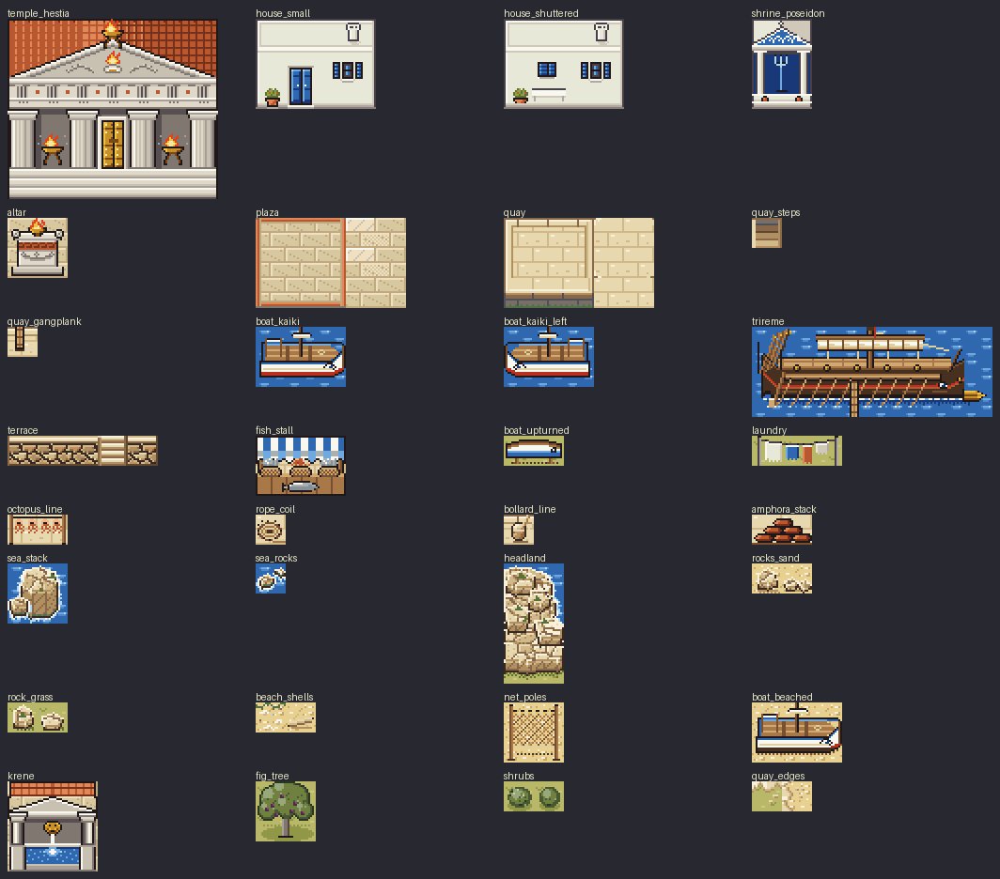

# Akti tileset catalog

The `akti` secondary tileset (`gTileset_Akti`) is Akti Town's harbor. Pair it with
the `aethos` primary, which supplies the open ground: grass, paths, sand, the sea and
the olive and cypress trees. `LAYOUT_AKTI_TOWN` uses aethos + akti; Elaia and Route 1
keep kalliste.

**This file is generated.** `tools/ichor/art/akti_build.py` draws the tileset, compiles
it and rewrites this catalog. The art is in `akti_art.py` (copies from kalliste, the
trireme, the plaza paving), `akti_harbor.py`, `akti_coast.py` and `akti_town.py`; the
palette plan and the borrowed-ground mechanism are in `akti_lib.py`.



## How to use it

**IDs.** Each grid below lists metatile ids as Porymap shows them, row by row. Ids run
from 0x200 in the order of `akti_art.build()`, so append new structures at its end to
keep the existing ids. `tools/ichor/maps/akti.py` places structures by key from
`build/akti/catalog.json`, never by raw id.

**Collision and layers.** The walk grid beside each structure gives what to set on
each cell:

| Code | Meaning |
|---|---|
| `X` | Impassable: set collision 1. |
| `.` | Passable. |
| `D` | Door: put the warp here. The behavior is `MB_NON_ANIMATED_DOOR`. |
| `T` | Passable, and drawn over the player, who walks beneath it. |
| `-` | Empty cell; don't place it. |

**Borrowed ground.** Cells marked *grass*, *sand* or *sea* below don't draw their own
ground. After Porytiles compiles, the build points their bottom-layer tiles at aethos's
own ground metatile: grass `0x001`, sand `0x124` or sea `0x170`. So:
- they meet the meadow, the beach or the sea around them seamlessly;
- every boat, rock and crag in the water sits on aethos's animated sea;
- they cost no Akti tiles.

These cells reference aethos's tiles by index. **Rebuild Akti whenever aethos is
repainted.** The build checks every borrowed entry against aethos's current
metatiles.

A borrowed cell keeps one layer of its own above the ground. Shadows (under the
fig, the upturned boat, the shrubs and the rocks) are drawn in that layer, so a
cell on borrowed ground can't also have a part drawn over the player: the build
rejects any that tries. (The laundry draws its posts and washing in the top layer.)

**Animated sea.** The sea's animation comes with the borrowed tiles: aethos swaps
the frames of tiles 454 and 455 in VRAM, and every borrowed sea cell points at them.

**Self-contained art.** Apart from the borrowed ground, Akti is compiled against an
empty stand-in primary in a scratch Porytiles project under `build/`. Its metatiles use
only Akti's own tiles (0x200 and up) and palettes 6-12. The build verifies this.

**Palettes.** Every 8x8 tile draws from one of seven color groups, one per secondary
palette (`akti_lib.GROUPS`):

| Group | Use |
|---|---|
| Cycladic | Whitewash, Aegean blue, terracotta pots, basil; the laundry |
| Marble | The temple, the altar and the krene, with bronze, fire and roof terracotta |
| Stone | The quay, walls and terraces, and every crag, with its foam and weed |
| Wood | The trireme, the kaikia, the upturned boat, nets and rope |
| Market | Amphorae, baskets, the catch, octopus and the stall's awning |
| Plaza | The plaza's warm limestone and marble, and the krene's water |
| Grove | Aethos's meadow greens and olives, the fig and the shrubs |

**Tile budget.** 507 of the 512 secondary tiles are used.

## Buildings and monuments

The Temple of Hestia, Akti's houses, Poseidon's shrine, the altar and the krene.

### Temple of Hestia, exterior

`temple_hestia`, 7 wide by 6 tall. A tetrastyle Doric front in marble: a terracotta roof falling away either side of a lit ridge, a pediment with a relief hearth and a bronze fire-tripod on the apex, a triglyph frieze, bronze doors between two lit braziers, and three steps. Door: row 4, middle column (MB_NON_ANIMATED_DOOR). The step row is walkable.

```text
ids                                         walk
0x200 0x201 0x202 0x203 0x204 0x205 0x206   X X X X X X X
0x208 0x209 0x20A 0x20B 0x20C 0x20D 0x20E   X X X X X X X
0x210 0x211 0x212 0x213 0x214 0x215 0x216   X X X X X X X
0x218 0x219 0x21A 0x21B 0x21C 0x21D 0x21E   X X X X X X X
0x220 0x221 0x222 0x223 0x224 0x225 0x226   X X X D X X X
0x228 0x229 0x22A 0x22B 0x22C 0x22D 0x22E   . . . . . . .
```

Door metatile: 0x223.

### Small Cycladic house

`house_small`, 4 wide by 3 tall. Whitewashed cube with a flat parapet roof, a Cycladic chimney, an Aegean-blue door and shuttered window, and a basil pot. Door at the bottom row, second column: put the warp there.

```text
ids                       walk
0x230 0x231 0x232 0x233   X X X X
0x238 0x239 0x23A 0x23B   X X X X
0x240 0x241 0x242 0x243   X D X X
```

Door metatile: 0x241.

### Small Cycladic house, shuttered front

`house_shuttered`, 4 wide by 3 tall. The small house with its door bricked up as a shuttered window over a whitewashed bench, so a scenery house needs no barred door. All solid.

```text
ids                       walk
0x234 0x235 0x236 0x237   X X X X
0x23C 0x23D 0x23E 0x23F   X X X X
0x244 0x245 0x246 0x247   X X X X
```

### Harbor shrine to Poseidon

`shrine_poseidon`, 2 wide by 3 tall. A small whitewashed naiskos on the quay: blue tympanum with a wave scroll, two slim columns, a verdigris-bronze trident standing in a blue niche, and conch offerings on the step. Talk-to scenery.

```text
ids           walk
0x248 0x249   X X
0x250 0x251   X X
0x258 0x259   X X
```

### Altar of Hestia before the temple

`altar`, 2 wide by 2 tall. Elaia's marble altar and fire-bowl, on the plaza's warm paving. The temple's sign is cut on it.

```text
ids           walk
0x24A 0x24B   X X
0x252 0x253   X X
```

### Krene: the fountain house

`krene`, 3 wide by 3 tall. A fountain house on the plaza's paving: a terracotta roof and pediment (row 0), two Doric columns framing a bronze lion's-head spout (row 1), and the marble basin it fills (row 2). Stand townsfolk in front of it.

```text
ids                 walk
0x303 0x304 0x305   X X X
0x30B 0x30C 0x30D   X X X
0x313 0x314 0x315   X X X
```

## The harbor

The quay and its edges, the trireme Euploia and the kaikia, and the harbor's goods.

### Harbor quay: ashlar paving, edges and corners

`quay`, 5 wide by 3 tall. Big limestone blocks in running bond. Water is aethos ocean, placed next to these. Row 0: NW outer corner, north edge (water to the north: coping only, the face is hidden), NE outer corner, then inner corners NW and NE (water diagonally beyond). Row 1: west edge (water west), plain quay, east edge (water east), inner corners SW and SE. Row 2: SW outer corner, south edge (water to the south: the wet face shows), SE outer corner, then two plain quay alternates. Edge cells are walkable; mark the water side impassable unless surfing.

```text
ids                             walk
0x278 0x279 0x27A 0x27B 0x27C   X X . X X
0x280 0x281 0x282 0x283 0x284   . . . X X
0x288 0x289 0x28A 0x28B 0x28C   X X . X X
```

### Harbor steps down to the water

`quay_steps`, 1 wide by 1 tall. Steps cut down into the water from the quay's north edge (water to the north). Put the surf start beside them.

```text
ids     walk
0x27D   .
```

### Quay edge with the gangplank's foot

`quay_gangplank`, 1 wide by 1 tall. The quay's north edge with the trireme's gangplank resting on it. Place it directly below the trireme's bottom row, column 3.

```text
ids     walk
0x27E   .
```

### Quay paving running out onto grass and sand

`quay_edges`, 2 wide by 1 tall. Lay these on the first row or column past the quay: on grass, flags spilling from the quay to the north; on sand, flags spilling from the quay to the west. Both walkable.

```text
ids           walk
0x31A 0x31B   . .
```

Ground: grass at (0,0); sand at (1,0).

### The trireme Euploia

`trireme`, 8 wide by 3 tall. The Euploia moored bow to the right on aethos's animated sea. Place her with her bottom row on the water row just north of the quay, so the gangplank (bottom row, column 3) lands on quay_gangplank below it.

```text
ids                                               walk
0x2A0 0x2A1 0x2A2 0x2A3 0x2A4 0x2A5 0x2A6 0x2A7   X X X X X X X X
0x2A8 0x2A9 0x2AA 0x2AB 0x2AC 0x2AD 0x2AE 0x2AF   X X X X X X X X
0x2B0 0x2B1 0x2B2 0x2B3 0x2B4 0x2B5 0x2B6 0x2B7   X X X X X X X X
```

Ground: all on aethos sea.

### Moored kaiki with painted eyes

`boat_kaiki`, 3 wide by 2 tall. A fishing kaiki on live sea: the water under it is aethos's animated sea. Bow to the right.

```text
ids                 walk
0x290 0x291 0x292   X X X
0x298 0x299 0x29A   X X X
```

Ground: all on aethos sea.

### Moored kaiki, bow to the left

`boat_kaiki_left`, 3 wide by 2 tall. A fishing kaiki on live sea: the water under it is aethos's animated sea. Bow to the left.

```text
ids                 walk
0x293 0x294 0x295   X X X
0x29B 0x29C 0x29D   X X X
```

Ground: all on aethos sea.

### Bollard with a mooring line

`bollard_line`, 1 wide by 1 tall. A stone bollard on the quay's north edge, its line running up to a boat moored to the north.

```text
ids     walk
0x2D0   X
```

### A coil of rope on the quay

`rope_coil`, 1 wide by 1 tall. A coiled hawser on quay paving.

```text
ids     walk
0x2CF   X
```

### Amphorae stacked in a rack

`amphora_stack`, 2 wide by 1 tall. Transport amphorae laid on their sides in a three-high pyramid, on quay paving.

```text
ids           walk
0x2D1 0x2D2   X X
```

### Octopus drying on a line

`octopus_line`, 2 wide by 1 tall. Two posts on the quay with octopus hung over the line to dry. Quay paving underneath; the octopus are drawn over the player.

```text
ids           walk
0x2CD 0x2CE   X X
```

### Fish stall with a striped awning

`fish_stall`, 3 wide by 2 tall. The fishwife's stall on the quay: a striped awning (row 0) over a counter of baskets (row 1), on quay paving. She stands beside it.

```text
ids                 walk
0x2BD 0x2BE 0x2BF   X X X
0x2C5 0x2C6 0x2C7   X X X
```

## The coast

Limestone crags in the sea and on the shore, the west headland, and the beach.

### Limestone sea stack

`sea_stack`, 2 wide by 2 tall. A tall crag of pale limestone standing in the sea, with a smaller rock at its foot, foam round both. On aethos's animated sea.

```text
ids           walk
0x2D3 0x2D4   X X
0x2DB 0x2DC   X X
```

Ground: all on aethos sea.

### Rocks awash

`sea_rocks`, 1 wide by 1 tall. A broken pair of crags with foam, to scatter around the stacks and the headland in clusters.

```text
ids     walk
0x2D5   X
```

Ground: all on aethos sea.

### West headland: a limestone spur

`headland`, 2 wide by 4 tall. A two-wide rocky spur, its west side on the map edge. Row 0: the tip, sea north and east. Row 1: rock at left, its east edge on the sea at right. Row 2: solid rock; repeat it for length. Row 3: the spur's south face, dropping onto grass. Scrub grows on top.

```text
ids           walk
0x2D6 0x2D7   X X
0x2DE 0x2DF   X X
0x2E6 0x2E7   X X
0x2EE 0x2EF   X X
```

Ground: grass at (0,3), (1,3); sea at (0,0), (0,1), (0,2), (1,0), (1,1), (1,2).

### Limestone rocks on the sand

`rocks_sand`, 2 wide by 1 tall. Two single-cell crags on aethos sand, with a shadow: a tall one and a low pair. Use them where the beach meets the tide rocks.

```text
ids           walk
0x2F0 0x2F1   X X
```

Ground: all on aethos sand.

### Limestone rock in the grass

`rock_grass`, 2 wide by 1 tall. Two crags on aethos grass, each with its shadow and a tuft: for the edges of the town and the olive groves.

```text
ids           walk
0x2F2 0x2F3   X X
```

Ground: all on aethos grass.

### Shells and driftwood on the sand

`beach_shells`, 2 wide by 1 tall. On aethos sand: shells, pebbles and a line of weed left by the tide (walkable), and a sun-bleached driftwood branch (solid).

```text
ids           walk
0x2F4 0x2F5   . X
```

Ground: all on aethos sand.

### Nets drying on poles

`net_poles`, 2 wide by 2 tall. Two driftwood poles on the sand with a net hung between them, cork floats along its head rope. On aethos sand.

```text
ids           walk
0x2F6 0x2F7   X X
0x2FE 0x2FF   X X
```

Ground: all on aethos sand.

### Kaiki hauled up on the beach

`boat_beached`, 3 wide by 2 tall. The kaiki drawn up on aethos sand, its hull sunk a little into it.

```text
ids                 walk
0x300 0x301 0x302   X X X
0x308 0x309 0x30A   X X X
```

Ground: all on aethos sand.

## The town

The plaza's paving, walls and terraces, and the gardens and yards of the lower town.

### Plaza paving: warm limestone and marble flags

`plaza`, 5 wide by 3 tall. Warm limestone flags in a running bond, with pale marble ones laid among them on a two-cell repeat. Columns 0-2 are the kerbed border: NW, N, NE / W, plain, E / SW, S, SE, the kerb terracotta, showing its face on the south edge. Columns 3-4, rows 0-1, are the four interior cells: lay the one at (3 + x % 2, y % 2) for map cell (x, y) and the marble flags fall into place. (3, 2) and (4, 2) are plain limestone.

```text
ids                             walk
0x260 0x261 0x262 0x263 0x264   . . . . .
0x268 0x269 0x26A 0x26B 0x26C   . . . . .
0x270 0x271 0x272 0x273 0x274   . . . . .
```

### Terrace retaining wall and steps

`terrace`, 5 wide by 1 tall. A retaining wall for terraced ground, lower ground to the south: west end, two middles to alternate, steps up through the wall, east end.

```text
ids                             walk
0x2B8 0x2B9 0x2BA 0x2BB 0x2BC   X X X . X
```

### Laundry on a line

`laundry`, 3 wide by 1 tall. A washing line between two posts over grass. The posts are solid; the middle is walkable, and the washing is drawn over the player.

```text
ids                 walk
0x2CA 0x2CB 0x2CC   X T X
```

Ground: all on aethos grass.

### Upturned boat on trestles

`boat_upturned`, 2 wide by 1 tall. A rowing boat turned keel-up on trestles, on aethos grass. Diktys's seat by the south road.

```text
ids           walk
0x2C8 0x2C9   X X
```

Ground: all on aethos grass.

### Fig tree

`fig_tree`, 2 wide by 2 tall. A fig tree on aethos grass, its shadow under it. All four cells solid.

```text
ids           walk
0x306 0x307   X X
0x30E 0x30F   X X
```

Ground: all on aethos grass.

### Lentisk and rosemary

`shrubs`, 2 wide by 1 tall. Two low Mediterranean shrubs on aethos grass with their shadows, to break up tree lines and soften corners.

```text
ids           walk
0x318 0x319   X X
```

Ground: all on aethos grass.
