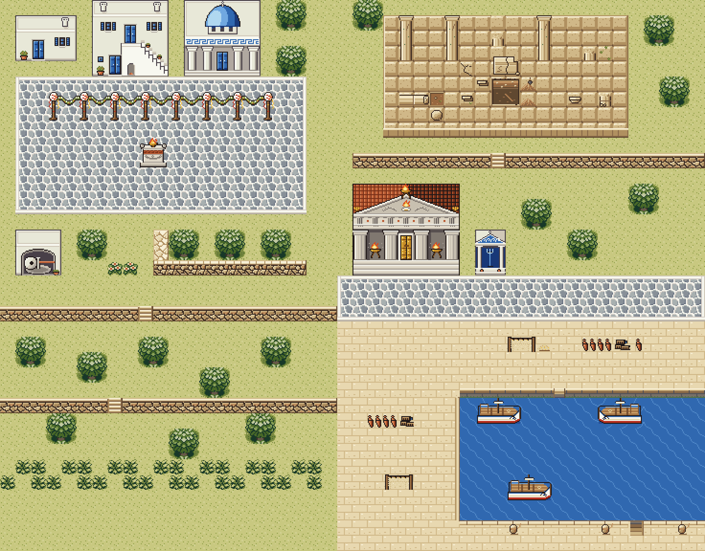

# Kalliste tileset catalog

The `kalliste` secondary tileset (`gTileset_Kalliste`) holds every Greek structure on
Kalliste Isle. Pair it with the `aethos` primary, which supplies the ground (grass,
paths, sand, the sea and trees).

**This file is generated.** `tools/ichor/art/kalliste_build.py` draws the tileset,
compiles it and rewrites this catalog. The scene render comes from
`tools/ichor/art/kalliste_scene.py`.



## How to use it

**IDs.**
- Each grid below lists metatile ids as Porymap shows them, row by row.
- Each section starts on a fixed row of the sheet: Elaia at 0x200, Akti at 0x2C0 and
  Kronion at 0x380. Adding to one section never renumbers another, so new pieces
  should be appended to their section.

**Collision and layers.** The walk grid beside each structure gives what to set on
each cell when placing it:

| Code | Meaning |
|---|---|
| `X` | Impassable: set collision 1. |
| `.` | Passable. |
| `D` | Door: put the warp here. The behavior is `MB_NON_ANIMATED_DOOR`, so the warp triggers without a door animation. |
| `T` | Passable, and drawn over the player, who walks behind it. |
| `J` | Ledge: `MB_JUMP_SOUTH`. |
| `-` | Empty cell; don't place it. |

**Ground.**
- Buildings fill their whole footprint, so they sit on any aethos ground.
- Small objects carry their own ground in the bottom layer, because kalliste cannot
  borrow aethos tiles:
  - garland posts and the altar sit on festival paving;
  - nets, amphorae and crates sit on quay paving;
  - columns, drums and the dig sit on stylobate slabs;
  - boats sit on sea.
- Put these on matching ground.
- The sea under the boats copies aethos's deep water (0x170) colors but does not
  animate.

**Self-contained build.**
- kalliste is compiled against an empty stand-in primary, in a scratch Porytiles
  project under `build/`.
- Its metatiles use only kalliste's own tiles (0x200 and up) and palettes 6–12, so
  they keep working whatever aethos becomes. The build verifies this.
- To compile against aethos instead, run `porytiles compile-tileset gTileset_Kalliste`.
  `porytiles/tilesets/gTileset_Kalliste/config.yaml` pairs it with aethos. Porytiles
  may then reuse aethos tiles and palettes, so recompile kalliste whenever aethos
  changes.

**Palettes.** Every 8×8 tile draws from one of seven color groups, one per secondary
palette:

| Group | Use |
|---|---|
| Cycladic | Whitewash, Aegean blue, terracotta pots, basil |
| Marble | Hestia's temple and the festival altar, with hearth bronze, fire and roof terracotta |
| Stone | Limestone walls, terraces, the quay and Kronion's weathered poros |
| Wood | Boats, crates, nets and rope |
| Clay | Amphorae, the Klotheia garlands and the distaff posts |
| Paving | Slate flagstones in white lime |
| Sea | The water under the boats |

**Tile budget.** 492 of the 512 secondary tiles are used. The set is nearly full,
so more Kalliste art will need trimming or a second secondary. The harbor kit is the
easiest part to split out.

## Elaia Village

Cycladic houses, the blue-domed shrine, the Klotheia square, walls, terraces and the olive press.

### Small Cycladic house

`house_small`, 4 wide by 3 tall. Whitewashed cube with a flat parapet roof, a Cycladic chimney, an Aegean-blue door and shuttered window, and a basil pot. Door at the bottom row, second column: put the warp there.

```text
ids                       walk
0x200 0x201 0x202 0x203   X X X X
0x208 0x209 0x20A 0x20B   X X X X
0x210 0x211 0x212 0x213   X D X X
```

Door metatile: 0x211.

### Two-story Cycladic house with an outside stair

`house_large`, 5 wide by 5 tall. Two floors under one flat roof. A whitewashed outside stair climbs the front from the right corner to a landing at the blue upper door. Only the ground-floor door (bottom row, second column) is a warp; the upper door and the stair are scenery.

```text
ids                             walk
0x218 0x219 0x21A 0x21B 0x21C   X X X X X
0x220 0x221 0x222 0x223 0x224   X X X X X
0x228 0x229 0x22A 0x22B 0x22C   X X X X X
0x230 0x231 0x232 0x233 0x234   X X X X X
0x238 0x239 0x23A 0x23B 0x23C   X D X X X
```

Door metatile: 0x239.

### Blue-domed shrine with a columned porch

`shrine_dome`, 5 wide by 5 tall. A whitewashed chapel-shrine: Aegean-blue dome on a windowed drum, a porch of four white Doric columns under a meander frieze, and a blue door on two steps. Door: bottom row, middle column.

```text
ids                             walk
0x240 0x241 0x242 0x243 0x244   X X X X X
0x248 0x249 0x24A 0x24B 0x24C   X X X X X
0x250 0x251 0x252 0x253 0x254   X X X X X
0x258 0x259 0x25A 0x25B 0x25C   X X X X X
0x260 0x261 0x262 0x263 0x264   X X D X X
```

Door metatile: 0x262.

### Festival-square paving: Cycladic flagstones in whitewashed lime

`paving`, 4 wide by 3 tall. Slate flagstones set in white lime, one 16 px pattern so any piece joins any other. Layout: NW, N, NE, plain / W, plain, E, plain / SW, S, SE, plain. The curb faces down on the south edge. Also good for Akti's streets.

```text
ids                       walk
0x268 0x269 0x26A 0x26B   . . . .
0x270 0x271 0x272 0x273   . . . .
0x278 0x279 0x27A 0x27B   . . . .
```

### Festival altar of the Klotheia

`altar_square`, 2 wide by 2 tall. A marble altar with volute bolsters, a painted meander and a bronze fire-bowl, standing on the square's flagstones. Two layers: paving below, the altar over it.

```text
ids           walk
0x26C 0x26D   X X
0x274 0x275   X X
```

### Klotheia garland posts

`klotheia_posts`, 5 wide by 2 tall. Thread-wrapped posts for the festival, with spindle-whorl tops and garlands of olive, myrtle and flowers. Top row (drawn over the player): post top with garland both sides, garland swag, post top garland left only, post top garland right only, post top bare. Bottom row: post base, plain paving, post base, plain paving, post base. Place a post top above every base; swags go between post tops.

```text
ids                             walk
0x280 0x281 0x282 0x283 0x284   T T T T T
0x288 0x289 0x28A 0x28B 0x28C   X . X . X
```

### Dry-stone walls with whitewashed caps

`wall_drystone`, 5 wide by 2 tall. Row 0: an east-west run: west end, middle A, middle B, east end, and a lone pier (also the south end of a north-south run, or a gate post). Row 1: a north-south run seen from above: middle, north end, and the corners NW and NE where an east-west run turns south. For SW and SE corners use the east-west ends.

```text
ids                             walk
0x290 0x291 0x292 0x293 0x294   X X X X X
0x298 0x299 0x29A 0x29B 0x29C   X X X X -
```

### Terrace retaining walls and steps

`terrace`, 5 wide by 2 tall. Retaining walls for terraced hillside, lower ground to the south. Row 0: west end, middle A, middle B, steps up through the wall, east end. Row 1: the same pieces as one-way ledges (MB_JUMP_SOUTH) for the two middles; the ends and steps repeat so a ledge run can close.

```text
ids                             walk
0x2A0 0x2A1 0x2A2 0x2A3 0x2A4   X X X . X
0x2A8 0x2A9 0x2AA 0x2AB 0x2AC   X J J . X
```

### Olive-press house

`olive_press`, 3 wide by 3 tall. A whitewashed press-house with a wide arched opening onto its trapetum: a round stone basin, a central pier and two upright millstones on a wooden axle, with a basket of olives. Scenery; the olive farmer stands in front. Roof and wall tiles are shared with the houses, so it costs few tiles.

```text
ids                 walk
0x2A5 0x2A6 0x2A7   X X X
0x2AD 0x2AE 0x2AF   X X X
0x2B5 0x2B6 0x2B7   X X X
```

## Akti Town

The Temple of Hestia, the harbor kit and the shrine to Poseidon.

### Temple of Hestia, exterior

`temple_hestia`, 7 wide by 6 tall. A tetrastyle Doric front in marble: terracotta roof, a pediment with a relief hearth in the tympanum and a bronze fire-tripod as the apex acroterion, gilded palmettes at the corners, a triglyph frieze, bronze doors between two lit braziers, and three steps. Door: row 4, middle column (MB_NON_ANIMATED_DOOR). The step row is walkable.

```text
ids                                         walk
0x2C0 0x2C1 0x2C2 0x2C3 0x2C4 0x2C5 0x2C6   X X X X X X X
0x2C8 0x2C9 0x2CA 0x2CB 0x2CC 0x2CD 0x2CE   X X X X X X X
0x2D0 0x2D1 0x2D2 0x2D3 0x2D4 0x2D5 0x2D6   X X X X X X X
0x2D8 0x2D9 0x2DA 0x2DB 0x2DC 0x2DD 0x2DE   X X X X X X X
0x2E0 0x2E1 0x2E2 0x2E3 0x2E4 0x2E5 0x2E6   X X X D X X X
0x2E8 0x2E9 0x2EA 0x2EB 0x2EC 0x2ED 0x2EE   . . . . . . .
```

Door metatile: 0x2E3.

### Harbor quay: ashlar paving, edges and corners

`quay`, 5 wide by 3 tall. Big limestone blocks in running bond. Water is aethos ocean, placed next to these. Row 0: NW outer corner, north edge (water to the north: coping only, the face is hidden), NE outer corner, then inner corners NW and NE (water diagonally beyond). Row 1: west edge (water west), plain quay, east edge (water east), inner corners SW and SE. Row 2: SW outer corner, south edge (water to the south: the wet face shows), SE outer corner, then two plain quay alternates. Edge cells are walkable; mark the water side impassable unless surfing.

```text
ids                             walk
0x2F0 0x2F1 0x2F2 0x2F3 0x2F4   X X . X X
0x2F8 0x2F9 0x2FA 0x2FB 0x2FC   . . . X X
0x300 0x301 0x302 0x303 0x304   X X . X X
```

### Harbor steps down to the water

`quay_steps`, 3 wide by 1 tall. Steps cut into the quay. Left: water to the north, steps descending away from the viewer, wet toward the sea. Middle: water to the south, steps cut into the visible face. Right: a stone bollard with a rope, on the north edge. Put the surf start on the water next to a step.

```text
ids                 walk
0x2F5 0x2F6 0x2F7   . . .
```

### Moored kaiki with painted eyes

`boat_kaiki`, 3 wide by 2 tall. A fishing kaiki moored side-on, bow to the right: white hull with a blue gunwale and red boot-top, an eye on the bow, a short mast with a furled sail and a little stern awning. Two layers: sea below, boat over it. The sea matches aethos's deep water but does not animate.

```text
ids                 walk
0x308 0x309 0x30A   X X X
0x310 0x311 0x312   X X X
```

### Moored kaiki, bow to the left

`boat_kaiki_left`, 3 wide by 2 tall. The same kaiki facing the other way, for the other side of a mooring.

```text
ids                 walk
0x30B 0x30C 0x30D   X X X
0x313 0x314 0x315   X X X
```

### Drying nets, net pile, amphorae and crates

`quay_nets`, 4 wide by 2 tall. All on quay paving (two layers: quay below). Row 0: a net hung to dry on a two-post rack (2 cells), a heap of net with cork floats, and plain quay. Row 1: stacked amphorae (2 cells), a stack of fish crates, and a lone amphora.

```text
ids                       walk
0x318 0x319 0x31A 0x31B   X X X .
0x320 0x321 0x322 0x323   X X X X
```

### Harbor shrine to Poseidon

`shrine_poseidon`, 2 wide by 3 tall. A small whitewashed naiskos on the quay: blue tympanum with a wave scroll, two slim columns, a verdigris-bronze trident standing in a blue niche, and conch offerings on the step. Talk-to scenery.

```text
ids           walk
0x31C 0x31D   X X
0x324 0x325   X X
0x32C 0x32D   X X
```

## Kronion Hill

The archaic shrine's ruins and the Titanborn's dig.

### Kronion Hill: cracked stylobate

`stylobate`, 4 wide by 3 tall. The shrine's platform of worn poros slabs. Layout: NW, N, NE, cracked / W, plain, E, weedy / SW, S, SE, slab missing (bare earth). The north and side edges are flush with the hill; the south edge shows a crumbling step face (impassable, or use the steps from the terrace set). Ruins, drums and the dig all sit on these slabs.

```text
ids                       walk
0x380 0x381 0x382 0x383   . . . .
0x388 0x389 0x38A 0x38B   . . . .
0x390 0x391 0x392 0x393   X X X .
```

### Kronion Hill: standing and broken Doric columns

`ruin_columns`, 4 wide by 3 tall. Weathered poros columns on stylobate slabs. Column 0: a standing column (3 cells). Column 1: a column snapped at mid height (top cell is mostly slab). Column 2: a stump (bottom cell). Column 3: a stump of two drums with rubble. Upper cells draw over the player (walk behind); bottom cells are impassable.

```text
ids                       walk
0x384 0x385 0x386 0x387   T T . .
0x38C 0x38D 0x38E 0x38F   T T T .
0x394 0x395 0x396 0x397   X X X X
```

### Kronion Hill: fallen drums and a capital

`ruin_drums`, 4 wide by 1 tall. On stylobate slabs. A fallen run of two drums lying east-west (2 cells), a single drum lying with its fluted end toward the viewer, and a toppled capital.

```text
ids                       walk
0x398 0x399 0x39A 0x39B   X X X X
```

### Kronion Hill: the Titanborn's dig

`dig_site`, 4 wide by 2 tall. A fresh pit hacked through the slabs (2 x 2), a spoil heap with a trowel stuck in it, a plain spoil heap, and two pried-up slabs. The pit's north wall shows the hill's strata. Cells 2-3 of each row are loose pieces to scatter around the pit.

```text
ids                       walk
0x39C 0x39D 0x39E 0x39F   X X X X
0x3A4 0x3A5 0x3A6 0x3A7   X X X X
```

### Kronion Hill: the broken altar

`altar_broken`, 2 wide by 2 tall. An archaic altar split by a crack, one corner fallen. Bottom row is the altar; the top row is slab with its back edge.

```text
ids           walk
0x3A8 0x3A9   . .
0x3B0 0x3B1   X X
```
