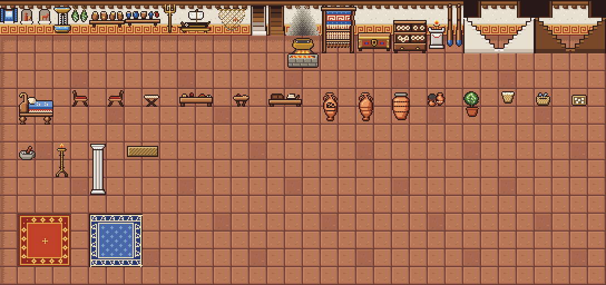

# oikia: the furnishings of a Greek house

`gTileset_Oikia` is a secondary tileset for Aethos homes. It draws everything a home needs: the floor, the back wall, and the furniture standing on them. The four Phase 1 homes are laid out from it (see `ROOMS_oikia.md`).



## What's in it

- **Floors:** fired terracotta pavers, with a second tone sprinkled through empty floor; the upper storey's wide boards; irregular limestone flags. Each has a shadowed row for under the back wall, a shadowed column for the left edge, and the corner where they meet.
- **The back wall,** two blocks tall: a dark ceiling beam with rafter ends, whitewashed plaster, and a painted dado with a running Greek key. There are two dados: red ochre for Elaia, and Aegean blue for the harbor homes of Akti.
- **Woven rugs:** madder red with a saffron lozenge border, and indigo with a wave-scroll border. Both are 9-slices, so they can be any size from 2x2 up. They are walkable, and furniture stands on them.
- **On the wall:** a shuttered window, two niches with clay figurines (a goddess, a horse), the klepsydra, a trident, drying herbs, a fishing net with floats and sinkers, a model pentekonter on a shelf, shelves of honey jars and of remedy flasks, and the stairwell down.
- **Against the wall:** the warp-weighted loom with a half-woven cloth, the kibotos chest, a cabinet of scrolls, Hestia's altar, a pair of oars, and stairs climbing to a hatch in the ceiling, in both directions.
  - The stairs, and the stairwell down, come in whitewashed stone and in timber.
  - The rooms use the whitewashed ones: they read more clearly at Gen 3 scale, and they belong to Kalliste's Cycladic houses. The timber stairwell down reads like a closed door.
  - Swapping is one line per room in `oikia_rooms.py`: `stairs_up_r` to `stairs_up_wood_r`, and `stairs_down` to `stairs_down_wood`.
- **On the floor:** the kline, klismos chairs (facing either way), a folding diphros stool, a long table and a round one, a writing table with a wax tablet, two amphorae, a pithos, cooking pots, a barley mortar, the kitchen hearth with its cauldron (and the soot above it), a potted myrtle, the wool basket, a basket of fish, knucklebones, a bronze lampstand, a Doric post, and the reed doormat.

`img/oikia_sheet.png` is the numbered metatile sheet. The tables at the end give every piece's metatile ids.

## How it is made

Everything is drawn by hand as character grids in `tools/ichor/art/oikia_art.py`: one character per color, `.` for clear. Floors, walls and rugs are small generators over the same palettes; furniture is one grid per piece.

`tools/ichor/art/oikia_build.py` does the rest. Run it after any change, instead of calling Porytiles directly:

```bash
/usr/bin/python3 tools/ichor/art/oikia_build.py                # compose, compile, check, write rooms and images
/usr/bin/python3 tools/ichor/art/oikia_build.py --no-compile   # compose and check only
```

It works like this:

1. It composes every cell of every room, and of three catalog layouts that stand every piece on every floor and wall.
2. It deduplicates the cells into metatiles. The bare floors, walls and rugs come first, so their ids stay put.
3. It writes `porytiles_src/{bottom,middle,top}.png` and `attributes.csv`, then compiles with Porytiles.
4. It checks the result, then writes the rooms' `.bin` files, the renders, and the generated tables in this file and `ROOMS_oikia.md`.

**Layers.**
- The bottom layer is the floor, the wall or a rug, and it is always opaque.
- The middle layer is the furniture.
- Nothing uses the top layer yet. A stamp can put an overhang there, which is drawn over the player, by flattening its body into the bottom layer (`flatten=True`, which needs the base's palette).

**Collision and behavior** follow vanilla interiors:
- Floor is passable at elevation 3.
- Walls and furniture are collision 1 at elevation 0.
- Warp tiles are passable at elevation 0.
- Only warp tiles carry a behavior: `MB_SOUTH_ARROW_WARP` on the doormat, and `MB_NON_ANIMATED_DOOR` on the stair cell the player steps onto. Everything else is `MB_NORMAL`. Vanilla behaviors such as `MB_PC`, `MB_TELEVISION` and `MB_BOOKSHELF` would print Hoenn text, so the script's bg events do that work instead.

## Why it works on any primary

oikia is paired with aethos to compile, but it borrows nothing from it. It uses **only its own tiles and palettes 6-12**. The builder holds that line in three ways:

- **Its own colors.** No oikia color equals any aethos color, and the builder asserts it. Porytiles therefore can't place an oikia tile in palettes 0-5.
- **Its own tiles.** When it compiles a secondary, Porytiles reuses any primary tile with the same 4bpp pattern. In practice those are solid-color tiles; it borrowed two from aethos. The builder copies each borrowed tile into oikia's own `tiles.png`, repoints the metatiles at the copy, and refreshes `porytiles/tilesets/gTileset_Oikia/tileset.cache.json`. Clear sub-tiles point at tile 0, which is blank in every primary.
- **The proof.** After every compile, the builder checks that no metatile entry points below tile 512 or outside palettes 6-12. It renders every room through `tools/ichor/render_map.py` on both `gTileset_Aethos` and `gTileset_Building`, and fails unless the two renders are pixel-identical to each other and to the composed source.

**Porytiles quirks.**
- Porytiles only compiles a secondary against a primary it manages, so the builder passes `--primary-pairing-mode manual --primary-pairing-partners gTileset_Aethos`. No layout uses oikia yet, so automatic pairing has nothing to go on.
- It also passes `--no-verify-checksums`. aethos's checksum cache on `main` lags its committed sources, and Porytiles refuses to pair with it otherwise. That is safe because oikia takes nothing from aethos, which the checks above prove.
- Running `porytiles compile-tileset gTileset_Oikia` by hand would bring the borrowed solid tiles back. Use the builder.

## Palettes

There are seven palettes of at most 15 colors each. Every 8x8 tile uses exactly one of them, and the builder checks that before Porytiles runs. All values are multiples of 8, built from the `PLAN.md` families and shifted where needed to stay clear of aethos.

| Palette | Use | Colors |
|---|---|---|
| wall | Beams, whitewash, red ochre dado, ochre key, Aegean shutters, sky; also the stairs and niche figurines | 15 |
| floor | Terracotta (5 tones and grout), boards (4), limestone (5) | 15 |
| wood | Furniture woods, bronze fittings, linen, red and blue cloth, olive | 15 |
| clay | Terracotta pottery, hearth stone, fire, soot, white slip, bronze, honey | 15 |
| cloth | Rugs: madder, ochre, saffron, wool, indigo, blue, brown, green | 11 |
| nature | Myrtle and herbs, wicker, fish, rope, a plant pot | 14 |
| bronze | Bronze, flame, water, marble, painted red | 14 |

## Adding a piece or re-dressing a room

- **A new piece:** add a `stamp(...)` grid to `oikia_art.py`. List it in `WALL_HUNG`, `BACK` or `FREE` in `oikia_rooms.py` so the catalogs carry it on every floor, then run the builder.
- **Moving furniture:** edit the room in `oikia_rooms.py` and rerun. Every combination of a piece and a floor that a room needs is made automatically.
- **Hand-editing in Porymap:** the catalog combinations are already in the tileset. Metatile ids stay stable while pieces are only added at the end of the lists, but changing the art of an earlier piece can shift later ids. Rerun the builder and repaint, rather than trusting old ids.
- **Budget:** about 60% of the 512 metatiles and 512 tiles are used today. The "Built" line below has the exact counts. The catalogs cost most of the metatiles. If space runs short, trim `FREE` to the pieces really used on more than one floor.

## Generated tables

The builder rewrites everything below this line.

<!-- oikia_build: begin generated -->

Built: **318** metatiles (`0x200`-`0x33d`) of 512, **371** tiles of 512, palettes 6-12.

| Piece | Metatile |
|---|---|
| floor terracotta, plain | `200` |
| floor terracotta, alt | `201` |
| floor terracotta, top | `202` |
| floor terracotta, left | `203` |
| floor terracotta, corner | `204` |
| floor boards, plain | `205` |
| floor boards, top | `206` |
| floor boards, left | `207` |
| floor boards, corner | `208` |
| floor flags, plain | `209` |
| floor flags, top | `20A` |
| floor flags, left | `20B` |
| floor flags, corner | `20C` |
| wall red, upper | `20D` |
| wall red, lower | `20E` |
| wall blue, upper | `20D` |
| wall blue, lower | `20F` |
| void (outside the room) | `210` |
| rug red, top-left | `211` |
| rug red, top | `212` |
| rug red, top-right | `213` |
| rug red, left | `214` |
| rug red, middle | `215` |
| rug red, right | `216` |
| rug red, bottom-left | `217` |
| rug red, bottom | `218` |
| rug red, bottom-right | `219` |
| rug blue, top-left | `21A` |
| rug blue, top | `21B` |
| rug blue, top-right | `21C` |
| rug blue, left | `21D` |
| rug blue, middle | `21E` |
| rug blue, right | `21F` |
| rug blue, bottom-left | `220` |
| rug blue, bottom | `221` |
| rug blue, bottom-right | `222` |

| Stamp | Cells | Palette | Terracotta, red wall | Boards, blue wall | Flags, red wall | What it is |
|---|---|---|---|---|---|---|
| `window` | 1x2 | wall | 227 / 231 | 227 / 296 | 227 / 231 | shuttered window, Aegean-blue shutters open |
| `niche` | 1x2 | wall | 22A / 234 | 22A / 2DA | 22A / 234 | wall niche with a terracotta goddess and an aryballos |
| `niche_horse` | 1x2 | wall | 258 / 25F | 258 / 2DB | 258 / 25F | wall niche with a clay horse and an oil flask |
| `klepsydra` | 1x2 | bronze | 257 / 25C | 257 / 2DC | 257 / 25C | klepsydra: a bronze bowl drips into a basin past a marble hour scale |
| `trident` | 1x2 | bronze | 290 / 2AF | 290 / 297 | 290 / 2AF | a trident hung on two pegs |
| `herbs` | 1x2 | nature | 273 / 276 | 273 / 2DD | 273 / 276 | bundles of drying herbs hung from pegs in the beam |
| `nets` | 2x2 | nature | 28D 28E / 2B2 2B3 | 28D 28E / 293 294 | 28D 28E / 2B2 2B3 | a fishing net drying on two pegs: cork floats, lead sinkers, a starfish caught in it |
| `boat` | 2x2 | bronze | 291 292 / 2B0 2B1 | 291 292 / 298 299 | 291 292 / 2B0 2B1 | a model pentekonter on a wall shelf: black hull, painted eye, square sail |
| `honey_shelf` | 2x2 | wood | 225 226 / 22E 22F | 225 226 / 2DE 2DF | 225 226 / 22E 22F | wall shelf of honey jars sealed with wax |
| `jar_shelf` | 2x2 | wood | 274 275 / 2AD 2AE | 274 275 / 2E0 2E1 | 274 275 / 2AD 2AE | wall shelf of remedy jars and flasks |
| `stairs_down` | 1x2 | wall | 259 / 260 | 259 / 2E2 | 259 / 260 | stairs down: whitewashed steps dropping into the back wall; the warp is the lower cell |
| `stairs_up` | 2x3 | wall | 2AC --- / 2B6 2B7 / 2BF 2C0 | 2AC --- / 2ED 2EE / 2F9 2FA | 2AC --- / 2B6 2B7 / 31C 31D | whitewashed stairs climbing to a hatch in the ceiling; the warp is the bottom-right cell |
| `stairs_up_r` | 2x3 | wall | --- 22B / 235 236 / 23F 240 | --- 22B / 2EF 2F0 / 2FB 2FC | --- 22B / 235 236 / 31E 31F | the same stairs climbing east; the warp is the bottom-left cell |
| `stairs_up_wood` | 2x3 | wall | 2AC --- / 2B8 2B7 / 2C1 2C2 | 2AC --- / 2F1 2EE / 2FD 2FE | 2AC --- / 2B8 2B7 / 320 321 | timber stairs climbing west to the ceiling hatch; the warp is the bottom-right cell |
| `stairs_up_wood_r` | 2x3 | wall | --- 22B / 235 2B9 / 2C3 2C4 | --- 22B / 2EF 2F2 / 2FF 300 | --- 22B / 235 2B9 / 322 323 | timber stairs climbing east; the warp is the bottom-left cell |
| `stairs_down_wood` | 1x2 | wall | 2AB / 2B4 | 2AB / 2E3 | 2AB / 2B4 | timber stairs dropping into the back wall; the warp is the lower cell |
| `kline` | 2x2 | wood | 249 24A / 24D 24E | 26A 26B / 26E 26F | 283 284 / 287 288 | kline (couch-bed): a scrolled headrest with a bronze boss, linen pillow, woven blue coverlet |
| `klismos_r` | 1x1 | wood | 2C5 | 303 | 326 | klismos chair, facing right |
| `klismos_l` | 1x1 | wood | 2C6 | 269 | 327 | klismos chair, facing left |
| `stool` | 1x1 | wood | 2C7 | 2A3 | 328 | diphros: a folding stool with crossed legs and a fleece seat |
| `table` | 2x1 | wood | 2C8 2C9 | 2A4 2A5 | 329 32A | trapeza: a low table with bread, a red jug, olives and a cup |
| `table_round` | 1x1 | wood | 2CA | 304 | 32B | a small three-legged table with a jug and bread |
| `desk` | 2x1 | wood | 2CB 2CC | 305 268 | 32C 32D | writing table: a wax tablet with its stylus, a rolled scroll |
| `oars` | 1x3 | wood | 28F / 2B5 / 2BE | 28F / 295 / 29D | 28F / 2B5 / 31B | a pair of oars with blue-painted blades, leaning on the wall |
| `scrolls` | 2x2 | wood | 25A 25B / 2BC 2BD | 2EA 2EB / 2F7 262 | 25A 25B / 318 319 | a cabinet of scrolls in pigeonholes, parchment tags hanging |
| `chest` | 2x2 | wood | 25D 25E / 2BA 2BB | 2E8 2E9 / 263 264 | 25D 25E / 27B 27C | kibotos: a wooden chest with bronze straps and painted panels |
| `loom` | 2x3 | wood | 228 229 / 232 233 / 23C 23D | 228 229 / 2E6 2E7 / 2F5 2F6 | 228 229 / 232 233 / 316 317 | warp-weighted loom: a half-woven cloth, the warp, clay loom weights |
| `altar` | 1x2 | bronze | 230 / 23B | 2EC / 2F8 | 230 / 31A | household altar of Hestia: horned marble altar, red fillets, a flame in a bronze bowl |
| `lampstand` | 1x2 | bronze | 24B / 24F | 310 / 266 | 285 / 289 | lychnouchos: a bronze lampstand on lion-paw feet, lamp lit |
| `amphora` | 1x2 | clay | 2CD / 2D4 | 306 / 30D | 32E / 336 | amphora with a black-figure band |
| `amphora_plain` | 1x2 | clay | 2CE / 2D5 | 270 / 272 | 32F / 337 | a plain oil amphora |
| `pithos` | 1x2 | clay | 2CF / 2D6 | 307 / 2A0 | 330 / 338 | pithos: a big storage jar with rope-pattern bands and a stone lid |
| `pots` | 1x1 | clay | 2D0 | 308 | 331 | cooking pots: a sooty chytra, a jug and a stack of bowls |
| `mortar` | 1x1 | clay | 251 | 30F | 33A | a stone mortar of barley with its pestle |
| `hearth` | 2x2 | clay | 238 239 / 242 243 | 2F3 2F4 / 301 302 | 314 315 / 324 325 | kitchen hearth: Hestia's fire in a stone curb, a bronze cauldron on its tripod |
| `soot` | 2x2 | clay | 223 224 / 22C 22D | 223 224 / 2E4 2E5 | 223 224 / 22C 22D | smoke-blackened plaster above the hearth |
| `myrtle` | 1x2 | nature | 252 / 256 | 309 / 30E | 332 / 339 | potted myrtle, Aphrodite's shrub, in flower |
| `kalathos` | 1x1 | nature | 2D1 | 30A | 333 | kalathos: the wool basket, heaped with carded fleece |
| `fish_basket` | 1x1 | nature | 2D2 | 30B | 334 | a wicker basket of the morning's catch |
| `knucklebones` | 1x1 | nature | 2D3 | 30C | 335 | astragaloi: five knucklebones on a leather gaming cloth |
| `mat` | 2x1 | nature | 254 255 | 2A9 2AA | 28B 28C | woven reed mat at the door; both cells are south-arrow warps |
| `column` | 1x3 | bronze | 2D7 / 2D8 / 2D9 | 311 / 312 / 313 | 33B / 33C / 33D | a Doric post of whitewashed stone, holding up the beam |

<!-- oikia_build: end generated -->
