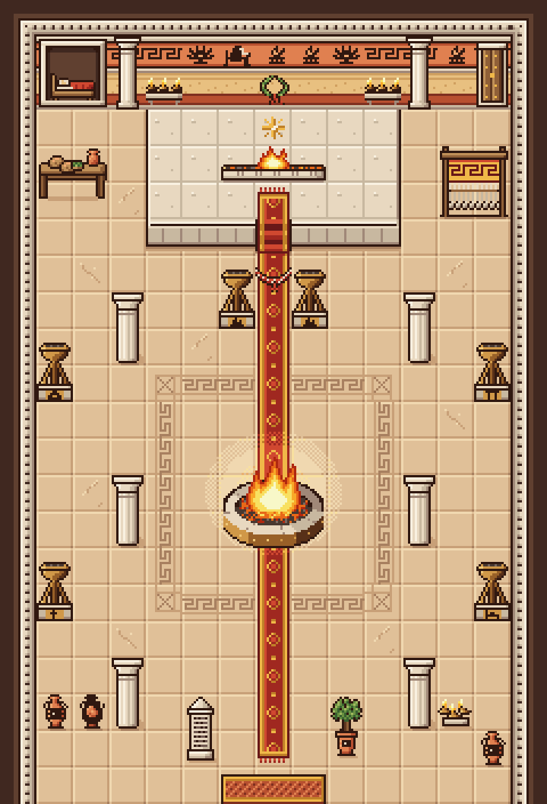

# Temple of Hestia tileset: `temple_hestia`

The interior of Akti's Temple of Hestia, home of the Hearth Trial (`SCRIPT.md`, beat 7 and Part 5). It is Doric, warm and lit by fire. A honey-marble hall runs under a black-figure frieze. A red wool runner leads past the great round hearth to the Hierophant's dais. Bronze tripod braziers stand around the hall, cold until the trial lights them.



| Image | Shows |
|---|---|
| `img/temple_room.png` | The proposed Hearth Trial room at 3×, before the trial |
| `img/temple_room_lit.png` | The same room after the trial: every brazier lit, the cord gone |
| `img/temple_sheet.png` | Every metatile with its id, rendered from the compiled tileset |
| `img/temple_identity.png` | The room on `building` and on `aethos`, side by side, with the diff |

## How it is made

- **`tools/ichor/art/temple_hestia.py`** holds every pixel, drawn as character grids with one legend. It writes `porytiles_src/` (bottom, middle and top PNGs, plus `attributes.csv`) and the per-tileset Porytiles config.
- **`tools/ichor/art/temple_room.py`** runs that script and compiles with Porytiles. It checks the result, lays out the proposed room and renders the four images. `--layout-out map.bin` also writes the room as a layout, with collision and elevation, for the map builder.

```bash
/usr/bin/python3 tools/ichor/art/temple_room.py
```

### Layers

- Everything is in the **bottom** layer (opaque backgrounds) and the **middle** layer (objects). The top layer is empty.
- So every metatile is `COVERED`, and its first layer is fully opaque. The engine never shows the primary's backdrop, or its "garbage" tile `0x3014`, through it.
- No object needs to be drawn over sprites. A sprite standing south of an object overlaps it from in front, which is correct.

### Primary independence

The temple must work on any primary, because the Greek interior primary is still being drawn.

- **It uses only its own tiles and palettes 6–12.** `temple_room.py` checks every compiled entry. Each one is either a temple tile (index ≥ 512) with palette 6–12, or the transparent tile 0 in the upper layer of a `COVERED` metatile. The engine itself writes tile 0 there, and tile 0 is transparent in every primary.
- **No temple color appears in aethos**, the primary Porytiles pairs it with. So Porytiles cannot reuse an aethos palette. Nearly empty or solid 8×8 tiles are avoided as well, because Porytiles matched those to aethos tile shapes. The check catches that too.
- **Identity check:** the cold room and the lit room render pixel-identical with `--primary building` and with `--primary aethos`. Zero pixels differ.

### Palettes

Porytiles' own palette search did not finish for this many colors: the default ran out of time and `best-fusion` failed. So the seven secondary palettes are planned by hand in `PALETTES`, and every 8×8 tile is checked to fit one of them. They reach Porytiles as packing hints, in `porytiles/tilesets/gTileset_TempleHestia/config.yaml`.

| Slot | Name | For |
|---|---|---|
| 6 | cloth | Loom, bed niche, side door, the cord |
| 7 | fire | The great and inner hearths, braziers, bronze lamps |
| 8 | floor | Floor, firelight, runner, key inlay, doormat |
| 9 | marble | Dais, steps, riser, columns, stele |
| 10 | clay | Amphorae, laurel, wreath, the table |
| 11 | wall | Wall top, frieze, lower wall |
| 12 | free | |

All colors are multiples of 8, in the master palette's families shifted warm. Object shadows are painted into the floor beneath, so objects never need floor colors. The tileset uses 352 of 512 tiles.

## Catalog

Ids are global metatile ids. "Blocks" is the collision to paint in Porymap: 1 is impassable. Every metatile's behavior is `MB_NORMAL` unless listed.

### Floor, runner and inlay (all walkable)

| Id | Name | Notes |
|---|---|---|
| `0x200` | `void` | Near-black, for the layout's border. Blocks |
| `0x201` | `floor` | Honey-marble slab, 16 px |
| `0x202`, `0x203` | `floor_vein_a`, `floor_vein_b` | Veined variants; scatter them |
| `0x204` | `runner` | Red wool runner, one tile wide, gold lozenge per tile |
| `0x205` | `runner_end_s` | South end: gold hem and fringe |
| `0x23B` | `runner_end_n` | North end on the floor |
| `0x206` | `runner_end_n_dais` | North end on the dais |
| `0x23D` | `dais_runner` | Runner straight on the dais |
| `0x208`, `0x209` | `inlay_h`, `inlay_v` | Subtle Greek-key inlay band, the same key as the pottery UI |
| `0x20A`–`0x20D` | `inlay_tl`, `_tr`, `_bl`, `_br` | Frame corners: a saltire square |

The runner simply interrupts an inlay band where it crosses one.

### Doormat: the exit warp

| Id | Name | Behavior |
|---|---|---|
| `0x20E`, `0x20F`, `0x210` | `mat_l`, `mat_m`, `mat_r` | `MB_SOUTH_ARROW_WARP` |
| `0x211` | `mat_single` | `MB_SOUTH_ARROW_WARP` |

- Put the mat on the map's **bottom row**, as vanilla interiors do: collision 0, elevation 3.
- Give each mat tile a warp event to `MAP_AKTI_TOWN`.
- Use a three-wide mat (`l m r`) or one `mat_single`.

### Walls (all block)

A room shows three wall rows: the wall top, the frieze, then the lower wall.

| Id | Name | Row | Notes |
|---|---|---|---|
| `0x212` | `wall_top` | 0 | Roof shadow over a dentil cornice |
| `0x213`, `0x214` | `wall_corner_l`, `wall_corner_r` | 0 | Cornice mitred into the side walls |
| `0x215`, `0x216` | `side_wall_l`, `side_wall_r` | all | The side walls' tops, down both edges of the map |
| `0x218` | `frieze_key` | 1 | Black-figure Greek key on terracotta |
| `0x219` | `frieze_palmette` | 1 | Anthemion |
| `0x21A` | `frieze_flame` | 1 | Flame on an altar |
| `0x21B` | `frieze_amphora` | 1 | |
| `0x21C`, `0x21D` | `frieze_hestia_l`, `_r` | 1 | Hestia enthroned and veiled, holding a phiale to her altar. Two tiles, left then right |
| `0x217` | `wall_lower` | 2 | Ochre plaster, red dado, marble skirting |
| `0x21E` | `wall_lower_wreath` | 2 | A laurel wreath tied with red ribbon |
| `0x21F` | `wall_lower_lamps` | 2 | Votive lamps burning on a marble ledge |

### Set into the wall (1 × 2 and 2 × 2, rows 1–2, all block)

| Ids | Name | Footprint |
|---|---|---|
| `0x220` / `0x228` | `pilaster_top` / `pilaster_bottom` | 1 × 2. A Doric half-column under the cornice; end a colonnade with one |
| `0x221` / `0x229` | `side_door_top` / `_bottom` | 1 × 2. A closed olive-wood door with gold studs; Kanthos is tied here. Not a warp |
| `0x222` `0x223` / `0x22A` `0x22B` | `bed_niche_tl`, `_tr` / `_bl`, `_br` | 2 × 2. An alcove with a kline made up for the night watch |

### Dais

| Id | Name | Blocks | Notes |
|---|---|---|---|
| `0x224` | `dais` | 0 | White marble |
| `0x225` | `dais_sun` | 0 | Gold sun of Hestia's house set in the marble, for under Ione |
| `0x226`, `0x227` | `dais_edge_l`, `_r` | 1 | The dais's side edges. Blocking them stops the player climbing on from the side |
| `0x22C` | `riser` | 1 | The dais's front face |
| `0x22D`, `0x22E` | `riser_l`, `riser_r` | 1 | Front corners |
| `0x22F` | `steps_runner` | 0 | Two steps with the runner climbing them |
| `0x23A` | `steps_plain` | 0 | Bare steps |

### Standing objects (all block)

| Ids | Name | Footprint |
|---|---|---|
| `0x230` / `0x238` | `column_top` / `column_bottom` | 1 × 2. Free-standing Doric column; both tiles block |
| `0x231` / `0x239` | `stele_top` / `stele_bottom` | 1 × 2. The hymn stele, pedimented and inscribed |
| `0x232` | `amphora` | 1 × 1. Black-figure |
| `0x233` | `amphora_red` | 1 × 1. Red-figure |
| `0x234` / `0x23C` | `laurel_top` / `laurel_bottom` | 1 × 2. Laurel in a terracotta pot |
| `0x235` | `votive_lamps` | 1 × 1. Three bronze lamps burning on a step |
| `0x236` `0x237` / `0x23E` `0x23F` | `table_tl`, `_tr` / `_bl`, `_br` | 2 × 2. Olive-wood table set with bread, olives and a jug |
| `0x255` `0x256` / `0x25D` `0x25E` | `loom_tl`, `_tr` / `_bl`, `_br` | 2 × 2. Warp-weighted loom: red cloth with a gold key band, stone weights |

### The great hearth (3 × 3, in a 5 × 5 pool of light)

The hearth is a stone ring clad in hearth bronze, with a bed of coals and Hestia's flame. It sits in a 5 × 5 block whose outer ring is floor warmed by its light.

```
0x250 0x251 0x252 0x253 0x254      glow_00 … glow_04   (0x252 is the runner)
0x258 0x259 0x25A 0x25B 0x25C      glow_10, hearth_00 hearth_01 hearth_02, glow_14
0x260 0x261 0x262 0x263 0x264      glow_20, hearth_10 hearth_11 hearth_12, glow_24
0x268 0x269 0x26A 0x26B 0x26C      glow_30, hearth_20 hearth_21 hearth_22, glow_34
0x270 0x271 0x272 0x273 0x274      glow_40 … glow_44   (0x272 is the runner)
```

- Place the whole 5 × 5 block, with the runner entering at the middle of its top and bottom edges.
- The 3 × 3 hearth (`0x259`–`0x26B`) blocks; the glow tiles are walkable.
- Give the hearth's tiles bg events that all call the hearth script. Lampon stands on `0x272`, south of it.

### Braziers (1 × 2, both tiles block)

A brazier is a bowl tile over a leg tile. The leg tile carries the plinth and a bronze plaque with the station's glyph. **Each lit metatile is its cold one + 1.**

| Part | Cold | Lit |
|---|---|---|
| Bowl (upper tile, every brazier) | `0x240` `brazier_top_cold` | `0x241` `brazier_top_lit` |
| Legs, **Door** plaque (a doorway) | `0x242` | `0x243` |
| Legs, **Table** plaque (a loaf) | `0x244` | `0x245` |
| Legs, **Loom** plaque (a spindle) | `0x246` | `0x247` |
| Legs, **Bed** plaque (a couch) | `0x248` | `0x249` |
| Legs, **Hearth** plaque (a flame), for the dais pair | `0x24A` | `0x24B` |

- The two states have the same footprint and the same collision. So swap **both** tiles, keeping them impassable:

  ```
  setmetatile(x, y,     0x241, TRUE)   // bowl: lit
  setmetatile(x, y + 1, 0x245, TRUE)   // legs: lit (Table, here)
  special(DrawWholeMapView)
  ```

- To put a brazier out, use the cold ids.
- Put bg events on both tiles, so the player can use a brazier from any side.

### The inner hearth and the dais gate

| Id | Name | Blocks | Behavior |
|---|---|---|---|
| `0x24C` | `inner_hearth_l` | 1 | |
| `0x24D` | `inner_hearth_c` | 1 | **`MB_COUNTER`** |
| `0x24E` | `inner_hearth_r` | 1 | |
| `0x207` | `runner_cord` | 1 | |

- The inner hearth is a long marble altar-hearth burning Hestia's sacred flame, 3 × 1 on the dais.
- Its center is a counter: the player standing south of it talks across the flame to Ione behind it, like the nurse in a Pokémon Center.
- **The gate** is `runner_cord`: a red-and-white woolen fillet strung between the two dais braziers' bowls, across the runner. It is the mark of a closed sacred place.
- When the trial completes, the flare burns it away:
  - swap the dais braziers to lit;
  - then `setmetatile(cord_x, cord_y, 0x204, FALSE)` turns the cord tile back into a plain, walkable runner.

### Spare slots

These are plain floor that keeps the hearth block aligned in Porymap's 8-wide selector, free for later additions:

- `0x24F`
- `0x257`, `0x25F`
- `0x265`–`0x267`
- `0x26D`–`0x26F`
- `0x275`–`0x277`

## The proposed room for the Hearth Trial

- **Size.** The room is **15 × 22**.
  - The current placeholder layout is 11 × 20, on `building` + `RustboroGym`.
  - 15 wide fills the GBA screen and leaves room for a nave and two aisles.
- **Tilesets.** Use primary `gTileset_Building`, or the new Greek interior primary when it lands, with secondary `gTileset_TempleHestia`.
- **Getting the layout.** `temple_room.py --layout-out <path>` writes the room as a `map.bin`:
  - elevation 3 everywhere;
  - collision 1 on every blocking tile listed above.

The braziers follow Part 5's suggested scramble, so their order in space does not match the hymn.

| What | Where (x, y) | Notes |
|---|---|---|
| Door warp mat | (6–8, 21) | `mat_l m r`. Each mat tile warps out. Put the "torch sputters out" coord events on the same three tiles |
| Stele with the hymn | (5, 19–20) | Just inside the entrance. bg events on both tiles |
| Euboulos | (8, 20) | Just inside the door |
| Runner | x = 7, from y = 20 up to the steps | |
| Great hearth | (6–8, 12–14) | Inside the 5 × 5 light block at (5–9, 11–15) and a 7 × 7 key-inlay frame at (4–10, 10–16) |
| Lampon | (7, 15), facing south | On the runner in the firelight. The hearth checks his trainer flag |
| **Table** brazier | (1, 9–10) | Back left |
| **Door** brazier | (13, 9–10) | Back right |
| **Loom** brazier | (1, 15–16) | Front left |
| **Bed** brazier | (13, 15–16) | Front right |
| Pyrrha | (2, 12), facing east, sight 3 | Left aisle, between the Table and Loom braziers. Seen tiles: (3–5, 12). Walking x = 1 behind her avoids her |
| Aithra | (12, 15), facing west, sight 2 | Beside the Bed brazier. Seen tiles: (10–11, 15) |
| Dais braziers | (6, 7–8) and (8, 7–8) | Hearth plaques, flanking the approach to the steps |
| The cord (gate) | (7, 7) | Between the dais braziers' bowls |
| Steps | (7, 6) | The dais's front riser runs (4–10, 6) |
| Dais | (4–10, 3–5) | Edges at x = 4 and x = 10 block |
| Inner hearth | (6–8, 4) | Counter at (7, 4) |
| Ione | (7, 3), facing south | On `dais_sun`. Talk to her from (7, 5) across the counter |
| Colonnades | x = 3 and x = 11; columns at y = 8–9, 13–14, 18–19 | They end in pilasters in the north wall at (3, 1–2) and (11, 1–2) |
| Side door and Kanthos | Door (13, 1–2); Kanthos at (13, 3) | The loom stands in the right aisle at (12–13, 4–5) |
| Bed niche, table | Niche (1–2, 1–2); table (1–2, 4–5) | Left aisle |

### State drawing

- `ON_LOAD` draws each brazier from `VAR_ICHOR_HEARTH_TRIAL`: Door is lit at var ≥ 2, Table at ≥ 3, Loom at ≥ 4 and Bed at ≥ 5.
- Once the trial is done (`FLAG_ICHOR_HEARTH_TRIAL_DONE`), every brazier and the dais pair are drawn lit, and the cord tile becomes `runner`, passable.
- A wrong brazier, or leaving the room, resets the four hall braziers to their cold ids.

## Notes and limits

- **The fire is static.** Porytiles 2.0 can only animate tiles by wiring animation code into the engine (`src/tileset_anims.c` and a tileset callback). That is engine work outside this tileset, so the hearths, braziers and lamps are drawn as single frames.
  - If the engine team adds a `temple_hestia` callback later, every flame shares the fire palette (slot 7 today), so palette cycling could make them flicker without redrawing tiles.
- **aethos's Porytiles cache is stale.** Its sources were repainted after its last compile, so pairing with it fails checksum verification. `temple_room.py` compiles with `--no-verify-checksums`.
  - Whoever owns aethos should recompile it.
  - If aethos ever gains a temple color, the self-containment check will fail loudly rather than ship a primary-dependent tile.
- **Metatile labels.** Scripts can use the raw ids above. Labels such as `METATILE_TempleHestia_BrazierTop_Lit` belong in `include/constants/metatile_labels.h`, which the map or script owner should add.
- **What could be better.**
  - The great hearth is 3 × 3. It reads well as the hall's center, but a 5 × 4 hearth would feel grander.
  - The plaque glyphs are tiny (6 × 4), so the plaque text has to name the station.
  - The white dais is cooler than the warm hall around it.
  - The lit braziers don't warm the floor around them the way the great hearth does.
