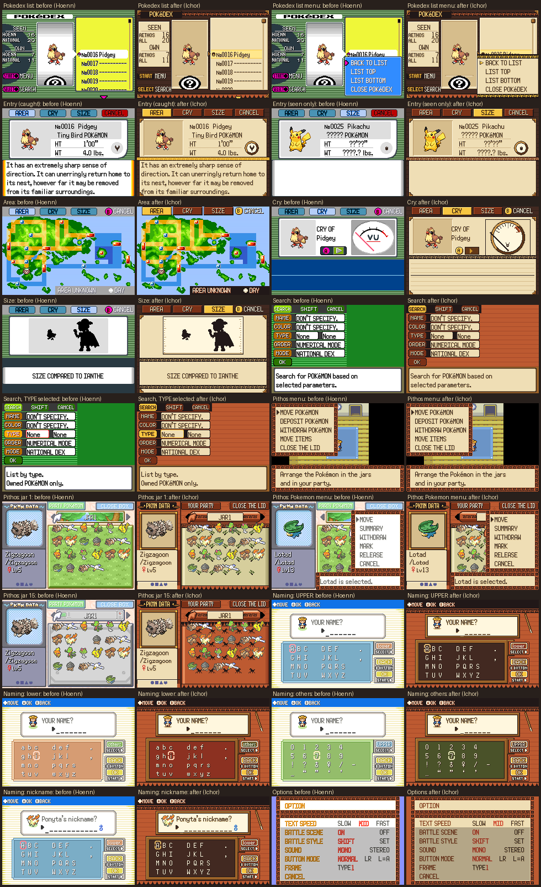
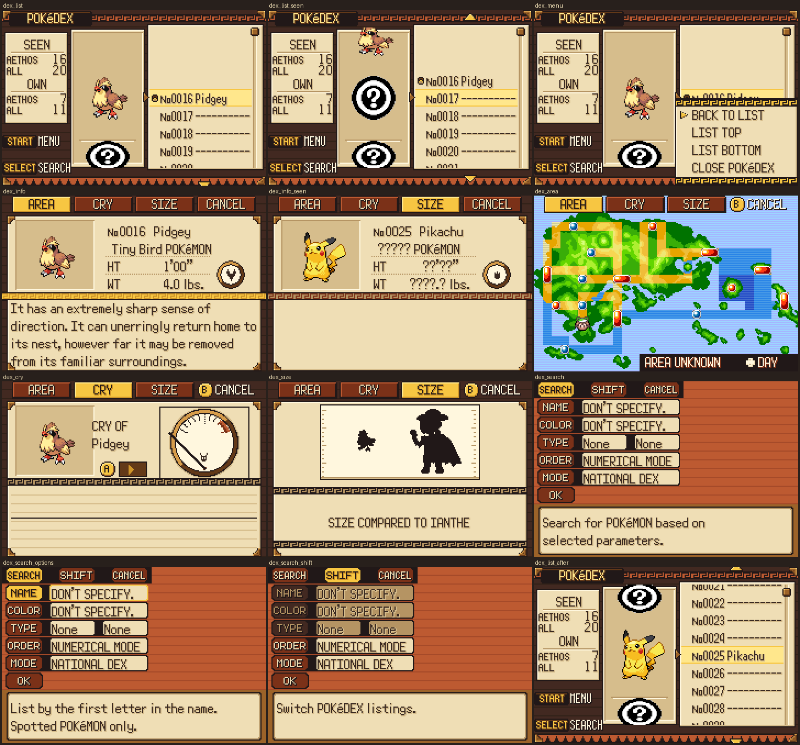
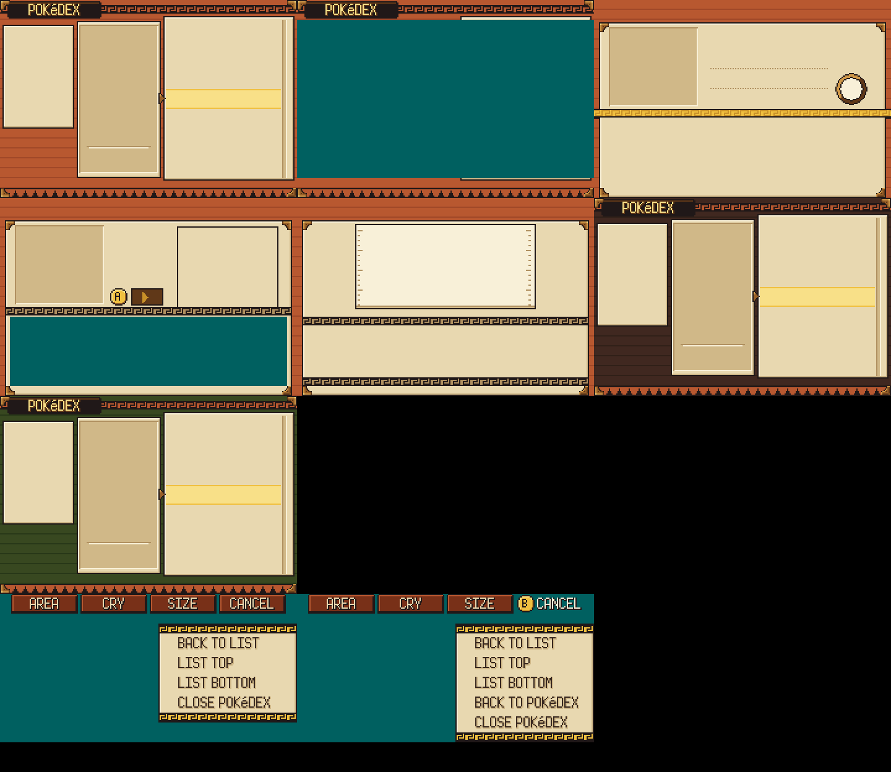
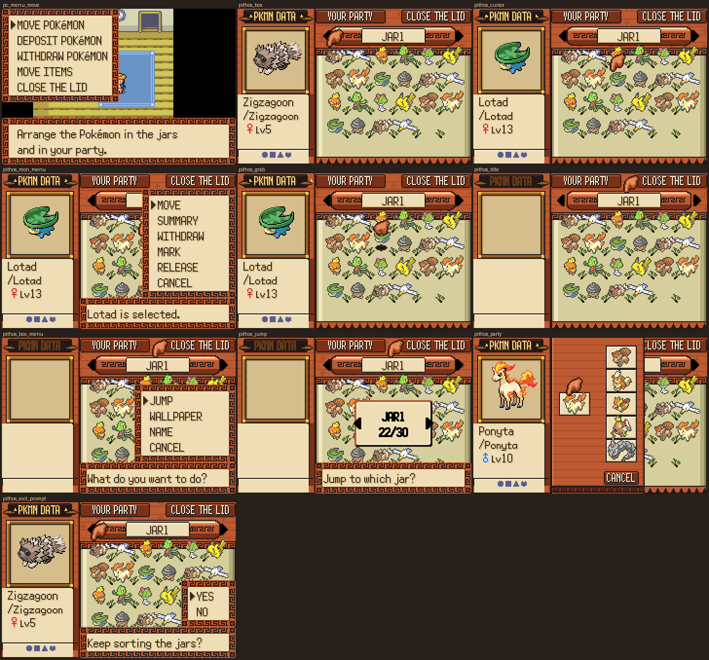
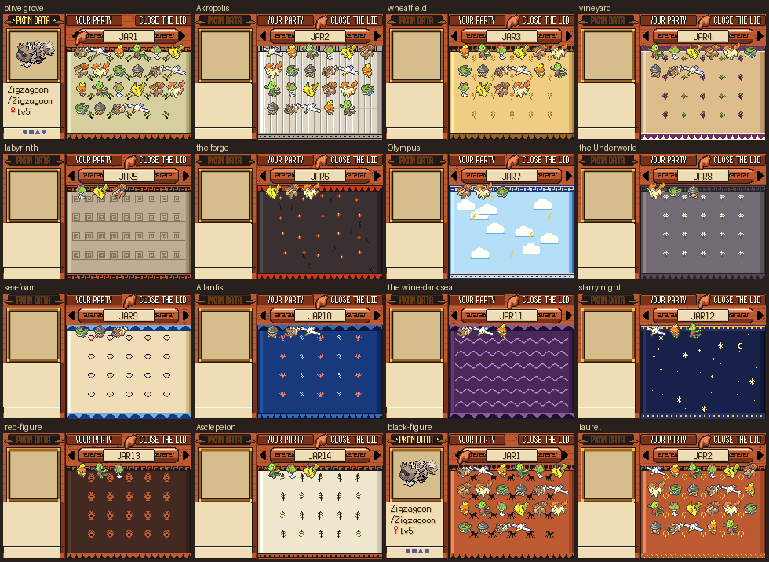
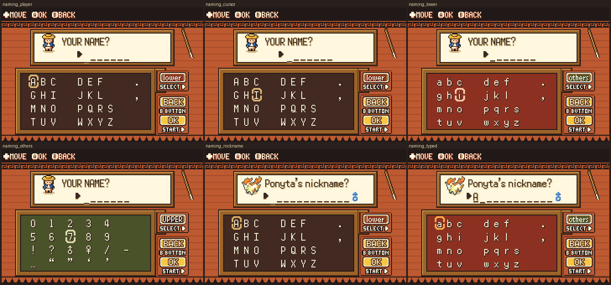

# The reading screens: codex, Pithos, tablet

The Pokédex, the Pithos (storage), the naming screen and the options screen are redrawn in the pottery family of `UI_menus.md`. Every asset comes from a script in `tools/ichor/art/`, so edit the script and rerun it rather than touching the PNGs, `.pal` or `.bin` files. The scripts are idempotent: a second run changes nothing.



| Script | Draws |
|---|---|
| `ui_codex_lib.py` | Shared: the game's own fonts for lettering baked into art, bronze corner caps, meander and ray bands, cartouches |
| `ui_codex_dex.py` | The Pokédex: every page, its palettes, its sprites, the cry dial, the area glow, the search page |
| `ui_codex_pithos.py` | The Pithos around the jars: the PKMN DATA panel, the party tray, the lid button, the scrolling clay, the hand, the lamps, the menus' palette |
| `ui_codex_jars.py` | The sixteen jars (box wallpapers), and Walda's patterns fired in clay |
| `ui_codex_naming.py` | The naming screen: the writing strip, the wax tablets, the keys and the jar icon |
| `ui_codex_misc.py` | `std_menu.pal` and the options screen's text palette |

## The family look, carried over

- **Terracotta board, parchment leaves, ink text.** Text prints in ink (`56,40,32`) on parchment (`232,216,176`) with a `208,184,136` shadow, as the dialogue box does.
- **Sun-gold means "here".** The Pokédex's selected row and tab, the Pithos's flashing lid button, the naming cursor, the OK and BACK keys.
- **Bronze** is new to these screens: corner caps, frames, the scroll thumb, the lamps. It is the master palette's `BRONZE` with a dark (`96,56,24`), a light (`208,152,72`) and a glint (`248,216,136`).
- **Lettering baked into art uses the game's fonts** (`ui_codex_lib.draw_text` reads `graphics/fonts/` and `src/fonts.c`), so a tab label matches the text the engine prints beside it.

## The standard menu palette

`graphics/interface/std_menu.pal` is now the dialogue box's palette slot for slot (`ui_codex_misc.py`). Every window that loads it prints ink on parchment: the move relearner, the whiteout text, the save-error and clear-save screens, and link and trade windows. Nothing that the slice shows still prints on white. The Pokédex and the bag already loaded the dialogue palette themselves.

## Pokédex: a codex



- **The list** is an open codex on the terracotta board: a tally leaf for SEEN and OWN, a portrait leaf, and the list leaf. Bronze caps sit on the board's corners, the header is an ink cartouche lettered POKéDEX over a tooled meander, and the foot is a band of rays. The selected row is a gold-pale bar, and a bronze pointer joins it to the portrait.
- **Counts** read AETHOS and ALL (the art's labels; the strings say AETHOS DEX and NATIONAL DEX). SEEN and OWN are ink headings ruled on the tally leaf. START MENU and SELECT SEARCH are ink key caps lettered in gold.
- **Three bindings.** Before the National Dex, the board is terracotta (`bg_hoenn.pal`). Once it is on, the board is black glaze (`bg_national.pal`). Search results sit on olive (`search_results_bg.pal`). The leaves never change.
- **The entry page** is one parchment leaf with bronze caps. It has a recessed niche for the Pokémon, ruled lines for its measurements, and a bronze roundel where the footprint is printed in ink.
- **The owned band.** A meander strap crosses the codex between the entry and the description. It is terracotta on sand for a Pokémon only seen. Once the Pokémon is caught it gilds, and it flickers gold on the new-entry page. This is the engine's palette-3 trick: the code copies palette 0 over palette 3 for a Pokémon not caught.
- **The tabs** (AREA, CRY, SIZE, CANCEL) are clay tabs lettered in parchment. The current one turns gold and ink. On the sub-pages, CANCEL is a gold B coin and its label.
- **The cry page.** The play button is an A coin and a gold arrow; `pokedex.c` lights the arrow gold, not lime, while the cry plays. The VU meter is a bronze-rimmed dial with a red-clay loud end and a lyre mark, and an ink needle. The waveform runs in ink and clay over ruled papyrus.
- **The size page** is a lit measuring wall with a height scale. The silhouettes are ink.
- **The area page** keeps whatever region map exists (another agent's work) under the codex's tab bar. The glow over a Pokémon's places is gold. Special-area markers are gold seals ringed in ink. The AREA UNKNOWN and time-of-day labels are parchment on ink.
- **Search** keeps Emerald's tiles and the code's palette swaps but wears the codex colors. Idle labels are dark clay lettered in parchment, the selected one is gold lettered in ink, disabled ones are black glaze, the boxes are parchment, and the field is ringed clay.
- **The list's slide-up menu** is a parchment panel banded in gold meanders.



### How the engine draws it

| What | Where in the code | What the art does |
|---|---|---|
| All page text | BG palette 0, color 15 with shadow 3 | Ink (15) on parchment, shadow `PARCH_SHADE` (3) |
| Area labels | Palette 0: fill 7, text 1, shadow 5 | Ink fill, parchment text, dark-clay shadow |
| List sprites | Colored with `bg_hoenn.pal` palette 0 | The interface sprites use the same indices as the BG |
| Tabs | Palette 2 when selected, 4 when not (`HighlightScreenSelectBarItem`) | Slots 10-14 are the tab's colors, gold in 2, clay in 4 |
| Owned glow | Palette 3; colors 1-7 flicker on a new entry | Only the band row uses palette 3, drawn in slots 4 and 5 |
| Play arrow | Palette 5 color 13, written by `LoadPlayArrowPalette` | Its tiles are palette 5 |
| Cry waveform | BG0 window under BG3, rows 12-18 | BG3 is transparent there |
| List names | BG2, between BG1 and BG3 | BG1 copies rows 0-1 and 18-19 so names never show outside the leaf |
| Rotating Poké Ball | An OBJ window that hides BG1 | BG1 is empty there, so the mask has nothing to cut |

**Limits.** The codex uses 262 tiles. `pokedex.c` used to copy exactly 256 (`0x2000` bytes), so it now loads `menu.png` whole. The new-entry page puts the tiles at charbase 1 under map base 14, so 384 is the hard cap (`MAX_TILES` in the script).

## The Pithos: storage jars



- **The jars.** Each box wallpaper is the painted wall of a pithos. A clay lip runs along the top with a parchment name tag tied on with bronze pegs, and the jar's name prints on it in ink (`sBoxTitleColors` in `src/data/wallpapers.h`). The wall is shaded like a pot's body: lit at the left, falling into shade at the right, and banded at shoulder and foot. The theme's motif sits in the gaps between the icon cells, so it never fights a Pokémon icon.

  

  | Engine slot | Jar | Bands | Motif |
  |---|---|---|---|
  | forest | olive grove | meander / rays | olive sprigs with black olives |
  | city | Akropolis | triglyphs / dots | fluted marble drums |
  | desert | wheatfield | tongues / rays | ears of wheat (Demeter) |
  | savanna | vineyard | laurel / rays | grape clusters and ivy |
  | crag | labyrinth | meander / meander | the meander key as a maze |
  | volcano | the forge | rays / rays | basalt cracks and embers |
  | snow | Olympus | meander / dots | clouds and Zeus's bolts |
  | cave | the Underworld | meander / rays | asphodel |
  | beach | sea-foam | waves / waves | scallop shells (Aphrodite) |
  | seafloor | Atlantis | waves / rays | coral and bubbles |
  | river | the wine-dark sea | waves / waves | running waves |
  | sky | starry night | dots / dots | stars and a crescent |
  | polkadot | red-figure | meander / rays | amphorae in clay on black glaze |
  | pokecenter | Asclepeion | meander / dots | the rod of Asclepius |
  | machine | black-figure | tongues / rays | running horses in ink on clay |
  | plain | laurel | meander / laurel | gold laurel wreaths |

  The engine's slot names, file names and count are unchanged. The wallpaper menu still shows Emerald's names (see the strings below).
- **Walda's gift** (`WALLPAPER_FRIENDS`) has sixteen patterns the player tints, and nothing in Aethos gives it. It is still loaded, so `write_friends()` fires its art in the same clay: each color moves to the nearest step of a clay-and-parchment ramp.
- **The panel.** PKMN DATA is an ink cartouche lettered in gold, dimmed to bronze when no Pokémon is shown. The two "waveform" sprites beside it are now oil lamps that flicker when a Pokémon is shown. The portrait sits in a bronze frame, and the info panel is parchment with Aegean ♂ and red ♀.
- **The buttons.** YOUR PARTY and CLOSE THE LID are clay plates lettered in parchment. CLOSE THE LID flashes gold.
- **The party tray** slides down as a clay tray. Each Pokémon has a parchment seat, and an empty place is an incised socket.
- **The hand** keeps Emerald's four poses and fingertips, recolored red-figure: clay skin outlined in ink. In auto-action it is gold. The jar picker (JUMP) is parchment on the gold hand's palette.
- **Behind the jars**, Corinthian filler rosettes on ringed clay scroll diagonally. In MOVE ITEMS the clay turns olive.
- **Menus and messages** (`text_windows.pal`) are ink on parchment in the pottery frame.

**Limits.** BG1 loads `menu.png` at tile `0x100`, so every map index is offset by `0x100`. The interface uses 131 of 256 tiles. A wallpaper may use 256 tiles; the jars use 27-92. `graphics_file_rules.mk` no longer fixes the jars' tile counts. Each jar's `frame.png` carries all its tiles in the lip's palette, and `bg.png` is one blank tile in the wall's palette.

## The naming screen: a writing tablet



- **The name strip** is parchment in a wooden frame on the terracotta desk. A bronze stylus with a bone point leans beside it.
- **The keyboard is a wax tablet.** It has a wooden frame and a handle lug, and the letters are cut light into the wax. Each page has its own wax: dark for UPPER, red for lower, olive for others. The page tags in the frame match.
- **The cursor** is sun-gold. The BACK and OK keys are gold, and their captions sit on clay plates. The controls banner is an ink band (`naming_screen.c` now loads `banner.pal` instead of the shared blue `text_pal2`).
- **"Sent to the Pithos"** shows a little pithos instead of a PC (`pc_icon_*.png`).

**Limits.** The engine copies 48 tiles (`tileBuffer[0x600]`), and the screen uses 40. The three tablets share their tiles and differ only by palette (1, 2 and 3).

## Options and save

- **Options** (`option_menu_text.pal`): labels in incised clay, values in ink, and the chosen value in the dialogue box's red, all on parchment. The code darkens every row but the current one. The backdrop behind the frames is terracotta, not lavender (`option_menu.c`).
- **Save** is the start menu's info window and YES/NO box. Both were already pottery frames on the dialogue palette, so they needed no new art. The location name prints in the dialogue palette's green; see the notes below.

## Source edits

All are small and commented `// Ichor:`.

| File | Change |
|---|---|
| `src/pokedex.c` | Loads `menu.png` whole (five calls, `0x2000` → `0`). The cry page's play arrow is gold. |
| `src/option_menu.c` | The backdrop color is terracotta. |
| `src/naming_screen.c` | The controls banner uses `graphics/naming_screen/banner.pal`. |
| `src/data/wallpapers.h` | Jar names print in ink on the parchment tag (`sBoxTitleColors`). |
| `graphics_file_rules.mk` | The sixteen jars' `frame.png` and `bg.png` use the generic rule, without fixed tile counts. |

## Strings for the text agent

The art already says these words; the strings are not mine.

- **Wallpaper names** (`sMenuTexts` in `src/pokemon_storage_system.c`), to match the jars:

  | String | Now | Proposed |
  |---|---|---|
  | `MENU_FOREST` | FOREST | OLIVE GROVE |
  | `MENU_CITY` | CITY | AKROPOLIS |
  | `MENU_DESERT` | DESERT | WHEATFIELD |
  | `MENU_SAVANNA` | SAVANNA | VINEYARD |
  | `MENU_CRAG` | CRAG | LABYRINTH |
  | `MENU_VOLCANO` | VOLCANO | FORGE |
  | `MENU_SNOW` | SNOW | OLYMPUS |
  | `MENU_CAVE` | CAVE | UNDERWORLD |
  | `MENU_BEACH` | BEACH | SEA-FOAM |
  | `MENU_SEAFLOOR` | SEAFLOOR | ATLANTIS |
  | `MENU_RIVER` | RIVER | WINE-DARK SEA |
  | `MENU_SKY` | SKY | STARRY NIGHT |
  | `MENU_POLKADOT` | POLKA-DOT | RED-FIGURE |
  | `MENU_POKECENTER` | ASCLEPEION | keep |
  | `MENU_MACHINE` | MACHINE | BLACK-FIGURE |
  | `MENU_SIMPLE` | SIMPLE | LAUREL |

  The four set names (SCENERY 1-3, ETCETERA) could become THE LAND, THE WILDS, SEA AND SKY and POTTERY.
- **Baked labels:** CLOSE THE LID (matching `OPTION_EXIT`), YOUR PARTY, PKMN DATA, AETHOS and ALL on the Pokédex counts.
- **The save info window** prints the location in `TEXT_COLOR_GREEN` (`start_menu.c`), the one Hoenn green left on the slice's frames. Ink or the dialogue red would fit better. That file is not mine.

## Not done, or left on purpose

- **The unknown Pokémon's "?",** which the list shows for unseen neighbors, is now a clay roundel (`UI_remnants.md`).
- **The region map** under the area page belongs to the region-map agent.
- **Walda's patterns** are fired in clay but keep their Hoenn shapes (Azumarill, Pikachu, ...). The Walda icons are untouched. Nothing in Aethos reaches them.
- **The search page** keeps Emerald's rounded label pills; it is recolored, not redrawn.
- **The HGSS Pokédex** (`graphics/pokedex/hgss/`) is off (`POKEDEX_PLUS_HGSS`) and untouched.
- **`item_info_frame.png`** (MOVE ITEMS) is untouched, and MOVE ITEMS was not screenshotted.
- **The party tray had no before shot.** The compare sheet pairs every other page.

## How to regenerate and check

```bash
python3 tools/ichor/art/ui_codex_dex.py
python3 tools/ichor/art/ui_codex_pithos.py
python3 tools/ichor/art/ui_codex_jars.py
python3 tools/ichor/art/ui_codex_naming.py
python3 tools/ichor/art/ui_codex_misc.py
make -j$(sysctl -n hw.ncpu) && tools/ichor/smoke_test.sh && tools/ichor/ui_check.sh
```

The scripts write previews to `design/phase1/img/ui_codex_*`.

**How the in-game shots were taken.** A temporary, uncommitted patch to `src/field_control_avatar.c` set things up when START was pressed: a party, twenty Pokédex entries seen and nine caught, the National Dex, fourteen jars filled, and each jar a different wallpaper. SELECT then opened the Pithos, the player naming screen, the nickname screen, and the Pithos again with the last two wallpapers. A headless Lua script walked every page. The patch (`codex_test.patch`), the script (`codex_check.lua`), the sheet maker and the raw before and after shots are kept in the worktree's `build/codex/`, outside git.

**`ui_check`** now reads its boxes in the Akti Asclepeion, because the bedroom Quickstart starts in has nothing to read:
- The old man gives the plain message.
- The old man again, with a speaker name forced, gives the name box.
- The Asclepius statue gives the sign.

The map's group and number come from `map_groups.h`, and the events' places come from the map's JSON.
