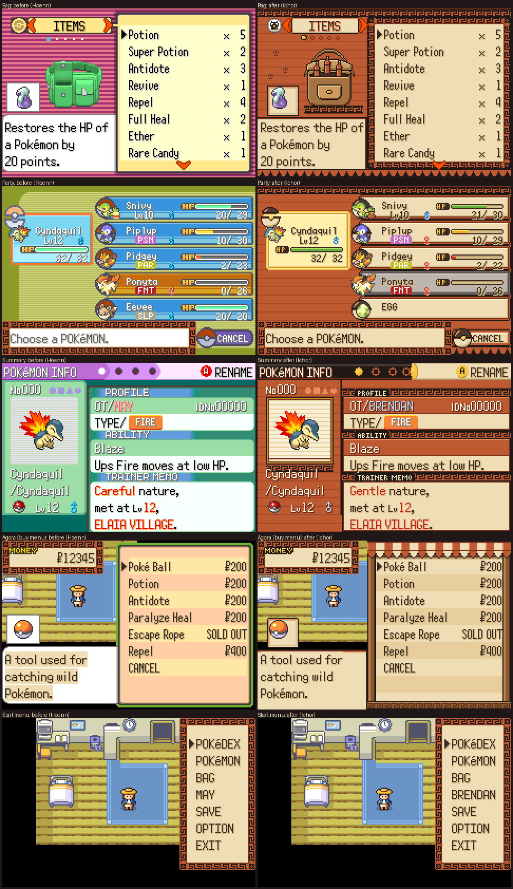
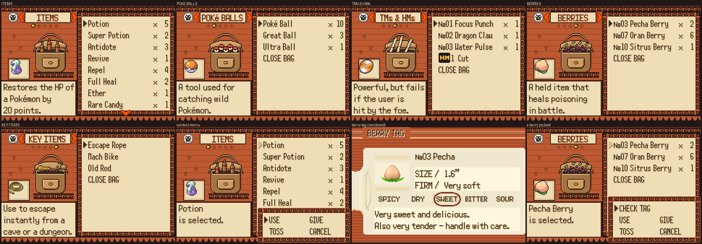
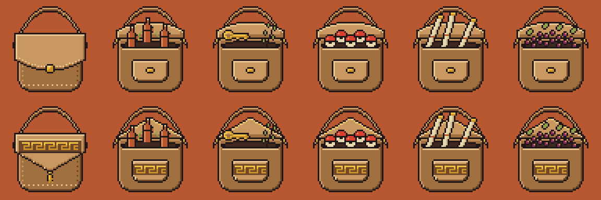
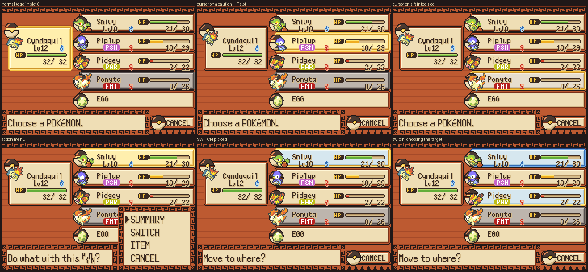
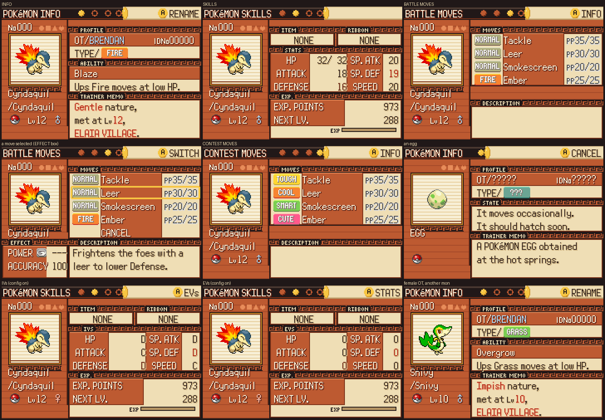
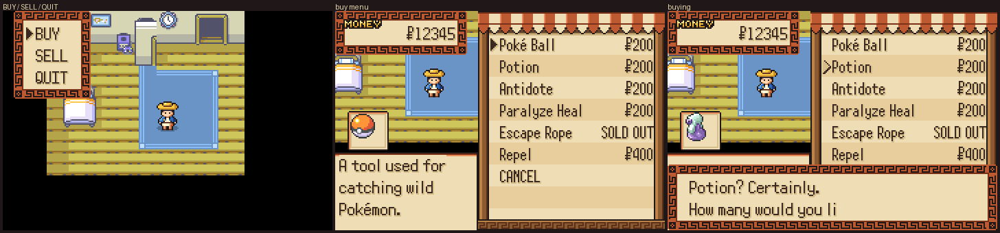
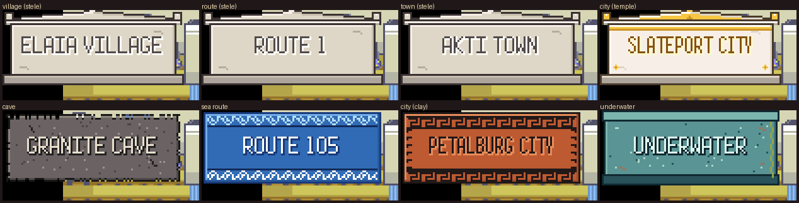
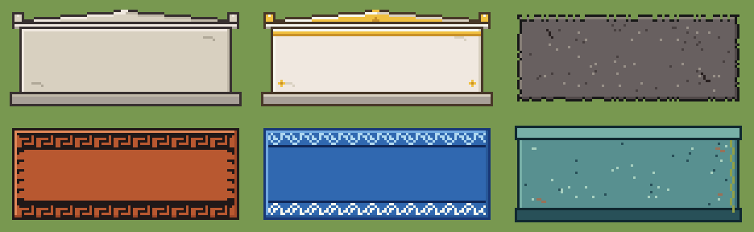

# Everyday menu screens

The bag, party menu, summary screen, Agora (shop) and map-name popups are redrawn as one family with the pottery dialogue box. Every asset is generated by a script in `tools/ichor/art/`, so edit the script and rerun it rather than touching the PNGs or `.bin` files. The scripts are idempotent: running them twice changes nothing.



## The family look

- **The field is a pot's terracotta.** It uses `CLAY` with a darker throwing ring on the last row of every tile, the faint horizontal lines a potter's wheel leaves.
- **Friezes bound the screen.** A meander frieze runs along the top and a row of black-figure rays along the foot, the way a vase is banded at its shoulder and foot.
- **Panels are parchment in the dialogue box's frame.** Text is ink (`56,40,32`) on parchment (`232,216,176`) with a `208,184,136` shadow, the same colors as the dialogue box. The item list is literally the dialogue box's frame: its tiles come from `ui_frames.py`.
- **Light text sits on terracotta.** Where the engine prints light lettering (summary labels, move names), it sits on a clay inlay in `248,240,216` with a `104,40,24` shadow.
- **Sun-gold means "here".** It marks the party cursor, the current pocket dot, the current page dot, the move cursor and the HM badge's letters.
- **Black-figure details** recur across screens: an owl drachma, a black-glazed Poke Ball, ink cartouches lettered in parchment, ivy leaves.
- **The master palette** in `PLAN.md` supplies every color, all multiples of 8. Light comes from the top left. Color 0 is transparent.

## Bag: a traveler's satchel



- **Screen** (`ui_menus_bag.py`). The item list is a dialogue-box panel. The pocket name hangs on a parchment label under the frieze. The silver drachma with Athena's owl replaces the Poke Ball sticker, and the rotating sprite that spins when the pocket changes is the same coin (`rotating_ball.png`). The satchel stands on a meander plinth. The icon plate and description panel are parchment, and Corinthian filler rosettes sit in the empty clay.
- **Satchel** (`ui_menus_satchel.py`). It is a pera, the leather shoulder bag of travelers and Hermes, in buff leather so it parts from the clay. One frame per pocket shows what the flap opens on:

  | Frame | Pocket | Contents |
  |---|---|---|
  | 0 | closed | Shown while the pocket changes |
  | 1 | Items | Clay flasks and herbs |
  | 2 | Key Items | A bronze key and a laurel sprig |
  | 3 | Poke Balls | Balls |
  | 4 | TMs & HMs | Scrolls with gold caps |
  | 5 | Berries | Berries and olive leaves |

  Theo's satchel (`bag_male.png`) closes with a bronze disc. Ianthe's (`bag_female.png`) has a pointed flap embroidered with a gold meander, and a tassel. The two share `bag.pal`.

  
- **Badges.** The HM badge is gold on an ink tablet. The SELECT tag is ink on gold.
- **Berry tag** (Bag > Berries > CHECK TAG) is redrawn as a clay label by `ui_berry_tag.py` (`UI_remnants.md`).
- **Limits.**
  - `graphics.c` loads `-num_tiles 53`, so the screen uses at most 53 tiles. It uses 40 today.
  - The code draws some tiles by number: `0x11` is the plain list fill (`DrawItemListBgRow`), and `0x17` and `0x2B` are the pocket dots in BG palette 1 (`DrawPocketIndicatorSquare`).
  - Palette 1 is the text palette. Item names use color 1 with shadow 3, and the pocket name uses 1 with shadow 4. The dots and badges share palette 1's spare colors.

## Party menu: clay plaques



- **Script:** `ui_menus_party.py`.
- **Slots.** Each slot is a parchment plaque in a clay rim with an ink outline.
- **States.** The engine recolors a slot by loading single colors from `bg.png`'s 11 palettes into the slot window's colors 1 and 4–8. So the states are palette entries:

  | State | Look | Palettes |
  |---|---|---|
  | Normal | Parchment face, clay rim, ink outline | 3 |
  | Cursor | Pale-gold face, gold rim: the sun-gold glow | 7 face, 6 rim |
  | Fainted | Ashen face and rim | 5 |
  | Fainted with the cursor | A lighter ash, gold rim | 9 face, 6 rim |
  | Switching | Pale-sea face, Aegean rim; the cursor slot keeps the gold rim | 6 face, 10 rim |
  | Partner's slot (multi battles) | Olive | 4 |
  | Empty | An incised socket in the clay, from colors 1, 11 and 12 of palette 1 | 1 |
- **HP bars** keep battle's meaning: green (palette 3), gold (palette 4) and red (palette 5). The empty groove is parchment. The HP tag is gold letters on an ink tablet. The gender symbols are Aegean (male) and red (female).
- **Cancel / Confirm** is a plaque in BG palette 1, which the engine swaps for palette 2 (the gold glow) while it is selected. `cancel_button.bin` and `confirm_button.bin` place it for choose-half mode.
- **Sprites.**
  - The slot's ball (`pokeball.png`, `pokeball_small.png`) is painted black-figure: a glazed ink cap, a buff lower half, and a gold button. It opens on a gold glow.
  - The held-item badges (`hold_icons.png`) are a gold-tied pouch and a sealed scroll.
- **Limits.**
  - `graphics.c` loads `-num_tiles 62`, and the windows start at tile `0x63`. The screen uses 37 tiles.
  - Slot frames are blitted by byte maps (`slot_*.bin`) with no flips, so their 26 tiles are unflipped.
  - Text is color 3 with shadow 2. The HP bar's empty part is color 13 over 2.

## Summary: papyrus unrolled from a scroll rod



- **Script:** `ui_menus_summary.py`.
- **The header is the scroll's rod.** It is black, lit along the top, and carries the page title in parchment. The page dots on the rod are gold for this page, filled clay for pages seen, and clay rings for pages ahead. The last dot ends in a gold knob, and a papyrus tag beyond it holds the button prompt. The A and B buttons are gold coins struck with an ink letter.
- **Sections.** Each section opens with a meander band and an ink cartouche lettered in square capitals: PROFILE, ABILITY, TRAINER MEMO, ITEM, RIBBON, STATS, EXP., MOVES, DESCRIPTION, EFFECT, and STATE for eggs.
- **Text placement** follows the code's text colors:
  - Labels and names (the OT, the ability name, stat labels, move names) are printed light, so they sit on terracotta inlays.
  - Values and descriptions are printed dark, so they sit on papyrus.
  - The PP column and the type-icon column are papyrus.
- **The portrait** has a papyrus backdrop. For shiny Pokemon it gilds: the engine swaps palette 0 for 5 there, and only the backdrop's two colors differ between them.
- **The status band** that slides in under the portrait is an ink band with a papyrus seat for the status icon.
- **Other pieces.**
  - The EXP bar is Aegean in ink rails.
  - The move cursor (`move_select.png`) is gold, and the second cursor used when reordering moves is Aegean.
  - Contest appeal and jam hearts are ivy leaves, Greek art's heart.
  - The Pokerus-cured mark is a small gold star.
  - The markings (circle, square, triangle, heart) are faint clay until set, then gold.
- **Pinned tiles.** The code draws many tiles by number, so the script pins them:

  | Tiles | Use | Code |
  |---|---|---|
  | `0x01` | Plain field | The status band's blank |
  | `0x1A` | Field, flipped | Drawn at (3,17) |
  | `0x2C` | Pokerus-cured mark | `DrawPokerusCuredSymbol` |
  | `0x39`–`0x3D` | Ivy leaves | `DrawContestMoveHearts` |
  | `0x40`–`0x4C`, `0x50`–`0x5C` | Page dots | `DrawPagination` |
  | `0x62`–`0x6A` | EXP bar | `DrawExperienceProgressBar` |
  | `0xA9`–`0xAC` | STATS cartouche | `ChangeStatLabel` |
  | `0xD9` | Mirrored band | `ChangeStatLabel` |
  | `0xDA`–`0xDF` | EVS and IVS cartouches | `iv_ev_tiles.png` |

  The rows follow the code too:
  - The moves panel spans rows 4–11. A fifth move, in the forget-a-move flow, extends it through row 13 using `effect_cancel.bin`.
  - DESCRIPTION and EFFECT sit on row 14, clear of the nickname above.
- **The IV/EV view works.** Turning on `P_SUMMARY_SCREEN_IV_EV_INFO` and `P_SUMMARY_SCREEN_IV_EV_TILESET` cycles STATS, IVS and EVS cleanly. That was checked in game and is in the gallery above. Both switches stay off; the bible's EV/IV viewer is the director's call.
- **Palettes.**
  - 0–4 are one art palette. The code reaches the same art through palettes 1–4 in places.
  - 5 is the shiny variant.
  - 6 and 7 are the text palettes. Colors 3/4 are light text, 1/2 dark text, and 5/6 the memo's highlighted words. Male and female symbols and OT names are pale Aegean and pale red on clay.
- **Limits.** The script uses 218 of `tiles.png`'s 240 slots.

## Agora: the market stall



- **Script:** `ui_menus_shop.py`.
- **The stall.** The buy list is a stall:
  - a striped clay-and-parchment awning with a scalloped valance
  - wooden posts
  - a papyrus price board that alternates shades by row, as the Hoenn list did
  - a counter plank painted with a meander
- **The rest of the screen.** The description and the icon plate are papyrus, as in the bag. The money box uses the pottery frame, and the MONEY label is gold on ink.
- **Limits.**
  - The engine loads these tiles at `0x3E3`, so there is room for 29 and no more. The stall uses 24.
  - A tilemap entry of 0 leaves the map showing.
  - The list and description print in palette 15. The description fills each line with color 1, so its panel is exactly `PARCHMENT`.
  - The MONEY sprite is colored with this menu's palette (`gShopMenu_Pal`), so it is drawn in those indices.

## Map-name popups: steles and plaques



- **Script:** `ui_menus_popup.py`.
- **Themes.** The six themes keep Emerald's enum and file names, for easy upstream merges, but every one is redrawn:

  | Slot | Ichor theme | Look | Used for |
  |---|---|---|---|
  | `WOOD` | Stele | Marble stele, low pediment and acroteria, incised letters (dark cut, lit lower edge) | Villages, towns, routes: Elaia Village, Route 1, Akti Town |
  | `MARBLE` | Temple | White marble, gilded pediment and band, gilt letters | Cities and sanctuaries |
  | `STONE` | Cave | Rough basalt slab, chiseled light letters | Caves |
  | `BRICK` | Clay | Terracotta plaque, black-figure meander, ink letters | Cities |
  | `UNDERWATER` | Sea | Aegean fresco tile edged with the running wave | Sea routes |
  | `STONE2` | Deep | Sunken sea-green marble with barnacles (also `underwater.pal`) | The sea floor |

  
- **Kalliste's sections** are mapped to the stele in `map_name_popup.c`. All Kalliste names fit at the normal font. Indoor maps such as the temple and the Agora have `show_map_name: false`, so they show no popup.
- **Each popup** is an 80×24 face plus a one-tile border of 30 tiles, in the order `DrawMapNamePopUpFrame` draws them. The name prints in color 2 with shadow 3 of palette 14.

## Start menu

The start menu has no art of its own. It is a standard window, so it already wears the pottery frame and parchment from `graphics/text_window/` (see the comparison above). There are no icons or panels to restyle.

## Source edits

All are small and commented `// Ichor:`.

| File | Change |
|---|---|
| `src/item_menu.c` | The bag's context menus and messages load the dialogue box's palette (`GetOverworldTextboxPalettePtr()`) into slot 15 instead of the white `gStandardMenuPalette`. |
| `src/party_menu.c` | The same for the party menu's message box and action menus. |
| `src/shop.c` | The same for the buy menu. Palette 15 was only left over from the field before. |
| `src/map_name_popup.c` | Kalliste's three sections are mapped to the stele theme, with a comment on what each theme now is. |

## Not done, or left on purpose

- **Berry tag screen.** Done since: a clay label tied with twine (`ui_berry_tag.py`, `UI_remnants.md`).
- **Battle Pyramid bag.** `bag_pyramid.png` and `menu_pyramid.*` are untouched. The Battle Frontier is Hoenn-only content to be cut.
- **Gen 5 popups.** The assets in `graphics/map_popup/bw/` are untouched. `OW_POPUP_GENERATION` is `GEN_3`, so they are never shown.
- **Assets from other screens that appear on these ones.** None of these files are mine, so they are listed for their owners:
  - Type and category icons (`graphics/types/`).
  - Status pills (PSN, PAR, ...).
  - The red scroll arrows.
  - The PP colors, `graphics/battle_interface/text_pp.pal`, which the battle agent owns.
  - The item icons themselves.
- **One global palette.** `graphics/interface/std_menu.pal` is still white and gray. Other menu screens (Pokedex, storage, options) still print white standard windows. Giving it the dialogue box's parchment and ink colors would match every screen at once, instead of my per-screen loads. It is a cross-cutting change for the director.

## How to regenerate and check

```bash
python3 tools/ichor/art/ui_menus_bag.py
python3 tools/ichor/art/ui_menus_satchel.py
python3 tools/ichor/art/ui_menus_party.py
python3 tools/ichor/art/ui_menus_summary.py
python3 tools/ichor/art/ui_menus_shop.py
python3 tools/ichor/art/ui_menus_popup.py
make -j$(sysctl -n hw.ncpu) && tools/ichor/smoke_test.sh
```

Each script also writes a preview to `design/phase1/img/ui_*`.

The in-game shots came from a temporary, uncommitted patch to `src/field_control_avatar.c` and a headless Lua run:
- **The patch.** START stocks a party (varied HP, statuses, a held item, an egg) and a bag with every pocket filled. SELECT opens a mart, then cycles map popups through eight sections.
- **The Lua run** walks the start menu, every pocket, the party states, each summary page and the Agora.
- **Where they are.** The patch and the script are kept in the worktree's `build/ui_menus/`, with the raw before and after screenshots, if they are needed again.
