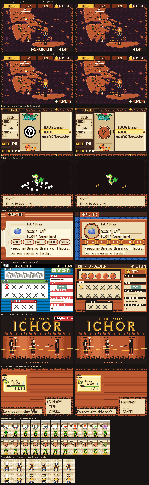

# The last Hoenn remnants in the slice

The small things a slice playthrough still showed from Emerald or the expansion, after the big screen batches. Each one is drawn in the pottery family of `UI_menus.md`, `UI_codex.md` and `UI_world.md`, from a script in `tools/ichor/art/`. Edit the script and rerun it rather than touching the PNGs.

| What | Before | Now | Script |
|---|---|---|---|
| Codex AREA glow (`graphics/pokedex/area_glow.png`) | Emerald's solid glow with a two-pixel rim, recolored gold. It covered the map's glyphs. | Gold hatching at 45 degrees inside a pale edge, a gold rule round the region and a dotted gold line beyond it, like the map's roads. The glyphs read through it. The engine still pulses its alpha. | `ui_codex_dex.py` (`write_area_glow`) |
| The unknown Pokémon (`graphics/pokemon/question_mark/circled/`, `icon.png`) | Emerald's black-and-white "?" ring. The codex list shows it for every unseen neighbor, and the Augur's Eye for every unseen species. | A terracotta tondo ringed in ink, dotted like the kylix, with a "?" painted in glaze. Its icon is the same roundel in icon palette 0. The shiny palette gilds it. | `ui_codex_dex.py` (`write_unknown_mon`, `write_unknown_icon`) |
| Evolution sparks (`graphics/misc/evo_sparkle.png`) | White dots. | Four-pointed gold sparks, white-hot at the heart, with ink at the tips, so they read on the black glaze and on the lit radiance. | `ui_evolution_bg.py` (`write_sparkle`) |
| Berry tag (Bag > Berries > CHECK TAG) | Emerald's rounded paper tag and flavor pills, recolored. | A terracotta label tied on with twine: a bored hole, a white-ground face ruled for the writing, a tondo for the fruit and a clay band of five flavor seals. A gold ring marks each flavor the fruit has. The backdrop is woven cloth, Aegean for Theo and violet for Ianthe. | `ui_berry_tag.py` (new; it took the palettes over from `ui_menus_bag.py`) |
| Follower emotes (`graphics/misc/emotes.png`, `emotes.pal`) | HGSS's white speech bubbles. | The field's pottery shards (`field_effects.py`), with black-figure faces and glyphs: happy, neutral, sad, upset, angry, pensive, love, surprise, curious, music, and poisoned on an olive shard. | `follower_icons.py` (new) |
| Follower balls (`graphics/object_events/pics/misc/ball_*.png`, 28 sheets) | Emerald's and the expansion's balls, in their own or npc_3's colors. | The party menu's black-figure ball: a glazed cap, a clay band, a gold button and a buff lower half, opening on ichor-gold light. The other 27 keep their colors as painted caps and marks. | `follower_icons.py` |
| The Augur's Eye (START > AUGURY, `graphics/dexnav/`) | The expansion's red and blue DexNav. | An augur's tablet: a glaze band for the register line and the map's name, parchment leaves for SEA, LAND and HIDDEN with an incised socket for each icon, and the reading (species, type, search level, hidden ability, chain) under a gold-rimmed SEEK plaque. The cursor is a gold ring. | `ui_augury.py` (new) |
| Quickstart badge on the title | The expansion's red "SEL New Game" badge. | Hidden: `QUICKSTART_HUD` is FALSE in `include/config/quickstart.h`. SELECT still quickstarts. | config |

## Engine and text

| What | Change |
|---|---|
| Codex AREA by day (QA m8) | `FindMapsWithMon` in `src/pokedex_area_screen.c` falls back to `OW_TIME_OF_DAY_FALLBACK`'s tables where the current time has none, as the field does. Route 1, Kronion Hill and Akti define only morning and night, so their Pokémon read AREA UNKNOWN by day before. |
| The follower's ball | `gObjectEventGraphicsInfo_PokeBall` loads `ichor_folk.pal` instead of Emerald's npc_3, so the black-figure ball costs no extra palette slot where townsfolk stand, as the item jar doesn't. |
| Party menu prompts (QA P3) | `src/strings.c`: "Choose a Pokémon or cancel.", "Do what with this one?" (the window is 16 tiles; "this Pokémon?" is 12 px too wide) and the rest of the party menu's prose in sentence case, per `design/TERMS.md`. |
| Follower lines | `src/data/text/follower_messages.h` and `src/follower_helper.c`: "Your POKéMON" becomes "Your Pokémon". The follower now notices the Agora's shelves too, because the shop lines also match `MUS_ICHOR_AGORA`. |
| ROM header | `Makefile`: the cartridge title is `POKEMONICHOR`. The game code stays `BPEE`, because emulators choose the save type from it. |

## How the engine draws them

- **The area glow** has 48 tiles in the order of `src/data/pokedex_area_glow.h`. Each tile is named for the neighbors that glow: an `EDGE_L` tile sits left of a glowing cell, so its glow is on its right. The script builds each tile from a 3×3 block of cells, so the hatching, which repeats every 4 px, joins across tiles. Colors keep the indices the old recolor used: 1 gold, 2 deep gold, 3 pale gold, 4 dark gold.
- **The berry tag's four layers share charbase 0,** and the text windows take tiles from 69 up. The art uses 67 of the 69 tiles, with the backdrop fixed at tile `0x42`. The flavor rings are sprites in palette 0, colors 12-14, centered 12 px left of the x the code gives them.
- **The Augur's Eye is one 16-color palette** on BG1 charbase 3, which has room for 384 tiles before the tilemap at screen base 30. It uses 159. Palette 0's color 0 is the backdrop, so it is the black glaze. The geometry is `include/dexnav.h`'s: the icon centers, and the info window at tile (21, 5), whose values print at y 5, 29, 53, 77 and 101.
- **The follower emotes** are 23 frames of 16×16: eleven emotions shown A, B, A, and Emerald's spare "!". Their palette is their own (`OBJ_EVENT_PAL_TAG_EMOTES`).
- **The follower balls** play frames 0-4 (closed, rocking, cracking, open, the column of light). The expansion's sheets carry two more frames that nothing plays; they are left blank.

## Testing

A temporary, uncommitted patch to `src/field_control_avatar.c` opened each screen with L when `gSpecialVar_0x8006` was set: the codex at one species in A-to-Z order (Ekans and Wooloo, which live on Route 1), the codex list at an unseen number, a Snivy evolving, the berry tag for Oran and Sitrus, a Snivy in the party for the follower, each follower emotion, and the follower going back into a Poké Ball and a Great Ball. A Lua script on the headless runner took the before and after shots. The patch (`harness.c.inc`, `apply.py`), the driver (`screens.lua`, `one.sh`, `run.sh`, `emotes.sh`) and the sheet maker (`compare.py`) are kept in the worktree's `build/remnants/`, outside git.

After the patch was removed: `make`, `tools/ichor/smoke_test.sh` (SMOKE PASS), `tools/ichor/tests/slice_playthrough.sh` (SLICE PASS: 269 messages, 0 Hoenn words, 20 battles) and `tools/ichor/tests/slice_sidechecks.sh` (CHECK PASS).

## Not done, or left on purpose

- **The trade scene** (`graphics/trade/`, `src/trade.c`) is still Emerald's. Kimon's Finizen trade in Glykera's bakery plays it, so the slice shows it. It is a screen of its own, for the UI team.
- **The no-data "X"** in the Augur's Eye's empty slots, and its small owned, star and hidden marks, are generic icons in shared palettes and are untouched.
- **Emoticons** (`graphics/misc/emoticons.png`) are FRLG's smiley field effect; no Emerald script plays it.
- **The register line** still reads "R TO REGISTER!" (`src/dexnav.c`), the expansion's words.
- **The berry pictures** themselves (`graphics/berries/`) are Emerald's fruit. The Oran and Sitrus item icons are Greek; the pictures belong with the berry decision (INVENTORY §1).
