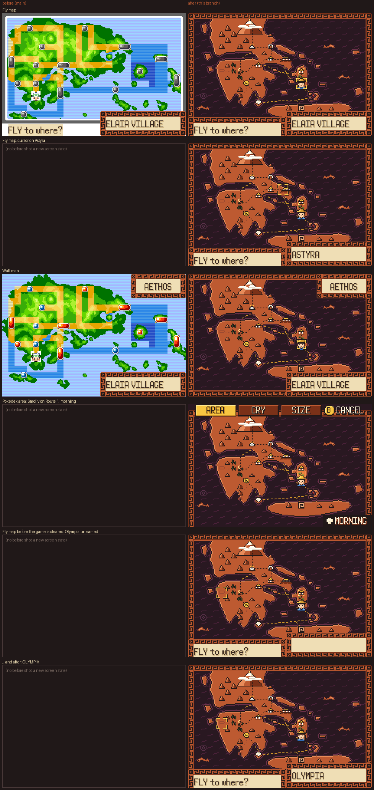
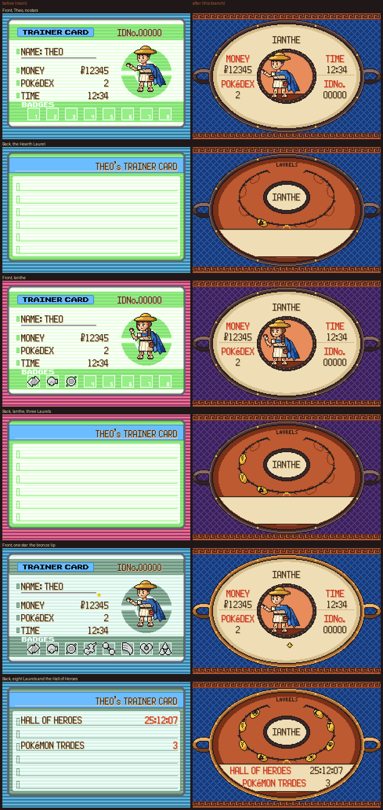
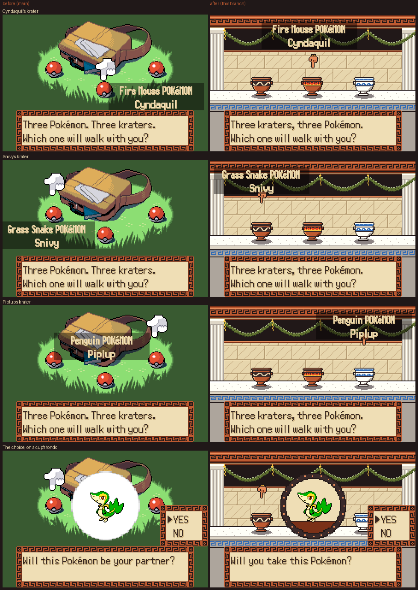
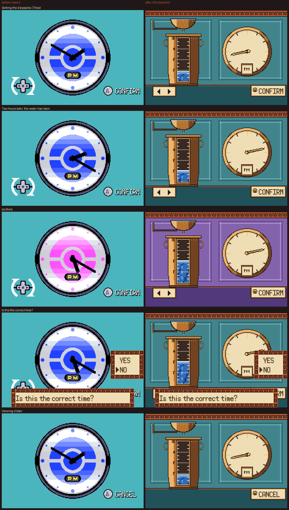
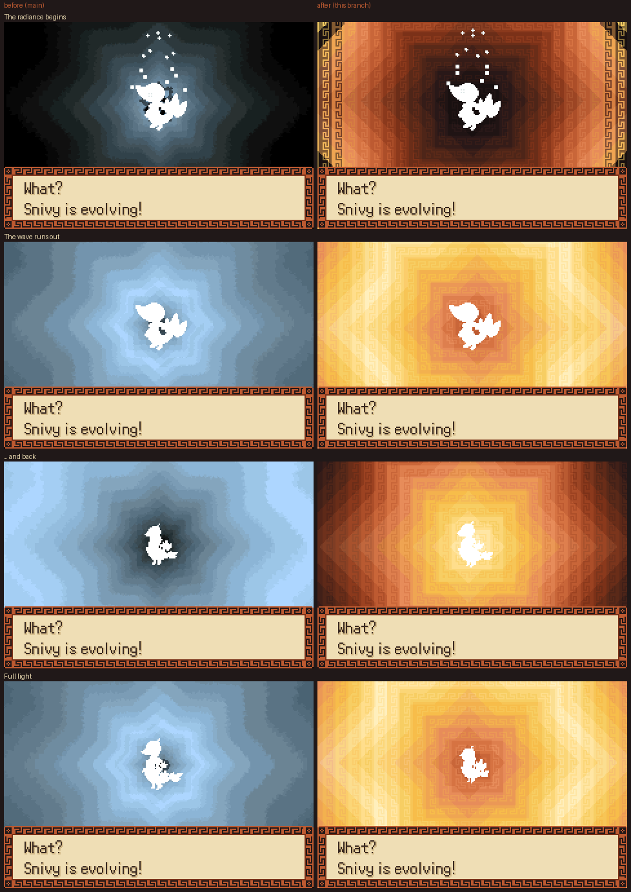
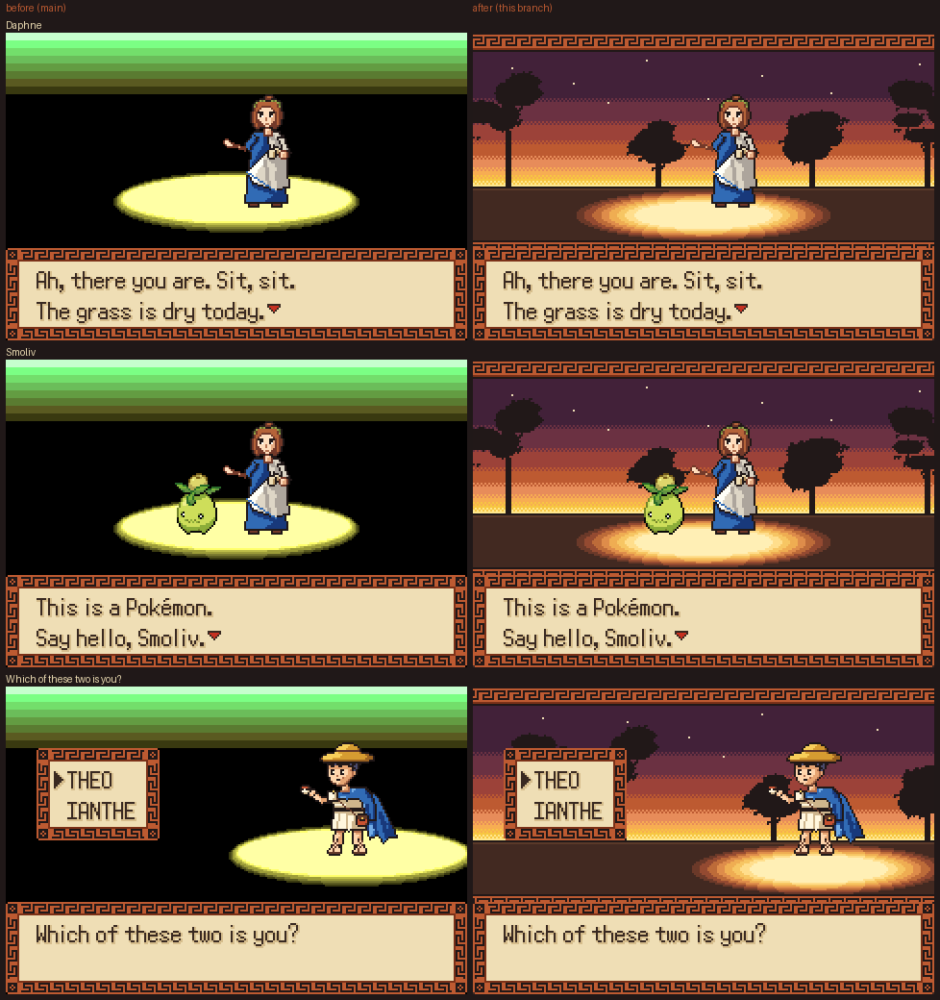

# The world's screens

The region map, the trainer card, the starter choice, the klepsydra, the evolution scene and the stage of Daphne's speech are redrawn in the pottery family of `UI_menus.md` and `UI_battle.md`. Every asset is generated by a script in `tools/ichor/art/`, so edit the script and rerun it rather than touching the PNGs or `.bin` files.

| Screen | Script | Sheet |
|---|---|---|
| Region map: Fly map, wall map, Pokédex area | `ui_world_map.py`, `ui_world_map_sprites.py` | `img/ui_world_compare_map.png` |
| Trainer card | `ui_trainer_card.py` | `img/ui_world_compare_card.png` |
| Starter selection | `ui_starter_choose.py` | `img/ui_world_compare_starter.png` |
| Wall clock: the klepsydra | `ui_klepsydra.py` | `img/ui_world_compare_clock.png` |
| Evolution scene background | `ui_evolution_bg.py` | `img/ui_world_compare_evolution.png` |
| Daphne's speech, the stage | `ui_speech_bg.py` | `img/ui_world_compare_speech.png` |

`ui_world_review.py` builds the before-and-after sheets from in-game screenshots.

## The region map



The geography, the section grid, the story's route and the decisions behind them are in `design/AETHOS_MAP.md`. In short:

- **A black-figure map on terracotta.** The land is reserved clay with an incised ink coast. The sea is black glaze with wine-purple strokes. Roads are ink dots and trireme lanes gold dashes. Each place has a small glyph, Olympus rises in snow and cloud, and dolphins leap in the open sea. The meander border is the dialogue box's own key.
- **One picture, three screens.** The Fly map and the wall map (`graphics/pokenav/region_map/map.*`) and the Pokédex area view (`graphics/pokedex/region_map.*`) all load the same 230 tiles. The script stops if the count passes the area view's 232.
- **Its sprites:**
  - the cursor, gold brackets that breathe
  - the fly marks, gold corner ticks round a town you can fly to. A town you can't fly to shows no mark, so its glyph is always clean.
  - "you are here": Theo's and Ianthe's heads under the petasos (`brendan_icon.png`, `may_icon.png`)
- **The Fly map's frame** (`frame.png`, `frame.bin`) only frames the "FLY to where?" prompt now, because the map paints its own border.
- **The post-game is unrevealed.** Tainaron, Olympia and Atlantis are painted faint, and the cursor gives them no name until `FLAG_SYS_GAME_CLEAR`.

## The trainer card: a kylix



- **Front: the cup seen from above.**
  - The portrait stands in the tondo, on a clay ground with its ground line, inside a glaze band set with clay dots.
  - The name is inscribed alone above it.
  - Money, Pokédex, time and ID sit in two columns either side, each a red label over its ink figure, on the white-ground bowl.
  - The stars are gold rosettes in a row under the tondo.
- **Back: the cup turned over.**
  - Round the foot, where the hero's name sits, a black-figure victory wreath rises from a gold tie.
  - It has an outline for each Laurel's leaf. Each Laurel adds a gold leaf with its god's emblem: the hearth flame, the kerykeion, the wheat ear, the mask, the crescent, the hammer, the scallop and the sun (`design/TERMS.md`).
  - Hearth, Herald, Harvest and Mask climb the left branch, and Moon, Forge, Foam and Sun come down the right.
  - LAURELS is inscribed in the gap at the top. The Hall of Heroes and trades are written on a white-ground band below.
- **The stars refine the cup.** The lip and handles go from black glaze (`green.pal`, no stars) to bronze, Exekias's coral red, silver and gold.
- **Theo and Ianthe.** Theo's cup lies on Aegean blue. Ianthe's lies on violet, the flower in her name (*ion* + *anthos*), from `female_bg.pal`.
- **Limits.**
  - The engine loads 192 tiles for the bowl, both faces and the cloth; the card uses 170.
  - Tiles 140, 141, 156 and 157 are Emerald's back-of-card stat marks. They are left blank.
  - Tile 143 is the star, in palette 4.
  - The two halves of the cup mirror each other, so their tiles are shared with flips. The light falls from above rather than the top left to keep that symmetry.
  - Palette 0 is the cup, palette 1 the cloth, and palette 2 the wreath. The script repaints every tile the wreath touches into palette 2's copies of the cup's colors, so no tile mixes palettes.

## The starter selection: Daphne's table



- **The scene.** The Akademia's wall has a meander frieze, two fluted pilasters, and a black fresco band hung with laurel festoons. Below it, Daphne's long white marble table has a key in Aegean blue along its apron.
- **The three kraters** are the room's own (`TILES_civic.md`): a cream serpent on a black band for Snivy, flames for Cyndaquil, and white ground with blue waves and water for Piplup. The selected one rocks as its Pokémon stirs.
- **The cursor** is a red-figure hand pointing down into the krater.
- **The chosen Pokémon** rises on a cup's tondo (`starter_circle.png`).
- **The labels** show on the black band, where the engine's darkened window leaves their pale letters crisp.
- **The flow and the starters are Emerald's**, per ruling 11.
- **The sprite sheet** keeps Emerald's first frames where they were, because the Battle Factory loads the same sheet's first 64 tiles:

  | Frames | Art |
  |---|---|
  | 0, 16, 32 | Snivy's krater |
  | 48 | the hand |
  | 64, 80, 96 | Cyndaquil's krater |
  | 112, 128, 144 | Piplup's krater |

  `birch_bag.bin` is the table and `birch_grass.bin` the wall. The save-failed screen and the credits also load them, so they show the Akademia too.

## The klepsydra



- **The scene.**
  - Water drips from a bronze bowl on a wall bracket into a tall bronze vessel with ring handles.
  - The water rises in the vessel's sight window past twelve hour lines. It is empty at 0:00 and 12:00 and full twelve hours later. Gamma, digamma, theta and iota-beta mark 3, 6, 9 and 12.
  - A bronze dial beside it, the kind Ktesibios's float turned, carries the minute hand. A slot at its foot shows an AM or PM tablet.
- **Controls.** The D-pad turns the hand as in Emerald, and the water follows. The set screen shows a ◀ ▶ plaque, and both screens show the A coin and CONFIRM or CANCEL on a parchment plaque.
- **How it works.**
  - The water is two 32×64 sprites, at frames 136 and 168 of `hand.png`. They sit behind the background (OAM priority 3) and show only through the window, which is a hole in it, as Emerald's AM/PM slot is.
  - Palette 0's color 0, the backdrop, is the vessel's dark empty inside.
  - The hour hand's frame is blank, because the water tells the hour.
- **Theo's and Ianthe's.** Theo's wall is a Minoan teal fresco (`male.pal`) and Ianthe's violet (`female.pal`). The sprites always use `male.pal`, so the colors they share are the same in both.

## The evolution scene



- **A black-figure radiance.** Behind the evolving Pokémon, an eight-pointed star of rays and nested meander frames carry the engine's light as it runs out and back, glaze to terracotta to pale gold, like the battle intro's pottery transitions.
- **The engine is untouched.** `bg_inner.bin` (the star) and `bg_outer.bin` (the frames) are a field of steps 1 to 13 that the palette animation walks through. `bg_anim.pal` is the ramp it lights them with.
- **The edges are straight lines** at 0, 45 and 90 degrees, so they repeat from tile to tile. The background is 110 tiles, under Emerald's 224.
- **The text box** was already the pottery box (`UI_battle.md`).

## Daphne's speech: the stage



- **The Akademia's laurel grove at dawn, painted like a vase.**
  - A meander frieze runs along the top, and a meander exergue along the foot.
  - Above, a night of black glaze with a few last stars. Toward the horizon it brightens to rose, terracotta and gold, with the laurels in black-figure against it.
  - Daphne, Smoliv and the hero stand on the dark ground in a pool of sunlight.
- **The pool of light is the old spotlight's palette slots.** Palette 0's colors 1 (centre) to 8 (rim) take their colors from `bg2.pal`. Entries 0-7 are the lit pool and 8-15 the bare ground, so the engine's own steps grow it from the centre and shrink it away.
- **The picture wraps round its 256 px width** for the 60 px slide while the hero is chosen.
- **No code changes.** The text and the flow are the Elaia agent's, and stay as they are.

## Source edits

All are small and commented `// Ichor:`.

| File | Change |
|---|---|
| `src/region_map.c` | Kalliste's heal locations. Elaia and Akti as fly targets (Elaia once you have a Pokémon, Akti once visited). The other Aethos towns show as towns you can't fly to yet. The post-game's sections go unnamed until the game is cleared. |
| `src/data/region_map/region_map_sections.json`, `region_map_layout.h` | 29 new sections and the 28×15 grid, generated by `ui_world_map.py`. |
| `src/trainer_card.c` | The portrait window moves to the tondo. The front's name, columns and stars, the back's name, stats and the laurels' wreath slots take the kylix's places. FRLG's layout is untouched. |
| `src/starter_choose.c` | The kraters stand in a row, with the labels over them and the hand above. Each krater gets its own frames, and the sheet grows to 0x1400. |
| `src/wallclock.c` | The hands and the AM/PM tablets move to the dial, and two water sprites follow the time. |

## How to regenerate and check

```bash
python3 tools/ichor/art/ui_world_map.py
python3 tools/ichor/art/ui_world_map_sprites.py
python3 tools/ichor/art/ui_trainer_card.py
python3 tools/ichor/art/ui_starter_choose.py
python3 tools/ichor/art/ui_klepsydra.py
python3 tools/ichor/art/ui_evolution_bg.py
python3 tools/ichor/art/ui_speech_bg.py
make -j$(sysctl -n hw.ncpu) && tools/ichor/smoke_test.sh
```

Each script also writes a preview to `design/phase1/img/ui_*`. Use `/usr/bin/python3` if your default Python lacks PIL.

The in-game shots came from a temporary, uncommitted patch to `src/field_control_avatar.c` and a headless Lua run.

- **The patch.** Pressing L in the field opens one screen with real data, chosen by `gSpecialVar_0x8006`. It sets the Laurels (`0x8007`), the gender (`0x8008`), and the Hall of Heroes, trades and game clear (`0x8009`). It also sets money, play time, the Pokédex and Akti's visited flag.

  | Value | Screen |
  |---|---|
  | 1 | the card |
  | 2 | the Fly map |
  | 3 | the clock, to set |
  | 4 | the clock, to view |
  | 5 | the starter choice |
  | 6 | a Snivy evolving into Servine |
  | 7 | the Pokédex at Smoliv, in A-to-Z mode |
  | 8 | the wall map |
- **The Lua run** quickstarts, writes those variables and presses L. Then it walks the screen: it flips the card, tours the Fly map's cursor, turns the clock, picks each krater, follows the evolution and changes the area view's time of day.
- **Where they are.** The patch (`harness.patch`), the script (`screens.lua`), the runners (`run.sh`, `one.sh`) and the raw screenshots are in the worktree's `build/ui_world/`. The final pass ran on the branch after merging `main` at 6b8f0473ec.

## Not done, or left for others

- **The area view's glow** (`graphics/pokedex/area_glow.png`) is still Emerald's pink. It belongs to the Pokédex screen.
- **The evolution sparkles** (the white circles that ring the Pokémon) are Emerald's. They belong to the evolution or battle-effects art.
- **The map-name popup themes** for the new sections default to the stele (`src/map_name_popup.c`, not mine).
- **Fly targets for the other towns** need their visited flags when their maps land (`design/AETHOS_MAP.md`, "Adding a map later").
- **`cursor_large.png`** is redrawn, but only the cut PokéNav's zoomed map shows it.
- **The Kanto and Sevii maps** (`map_kanto.*`, `map_sevii_*`, `graphics/pokedex/region_map_kanto*` and the rest) are FRLG leftovers, untouched and not shown in an Emerald build.
