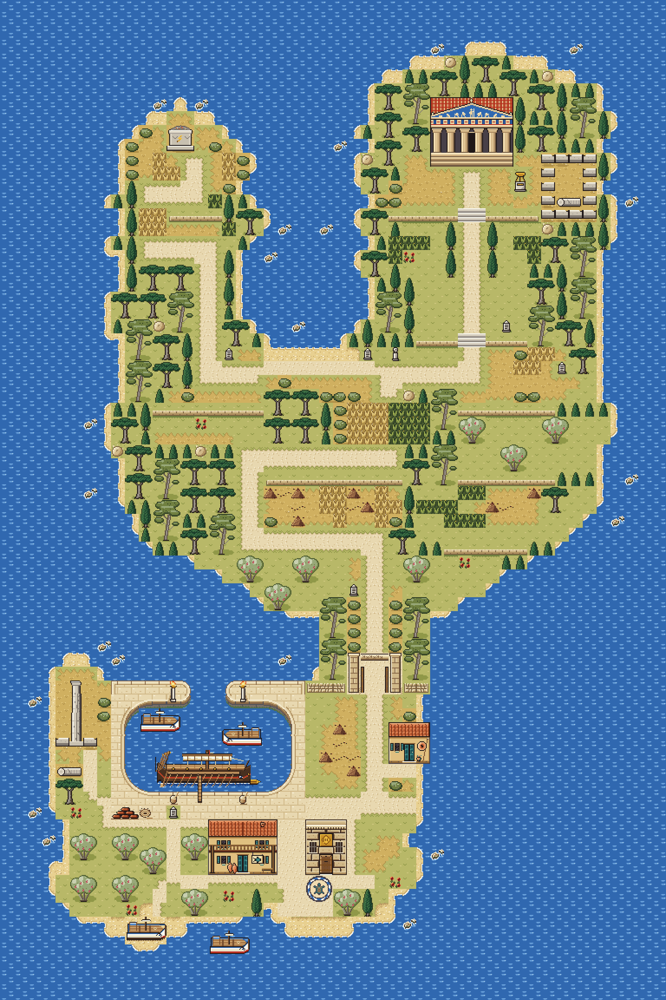
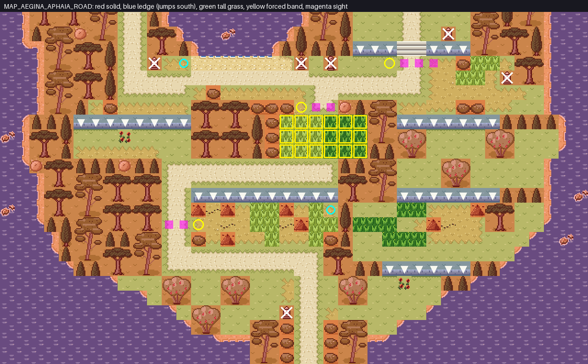
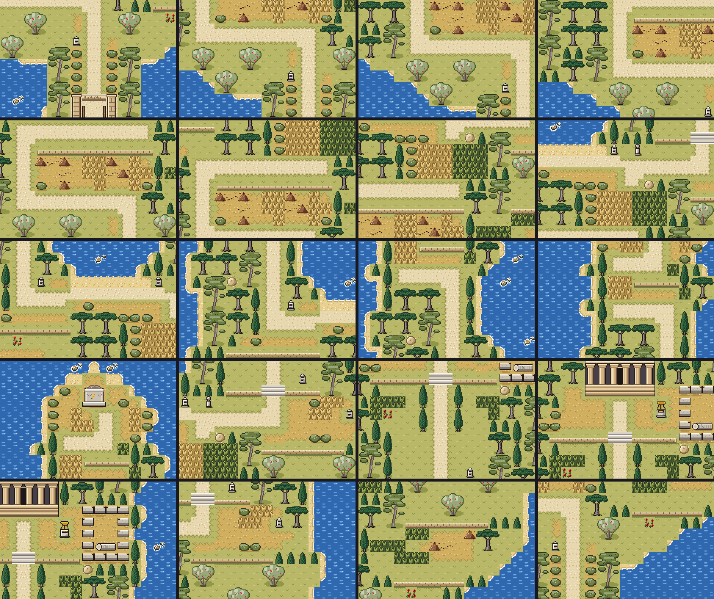

# Aigina's interior: the Aphaia Road, Mount Oros, the Temple of Aphaia

Three Act II maps north of Aigina Town's gate, on `gTileset_Aethos` + `gTileset_Aegina`, map section `MAPSEC_AIGINA`, music `MUS_ICHOR_ROAD`. SCRIPT.md's "Aegina's interior: an optional detour" says what is there; world-act2 scripts the people and story and re-levels the encounters. Seams, the people's tiles and the stubs are in BUILD.md ("Aigina's interior: placed for world-act2").

- **Builder:** `tools/ichor/maps/aegina_detour.py` (run with `/usr/bin/python3`; it needs `build/aegina/catalog.json` from `tools/ichor/art/aegina_build.py --no-compile`). The three maps are drawn as ASCII plans in one world frame, auto-tiled together so every seam matches, then cut apart. It writes the layouts, the events and the connections, and checks the route rules: seams that match, no cell a player can reach but not leave, a forced band on the walk to each end, each mandatory trainer's line across the only path, every person, item and sign within reach, and no empty dead end.
- **Test:** `tools/ichor/tests/aigina_interior.sh` walks the whole detour from the town's gate and back (every step found by a search over the map the game has loaded).
- **Renders** (`--render design/phase2/img`): `aigina_aphaia_road.png`, `aigina_mount_oros.png`, `aigina_temple_of_aphaia.png` at 2x, each with a `_walk.png` overlay (red solid, blue ledges, green tall grass, yellow forced bands, magenta sight lines, circles for people and items, crosses for readable spots); `aigina_island.png`, the four maps stitched; `aigina_interior_screens.png`, twenty 15×10 views along the walk; `aigina_interior_ingame.png`, the test's screenshots.

## The island

Aigina Town sits on the island's south tip. North of its gate the land widens into pine-and-pistachio hills, and a bay of open sea cuts down from the north between two headlands: Mount Oros on the west, Aphaia's hill on the east. Every edge without a connection is coast; the border is the sea.

- **The Aphaia Road** (40×24) climbs from the gate in a switchback. It runs north through the pistachios, then west along the lower terrace past the ant hills. At their corner it turns north past Myrmex, then east along the upper terrace above them. From there it goes north through a band of golden and green grass walled by thorn scrub and pines, past Sostratos, to the great herm on the bay's beach. There it forks. West, a pinewood path leads to Mount Oros. East, the path climbs marble steps through a terrace wall, with Euthymia at their foot, to the temple. East of the steps is a dry hill with a horos stone. Below it, terraces (a pistachio orchard, a meadow with more ant hills) drop by ledges back to the orchard at the gate: the quick way home. A ledge under the Oros path drops the other way, to the top of the climb.
- **Mount Oros** (16×16): the climb switchbacks through pines and up a band of golden grass to a dry summit ringed with scrub. Zeus's altar is at the top, with the Wine beside it, and there is sea on three sides. A ledge cuts the descent short.
- **The Temple of Aphaia** (24×20): a processional way between cypresses climbs a second flight of marble steps to a dry forecourt under the Doric front. The pine crown of the hill closes in behind the temple. The priestess stands on the steps, and the Pretty Feathers lie at their east end. Artemis's altar (aethos's bronze tripod on its plinth) stands before the door. East of the forecourt are the older temple's foundations: worn stylobate blocks round a fallen drum, and the turned earth of the dig spot.

What makes it its own place, not Kalliste's Route 1: dry golden ground, ant hills and thorn scrub instead of olive meadows; Aleppo and umbrella pines with cypress and juniper instead of olive groves; pistachio orchards; the sea in view from almost every screen.

## Render-and-critique passes

Each pass: render the three maps and the stitched island, look at every 15×10 view and the collision overlay, write down what's wrong, fix it.

**Pass 1 (first draw).** The skeleton worked: the switchback, the band and the three trainer lines checked out, and the seams matched the town. Wrong:
- **Coasts and bay.** Every coast was ruler-straight down the map edges, so the island read as a blocky U. The bay was a rectangle cut out of the land.
- **Woods.** The packer left a 1-wide column wherever a strip was 3 wide and filled it with cypress, so the west coast became a palisade of cypresses. Its lone gaps became squares of dark shade grass.
- **Orchards.** The terraced orchards' pistachios sat in a grid, which made 2×2 pockets the player could hop into and never leave (the check caught them).
- **Ledges.** The ledges ran 10-12 cells across the east side like fences.
- **Ground.** Too much flat green; only the ant field felt like Aigina.
- **Dead ends.** Five dead ends had nothing in them.

**Pass 2.**
- **Woods.** The packer now places pines in a stable pseudo-random order, so crowns stagger instead of lining up, then fills 1×2 gaps with cypresses.
- **Coasts.** Redrew the coast with sand of varying depth.
- **Oros path.** Moved the Oros path to the road's columns 8-9 so it runs straight up a pinewood.
- **Orchards and ledges.** Re-laid the terrace orchards with lanes that all connect. Cut the east ledges to 6-7 cells, ending them in woods.
- **Mount Oros.** Gave it a peak shape: a rocky spit, a dry summit, a scrub ring.
- **Temple.** Moved the temple up a row for a proper forecourt. Laid the foundations as a rectangle round a fallen drum, and lined the way with cypresses.

Still wrong:
- **Woods.** The single-cell fill was a boulder half the time, so the woods looked strewn with potatoes.
- **Bay.** The bay's sides were still straight.
- **East plateau.** It was a big empty dry rectangle.
- **Corners.** The temple forecourt and the Oros summit had dead-end corners.

**Pass 3.**
- **Woods.** A lone woods cell is now the cypress spire's crown alone, which reads as a young juniper; a boulder only one time in eight.
- **East plateau.** It gained golden grass, an umbrella pine and a horos stone ("Aphaia's land starts here. Nobody's sure where it ends."), which is myth in the land and a reason to look there.
- **Shoreline.** Ragged the bay's sides and both coasts of the temple hill and Oros a cell at a time. Scattered rocks awash round the island.
- **Dead ends.** Filled every dead-end corner, or gave it a way on; the builder's dead-end check now reports none.

**Pass 4 (and in game).** The test's screenshots (`aigina_interior_ingame.png`) were reviewed with the renders.
- **In game.** Every sign fits its two lines; three overflowed and were cut. The seams draw cleanly from both sides: the Oros sign shows across the seam from Oros's foot, and Euthymia shows below the temple's slope. The summit reads as "the whole gulf below", with sea on three sides.
- **Fixes.**
  - The meadow terrace on the way home was a plain lawn. It got a dry patch with two more ant hills and a trail (the Ergant spread across the island).
  - The bay got a rock.
  - Oros's golden band could be skirted up the green grass beside it. That column is closed, so the climb now has a forced band 2 deep.

## Notes for whoever comes next

- **Tiles.** No tiles were added; the aegina set is still at 488 of 504. Artemis's altar is aethos's bronze tripod. If Artemis should have her own altar (a crescent, a bow, feathers), 16 tiles are free for a 1×2 or 2×1 piece.
- **The dig spot** is a bg event on a walkable dry cell inside the foundations. When the engine's dig spots land, a turned-earth metatile there would show it.
- **The map-name popup** shows "AIGINA" at every seam crossing, as Emerald's popup does on any connection; all four maps share `MAPSEC_AIGINA`, as the brief asked.
