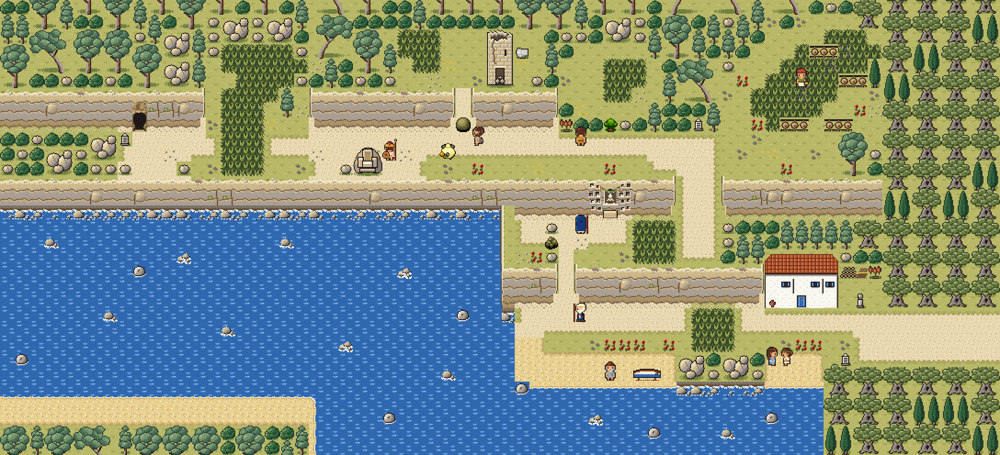
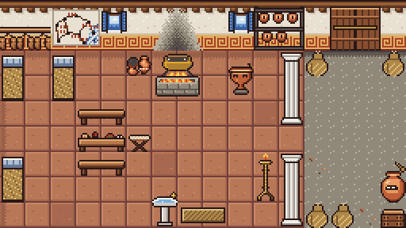

# Route 5, the Skironian cliffs

The Sacred Way out of Hecate's Hollow's west mouth, down the sea cliffs to Eleusa: `MAP_ROUTE5_SKIRONIAN_CLIFFS`, 68x31, `gTileset_Aethos` + `gTileset_Skiron`, and its roadside inn, `MAP_ROUTE5_REST_HOUSE`, 16x9, `gTileset_Oikos` + `gTileset_Domos`. It carries SCRIPT.md's "Route 3, the Pine Slopes" (beat 19's road) under its new name.

```bash
/usr/bin/python3 tools/ichor/art/skiron_build.py --no-compile    # build/skiron/catalog.json, if it's missing
/usr/bin/python3 tools/ichor/maps/route5.py --render build/render/route5   # layout, map.json, checks, renders
/usr/bin/python3 tools/ichor/maps/route5_rooms.py                 # rebuilds domos with the inn's room
tools/ichor/tests/route5.sh                                       # walks the road from a Quickstart
```





Review copies (not committed) go to `build/render/route5/`: the collision overlay (`route5_walk.png`: red solid, green tall grass, orange trainer sight, yellow people, cyan warps, white bg events, pink hidden items), fifteen 15x10 screen views along the road (`view_*.png`) and their contact sheet (`route5_views.png`). `img/route5_walk.png` and `img/route5_views.png` are copies of the last pass.

## The plan

The road is a switchback in three legs, each a step lower toward the sea, so the walk down to the Mysteries is long and the bay is in view most of the way.

| Leg | Where | What's on it |
|---|---|---|
| A, the cliff road | rows 9-11, from the mouth (9,8) east to x 48 | The first view of the strait. The pine clearing: the first forced band (x 15-17), right through the clearing and across the road, walled by the rockfall above and the drop below; the Super Potion in the clearing. The rock seat (24-25, 10-11) on the edge: the road narrows to one cell beside it, and Kynegeiros (26,10) sees the one cell out. The Great Ball beside the seat. Melanthios and his kid at the knoll's cleft; the watchtower on its knoll behind a column drum (the Girdle, Act II) with the PP Up. The pitch-gatherer under the pines; the pine hollow behind a thorn thicket (Demeter's Sickle) with the Calcium. The fork: the meadow's sign. |
| The meadow | x 49-59, rows 1-11, off the road's east end | The thyme meadow and its hives (optional): Aristaios, the Super Repel at the far end, the Honey hidden under a hive, the daily dig spot (stub). |
| B, the terrace | down the cutting (46-48, 12-14), then west on rows 15-17 | The second forced band (x 43-45) straight after the cutting. Aphrodite's niches in the bank (40-42, 12-14): the niches' text, her altar, a Pretty Feather hidden in a niche, Myrto facing the rock. The lookout at the terrace's west end, over the strait, closed by a rockfall whose middle is marble rubble (the Bronze Hammer): the Revive behind it. |
| C, the shore road | down the cleft stair (38, 17-20), then east on rows 21-23 | Mopsos (39,21) sees the stair's foot. The shore point west of it: the Heart Scale hidden at its tip. The beach: Aigialeus and his boat (the Good Rod); fishing from the sand. The third forced band (x 47-49), walled from the sea by a scrubby rise. Two initiates resting on the beach. The Inn of the Plain (door (54,20)): rest and Xenokles's trade. The great herm (58,20) and the inn's yard (the Oran Berry). Then the road widens to Eleusa's four rows between olive groves, and crosses the seam. |

**Rhythm,** as MAP_DESIGN asks: the mouth and the first view (calm); the clearing's band; Kynegeiros at the seat; the seat; the knoll, the pine hollow and the fork; the meadow (optional); the cutting and the terrace's band; the niches and Myrto; the lookout (the Hammer); the stair and Mopsos; the point, the beach and the Good Rod; the third band; the inn (rest); the herm; Eleusa's olives.

**Trainers** (ids 110-114, levels 20-21): Kynegeiros (Hoplite, mandatory), Melanthios (Goatherd, new, optional), Myrto (Pilgrim, optional), Aristaios (Beekeeper in the script; a Harvester until that class is drawn, optional), Mopsos (Augur, new, mandatory). The two mandatory ones stand beside the one cell out of a 1-wide way and see only that cell (sight 1), so after a battle they never stand in the way; `route5.py` checks that no trainer can stop anywhere that cuts the road.

**Signs:** the mouth (8,9), the meadow fork (47,8), the east end (57,24), and the inn's sign on its front.

## Seams and warps

| Edge | Neighbour | How |
|---|---|---|
| east (right) | `MAP_ELEUSA_VILLAGE`, its west edge | map connection, offset **-3** here (Eleusa's y = ours + 3) and **3** in Eleusa's map.json (`left`). Open on our rows 21-24 at x = 67 (Eleusa's 24-27). Our columns 60-67 are aethos only, olives in Eleusa's 2x2 phase, so each map draws the other right. |
| west | `MAP_HECATES_HOLLOW`, its west mouth | warp **0**, the cave door at **(9,8)** (aethos's cave mouth, `MB_NON_ANIMATED_DOOR`); the player steps out south to (9,9). The Hollow's west-mouth warp should target `MAP_ROUTE5_SKIRONIAN_CLIFFS` warp 0. Until `MAP_HECATES_HOLLOW` is registered, route5.py points the mouth at `MAP_EMPORION_CITY` warp 0 so the ROM builds; re-run route5.py after the Hollow merges (and set `HOLLOW_WARP_ID`). |
| the inn | `MAP_ROUTE5_REST_HOUSE` | Route 5's warp **1**, the door (54,20), goes to the inn's warp 0; the inn's mat (7-8, 8) goes back to Route 5's warp 1. |

The great herm's landing tile, `HEAL_LOCATION_HERM_AETHOS_ROUTE_5`, is (58,21).

## Wild Pokémon

`src/data/wild_encounters.json`: land rate 20, from SCRIPT.md's Route 3 table at BALANCE.md's Eleusa row (17-21). The expansion keys tables by time of day and falls back to `_Morning` when a time has none, per kind of encounter: `_Morning` serves morning and evening, `_Day` the day, `_Night` the night, and water, fishing and rock smash all fall back to `_Morning`.

| Slot | Rate | Morning and evening | Day | Night |
|---|---|---|---|---|
| 0 | 20% | Lophops 17-19 | Lophops 17-19 | Galekit 17-19 |
| 1 | 20% | Kerazap 17-19 | Harpeck 17-19 | Gelasable 20-21 |
| 2 | 10% | Chelonet 17-19 | Chelonet 17-19 | Pebblith 18-20 |
| 3 | 10% | Galekit 17-19 | Kerazap 17-19 | Kerazap 17-19 |
| 4 | 10% | Onotis 18-20 | Onotis 18-20 | Onotis 18-20 |
| 5 | 10% | Epopoi 17-19 | Epopoi 17-19 | Chelonet 17-19 |
| 6 | 5% | Elaleaf 18-20 | Galekit 18-20 | Spalunk 18-20 |
| 7 | 5% | Ergant 18-20 | Ergant 18-20 | Pebblith 19-20 |
| 8 | 4% | Pebblith 19-20 | Elaleaf 19-20 | Ergant 19-20 |
| 9 | 4% | Harpeck 18-20 | Pebblith 19-20 | Galekit 19-20 |
| 10 | 1% | Nemecub 20 | Lophops 21 | Onotis 21 |
| 11 | 1% | Kerazap 21 | Kerazap 21 | Gelasable 21 |

**Changes from SCRIPT.md's table,** for BALANCE.md's ruling that no wild Pokémon appears evolved before its evolution level (the dex's levels, `design/dex/species/*.yaml`): Cairnolith (from Pebblith at 25) becomes Pebblith; Gelasable (from Galekit at 20) appears at 20-21, not 18-20. Harpeck joins the day and morning tables (the dex puts it on Emporion's sea cliffs, by day). Nemecub keeps to mornings and evenings, as the dex says; the day table, new, leans on the birds and Chelonet (both "by day" in the dex).

| | Rate | Slots |
|---|---|---|
| Old Rod | 30 | Ketofry 18-20 (70), Karkipool 18-20 (30) |
| Good Rod | 30 | Karkipool 19-22 (60), Ketofry 19-21 (20), Narkeray 20-22 (20) |
| Super Rod (placeholder levels) | 30 | Kynoketos 20-25, Narkeray 20-25, Karkipool 20-25, Kynoketos 25-30, Narkeray 25-30 |
| Surfing (placeholder levels, Poseidon's Conch is Act II) | 4 | Halcyling 20-30, Ketofry 20-30, Galenyon 25-30, Narkeray 25-30, Galenyon 30 |
| Rock smash (the lookout's rubble) | 20 | Pebblith 18-21 (60), Spalunk 18-20 (30), Pebblith 21-22 (5), Chelonet 19-21 (4), Pebblith 22 (1) |

## Items and flags

| Item | How | Where | Flag |
|---|---|---|---|
| Super Potion | visible | the pine clearing (19,4), past the first band | `FLAG_ICHOR_ITEM_ROUTE5_SUPER_POTION` |
| Great Ball | visible | beside the rock seat (26,11) | `FLAG_ICHOR_ITEM_ROUTE5_GREAT_BALL` |
| PP Up | visible | the watchtower's knoll (29,3), behind the column drum (the Girdle, Act II) | `FLAG_ICHOR_ITEM_ROUTE5_PP_UP` |
| Calcium | visible | the pine hollow (42,4), behind the thicket (Demeter's Sickle) | `FLAG_ICHOR_ITEM_ROUTE5_CALCIUM` |
| Super Repel | visible | the far end of the thyme meadow (58,3) | `FLAG_ICHOR_ITEM_ROUTE5_SUPER_REPEL` |
| Revive | visible | the terrace's lookout (35,15), behind the rubble (the Hammer) | `FLAG_ICHOR_ITEM_ROUTE5_REVIVE` |
| Honey | hidden | under a hive in the meadow (57,5) | `FLAG_ICHOR_HIDDEN_ROUTE5_HONEY` (0x2B8) |
| Pretty Feather | hidden | in a niche of Aphrodite's shrine (42,14) | `FLAG_ICHOR_HIDDEN_ROUTE5_PRETTY_FEATHER` (0x2B9) |
| Heart Scale | hidden | the shore point's tip (35,25) | `FLAG_ICHOR_HIDDEN_ROUTE5_HEART_SCALE` (0x2BA) |
| Oran Berry | hidden | the inn's yard (59,19) | `FLAG_ICHOR_HIDDEN_ROUTE5_ORAN_BERRY` (0x2BB) |
| Good Rod | gift | Aigialeus, on the beach | `FLAG_ICHOR_GOT_GOOD_ROD` |
| Gelasable GALANTHIS | trade an Onotis | Xenokles, the inn | `FLAG_ICHOR_TRADED_GELASABLE` |

Also `FLAG_ICHOR_ROUTE5_THICKET_CUT` and `FLAG_ICHOR_ROUTE5_RUBBLE_BROKEN` (the two gates' hide flags, so they stay cleared) and `FLAG_ICHOR_MET_XENOKLES`. Bank flags 0x040-0x04A of this agent's 0x040-0x05F. The vanilla range 0x2B8-0x2C7 has only four free flags (0x2B8-0x2BB), so the road has four hidden items, not five: a Stardust by the first view was cut.

## Render-and-critique passes

**Pass 1** (first layout):
- *The sea couldn't be seen from the cliff road.* The road ran on rows 9-11 over a four-row cliff, so the screen (4 rows above the player, 5 below) showed the cliff face and nothing under it. **Fix:** the sea cliff under the road is three rows (brink, face, foot), so the strait shows at the bottom of the screen all along leg A.
- *Every road was a three-wide slab of limestone* with no edges, so legs A and B read as beige blocks. **Fix:** two-wide roads with a grass verge on the drop side (thyme, anemones, dry grass), running to the edge only by the mouth, past the seat and at the junction.
- *A grid of identical round boulders* closed the road's west end and walled the third band from the beach, like egg cartons. **Fix:** a rockfall of Skiron boulders, rocks and kermes oak by the mouth, and a scrubby rise of boulders and oak with its foot in the surf between the two beaches.
- *The first band was a plain 3x9 rectangle* through the clearing. **Fix:** a ragged meadow in the clearing that narrows to the three-column band across the road.
- *Woods cells a pine leans out of* (`.` in a piece's walk grid) were walkable pockets in the woods. **Fix:** every woods cell is solid.
- *A huge empty sea* filled the bottom left. **Fix:** surf rocks and sea stacks across the strait, and Salamis's shore across it, a beach under pines: what the king on the seat was looking at.

**Pass 2:**
- *The east grove was a straight wall of olives.* **Fix:** an olive and a cypress step into the meadow's east edge, and the grove's south part starts a column early.
- *The shore point was walled off by a column of boulders,* with the rubble in its one gap: it read as a fence. **Fix:** the rubble moved to the terrace's lookout, where it sits in a short rockfall between a rock on the road and a rock on the verge; the point is open, a dead end with the Heart Scale at its tip.
- *Four grass shapes Skiron doesn't have* drew with hard edges (two notched corners in the clearing, the knoll and the pine hollow). **Fix:** the masks were redrawn so every edge cell has a soft piece; `route5.py` reports any shape it lacks.
- *A young pine stood in the cut bank's foot* by the mouth. Removed.

**Pass 3** (with people):
- *Kynegeiros and Mopsos could block the road.* A trainer who sees the player walks up to them and stays; with sight 3 into a 1-wide ledge or stair, he'd end up standing in it, and the player couldn't get past (the in-game walk found it: "no path"). **Fix:** both stand beside the one cell out of the narrow way and see only that cell. `route5.py` now checks every trainer's possible stopping cells.
- *The woods were speckled with grey rocks* in rows. **Fix:** fewer rocks in the woods' single cells, more oak.
- *The pitch-gatherer's name overflowed its box.* PITCH-GATHERER is 67 px in the name box's small font, and the box holds 64. **Fix:** RESIN TAPPER (56 px). Every other line was measured with `text_width.py --scan` on the compiled scripts: none is over 216 px.
- *The view at the meadow's top edge* shows the border: a row of Aleppo pines, which reads as the mountain's forest going on. The west edge's border is never seen (nothing walkable within 7 columns of it), nor the south's (the lowest walkable row is six rows above it).

## In game

`tools/ichor/tests/route5.sh` plays the road from a Quickstart (screenshots in `build/test_route5/shots/`). What the screenshots showed:
- The warp onto the mouth's door walks the player out of the cave to (9,9), under the "ROUTE 5" popup, with the road's tune (its night form after dark).
- The strait shows at the bottom of the screen all along the cliff road; the seat reads as a throne on the edge with Kynegeiros beside it; the niches and the altar stone read at a glance.
- Night tables are live: the first run met a wild Gelasable at 20 in the clearing's band after dark, the next a Pebblith, then a Galekit.
- The followers walk behind the player on the one-cell ledge and the cleft stair without blocking either.
- Two things the walk found and the map fixed: Kynegeiros and Mopsos walking into the narrow ways (pass 3), and the pitch-gatherer's long name.

## The inn's room

Thria moved to Act II, so its **Inn of the Plain** stands on the road instead, at the cliffs' foot where the road comes out onto Eleusa's plain: SCRIPT.md Part 2's Xenokles (rest, and his trade: an Onotis for his Gelasable GALANTHIS, Lv 19, holding a Leppa Berry) and his stable boy (the Lakonian who ran into both doorposts). Thria's other two households, the sisters and Trygaios, stay with world-act2; so does Trygaios's sow, which the script put in this road's thyme meadow.

One long, low common room on domos (the set Emporion's town rooms share; its cells are appended after theirs, so their ids don't move): the pilgrims' pallets at the west end with their sandals on pegs over them (Galanthis takes the left ones), the road scratched on the plaster by every guest, the hearth halfway down with its soot up the wall, the table between its benches, a krater and a rack of wine jars, the washbasin by the door (a guest's feet come first), and through two posts the stable: trodden earth, feed sacks, a crate, the water jar and the barred doors to the donkey yard, where the Onotis stands after the trade. It plays `MUS_ICHOR_ELEUSA`, the plain's village.

**Passes:**
1. *The table and its benches, the pots and the washbasin walled the west end off* from the door: Galanthis, the pallets and the road on the wall couldn't be reached (the room build's spot check). **Fix:** the table group moved west and down, the pots to the hearth's other side, the washbasin beside the mat.
2. *The lampstand shut the pallets' corner* off again. **Fix:** it stands by the stable's posts, lighting the way through.
3. *The stable was bare* beside the busy common room: two sacks, a jar and the doors. **Fix:** another feed sack and a crate along its south wall, clear of the stall where the Onotis stands and the stable boy works.

## The inn's room, as built

<!-- domos_build: begin generated -->

### The Inn of the Plain, Route 5

- Map: `MAP_ROUTE5_REST_HOUSE`. Layout: `data/layouts/Route5_RestHouse/map.bin`, **16x9** blocks, `gTileset_Oikos` + `gTileset_Domos`.
- Floor: terracotta, claydust. Wall: red. Render: `design/phase2/img/route5_rest_house.png` (2x).

Walk map: `#` blocked, `.` open. Digits and letters mark the spots in the table; a bg event is marked on its furniture tile.

```
    0123456789012345
  0 ################
  1 #7#6#########a##
  2 #.#..###.#.##..#
  3 #.#...#82#.#..5.
  4 .4.##......#....
  5 ...###..........
  6 #..##.....##..3#
  7 #.....#...##...#
  8 ......911..###.#
```

| # | Kind | Tile | Read from | What |
|---|---|---|---|---|
| 1 | warp | (7,8), (8,8) |  | door to Route 5 (south-arrow mat) |
| 2 | npc | (8,3) | faces south | Xenokles, the innkeeper, by his hearth |
| 3 | npc | (14,6) | faces west | the stable boy, in the stable |
| 4 | npc | (1,4) | faces north | Galanthis the Gelasable, at the sandals (before the trade) |
| 5 | npc | (14,3) | faces south | the Onotis in the stall (after the trade) |
| 6 | bg | (3,1) | (3,2) facing north | the road scratched on the wall |
| 7 | bg | (1,1) | (1,2) facing north | the sandals on their pegs |
| 8 | bg | (7,3) | (7,4) facing north | the hearth |
| 9 | bg | (6,8) | (5,8) facing east | the washbasin by the door |
| a | bg | (13,1) | (13,2) facing north | the stable doors |

<!-- domos_build: end generated -->
