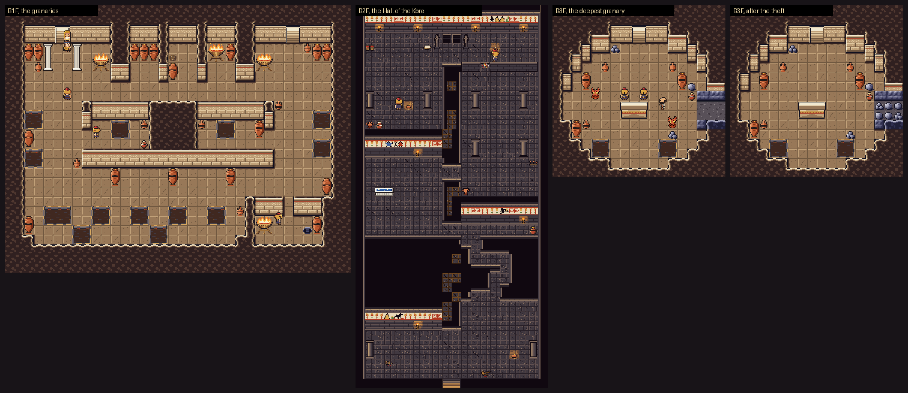

# The Mystery sanctum: the maps

Act I's dungeon, under Eleusa's Telesterion, right after Laurel 3 (design/phase2/SCRIPT.md, beat 23; Part 5, "The Mystery sanctum"; Part 3's Titanborn and Hyperion; Part 4's wild tables; Part 6's items). Three floors, teach, test and payoff (MAP_DESIGN.md §3), ending in Hyperion's first battle.

| | Builder | Size | Tilesets |
|---|---|---|---|
| `MAP_ELEUSA_SANCTUM_B1F`, the granaries | `tools/ichor/maps/sanctum.py` | 36×28, dark | oikos + `gTileset_EleusaSanctumRock` (cave_dark's crypt style) |
| `MAP_ELEUSA_SANCTUM_B2F`, the Hall of the Kore | the same | 20×40, dark | oikos + `gTileset_EleusaSanctumHall` (temple_demeter) |
| `MAP_ELEUSA_SANCTUM_B3F`, the deepest granary | the same | 18×18, dark | oikos + `gTileset_EleusaSanctumRock` |

The builder writes the three layouts, each `map.json`'s events, the generated blocks at the end of B1F's and B3F's `scripts.pory`, the two derived tilesets and the `METATILE_EleusaSanctum*` labels, then checks the floors. Run it after any change, and again after `cave_dark` or `temple_demeter` is rebuilt:

```bash
/usr/bin/python3 tools/ichor/art/temple_demeter_build.py --no-compile    # its catalog, once
/usr/bin/python3 tools/ichor/maps/sanctum.py --render design/phase2/img
tools/ichor/tests/sanctum.sh < /dev/null                                 # plays beat 23 through
```



| Image | Shows |
|---|---|
| [`img/sanctum_gallery.png`](img/sanctum_gallery.png) | All three floors side by side: B1F with its braziers lit, B2F, B3F before and after the theft |
| [`img/sanctum_b1f.png`](img/sanctum_b1f.png), [`_lit`](img/sanctum_b1f_lit.png), [`_dark`](img/sanctum_b1f_dark.png), [`_events`](img/sanctum_b1f_events.png) | The granaries as first found (people in place), with all four braziers lit, in the dark (the stair hall's stretch lit, the Torch's circle in the gallery), and the events: collision red, triggers gold (enter a lit zone), white (leave one) and blue (the rest), bg events blue boxes, hidden items pink, warps cyan, people green |
| [`img/sanctum_b2f.png`](img/sanctum_b2f.png), [`_dark`](img/sanctum_b2f_dark.png), [`_events`](img/sanctum_b2f_events.png) | The Hall of the Kore, its dark view from the spring, and its events (the pits' triggers blue) |
| [`img/sanctum_b3f.png`](img/sanctum_b3f.png), [`_after`](img/sanctum_b3f_after.png), [`_dark`](img/sanctum_b3f_dark.png), [`_events`](img/sanctum_b3f_events.png) | The vault at the theft, after it (the tunnel caved in, the dig bared), dark, and its events |
| [`img/sanctum_ingame.png`](img/sanctum_ingame.png) | In game, from `sanctum.sh`: 23A at the stair, Alethea's fight behind the column, a lit stretch, the apse, the first fresco, the chalk across the pits, the spring, the theft with the view dropped to the chest, Hyperion's battle, Chloe and the Sickle, the caved-in tunnel |

## No new tileset: two derived ones

The task's rule was to draw nothing. Both floors' looks come from existing sets:

- **The granaries and the vault** use cave_dark's **crypt style** (TILES_cave_dark.md): poros rock with lit rims over cut faces (cornice, red band, ashlar) and big warm flagstones. The autotiler draws any outline, so the halls are cut into the rock rather than boxed. The Titans' tunnel on B3F is cave_dark's plain cave style: grey-violet living rock, so the break-through reads.
- **The Hall of the Kore** uses **temple_demeter**: the Telesterion's dark flagstones, its rim-lit walls and its frieze of the Descent of Persephone, which is the Kore's story the hall is named for.

Each floor needs a few pieces those sets lack. They are **composed from existing 8×8 tiles** into new metatiles, in two derived secondaries. Each derived set shares its base's tiles, palettes and animation (`src/data/tilesets/headers.h`), copies the base's metatiles (so every catalog id stays valid), and appends its own from the next free row:

| Set | Base | Composed (ids from) | What |
|---|---|---|---|
| `gTileset_EleusaSanctumRock` | cave_dark (0x200–0x3DF) | 23 of 32 (0x3E0) | cave_dark's braziers (cold and lit, still animated), its steps down and its rubble on the crypt's flagstones; oikos's pithos, neck amphora and Doric column on the flagstones; **grain pits**: the still-water pieces, banks and all, in the fire palette, so they read as dark stone-lined pits |
| `gTileset_EleusaSanctumHall` | temple_demeter (0x200–0x2AF) | 24 of 336 (0x2B0) | oikos's spring basin on the flagstones; **rimmed pits and the chasm**, composed quadrant by quadrant from the wall top's lit lip (flipped for a far edge), the side walls' rims and the void; the chasm's floor is the hall's cracked flagstones in the fire palette, a faint red glow far below. The hall's flagstones get cave behavior, so the deeper wild table has cells to use |

Objects stand on plain flagstones: shadowed floor variants aren't kept under them, since the rock set has only 32 slots.

## B1F, the granaries (teach)

**The plan.** The Anaktoron's stair comes down in the north-west, between two white Doric columns, into the stair hall. Chloe stands on the stair; Alethea waits at its foot. The upper gallery runs east under three bays cut into the north rock: bay A full of great jars (where Alethea fights her grunt), bay B with the Persephone sherd's dig behind a great jar, and bay C with a brazier. It ends at the Ploutonion's landing in the north-east, where the village's stair comes down. A rock core fills the middle. The west and east galleries run down either side of it, lined with grain pits and jars. Two chambers are cut into the core: **Bolos's side pit** (west: a pit, the Hyper Potion behind him) and **the sealed granary** (east: a pit, jars, the hidden Miracle Seed). The lower gallery has great jars against the core's face. South of it lies the pit field. In the south-east, a narrow way leads into the apse and the steps down; Krokalos watches it.

**Teach: the braziers.** Four braziers along the walls (`FLAG_ICHOR_BRAZIERS_START + 0x18`–`0x1B`), the first beside the stair the player arrives on. Each lights its stretch as a lit zone (ENGINE_API.md §2), with enter triggers on the zone's edge and leave triggers just outside it. `VAR_TEMP_8` is 1 while the player stands in a lit zone. A map load inside a lit stretch is fully lit at once.

| Brazier | At | Its stretch |
|---|---|---|
| +0x18, the stair hall | (9,5) | (2,3)–(10,7) |
| +0x19, bay C | (21,4) | (13,4)–(23,9), the bays and the middle of the upper gallery |
| +0x1A, the Ploutonion's landing | (26,5) | (26,3)–(33,16), the landing and the east gallery |
| +0x1B, the apse | (26,22) | (26,22)–(32,24) |

**Beat 23A** plays on the first arrival (`FLAG_ICHOR_SANCTUM_ARRIVED`). Chloe speaks at the stair and Alethea answers. The lamp grunt comes up out of the gallery, Alethea sends out Spalunk, and the two of them move behind the column, where the fight plays as offscreen sound effects. Once the player is out of sight of the stair hall (a trigger line in the gallery), they're gone. Chloe heals whenever she's spoken to, until she gives the Sickle.

### Pass 1
- A pit-strewn hall: 2×2 pits on a grid, free-standing two-row rock blocks, empty flagstones everywhere. It read as a car park. The blocks were faces with no tops, like brick boxes, and there was no main aisle, so nothing guided the eye.
- What worked: the crypt style itself (warm cut stone, the stairs in the faces), the composed pithoi and braziers, and the pits.

### Pass 2
- Rebuilt as galleries round a core, with bays to the north, side pit and apse. The Anaktoron's stair is framed by two Doric columns.
- Still wrong: a big dark slab of rock top in the core, a monotonous core face along the lower gallery, an empty bay A, a pithos overlapping bay C's brazier, and a bare lower gallery.

### Pass 3
- Bay A filled with great jars, so it is no longer a dead end. The sealed granary was carved into the core's east half, which halves the slab. Great jars stand at a rhythm along the core's face. The pit field gained a 3×2 pit and staggered rows, and bay C was rearranged.
- The checker found three things to fix. Bay C's brazier boxed in a cell. The apse brazier's top cells couldn't be faced, so every brazier now reads from its legs. Two of Alethea's trigger cells sat on pits, so they moved a row up.

### Pass 4 (with events, in game)
- In game, the composed metatiles draw exactly as rendered: jars, columns, the lit bowls with their flames animated, and the pits.
- Trainers who spot the player walk up to them. Krokalos stands beside the narrow way, not in it, so he never blocks it after his battle.

## B2F, the Hall of the Kore (test)

**The plan.** A long frescoed hall with a chasm down its middle. Short walls jut from the sides at the turns of the walk, and each one carries a panel of the Kore's story, read south to north:

| Panel | Frieze row | Pieces | Where |
|---|---|---|---|
| 1. The girl picking flowers; the ground splitting open | 32 | maiden, horses | west, facing the court at the stair's foot |
| 2. The black chariot going down | 21 | seized | east, at the far edge of the pit field |
| 3. The searching woman with her torch; the smaller figure with two | 14 | search, hecate | west, over the spring |
| 4. The girl coming up a stair into the light | 1 | hermes, return | the north wall, by the far stair |

- **The court** (south): the stair up to the granaries, the Titans' bootprints from it, a smashed basket and an overturned brazier.
- **The near half** is grain pits on both sides of the chasm. On the east, Hecate's chalk marks the one safe way across, and the Titans' bootprints mark the same way by torchlight, since the chalk shows only doused and the engine's glow palettes aren't wired yet. A pit drops you back in the court, with the Telesterion's line.
- **The near bridge** leads west to the spring, the midpoint rest, with the Ether in its overflow. The far bridge leads back east.
- **The far half:** columns, the low wall and its doorway. Konis watches the doorway from beside it. Past it are the far stair down between two stone sentinels, and Gaios's fresco alcove (west, optional) with the TM Dig.
- **The hall's head:** a trigger line across the court plays Hyperion's voice from the far stair, once (`FLAG_ICHOR_SANCTUM_VOICE`).

### Pass 1
- The frieze panels on the jutting walls read well. So did the stair between the sentinels, the ribboned doorway and the marble basin.
- But pits and chasm were both pure black: the near half was a black void with a path, and you couldn't tell the chasm from the pits. The alcove and the court were bare flagstones.

### Pass 2
- The pits and the chasm are rimmed now: lit lips where they meet the floor, composed from the walls' own tiles. The chalk path reads as a causeway across a pit.
- The chasm shows faint ember-red cracks far below, so it no longer reads as a pit.
- Holy things (kistai, a winnowing basket, a kernos), the grunts' lamps and lit wall sconces by the panels.

### Pass 3 (with events, in game)
- Panel 2 became a single chariot cell with its reading spots beside it. The fourth panel moved east of the stair, since the stair cells can't be stood on to read it.
- Konis started out facing down the doorway. She would have walked into it to battle and blocked the only way north. Then, beside it, she and her lamp cut the far end off from the alcove. She now stands east of the doorway's exit facing west, so she sees the player step out of it and blocks nothing.

## B3F, the deepest granary (payoff)

**The plan.** A round vault, the oldest granary, its north wall stepped in cut stone, the stair up in the middle of it. The great chest stands in the middle. The crypt's sarcophagus stands in for the bronze chest. Petros and Amathos lever at it, Hyperion stands over them, and two Kapnub smolder on the floor. The Titans' tunnel breaks through the east wall into living rock. The bronze sickle lies thrown aside in the dust by the stair's foot, where it can be looked at before the scene. Two old pits lie in the south.

**Beat 23C** plays on the line five steps from the chest. The player is brought to the vault's mouth, and the view drops two tiles so the torch's circle frames the chest. On the first visit the crew carry the shard up the tunnel (`FLAG_ICHOR_FRAGMENT_STOLEN`). Hyperion steps into the light and battles. After a loss, the next visit starts at "Step into the light." Once he's beaten he backs up the tunnel, his Pebblith brings the roof down, and he's gone (`FLAG_ICHOR_HIDE_HYPERION_SANCTUM`). Chloe and Alethea come down. Chloe walks to the empty chest, picks up the sickle, and gives the player Demeter's Sickle (Demeter +10 Favor). Then a fade to the Telesterion's steps, outside, for beat 24. On later visits the tunnel is rubble and the cave-in has bared the old foundations: Daedalus's page II, a fixed dig.

### Pass 1
- The vault read strongly: a stepped ring of cut faces, rims round the south curve, the chest central.
- But the tunnel's living-rock style ran as a full column down the east edge: a straight blue band. The sickle's heap sat on a rock cell, and two cells were boxed in by jars.

### Pass 2
- The cave style is now only round the tunnel itself, so the blue rock is a ragged patch where the dig broke through. The vault's south has two pits, and the boxed cells are open.

### Pass 3 (in game)
- In the dark, the crew stood outside the torch's circle while they spoke. The scene now pans the view down to frame them and pans back before the battle.
- The collapse swaps the tunnel for boulders and rubble and draws the dig.

## Events, flags and ids

**Warps.**

| Floor | Id | At | To |
|---|---|---|---|
| B1F | 0, 1 | (5,3), (6,3): the Anaktoron's stair | `MAP_ELEUSA_VILLAGE_TEMPLE_OF_DEMETER` warp 3 (the Anaktoron's door, 13,13) |
| B1F | 2, 3 | (29,3), (30,3): the Ploutonion's stair | `MAP_ELEUSA_VILLAGE` warps 9, 10 (the Ploutonion's gate, 31–32,8) |
| B1F | 4 | (31,23): the steps down | B2F warp 0 |
| B2F | 0, 1 | (9,39), (10,39): the stair up | B1F warp 4 |
| B2F | 2, 3 | (9,3), (10,3): the far stair down | B3F warps 0, 1 |
| B3F | 0, 1 | (8,3), (9,3): the stair up | B2F warps 2, 3 |

**Flags.**

- Bank flags 0x086–0x08D:
  - `FLAG_ICHOR_SANCTUM_ARRIVED`
  - `FLAG_ICHOR_SANCTUM_VOICE`
  - `FLAG_ICHOR_HIDE_HYPERION_SANCTUM`
  - `FLAG_ICHOR_ITEM_SANCTUM_B1F_HYPER_POTION`
  - `_B2F_TM_DIG`
  - `_B2F_SUPER_POTION`
  - `_B3F_SOFT_SAND`
- Vanilla flags 0x2F4–0x2F6, for the hidden items:
  - `FLAG_ICHOR_HIDDEN_SANCTUM_B1F_MIRACLE_SEED`
  - `_B2F_ETHER`
  - `_B3F_BRONZE_OBOL`
- `FLAG_ICHOR_FRAGMENT_STOLEN` is the Eleusa rooms agent's claim (bank 0x094). Sitokles reads it. It's defined here too, until that merge.
- Braziers: +0x18–0x1B.
- Read but not owned:
  - `FLAG_ICHOR_GOT_DEMETERS_SICKLE`, the engine's: it hides B1F's Chloe;
  - the temp flags `FLAG_TEMP_1` and `_2`: they keep B3F's Chloe and Alethea hidden until the scene.

**Temp vars:**
- `VAR_TEMP_8`: in a lit zone.
- `VAR_TEMP_9`: the pits, always 0.
- `VAR_TEMP_A`: the scene or the voice is done.
- `VAR_TEMP_B`: Alethea's fight is still on screen.
- `VAR_TEMP_C` and `_D`: positions.
- `VAR_TEMP_2` and `_3` are left alone: they are the carried flame's.

**Trainers 150–154:**
- `TRAINER_ICHOR_GRUNT_SANCTUM_KROKALOS`, `_BOLOS`, `_KONIS` and `_GAIOS`, all Titanborn;
- `TRAINER_ICHOR_HYPERION_1`, of the new class `TRAINER_CLASS_TITAN_ADMIN`: `GetBattleBGM` gives the class `MUS_ICHOR_BATTLE_ADMIN`, and its victory music is the Titanborn's.

**Wild tables** (Part 4, with BALANCE.md's rule: no evolved form in the wild before its level):
- B1F has one table, levels 19–22: Spalunk, Rhoaril, Kaplet, Galekit, Pebblith, Ergant and Gelasable (7 species). Plouteras's slots went to Spalunk.
- B2F and B3F share the deeper table, levels 20–22, split `_Morning` and `_Night`: Rhoaril, Spalunk, Pebblith, Kaplet and Gelasable, with Galekit at night (5 and 6 species).
  - Cairnolith's slot went to Pebblith, and Plouteras's to Spalunk and Kaplet.
  - The night's two Persenyx slots went to Galekit. Persenyx at 22 stays a story static.

**Items.**

| Floor | Visible | Hidden | Other |
|---|---|---|---|
| B1F | Hyper Potion (Bolos's side pit) | Miracle Seed (the sealed granary) | the real Persephone sherd's fixed dig behind the great jar in bay B (fixed index 2; Trowel required) |
| B2F | TM28 Dig (Gaios's alcove), Super Potion (by the second panel) | Ether (the basin's overflow) | the spring heals |
| B3F | Soft Sand (the tunnel's mouth) | Bronze Obol (`ITEM_RELIC_COPPER`, the vault's dust) | Demeter's Sickle (Chloe); the real Daedalus page II fixed dig after the cave-in (fixed index 3; Trowel required) |

`tools/ichor/map_audit.py EleusaSanctum` reports 0 FAIL and 0 WARN. Its only note is that B1F has no `_Night` table.

## Still wanted from the art side

- **Hyperion's walker and portrait** (STORY.md §2). Until they're drawn he walks as Kedalion and fights in the Titan Grunt portrait.
- **`MUS_ICHOR_ENCOUNTER_ADMIN`**, the admins' encounter theme with Hyperion's forge-hammer layer. `MUS_ICHOR_ENCOUNTER_TITAN` stands in.
- **An open bronze chest** for the vault (the crypt's sarcophagus stands in), and **the black shard**, carried by Petros and Amathos (nothing shows it).
- **The bronze sickle in the dust:** a small metatile or object. A spoil heap stands in.
- **Crypt-style grain pits with a stone lip**, and their boarded twin. The composed still-water pits are close, but their bank is the cave's grey.
- **A crypt stair down.** cave_dark's rough steps are blue-grey on the warm flagstones.
- **Pithoi, amphorae and columns drawn on the crypt's flagstones**, with their contact shadows. The composed ones drop the shadows.
- **The grunts' lamps as moving lights, and the Kapnub's embers** (Part 5): the engine's halo sprites, a stretch goal (SYSTEMS.md §2). The grunts on B2F have a lamp standing beside them.
- **A chasm edge with its own glow.** The ember floor is the hall's cracked flagstones in the fire palette.
- **Hecate's chalk** on B2F still needs the engine's douse palettes. The B1F Persephone find and B3F page II dig are integrated; the sanctum harness checks actual collectible flags, repeat protection and saved-game persistence.
