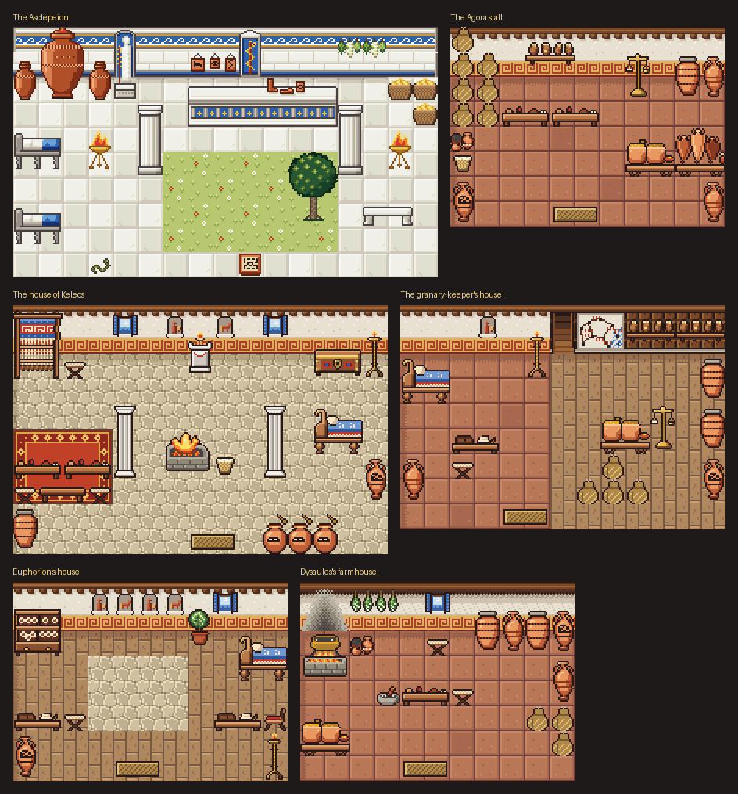

# Eleusa's six interiors

Every door in Eleusa opens on a room of its own (MAP_DESIGN.md §2): four households and two public buildings, laid out in `tools/ichor/maps/eleusa_rooms.py`. Who is in each and what happens there is in `design/phase2/SCRIPT.md`, Part 2, "Eleusa interiors"; the doors are BUILD.md's batch 4 table.

```bash
/usr/bin/python3 tools/ichor/maps/eleusa_rooms.py   # builds limen, domos and the Asclepeion, writes the rooms
tools/ichor/tests/eleusa_rooms.sh                   # walks into every room from its door and plays it (build/test_eleusa_rooms/)
```

| Room | Map | Size | Set | Exit mat | Back to Eleusa's warp | Render |
|---|---|---|---|---|---|---|
| The Asclepeion | `MAP_ELEUSA_VILLAGE_ASCLEPEION` | 17x10 | civic | the threshold mosaic at (9,9) | 0, the door at (10,23) | `img/eleusa_asclepeion.png` |
| The Agora stall | `MAP_ELEUSA_VILLAGE_AGORA` | 11x8 | limen | (4,7), (5,7) | 1, the door at (17,23) | `img/eleusa_agora.png` |
| The house of Keleos | `MAP_ELEUSA_VILLAGE_HOUSE_OF_KELEOS` | 15x10 | domos | (7,9), (8,9) | 2, the door at (38,23) | `img/eleusa_keleos.png` |
| The granary-keeper's house | `MAP_ELEUSA_VILLAGE_GRANARY_HOUSE` | 13x9 | limen | (4,8), (5,8) | 3, the first barn door at (15,17) | `img/eleusa_granary.png` |
| Euphorion's house | `MAP_ELEUSA_VILLAGE_POETS_HOUSE` | 11x8 | limen | (4,7), (5,7) | 5, the door at (24,30) | `img/eleusa_poets.png` |
| Dysaules's farmhouse | `MAP_ELEUSA_VILLAGE_FARMHOUSE` | 11x8 | domos | (4,7), (5,7) | 6, the first barn door at (31,30) | `img/eleusa_farmhouse.png` |

Each room's warp 0 is its mat (the village's doors all arrive there), and every mat cell warps back to the first warp id of its door, so the player comes out of the door they went in by. The gallery of all six is `img/batch4_rooms_gallery.png`.



## The sets

No new art. The rooms are composed from pieces that already exist, in the sets that already hold them:

- **limen and domos** (`TILES_limen.md`) are Emporion's twin sets on oikia's seven palettes, drawn by `tools/ichor/art/limen_art.py`, which carries oikia's furniture pixel for pixel and some of ergasteria's. The four households and the stall take their pieces from there: oikia's loom, hearth and soot, altar, niches, kline, chest, tables, scroll cabinet, desks, jars and mortar; ergasteria's open hearth, bench and scales; limen's water jars, grain sacks, grain and oil trestles and the scratched-plaster board. Two oikia pieces join limen_art's shared list (the barley mortar and the horse niche), and two stamps are existing pieces with another behavior, so they cost metatiles but no tiles: `counter_plank` (oikia's table as the stall's `MB_COUNTER`) and `pit_stairs` (oikia's timber stairwell without its warp). The households go where there's room: Keleos's hall and the farmhouse in domos (**451 of 504** tiles), the granary, Euphorion's room and the stall in limen (**494 of 504**). Emporion's rooms are rebuilt with them and come out identical.
- **civic** (`design/phase1/TILES_civic.md`) has the Asclepeion, so it shares Akti's and Emporion's counter, Pithos, statue, couches and braziers, as MAP_DESIGN.md §2 asks of public buildings. Its garden is the Akademia's grass, wildflowers and laurel. Four metatiles are added at the end of civic's list, so no earlier room's ids move, and they cost no tiles: the Agora's drying herbs on the Asclepeion's wall (`asc_herbs`) and its basket of grain on the marble slabs (`asc_basket_grain`, `_b`). Civic stays at 504 of 512 tiles.

## The rooms

**The Asclepeion.** A country Asclepeion, low and wide, built round a courtyard herb garden open to the sky in the middle of the hall: grass thick with poppies and white flowers, the laurel (Apollo's tree, and Asclepius was his son) over the herbs, and two marble posts at the garden's near corners framing it from the counter, the Panacoil coiled round the west one. The healer stands at her counter under the rod relief and looks out on it. The Pithos, an old grain jar, stands between its two lidded jars in the back-left corner with Asclepius beside it; bundles of herbs dry from the beam on the right, and the barley the farmers pay in is heaped in baskets in the back-right corner. The sick lie on the couches down the left side between braziers; a bench waits on the right. Akti's is square, round a spring and a mosaic; Emporion's is long, lit by its sea window; this one is a garden with a hall round it, and you walk in from the street through the herbs.

**The Agora stall.** A farmhouse front room turned shop. Sacks of barley heaped to the ceiling in the back-left corner, the honey jars in a row on the shelf behind the counter, the bronze scale at the counter's end, and the counter itself, a long board on legs with the bread, the jug and the olives on it. Oil jars along the back wall, and trestles of grain and of oil samples down the right side where the old woman is choosing; cooking pots, a basket and an amphora by the left wall. Akti's Agora is a stoa with an awning and a colonnade; this is somebody's front room.

**The house of Keleos.** The oldest house in the village, and a hall rather than a room: the great hearth burns in the middle on its raised curb, the old way, between two posts, with the cradle (a winnowing basket lined with fleece) set close to the fire. Metaneira's loom stands in the back-left corner with a stool; Hestia's altar is against the back wall between two niches and two windows; the chest and a lampstand fill the back-right corner, with the guest couch below them. The long table runs along the left side on its red rug, a bench and stools at it, where the youngest daughter sits; the three water jars for the trip to the Maiden's Well wait by the door, and a pithos stands in the corner. Flags underfoot, the red dado, more room than any other house in Eleusa.

**Dysaules's farmhouse.** A farm kitchen under a smoke-darkened beam. The hearth and its cauldron in the back-left corner with the soot above it, the cooking pots beside it and four bundles of herbs drying over them; the window with Dysaules's stool under it, worn into a Dysaules-shaped dip, facing the Rharian field; seed jars in a row along the back wall and down the right side; the kitchen table with the barley mortar at its end, where Theano stands; the grain trestle by the left wall; and the house's Galekit asleep on a sack by the barn doors.

**The granary-keeper's house.** Half house, half storeroom, and it shows: the house half is terracotta under the red dado, with Sitokles's bed (the Revive is under it), the niche that stands for the painting of the Kore, a lamp and his writing table; the store half is boards under a timber wall, with the steps down to his grain pit, the tally board of every city's first fruits, shelves of sealed seed-corn jars, pithoi down the right wall, the grain trestle and the scales, and a heap of sacks. Sitokles stands at his tally board.

**Euphorion's house.** A playwright's room: the cabinet of scrolls, a writing table on each side covered in wax tablets, his couch, a lampstand and a klismos; the chorus of clay figurines in a row of niches along the back wall, facing the stage; a myrtle under the window; and the stage itself in the middle of the floor, a pale square of flags set into the boards, where Euphorion stands with his Pithound (and, after the trade, a Melibee).

## Events and scripts

| Room | People | Event | Flags |
|---|---|---|---|
| The Asclepeion | the healer (9,2) behind the counter, the Panacoil (5,5) on the gate post, the pilgrim with blisters (14,6), the farmer (3,6) | Healing (`Ichor_EventScript_AsclepeionHealer`), the Pithos (Akti's menu, naming Eleusa) | sets the respawn, `HEAL_LOCATION_ELEUSA_VILLAGE` (new: the road below the door, (10,24); respawn in front of the counter, (9,4)) |
| The Agora stall | the stallkeeper (3,2) behind her counter, an old woman (7,6) | The market, SCRIPT.md's Eleusa stock: Great Ball, Super Potion, Antidote, Paralyze Heal, Awakening, Repel, Olive Oil, Barley Cake, Honey; after `FLAG_BADGE03_GET` Revive and Full Heal too | — |
| The house of Keleos | Metaneira (5,6) by the hearth, her youngest daughter (1,5) at the table | Xenia: she feeds you first (a heal), then offers the hearth (a rest and a heal). After the Harvest Laurel, once, the goddess's drink: 2 Fresh Water and 2 Barley Cakes | `FLAG_ICHOR_MET_METANEIRA` (her welcome in full, once), `FLAG_ICHOR_GOT_KYKEON` |
| Dysaules's farmhouse | Theano (5,3) at her table, the Galekit (9,5) asleep on a sack | TM09 Bullet Seed | `FLAG_ICHOR_GOT_TM_BULLET_SEED` |
| The granary-keeper's house | Sitokles (8,2) at his tally board | Lore; after the theft, the Amulet Coin; the Revive under the bed (hidden) | reads `FLAG_ICHOR_FRAGMENT_STOLEN` (beat 23 sets it); sets `FLAG_ICHOR_GOT_AMULET_COIN`, `FLAG_ICHOR_HIDDEN_ELEUSA_GRANARY_REVIVE` |
| Euphorion's house | Euphorion (5,4) on his stage, his Pithound (4,4); after the trade a Melibee (4,4) | In-game trade `INGAME_TRADE_ICHOR_CRITIC`: a Melibee for the Pithound CRITIC, Lv 21, hidden ability, holding a Twisted Spoon. After Act I, his new ending | `FLAG_ICHOR_TRADED_PITHOUND` (also hides the Pithound); the Melibee hides on `FLAG_TEMP_2` until the trade; reads `FLAG_ICHOR_ACT1_COMPLETE` |

- **Speakers** are in the name box (`setspeaker`), and narration clears it (`SP_NAME_NONE`).
- **Stubs**, each tagged in the scripts:
  - `ICHOR_STUB_XENIA`: Metaneira's rest menu (DAWN / NOON / DUSK / NIGHT) waits on SYSTEMS.md §10's clock, as Philoxenos's does; her hearth is a fade and a heal. The Split Coin's second link (`ITEM_HALF_COIN`, the Big Pearl, `FLAG_ICHOR_SPLIT_COIN_2`), a stretch feature, waits for the item and a flag.
  - `ICHOR_STUB_AETHOS_DEX`: Pithound, Melibee, Galekit and Panacoil are the dex's stand-ins (`include/constants/ichor_species_stubs.h`). CRITIC's hidden ability is the stand-in's until the real Pithound (Prankster) lands.
  - `ICHOR_STUB_STORY_FLAGS`: `FLAG_ICHOR_ACT1_COMPLETE` still reads the fourth Laurel's flag.
- **Story flags a later batch sets:** `FLAG_ICHOR_FRAGMENT_STOLEN` (claimed here, bank 0x094) belongs to beat 23, the theft in the sanctum (batch 5). Until it's set, Sitokles keeps the coin.
- **The check:** `tools/ichor/tests/eleusa_rooms.sh` walks into all six from their doors in the village, plays every event and walks back out onto the right door tile (`build/test_eleusa_rooms/`).

## Render-and-critique passes

Passes 1 and 2 looked at the composed source at 3x, with a coordinate grid and the people marked; pass 3 at the compiled 2x renders; pass 4 at in-game screenshots from the check.

**The Asclepeion**
1. Built from civic: the counter, Pithos and statue against the back wall, and the garden as a patch of the Akademia's grass in the middle of the marble with the laurel in it and two posts on its east and west sides. The garden read as a lawn with a tree: too few flowers. The posts stood on their pale stylobate squares inside the grass, and a lone Asclepeion jar on the open floor carried a piece of wall behind it (its top cell is drawn over the wall). *Fixed:* the poppies and white flowers on every other cell; the jar dropped; a second brazier on the right to balance the left.
2. Tried the posts as a gate on the garden's south side, flanking the walk in from the door: two columns standing in the lawn, which read as ruins, not a gate. *Fixed:* the posts moved out of the grass to the garden's two near corners on the marble, so they frame it from the counter; Asclepius moved one cell left so his base and the west post don't stack; the Panacoil on the west post's plinth.
3. The compiled render reads: counter, relief and healer on one axis with the door, the garden in front of them, the posts framing it. The herbs on the beam and the baskets of barley in the corner are the Agora's pieces on the Asclepeion's wall and slabs, new metatiles with no new tiles.
4. In game you come in on the threshold at the bottom and the garden fills the screen, with the counter beyond it. The Panacoil sits on the west post's plinth, coiled up into its shaft; the healer heals across the counter from the walk in front of it, and the room sets the respawn.

**The Agora stall**
1. The heap of sacks rising up the wall to the beam reads as "stacked to the ceiling", and the honey shelf and the scale read. The keeper was boxed in behind the counter (the sacks on one side, the scale on the other), and the counter, two long benches, read as seats.
2. *Fixed:* a gap at the counter's east end so the space behind it opens; the counter remade as oikia's long table (bread, a jug and olives on it, as `counter_plank`); an oil trestle beside the grain trestle, since the keeper sells oil; an old woman choosing barley.
3. The compiled render: the lower-left half was bare floor. *Fixed:* cooking pots and a basket along the left wall under the sacks, and a second amphora by the door.
4. In game the stallkeeper stands behind the board and sells across it, and the list opens on the Great Balls, with the Olive Oil, Barley Cakes and Honey below. The old woman stands at the grain trestle.

**The house of Keleos**
1. The megaron reads at once: the open hearth on its curb between two posts, the loom in the corner, Hestia's altar against the back wall between two niches, the chest, the couch and the three water jars by the door. The long table was two tables one above the other and read as two tables; the bottom-left was bare.
2. *Fixed:* the two tables end to end with a bench and stools, on a red rug, so the dining end of the hall is a place; one niche changed to the horse niche so the two aren't twins; a pithos in the bottom-left corner and an amphora by the couch.
3. The compiled render: the rug ran under the west post's foot. *Fixed:* the rug one cell narrower, so the post stands on the flags.
4. In game Metaneira stands at the hearth's west side with the fire and the cradle beside her, and her daughter sits at the head of the long table. The feast and the hearth each fade to black with the heal jingle.

**Dysaules's farmhouse**
1. A kitchen at once (hearth and soot, pots, the window and its stool, the row of seed jars, the mortar and table), but 12x9 was too much floor for it, and the lower half was empty.
2. *Fixed:* the room cut to 11x8; four bundles of herbs over the hearth instead of two; the grain trestle by the left wall; the sacks by the barn doors, where the Galekit sleeps.
3. The compiled render: the right wall was bare below the jars. *Fixed:* an amphora there, so the seed jars run along the back wall and down the side.
4. In game Theano stands behind her table under the window, and the Galekit sits on its sack by the barn doors.

**The granary-keeper's house**
1. The split reads (terracotta and the red dado for the house, boards and the timber wall for the store), and so does the scratched board as a tally board. The wall shelves of remedy flasks (blue and red) read as medicine, not seed-corn, and the store was thin.
2. *Fixed:* the shelves changed to the wax-sealed jars; pithoi down the right wall and an amphora; a heap of sacks; the scales next to the grain trestle; a lampstand in the house half; the writing table moved down so the bed and the painting have room.
3. The compiled render reads as half house, half storeroom, with Sitokles at his tally board. The steps to the grain pit are oikia's timber stairwell, a dark doorway with treads, without its warp.
4. In game Sitokles stands with his back to you at the tally board and turns when spoken to; the Revive turns up when you search the bed's foot.

**Euphorion's house**
1. The four niches in a row read as the chorus of figurines; the stage, a square of flags set into the boards, reads as a marked-out space. The window wall was bare to the right of the figurines.
2. *Fixed:* a myrtle under the window and an amphora by the left desk, so every wall has something on it.
3. The compiled render reads as a working room: tablets on both desks, the scroll cabinet, the couch, the stage in the middle.
4. In game Euphorion stands on the stage with his Pithound beside him; after the trade the Melibee hovers in its place.

## Art requests

Pieces the rooms want and no set has, each stood in for by an existing piece or left out:

- **A painting of the Kore** for the granary-keeper's house ("a girl picking flowers; behind her, the ground splits open"), 1x2 or 2x2 on the wall. Oikia's niche with its terracotta goddess stands in.
- **A trapdoor in the floor with a ladder going down**, for Sitokles's grain pit. Oikia's timber stairwell into the back wall stands in.
- **A wooden cradle** for the house of Keleos. Oikia's wool basket stands in, written as a fleece-lined winnowing basket (the liknon babies were laid in).
- **Masks of tragedy and comedy** on the wall, and **a chalk outline of a stage with three doors** on the floor, for Euphorion's house. A square of flags in the boards stands in for the stage; the masks are left out.
- **A lyre** for Euphorion. Left out.
- **A plough** propped by the farmhouse door. Left out.
- **A sleeping pose** for the Galekit on its sack: it sits upright.
- **Sheaves of barley** and **a stone mortar** in civic, for the Asclepeion. The Agora's baskets of grain stand in for the sheaves; the mortar is left out. Civic has 8 tiles left.
- **The Pithos painted with poppies.** The slice's Pithos stands in.
- **A barrel**, so the stall's counter can be "a door laid across two barrels". Oikia's long table stands in.
- **The healer's welcome** (`Ichor_Text_AsclepeionWelcome`, shared) says "by the sacred spring"; Eleusa's Asclepeion has a garden, not a spring (nor does Emporion's). A text request, not art.

## Generated tables

### From limen

<!-- limen_build: begin generated -->

### The granary-keeper's house, Eleusa

- Map: `MAP_ELEUSA_VILLAGE_GRANARY_HOUSE`. Layout: `data/layouts/EleusaVillage_GranaryHouse/map.bin`, **13x9** blocks, `gTileset_Oikos` + `gTileset_Limen`.
- Floor: terracotta, boards. Wall: red, timber. Render: `design/phase2/img/eleusa_granary.png` (2x).

Walk map: `#` blocked, `.` open. Digits and letters mark the spots in the table; a bg event is marked on its furniture tile.

```
    0123456789012
  0 #############
  1 ###3##65#####
  2 ##...#..2...#
  3 #7..........4
  4 ........###.#
  5 ..##....###.#
  6 #.#.....#...#
  7 #......###..#
  8 ....11.......
```

| # | Kind | Tile | Read from | What |
|---|---|---|---|---|
| 1 | warp | (4,8), (5,8) |  | the barn doors to Eleusa (south-arrow mat) |
| 2 | npc | (8,2) | faces north | Sitokles, at his tally board |
| 3 | bg | (3,1) | (3,2) facing north | the painting of the Kore |
| 4 | bg | (12,3) | (11,3) facing east | a jar of seed-corn |
| 5 | bg | (7,1) | (7,2) facing north | the tally board |
| 6 | bg | (6,1) | (6,2) facing north | the steps down to the grain pit |
| 7 | bg | (1,3) | (1,4) facing north | the bed (the Revive is hidden under it) |

### Euphorion's house, Eleusa

- Map: `MAP_ELEUSA_VILLAGE_POETS_HOUSE`. Layout: `data/layouts/EleusaVillage_PoetsHouse/map.bin`, **11x8** blocks, `gTileset_Oikos` + `gTileset_Limen`.
- Floor: boards, flags. Wall: red. Render: `design/phase2/img/eleusa_poets.png` (2x).

Walk map: `#` blocked, `.` open. Digits and letters mark the spots in the table; a bg event is marked on its furniture tile.

```
    01234567890
  0 ###########
  1 ###########
  2 ##.....#.##
  3 ....5....##
  4 ....32.....
  5 ###.....4##
  6 #.........#
  7 #...11....#
```

| # | Kind | Tile | Read from | What |
|---|---|---|---|---|
| 1 | warp | (4,7), (5,7) |  | door to Eleusa (south-arrow mat) |
| 2 | npc | (5,4) | faces south | Euphorion, on his stage |
| 3 | npc | (4,4) | faces east | his Pithound, the critic |
| 4 | bg | (8,5) | (8,6) facing north | the desk |
| 5 | bg | (4,3) | (4,2) facing south | the chalked stage |

### The Agora stall, Eleusa

- Map: `MAP_ELEUSA_VILLAGE_AGORA`. Layout: `data/layouts/EleusaVillage_Agora/map.bin`, **11x8** blocks, `gTileset_Oikos` + `gTileset_Limen`.
- Floor: terracotta. Wall: red. Render: `design/phase2/img/eleusa_agora.png` (2x).

Walk map: `#` blocked, `.` open. Digits and letters mark the spots in the table; a bg event is marked on its furniture tile.

```
    01234567890
  0 ###########
  1 ####4######
  2 ##.2...5.##
  3 #6####.....
  4 #......####
  5 #......####
  6 #......3..#
  7 #...11....#
```

| # | Kind | Tile | Read from | What |
|---|---|---|---|---|
| 1 | warp | (4,7), (5,7) |  | door to Eleusa (south-arrow mat) |
| 2 | npc | (3,2) | faces south | the stallkeeper, behind her counter (talked to across it) |
| 3 | npc | (7,6) | faces north | an old woman, choosing barley |
| 4 | bg | (4,1) | (4,2) facing north | the honey jars |
| 5 | bg | (7,2) | (7,3) facing north | the scale |
| 6 | bg | (1,3) | (1,4) facing north | the sacks of barley |

<!-- limen_build: end generated -->

### From domos

<!-- domos_build: begin generated -->

### The house of Keleos, Eleusa

- Map: `MAP_ELEUSA_VILLAGE_HOUSE_OF_KELEOS`. Layout: `data/layouts/EleusaVillage_HouseOfKeleos/map.bin`, **15x10** blocks, `gTileset_Oikos` + `gTileset_Domos`.
- Floor: flags. Wall: red. Render: `design/phase2/img/eleusa_keleos.png` (2x).

Walk map: `#` blocked, `.` open. Digits and letters mark the spots in the table; a bg event is marked on its furniture tile.

```
    012345678901234
  0 ###############
  1 ###############
  2 #6#....8....###
  3 ...............
  4 ....#.....#.##.
  5 .3..#.##..#.##.
  6 #####24#5.#...#
  7 ####..........#
  8 #.........#7#..
  9 #......11.###..
```

| # | Kind | Tile | Read from | What |
|---|---|---|---|---|
| 1 | warp | (7,9), (8,9) |  | door to Eleusa (south-arrow mat) |
| 2 | npc | (5,6) | faces south | Metaneira, by the hearth |
| 3 | npc | (1,5) | faces south | her youngest daughter, at the long table |
| 4 | bg | (6,6) | (6,7) facing north | the hearth |
| 5 | bg | (8,6) | (8,7) facing north | the cradle |
| 6 | bg | (1,2) | (1,3) facing north | the loom |
| 7 | bg | (11,8) | (11,7) facing south | the water jars by the door |
| 8 | bg | (7,2) | (7,3) facing north | Hestia's altar |

### Dysaules's farmhouse, Eleusa

- Map: `MAP_ELEUSA_VILLAGE_FARMHOUSE`. Layout: `data/layouts/EleusaVillage_Farmhouse/map.bin`, **11x8** blocks, `gTileset_Oikos` + `gTileset_Domos`.
- Floor: terracotta. Wall: tavern. Render: `design/phase2/img/eleusa_farmhouse.png` (2x).

Walk map: `#` blocked, `.` open. Digits and letters mark the spots in the table; a bg event is marked on its furniture tile.

```
    01234567890
  0 ###########
  1 ###########
  2 ###..4.#5##
  3 #6...2....#
  4 ...####...#
  5 ##.......3#
  6 ##........#
  7 ....11.....
```

| # | Kind | Tile | Read from | What |
|---|---|---|---|---|
| 1 | warp | (4,7), (5,7) |  | the barn doors to Eleusa (south-arrow mat) |
| 2 | npc | (5,3) | faces south | Theano, at her kitchen table |
| 3 | perch | (9,5) | (9,6) facing north | the cat, a Galekit, asleep on a sack |
| 4 | bg | (5,2) | (4,2) facing east | Dysaules's stool under the window |
| 5 | bg | (8,2) | (8,3) facing north | the seed jars |
| 6 | bg | (1,3) | (1,4) facing north | the hearth |

<!-- domos_build: end generated -->
