# Emporion's nine interiors

Every door in Emporion opens on a room of its own (MAP_DESIGN.md §2): four households and five public or working buildings, laid out in `tools/ichor/maps/emporion_rooms.py`. Who is in each and what happens there is in `design/phase2/SCRIPT.md` (beats 12 and 13, and Part 2, "Emporion interiors").

```bash
/usr/bin/python3 tools/ichor/maps/emporion_rooms.py   # builds ergasteria, limen, domos and the Asclepeion, writes the rooms
tools/ichor/tests/emporion_rooms.sh                   # plays every room's event from a Quickstart (build/emporion_rooms/)
```

| Room | Map | Size | Set | Exit (warp 0) | Render |
|---|---|---|---|---|---|
| The Asclepeion | `MAP_EMPORION_CITY_ASCLEPEION` | 17x9 | civic | the threshold mosaic at (8,8) | `img/emporion_asclepeion.png` |
| The Deigma | `MAP_EMPORION_CITY_DEIGMA` | 18x10 | limen | the mat at (2,9), (3,9) | `img/emporion_deigma.png` |
| The Hephaisteion | `MAP_EMPORION_CITY_HEPHAISTEION` | 12x9 | ergasteria | the mat at (5,8), (6,8) | `img/emporion_hephaisteion.png`, lit: `img/emporion_hephaisteion_lit.png` |
| The Dolphin | `MAP_EMPORION_CITY_TAVERN` | 14x9 | limen | the mat at (6,8), (7,8) | `img/emporion_tavern.png` |
| Philoxenos's house | `MAP_EMPORION_CITY_PHILOXENOS_HOUSE` | 15x11 | domos | the mat at (6,10), (7,10) | `img/emporion_philoxenos.png` |
| The widow's house | `MAP_EMPORION_CITY_WIDOWS_HOUSE` | 8x8 | limen | the mat at (3,7), (4,7) | `img/emporion_widow.png` |
| The runners' house | `MAP_EMPORION_CITY_RUNNERS_HOUSE` | 13x9 | domos | the mat at (5,8), (6,8) | `img/emporion_runners.png` |
| Euphronios's workshop | `MAP_EMPORION_CITY_POTTERS_WORKSHOP` | 12x9 | domos | the mat at (5,8), (6,8) | `img/emporion_potter.png` |
| The hiring hall | `MAP_EMPORION_CITY_HIRING_HALL` | 17x8 | limen | the mat at (8,7), (9,7) | `img/emporion_hiring_hall.png`, empty: `img/emporion_hiring_hall_empty.png` |

Every exit warps to `MAP_EMPORION_CITY` (the hiring hall to `MAP_EMPORION_HARBOR`) with a placeholder `dest_warp_id` of 0, until the city agent's door ids are known.

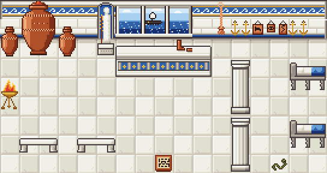

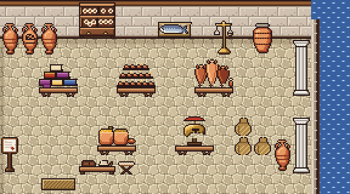

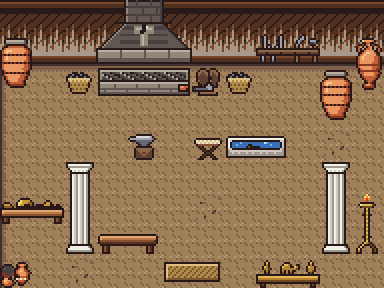

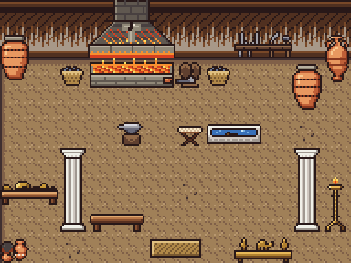

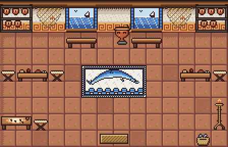

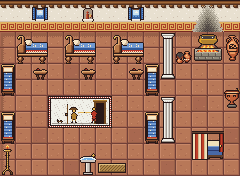

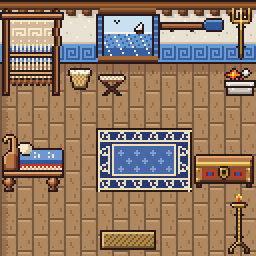

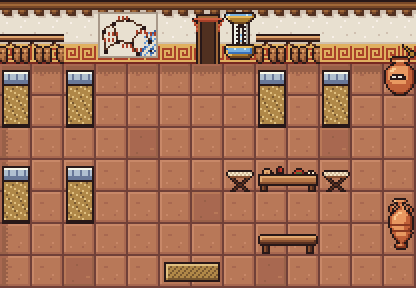

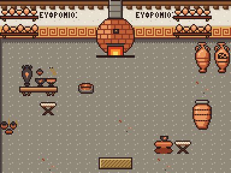

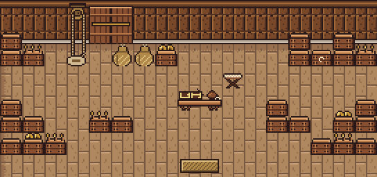

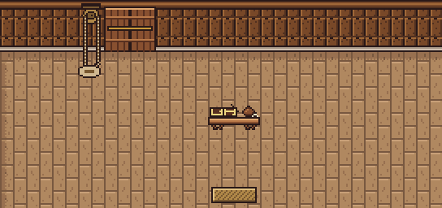

## The sets

Nine rooms' new pieces were far more than any one secondary holds, so they come from three:

- **ergasteria** (`TILES_ergasteria.md`) was planned to grow into Emporion's workshops. The Hephaisteion's forge, hood (cold and lit), bellows, smith's anvil, quenching trough, tongs rack, workbench, charcoal basket, votive shelf, beaten-earth floor and smoke-black wall took its last tiles: **500 of 504**.
- **limen** and **domos** (`TILES_limen.md`) are new, twin sets on oikia's seven palettes, drawn by one art module (`tools/ichor/art/limen_art.py`), so the slice's furniture comes over pixel for pixel. limen has the harbor's rooms (the Deigma, the Dolphin, the widow's room, the hiring hall): **436 of 504** tiles. domos has the town's (Philoxenos's andron, the runners' house, Euphronios's workshop): **374 of 504**.
- **civic** (`design/phase1/TILES_civic.md`) has the Asclepeion, which shares Akti's counter, Pithos, statue and couches as MAP_DESIGN.md asks of public buildings. Its new pieces (the sea window, the bell-pull rope, the votive anchors) are added after all the slice's metatiles, so the slice rooms' ids don't move: **504 of 512** tiles.

## The rooms

**The Asclepeion.** A harbor Asclepeion, long and bright. The healer stands at her counter with a wide sea window behind her, three lights between marble mullions and a trireme out on the water; Asclepius stands by the window, the Panacoil is coiled round the counter's post, and the ship's-rope bell-pull hangs at the counter's end. Sailors' bronze anchors and clay votives hang on the wall to the right, over the ward, where the couches stand behind two columns. The Pithos is in its niche between two jars at the back left, with a brazier by it and benches for those waiting. Akti's is square, its counter set round a spring, its mosaic between braziers; this one is wide, and all its light comes off the sea.

**The Deigma.** The merchants' exchange: a long hall of ashlar, open on the harbor side between columns, the water lapping at the quay's lip. Samples stand on trestles in two rows: the wool merchant's bolts of Tyrian purple, saffron, madder and blue; Lampis's stepped stand of clay lamps (there's a gap where a great many were); oil in transport amphorae; open sacks of grain and a bowl of first fruits; and one bronze helmet with a red crest, of a kind nobody in Emporion wears. Stock stands against the walls, a stuffed tunny hangs over the fish trade's corner, the contracts are in their pigeonholes, and by the door are the scribe's desk and the public notice board, where beat 12 ends.

**The Hephaisteion.** A forge in the temple's courtyard under a smoke-black roof. The great forge fills the back wall: its stone hood and flue black with soot, the empty iron hook in the middle with a clean hammer shape left in the soot behind it, the hearth below it, the goatskin bellows at its right hand and baskets of charcoal at each side. Kedalion sits on his horned anvil in front of it; the quenching trough, the tongs rack and a water jar are a step away. Toward the door the courtyard opens out between two columns: the smith's bench with an ingot and a half-beaten helmet, a bench and a lamp for customers, and the shelf of bronze votives by the mat. Lit, the hearth glows and firelight climbs the hood.

**The Dolphin.** A low, smoky harbor tavern: a heavy beam over yellowed plaster and a red dado, two windows on the quay with long benches under them, wine amphorae racked in both back corners, old nets on the wall, the krater between the windows, and the dolphin mosaic, the tavern's sign, in the middle of the floor. Sailors' tables stand either side, and in the corner by the door is the knucklebones table, worn pale in a hollow where the bones land, where Myrtale has sat for thirty-nine years.

**Philoxenos's house.** An andron, the dining room of a man who keeps the old law of hospitality: seven couches round the walls (three along the back, two down each side), a small table at each, and the mosaic of a host stepping out of his door to take a traveler's hand in the middle. The door is off-center, as an andron's is, so the couches fit. Through the columns on the right are the cook's hearth, a krater and the guest bed behind its striped curtain; a washbasin waits by the door, because a guest's feet are washed before anything else.

**The widow's house.** Penelopeia's narrow room up over the rope-maker's yard, on a boarded floor. The upright loom with a half-finished shroud of plain linen fills the back corner, her wool basket beside it; the window on the sea has her stool in front of it; her husband's oar hangs across the wall under the beam, and under Poseidon's trident is a little altar with a dried starfish. Her bed and her chest stand along the walls, with a lamp.

**The runners' house.** The barracks of Kerykos's day-runners. Straw pallets with gray blankets in rows along both walls, sandals hung in pairs by their laces on the pegs over them, every road in Aethos scratched into the plaster with the stades tallied beside each and the coast marked in blue, the back door to the yard with the red finishing ribbon nailed over it, the klepsydra they time each other by, a big water jar with its ladle, and a table of bread for when they come in.

**Euphronios's workshop.** The domed brick kiln at the back, a fire in its mouth and its chimney up through the roof; long shelves of new cups and jars drying either side; his name scrawled in black slip across the plaster; the paint table with a black amphora half figured in red; the slip pots and the clay bin; amphorae waiting for the kiln; and by the door the wheel, caked in clay, with a half-painted cup on it. The floor is trodden clay dust.

**The hiring hall.** A long warehouse among the shipsheds, timber-walled on a stone plinth. Crates of shovels and of bronze helmets stand in stacks along the walls and in the middle of the floor, one with a sickle chalked small on it; sacks wait by the great barred doors to the shipsheds; the rope-and-pulley hoist hangs by them. The crew boss stands behind his pay table, ledger and silver, and is talked to across it. After Act I the crates are gone (the `empty` variant) and only the ledger is left, open.

## Events and scripts

| Room | People | Event | Flags |
|---|---|---|---|
| The Asclepeion | the healer (8,2) behind the counter, the Panacoil (6,2), a sunburned sailor (13,4), an old woman (4,3), a young healer (13,7) | Healing (`Ichor_EventScript_AsclepeionHealer`), the Pithos (Akti's menu, naming Emporion) | sets the respawn, `HEAL_LOCATION_EMPORION_CITY` |
| The Deigma | Lampis (8,4), Alethea (7,5) for beat 12, Thaletas (14,5) and his Narkeray in the harbor (16,5), the wool merchant (1,4), the grain trader (7,7) | Beat 12 on first entry after beat 11: the forty lamps, the notice and the hook under the owl. Thaletas's in-game trade, `INGAME_TRADE_ICHOR_SOCRATES`: an Onotis for Narkeray SOCRATES, Lv 15, holding a Shell Bell; the Onotis stands by him afterward | sets `FLAG_ICHOR_DEIGMA_CLUE`, `FLAG_ICHOR_TRADED_NARKERAY`; Alethea hides on `FLAG_TEMP_1`, the Onotis on `FLAG_TEMP_2` |
| The Hephaisteion | Kedalion (4,4) on his anvil, his apprentice (9,5) | Beat 13: with Akti's Charcoal, the forge is relit (fire, a flash, the lit metatiles) and Kedalion gives the Bronze Hammer | sets `FLAG_ICHOR_FORGE_RELIT`, `FLAG_ICHOR_GOT_BRONZE_HAMMER`; `ON_LOAD` keeps the forge lit |
| The Dolphin | Myrtale (1,6), Strepsiades (2,5), Stratyllis (10,3) | Knucklebones: Myrtale's first loss pays TM Fling; Strepsiades's Olive Oil x2 and Stratyllis's Wine for a first win | sets `FLAG_ICHOR_KNUCKLEBONES_EMPORION`, `_STREPSIADES`, `_STRATYLLIS` |
| Philoxenos's house | Philoxenos (5,8), his cook (13,4) | Xenia: he feeds you first (a heal), then a story for each new laurel for Wine, then a bed | sets `FLAG_ICHOR_PHILOXENOS_LAUREL_2`, `_3` |
| The widow's house | Penelopeia (2,3) | Her husband's Sea Incense | sets `FLAG_ICHOR_GOT_WIDOWS_GIFT` |
| The runners' house | Dromokleia (4,3), two runners (6,5), (1,4) | A Quick Claw; after Act I, a letter home | sets `FLAG_ICHOR_GOT_QUICK_CLAW`, `FLAG_ICHOR_WROTE_TO_MOM` |
| Euphronios's workshop | Euphronios (3,4), his apprentice (9,6) | "Show me a Pokémon": a Harpeck (Super Potion x2), a Chelonet (Great Ball x3), a Stachyss (Star Piece) | sets `FLAG_ICHOR_EUPHRONIOS_1` to `_3` |
| The hiring hall | the crew boss (9,3) behind his pay table, a dockhand (6,5) | An optional battle, `TRAINER_ICHOR_GRUNT_EMPORION_CREW_BOSS` (Pebblith 15, Spalunk 16), for his Rocky Helmet and the Titanborn blessing; after Act I, the empty hall and the open ledger | sets `FLAG_ICHOR_HIRING_HALL`; both hide on `FLAG_ICHOR_ACT1_COMPLETE`, and `ON_LOAD` clears the crates |

- **Speakers** are in the name box (`setspeaker`), and narration clears it (`SP_NAME_NONE`). The name box holds 64 pixels in the small font, so SCRIPT.md's GRAIN MERCHANT (66) is the GRAIN TRADER.
- **Metatile swaps are generated.** The room builder composes each room's `variants` (the forge `lit`, the hall `empty`), and writes the cells that differ as a `setmetatile` script between the `// <set>_build: begin generated` markers at the end of the map's `scripts.pory`. Rebuild the rooms after any art change and the scripts follow.
- **Stubs**, each tagged in the scripts:
  - `ICHOR_STUB_RELICS`: the Bronze Hammer is the flag and the receive message until `ITEM_BRONZE_HAMMER` is on main (it is on the engine branch).
  - `ICHOR_STUB_RITES`: Hephaestus Favor +5 for the forge.
  - `ICHOR_STUB_OFFERINGS`: Olive Oil and Wine are Berry Juice (BUILD.md's rule for Wine); Kedalion's votive stall waits for `ITEM_BRONZE_VOTIVE`.
  - `ICHOR_STUB_KNUCKLEBONES`: SYSTEMS.md §9's game isn't built. A match is one throw of four bones each, higher total winning, a tie thrown again; the champion keeps the better of two throws. The prizes are paid as SCRIPT.md gives them.
  - `ICHOR_STUB_TM_FLING`: Fling isn't one of the vanilla fifty TMs; Myrtale's prize is the flag and the receive message until Balance numbers it.
  - `ICHOR_STUB_XENIA`: Philoxenos's rest menu (DAWN / NOON / DUSK / NIGHT) waits on SYSTEMS.md §10's clock; his bed is a fade and a heal. The Split Coin (a stretch feature) waits on `ITEM_HALF_COIN` and a flag.
  - `ICHOR_STUB_STORY_FLAGS` (`include/constants/ichor_flag_stubs.h`): `FLAG_ICHOR_ARRIVED_EMPORION` (the city agent's) reads `FLAG_ICHOR_CROSSING_DONE`, and `FLAG_ICHOR_ACT1_COMPLETE` (beat 25) reads `FLAG_BADGE04_GET`. Each steps aside once its owner claims the real flag.
  - `ICHOR_STUB_AETHOS_DEX`: Stachyss and Panacoil join the species stand-ins (Sunkern, Arbok).
- **Placeholders, fixed at merge:** the warps' `dest_warp_id`, and `HEAL_LOCATION_EMPORION_CITY`'s city tile (10,10).
- **Kedalion** has his own walker, `OBJ_EVENT_GFX_ICHOR_KEDALION` (`design/phase2/SPRITES.md`). The other people use the slice's townsfolk walkers.
- **The check:** `tools/ichor/tests/emporion_rooms.sh` plays all nine from a Quickstart and screenshots every message box (`build/emporion_rooms/`).

## Render-and-critique passes

Each pass: render, look, write down what's wrong, fix it. Passes 1 and 2 looked at the composed source at 3x, pass 3 at the compiled 2x renders, pass 4 at in-game screenshots from the check.

**The Asclepeion**
1. Built from civic: the sea window, rope and anchors read, but the lower half was a bare checkerboard, and a single column stood alone in the middle of the floor. *Fixed:* a second column, so the two make a colonnade in front of the ward.
2. Compared against Akti's on purpose: Akti's is square, built round a spring, with a mosaic between two braziers in the middle. *Kept different:* no spring and no mosaic; the room is wide, the window is its centerpiece, the Pithos sits in a niche at the left instead of the right, and the couches are a ward down one side.
3. The compiled render reads: window, counter, healer and Panacoil on one axis with the door. The benches by the Pithos give the waiting side something to sit on.
4. In game the Panacoil (the Arbok stand-in) coils on the counter's post, and the healer heals across the counter from the tile below it.

**The Deigma**
1. The samples sat on 2x1 trestles, eight pixels tall: the lamps read as bread rolls, the oil amphorae as sausages, the helmet as a hat. The hall was mostly empty floor. The sea windows elsewhere had a bug (the sea was painted over); here the harbor strip read fine.
2. *Fixed:* every sample table became a 2x2 trestle with goods up to 24 pixels tall: a stepped stand of lamps, three standing amphorae and a flask, wool bolts piled three high with a length of purple over the edge, grain in open sacks, and the helmet on a stand with a red crest. Sacks and an amphora went by the harbor side.
3. The compiled render reads as an exchange hall: two rows of tables, stock on the walls, the open colonnade on the water. The grain table moved a column right so the scribe's desk can be read from in front of it.
4. In game beat 12 stages cleanly: Alethea at the lamps, the player beside her, Lampis behind his stand; she walks round the tables to the notice board by the door, the player behind her, and leaves through the door. The Narkeray idles in the harbor until the trade, and the Onotis stands by Thaletas after it.

**The Hephaisteion**
1. The smoke-black wall read as gravel, too light and too busy; the forge hood was small and gray, more kitchen than forge, and the hook didn't show; a patch of limestone "courtyard" in front looked like a stray rug. *Fixed:* the wall redrawn as soot hanging from the beam in a ragged fringe over stone-gray plaster; the hood made broad and dark, its flue wider, soot thick up its middle, the hook and its clean hammer shape drawn bigger; the limestone patch dropped.
2. The lit variant reads at once: coals glowing on the bed, flames licking up, firelight on the lintel and up the hood's throat. The lower half was still bare. *Fixed:* the smith's bench (an ingot and a half-beaten helmet), two columns framing the courtyard half.
3. The compiled render: still a big empty courtyard. *Fixed* with pieces already in the set (ergasteria had four tiles left): a second charcoal basket, a water jar by the trough, a stool by the anvil, a bench and a lamp for customers, pots by the bench.
4. In game Kedalion sits on his anvil glaring at the cold hearth; the forge catches in a flash of white with the flame sound, and stays lit on re-entry.

**The Dolphin**
1. The sea windows showed only sky, because the opening was redrawn over the sea; the rack timber was a bright yellow; the knucklebones table read as an ordinary table; the room was sparse. *Fixed:* the window drawn frame first, then sky, sea, a gull and a sail; the racks' timber stained dark; the table redrawn heavy and square with a pale worn hollow and four bones in it.
2. *Fixed:* old nets on the wall either side of the windows, a lamp, stools round the sailors' tables; the krater moved between the windows.
3. The compiled render reads as a tavern: the windows on the quay, the benches under them, the racks in the corners, the dolphin in the floor.
4. In game Myrtale sits at the worn table in the corner and the match plays in the message box.

**Philoxenos's house**
1. Seven couches, the mosaic, the hearth and the curtained bed read at once; the mosaic's host, doorway, traveler with his staff and hat, and the dog all show. The lower rows were empty.
2. *Fixed:* a marble washbasin by the door (the first kindness to a guest) and a lamp in the corner. The basin first went at the right of the door and cut the cook's half of the room off from the door; it moved to the left.
3. The compiled render reads as a dining room with a kitchen through the columns.
4. In game Philoxenos stands at the foot of his mosaic and the feast fades to black with the heal jingle.

**The widow's house**
1. The window showed no sea (the same bug as the Dolphin's). The oar, hung low on the dado, read as a bench with a blue cushion. A void corner at the bottom left was a black hole.
2. *Fixed:* the window; the oar redrawn thin, under the beam, its blue blade at one end; the void dropped and the room made a rectangle a row shorter.
3. The compiled render reads: loom with its white shroud, window and stool, oar, trident and the starfish altar along the back; her bed and chest along the walls. *Added* a lamp by the chest.
4. In game Penelopeia stands at her loom; the room fills the screen without the camera moving.

**The runners' house**
1. The sandals on their pegs read as a row of little benches; the road map was too faint to read; the middle of the room was empty.
2. *Fixed:* the sandals redrawn as soles in pairs hanging by their laces; the map redrawn with darker roads, town dots, red tally marks and the coast in blue; a table of bread with stools in the middle, the bench moved below it.
3. The compiled render reads as a barracks: pallets in rows, the kit on the walls, the ribbon over the back door.
4. In game Dromokleia stands under her map.

**Euphronios's workshop**
1. The wheel read as a lamp on a stand; the clay-dust floor's red specks were noisy.
2. *Fixed:* the wheel redrawn as a broad clay-caked disc over its kick-wheel with the half-painted cup on it; the floor quieted to gray dust with a few pale grains. The paint table became a 2x2 trestle with a black amphora half figured in red.
3. The compiled render reads: kiln, shelves and signature along the back, the work in the middle, the wheel by the door. Two amphorae wait for the kiln on the right.
4. In game Euphronios stands at his paint table; his three paintings fade to black and back.

**The hiring hall**
1. The crates read; the timber wall and the shed doors read; the hoist's coil looked like a bowl; the long middle of the hall was empty.
2. *Fixed:* more crates along both ends, sacks by the doors, the pay table as a counter (the crew boss is talked to across it).
3. The compiled render: still a long empty floor. *Fixed:* stacks of crates in the middle, so the hall has aisles. The `empty` variant clears every crate, sack and stool, leaving the boards, the hoist, the doors and the ledger.
4. In game the battle runs from across the counter; after Act I the crew boss and the dockhand are gone and the ledger reads "ELEUSA. FORTY LAMPS. ALL PAID."

## Generated tables

The builders rewrite everything between each pair of markers below.

### From ergasteria

<!-- ergasteria_build: begin generated -->

### The Hephaisteion, Emporion

- Map: `MAP_EMPORION_CITY_HEPHAISTEION`. Layout: `data/layouts/EmporionCity_Hephaisteion/map.bin`, **12x9** blocks, `gTileset_Oikos` + `gTileset_Ergasteria`.
- Floor: earth. Wall: smoke. Render: `design/phase2/img/emporion_hephaisteion.png` (2x).
- Variant `lit`: `EmporionCity_Hephaisteion_EventScript_LightForge` in the map's scripts.pory swaps its cells.

Walk map: `#` blocked, `.` open. Digits and letters mark the spots in the table; a bg event is marked on its furniture tile.

```
    012345678901
  0 ############
  1 ########6###
  2 #.##4#5#..##
  3 ..........#.
  4 ....2.#7#...
  5 ..#......3#.
  6 ###.......##
  7 ..###.....##
  8 #....11.8#..
```

| # | Kind | Tile | Read from | What |
|---|---|---|---|---|
| 1 | warp | (5,8), (6,8) |  | door to Emporion (south-arrow mat) |
| 2 | perch | (4,4) | (4,5) facing north | Kedalion, sitting on his anvil, glaring at the forge |
| 3 | npc | (9,5) | faces west | the apprentice, by the trough |
| 4 | bg | (4,2) | (4,3) facing north | the forge |
| 5 | bg | (6,2) | (6,3) facing north | the bellows |
| 6 | bg | (8,1) | (8,2) facing north | the tongs rack |
| 7 | bg | (7,4) | (7,5) facing north | the quenching trough |
| 8 | bg | (8,8) | (8,7) facing south | the votive shelf, by the door |

<!-- ergasteria_build: end generated -->

### From limen

<!-- limen_build: begin generated -->

### The Deigma, Emporion

- Map: `MAP_EMPORION_CITY_DEIGMA`. Layout: `data/layouts/EmporionCity_Deigma/map.bin`, **18x10** blocks, `gTileset_Oikos` + `gTileset_Limen`.
- Floor: flags, sea. Wall: stone. Render: `design/phase2/img/emporion_deigma.png` (2x).

Walk map: `#` blocked, `.` open. Digits and letters mark the spots in the table; a bg event is marked on its furniture tile.

```
    012345678901234567
  0 ##################
  1 ########c#########
  2 ###........#.#.###
  3 ..##..##..##...###
  4 .8#f..e#2.g#...###
  5 ......43......7.##
  6 .....##..##.#..###
  7 #....h#9.d#.######
  8 a56.b##.......####
  9 ..11............##
```

| # | Kind | Tile | Read from | What |
|---|---|---|---|---|
| 1 | warp | (2,9), (3,9) |  | door to Emporion (south-arrow mat) |
| 2 | npc | (8,4) | faces west | Lampis, the lamp-seller, beside his lamps |
| 3 | npc | (7,5) | faces north | Alethea, at Lampis's table (beat 12 only) |
| 4 | coord | (6,5) |  | the player's place in beat 12, beside Alethea |
| 5 | coord | (1,8) |  | Alethea at the notice board (beat 12) |
| 6 | coord | (2,8) |  | the player behind her at the notice board (beat 12) |
| 7 | npc | (14,5) | faces west | Thaletas, the trader, by the water with his Narkeray |
| 8 | npc | (1,4) | faces east | the wool merchant, at her bolts |
| 9 | npc | (7,7) | faces west | the grain merchant, by his sacks |
| a | bg | (0,8) | (1,8) facing west | the public notice, sealed with the Archon's owl |
| b | bg | (4,8) | (4,7) facing south | the scribe's desk |
| c | bg | (8,1) | (8,2) facing north | the stuffed tunny |
| d | bg | (9,7) | (9,8) facing north | the bronze helmet |
| e | bg | (6,4) | (6,5) facing north | Lampis's lamps |
| f | bg | (3,4) | (3,5) facing north | the wool |
| g | bg | (10,4) | (10,5) facing north | the oil |
| h | bg | (5,7) | (4,7) facing east | the grain |

### The Dolphin, a tavern, Emporion

- Map: `MAP_EMPORION_CITY_TAVERN`. Layout: `data/layouts/EmporionCity_Tavern/map.bin`, **14x9** blocks, `gTileset_Oikos` + `gTileset_Limen`.
- Floor: terracotta. Wall: tavern. Render: `design/phase2/img/emporion_tavern.png` (2x).

Walk map: `#` blocked, `.` open. Digits and letters mark the spots in the table; a bg event is marked on its furniture tile.

```
    01234567890123
  0 ##############
  1 7#########9###
  2 ....##.8##....
  3 ..........4...
  4 ####.......###
  5 ..3...6.......
  6 .2...........#
  7 5##..........#
  8 ......11....#.
```

| # | Kind | Tile | Read from | What |
|---|---|---|---|---|
| 1 | warp | (6,8), (7,8) |  | door to Emporion (south-arrow mat) |
| 2 | npc | (1,6) | faces south | Myrtale, the champion, at the knucklebones table |
| 3 | npc | (2,5) | faces north | Strepsiades, at the corner table |
| 4 | npc | (10,3) | faces south | Stratyllis, on the bench by the window |
| 5 | bg | (0,7) | (0,6) facing south | the knucklebones table |
| 6 | bg | (6,5) | (6,6) facing north | the dolphin mosaic, read from below |
| 7 | bg | (0,1) | (0,2) facing north | the amphora rack |
| 8 | bg | (7,2) | (7,3) facing north | the krater |
| 9 | bg | (10,1) | (10,2) facing north | the nets |

### The widow's house, Emporion

- Map: `MAP_EMPORION_CITY_WIDOWS_HOUSE`. Layout: `data/layouts/EmporionCity_WidowsHouse/map.bin`, **8x8** blocks, `gTileset_Oikos` + `gTileset_Limen`.
- Floor: boards. Wall: blue. Render: `design/phase2/img/emporion_widow.png` (2x).

Walk map: `#` blocked, `.` open. Digits and letters mark the spots in the table; a bg event is marked on its furniture tile.

```
    01234567
  0 ########
  1 ####4#5#
  2 #3##...6
  3 ..2.....
  4 ##....##
  5 ##....##
  6 .......#
  7 ...11..#
```

| # | Kind | Tile | Read from | What |
|---|---|---|---|---|
| 1 | warp | (3,7), (4,7) |  | the stair door down to the yard (south-arrow mat) |
| 2 | npc | (2,3) | faces north | Penelopeia, at her loom |
| 3 | bg | (1,2) | (1,3) facing north | the loom and its shroud |
| 4 | bg | (4,1) | (4,2) facing north | the window on the sea |
| 5 | bg | (6,1) | (6,2) facing north | her husband's oar |
| 6 | bg | (7,2) | (7,3) facing north | the shrine of Poseidon |

### The hiring hall, Emporion's harbor

- Map: `MAP_EMPORION_CITY_HIRING_HALL`. Layout: `data/layouts/EmporionCity_HiringHall/map.bin`, **17x8** blocks, `gTileset_Oikos` + `gTileset_Limen`.
- Floor: boards. Wall: timber. Render: `design/phase2/img/emporion_hiring_hall.png` (2x).
- Variant `empty`: `EmporionCity_HiringHall_EventScript_EmptyHall` in the map's scripts.pory swaps its cells.

Walk map: `#` blocked, `.` open. Digits and letters mark the spots in the table; a bg event is marked on its furniture tile.

```
    01234567890123456
  0 #################
  1 #################
  2 #6.7.###.....#5##
  3 .........2#......
  4 #.......4#..#...#
  5 ##..##3.....##.##
  6 ###...........###
  7 ........11.......
```

| # | Kind | Tile | Read from | What |
|---|---|---|---|---|
| 1 | warp | (8,7), (9,7) |  | door to the harbor (south-arrow mat) |
| 2 | npc | (9,3) | faces south | the crew boss, behind his pay table (talked to across it) |
| 3 | npc | (6,5) | faces east | a dockhand, waiting to sign on |
| 4 | bg | (8,4) | (8,5) facing north | the ledger (after Act I) |
| 5 | bg | (14,2) | (14,3) facing north | the crate with the sickle chalked on it |
| 6 | bg | (1,2) | (1,3) facing north | the crates of shovels |
| 7 | bg | (3,2) | (3,3) facing north | the hoist |

<!-- limen_build: end generated -->

### From domos

<!-- domos_build: begin generated -->

### Philoxenos's house, Emporion

- Map: `MAP_EMPORION_CITY_PHILOXENOS_HOUSE`. Layout: `data/layouts/EmporionCity_PhiloxenosHouse/map.bin`, **15x11** blocks, `gTileset_Oikos` + `gTileset_Domos`.
- Floor: terracotta. Wall: red. Render: `design/phase2/img/emporion_philoxenos.png` (2x).

Walk map: `#` blocked, `.` open. Digits and letters mark the spots in the table; a bg event is marked on its furniture tile.

```
    012345678901234
  0 ###############
  1 ###############
  2 .##.##.##.#.###
  3 .##.##.##.##5##
  4 #.#..#..###..3.
  5 #........#....#
  6 ..........#...#
  7 #...4....##....
  8 #....2...##.##.
  9 #....7......6#.
 10 #....#11.......
```

| # | Kind | Tile | Read from | What |
|---|---|---|---|---|
| 1 | warp | (6,10), (7,10) |  | door to Emporion (south-arrow mat) |
| 2 | npc | (5,8) | faces south | Philoxenos, at the head of his table |
| 3 | npc | (13,4) | faces west | his cook, at the hearth |
| 4 | bg | (4,7) | (4,8) facing north | the host-greeting mosaic |
| 5 | bg | (12,3) | (12,4) facing north | the hearth |
| 6 | bg | (12,9) | (11,9) facing east | the guest bed behind its curtain |
| 7 | bg | (5,9) | (5,8) facing south | the washbasin by the door |

### The runners' house, Emporion

- Map: `MAP_EMPORION_CITY_RUNNERS_HOUSE`. Layout: `data/layouts/EmporionCity_RunnersHouse/map.bin`, **13x9** blocks, `gTileset_Oikos` + `gTileset_Domos`.
- Floor: terracotta. Wall: red. Render: `design/phase2/img/emporion_runners.png` (2x).

Walk map: `#` blocked, `.` open. Digits and letters mark the spots in the table; a bg event is marked on its furniture tile.

```
    0123456789012
  0 #############
  1 ###5##68#####
  2 #.#.....#.#.7
  3 #.#.2...#.#..
  4 .4...........
  5 #.#...3####..
  6 #.#.........#
  7 ........##..#
  8 .....11......
```

| # | Kind | Tile | Read from | What |
|---|---|---|---|---|
| 1 | warp | (5,8), (6,8) |  | door to Emporion (south-arrow mat) |
| 2 | npc | (4,3) | faces south | Dromokleia, the chief runner, under her map |
| 3 | npc | (6,5) | faces east | a runner, stretching |
| 4 | npc | (1,4) | faces south | a runner, on his pallet |
| 5 | bg | (3,1) | (3,2) facing north | the road map scratched on the wall |
| 6 | bg | (6,1) | (6,2) facing north | the finishing ribbon over the back door |
| 7 | bg | (12,2) | (12,3) facing north | the water jar |
| 8 | bg | (7,1) | (7,2) facing north | the klepsydra |

### Euphronios's workshop, Emporion

- Map: `MAP_EMPORION_CITY_POTTERS_WORKSHOP`. Layout: `data/layouts/EmporionCity_PottersWorkshop/map.bin`, **12x9** blocks, `gTileset_Oikos` + `gTileset_Domos`.
- Floor: claydust. Wall: red. Render: `design/phase2/img/emporion_potter.png` (2x).

Walk map: `#` blocked, `.` open. Digits and letters mark the spots in the table; a bg event is marked on its furniture tile.

```
    012345678901
  0 ############
  1 7##6########
  2 .....#4...##
  3 .##.......##
  4 .##2#.......
  5 ..#.......#.
  6 #........3#.
  7 ........5#..
  8 .....11.....
```

| # | Kind | Tile | Read from | What |
|---|---|---|---|---|
| 1 | warp | (5,8), (6,8) |  | door to Emporion (south-arrow mat) |
| 2 | npc | (3,4) | faces west | Euphronios, at his paint table |
| 3 | npc | (9,6) | faces south | the apprentice, at the wheel |
| 4 | bg | (6,2) | (6,3) facing north | the kiln |
| 5 | bg | (8,7) | (7,7) facing east | the half-painted cup on the wheel |
| 6 | bg | (3,1) | (3,2) facing north | EUPHRONIOS PAINTED ME, on the wall |
| 7 | bg | (0,1) | (0,2) facing north | the drying shelves |

<!-- domos_build: end generated -->
