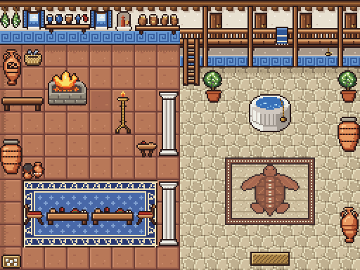
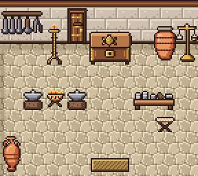
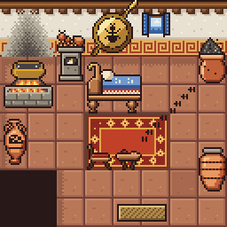

# Aegina's three homes, built from ergasteria

Three interiors for Aegina Town, laid out from `gTileset_Ergasteria` (see `TILES_ergasteria.md`) in `tools/ichor/maps/aegina_homes.py`. Who lives in each and what happens there is in `design/phase2/SCRIPT.md` (beat 10B, and Part 2, "Aegina Town").

| Room | Map | Size | Floor and wall | Exit (warp 0) | Render |
|---|---|---|---|---|---|
| The inn | `MAP_AEGINA_TOWN_INN` | 16x12 | terracotta and a flagged courtyard; Aegean dado and the gallery | the mat at (11,11) and (12,11) | `img/aegina_inn.png` |
| The mint | `MAP_AEGINA_TOWN_MINT` | 9x8 | limestone flags; ashlar | the mat at (4,7) and (5,7) | `img/aegina_mint.png` |
| Aiakides's house | `MAP_AEGINA_TOWN_AIAKIDES_HOUSE` | 8x8, an L | terracotta; red ochre dado | the mat at (4,7) and (5,7) | `img/aegina_aiakides.png` |







## The rooms

**The inn.** Endeis has seen every sailor in the gulf at least twice. The street door opens into a little flagged courtyard: the rain cistern in the middle, the turtle mosaic between it and the door, and over the north side the timber gallery of guest rooms, its ladder at the west end. Through the posts to the west is the common room, terracotta, round its open hearth. Endeis serves from her stores along the west wall and the round bread table, and the sailors eat at the long table on the rug. On the voyage night Kleon sits with his back to the wall behind the fire, Alethea beside it with her scroll, and the player across from Kleon; then Kleon walks off and climbs the ladder to the loft.

**The mint.** Pheidon strikes the island's turtle coins in a deep stone strongroom with no window. The dies hang on their rack; the vault's bronze-bound door, with its coin slot, is in the back wall beside the turtle strongbox, with a pithos and the balance in the corner. Pheidon works at his two anvils with the blank-heating brazier between them, and his Chelonet sits on the right-hand anvil, on the stamps. The counting table and its stool are by the door. After the trade, the Karkipool stands guard by the strongbox.

**Aiakides's house.** An old soldier, whose family were ants before they were people. A small L of a house, its street corner cut away by the neighbor's yard. His narrow bed is under the shield and spear; the shrine with its clay ant stands between the bed and the kitchen hearth; his chair is at the round table, where the crumbs fall. In the back corner is the big pot with the anthill he feeds, and a line of its ants marches across the floor and the rug for the table.

## Events and scripts

| Room | People | Event | Flags |
|---|---|---|---|
| The inn | Endeis (5,6); Kleon (3,2) and Alethea (4,4) on the voyage night only | The night by the fire (beat 10B): Endeis's "Ready for bed?", the talk, Kleon's question (SHE SAID NOTHING / IT'S MY OWN BUSINESS), Kleon to the loft, Alethea's goodnight, then the heal and the warp to the deck for beat 10C. Later visits: Endeis heals. | reads `FLAG_ICHOR_ARRIVED_AEGINA`; sets `FLAG_ICHOR_AEGINA_NIGHT` (Kleon's and Alethea's objects hide on it) |
| The mint | Pheidon (2,5); his Chelonet on the anvil (3,4); the Karkipool guard (6,2) after the trade | In-game trade `INGAME_TRADE_ICHOR_STATER`: a Karkipool for Chelonet STATER, holding an Oran Berry | sets `FLAG_ICHOR_TRADED_CHELONET` (the Chelonet's object hides on it); the guard hides on `FLAG_TEMP_1`, which `ON_TRANSITION` sets until the trade |
| Aiakides's house | Aiakides (2,5) | His story; with an Ergant in the party (`checkspecies`, the whole party), the Black Belt | sets `FLAG_ICHOR_GOT_BLACK_BELT` |

- **Speakers** are in the name box (`setspeaker`), as in the slice. Player-facing text says Aigina (the revised AETHOS_MAP.md spelling); internal ids keep Aegina.
- **The night's tint.** The inn's `ON_TRANSITION` re-applies hour 22 while the voyage night lasts (BUILD.md), for the step back outside; indoor maps take no tint themselves. The scene clears it (`setvar(VAR_0x8004, 0)`, `special(Ichor_SetHoursOverride)`) before the warp.
- **The night's music** is `MUS_ICHOR_ASCLEPEION`, a stub for `MUS_ICHOR_HEARTH_NIGHT` (`ICHOR_STUB_MUSIC`).
- **The player's seat.** The scene walks the player to (2,5) in the dark from whichever side they spoke to Endeis (south or west; furniture closes the others), so the camera follows. (Moving the player with `setobjectxy` leaves the camera behind.)
- **Placeholders, fixed at merge:** each mat warps to `MAP_AEGINA_TOWN` with a placeholder warp id (the inn 0, the mint 1, the house 2) until the Aegina agent's door ids are known; the night warps to `MAP_TRIREME_EUPLOIA_DECK` at a placeholder (12,8) until the trireme agent records the deck's arrival tile.
- **The check:** `tools/ichor/tests/aegina_homes.sh` plays all three from a Quickstart (`build/aegina_homes/`).

## Render-and-critique passes

Each pass: render, look, write down what's wrong, fix it. Passes 1 and 2 looked at the composed source (3x), pass 3 at the compiled tileset's 2x renders, pass 4 at in-game screenshots from the check.

**The inn**
1. The myrtles stood on the gallery's ground-floor row (the build also caught their palette clash with the gallery timber). The guest-room doors were mostly hidden behind the balustrade. The courtyard's east side was empty. In the common room the bench and the knucklebones floated, and the fish basket and lampstand boxed in the tile beside the ladder's foot. *Fixed:* the myrtles moved onto the courtyard floor; the rail dropped two pixels so the doors read; a pithos and an amphora went on the east side; the bench went beside the hearth and the lampstand beside Alethea's place. The mosaic had been 3x3 and could not sit on the cistern's and the door's axis; it became 4x3.
2. The lower common room was still loose and the sailors' table too short for an inn. *Fixed:* two tables end to end on a six-block blue rug, chairs at the ends, the knucklebones in the corner.
3. The compiled render reads: gallery, ladder, cistern, mosaic and door share one axis; the colonnade separates the two halves. But the set was at 437 tiles, too near its ceiling to leave batch 2 room. *Fixed:* four pieces no room used (oikia's chest, altar and mortar, and a gallery post bay) left the set, and the mosaic's bead border and pebble field were made exactly symmetric and 8-pixel periodic: 399 tiles.
4. In game, the night scene moved the player with `setobjectxy`, which left the camera where it was: Kleon was clipped at the top edge. *Fixed:* the player walks to the seat in the dark. Now Kleon is against the wall behind the fire, Alethea beside it facing it, the player across, Endeis at her table; Kleon walks east along the wall and climbs the ladder into the gallery.

**The mint**
1. Too sparse and too pale; the anvils read as tree stumps; at 12 wide the room was bigger than its contents; nothing said money changed hands. *Fixed:* narrowed to 9x8, deep rather than wide, as a strongroom; the anvil redrawn as a waisted iron block on a wider stump; a counting table with silver stacks and a purse added by the door; the balance moved to the back corner by the pithos.
2. It reads as a stone strongroom. The limestone floor and the ashlar are close in value; a terracotta floor was weighed and rejected (a strongroom is stone), and the shadow row under the wall keeps them apart.
3. The compiled render reads; the vault door with its slot and the turtle strongbox sit together in the back wall, the work area in the middle, the counting by the door.
4. In game, the Chelonet on the right-hand anvil reads as sitting on the stamps, and after the trade the anvil is bare and the Karkipool guards the strongbox.

**Aiakides's house**
1. The clay ant on the shrine did not read as an ant; the ant trail looked like a crack in the floor; the room was a plain rectangle; the bed was nowhere near the shield. *Fixed:* the ant redrawn in profile (antennae, head, thorax, a big abdomen, legs) on a pillar with a lamp in its niche; the trail redrawn as four distinct ants; the room made an L, its street corner cut away; the bed moved directly under the shield and spear; the anthill pot moved into the back corner, its ants marching for the table.
2. The bottom-right corner was empty floor. *Fixed:* a pithos.
3. The compiled render reads: the trail crossing the rug reads as ants marching on the crumbs.
4. Wiring the events, the shield's readable spot turned out unreachable: the bed is under it. *Fixed:* the bed carries the text (the bed, and the shield and spear over it), read from the rug or from beside it. In game, Aiakides stands by his chair, and his story, the Black Belt and his after lines play from the tile below him.

## Generated tables

The builder rewrites everything below this line.

<!-- ergasteria_build: begin generated -->

### The inn, Aegina

- Map: `MAP_AEGINA_TOWN_INN`. Layout: `data/layouts/AeginaTown_Inn/map.bin`, **16x12** blocks, `gTileset_Oikos` + `gTileset_Ergasteria`.
- Floor: terracotta, flags. Wall: blue, gallery. Render: `design/phase2/img/aegina_inn.png` (2x).

Walk map: `#` blocked, `.` open. Digits and letters mark the spots in the table; a bg event is marked on its furniture tile.

```
    0123456789012345
  0 ################
  1 ################
  2 ##.3....########
  3 #.##...6a#.....#
  4 ##7#4#.#.#.##..#
  5 ..5..#.#...8#..#
  6 #....2##.......#
  7 ##..............
  8 .......#........
  9 .#######...9...#
 10 .......#.......#
 11 #..........11...
```

| # | Kind | Tile | Read from | What |
|---|---|---|---|---|
| 1 | warp | (11,11), (12,11) |  | door to Aegina Town (south-arrow mat) |
| 2 | npc | (5,6) | faces south | Endeis, the innkeeper, by her stores and the bread table |
| 3 | npc | (3,2) | faces south | Kleon, the voyage night: back to the wall, eating bread |
| 4 | npc | (4,4) | faces west | Alethea, the voyage night: her scroll open by the fire |
| 5 | coord | (2,5) |  | the player's seat by the fire (the night scene puts them here) |
| 6 | coord | (7,3) |  | beside the ladder's foot, where Kleon climbs to the loft |
| 7 | bg | (2,4) | (2,5) facing north | the hearth |
| 8 | bg | (11,5) | (11,6) facing north | the cistern |
| 9 | bg | (11,9) | (11,10) facing north | the turtle mosaic, read from below it |
| a | bg | (8,3) | (7,3) facing east | the ladder to the guest gallery |

### The mint, Aegina

- Map: `MAP_AEGINA_TOWN_MINT`. Layout: `data/layouts/AeginaTown_Mint/map.bin`, **9x8** blocks, `gTileset_Oikos` + `gTileset_Ergasteria`.
- Floor: flags. Wall: stone. Render: `design/phase2/img/aegina_mint.png` (2x).

Walk map: `#` blocked, `.` open. Digits and letters mark the spots in the table; a bg event is marked on its furniture tile.

```
    012345678
  0 #########
  1 #6#4#####
  2 ..#.5#.#7
  3 .........
  4 .##3..8#.
  5 ..2....#.
  6 #........
  7 #...11...
```

| # | Kind | Tile | Read from | What |
|---|---|---|---|---|
| 1 | warp | (4,7), (5,7) |  | door to Aegina Town (south-arrow mat) |
| 2 | npc | (2,5) | faces north | Pheidon, the moneyer, at his anvils |
| 3 | perch | (3,4) | (3,5) facing north | Pheidon's Chelonet, sitting on the stamps (the anvil) |
| 4 | bg | (3,1) | (3,2) facing north | the vault door and its coin slot |
| 5 | bg | (4,2) | (4,3) facing north | the strongbox |
| 6 | bg | (1,1) | (1,2) facing north | the die rack |
| 7 | bg | (8,2) | (8,3) facing north | the balance |
| 8 | bg | (6,4) | (6,5) facing north | the counting table |

### Aiakides's house, Aegina

- Map: `MAP_AEGINA_TOWN_AIAKIDES_HOUSE`. Layout: `data/layouts/AeginaTown_AiakidesHouse/map.bin`, **8x8** blocks, `gTileset_Oikos` + `gTileset_Ergasteria`.
- Floor: terracotta. Wall: red. Render: `design/phase2/img/aegina_aiakides.png` (2x).

Walk map: `#` blocked, `.` open. Digits and letters mark the spots in the table; a bg event is marked on its furniture tile.

```
    01234567
  0 ########
  1 ########
  2 ##3#4..5
  3 ##.##...
  4 #.......
  5 #.2##..#
  6 ##.....#
  7 ##..11..
```

| # | Kind | Tile | Read from | What |
|---|---|---|---|---|
| 1 | warp | (4,7), (5,7) |  | door to Aegina Town (south-arrow mat) |
| 2 | npc | (2,5) | faces east | Aiakides, by his chair |
| 3 | bg | (2,2) | (2,3) facing north | the clay-ant shrine |
| 4 | bg | (4,2) | (5,2) facing west | the bed, under the shield and spear |
| 5 | bg | (7,2) | (7,3) facing north | the anthill in its pot |

<!-- ergasteria_build: end generated -->
