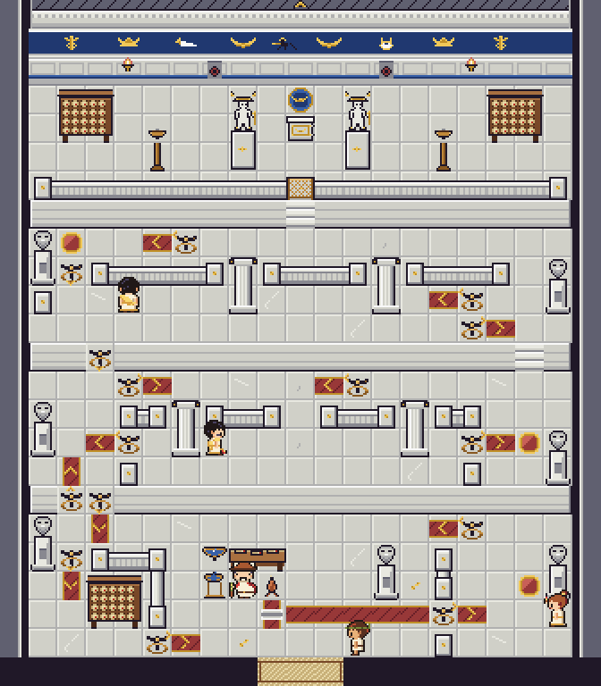
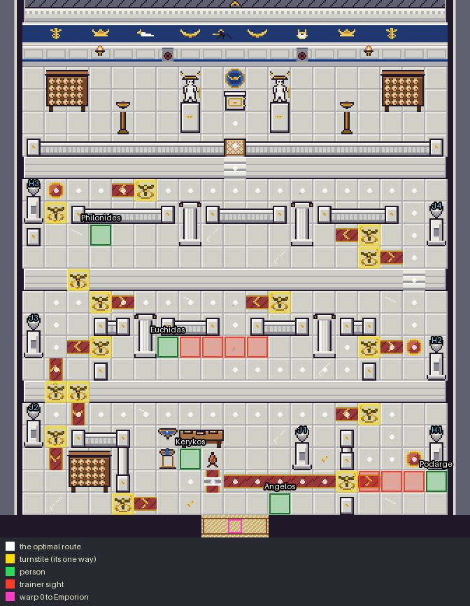
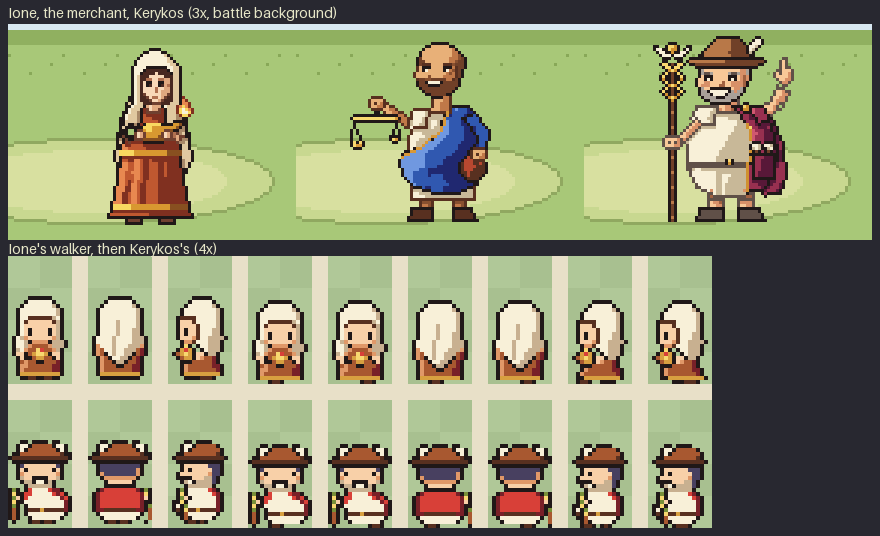
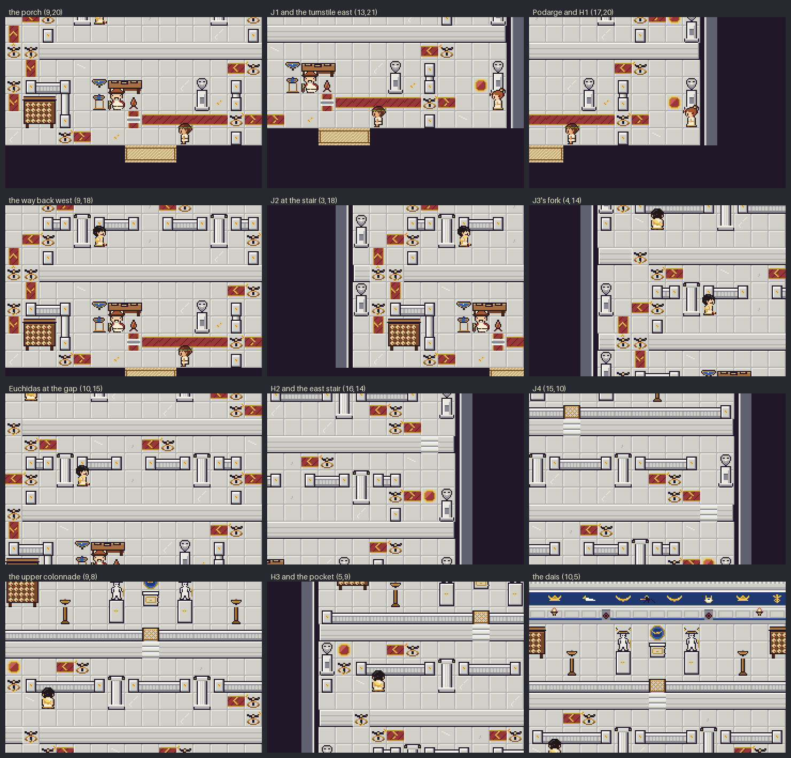
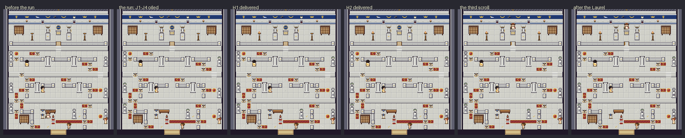

# The Temple of Hermes: the Herald's Run

`MAP_EMPORION_CITY_TEMPLE_OF_HERMES`, Laurel 2. Beat 15 and Part 5 of `design/phase2/SCRIPT.md`, built on `oikos` + `gTileset_TempleHermes` (`design/phase2/TILES_temple_hermes.md`).

| File | What |
|---|---|
| `tools/ichor/maps/temple_hermes.py` | The room (`ROOM`, one character per cell), the solver and checks, `map.bin`, `map.json`, the metatile labels, the generated room scripts and the renders |
| `data/maps/EmporionCity_TempleOfHermes/scripts.pory` | The run, the herms, the people. The block between the two markers is generated: never edit it by hand |
| `tools/ichor/art/sprites_kerykos.py` | Kerykos's portrait and walker |
| `tools/ichor/tests/temple_hermes.sh` | The headless playthrough (`temple_hermes.lua`, `temple_hermes_consts.c`) |

Rebuild after any change to the room: `/usr/bin/python3 tools/ichor/maps/temple_hermes.py` (add `--report` for the legs and loops, `--check` to verify without writing). It needs `build/temple_hermes/catalog.json`, which `/usr/bin/python3 tools/ichor/art/emporion_build.py temple_hermes` writes.

## The room

21 x 24. Entered from the south (warp 0 is the middle of the door mat, (10, 23); its `dest_warp_id` into `MAP_EMPORION_CITY` is a placeholder, `"0"`, until the city's temple door exists). Three terraces of an Ionic stoa fold back on each other, each a step above the last, and Kerykos's dais is at the top behind a bronze gate.

| Rows | Part |
|---|---|
| 0–2 | The cornice, the winged frieze (Hermes running across the middle), the lower wall |
| 3–5 | The dais: Kerykos on the roundel behind his lectern, two statues of Hermes (his great altar), two relay torches, two pigeonhole cabinets |
| 6–7 | The dais's parapet with its gate, over the steps |
| 8–11 | The upper colonnade: a north lane under the dais and two south lanes behind a colonnade |
| 12 | The terrace's face, with the east stair |
| 13–16 | The middle stoa: two lanes behind a colonnade with one gap, the narrow point |
| 17 | The terrace's face, with the turnstile stair (up) and the drop (down) side by side |
| 18–22 | The lower gallery and the porch: Kerykos, the oil jar, the step-glass, his table, Angelos, J1 by the door, the loop room with its scroll cabinet |
| 23 | The door mat |

## The Herald's Run

Kerykos hands over three scrolls by the oil jar and the glass starts: 120 steps (Hero). The three herald-herms take them in order, doorway (H1), sandal (H2), purse (H3), each standing at a red turning post. The four junction herms (J1–J4) stand at forks with their heads straight ahead until oiled; then each faces the first step of the shortest way to the next herald-herm, and turns again after every delivery. Oiled herms stay oiled, so a second try is easier.

| Leg | From, to | Optimal | What it does |
|---|---|---|---|
| Lower (teach) | Kerykos to H1 | 11 | A porphyry track runs from a starting sill to the first turnstile, J1 points east along it, and the turnstile west of the door refuses. Through T1, Podarge (mandatory) sees you; H1 is right there |
| Middle (test) | H1 to H2 | 43 | Back west through T1b. J2 at the turnstile stair: up (right) or down into the loop room (16 steps back to J2). J3 at a three-way fork: the north lane (right), the south lane's turnstile (turns the other way) or the drop back to the stair's foot. The north lane ends at a wrong-way turnstile, so the colonnade's one gap is the way, and Euchidas (mandatory) watches its foot |
| Upper (master) | H2 to H3 | 23 | The east stair to J4: the north lane (right) or T6, a loop past the optional Philonides (8 steps). T5 lets you west into H3's pocket and no further back |
| The dais | H3 to Kerykos | 11 | The third scroll opens the gate, turns the upper colonnade's turnstiles round (T5 now lets you back east), and turns every herm in the hall to face the dais |

The optimal run is 77 steps against a glass of 120, so a Hero player can take the loop room and a wrong turnstile or two and still make it. The solver checks this, and that there is no softlock before, during or after the run.

**Turnstiles.** Each is a coord event on its own tile. Walked into the way it turns, it clicks round (`SE_ROTATING_GATE`) and carries the player through to the far side; the wrong way, "The turnstile won't turn that way." and the player steps back. A red porphyry chevron on its far side shows its one way from a screen off; the two that turn round move their chevrons with them. The engine checks trainer sight before coord events, so no trainer's sight may reach a turnstile's tile (the builder enforces it).

**The step-glass.** Every floor tile of the run carries a coord event that fires while `VAR_TEMP_3` is 1. Its script only changes vars until the glass reaches a mark, so the expansion runs it immediately (`RunScriptImmediatelyUntilEffect`) and the player never stops walking; no engine change was needed. 172 counters plus 15 turnstiles make 187 coord events, under the engine's u8 limit of 255. At 60 the glass says it's half run, at 30 that it's running low; the glass by the door tells the exact count. At 0 the music stops dead, the scrolls fly home, Kerykos calls "Late!" from somewhere, and the player is put back at the door. Steps into a trainer's sight and battles don't count.

**State.** `VAR_TEMP_1` scrolls delivered, `VAR_TEMP_2` the glass, `VAR_TEMP_3` the run is on, `VAR_TEMP_4` never set (the turnstiles' coord events test it against 0), `VAR_TEMP_5` flasks of oil (a stub). Flags, bank `0x0F0`–`0x0F7`: `FLAG_ICHOR_HERALDS_RUN_DONE`, `FLAG_ICHOR_HERMES_HERM_J1`–`J4`, `FLAG_ICHOR_GOT_TM_AERIAL_ACE`, `FLAG_ICHOR_HERALDS_RUN_FAILED` (Angelos's hint), `FLAG_ICHOR_HERALDS_RUN_TOLD` (Kerykos's rite is explained once). `ON_LOAD` draws every changing metatile from them.

**After the Laurel** the room stays solved: the gate open, the turnstiles turned, every herm facing the dais, the glass put away, and all three acolytes marked beaten. Kerykos offers "the short way down" to the door, the one shortcut out.

## People

| Who | Where | Notes |
|---|---|---|
| Kerykos | by the oil jar (8, 20); on his dais (10, 3) once the run is done | Explains the rite once, then a short version. On YES he hops the jar and dashes off. On the dais: the battle (`TRAINER_ICHOR_KERYKOS_1`, id 68), the Herald Laurel (`FLAG_BADGE02_GET`), TM40 Aerial Ace, his secret, and the rite lesson with a Honey |
| Angelos | inside the door (12, 22) | Welcome; the hint after a dry glass; "Delivered, and on time!" after the Laurel |
| Podarge | (19, 21), facing west, sight 3 | `TRAINER_ICHOR_PODARGE`, id 65. Mandatory: T1 carries you into her sight |
| Euchidas | (7, 15), facing east, sight 4 | `TRAINER_ICHOR_EUCHIDAS`, id 66. Mandatory: his sight runs across the foot of the colonnade's gap |
| Philonides | (4, 10), facing the colonnade | `TRAINER_ICHOR_PHILONIDES`, id 67. Optional: he faces the balustrade, so he never sees anyone |

Acolytes are IVs 10 and AI Basic Trainer; Kerykos is Hero difficulty, levels 18/19/20 with Super Potion x2. The parties are in `src/data/trainers.party` without `Ability:` lines (the Aethos stand-ins). `TRAINERS_END_ACT1` is 69.

## Stubs

| Tag | Stand-in | Replace with |
|---|---|---|
| `ICHOR_STUB_OFFERINGS` | Flasks of oil are `VAR_TEMP_5`; the jar gives one, up to 3; they're lost on leaving the room | `ITEM_OLIVE_OIL`: `checkitem`/`additem` at the jar, `removeitem` at the herm (`EventScript_OilJar`, `_AskOil`) |
| `ICHOR_STUB_RITES` | Kerykos's rite lesson says two lines and gives Honey, setting the engine's own Hierophant's-offering flag for Hermes (`FLAG_ICHOR_GIFTS_START + 11`). The altar is a sign. No Favor +15 on the Laurel, no gift I | `EventScript_IchorHierophantRite`, `EventScript_IchorTempleAltar_Hermes`, `Ichor_AddFavor`, `EventScript_IchorHierophantGift` with `ICHOR_GOD_HERMES` |
| `ICHOR_STUB_MUSIC` | The run plays `MUS_ICHOR_TEMPLE_HERMES` (restarted at the start); Kerykos's battle plays the Hierophant class's `MUS_ICHOR_BATTLE_RIVAL` | `MUS_ICHOR_HERALDS_RUN`, `MUS_ICHOR_BATTLE_HIEROPHANT` |
| `ICHOR_STUB_INFO_PANEL` | The glass speaks at 60 and 30, and tells its count when checked | The start-menu info panel ("Step-glass: 120", SYSTEMS.md §2) |
| (no tag) | The glass is 120 for every difficulty | 150 Mortal, 100 Spartan, once a difficulty setting exists (comment in `EventScript_StartRun`) |

Sound effects (SCRIPT.md Part 9) are vanilla stand-ins: the turnstile `SE_ROTATING_GATE`, a herm's head turning `SE_M_STRENGTH`, the last grain `SE_BALL_TRAY_BALL`, the bell `SE_M_HEAL_BELL`.

## Kerykos's art

- **Portrait** (`TRAINER_PIC_HIEROPHANT_KERYKOS`, `Pic: Hierophant Kerykos`): a round, cheerful man with a short graying beard and a grin, a dark felt petasos pushed back with a white wing, a porphyry chlamys (the temple's red-purple stone) with a gold border and a deep pocket of sealed scrolls, the kerykeion (a cedar staff, two gold snakes, white wings and a gold knob) in his near hand and his far hand up, one finger raised: "Hear ye!" Its own 15 colors.
- **Walker** (`OBJ_EVENT_GFX_ICHOR_KERYKOS`, `graphics/object_events/pics/people/ichor/kerykos.png`): the wide felt petasos with white wings, a round linen belly under the porphyry chlamys, a graying beard round a grin, the staff at his side. It uses the cast palette (`OBJ_EVENT_PAL_TAG_ICHOR_CAST`), so a map that shows him needs no new palette slot. The city agent can place him on the quay.
- **Not the player's colors.** Theo and Ianthe wear a straw petasos and an Aegean-blue chlamys, so Kerykos keeps clear of both.

## Render-and-critique passes

**Map, pass 1** (the first full layout). Wrong: the turnstiles' gold chevrons can't be read at screen size, so the one-way rule is invisible; the turnstiles stand in open floor beside a single balustrade post and don't read as gates; the loop room was a fenced "C" of balustrade; the porch's east side crowded J1, the step-glass and the fence into one corner; the herald-herms looked exactly like the junction herms; the galleries were long empty marble. Changed: every turnstile got a porphyry chevron on its far side (the reversing ones move theirs); the starting sill and a track from it to T1 in the porch, so the teaching leg reads at a glance; turning-post discs in front of the three herald-herms; the loop room opened into a small archive with a scroll cabinet (the loop is now exactly 16 steps back to J2); the step-glass, Kerykos and the oil jar moved together by his table, west of the door.

**Map, pass 2.** Better: every turnstile's way reads from a screen away, the porch tells you where to go first, and the herald-herms stand out. Still wrong: the upper and middle galleries were long unbroken balustrades over empty floor. Changed: both spines became colonnades, two Ionic columns each with balustrade between them, which also puts Euchidas beside a column at the narrow point.

**Map, pass 3.** The stoa now reads as a stoa: terraces, columns, balustrades, the dais above. In-game the trainer check runs before coord events, so Podarge (then at (18, 21)) caught the player inside T1; she moved to (19, 21), still sight 3, and the builder now fails if any trainer's sight reaches a turnstile. The 15 x 10 views (below) each show a herm, a turnstile or a person to aim at.

**Portrait, pass 1.** Wrong: the kerykeion's gold snakes on a gold staff read as a checkered smear; the near arm didn't meet the fist; the raised hand read as a thumbs-up. **Pass 2:** a cedar staff with gold snakes, white wings and a gold knob; the forearm reaches the fist; one finger up. Still wrong: the staff's wings collided with the hat's near wing. **Pass 3:** the staff moved clear of his belly and the hat's near wing went (it's hidden behind the crown in this view).

**Walker, pass 1.** Wrong: a narrow body that didn't read as round. **Pass 2:** a wider belly with the chlamys at its sides and the staff alongside. Still wrong: the face had no grin and no beard. **Pass 3:** a graying beard round an open grin, in front and in profile.

**Both, pass 4 (in game).** Standing by the player in the porch, he read as a third player: the same straw-colored petasos and Aegean-blue chlamys as Theo and Ianthe. Changed in the walker and the portrait together: a dark felt petasos with white wings and a porphyry chlamys.

## The check

`tools/ichor/tests/temple_hermes.sh` quickstarts, gives a level-100 Prinplup with Surf, warps in and plays it all with key presses, about 100 checks and 36 screenshots in `build/temple_hermes/`: Angelos, the glass, the oil jar, Kerykos's rite, the turnstile that refuses (two steps off the glass), oiling J1 (it points east), the glass's mark at 30 and running dry (the music stops; back at the door with the scrolls home, J1 still oiled), Angelos's hint, then the full run with exact glass counts on the first leg: Podarge, H1 (the torch lights, J1 turns west), T1b, J2, the turnstile stair, J3, T3, the gap and Euchidas, T4, H2, the east stair, J4, T5, H3 (the gate opens, T5 turns round, every herm faces the dais, Kerykos is on his dais). Then back through the turned T5, in through the turned T6b to Philonides and out through T6, Kerykos's battle (with its music), the Herald Laurel, TM40, the Honey, the acolytes marked beaten, the glass put away, his short way down, and a re-entry with the room still solved. Two shortcuts, both logged: the glass is set to 32 and then 2 to reach its marks.
