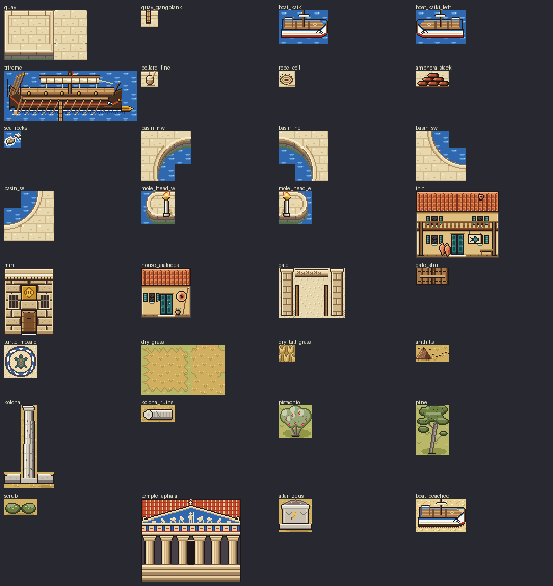

# Aegina tileset catalog

The `aegina` secondary tileset (`gTileset_Aegina`) is the island of Aigina: Aegina Town
and the three detour maps (the Aphaia Road, the Temple of Aphaia, Mount Oros). Pair it
with the `aethos` primary, which supplies the open ground: grass, paths, sand, the sea,
olives, cypresses and the umbrella pine. All four Aegina outdoor maps share this
secondary, so their seams with each other need no aethos-only strip
(MAP_DESIGN.md §5).

Aigina is not Akti. Akti is whitewash, olives, a plaza and a straight quay. Aigina is a
**round harbor** with two moles and a beacon on each head, **Kolona's** lone grey column on
its headland, honey-ochre houses under pitched tile roofs with sea-green doors, a bare
ashlar mint with a bronze turtle stater over its door, a **turtle mosaic**, **ant hills** in
tawny dry grass, pistachio orchards and Aleppo pines.

**Built by** `tools/ichor/art/aegina_build.py` (run it with `/usr/bin/python3`): it draws,
compiles with Porytiles, verifies and rewrites the catalog section of this file. The art
is in `aegina_harbor.py` (Akti's copies, the round basin, the mole heads), `aegina_town.py`
(the inn, the mint, Aiakides's house, the gate, the mosaic), `aegina_ground.py` (dry grass,
golden tall grass, ant hills) and `aegina_land.py` (Kolona, trees, scrub, Aphaia's temple,
Zeus's altar); the palette plan and the borrowed ground are in `aegina_lib.py`.



## How to use it

**Ids.** Each grid below lists metatile ids as Porymap shows them. They run from 0x200 in
the order of `aegina_art.build()`; new structures go at its end (`aegina_harbor.later()`)
so existing ids stay put. Map builders place structures by key from
`build/aegina/catalog.json` (make it with `aegina_build.py --no-compile`), never by raw id.
The one exception is Aegina Town's `setmetatile` for the shut gate, which
`tools/ichor/maps/aegina.py` checks against the catalog.

**Walk codes.** `X` solid (collision 1), `.` walkable, `D` door (`MB_NON_ANIMATED_DOOR`, put
the warp there), `T` walkable and drawn over the player (walk behind it), `-` not part of the
structure: leave the ground that is there (the round basin's open-water cell, the cells
beside Kolona's shaft).

**Borrowed ground.** Cells marked *grass*, *sand*, *sea* or *path* draw no ground of their
own: after Porytiles compiles, the build points their bottom layer at aethos's grass
(0x001), sand (0x124), animated sea (0x170) or limestone path (0x1D9). Boats, rocks and
the basin's curved quay sit on moving water; trees, the gate and the mosaic meet the
meadow and the road with no seam, at no tile cost. **Rebuild Aegina whenever aethos is
repainted.** A borrowed cell keeps one layer of its own above the ground.

**Seams with other tilesets.** From a map on another secondary, Aegina's pieces draw as
garbage, so keep them out of the six rows (eight columns) nearest such a seam. The four
Aegina maps are exempt with each other.

**Palettes.** Every 8x8 tile draws from one of seven groups, one per secondary palette
(`aegina_lib.GROUPS`). Stone, wood and marble are Akti's own, so the copied quay, boats and
trireme fit unchanged.

| Group | Use |
|---|---|
| Stone | Limestone: the quay and the moles, the basin's curved walls, crags, the mint's ashlar, the gate's piers |
| Wood | Timber, rope, pitch and bronze: the trireme, the kaikia, the gate's leaves, the mint's door and its turtle plaque, the beacons' fire baskets |
| Marble | Grey marble and bronze: Kolona's column and the fallen drum, the beacons' pillars, Zeus's altar |
| Grove | Aethos's meadow and the trees: pistachios (with rose-red nuts), Aleppo pines, scrub |
| Dry | Straw, red earth and ants, with the meadow greens it fades into: dry grass, golden tall grass, ant hills |
| House | Honey-ochre plaster, terracotta, sea-green paint: the inn, Aiakides's house, amphorae |
| Poros | Aphaia's golden limestone with its painted blue and red; the turtle mosaic's pebbles |

**Tile budget.** A secondary has 512 tiles, but the door animations copy their frames into
tiles 504-511 (`DOOR_TILE_START_SIZE1` in `src/field_door.c`), so the build fails past
504. No Aegina map uses wide doors (its three doors are non-animated), so 496-511 need not
stay free; the count is in the catalog below. The build also redraws any tile within two
pixels of another as that tile. Symmetric fronts (the inn, the mint, the temple's roof and
pediment, the altar, the mosaic, the beacons' mole heads) are drawn as one half mirrored,
so Porytiles stores their right halves as flipped left tiles.

## Assembling the round harbor

The basin is open water ringed by quay. Lay Akti's straight quay edges along its sides and
put a rounded corner at each of its four corners, its cell (1,1) on the basin's corner water
cell:

```text
      mole (2 thick): row 0 quay north edge (coping), row 1 quay south edge (face)
      [basin_nw]  ...north rim...  [mole_head_e] mouth [mole_head_w] ...  [basin_ne]
      west rim: quay east edge                        east rim: quay west edge
      [basin_sw]  ...south rim: quay north edge (coping), the gangplank...  [basin_se]
```

- The north corners show the wet wall face, matching the quay's south edge; the south
  corners show only coping, matching its north edge.
- A mole two cells thick ends in `mole_head_w` (pointing west) or `mole_head_e`, each with a
  lit beacon on a marble pillar. All four of its cells are solid.
- The trireme lies against the south rim with its bottom row on the last water row; her
  gangplank (column 3) lands on `quay_gangplank`. The corners' partial cells take two
  columns at each end of that row, so the basin needs 12 water columns for her 8.

## For the detour

Drawn now for the Aphaia Road, the Temple of Aphaia and Mount Oros; the town uses the
first three too.

| Piece | For |
|---|---|
| `pistachio` | orchards on the lower slopes, on aethos grass |
| `pine` | the Aleppo pines on the hills and round Aphaia's hilltop; its top row is walk-behind. Mix with aethos's umbrella pine (0x01E) and cypress (0x00E/0x016) |
| `scrub` | thorn cushions on dry grass: the edges of forced bands, the summit |
| `dry_tall_grass` | golden tall grass (`MB_TALL_GRASS`), stalk for stalk like aethos's 0x00D, so the two can share a band |
| `temple_aphaia` | the temple's Doric front, 6×5; row 4 is the steps (walkable). It has no door: the priestess stands on the steps. Frame it with pines on its hill |
| `altar_zeus` | the summit altar on Mount Oros, 2×2, on dry grass; its bg event goes on the bottom row |

Also useful there: `dry_grass` and its edges for the hills, `anthills` (with trails) for
the Ergant's slopes, `kolona_ruins` for the temple's old foundations, aethos's herm (0x01B)
for the great herm, and aethos's ledges (0x087 and kin) for terraces.

## Render-and-critique log

Each pass: render, look, write down what's wrong, fix it.

**Tileset pass 1 (pieces).** The first ant hills were flat brown blobs: redrawn as cones of
red earth with a crater at the top, a shadow and crumbs. The first golden tall grass, drawn
procedurally, read as noise: replaced by aethos's own tall-grass stalks recoloured to straw,
so it matches aethos's bands. Aphaia's first pediment was a tall slab of blue with
figures too small to read, and its sixth column ran off the edge: the pediment is now a
shallow Doric triangle with bigger figures (Athena in the middle, warriors, archers, the
fallen), and the six columns sit one to a cell.

**Tileset pass 2 (budget).** The first full draw was 600 tiles. Mirrored the symmetric
fronts, flattened the plaster (aethos's and kalliste's walls are flat too), put roof courses
and textures on 4 and 16 px repeats, dropped Akti's `quay_edges` and `rock_grass`, kept one
ant hill and one scrub cushion (mirrored, in flower): 487 tiles drawn, 488 compiled.

**Map pass 1 (`aegina_town.png`).** The round harbor and its beacons read at once. Wrong:
Kolona's headland was a flat rectangle of dry grass; a plain-rectangle dry patch in the
south-west; the south, the hills and the gate had no trees at all; the west, east and south
coasts were ruler-straight; the inn's door opened onto grass; the mint's square was a flat
field of path; the rocks off the headland stood in a column along the map edge.

**Map pass 2.** Redrew the plan by hand: a bay on the west shore, a cove on the east, an
inlet with a moored kaiki on the south beach; a pistachio orchard south-west of the
waterfront; ant hills with trails in the dry grass by the lane, the kid and his Ergant
among them; Aleppo pines either side of the gate; scrub and the fallen drum on Kolona; a lane
from the inn's door east to the mint's square. Still wrong: Kolona's foot bare, the big
lawn south of the inn, the square still bare, the pines' walk-behind crowns left the seam
open beside the road.

**Map pass 3 (every 15×10 view, `aegina_screens.png`, and the collision overlay).** Each view
along the route has a landmark: the Euploia and the inn on arrival; Kolona; the beacons on
the moles; the inn; the mint and the mosaic; the ant hills; Aiakides's house; the gate; the
orchard; the boats on the beach. Fixed: an umbrella pine at Kolona's foot; a pistachio
shading the square; a kaiki hauled up on the beach (Akti's `boat_beached`, appended at the
end of the set); the pines' crowns and scrub close the seam except the gate's two columns;
the rocks awash spread round the island.

**Map pass 4 (in game, `aegina_ingame.png`).** The forced night tint reads; the beacons, the
inn's front and the shut gate read in the dark; the cast walk off cleanly; by day (after the
crossing) the gate stands open with the keeper beside it. Only fix: the gate sign's second
line wrapped onto a third and scrolled, so it was shortened.

<!-- catalog:start -->

**Tile count.** 488 of 504 tiles are used. The pieces drawn for the detour (`pistachio`, `pine`, `scrub`, `dry_tall_grass`, `temple_aphaia`, `altar_zeus`) use 115 of them. The town plants the `pistachio`, `pine`, `scrub` too, so 66 tiles belong to the detour alone.

| Structure | Size | Tiles it draws | New tiles |
|---|---|---|---|
| `quay` | 5×3 | 23 | 23 |
| `quay_gangplank` | 1×1 | 8 | 4 |
| `boat_kaiki` | 3×2 | 19 | 19 |
| `boat_kaiki_left` | 3×2 | 19 | 0 |
| `trireme` | 8×3 | 52 | 52 |
| `bollard_line` | 1×1 | 5 | 5 |
| `rope_coil` | 1×1 | 6 | 4 |
| `amphora_stack` | 2×1 | 10 | 8 |
| `sea_rocks` | 1×1 | 4 | 4 |
| `basin_nw` | 3×3 | 19 | 16 |
| `basin_ne` | 3×3 | 19 | 15 |
| `basin_sw` | 3×3 | 15 | 10 |
| `basin_se` | 3×3 | 15 | 7 |
| `mole_head_w` | 2×2 | 23 | 18 |
| `mole_head_e` | 2×2 | 23 | 0 |
| `inn` | 5×4 | 42 | 42 |
| `mint` | 3×4 | 26 | 26 |
| `house_aiakides` | 3×3 | 27 | 20 |
| `gate` | 4×3 | 18 | 18 |
| `gate_shut` | 2×1 | 8 | 8 |
| `turtle_mosaic` | 2×2 | 8 | 8 |
| `dry_grass` | 5×3 | 22 | 22 |
| `dry_tall_grass` (detour) | 1×1 | 4 | 4 |
| `anthills` | 2×1 | 14 | 10 |
| `kolona` | 3×5 | 30 | 23 |
| `kolona_ruins` | 2×1 | 14 | 12 |
| `pistachio` (detour) | 2×2 | 16 | 16 |
| `pine` (detour) | 2×3 | 22 | 22 |
| `scrub` (detour) | 2×1 | 7 | 6 |
| `temple_aphaia` (detour) | 6×5 | 45 | 45 |
| `altar_zeus` (detour) | 2×2 | 21 | 17 |
| `boat_beached` | 3×2 | 19 | 3 |

New tiles are counted before Porytiles merges flips and the build merges near-duplicates, so they add up to a little more than the total.

## The harbor

Akti's harbor pieces, copied pixel for pixel, and the round harbor: four rounded basin corners and the two mole heads with their beacons.

### Harbor quay: ashlar paving, edges and corners

`quay`, 5 wide by 3 tall. Big limestone blocks in running bond. Water is aethos ocean, placed next to these. Row 0: NW outer corner, north edge (water to the north: coping only, the face is hidden), NE outer corner, then inner corners NW and NE (water diagonally beyond). Row 1: west edge (water west), plain quay, east edge (water east), inner corners SW and SE. Row 2: SW outer corner, south edge (water to the south: the wet face shows), SE outer corner, then two plain quay alternates. Edge cells are walkable; mark the water side impassable unless surfing.

```text
ids                             walk
0x200 0x201 0x202 0x203 0x204   X X . X X
0x208 0x209 0x20A 0x20B 0x20C   . . . X X
0x210 0x211 0x212 0x213 0x214   X X . X X
```

### Quay edge with the gangplank's foot

`quay_gangplank`, 1 wide by 1 tall. The quay's north edge with the trireme's gangplank resting on it. Place it directly below the trireme's bottom row, column 3.

```text
ids     walk
0x205   .
```

### The trireme Euploia

`trireme`, 8 wide by 3 tall. The Euploia moored bow to the right on aethos's animated sea. Place her with her bottom row on the water row just north of the quay, so the gangplank (bottom row, column 3) lands on quay_gangplank below it.

```text
ids                                               walk
0x228 0x229 0x22A 0x22B 0x22C 0x22D 0x22E 0x22F   X X X X X X X X
0x230 0x231 0x232 0x233 0x234 0x235 0x236 0x237   X X X X X X X X
0x238 0x239 0x23A 0x23B 0x23C 0x23D 0x23E 0x23F   X X X X X X X X
```

Ground: all on aethos sea.

### Moored kaiki with painted eyes

`boat_kaiki`, 3 wide by 2 tall. A fishing kaiki on live sea: the water under it is aethos's animated sea. Bow to the right.

```text
ids                 walk
0x218 0x219 0x21A   X X X
0x220 0x221 0x222   X X X
```

Ground: all on aethos sea.

### Moored kaiki, bow to the left

`boat_kaiki_left`, 3 wide by 2 tall. A fishing kaiki on live sea: the water under it is aethos's animated sea. Bow to the left.

```text
ids                 walk
0x21B 0x21C 0x21D   X X X
0x223 0x224 0x225   X X X
```

Ground: all on aethos sea.

### Bollard with a mooring line

`bollard_line`, 1 wide by 1 tall. A stone bollard on the quay's north edge, its line running up to a boat moored to the north.

```text
ids     walk
0x240   X
```

### A coil of rope on the quay

`rope_coil`, 1 wide by 1 tall. A coiled hawser on quay paving.

```text
ids     walk
0x241   X
```

### Amphorae stacked in a rack

`amphora_stack`, 2 wide by 1 tall. Transport amphorae laid on their sides in a three-high pyramid, on quay paving.

```text
ids           walk
0x242 0x243   X X
```

### Rocks awash

`sea_rocks`, 1 wide by 1 tall. A broken pair of crags with foam, to scatter around the stacks and the headland in clusters.

```text
ids     walk
0x244   X
```

Ground: all on aethos sea.

### Kaiki hauled up on the beach

`boat_beached`, 3 wide by 2 tall. The kaiki drawn up on aethos sand, its hull sunk a little into it.

```text
ids                 walk
0x350 0x351 0x352   X X X
0x358 0x359 0x35A   X X X
```

Ground: all on aethos sand.

### Round basin, north-west corner

`basin_nw`, 3 wide by 3 tall. The round harbor's north-west corner: the quay curves round on a two-cell radius, its wet wall face showing as on Akti's straight south edges. Place its cell (1,1) on the basin's top-left water cell: row 0 continues the north rim (Akti's quay south edge, the face showing), column 0 the west rim (the quay's east edge). Cells with water are solid and sit on aethos's animated sea; '-' cells are open water: put aethos sea (0x170) there.

```text
ids                 walk
0x245 0x246 0x247   . . .
0x24D 0x24E 0x24F   . X X
0x255 0x256   -     . X -
```

Ground: sea at (1,1), (1,2), (2,1).

### Round basin, north-east corner

`basin_ne`, 3 wide by 3 tall. The round harbor's north-east corner: the quay curves round on a two-cell radius, its wet wall face showing as on Akti's straight south edges. Place its cell (1,1) on the basin's top-right water cell: row 0 continues the north rim, column 2 the east rim (the quay's west edge). Cells with water are solid and sit on aethos's animated sea; '-' cells are open water: put aethos sea (0x170) there.

```text
ids                 walk
0x258 0x259 0x25A   . . .
0x260 0x261 0x262   X X .
  -   0x269 0x26A   - X .
```

Ground: sea at (0,1), (1,1), (1,2).

### Round basin, south-west corner

`basin_sw`, 3 wide by 3 tall. The round harbor's south-west corner: the quay curves round on a two-cell radius, its wet wall face hidden as on Akti's straight north edges. Place its cell (1,1) on the basin's bottom-left water cell: column 0 continues the west rim, row 2 the south rim (the quay's north edge, coping only). Cells with water are solid and sit on aethos's animated sea; '-' cells are open water: put aethos sea (0x170) there.

```text
ids                 walk
0x25B 0x25C   -     . X -
0x263 0x264 0x265   . X X
0x26B 0x26C 0x26D   . . .
```

Ground: sea at (1,0), (1,1), (2,1).

### Round basin, south-east corner

`basin_se`, 3 wide by 3 tall. The round harbor's south-east corner: the quay curves round on a two-cell radius, its wet wall face hidden as on Akti's straight north edges. Place its cell (1,1) on the basin's bottom-right water cell: column 2 continues the east rim, row 2 the south rim. Cells with water are solid and sit on aethos's animated sea; '-' cells are open water: put aethos sea (0x170) there.

```text
ids                 walk
  -   0x271 0x272   - X .
0x278 0x279 0x27A   X X .
0x280 0x281 0x282   . . .
```

Ground: sea at (0,1), (1,0), (1,1).

### Mole head with a harbor beacon, pointing west

`mole_head_w`, 2 wide by 2 tall. The rounded end of a mole two cells thick (row 0: open sea to the north, the coping; row 1: the basin to the south, its wall face showing), with a lit harbor beacon on a marble pillar. Points west: the mole runs on to the east in Akti's quay pieces (row 0 its north edge, row 1 its south edge). All four cells are solid; the walk ends on the mole beside it.

```text
ids           walk
0x273 0x274   X X
0x27B 0x27C   X X
```

Ground: sea at (0,0), (0,1).

### Mole head with a harbor beacon, pointing east

`mole_head_e`, 2 wide by 2 tall. The rounded end of a mole two cells thick (row 0: open sea to the north, the coping; row 1: the basin to the south, its wall face showing), with a lit harbor beacon on a marble pillar. Points east: the mirror image, the mole running on to the west. All four cells are solid; the walk ends on the mole beside it.

```text
ids           walk
0x275 0x276   X X
0x27D 0x27E   X X
```

Ground: sea at (1,0), (1,1).

## The town

The three doors (the inn, the mint, Aiakides's house), the north gate and its shut leaves, and the turtle mosaic.

### The inn on the waterfront

`inn`, 5 wide by 4 tall. Endeis's inn: two storeys of honey-ochre plaster under a pitched terracotta roof, a wooden gallery of guest rooms along the upper floor, a painted sea-turtle sign hung from it, amphorae and a bench by the sea-green door. Door: row 3, middle column (MB_NON_ANIMATED_DOOR). Put its sign's bg event on the cell right of the door.

```text
ids                             walk
0x288 0x289 0x28A 0x28B 0x28C   X X X X X
0x290 0x291 0x292 0x293 0x294   X X X X X
0x298 0x299 0x29A 0x29B 0x29C   X X X X X
0x2A0 0x2A1 0x2A2 0x2A3 0x2A4   X X D X X
```

Door metatile: 0x2A2.

### The mint's strongroom front

`mint`, 3 wide by 4 tall. Pheidon's strongroom: rusticated limestone ashlar under a flat parapet, two barred slit windows, and over the iron-bound door a bronze plaque with the sea turtle of Aegina's coins. A slot in the door lets coins out and nothing in. Door: row 3, middle column (MB_NON_ANIMATED_DOOR). Put the plaque's bg event on the door's left or right.

```text
ids                 walk
0x28D 0x28E 0x28F   X X X
0x295 0x296 0x297   X X X
0x29D 0x29E 0x29F   X X X
0x2A5 0x2A6 0x2A7   X D X
```

Door metatile: 0x2A6.

### Aiakides's house

`house_aiakides`, 3 wide by 3 tall. A small house up a lane: ochre plaster under a pitched terracotta roof, a sea-green door, one shuttered window, and the old soldier's bronze shield and spear hung on the wall. Door: row 2, middle column (MB_NON_ANIMATED_DOOR).

```text
ids                 walk
0x2A8 0x2A9 0x2AA   X X X
0x2B0 0x2B1 0x2B2   X X X
0x2B8 0x2B9 0x2BA   X D X
```

Door metatile: 0x2B9.

### The north gate to the Aphaia Road

`gate`, 4 wide by 3 tall. The town gate: two ashlar piers (cols 0 and 3, solid) joined by a stone lintel the player walks under (row 0), the wooden leaves folded back against the piers. The passage, cols 1-2, is aethos's limestone path. Join aethos's dry-stone wall (0x148-0x14A) to either side. gate_shut swaps in for row 2 of the passage to close it.

```text
ids                       walk
0x2AB 0x2AC 0x2AD 0x2AE   X . . X
0x2B3 0x2B4 0x2B5 0x2B6   X . . X
0x2BB 0x2BC 0x2BD 0x2BE   X . . X
```

Ground: all on aethos path.

### The north gate, shut for the night

`gate_shut`, 2 wide by 1 tall. Swap these in for the gate's row 2 passage cells (setmetatile, solid) while the gate is shut: two oak leaves meeting in the middle, bound in iron, a bar across them.

```text
ids           walk
0x2C0 0x2C1   X X
```

Ground: all on aethos path.

### Turtle pebble mosaic

`turtle_mosaic`, 2 wide by 2 tall. A round pebble mosaic laid into the street before the mint: a sea turtle, as struck on Aegina's coins, in a border of waves. On aethos's limestone path; walkable.

```text
ids           walk
0x2C2 0x2C3   . .
0x2CA 0x2CB   . .
```

Ground: all on aethos path.

## Dry ground and ants

The dry grass, its golden tall grass, and the ant hills.

### Dry grass: a patch with soft edges onto the meadow

`dry_grass`, 5 wide by 3 tall. Sun-dried grass and straw. Cols 0-2 are the patch: TL T TR / L C R / BL B BR, fading onto aethos grass round its edge. Cols 3-4: row 0 the inner corners NW and NE (meadow only in that corner), row 1 the inner corners SW and SE, row 2 two plain fills with a pebble, to scatter through big patches. All walkable, no encounters.

```text
ids                             walk
0x2D0 0x2D1 0x2D2 0x2D3 0x2D4   . . . . .
0x2D8 0x2D9 0x2DA 0x2DB 0x2DC   . . . . .
0x2E0 0x2E1 0x2E2 0x2E3 0x2E4   . . . . .
```

Ground: grass at (0,0), (0,1), (0,2), (1,0), (1,2), (2,0), (2,1), (2,2), (3,0), (3,1), (4,0), (4,1).

### Dry tall grass (wild encounters)

`dry_tall_grass`, 1 wide by 1 tall. **Detour piece.** Tall golden grass on the dry hills, for wild encounters: MB_TALL_GRASS, drawn stalk for stalk like aethos's 0x00D so the two can share a band.

```text
ids     walk
0x2D5   .
```

### An ant hill and an ant trail

`anthills`, 2 wide by 1 tall. On dry grass: an ant hill (solid) and a walkable trail of ants crossing the straw. Scatter the hills in twos and threes where the town gives way to the dry hills, and lead trails between them.

```text
ids           walk
0x2D6 0x2D7   X .
```

## Landmarks and growth

Kolona and its fallen temple, the island's trees and scrub, and the detour's two monuments.

### Kolona: the standing column

`kolona`, 3 wide by 5 tall. The last standing column of an old temple, on dry grass: its capital and shaft (rows 0-3, middle column) are drawn over the player, so they can walk behind it; its foot (row 4, middle) is solid. Row 4's outer cells are two worn stylobate blocks, walkable: hide the Stardust on one. Put dry grass (dry_grass's fill) in the '-' cells.

```text
ids                 walk
  -   0x2E9   -     - T -
  -   0x2F1   -     - T -
  -   0x2F9   -     - T -
  -   0x301   -     - T -
0x308 0x309 0x30A   . X .
```

### Fallen column drum

`kolona_ruins`, 2 wide by 1 tall. Kolona's temple, fallen: a fluted column drum on its side, grey marble on dry grass. Solid. Lay it near the column.

```text
ids           walk
0x2EB 0x2EC   X X
```

### Pistachio tree

`pistachio`, 2 wide by 2 tall. **Detour piece.** Aegina's pistachio, on aethos grass: a low, spreading tree with a round pale-green crown hung with rose-red clusters of nuts, on several grey stems. Solid. Plant them in loose rows for an orchard.

```text
ids           walk
0x2ED 0x2EE   X X
0x2F5 0x2F6   X X
```

Ground: all on aethos grass.

### Aleppo pine

`pine`, 2 wide by 3 tall. **Detour piece.** A tall Aleppo pine on aethos grass, leaning a little east. Its top row is drawn over the player (walk behind it); the rest is solid. Mix with aethos's umbrella pine (0x01E) and cypress for the hills.

```text
ids           walk
0x310 0x311   T T
0x318 0x319   X X
0x320 0x321   X X
```

Ground: all on aethos grass.

### Dry scrub: thorn cushions and thyme

`scrub`, 2 wide by 1 tall. **Detour piece.** Low thorny scrub on dry grass: two grey-green cushions of spiny burnet and a purple-flowered tuft of thyme. Solid. For the dry hills, the town's edges and the detour's forced bands.

```text
ids           walk
0x312 0x313   X X
```

### Temple of Aphaia, Doric front

`temple_aphaia`, 6 wide by 5 tall. **Detour piece.** Aphaia's temple on its pine-crowned hill: six Doric columns in golden poros under a terracotta roof, the pediment painted blue with Athena among the heroes of Troy, triglyphs in blue and metopes picked out in red, and a dark, empty doorway. Row 4 is the steps, walkable. No door: the priestess stands on the steps. Frame it with pines.

```text
ids                                   walk
0x328 0x329 0x32A 0x32B 0x32C 0x32D   X X X X X X
0x330 0x331 0x332 0x333 0x334 0x335   X X X X X X
0x338 0x339 0x33A 0x33B 0x33C 0x33D   X X X X X X
0x340 0x341 0x342 0x343 0x344 0x345   X X X X X X
0x348 0x349 0x34A 0x34B 0x34C 0x34D   . . . . . .
```

### Altar of Zeus on Mount Oros

`altar_zeus`, 2 wide by 2 tall. **Detour piece.** The summit altar: a long marble altar heaped with ash, embers still glowing, a gilded thunderbolt on its face, on a stepped base. On dry grass; solid. Its bg event goes on the bottom row.

```text
ids           walk
0x32E 0x32F   X X
0x336 0x337   X X
```

<!-- catalog:end -->
