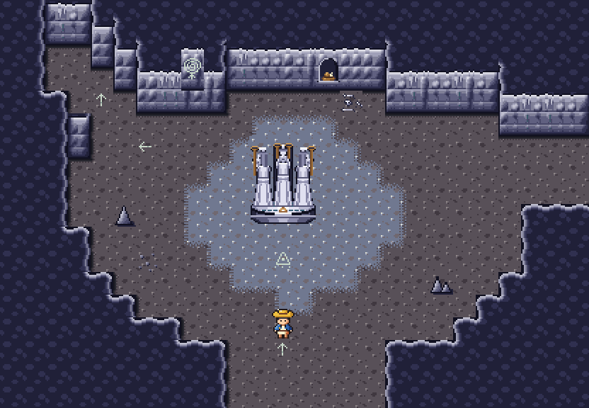

# The dark places' tileset: `cave_dark`

`gTileset_CaveDark` is the secondary tileset for Phase 2's dark places: **Hecate's Hollow** (under the pass of Mount Aigaleos), **the Salt Grotto** (off Route 6), and two Kalliste places the Phase 2 relics open, **Akti's Sea Grotto** and **the Kronion Crypt** (SCRIPT.md Part 10, the Hollow in beat 18 and Part 5, Return to Kalliste).

The Hollow should feel like a goddess's place: cold, quiet, a little frightening, and readable in the dark. The rock is a cold silver-violet limestone over a warm grey clay floor. The landmarks are warm: bronze braziers, the Hekataion's torches, the old woman's dish. Hecate's chalk is faint in light and glows when the torch is doused.



| Image | Shows |
|---|---|
| `img/cave_dark_entrance.png`, `_dark` | The Hollow's east mouth: daylight from Route 2, the old woman and her covered dish, a ledge, the first chalk arrow |
| `img/cave_dark_three_roads.png`, `_dark`, `_doused` | The Three Roads: the Hekataion in its pool of light from above, Hecate's supper in a niche, her chalk; doused, only the chalk shows |
| `img/cave_dark_web_passage.png`, `_dark` | A side passage curtained with cobweb, and one already burnt through |
| `img/cave_dark_brazier_room.png`, `_dark` | Two bronze braziers (one lit), the still spring under a seep, a ledge, a trainer |
| `img/cave_dark_crypt.png`, `_dark` | The Kronion Crypt: cut walls, the stair up, the relief, the sarcophagus, the altar stone, a dig spot |
| `img/cave_dark_sea_grotto.png`, `_dark` | Akti's Sea Grotto: wet rock, Hydna's too-still water, the boat, Glaukos's shrine, a tide pool, the way out to daylight |
| `img/cave_dark_sheet.png` | Every metatile with its id, from the compiled tileset |

Every image is rendered at 2x from the **compiled** tileset through `tools/ichor/render_map.py` on aethos, so it shows what the game draws. The `_dark` images show what a dark map shows (see *Darkness* below). The rooms are throwaway block data; the map batch builds the real layouts.

## How it is made

| Script | Holds |
|---|---|
| `tools/ichor/art/cave_dark_lib.py` | Colors, the seven palette groups, the glow copy, the two recolors, layers and structures, validation, packing |
| `tools/ichor/art/cave_dark_kit.py` | The kit (rock with depth, floor, lit floor, still water) and its autotiler |
| `tools/ichor/art/cave_dark_props.py` | The cave's furniture: stone, ledges, mouths and daylight, braziers, webs, Hecate's niche and chalk, the Hekataion |
| `tools/ichor/art/cave_dark_places.py` | The crypt and the sea grottos: their wall styles and pieces, and their two mock-up rooms |
| `tools/ichor/art/cave_dark_build.py` | Paints, packs, compiles, verifies, writes the glow palettes, the catalog, the labels and the sheet, and wires the animation |
| `tools/ichor/art/cave_dark_mockups.py` | The mock-up rooms and their lit, dark and doused renders |

```bash
/usr/bin/python3 tools/ichor/art/cave_dark_build.py      # paint, compile, verify, catalog
/usr/bin/python3 tools/ichor/art/cave_dark_mockups.py    # render the rooms (ROOM ... for some)
```

- **Self-contained.** Like agros, the set is compiled in a scratch Porytiles project (`build/cave_dark_porytiles`) against an empty stand-in primary. Every metatile uses only its own tiles and palettes 6–12; the build fails otherwise. So it works on any primary.
- **Palette hints** pin one palette per group (`porytiles/tilesets/gTileset_CaveDark/config.yaml`).
- **Tile sharing** is on (`tileset.tiles.sharing: packing biased, alignment greedy`). The crypt's rock and the grottos' wet rock are the cave's rock *recolored*; Porytiles stores those tiles once and points the recolored metatiles at another palette. The whole wet-rock style costs 8 tiles (its two new flutes); the crypt's rock costs none.
- **Every 8x8 tile draws from one palette group** (`validate()`). Objects keep the plain floor in the bottom layer and draw themselves in the middle layer, or the top layer for parts the player walks behind, so the floor's tiles are shared everywhere.
- **Registration**: appended entries in `src/data/tilesets/headers.h`, `graphics.h` and `metatiles.h`; the swap labels in `include/constants/metatile_labels.h` (rewritten by the build between its markers); the animation wiring (below).

## The primary: aethos

The maps should pair `cave_dark` with **aethos**, as SCRIPT.md Part 10 and ART_PLAN say for every biome secondary.

- The set draws nothing from its primary, so the primary is free to give what the four maps want from outside: aethos's grass and road beyond a mouth, its animated sea outside the grottos' openings.
- Darkness costs nothing from the primary either. Outside the flash circle the GBA shows the backdrop, and `LoadTilesetPalette` (`src/fieldmap.c`) forces it to black whatever the primary.
- The glow copy needs only the secondary's palettes; the engine can black out the primary's six whole.
- The caves join their routes by warps, so there are no seams to keep.
- A cave primary would add 512 tiles and six palettes, but it would be a second primary to maintain for four small maps. Tile sharing gave the room instead (two whole wall styles for 8 tiles), and the set fits in 480 of 504.

## Palettes

Seven groups, one per secondary palette, at most 15 colors each, all multiples of 8. The slot each lands in is printed by the build.

| Slot | Group | For |
|---|---|---|
| 6 | crypt | Kronion's poros: the crypt's rock (the cave's, recolored), cut faces, slabs, relief, sarcophagus, altar |
| 7 | fire | Bronze, flame and ash: braziers, Hecate's bowl, the covered dish; the boat and mooring post (bronze tones as wood) |
| 8 | floor | Cave clay, contact shadows, puddles, moonlight and daylight, Hecate's chalk |
| 9 | grotto | Wet rock (the cave's rock recolored), weed, foam |
| 10 | marble | The Hekataion: marble, torch bronze, flame, the barley cake, the trickle |
| 11 | rock | Cold limestone: rock top, rims, flowstone faces, stalagmites, webs, seeps, chalk |
| 12 | water | Still water, its banks, the tide pool's anemones, starfish and weed, Glaukos's shells |

### The glow copy (dousing)

SYSTEMS.md §2: dousing loads a copy of the map's palettes in which every color is black but the glow paint, at flash level 0.

- The glow paint is **Hecate's chalk**, two colors (`ch1`, `ch2`) in the rock and floor palettes. In ordinary light they are a faint grey-green chalk on the stone. In the glow copy they become a bright spectral green (`ch2` 152,248,208) with a dimmer halo (`ch1` 32,136,112). Every other slot of all sixteen palettes is black.
- The build writes it to `data/tilesets/secondary/cave_dark/glow/00.pal`–`15.pal`, finding the chalk's slots by color, so a recompile never leaves it stale. Today the chalk sits at palette 8 (floor) indices 6 and 15, and palette 11 (rock) indices 10 and 13.
- It is registered as `gTilesetPalettes_PorytilesManaged_CaveDark_Glow[][16]` in `src/data/tilesets/graphics.h`, ready for the engine's douse: load it over palettes 0–12, set flash level 0; restore both on relighting.
- `img/cave_dark_three_roads_doused.png` is the Three Roads rendered with it: the wheel on the wall, the Three Roads sign and the arrows glow, and nothing else.

### The recolors

`cave_dark_lib.WET` and `POROS` map the cave's rock colors one-to-one onto the grotto and crypt palettes, so the recolored metatiles reuse the cave's tiles.

## Tile and metatile budget

- **480 of 504 tiles** (door animations own 504–511; the build fails past 504). The kit takes 109, the cave's furniture 223 (the Hekataion and its states 32, down from 42 before it was made symmetric; the webs 44), the crypt and grottos 147 (their recolored rock nothing; the wet style's new strips 8).
- **Metatiles**: sections start on fixed rows so growing one never renumbers another. The kit is `0x200`–`0x2BE`, the cave's furniture `0x2C0`–`0x341` (14 spare to `0x34F`), the places `0x350`–`0x3DD` (34 spare to `0x3FF`).
- The animation frames cost ROM, not tile slots.

## The kit and the autotiler

Map builders never pick wall pieces by hand. They describe terrain and the autotiler picks every cell.

```python
import json, sys
sys.path.insert(0, "tools/ichor/art")
import cave_dark_kit as kit
catalog = json.load(open("data/tilesets/secondary/cave_dark/catalog.json"))
ids = kit.autotile(grid, catalog, style=None)   # style: None (the cave), "wet" or "crypt"
# then place pieces over it by id: catalog["pieces"][...]["ids"]
```

The grid is a list of strings: `#` rock, `.` floor, `,` lit floor (moonlight or daylight), `~` still water.

- **Rock with depth.** A rock cell whose south neighbour is open is the base of a face (`fb`). The one above it is the face's top with its rim (`ft`). Every other rock cell is the rock's top surface (`T`): dark, quiet, out of reach. So a wall is two cells of face under a lit lip.
- **Rims.** The top surface has a lit lip wherever it meets floor or a recessed face: bright on the north and west, dimmer on the east (SYSTEMS.md §2 rule 2: rim-lit walls read inside a torch's radius). Rims are drawn from a distance field, so straight edges, rounded outer corners and inner corners agree pixel for pixel.
- **Faces** are rows of 8 px flowstone strips: lobes, a drapery fold, a boss with a crack, a stalactite fringe. Every strip shares its edge columns, so any strip meets any other. Two bedding planes run through every strip, so long walls read as layered limestone. Strips are picked by position, so a wall never repeats in step. Where a face meets rock standing further forward, it takes that rock's shadow; where it ends in the open, it turns the corner.
- **Floor** carries soft contact shadows under faces and beside west walls. Plain floor scatters a second texture.
- **Lit floor** (`,`) dithers softly into plain floor and rounds its outer corners. It is `MB_NORMAL`: no encounters in the light, so a lit pool is a safe place. Plain floor is `MB_CAVE`.
- **Still water** (`~`) is `MB_POND_WATER`: surfable, fishable. A north bank shows the bank's face falling to the water; other banks show their lip.
- **Styles.** `wet` recolors rock and faces to wet, weed-dark stone and adds two strips: a seep, and a tide line of barnacles and weed. `crypt` recolors the rock to poros and swaps the faces for cut stone (a cornice, a painted red band, two courses of ashlar) and the floor for big worn flagstones.
- **Keys and fallbacks.** Each cell's key (for example `T|N.W` or `ft|A|end`) is looked up in `catalog["styles"][style]`, then `catalog["kit"]`. Rare combinations (three or four inner corners in one cell, flutes a style lacks) fall back to the nearest piece.

## Catalog

`data/tilesets/secondary/cave_dark/catalog.json` holds every piece: key, title, footprint, ids row by row, walk codes, behaviors and notes. Ids below are global metatile ids. Walk codes: `X` blocks, `.` walkable, `T` walkable and drawn over the player, `J` ledge south, `>`/`<` ledge east/west, `^ v [ ]` arrow warps north, south, west, east.

### Stone and ground

| Key | Ids | Size | Walk | Notes |
|---|---|---|---|---|
| `stalagmite`, `stalagmites` | `0x2C7`, `0x2C8` | 1x1 | X | One, or a tall and a short |
| `stalagmite_tall`, `column` | `0x2C9`/`0x2D1`, `0x2CA`/`0x2D2` | 1x2 | T/X | Walk behind the tip; the column is a stalactite and stalagmite grown together |
| `boulder`, `rock_pile` | `0x2CB`, `0x2CC` | 1x1 | X | |
| `slab` | `0x2CE`–`0x2CF` | 2x1 | XX | A slab fallen from the roof |
| `pebbles`, `bones` | `0x2CD`, `0x2C0` | 1x1 | . | Scatter; the bones are a dog's |
| `ledge_w`, `ledge_a`, `ledge_b`, `ledge_e` | `0x2D8`–`0x2DB` | 1x1 | J | A low rock step: west end, two middles, east end. Collision 1, as vanilla ledges |
| `ledge_east`, `ledge_west` | `0x2DC`, `0x2DD` | 1x1 | > / < | |
| `stele` | `0x2C1` | 1x1 | X | The name stone at a mouth (the sign's bg event) |
| `dig`, `dig_crypt` | `0x3C3`, `0x3C2` | 1x1 | . | Fixed dig spots, on cave floor and on slabs |

### Mouths, daylight, the way down

| Key | Ids | Size | Walk | Notes |
|---|---|---|---|---|
| `mouth` | `0x2DE`–`0x2E7` | 2x2 | XX/^^ | An opening in a north face, daylight beyond. Set over the face's ft/fb cells |
| `daylight_e`, `daylight_w` | `0x2E9`–`0x2EA`, `0x2EB`–`0x2EC` | 2x1 | .] / [. | Daylight pouring in where a passage leaves the map's edge; the edge cell is the warp |
| `daylight_s`, `daylight_n` | `0x2ED`/`0x2F5`, `0x2EE`/`0x2F6` | 1x2 | ./v, ^/. | The same for south and north exits |
| `lit_warp_n/s/w/e` | `0x2C3`–`0x2C6` | 1x1 | arrows | Lit floor with an arrow warp |
| `hole_down` | `0x2E8` | 1x1 | . | Rough steps into the dark: `MB_NON_ANIMATED_DOOR` |

### Fire

| Key | Ids | Size | Notes |
|---|---|---|---|
| `brazier_cold` | `0x2F8` `0x2F9` / `0x300` `0x301` | 2x2, all X | A deep bronze bowl on a lion-footed tripod, cold ash in it |
| `brazier_lit` | `0x2FA` `0x2FB` / `0x302` `0x303` | 2x2, all X | The same alight; its flames are animated |

### Webs (the Arachne lead)

| Key | Ids | Size | Walk | Notes |
|---|---|---|---|---|
| `web_1`, `web_2` | `0x2FC`/`0x304`; `0x2FD` `0x2FE` / `0x305` `0x306` | 1x2, 2x2 | X | An orb web strung wall to wall and roof to floor, two cells deep, across a 1- or 2-wide passage |
| `torn_1`, `torn_2` | `0x2FF`/`0x307`; `0x308` `0x309` / `0x310` `0x311` | 1x2, 2x2 | . | What Hecate's Torch leaves: shreds at the walls and roof, ash on the floor |
| `web_corner_w`, `web_corner_e` | `0x30A`, `0x30B` | 1x1 | . | Old webbing on the floor row under a face |

SYSTEMS.md plans webs as object events (like cut trees). These metatiles serve either way: a map can swap them with `setmetatile`, or keep them under an object as its look.

### Hecate

| Key | Ids | Size | Walk | Notes |
|---|---|---|---|---|
| `hekataion` | `0x322`–`0x324` / `0x32A`–`0x32C` / `0x332`–`0x334` / `0x33A`–`0x33C` | 3x4 | TTT/XXX/XXX/XXX | Three veiled, crowned women back to back, each holding up bronze torches, on a round base with an offering ledge and the barley cake; water runs down the pillar between them. Stand it in lit floor (its ground is lit) |
| `hekataion_torch_w_lit`, `_s_lit`, `_e_lit` | `0x325`, `0x326`, `0x327` | 1x1 | T | Each face's torches alight (swap over row 0) |
| `hekataion_torch_s_gone` | `0x340` | 1x1 | T | The front face's right torch taken (beat 18), the left still burning |
| `hekataion_no_cake` | `0x341` | 1x1 | X | The ledge bare (swap over row 3, middle) |
| `niche_supper`, `niche_empty` | `0x30C`/`0x314`, `0x30D`/`0x315` | 1x2 | X | A niche cut in a face, a dog's bronze bowl on its sill: Hecate's supper (a loaf, two eggs), then eaten. Set over a face's ft/fb cells |
| `chalk_wheel` | `0x30F`/`0x317` | 1x2 | X | Hecate's wheel (the strophalos) chalked on a face |
| `chalk_arrow_n/e/s/w`, `chalk_triangle` | `0x318`–`0x31C` | 1x1 | . | Chalk on the floor; the triangle is her sign for the Three Roads |
| `chalk_triangle_lit`, `chalk_arrow_n_lit`, `chalk_arrow_s_lit`, `bones_lit`, `pebbles_lit` | `0x31D`–`0x321` | 1x1 | . | The same marks and scatter on lit floor (no tiles of their own) |
| `dish_covered` | `0x2C2` | 1x1 | X | The old woman's covered dish, at her feet by the east mouth |
| `seep` | `0x30E`/`0x316` | 1x2 | X | The underground spring weeping from a face, over a pool |

### The crypt (style `crypt`)

| Key | Ids | Size | Walk | Notes |
|---|---|---|---|---|
| `crypt_stair` | `0x3B0` `0x3B1` / `0x3B8` `0x3B9` | 2x2 | XX/^^ | Steps cut up through the north face to Kronion Hill's pit; the bottom row is the warp |
| `crypt_relief` | `0x3B2` `0x3B3` / `0x3BA` `0x3BB` | 2x2 | XX | Rhea hands Kronos the swaddled stone; he opens wide. Give it the relief's bg event |
| `sarcophagus` | `0x3B4`–`0x3B6` / `0x3BC`–`0x3BE` | 3x2 | X | Old poros, gabled lid, a red meander on ochre |
| `altar_stone` | `0x3C0`–`0x3C1` | 2x1 | XX | A rough block with a libation hollow, stained |

### The sea grottos (style `wet`)

| Key | Ids | Size | Walk | Notes |
|---|---|---|---|---|
| `boat` | `0x3C4`–`0x3C6` / `0x3CC`–`0x3CE` | 3x2 | X | A fisher's boat on still water: painted eye at the bow, thwarts, an oar shipped, rope and net |
| `mooring_post` | `0x3C7` | 1x1 | X | Set on the shore west of the bow |
| `tide_pool` | `0x3D0`–`0x3D2` / `0x3D8`–`0x3DA` | 3x2 | X | A rock pool: anemones, a starfish, weed |
| `shell_shrine` | `0x3D5`/`0x3DD` | 1x2 | X | Glaukos's tiny shrine of shells, in a wet face |
| `shingle`, `salt` | `0x3D4`, `0x3D3` | 1x1 | . | Sea-worn pebbles at a shore; the Salt Grotto's white crust |

## Scripted swaps

`cave_dark_build.py` writes `METATILE_CaveDark_*` labels into `include/constants/metatile_labels.h`, so scripts never use stale ids. Multi-cell pieces get one label per cell, suffixed `_xy`.

- **Braziers**: `Brazier_Cold_00/10/01/11` and `Brazier_Lit_00/10/01/11`. Swap all four, keeping collision.
- **The Hekataion**: `Hekataion_TorchW_Cold`/`_Lit`, `TorchS_Cold`/`_Lit`/`_Gone`, `TorchE_Cold`/`_Lit`; `Hekataion_Cake`/`_NoCake`. Beat 18 lights west, then east, then the front, then swaps the front to `_Gone` when the torch comes loose.
- **Webs**: `Web1_0/1` and `Web1_Torn_0/1`; `Web2_00/10/01/11` and `Web2_Torn_*`. Burning swaps the intact cells for the torn ones and clears their collision.
- **Hecate's niche**: `Niche_Supper_0/1` and `Niche_Empty_0/1` (only the lower cell differs).

## Animation

The lit braziers' flames and the Hekataion's lit torches flicker through three frames (ping-pong, 16 frames each).

- `cave_dark_build.py` finds the 8x8 tiles that change between the frames and writes them as Porytiles animations (`porytiles_src/anim/brazier_flame`, `torch_flame`, with `anim.json`). Porytiles places the key tiles in the tileset (secondary tiles 1–9) and generates the code.
- The wiring is the same as aethos's: `include/porytiles_generated/tilesets/cave_dark/generated_anim_code.h`, one include appended to `src/tileset_anims.c`, one declaration in `include/tileset_anims.h`, and `.callback = InitTilesetAnim_PorytilesManaged_CaveDark` on the tileset. The build applies them from the scratch project.
- Cold braziers and cold torches use other tiles, so they stay still.

## Darkness

The `_dark` renders model the engine (SYSTEMS.md §2): black everywhere but a circle round the player and the light sources.

- The player's circle is the flash radius: 24 px with no torch (flash level 7: the entrance and the Three Roads, before the Hekataion), 56 px with Hecate's Torch (flash level 3: the other rooms).
- A lit brazier carves a 32 px pool (the 64x64 halo sprite, SYSTEMS.md's stretch feature). The skylight over the Hekataion and the daylight at a mouth are drawn the same way.
- Without the halo feature, the engine shows only the player's circle, or full light inside a lit zone (flash level 0).
- What reads in the dark: the rims (the brightest stone on screen) outline every wall inside the circle; floor, rock top and faces are three clearly different values; the warm brazier and torch flames and the pale Hekataion are the landmarks; webs read as white thread.

## Critique passes

Each pass rendered all six rooms from the compiled tileset, looked at them at 2x and zoomed to 3–4x, and fixed what was wrong.

**Pass 1 (first full render).**
- The faces read as a picket fence: a hard dark crease every 8 px. Redrawn as hand-painted strips with a shared mid-tone edge, then (still too orderly, like masonry) as lobes, a drapery fold and a boss, with real highlights and limestone bedding.
- The rock top read as a quilted textile (regular dots and diagonal cracks). Now quiet low lumps.
- The lit floor was a flat blue rug with square corners. Rounded corners, a wider dither, quieter moonlight colors.
- Marks on lit floor sat in a dark square (their ground was plain floor). Added lit-ground variants that reuse the same tiles.
- Webs were a white smudge, braziers yellow fruit bowls, the Hekataion three robots, the boat a fish, the crypt floor bathroom brick, and open floor repeated every 16 px. All redrawn; a second floor texture is scattered by the autotiler.
- The budget reached 475 of 504. The brazier, the Hekataion and the sarcophagus became mirror-symmetric (Porytiles stores a flipped half once), and the 3-wide web was dropped.

**Pass 2.**
- The Hekataion at 3x: torches read as T-crosses, the women as bowling pins, the trickles as rows of buttons, and the raised arms vanished against the robes. Torch cups now show a rim round a sooty mouth; the women have head, neck and shoulders, a dark outline and arms that break the silhouette; the water runs down the pillar between them.
- Webs were still too small to read as a curtain. They now hang two cells deep.
- Ledges read as slabs. Their faces are darker with a cast shadow, and the rooms had placed them on rock edges; moved into open floor.
- Daylight at the mouth didn't read. Added daylight pieces that run from floor to white at the map's edge.
- In the dark renders, lit cells showed stepped edges. The skylight and daylight are now modelled as halos, as the engine would draw them.
- Shingle was too loud; quieted.

**Pass 3.**
- The grotto's exit passage didn't line up with its daylight (a room-grid slip); fixed.
- The wall bosses read as rows of eyes; toned down.
- No room showed the Hollow's still spring. Added a seep piece (it reuses the wet style's tiles, so it is free) and a spring pool in the brazier room.
- The web passage's dark render left the web outside the light; the player now stands at its mouth, and the web reads by torchlight.
- Added the doused render to prove the glow copy.

## Notes, limits and what the set still lacks

- **Not yet seen in game.** No map uses the set yet, so the animation and the swaps are untested on hardware; `make` builds and the smoke test passes.
- **Engine work the set assumes** (SYSTEMS.md §2, the engine session): loading the glow copy on douse, the halo sprites at lit braziers (a stretch), and lit zones by coord events.
- **Moonlight and daylight share one lit floor** (a cool silver), and daylight pieces exist only for exits at a map's edge, plus the north-face `mouth`.
- **Water is static** by design (Hydna's "too still" water). There is no waterfall or current.
- **Ledges** run south, east and west; there are no corner ledges and no north ledge.
- **The crypt** has one ashlar pattern and square flagstones; it has no crypt-cut ledge or a stair down.
- **The Salt Grotto** has no mock-up of its own. It is the wet style with the tide pool, `salt` crust and `shingle`; salt on its walls would need a strip of its own.
- **Space left**: 24 tiles, 14 metatiles in the cave section and 34 in the places section.
