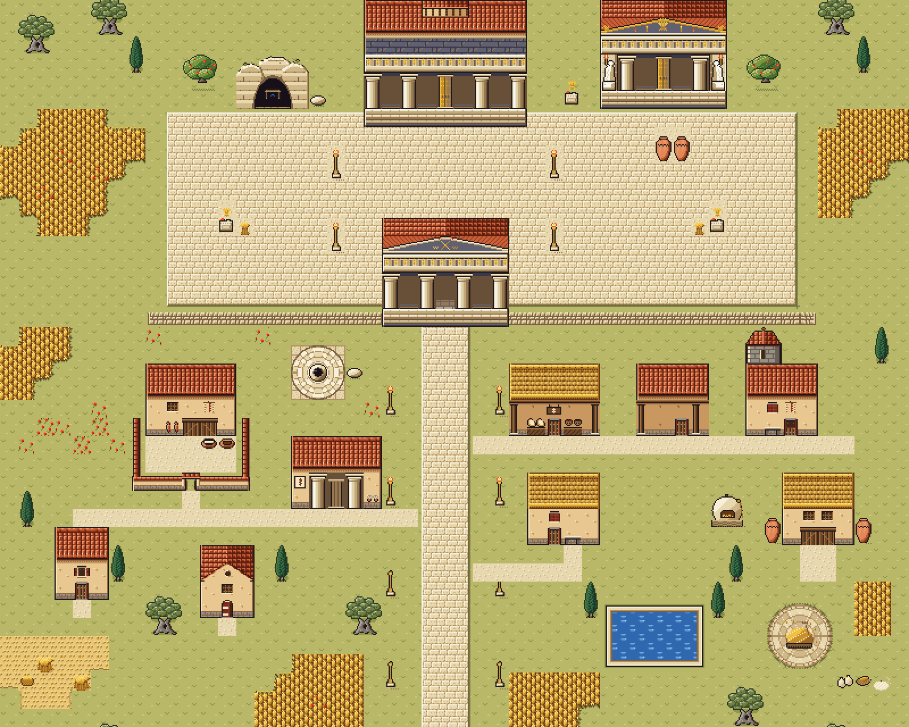
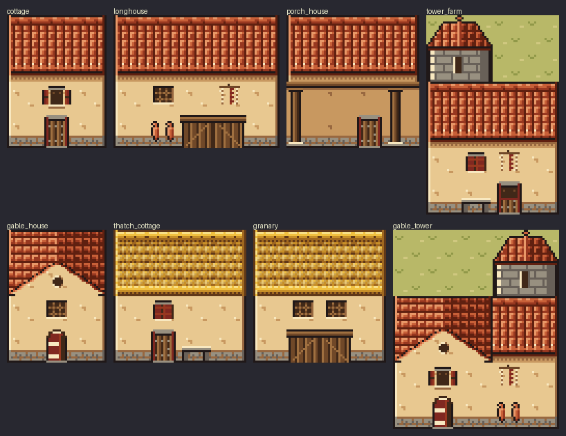

# Eleusa tileset catalog

`gTileset_Eleusa` is Eleusa Village: Eleusis on its wheat plain, the third Laurel's
town. It is gold and earth, where Kalliste is whitewash and Aegean blue: ochre
plaster farmhouses under red Laconian tiles or reed thatch, ox-blood doors, golden
wheat and stubble, poppies, threshing floors and pithoi. At its heart is the sanctuary
of the Mysteries in honey marble and Eleusis's dark grey stone. Pair it with the
`aethos` primary, which supplies the grass, the limestone path, trees and the sea.

**This file is generated.** `tools/ichor/art/eleusa_build.py` paints the tileset,
compiles it and rewrites this catalog. The art lives in `eleusa_fields.py`,
`eleusa_farm.py`, `eleusa_house.py` and `eleusa_sacred.py`; the palette plan and the
borrowed-ground mechanism in `eleusa_lib.py`.

| Image | Shows |
|---|---|
| [`img/eleusa_scene.png`](img/eleusa_scene.png) | The mock scene: village, fields, sanctuary (`eleusa_scene.py`) |
| [`img/eleusa_fronts.png`](img/eleusa_fronts.png) | The eight house fronts, composed from the kit |
| [`img/eleusa_pieces.png`](img/eleusa_pieces.png) | Every structure on its ground |
| [`img/eleusa_sheet.png`](img/eleusa_sheet.png) | The numbered metatile sheet, rendered from the compiled tileset |



## How to use it

**IDs.** Each grid lists metatile ids as Porymap shows them, row by row. Each section
starts on a fixed row of the sheet (fields at 0x200, farm at 0x268, houses at 0x290, sanctuary at 0x2D0, civic at 0x3B0). Structures are placed first-fit in build
order, so appending a new one never moves an old one. The Telesterion is 9 wide, so the
sheet stores it in two chunks; its grid below is whole. Map builders should place
pieces by key and name from `build/eleusa/catalog.json`, never by raw id.

**Collision and layers.** The walk grid beside each structure gives what to set on each
cell:

| Code | Meaning |
|---|---|
| `X` | Impassable: set collision 1. |
| `.` | Passable. |
| `T` | Passable, drawn over the player, who walks behind or beneath it. |
| `G` | Tall grass: `MB_TALL_GRASS`, so wild encounters happen here. Passable. |
| `D` | Door: `MB_NON_ANIMATED_DOOR`. Put the warp here. |

**Borrowed ground.** Cells marked *grass*, *path* or *sea* below draw no ground of their
own. After Porytiles compiles, the build points their bottom-layer tiles at aethos's own
grass (`0x001`), limestone path (`0x1D9`) or animated sea (`0x170`). They meet the
meadow, the lane or the pool around them exactly, cost no Eleusa tiles, and the
Rheitoi's water animates. **Rebuild Eleusa whenever aethos is repainted**; the build
checks every borrowed entry against aethos's current metatiles. A borrowed cell keeps
only one layer of its own, so its art is either under the player (middle) or over it
(top).

**Soft ground.** The wheat and the stubble are agros's soft-ground engine
(`agros_ground.py`): a cell's piece is chosen by its shape key, the cell then its
neighbors N NE E SE S SW W NW, `1` in the field and `0` not, a diagonal counting only
when both its sides are in. `eleusa_lib.blob_key(region, x, y)` computes it from a field
mask; `eleusa_scene.py` shows the use. All 47 shapes exist, so any outline works. The
full interior is `1|11111111`. Where wheat meets stubble, give each cell the shape it
has in its own field: a strip of grass shows between, like a balk between two plots.

**Seams.** The engine draws a connected map with the tilesets of the map the player
stands on, so keep Eleusa pieces out of the six rows nearest an up/down seam and the
eight columns nearest a left/right one (MAP_DESIGN.md §5). Use aethos's own grass, path
and trees there.

**Self-contained art.** Apart from the borrowed ground, Eleusa is compiled against an
empty stand-in primary in a scratch Porytiles project under `build/`, so its art uses
only its own tiles (0x200 and up) and palettes 6-12. The build verifies every entry.

**Palettes.** Every 8x8 tile draws from one of seven color groups, one per secondary
palette (`eleusa_lib.GROUPS`). They reach Porytiles as packing hints.

| Group | Use |
|---|---|
| field | Wheat, stubble, poppies and reed thatch, on aethos grass |
| grove | The pomegranate's leaves, fruit and trunk |
| earth | The threshing floor, the Sacred Way's slabs, grain heaps, the sledge |
| clay | Pithoi, the oven, sacks and the liknon |
| house | Lime plaster, roof tiles, dark timber, ox-blood paint, the stone socle |
| marble | Honey marble, Eleusis's grey stone, gilding, torch fire |
| rock | The Plutonion's crag, the Kallichoron's curb, the Rheitoi's kerbs |

**Tile budget.** ? of 504 tiles are used (422 metatiles). A secondary owns 512
tiles, but the door animations copy their frames into tiles 504-511
(`DOOR_TILE_START_SIZE1`, `src/field_door.c`), so the build fails past 504. It merges
tiles within two pixels of each other, and the sacred buildings, the house kit and the
roofs are drawn on a 16 px grid so repeats share tiles. That leaves little room: new
pieces should reuse the kits' parts, or something must go.

**Scripted swaps.** The build writes the ids scripts swap to the `gTileset_Eleusa`
block at the end of `include/constants/metatile_labels.h`: `METATILE_Eleusa_TorchPost_Lit`
and `_Cold` light or put out a procession torch (setmetatile on the torch's top cell).

## Fields

Standing wheat (Eleusa's tall grass), harvested stubble, sheaves and Demeter's poppies. The wheat and the stubble are soft-edged: each comes as all 47 blob shapes, named by shape key.

### Standing wheat with soft edges (tall grass)

`wheat`, 8 wide by 6 tall. Eleusa's tall grass: golden wheat. Every one of the 47 blob shapes, named by its shape key (agros_ground.py), so a field can take any outline. MB_TALL_GRASS throughout: wild encounters follow the cells while the outline stays soft. The full interior is `1|11111111`.

| Shape key | Id | Walk |
|---|---|---|
| `1|00000000` | 0x200 | G |
| `1|00000010` | 0x201 | G |
| `1|00001000` | 0x202 | G |
| `1|00001010` | 0x203 | G |
| `1|00001110` | 0x204 | G |
| `1|00100000` | 0x205 | G |
| `1|00100010` | 0x206 | G |
| `1|00101000` | 0x207 | G |
| `1|00101010` | 0x208 | G |
| `1|00101110` | 0x209 | G |
| `1|00111000` | 0x20A | G |
| `1|00111010` | 0x20B | G |
| `1|00111110` | 0x20C | G |
| `1|10000000` | 0x20D | G |
| `1|10000010` | 0x20E | G |
| `1|10000011` | 0x20F | G |
| `1|10001000` | 0x210 | G |
| `1|10001010` | 0x211 | G |
| `1|10001011` | 0x212 | G |
| `1|10001110` | 0x213 | G |
| `1|10001111` | 0x214 | G |
| `1|10100000` | 0x215 | G |
| `1|10100010` | 0x216 | G |
| `1|10100011` | 0x217 | G |
| `1|10101000` | 0x218 | G |
| `1|10101010` | 0x219 | G |
| `1|10101011` | 0x21A | G |
| `1|10101110` | 0x21B | G |
| `1|10101111` | 0x21C | G |
| `1|10111000` | 0x21D | G |
| `1|10111010` | 0x21E | G |
| `1|10111011` | 0x21F | G |
| `1|10111110` | 0x220 | G |
| `1|10111111` | 0x221 | G |
| `1|11100000` | 0x222 | G |
| `1|11100010` | 0x223 | G |
| `1|11100011` | 0x224 | G |
| `1|11101000` | 0x225 | G |
| `1|11101010` | 0x226 | G |
| `1|11101011` | 0x227 | G |
| `1|11101110` | 0x228 | G |
| `1|11101111` | 0x229 | G |
| `1|11111000` | 0x22A | G |
| `1|11111010` | 0x22B | G |
| `1|11111011` | 0x22C | G |
| `1|11111110` | 0x22D | G |
| `1|11111111` | 0x22E | G |

### Poppies in the corn

`wheat_poppies`, 1 wide by 1 tall. Tall grass for the inside of a field (where the shape key is `1|11111111`): wheat with Demeter's poppies through it. Scatter it to break up a large field.

```text
ids        walk
0x230   G
```

### Harvested stubble with soft edges

`stubble`, 8 wide by 6 tall. A reaped field: rows of cut straw over dry earth. Walkable. The same 47 shapes as the wheat, so a field can be half reaped: put stubble cells beside wheat cells and give each the shape it has on its own.

| Shape key | Id | Walk |
|---|---|---|
| `1|00000000` | 0x238 | . |
| `1|00000010` | 0x239 | . |
| `1|00001000` | 0x23A | . |
| `1|00001010` | 0x23B | . |
| `1|00001110` | 0x23C | . |
| `1|00100000` | 0x23D | . |
| `1|00100010` | 0x23E | . |
| `1|00101000` | 0x23F | . |
| `1|00101010` | 0x240 | . |
| `1|00101110` | 0x241 | . |
| `1|00111000` | 0x242 | . |
| `1|00111010` | 0x243 | . |
| `1|00111110` | 0x244 | . |
| `1|10000000` | 0x245 | . |
| `1|10000010` | 0x246 | . |
| `1|10000011` | 0x247 | . |
| `1|10001000` | 0x248 | . |
| `1|10001010` | 0x249 | . |
| `1|10001011` | 0x24A | . |
| `1|10001110` | 0x24B | . |
| `1|10001111` | 0x24C | . |
| `1|10100000` | 0x24D | . |
| `1|10100010` | 0x24E | . |
| `1|10100011` | 0x24F | . |
| `1|10101000` | 0x250 | . |
| `1|10101010` | 0x251 | . |
| `1|10101011` | 0x252 | . |
| `1|10101110` | 0x253 | . |
| `1|10101111` | 0x254 | . |
| `1|10111000` | 0x255 | . |
| `1|10111010` | 0x256 | . |
| `1|10111011` | 0x257 | . |
| `1|10111110` | 0x258 | . |
| `1|10111111` | 0x259 | . |
| `1|11100000` | 0x25A | . |
| `1|11100010` | 0x25B | . |
| `1|11100011` | 0x25C | . |
| `1|11101000` | 0x25D | . |
| `1|11101010` | 0x25E | . |
| `1|11101011` | 0x25F | . |
| `1|11101110` | 0x260 | . |
| `1|11101111` | 0x261 | . |
| `1|11111000` | 0x262 | . |
| `1|11111010` | 0x263 | . |
| `1|11111011` | 0x264 | . |
| `1|11111110` | 0x265 | . |
| `1|11111111` | 0x266 | . |

### Stook of sheaves on the stubble

`stook`, 1 wide by 1 tall. Four sheaves stood together to dry, on the stubble's middle.

```text
ids        walk
0x231   X
```

### A sheaf standing on grass

`sheaf_grass`, 1 wide by 1 tall. On borrowed aethos grass: a sheaf by a door, a shrine or a gate.

```text
ids        walk
0x232   X
```

Borrowed ground (grass): cells 0,0.

### The reaper's basket and sickle, on stubble

`reaper`, 1 wide by 1 tall. A wicker basket of cut ears with a bronze sickle laid across it.

```text
ids        walk
0x233   X
```

### Poppies in the grass

`poppies`, 2 wide by 1 tall. Field poppies through aethos grass; walkable. Scatter `scattered` round a field's edge and use `dense` for its heart. Poppies are Demeter's flower: plant them by her shrines and in the corn.

```text
ids              walk
0x234 0x235   . .
```

Pieces: `scattered` 0x234, `dense` 0x235.

## Farmyards

The threshing floor (agros's own alonia) and its harvest-time middle, the winnowing, pithoi standing and sunk, and the bread oven.

### Alonia: the round threshing floor (agros)

`alonia`, 4 wide by 4 tall. Agros's threshing floor, pixel for pixel: flagstones in a ring of upright stones, open to walk on. For harvest time, swap its middle 2 x 2 for `alonia_work` (the grain heap and the sledge).

```text
ids                          walk
0x268 0x269 0x26A 0x26B   . . . .
0x270 0x271 0x272 0x273   . . . .
0x278 0x279 0x27A 0x27B   . . . .
0x280 0x281 0x282 0x283   . . . .
```

### Alonia at threshing time: middle 2 x 2

`alonia_work`, 2 wide by 2 tall. Drop over the alonia's cells (1,1)-(2,2). The heap and the sledge block; walk round them on the ring.

```text
ids              walk
0x26C 0x26D   X X
0x274 0x275   X X
```

### Winnowing: sacks, the liknon, the chaff

`winnowing`, 3 wide by 1 tall. Three props on aethos grass, to set beside a threshing floor. The liknon is the winnowing basket the Mysteries carried, so it reappears in the sanctum.

```text
ids                    walk
0x27C 0x27D 0x27E   X X X
```

Pieces: `sacks` 0x27C, `liknon` 0x27D, `chaff` 0x27E.

Borrowed ground (grass): cells 0,0, 1,0, 2,0.

### A great pithos, taller than a man

`pithos`, 1 wide by 2 tall. The storage jar Pandora's box really was. Stand them in rows for a granary yard. The rim draws over the player; the body blocks.

```text
ids        walk
0x26E   T
0x276   X
```

Borrowed ground (grass): cells 0,0, 0,1.

### Pithoi sunk to the shoulder

`pithos_sunk`, 2 wide by 1 tall. A granary floor: two pithoi buried to the shoulder in beaten earth, one with its stone lid on. On borrowed aethos path.

```text
ids              walk
0x284 0x285   X X
```

Borrowed ground (path): cells 0,0, 1,0.

### The bread oven: a clay dome

`oven`, 2 wide by 2 tall. A beehive oven of daub over a stone base, its mouth glowing, a peel leaning on it. Barley loaves are Demeter's own bread.

```text
ids              walk
0x286 0x287   X X
0x28E 0x28F   X X
```

Borrowed ground (grass): cells 0,0, 0,1, 1,0, 1,1.

## The house kit

Parts that snap together into farmhouse fronts (see *House fronts* below for eight ready arrangements), and the courtyard walls that close a farm compound.

### Tiled roof: ridge row and eave row

`roof_tile`, 3 wide by 2 tall. Red Laconian tiles. Repeat the middle column for a wider house.

```text
ids                    walk
0x290 0x291 0x292   X X X
0x298 0x299 0x29A   X X X
```

Pieces: `R0_L` 0x290, `R0_M` 0x291, `R0_R` 0x292, `R1_L` 0x298, `R1_M` 0x299, `R1_R` 0x29A.

### Reed-thatched roof: ridge row and eave row

`roof_thatch`, 3 wide by 2 tall. Golden reed thatch for humbler houses, barns and the granary.

```text
ids                    walk
0x293 0x294 0x295   X X X
0x29B 0x29C 0x29D   X X X
```

Pieces: `R0_L` 0x293, `R0_M` 0x294, `R0_R` 0x295, `R1_L` 0x29B, `R1_M` 0x29C, `R1_R` 0x29D.

### Gable-fronted roof, 3 wide

`roof_gable`, 3 wide by 2 tall. The house turned end-on: the roof from above with its ridge running back, then the gable's triangle with a round vent. Always 3 wide; put 3-wide wall rows under it.

```text
ids                    walk
0x2A0 0x2A1 0x2A2   X X X
0x2A8 0x2A9 0x2AA   X X X
```

Pieces: `R0_L` 0x2A0, `R0_M` 0x2A1, `R0_R` 0x2A2, `R1_L` 0x2A8, `R1_M` 0x2A9, `R1_R` 0x2AA.

### Wall rows: upper and lower (on the socle)

`wall`, 3 wide by 2 tall. Plain plaster. Every window, door and extra below is a W0 or W1 M cell, so it can stand anywhere between the corners.

```text
ids                    walk
0x2A3 0x2A4 0x2A5   X X X
0x2AB 0x2AC 0x2AD   X X X
```

Pieces: `W0_L` 0x2A3, `W0_M` 0x2A4, `W0_R` 0x2A5, `W1_L` 0x2AB, `W1_M` 0x2AC, `W1_R` 0x2AD.

### Upper-wall cells: windows and garlic

`windows`, 4 wide by 1 tall. W0 cells. `shutters` is an open window with ox-blood shutters, `lattice` a small timber grille, `closed` shutters shut, `garlic` strings of garlic and onions on a peg.

```text
ids                          walk
0x2B0 0x2B1 0x2B2 0x2B3   X X X X
```

Pieces: `shutters` 0x2B0, `lattice` 0x2B1, `closed` 0x2B2, `garlic` 0x2B3.

### Doors (lower-wall cells)

`doors`, 5 wide by 1 tall. W1 cells; every one is a door (MB_NON_ANIMATED_DOOR): put the warp there. `plank` a dark plank door in ox-blood jambs, `dutch` its top leaf open, `curtain` an arched doorway with a striped wool curtain, `barn_l` + `barn_r` a wide double door (warp on both).

```text
ids                                walk
0x2B8 0x2B9 0x2BA 0x2BB 0x2BC   D D D D D
```

Pieces: `plank` 0x2B8, `dutch` 0x2B9, `curtain` 0x2BA, `barn_l` 0x2BB, `barn_r` 0x2BC.

### Lower-wall cells with things against the wall

`wall_extras`, 2 wide by 1 tall. W1 cells: a stone bench, two amphorae.

```text
ids              walk
0x296 0x297   X X
```

Pieces: `bench` 0x296, `amphorae` 0x297.

### Porch (pastas) on timber posts

`porch`, 3 wide by 2 tall. Wall rows in the porch's shade, under a tiled roof's R1 row. A post stands in `*_post` cells; `*_mid` repeats; `W1_door` is a plank door in the shade (MB_NON_ANIMATED_DOOR). Mirror the order for a post on the right: posts are drawn on the cell's west side.

```text
ids                    walk
0x2B5 0x2B6 0x2B7   X X X
0x2BD 0x2BE 0x2BF   X X D
```

Pieces: `W0_post` 0x2B5, `W0_mid` 0x2B6, `W0_beam_end` 0x2B7, `W1_post` 0x2BD, `W1_mid` 0x2BE, `W1_door` 0x2BF.

### Pyrgos: the farm's stone tower

`tower`, 2 wide by 2 tall. Two rows that stand above a house's R0 at one end, so the tower rises behind the roof. The cap's top corners are borrowed grass.

```text
ids              walk
0x29E 0x29F   X X
0x2A6 0x2A7   X X
```

Pieces: `T0_L` 0x29E, `T0_R` 0x29F, `T1_L` 0x2A6, `T1_R` 0x2A7.

Borrowed ground (grass): cells 0,0, 1,0.

### Courtyard walls: plaster under tiled coping

`court_wall`, 7 wide by 1 tall. On borrowed grass. `EW` the run, `W`/`E` its ends, `NS` a run going north (seen from above), `NE`/`NW` front corners where a side wall comes down onto the front run, `gate` an open gateway under a little roof (walk through it; drawn over the player).

```text
ids                                            walk
0x2C0 0x2C1 0x2C2 0x2C3 0x2C4 0x2C5 0x2C6   X X X X X X T
```

Pieces: `EW` 0x2C0, `W` 0x2C1, `E` 0x2C2, `NS` 0x2C3, `NE` 0x2C4, `NW` 0x2C5, `gate` 0x2C6.

Borrowed ground (grass): cells 0,0, 1,0, 2,0, 3,0, 4,0, 5,0, 6,0.

### House fronts

Every house in Eleusa is a home (MAP_DESIGN.md §2), so each front has a door. These eight are arrangements of the parts above and cost no metatiles of their own; mix the parts for more. A `-` cell is not part of the house: leave the map's own ground there. Walk: every house cell is `X` except its door cells (`D`).



**Smallholder's cottage** (`cottage`): a reaper's family: three wide, one window, a plank door.

```text
ids                    walk
0x290 0x291 0x292   X X X
0x298 0x299 0x29A   X X X
0x2A3 0x2B0 0x2A5   X X X
0x2AB 0x2B8 0x2AD   X D X
```

**Long farmhouse with a barn door** (`longhouse`): a big household: five wide, garlic by the window, double doors.

```text
ids                                walk
0x290 0x291 0x291 0x291 0x292   X X X X X
0x298 0x299 0x299 0x299 0x29A   X X X X X
0x2A3 0x2B1 0x2A4 0x2B3 0x2A5   X X X X X
0x2AB 0x297 0x2BB 0x2BC 0x2AD   X X D D X
```

**House with a porch** (`porch_house`): a shaded pastas on timber posts along the front.

```text
ids                          walk
0x290 0x291 0x291 0x292   X X X X
0x298 0x299 0x299 0x29A   X X X X
0x2B5 0x2B6 0x2B6 0x2B5   X X X X
0x2BD 0x2BE 0x2BF 0x2BD   X X D X
```

**Tower farmhouse** (`tower_farm`): a farm with a stone grain tower rising behind its west end.

```text
ids                          walk
0x29E 0x29F   -     -     X X - -
0x2A6 0x2A7   -     -     X X - -
0x290 0x291 0x291 0x292   X X X X
0x298 0x299 0x299 0x29A   X X X X
0x2A3 0x2B2 0x2B3 0x2A5   X X X X
0x2AB 0x296 0x2B9 0x2AD   X X D X
```

**Gable-fronted house** (`gable_house`): end-on to the lane, a curtain in the doorway.

```text
ids                    walk
0x2A0 0x2A1 0x2A2   X X X
0x2A8 0x2A9 0x2AA   X X X
0x2A3 0x2B1 0x2A5   X X X
0x2AB 0x2BA 0x2AD   X D X
```

**Thatched cottage** (`thatch_cottage`): a poor tenant's house under golden reed thatch.

```text
ids                          walk
0x293 0x294 0x294 0x295   X X X X
0x29B 0x29C 0x29C 0x29D   X X X X
0x2A3 0x2B2 0x2A4 0x2A5   X X X X
0x2AB 0x2B8 0x296 0x2AD   X D X X
```

**Granary barn** (`granary`): the village's grain store: thatch, a high hatch and barn doors.

```text
ids                          walk
0x293 0x294 0x294 0x295   X X X X
0x29B 0x29C 0x29C 0x29D   X X X X
0x2A3 0x2B1 0x2B1 0x2A5   X X X X
0x2AB 0x2BB 0x2BC 0x2AD   X D D X
```

**Gable house with a tower** (`gable_tower`): the headman's house: a gable front and a grain tower beside it.

```text
ids                                walk
  -     -     -   0x29E 0x29F   - - - X X
  -     -     -   0x2A6 0x2A7   - - - X X
0x2A0 0x2A1 0x2A2 0x291 0x292   X X X X X
0x2A8 0x2A9 0x2AA 0x299 0x29A   X X X X X
0x2A3 0x2B0 0x2A4 0x2B3 0x2A5   X X X X X
0x2AB 0x2BA 0x2AC 0x297 0x2AD   X D X X X
```

## The sanctuary of the Mysteries

The Temple of Demeter, the Greater Propylaea, the Telesterion, the Kallichoron well, the Plutonion, the Sacred Way, the Rheitoi, the procession's torches, a field shrine and Persephone's pomegranate. The three temples share one kit: their columns, frieze and steps are the same tiles.

### Temple of Demeter, exterior

`temple_demeter`, 7 wide by 6 tall. Wheat-gold Doric: a gilt sheaf between two torches and two poppies in the pediment, gold ears of wheat in the metopes, gilt-bronze doors, and a marble torch-bearer at either end of the porch. Door: row 4, middle column (MB_NON_ANIMATED_DOOR). The step row is walkable.

```text
ids                                            walk
0x2D0 0x2D1 0x2D2 0x2D3 0x2D4 0x2D5 0x2D6   X X X X X X X
0x2D8 0x2D9 0x2DA 0x2DB 0x2DC 0x2DD 0x2DE   X X X X X X X
0x2E0 0x2E1 0x2E2 0x2E3 0x2E4 0x2E5 0x2E6   X X X X X X X
0x2E8 0x2E9 0x2EA 0x2EB 0x2EC 0x2ED 0x2EE   X X X X X X X
0x2F0 0x2F1 0x2F2 0x2F3 0x2F4 0x2F5 0x2F6   X X X D X X X
0x2F8 0x2F9 0x2FA 0x2FB 0x2FC 0x2FD 0x2FE   . . . . . . .
```

Door metatile: 0x2F3.

### The Greater Propylaea: the sanctuary's gate

`propylaea`, 7 wide by 6 tall. The gate of the Mysteries. A Doric front with Demeter's crossed torches in the pediment. Walk through the middle bay: its column (x = 3) is passable all the way up and the gate is drawn over the player, so put the sanctuary's ground directly north of it. The step row is walkable.

```text
ids                                            walk
0x300 0x301 0x302 0x303 0x304 0x305 0x306   X X X T X X X
0x308 0x309 0x30A 0x30B 0x30C 0x30D 0x30E   X X X T X X X
0x310 0x311 0x312 0x313 0x314 0x315 0x316   X X X T X X X
0x318 0x319 0x31A 0x31B 0x31C 0x31D 0x31E   X X X T X X X
0x320 0x321 0x322 0x323 0x324 0x325 0x326   X X X T X X X
0x328 0x329 0x32A 0x32B 0x32C 0x32D 0x32E   . . . . . . .
```

### The Telesterion: the hall of initiation, exterior

`telesterion`, 9 wide by 7 tall. The great square hall where the Mysteries were shown, and where the Titans rob the sanctum. A hipped roof with the lantern (opaion) that lets the smoke of the torches out, a blind wall of grey Eleusinian stone ("Who builds a temple with no windows?"), and Philon's Doric colonnade. Door: row 5, middle column. The step row is walkable.

```text
ids                                                        walk
0x330 0x331 0x332 0x333 0x334 0x335 0x336 0x337 0x2D7   X X X X X X X X X
0x338 0x339 0x33A 0x33B 0x33C 0x33D 0x33E 0x33F 0x2DF   X X X X X X X X X
0x340 0x341 0x342 0x343 0x344 0x345 0x346 0x347 0x2E7   X X X X X X X X X
0x348 0x349 0x34A 0x34B 0x34C 0x34D 0x34E 0x34F 0x2EF   X X X X X X X X X
0x350 0x351 0x352 0x353 0x354 0x355 0x356 0x357 0x2F7   X X X X X X X X X
0x358 0x359 0x35A 0x35B 0x35C 0x35D 0x35E 0x35F 0x2FF   X X X X D X X X X
0x360 0x361 0x362 0x363 0x364 0x365 0x366 0x367 0x307   . . . . . . . . .
```

Door metatile: 0x35C.

### The Kallichoron well, where Demeter sat grieving

`kallichoron`, 3 wide by 3 tall. The Maiden's Well of the Hymn to Demeter. A round curb of grey stone in a ring of radiating slabs, walkable all round. Put the theoxenia's old woman on the seat stone (`seat_stone`) beside it.

```text
ids                    walk
0x368 0x369 0x36A   . . .
0x370 0x371 0x372   . X .
0x378 0x379 0x37A   . . .
```

### The Mirthless Rock: a seat stone

`seat_stone`, 1 wide by 1 tall. Agelastos Petra, where Demeter sat without laughing. On grass, beside the well or the Plutonion.

```text
ids        walk
0x30F   X
```

Borrowed ground (grass): cells 0,0.

### The Plutonion: the cave mouth to the underworld

`plutonion`, 4 wide by 3 tall. A crag of the sanctuary's rock, split by a black cave mouth. Hades's shrine stands just inside, two small columns barely lit. The mouth is a two-cell door (MB_NON_ANIMATED_DOOR): put a warp on both. The crag's top row stands on borrowed grass; a crag face runs on east and west by repeating the outer columns.

```text
ids                          walk
0x36B 0x36C 0x36D 0x36E   X X X X
0x373 0x374 0x375 0x376   X X X X
0x37B 0x37C 0x37D 0x37E   X D D X
```

Borrowed ground (grass): cells 0,0, 1,0, 2,0, 3,0.

Door metatiles: 0x37C, 0x37D.

### The Sacred Way: processional paving

`sacred_way`, 5 wide by 2 tall. Big limestone slabs, kerbed where they meet grass. A 3 x 3 patch: NW N NE / W C E / SW S SE. `C_ruts` carries the carts' wheel ruts east-west down the middle of a run.

```text
ids                                walk
0x380 0x381 0x382 0x383 0x384   . . . . .
0x388 0x389 0x38A 0x38B 0x38C   . . . . .
```

Pieces: `NW` 0x380, `N` 0x381, `NE` 0x382, `W` 0x383, `C` 0x384, `E` 0x388, `SW` 0x389, `S` 0x38A, `SE` 0x38B, `C_ruts` 0x38C.

### The Rheitoi: kerbed salt pools and the bridge

`rheitoi`, 9 wide by 1 tall. Kerbs for a rectangular pool: put aethos's sea (0x170) in the middle, so the water animates. Each kerb cell is borrowed sea under a stone edge and its grass. `bridge` is a slab bridge across the pool (walkable; run it north-south and set its two ends on the kerb rows).

```text
ids                                                        walk
0x390 0x391 0x392 0x393 0x394 0x395 0x396 0x397 0x317   X X X X X X X X .
```

Pieces: `NW` 0x390, `N` 0x391, `NE` 0x392, `W` 0x393, `E` 0x394, `SW` 0x395, `S` 0x396, `SE` 0x397, `bridge` 0x317.

Borrowed ground (sea): cells 0,0, 1,0, 2,0, 3,0, 4,0, 5,0, 6,0, 7,0, 8,0.

### A procession torch on its bronze stand

`torch_post`, 3 wide by 1 tall. Stand `foot` on the ground and put `top_lit` (or `top_cold`) in the cell above it: the torch head draws over the player. Line the Sacred Way with them for the night of the Mysteries. Each lit metatile is its cold one - 1: swap top_cold for top_lit to light one (METATILE_Eleusa_TorchPost_Lit / _Cold).

```text
ids                    walk
0x385 0x386 0x387   T T X
```

Pieces: `top_lit` 0x385, `top_cold` 0x386, `foot` 0x387.

Borrowed ground (grass): cells 0,0, 1,0, 2,0.

### Demeter's field shrine

`grain_shrine`, 1 wide by 2 tall. A little stone altar heaped with a sheaf, barley cakes and poppies: a place for the rites' offerings (SYSTEMS.md: grain shrines in fields for Demeter). The sheaf's top draws over the player.

```text
ids        walk
0x31F   T
0x327   X
```

Borrowed ground (grass): cells 0,0, 0,1.

### Pomegranate tree

`pomegranate`, 2 wide by 2 tall. Persephone's tree: glossy leaves, scarlet flowers and fruit. Its six seeds kept her below for part of every year.

```text
ids              walk
0x398 0x399   X X
0x3A0 0x3A1   X X
```

Borrowed ground (grass): cells 0,0, 0,1, 1,0, 1,1.

## Eleusa's Asclepeion and Agora

The village's own healing house and grain market, in its plaster and tile.

### Eleusa's Asclepeion

`asclepeion`, 5 wide by 4 tall. The village healing house: plaster and tile like the farms, a porch of two marble columns, the rod of Asclepius painted on a plaque, and pots of healing herbs. Door: bottom row, middle (MB_NON_ANIMATED_DOOR).

```text
ids                                walk
0x3B0 0x3B1 0x3B2 0x3B3 0x3B4   X X X X X
0x3B8 0x3B9 0x3BA 0x3BB 0x3BC   X X X X X
0x3C0 0x3C1 0x3C2 0x3C3 0x3C4   X X X X X
0x3C8 0x3C9 0x3CA 0x3CB 0x3CC   X X D X X
```

Door metatile: 0x3CA.

### Eleusa's Agora: the grain market

`agora`, 5 wide by 4 tall. A thatched market stoa on timber posts: sacks of grain and baskets of figs and pomegranates on the counter, a sign with a gilt ear of wheat. Door: bottom row, middle (MB_NON_ANIMATED_DOOR).

```text
ids                                walk
0x3D0 0x3D1 0x3D2 0x3D3 0x3D4   X X X X X
0x3D8 0x3D9 0x3DA 0x3DB 0x3DC   X X X X X
0x3E0 0x3E1 0x3E2 0x3E3 0x3E4   X X X X X
0x3E8 0x3E9 0x3EA 0x3EB 0x3EC   X X D X X
```

Door metatile: 0x3EA.
