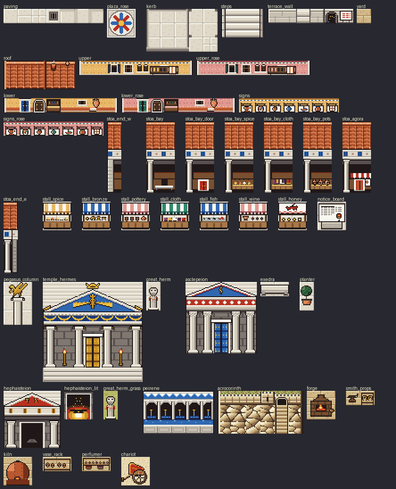

# Emporion tileset catalog

`gTileset_Emporion` is Emporion City: Corinth in its prime, the great trading port of
the Isthmus, in marble and painted stone. Pair it with the `aethos` primary, which
supplies grass, paths, the sea, olives, cypresses and stone pines. Its sister,
`gTileset_Isthmos` ([TILES_isthmos.md](TILES_isthmos.md)), holds the harbor of Lechaion,
the Diolkos, the shipwright's yard and the Isthmian sanctuary; the Temple of Hermes's
interior is `gTileset_TempleHermes` ([TILES_temple_hermes.md](TILES_temple_hermes.md)).

**Why two city tilesets.** The brief's whole Isthmus (city, Agora, temple, monuments,
workshops, Acrocorinth, port, ship sheds, the Diolkos with its ship, Isthmia) came to
about 870 tiles drawn plainly and about 650 after every economy below. A secondary holds
504. The split follows the real map: Lechaion was Corinth's harbor town 3 km north, the
Diolkos crossed the Isthmus west of it, and Isthmia lay 10 km east. If the map team
builds Emporion as one map with its harbor inside it, move `emporion_port.build_port()`
into `emporion_art.py` and cut the same number of tiles elsewhere.

**This file is generated.** `tools/ichor/art/emporion_build.py emporion` draws the tileset,
compiles it and rewrites this catalog. The art is in `emporion_city.py` (streets and the
house kit), `emporion_agora.py`, `emporion_monuments.py` and `emporion_land.py`; the palette
plan, the ground mechanism and the painters are in `emporion_lib.py`.



The numbered sheet is [img/emporion_sheet.png](img/emporion_sheet.png). Mock scenes of a
street, the Agora and the temple are in `img/emporion_scene_*.png` (see the end of this
file).

## How to use it

**IDs.** Each grid lists metatile ids as Porymap shows them, row by row. Each section
starts on a fixed row of the sheet (streets at 0x200, houses: the kit at 0x238, the agora at 0x280, monuments at 0x310, acrocorinth and the workshops at 0x3A8), so adding to one section never renumbers
another; append new pieces at the end of their section. `build/emporion/catalog.json`
carries every structure's ids, walk codes, ground and named parts (`names`) for map
builders, who should place pieces by key and name, never by raw id.

**Collision and layers.** The walk grid beside each structure gives what to set on each
cell:

| Code | Meaning |
|---|---|
| `X` | Impassable: set collision 1. |
| `.` | Passable. |
| `D` | Door: put the warp here. The behavior is `MB_NON_ANIMATED_DOOR`. |
| `T` | Passable, and drawn over the player, who walks behind it. |

Counters (`MB_COUNTER`) are noted where they are.

**Ground.** Each cell is on one of these:
- *aethos ground* (`grass`, `sand`, `sea`, `path`): the cell draws no ground of its own.
  After Porytiles compiles, the build points its bottom layer at aethos's own metatile
  (grass `0x001`, sand `0x124`, sea `0x170`, path `0x1D9`), so it meets the meadow, beach
  or road around it seamlessly, the sea under every ship animates, and it costs no tiles.
  These cells reference aethos's tiles by index: **rebuild whenever aethos is repainted**.
  The build checks every borrowed entry.
- *paving* (`pave`, Emporion's marble flags) or *yard* (`quay`, warm poros blocks): drawn
  into the cell's bottom layer. Both repeat every 16 px, so every paved cell shares the
  same few tiles, and a prop on paving meets the street around it exactly.
- *none*: the art fills the cell.

A cell keeps at most two layers. On aethos ground that means one drawn layer: a part
drawn over the player there can't also have a part under the player.

**Seams.** The engine draws a connected map with the tilesets of the map the player
stands on (MAP_DESIGN.md §5). Keep this tileset's pieces out of the six rows nearest an
up/down seam and the eight columns nearest a left/right seam, unless both maps share it.

**Self-contained.** Apart from the borrowed ground, the tileset is compiled against an
empty stand-in primary, so its metatiles use only its own tiles (0x200 and up) and
palettes 6-12. The build verifies this.

**Palettes.** Every 8x8 tile draws from one of seven color groups, one per secondary
palette (`emporion_lib.GROUPS`). All colors are multiples of 8, in the master palette's
families (PLAN.md):

| Group | Use |
|---|---|
| marble | Marble, gold and painted blue and red: temples, colonnades, the Peirene, the street paving and kerbs, statues, the notice board, fountain water |
| clay | Terracotta roofs, ochre stucco, Aegean-blue doors and shutters, timber; striped awnings |
| clay2 | The same colors slot for slot, with rose stucco and sea-green paint |
| stone | Poros limestone: yards, quays, warehouses, the Diolkos, Acrocorinth's crag and walls |
| wood | Timber, rope, ships, cranes, bronze and fire |
| market | The goods: pots and vases, cloth, spices, fish, wine; the kilns |
| grove | Aethos's grass, pines and laurels |

**Free recolors.** `clay` and `clay2` list their colors in the same order, so a part drawn
in ochre and recolored to rose is the same 4bpp tile in another palette: Porytiles aligns
the slots and stores it once. Every rose house part, and the rose and green awnings, cost
no tiles.

**Tile budget.** 494 of 504 tiles are used. A secondary has 512, but the door
animations copy their frames into tiles 504-511 (`DOOR_TILE_START_SIZE1` in
`src/field_door.c`), so the build fails past 504. To fit, the art is drawn for reuse:
symmetric fronts are mirrored about a tile edge (Porytiles stores a flipped tile once);
walls, roofs, paving, friezes and rock repeat on the 8 or 16 px grid; the Temple of
Hermes, the Asclepeion and the Hephaisteion share one porch kit, row for row; and any
tile within two pixels of another is redrawn as that tile.

## Streets

Marble paving and its variants, kerbs against grass, broad steps, the poros yard paving of the workshops, and the terrace walls that hold the city's levels, with the cistern mouth under the Agora steps.

### Marble street paving

`paving`, 7 wide by 1 tall. Great square marble flags, one to a cell, softly bevelled. (0) the flag, (1) split in two, (2) split in four, (3) a bronze drain grate: lay (0) everywhere and scatter the others. (4)-(6) the flag in shadow: (4) along its north edge, for the row under a building's front or a wall, (5) along its west edge, for the column east of a building's end, (6) both, for the corner. All walkable, and all meet each other on every side.

```text
ids                                         walk
0x200 0x201 0x202 0x203 0x204 0x205 0x206   . . . . . . .
```

Parts: `flag` 0x200, `flag_2` 0x201, `flag_4` 0x202, `drain` 0x203, `shade_n` 0x204, `shade_w` 0x205, `shade_nw` 0x206.

### Plaza inlay: an eight-pointed star in colored marble

`plaza_rose`, 2 wide by 2 tall. For the middle of the Agora or a crossroads: a star of blue and red marble with a gold heart, in a ring, in a square frame. Walkable.

```text
ids           walk
0x208 0x209   . .
0x210 0x211   . .
```

### Paving's kerbed edge against grass

`kerb`, 5 wide by 3 tall. Columns 0-2 are the paved area's border: NW, N, NE / W, plain, E / SW, S, SE. A dark kerbstone runs round the outside; on the south edge its face shows, the street a step above the grass. Columns 3-4, rows 0-1, are inner corners (grass diagonally beyond): NW, NE / SW, SE. (3,2) and (4,2) are plain paving and its worn variant.

```text
ids                             walk
0x20A 0x20B 0x20C 0x20D 0x20E   . . . . .
0x212 0x213 0x214 0x215 0x216   . . . . .
0x21A 0x21B 0x21C 0x21D 0x21E   . . . . .
```

Parts: `NW` 0x20A, `N` 0x20B, `NE` 0x20C, `W` 0x212, `C` 0x213, `E` 0x214, `SW` 0x21A, `S` 0x21B, `SE` 0x21C, `inNW` 0x20D, `inNE` 0x20E, `inSW` 0x215, `inSE` 0x216.

### Broad marble steps

`steps`, 3 wide by 2 tall. Four treads climbing north, two per row: west cheek, run (repeat it for width), east cheek. Lay them against a terrace wall's gap, a podium or a stoa's front (one row of them makes its stylobate).

```text
ids                 walk
0x220 0x221 0x222   . . .
0x228 0x229 0x22A   . . .
```

### Marble terrace wall, its steps and the cistern mouth

`terrace_wall`, 6 wide by 1 tall. A retaining wall one cell tall, the upper level to the north: (0) west end, (1) run (repeat it), (2) steps up through the wall (walkable), (3) east end, (4) the cistern mouth under the Agora steps, a black arch with its grille torn away and two eyes catching the light, (5) its painted board, 'No light, no entry'. Put a warp or a bg event on the mouth; it opens with Hecate's Torch (SYSTEMS.md §1).

```text
ids                                   walk
0x230 0x231 0x232 0x233 0x234 0x235   X X . X X X
```

Parts: `W` 0x230, `run` 0x231, `stairs` 0x232, `E` 0x233, `cistern` 0x234, `cistern_sign` 0x235.

### Poros yard paving

`yard`, 1 wide by 1 tall. The warm poros blocks of the workshops' yards and the back lanes. The workshop props stand on it. It meets the marble paving with a plain joint.

```text
ids     walk
0x236   .
```

Ground: all on poros yard paving.

## Houses: the kit

Two-storey merchant houses built from parts: a terracotta roof (two rows), an upper storey and a ground storey, each a strip of one-cell parts. Every wall part comes in ochre with Aegean-blue paint and in rose with sea-green paint. The recipes after the kit show eight houses made from it.

### House roof: terracotta, two rows

`roof`, 5 wide by 2 tall. Row 0 is the ridge, row 1 the eaves with palmette antefixes. Columns: west end, run (repeat it), east end, then two ridge-row variants of the run: a clay chimney pot and a ridge acroterion (their eaves row is the plain run). A terrace of houses shares one long roof line, each house closed by its own ends.

```text
ids                             walk
0x238 0x239 0x23A 0x23B 0x23C   X X X X X
0x240 0x241 0x242 0x243 0x244   X X X X X
```

Parts: `W` 0x238, `run` 0x239, `E` 0x23A, `chimney` 0x23B, `acroterion` 0x23C, `eaves_W` 0x240, `eaves_run` 0x241, `eaves_E` 0x242.

### House upper storey, ochre

`upper`, 8 wide by 1 tall. One-cell parts for the upper storey, in a row under the roof's eaves: (0) west corner pilaster, (1) plain wall, (2) a window with blue shutters folded back, (3) a window with a wooden grille, (4) a pair of small arched windows, (5)-(6) a timber balcony with a rug over its rail and a door behind (always as a pair), (7) east corner pilaster.

```text
ids                                               walk
0x248 0x249 0x24A 0x24B 0x24C 0x24D 0x24E 0x24F   X X X X X X X X
```

Parts: `W` 0x248, `wall` 0x249, `shutters` 0x24A, `grille` 0x24B, `arched` 0x24C, `balcony_l` 0x24D, `balcony_r` 0x24E, `E` 0x24F.

### House upper storey, rose

`upper_rose`, 8 wide by 1 tall. One-cell parts for the upper storey, in a row under the roof's eaves: (0) west corner pilaster, (1) plain wall, (2) a window with sea-green shutters folded back, (3) a window with a wooden grille, (4) a pair of small arched windows, (5)-(6) a timber balcony with a rug over its rail and a door behind (always as a pair), (7) east corner pilaster. The rose parts are the ochre parts' own tiles in the rose palette.

```text
ids                                               walk
0x250 0x251 0x252 0x253 0x254 0x255 0x256 0x257   X X X X X X X X
```

Parts: `W` 0x250, `wall` 0x251, `shutters` 0x252, `grille` 0x253, `arched` 0x254, `balcony_l` 0x255, `balcony_r` 0x256, `E` 0x257.

### House ground storey, ochre

`lower`, 8 wide by 1 tall. One-cell parts for the ground storey: (0) west pilaster, (1) a double-leaf blue door in a marble frame, (2) an arched wooden door, (3) an open shopfront with a counter (a door too), (4) plain wall, (5) a low barred window, (6) a stone bench with an amphora, (7) east pilaster. (1)-(3) are MB_NON_ANIMATED_DOOR: put the warp there.

```text
ids                                               walk
0x258 0x259 0x25A 0x25B 0x25C 0x25D 0x25E 0x25F   X D D D X X X X
```

Door metatiles: 0x259, 0x25A, 0x25B.

Parts: `W` 0x258, `door` 0x259, `door_arched` 0x25A, `shop` 0x25B, `wall` 0x25C, `window` 0x25D, `bench` 0x25E, `E` 0x25F.

### House ground storey, rose

`lower_rose`, 8 wide by 1 tall. One-cell parts for the ground storey: (0) west pilaster, (1) a double-leaf sea-green door in a marble frame, (2) an arched wooden door, (3) an open shopfront with a counter (a door too), (4) plain wall, (5) a low barred window, (6) a stone bench with an amphora, (7) east pilaster. (1)-(3) are MB_NON_ANIMATED_DOOR: put the warp there. The rose parts are the ochre parts' own tiles in the rose palette.

```text
ids                                               walk
0x260 0x261 0x262 0x263 0x264 0x265 0x266 0x267   X D D D X X X X
```

Door metatiles: 0x261, 0x262, 0x263.

Parts: `W` 0x260, `door` 0x261, `door_arched` 0x262, `shop` 0x263, `wall` 0x264, `window` 0x265, `bench` 0x266, `E` 0x267.

### House upper storey with trade signs, ochre

`signs`, 7 wide by 1 tall. Upper-storey wall cells with a trade sign hung from an iron bracket: (0) tavern (a kantharos cup), (1) bronze-smith (a Corinthian helmet), (2) potter (an amphora), (3) perfumer (an aryballos), (4) shipwright (a hull and sail), (5) grain and the hiring hall (a sack), (6) the wheelwright, Alfred's chariot store (a spoked wheel). Put one over the door of the trade's house.

```text
ids                                         walk
0x268 0x269 0x26A 0x26B 0x26C 0x26D 0x26E   X X X X X X X
```

Parts: `tavern` 0x268, `bronze` 0x269, `potter` 0x26A, `perfume` 0x26B, `ships` 0x26C, `grain` 0x26D, `wheel` 0x26E.

### House upper storey with trade signs, rose

`signs_rose`, 7 wide by 1 tall. Upper-storey wall cells with a trade sign hung from an iron bracket: (0) tavern (a kantharos cup), (1) bronze-smith (a Corinthian helmet), (2) potter (an amphora), (3) perfumer (an aryballos), (4) shipwright (a hull and sail), (5) grain and the hiring hall (a sack), (6) the wheelwright, Alfred's chariot store (a spoked wheel). Put one over the door of the trade's house. The rose parts are the ochre parts' own tiles in the rose palette.

```text
ids                                         walk
0x270 0x271 0x272 0x273 0x274 0x275 0x276   X X X X X X X
```

Parts: `tavern` 0x270, `bronze` 0x271, `potter` 0x272, `perfume` 0x273, `ships` 0x274, `grain` 0x275, `wheel` 0x276.

## House recipes

Eight different houses from the kit, as id grids (top row first). Lay them in a terrace along a street, vary their widths, and give each its own door warp and household. Stack a second upper storey for a three-storey house (recipe 8). A house's door is the cell marked `D` in its ground storey.

**1. A house with shutters** (5 wide, 4 tall, ochre)

```text
0x238 0x239 0x239 0x239 0x23A
0x240 0x241 0x241 0x241 0x242
0x248 0x24A 0x249 0x24B 0x24F
0x258 0x259 0x25C 0x25D 0x25F
```

**2. A rose house with a balcony** (4 wide, 4 tall, rose)

```text
0x238 0x23B 0x239 0x23A
0x240 0x241 0x241 0x242
0x250 0x255 0x256 0x257
0x260 0x266 0x262 0x267
```

**3. The tavern** (5 wide, 4 tall, ochre)

```text
0x238 0x239 0x23C 0x239 0x23A
0x240 0x241 0x241 0x241 0x242
0x248 0x24C 0x268 0x24C 0x24F
0x258 0x25D 0x259 0x25E 0x25F
```

**4. A rose house with a shop** (4 wide, 4 tall, rose)

```text
0x238 0x239 0x23B 0x23A
0x240 0x241 0x241 0x242
0x250 0x253 0x252 0x257
0x260 0x263 0x261 0x267
```

**5. The bronze-smith's house** (6 wide, 4 tall, ochre)

```text
0x238 0x23B 0x239 0x239 0x239 0x23A
0x240 0x241 0x241 0x241 0x241 0x242
0x248 0x269 0x24D 0x24E 0x24A 0x24F
0x258 0x25B 0x25C 0x25A 0x25D 0x25F
```

**6. The perfumer's house** (6 wide, 4 tall, rose)

```text
0x238 0x239 0x239 0x23C 0x239 0x23A
0x240 0x241 0x241 0x241 0x241 0x242
0x250 0x252 0x273 0x251 0x254 0x257
0x260 0x265 0x263 0x261 0x266 0x267
```

**7. The potter's narrow house** (3 wide, 4 tall, ochre)

```text
0x238 0x23B 0x23A
0x240 0x241 0x242
0x248 0x26A 0x24F
0x258 0x25A 0x25F
```

**8. A tall rose house, three storeys** (5 wide, 5 tall, rose)

```text
0x238 0x239 0x23B 0x239 0x23A
0x240 0x241 0x241 0x241 0x242
0x250 0x254 0x252 0x254 0x257
0x250 0x253 0x255 0x256 0x257
0x260 0x265 0x261 0x265 0x267
```

## The Agora

The stoa and its bays (the Agora shop among them), the market's stalls, the notice board with the owl seal, and Pegasus on his column.

### Stoa: west end

`stoa_end_w`, 1 wide by 5 tall. The stoa's west end: the roof's verge, the entablature's return and the end wall (anta). Impassable.

```text
ids     walk
0x280   X
0x288   X
0x290   X
0x298   X
0x2A0   X
```

### Stoa bay: open

`stoa_bay`, 2 wide by 5 tall. One bay of the colonnade, two cells wide and five tall: roof, eaves, the triglyph frieze with its painted metopes, and a tall Doric column at the bay's left before the portico's deep shadow. Its bottom row is the portico with a bench and a doorway at the back. Repeat bays for length: every bay's top four rows are the same tiles. All impassable.

```text
ids           walk
0x281 0x282   X X
0x289 0x28A   X X
0x291 0x292   X X
0x299 0x29A   X X
0x2A1 0x2A2   X X
```

### Stoa bay: a shop door

`stoa_bay_door`, 2 wide by 5 tall. As stoa_bay, with a red door at the back of the portico: bottom row, second column, MB_NON_ANIMATED_DOOR. Put a shop's warp there.

```text
ids           walk
0x283 0x284   X X
0x28B 0x28C   X X
0x293 0x294   X X
0x29B 0x29C   X X
0x2A3 0x2A4   X D
```

### Stoa bay: the spice seller's counter

`stoa_bay_spice`, 2 wide by 5 tall. As stoa_bay, with a counter of baskets heaped with saffron, sumac, salt and herbs. Both bottom cells are MB_COUNTER, so the player talks across them to a seller standing in front of the bay's column.

```text
ids           walk
0x285 0x286   X X
0x28D 0x28E   X X
0x295 0x296   X X
0x29D 0x29E   X X
0x2A5 0x2A6   X X
```

Counter metatiles (`MB_COUNTER`): 0x2A5, 0x2A6.

### Stoa bay: the cloth merchant's counter

`stoa_bay_cloth`, 2 wide by 5 tall. As stoa_bay_spice, with bolts of purple, saffron and white cloth.

```text
ids           walk
0x2A8 0x2A9   X X
0x2B0 0x2B1   X X
0x2B8 0x2B9   X X
0x2C0 0x2C1   X X
0x2C8 0x2C9   X X
```

Counter metatiles (`MB_COUNTER`): 0x2C8, 0x2C9.

### Stoa bay: the potter's counter

`stoa_bay_pots`, 2 wide by 5 tall. As stoa_bay_spice, with black-figure cups and jugs and three amphorae.

```text
ids           walk
0x2AA 0x2AB   X X
0x2B2 0x2B3   X X
0x2BA 0x2BB   X X
0x2C2 0x2C3   X X
0x2CA 0x2CB   X X
```

Counter metatiles (`MB_COUNTER`): 0x2CA, 0x2CB.

### Stoa bay: the Agora shop

`stoa_agora`, 2 wide by 5 tall. The Agora (the game's shop) as a bay of the stoa: a red-and-white awning slung between the columns, a pinax with the Agora's jar, and the door: bottom row, second column, MB_NON_ANIMATED_DOOR. Warp to the Agora interior here.

```text
ids           walk
0x2AC 0x2AD   X X
0x2B4 0x2B5   X X
0x2BC 0x2BD   X X
0x2C4 0x2C5   X X
0x2CC 0x2CD   X D
```

### Stoa: east end

`stoa_end_e`, 1 wide by 5 tall. The stoa's east end: the last column, the shaded verge and the end wall. Impassable.

```text
ids     walk
0x2AE   X
0x2B6   X
0x2BE   X
0x2C6   X
0x2CE   X
```

### Market stall: spices

`stall_spice`, 2 wide by 2 tall. Saffron, sumac, cumin and salt heaped in baskets. Free-standing on the paving; the seller stands beside it.

```text
ids           walk
0x2D0 0x2D1   X X
0x2D8 0x2D9   X X
```

Ground: all on marble paving.

### Market stall: bronze

`stall_bronze`, 2 wide by 2 tall. Bronze mirrors, a jug, a helmet and a little tripod (Corinthian bronze). Free-standing on the paving; the seller stands beside it.

```text
ids           walk
0x2D2 0x2D3   X X
0x2DA 0x2DB   X X
```

Ground: all on marble paving.

### Market stall: pottery

`stall_pottery`, 2 wide by 2 tall. Black-figure jugs and cups, and an amphora. Free-standing on the paving; the seller stands beside it.

```text
ids           walk
0x2D4 0x2D5   X X
0x2DC 0x2DD   X X
```

Ground: all on marble paving.

### Market stall: cloth

`stall_cloth`, 2 wide by 2 tall. Bolts of Tyrian purple, saffron and white. Free-standing on the paving; the seller stands beside it.

```text
ids           walk
0x2D6 0x2D7   X X
0x2DE 0x2DF   X X
```

Ground: all on marble paving.

### Market stall: fish

`stall_fish`, 2 wide by 2 tall. Silver fish on a wet slab, an octopus and a basket of sprats. Free-standing on the paving; the seller stands beside it.

```text
ids           walk
0x2E0 0x2E1   X X
0x2E8 0x2E9   X X
```

Ground: all on marble paving.

### Market stall: wine

`stall_wine`, 2 wide by 2 tall. A krater, wine jugs and a rack of amphorae. Free-standing on the paving; the seller stands beside it.

```text
ids           walk
0x2E2 0x2E3   X X
0x2EA 0x2EB   X X
```

Ground: all on marble paving.

### Kydon's honey stall

`stall_honey`, 2 wide by 2 tall. Kydon, the Knossan honey-seller (LABYRINTH.md seed 3): his awning is painted with a bull-leaper over a wavy Minoan border. Honey jars and a comb on the counter.

```text
ids           walk
0x2E4 0x2E5   X X
0x2EC 0x2ED   X X
```

Ground: all on marble paving.

### The public notice board (the Archon's owl seal)

`notice_board`, 2 wide by 2 tall. A whitened board (leukoma) on a marble base, where proclamations are posted. The notice carries the Archon's owl seal in red wax, with a tiny hook cut under it (STORY.md I-4: 'Odd. There's a little hook under the owl.'). Give both bottom cells the same bg event.

```text
ids           walk
0x2E6 0x2E7   X X
0x2EE 0x2EF   X X
```

Ground: all on marble paving.

### Pegasus on his column, Corinth's emblem

`pegasus_column`, 2 wide by 3 tall. A gilded bronze Pegasus rearing on an Ionic column: Bellerophon caught him at the Peirene spring. Put it in the middle of the Agora. The top row draws over the player.

```text
ids           walk
0x2F0 0x2F1   T T
0x2F8 0x2F9   X X
0x300 0x301   X X
```

Ground: all on marble paving.

## Monuments

The Temple of Hermes, Emporion's Asclepeion, the Peirene fountain house, the Hephaisteion and its forge, the great herm, and the street furniture.

### Temple of Hermes, exterior

`temple_hermes`, 7 wide by 7 tall. The city's crown. A tetrastyle Ionic front in marble under a marble-tiled roof: a gold winged petasos on the apex, gilded wings at the corners, the caduceus on spread wings in a blue pediment, a dentil cornice over a frieze of golden wings, relay torches burning in the side bays, and tall bronze doors. Door: row 5, middle column (MB_NON_ANIMATED_DOOR). The step row is walkable. Raise it on a terrace at the end of the main street.

```text
ids                                         walk
0x310 0x311 0x312 0x313 0x314 0x315 0x316   X X X X X X X
0x318 0x319 0x31A 0x31B 0x31C 0x31D 0x31E   X X X X X X X
0x320 0x321 0x322 0x323 0x324 0x325 0x326   X X X X X X X
0x328 0x329 0x32A 0x32B 0x32C 0x32D 0x32E   X X X X X X X
0x330 0x331 0x332 0x333 0x334 0x335 0x336   X X X X X X X
0x338 0x339 0x33A 0x33B 0x33C 0x33D 0x33E   X X X D X X X
0x340 0x341 0x342 0x343 0x344 0x345 0x346   . . . . . . .
```

Door metatiles: 0x33B.

### Great herm

`great_herm`, 1 wide by 2 tall. A garlanded pillar with Hermes's bearded head, darker where hands have touched it (SYSTEMS.md §4). Kerykos teaches anointing at this one. The top cell draws over the player; give the bottom cell the bg event. On paving.

```text
ids     walk
0x317   T
0x31F   X
```

Ground: all on marble paving.

### Emporion's Asclepeion

`asclepeion`, 5 wide by 5 tall. Emporion's healing temple, a sibling of aethos's Asclepeion (0x048): a Corinthian porch (Corinth's own order), the rod of Asclepius in gold in a blue pediment, a frieze of white rosettes on red, and a tall blue door with gold studs. Door: bottom row, middle (MB_NON_ANIMATED_DOOR). Lay the broad steps in front of it. Its column cells are the Temple of Hermes's own tiles below the capitals.

```text
ids                             walk
0x348 0x349 0x34A 0x34B 0x34C   X X X X X
0x350 0x351 0x352 0x353 0x354   X X X X X
0x358 0x359 0x35A 0x35B 0x35C   X X X X X
0x360 0x361 0x362 0x363 0x364   X X X X X
0x368 0x369 0x36A 0x36B 0x36C   X X D X X
```

Door metatiles: 0x36A.

### Marble exedra bench

`exedra`, 2 wide by 1 tall. A curved marble bench with lion's-foot ends, for squares and the Peirene's court. Sit townsfolk beside it.

```text
ids           walk
0x34D 0x34E   X X
```

Ground: all on marble paving.

### A clipped laurel in a great terracotta pot

`planter`, 1 wide by 2 tall. For squares, doorways and the temple's terrace. One cell wide, two tall; the laurel's head draws over the player.

```text
ids     walk
0x34F   T
0x357   X
```

Ground: all on marble paving.

### The Hephaisteion above the Agora (forge cold)

`hephaisteion`, 4 wide by 4 tall. Hephaestus's small temple above the Agora (SYSTEMS.md §1, 'The Cold Forge'): a red pediment with the god's hammer and tongs in gold, a triglyph frieze, and the cella's great doorway, dark while the forge is cold. Doors: bottom row, middle two cells. When Kedalion relights the forge, swap hephaisteion_lit's four cells over rows 2-3, columns 1-2. Its back stair (stair_up) can be blocked by column drums as object events for the Girdle gate.

```text
ids                       walk
0x370 0x371 0x372 0x373   X X X X
0x378 0x379 0x37A 0x37B   X X X X
0x380 0x381 0x382 0x383   X X X X
0x388 0x389 0x38A 0x38B   X D D X
```

Door metatiles: 0x389, 0x38A.

### The Hephaisteion's doorway with the forge roaring

`hephaisteion_lit`, 2 wide by 2 tall. Swap these over hephaisteion's cells (1,2), (2,2), (1,3) and (2,3) once the forge is lit: firelight fills the doorway and the anvil stands black against it. Keep the bottom row MB_NON_ANIMATED_DOOR.

```text
ids           walk
0x374 0x375   X X
0x37C 0x37D   D D
```

Door metatiles: 0x37C, 0x37D.

### Great herm, on grass

`great_herm_grass`, 1 wide by 2 tall. A garlanded pillar with Hermes's bearded head, darker where hands have touched it (SYSTEMS.md §4). Kerykos teaches anointing at this one. The top cell draws over the player; give the bottom cell the bg event. On aethos grass; its tiles are great_herm's.

```text
ids     walk
0x376   T
0x37E   X
```

Ground: all on aethos grass.

### The Peirene fountain house

`peirene`, 5 wide by 3 tall. Corinth's sacred spring, where Bellerophon caught Pegasus: an Ionic entablature with a frieze of waves over an arcade of dark spring chambers, each with a bronze spout, over a marble drawing basin. The middle three cells are the same tiles, so it can be made longer or shorter. Give the basin a bg event: 'The water is cold and very sweet.'

```text
ids                             walk
0x390 0x391 0x392 0x393 0x394   X X X X X
0x398 0x399 0x39A 0x39B 0x39C   X X X X X
0x3A0 0x3A1 0x3A2 0x3A3 0x3A4   X X X X X
```

## Acrocorinth and the workshops

The crag and its walls over the city; the bronze-smith's, the potter's and the perfumer's yards.

### Acrocorinth: the crag and its fortified crest

`acrocorinth`, 6 wide by 3 tall. The great crag over the city with walls on its skyline, a band three rows tall that runs east-west: row 0 the crest (curtain wall and battlements, the plateau's scrub above), rows 1-2 the cliff. Columns: (0) the west end, (1) run A, (2) run B (alternate them), (3) a tower, (4) the gate, a rock-cut stair climbing to it through the cliff (walkable), (5) the east end. Put the map's highest ground above row 0, and grass or rock beside the ends.

```text
ids                                   walk
0x3A8 0x3A9 0x3AA 0x3AB 0x3AC 0x3AD   X X X X . X
0x3B0 0x3B1 0x3B2 0x3B3 0x3B4 0x3B5   X X X X . X
0x3B8 0x3B9 0x3BA 0x3BB 0x3BC 0x3BD   X X X X . X
```

### The bronze-smith's forge

`forge`, 2 wide by 2 tall. A brick forge under a hood, its charcoal glowing, with the leather bellows at its side. On yard paving (the quay's poros).

```text
ids           walk
0x3AE 0x3AF   X X
0x3B6 0x3B7   X X
```

Ground: all on poros yard paving.

### Anvil, and a rack of Corinthian helmets

`smith_props`, 2 wide by 1 tall. (0) an anvil on its block with a hammer; (1) a rack of Corinthian helmets, the city's famous bronze. On yard paving.

```text
ids           walk
0x3C0 0x3C1   X X
```

Ground: all on poros yard paving.

### The potter's kiln

`kiln`, 2 wide by 2 tall. A beehive kiln of clay, smoke from its vent, fire showing at its stoking mouth. On yard paving.

```text
ids           walk
0x3C2 0x3C3   X X
0x3CA 0x3CB   X X
```

Ground: all on poros yard paving.

### A rack of black-figure vases drying

`vase_rack`, 2 wide by 1 tall. The potter's new pots drying in the sun: jugs and amphorae with Corinth's black-figure animal friezes. On yard paving.

```text
ids           walk
0x3C4 0x3C5   X X
```

Ground: all on poros yard paving.

### The perfumer's shelf

`perfumer`, 2 wide by 1 tall. Shelves of aryballoi, Corinth's little round perfume flasks, in painted clay, over baskets of roses and irises. On yard paving.

```text
ids           walk
0x3C6 0x3C7   X X
```

Ground: all on poros yard paving.

### Alfred's chariot on show

`chariot`, 2 wide by 2 tall. A light two-wheeled racing chariot, its car painted red with a gold rim, parked with its pole resting on the yoke: the one Alfred builds and sells. In the wheelwright's dirt yard.

```text
ids           walk
0x3D0 0x3D1   X X
0x3D8 0x3D9   X X
```

Ground: all on aethos path.

## Mock scenes

`tools/ichor/art/emporion_scene.py` composes four throwaway scenes from these catalogs by
structure key and renders them with `tools/ichor/render_map.py` on the compiled tilesets:
a street of merchant houses, the Agora, the port of Lechaion with the Diolkos (Isthmos),
and the Temple of Hermes on its height. They are block data, not maps.

| Image | Shows |
|---|---|
| `img/emporion_scene_street.png` | A street of the eight house recipes |
| `img/emporion_scene_agora.png` | The stoa, the Agora shop, the stalls, Pegasus, the notice board |
| `img/emporion_scene_temple.png` | The Temple of Hermes on its terrace, the Asclepeion, the Peirene, Acrocorinth behind |
| `img/emporion_scene_port.png` | Lechaion: quays, sheds, warehouses, the crane, the ship and the Diolkos |
| `img/emporion_scene_*_pass1.png`, `_pass2` | The first two render-and-critique passes; the unsuffixed image is the third and final |
| `img/emporion_scene_temple_interior.png` | The Herald's Run, a mock of the temple's interior (TILES_temple_hermes.md) |
