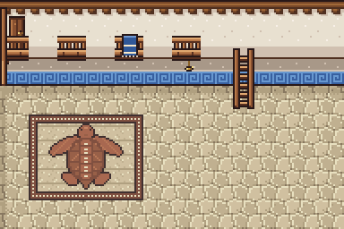
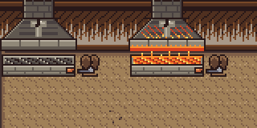

# ergasteria: the working interiors

`gTileset_Ergasteria` ("workshops") is the secondary tileset for Phase 2's working rooms: the inns, the mint, the forge, the potter's, the tavern. Batch 1 draws Aegina's three homes (the inn, the mint and Aiakides's house, laid out in `ROOMS_ergasteria.md`). Batch 2 added Emporion's Hephaisteion, which filled it; Emporion's other rooms are on limen and domos (`TILES_limen.md`). It sits on the `oikos` primary, as oikia and civic do, and like them works on any primary.




## What's in it

**Shared with the slice.** The furniture a working room shares with a home is taken from oikia (`tools/ichor/art/oikia_art.py`) pixel for pixel, so these rooms match the slice's homes exactly:
- terracotta pavers and limestone flags, with their shadowed rows and columns;
- the whitewashed back wall with the red ochre dado and with the Aegean dado; the void;
- the red and the blue rug;
- the window, the niche, drying herbs, the jar shelf and the honey shelf;
- the kline, both klismos chairs, the stool, the long table and the round one;
- both amphorae, the pithos, the cooking pots, the kitchen hearth and its soot;
- the potted myrtle, the fish basket, knucklebones, the bronze lampstand, the Doric post and the reed door mat.

oikia's boards, loom, chest, altar, scrolls, stairs and the rest stay out until a room needs them: each piece costs tiles.

**New for the inn.**
- **The gallery wall.** The courtyard's back wall is three blocks tall: the eave and rafters, the whitewashed upper storey, then the shaded ground floor under the gallery with the inn's blue dado.
- **The gallery.** Timber bays drawn over that wall, one block wide each: a post with a guest-room door behind the balustrade, the balustrade over bare wall, a blue blanket airing over the rail, and a clay lamp hung under the gallery. Any order tiles cleanly.
- **The ladder** up to the gallery (the loft), 1x3: its top above the rail, its foot on the courtyard floor.
- **The cistern.** A fluted marble well-head over the rain cistern, with a dipper on its rope, 2x2.
- **The turtle mosaic.** A pebble mosaic of a sea turtle, Aegina's coin, in a frame of white beads, 4x3, walkable. Dark pebbles outline it, terracotta pebbles make its shell, and a row of white ones runs down its spine as on the island's staters.
- **The common room's hearth.** An open fire in a raised stone curb, free-standing, 2x2.
- **A long bench**, 2x1.

**New for the mint.**
- **The stone wall.** Ashlar for the strongroom: three courses of squared limestone with staggered joints on a dark plinth, under the same ceiling beam.
- **The anvil.** An iron block with the lower die in it, on an oak stump, a blank on the die.
- **The die rack.** Three upper dies, a hammer and tongs on a pegged board, hung on the wall, 2x2.
- **The brazier.** A small bronze brazier with silver blanks heating on its coals.
- **The balance.** A moneyer's balance, silver in one pan and a weight in the other, 1x2.
- **The strongbox.** Oak bound in bronze, with a sea turtle stamped on its lid, 2x2.
- **The vault door.** Oak bound in bronze, with a slot that lets coins out and nothing in, set in the back wall, 1x2.
- **The counting table.** Stacks of silver staters, a purse and blanks on a table, 2x1. Its top row of tiles is the iron palette and its bottom row the wood palette, which keeps every 8x8 tile in one palette.

**New for Aiakides's house.**
- **The shield and spear.** A bronze hoplite shield with an ant for its blazon and the spear behind it, hung on the wall, 2x2.
- **The ant shrine.** A little stone pillar with a terracotta ant on top and a lamp in its niche, against the back wall, 1x2.
- **The anthill pot.** A big pot full of earth with the anthill heaped in it, ants on the rim, 1x2.
- **The ant trail.** A line of ants marching across the floor, walkable, 1x1. Two in a row make a diagonal.

**New for Emporion's Hephaisteion (batch 2).** The forge took the rest of the set; the potter's and the tavern, planned here too, went to limen and domos (`TILES_limen.md`) because there was no room.
- **Beaten earth.** The floor palette's three earth tones, held back for this: a speckle that repeats every 8 pixels, shadowed under the wall and along the left edge, cinders in the alt cell.
- **The smoke-black wall.** Soot hanging from the beam in a ragged fringe over stone-gray plaster, 8-pixel periodic.
- **The forge hood**, 3x2 over the wall, and its lit variant: a flue up through the roof, the hood flaring over the hearth, its lintel, and the empty iron hook where the Bronze Hammer hung, a clean hammer shape left in the soot behind it. Lit, firelight on the lintel and up the hood's throat.
- **The forge**, 3x1, cold and lit: a raised stone bed, gray ash and dead charcoal, or glowing coals and flames; the bellows' clay nozzle let into its right end.
- **The bellows**, two goatskins on a plank with an iron nozzle; **the smith's anvil**, horned, on an oak stump; **the quenching trough**, stone, black water, tongs in it; **the tongs rack**, a pegged plank of tongs and hammers; **the workbench**, an ingot, a half-beaten helmet, a hammer and a file; **the votive shelf**, a little smith, a bull and an owl in bronze; **a charcoal basket**.



## How it is made

The art is in `tools/ichor/art/ergasteria_art.py`: hand-drawn character grids, one character per color, `.` for clear, with small generators for the round and symmetric pieces (the cistern, the mosaic, the shield, the gallery bays). `tools/ichor/art/ergasteria_build.py` does the rest, the way `oikia_build.py` does (`design/phase1/TILES_oikia.md`), and reuses its generic parts:

```bash
/usr/bin/python3 tools/ichor/art/ergasteria_build.py                # compose, compile, check, write the rooms and images
/usr/bin/python3 tools/ichor/art/ergasteria_build.py --no-compile   # compose and check only
/usr/bin/python3 tools/ichor/maps/aegina_homes.py                   # the same build, from the rooms' end
```

1. It composes every cell of every room (each module in `room_modules()`: `tools/ichor/maps/aegina_homes.py` and, for the rooms whose `set` is ergasteria, `tools/ichor/maps/emporion_rooms.py`) and of four catalog layouts, plus each room's variants (the forge lit).
2. It deduplicates the cells into metatiles, the bare floors, walls and rugs first, and writes `data/tilesets/secondary/ergasteria/porytiles_src/`.
3. It compiles with Porytiles, paired with `gTileset_Aethos`, and copies back any solid tile Porytiles borrowed from aethos.
4. It checks every metatile uses only ergasteria's tiles and palettes 6-12, renders every room on `oikos`, `aethos` and `building`, and fails unless all three match the composed source.
5. It writes each room's `map.bin` and `border.bin`, edits its `layouts.json` entry (size and tilesets only), and writes the renders and the generated tables here and in each room module's ROOMS doc (`ROOMS_ergasteria.md`, `ROOMS_emporion.md`).
6. For each room variant, it writes the `setmetatile` script that turns the room as built into the variant, between `// ergasteria_build: begin generated` markers at the end of the map's `scripts.pory` (the Hephaisteion's `EmporionCity_Hephaisteion_EventScript_LightForge`).

The same machinery builds other sets: a `RoomSet` names the tileset, its art module and its docs, and each room spec names its set. `limen_build.py` builds limen and domos with it.

**The rooms are data in Python.** The builder rewrites their blockdata on every run, so metatile ids may move freely between builds. Re-dress a room in `aegina_homes.py`, not in Porymap.

**Rooms can mix floors and walls.** Beyond oikia's format, a room's `floors` maps more grid characters to other floors (the inn's flagged courtyard is `,`), and `walls` maps more characters to other wall styles of any height (the inn's three-block gallery wall is `G`).

**Layers, collision and behavior** follow oikia: floors and walls on the bottom layer, furniture on the middle layer; floor passable at elevation 3, walls and furniture blocked at elevation 0, warp tiles passable at elevation 0. Only the door mat carries a behavior (`MB_SOUTH_ARROW_WARP`). A walkable piece (the mosaic, the ant trail) keeps the floor passable; laid over a blocked cell it keeps it blocked.

## Palettes

Seven palettes of at most 15 colors, all multiples of 8, none equal to an aethos color (the builder asserts both). Five are oikia's, so the shared furniture fits them as it is.

| Palette | Use | Colors |
|---|---|---|
| wall | oikia's: beams, whitewash, red ochre and Aegean dados, ochre key, shutters, sky; also the ashlar and the gallery wall | 15 |
| floor | terracotta (6) and limestone (5), oikia's; a dark pebble; three earth tones | 15 |
| wood | oikia's: furniture woods, bronze fittings, linen, red and blue cloth, olive | 15 |
| clay | oikia's: pottery, hearth stone, fire, soot, white slip, bronze, honey | 15 |
| iron | oikia's rug colors (madder, ochre, saffron, wool, indigo, blues, brown), with iron (3), silver and a lit wood | 15 |
| nature | oikia's: myrtle and herbs, wicker, fish, rope, a plant pot | 14 |
| bronze | oikia's: bronze, flame, water, marble, painted red | 15 |

**Batch 2.** The palettes were chosen so Emporion's workshops would need no new ones, and the forge needed none: the hearth's stone, fire and soot are in clay; the smith's horned anvil, tongs and bellows in iron (its browns are the leather); the trough and votives in bronze; the beaten-earth floor in the floor palette's three earth tones. The potter's and the tavern went to limen and domos for want of tiles, not colors. One nature slot is still free.

## Budget

**Full: 500 of 504 tiles** after batch 2 (batch 1 used 399; the Hephaisteion took the other 101). Tiles 504-511 stay free, because door animations copy their frames over them (`DOOR_TILE_START_SIZE1` in `src/field_door.c`). Metatiles are not tight: 344 of 512. New rooms can still be built from the pieces already here (a new arrangement over an existing floor costs metatiles, not tiles); new pieces go in another set.

To spend tiles carefully:
- Draw symmetric pieces symmetric to the pixel. Porytiles stores a mirrored 8x8 tile once, so the mosaic costs 18 tiles, not 36.
- Make plain fill repeat every 8 pixels (the mosaic's pebble field does), so it costs one tile.
- Leave pieces out of the set until a room uses them, as above.

## Generated tables

The builder rewrites everything below this line.

<!-- ergasteria_build: begin generated -->

Built: **337** metatiles (`0x200`-`0x350`) of 512, **500** tiles of 504, palettes 6-12.

| Piece | Metatile |
|---|---|
| floor terracotta, plain | `200` |
| floor terracotta, alt | `201` |
| floor terracotta, top | `202` |
| floor terracotta, left | `203` |
| floor terracotta, corner | `204` |
| floor flags, plain | `205` |
| floor flags, top | `206` |
| floor flags, left | `207` |
| floor flags, corner | `208` |
| floor earth, plain | `209` |
| floor earth, alt | `20A` |
| floor earth, top | `20B` |
| floor earth, left | `20C` |
| floor earth, corner | `20D` |
| wall red, row 0 | `20E` |
| wall red, row 1 | `20F` |
| wall blue, row 0 | `20E` |
| wall blue, row 1 | `210` |
| wall stone, row 0 | `211` |
| wall stone, row 1 | `212` |
| wall gallery, row 0 | `213` |
| wall gallery, row 1 | `214` |
| wall gallery, row 2 | `215` |
| wall smoke, row 0 | `216` |
| wall smoke, row 1 | `217` |
| void (outside the room) | `218` |
| rug red, top-left | `219` |
| rug red, top | `21A` |
| rug red, top-right | `21B` |
| rug red, left | `21C` |
| rug red, middle | `21D` |
| rug red, right | `21E` |
| rug red, bottom-left | `21F` |
| rug red, bottom | `220` |
| rug red, bottom-right | `221` |
| rug blue, top-left | `222` |
| rug blue, top | `223` |
| rug blue, top-right | `224` |
| rug blue, left | `225` |
| rug blue, middle | `226` |
| rug blue, right | `227` |
| rug blue, bottom-left | `228` |
| rug blue, bottom | `229` |
| rug blue, bottom-right | `22A` |

| Stamp | Cells | Palette | From | Metatiles (where) | What it is |
|---|---|---|---|---|---|
| `window` | 1x2 | wall | oikia | 22C / 234 (terracotta) | shuttered window, Aegean-blue shutters open |
| `niche` | 1x2 | wall | oikia | 22F / 237 (terracotta) | wall niche with a terracotta goddess and an aryballos |
| `herbs` | 1x2 | nature | oikia | 22B / 233 (terracotta) | bundles of drying herbs hung from pegs in the beam |
| `jar_shelf` | 2x2 | wood | oikia | 22D 22E / 235 236 (terracotta) | wall shelf of remedy jars and flasks |
| `honey_shelf` | 2x2 | wood | oikia | 230 231 / 238 239 (terracotta) | wall shelf of honey jars sealed with wax |
| `kline` | 2x2 | wood | oikia | 2DB 2DC / 29C 29D (terracotta) | kline (couch-bed): a scrolled headrest with a bronze boss, linen pillow, woven blue coverlet |
| `klismos_r` | 1x1 | wood | oikia | 2DD (terracotta) | klismos chair, facing right |
| `klismos_l` | 1x1 | wood | oikia | 2DE (terracotta) | klismos chair, facing left |
| `stool` | 1x1 | wood | oikia | 2DF (terracotta) | diphros: a folding stool with crossed legs and a fleece seat |
| `table` | 2x1 | wood | oikia | 2E1 2E2 (terracotta) | trapeza: a low table with bread, a red jug, olives and a cup |
| `table_round` | 1x1 | wood | oikia | 258 (terracotta) | a small three-legged table with a jug and bread |
| `amphora` | 1x2 | clay | oikia | 2E3 / 2E5 (terracotta) | amphora with a black-figure band |
| `amphora_plain` | 1x2 | clay | oikia | 2E4 / 2E6 (terracotta) | a plain oil amphora |
| `pithos` | 1x2 | clay | oikia | 2A3 / 2A4 (terracotta) | pithos: a big storage jar with rope-pattern bands and a stone lid |
| `pots` | 1x1 | clay | oikia | 25C (terracotta) | cooking pots: a sooty chytra, a jug and a stack of bowls |
| `hearth` | 2x2 | clay | oikia | 2D9 295 / 2DA 29B (terracotta) | kitchen hearth: Hestia's fire in a stone curb, a bronze cauldron on its tripod |
| `soot` | 2x2 | clay | oikia | 289 28A / 2D6 2D7 (terracotta) | smoke-blackened plaster above the hearth |
| `myrtle` | 1x2 | nature | oikia | 2E7 / 2F1 (terracotta) | potted myrtle, Aphrodite's shrub, in flower |
| `fish_basket` | 1x1 | nature | oikia | 2E8 (terracotta) | a wicker basket of the morning's catch |
| `knucklebones` | 1x1 | nature | oikia | 2E9 (terracotta) | astragaloi: five knucklebones on a leather gaming cloth |
| `lampstand` | 1x2 | bronze | oikia | 24D / 252 (terracotta) | lychnouchos: a bronze lampstand on lion-paw feet, lamp lit |
| `column` | 1x3 | bronze | oikia | 24E / 253 / 259 (terracotta) | a Doric post of whitewashed stone, holding up the beam |
| `mat` | 2x1 | nature | oikia | 2A5 2A6 (terracotta) | woven reed mat at the door; both cells are south-arrow warps |
| `cistern` | 2x2 | bronze | ergasteria | 2F6 2F7 / 2FF 300 (terracotta) | the courtyard's rain cistern: a fluted marble well-head over dark water, a dipper on its rope |
| `mosaic_turtle` | 4x3 | floor | ergasteria | 25D 25E 25F 260 / 261 262 263 264 / 269 26A 26B 26C (gallery) | pebble mosaic of a sea turtle, Aegina's coin: terracotta shell, white beads down the spine |
| `gallery_door` | 1x3 | wood | ergasteria | 232 / 23B / 241 (gallery) | the inn's timber gallery: a post, a guest-room door behind the balustrade |
| `gallery_rail` | 1x3 | wood | ergasteria | --- / 23C / 242 (gallery) | the gallery's balustrade over bare wall |
| `gallery_blanket` | 1x3 | wood | ergasteria | --- / 23D / 242 (gallery) | a blue blanket airing over the gallery rail |
| `gallery_lamp` | 1x3 | wood | ergasteria | --- / 23C / 243 (gallery) | the balustrade, with a clay lamp hung under the gallery |
| `ladder` | 1x3 | wood | ergasteria | 348 / 349 / 247 (gallery) | a timber ladder up to the guest gallery (the loft); its foot stands in the courtyard |
| `hearth_floor` | 2x2 | clay | ergasteria | 245 246 / 24B 24C (terracotta) | the common room's hearth: an open fire in a raised stone curb, where the inn eats |
| `bench` | 2x1 | wood | ergasteria | 2E0 24A (terracotta) | a long wooden bench |
| `anvil` | 1x1 | iron | ergasteria | 2EA (terracotta) | a coin anvil: an iron block with the lower die in it, on an oak stump; a blank on the die |
| `coin_table` | 2x1 | wood | ergasteria | 2EF 2F0 (terracotta) | a counting table: stacks of silver staters, a purse, blanks waiting their turn |
| `die_rack` | 2x2 | iron | ergasteria | 2CC 2CD / 2D1 2D2 (terracotta) | the moneyer's rack: three upper dies, a hammer and tongs on pegs |
| `brazier_small` | 1x1 | bronze | ergasteria | 2EB (terracotta) | a small bronze brazier, silver blanks heating on its coals |
| `scales` | 1x2 | bronze | ergasteria | 2EC / 2F2 (terracotta) | a moneyer's balance: silver in one pan, a bronze weight in the other |
| `turtle_chest` | 2x2 | wood | ergasteria | 2ED 2EE / 2F3 2F4 (terracotta) | the mint's strongbox: oak bound in bronze, a sea turtle stamped on its lid |
| `vault_door` | 1x2 | wood | ergasteria | 2CE / 2D3 (terracotta) | the strongroom's inner door: oak bound in bronze, with a slot that lets coins out and nothing in |
| `shield_spear` | 2x2 | bronze | ergasteria | 28B 28C / 2D4 2D5 (terracotta) | Aiakides's bronze shield, an ant for its blazon, and his spear, hung on the wall |
| `ant_shrine` | 1x2 | clay | ergasteria | 2D8 / 296 (terracotta) | a little stone shrine with a clay ant on it and a lamp in its niche: Aiakides's ancestors |
| `anthill_pot` | 1x2 | clay | ergasteria | 2F5 / 2FE (terracotta) | a big pot full of earth, a living anthill heaped in it; ants on the rim |
| `ant_trail` | 1x1 | clay | ergasteria | 29E (terracotta) | a line of ants across the floor, marching for the crumbs |
| `forge_hood` | 3x2 | clay | ergasteria | 2A7 2A8 2A9 / 2AB 2AC 2AD (forge) | the forge's stone hood and flue, black with soot; the empty hook where the Bronze Hammer hung |
| `forge_hood_lit` | 3x2 | clay | ergasteria | 2A7 2A8 2A9 / 34A 34B 34C (forge) | the hood with the forge lit: firelight on the lintel and up its throat |
| `forge_cold` | 3x1 | clay | ergasteria | 34D 2B4 2B5 (forge) | the forge's hearth, cold: gray ash and dead charcoal on a stone bed |
| `forge_lit` | 3x1 | clay | ergasteria | 34E 34F 350 (forge) | the forge's hearth, lit from Hestia's coal: glowing coals, flames licking at the hood |
| `bellows` | 1x1 | iron | ergasteria | 2B6 (forge) | the bellows: two goatskins on a plank, their iron nozzle run into the hearth |
| `smith_anvil` | 1x1 | iron | ergasteria | 2F8 (terracotta) | the smith's anvil: a horned iron anvil on an oak stump |
| `quench_trough` | 2x1 | bronze | ergasteria | 2F9 2FA (terracotta) | the quenching trough: a stone trough of dark water, tongs left in it |
| `tongs_rack` | 2x1 | iron | ergasteria | 2CF 2D0 (terracotta) | the tongs rack: a pegged plank of tongs and hammers |
| `votive_shelf` | 2x1 | bronze | ergasteria | 2FB 2FC (terracotta) | a low shelf of bronze votives for sale: a little smith, a bull, an owl |
| `workbench` | 2x1 | wood | ergasteria | 2BF 2C0 (hephaisteion) | the smith's bench: an ingot, a half-beaten bronze helmet, a hammer and a file |
| `charcoal_basket` | 1x1 | nature | ergasteria | 2FD (terracotta) | a wicker basket heaped with charcoal |

<!-- ergasteria_build: end generated -->
