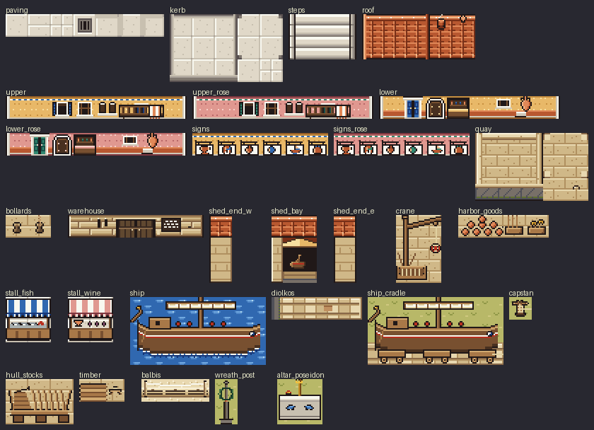

# Isthmos tileset catalog

`gTileset_Isthmos` is Emporion's harbor and the Isthmus, the maps outside the city walls:
the port of Lechaion, the Diolkos (the stone track on which ships were hauled across the
Isthmus) with a merchant ship on its cradle, the shipwright's yard, and the Isthmian
sanctuary of Poseidon. Pair it with the `aethos` primary, which supplies grass, paths,
sand, the animated sea and the stone pines of Isthmia.

It is the sister of `gTileset_Emporion` ([TILES_emporion.md](TILES_emporion.md)): the city
didn't fit one secondary (see there). It carries the city's paving, kerbs, steps and the
whole house kit, drawn by the same code, so a harbor district has streets and homes that
match the city's pixel for pixel. The house recipes in TILES_emporion.md work here with
this file's ids.

**This file is generated.** `tools/ichor/art/emporion_build.py isthmos` draws the tileset,
compiles it and rewrites this catalog. The art is in `emporion_port.py`, `emporion_land.py`
and the shared `emporion_city.py`.



The numbered sheet is [img/isthmos_sheet.png](img/isthmos_sheet.png). The port mock scene is
`img/emporion_scene_port.png`.

## How to use it

**IDs.** Each grid lists metatile ids as Porymap shows them, row by row. Each section
starts on a fixed row of the sheet (streets at 0x200, houses: the kit at 0x228, the port of lechaion at 0x270, the diolkos and the ships at 0x2D8, the isthmian sanctuary of poseidon at 0x340), so adding to one section never renumbers
another; append new pieces at the end of their section. `build/isthmos/catalog.json`
carries every structure's ids, walk codes, ground and named parts (`names`) for map
builders, who should place pieces by key and name, never by raw id.

**Collision and layers.** The walk grid beside each structure gives what to set on each
cell:

| Code | Meaning |
|---|---|
| `X` | Impassable: set collision 1. |
| `.` | Passable. |
| `D` | Door: put the warp here. The behavior is `MB_NON_ANIMATED_DOOR`. |
| `T` | Passable, and drawn over the player, who walks behind it. |

Counters (`MB_COUNTER`) are noted where they are.

**Ground.** Each cell is on one of these:
- *aethos ground* (`grass`, `sand`, `sea`, `path`): the cell draws no ground of its own.
  After Porytiles compiles, the build points its bottom layer at aethos's own metatile
  (grass `0x001`, sand `0x124`, sea `0x170`, path `0x1D9`), so it meets the meadow, beach
  or road around it seamlessly, the sea under every ship animates, and it costs no tiles.
  These cells reference aethos's tiles by index: **rebuild whenever aethos is repainted**.
  The build checks every borrowed entry.
- *paving* (`pave`, Emporion's marble flags) or *yard* (`quay`, warm poros blocks): drawn
  into the cell's bottom layer. Both repeat every 16 px, so every paved cell shares the
  same few tiles, and a prop on paving meets the street around it exactly.
- *none*: the art fills the cell.

A cell keeps at most two layers. On aethos ground that means one drawn layer: a part
drawn over the player there can't also have a part under the player.

**Seams.** The engine draws a connected map with the tilesets of the map the player
stands on (MAP_DESIGN.md §5). Keep this tileset's pieces out of the six rows nearest an
up/down seam and the eight columns nearest a left/right seam, unless both maps share it.

**Self-contained.** Apart from the borrowed ground, the tileset is compiled against an
empty stand-in primary, so its metatiles use only its own tiles (0x200 and up) and
palettes 6-12. The build verifies this.

**Palettes.** Every 8x8 tile draws from one of seven color groups, one per secondary
palette (`emporion_lib.GROUPS`). All colors are multiples of 8, in the master palette's
families (PLAN.md):

| Group | Use |
|---|---|
| marble | Marble, gold and painted blue and red: temples, colonnades, the Peirene, the street paving and kerbs, statues, the notice board, fountain water |
| clay | Terracotta roofs, ochre stucco, Aegean-blue doors and shutters, timber; striped awnings |
| clay2 | The same colors slot for slot, with rose stucco and sea-green paint |
| stone | Poros limestone: yards, quays, warehouses, the Diolkos, Acrocorinth's crag and walls |
| wood | Timber, rope, ships, cranes, bronze and fire |
| market | The goods: pots and vases, cloth, spices, fish, wine; the kilns |
| grove | Aethos's grass, pines and laurels |

**Free recolors.** `clay` and `clay2` list their colors in the same order, so a part drawn
in ochre and recolored to rose is the same 4bpp tile in another palette: Porytiles aligns
the slots and stores it once. Every rose house part, and the rose and green awnings, cost
no tiles.

**Tile budget.** 330 of 504 tiles are used. A secondary has 512, but the door
animations copy their frames into tiles 504-511 (`DOOR_TILE_START_SIZE1` in
`src/field_door.c`), so the build fails past 504. To fit, the art is drawn for reuse:
symmetric fronts are mirrored about a tile edge (Porytiles stores a flipped tile once);
walls, roofs, paving, friezes and rock repeat on the 8 or 16 px grid; the Temple of
Hermes, the Asclepeion and the Hephaisteion share one porch kit, row for row; and any
tile within two pixels of another is redrawn as that tile.

## Streets

Emporion's marble paving, kerbs and broad steps, for the harbor district's streets.

### Marble street paving

`paving`, 7 wide by 1 tall. Great square marble flags, one to a cell, softly bevelled. (0) the flag, (1) split in two, (2) split in four, (3) a bronze drain grate: lay (0) everywhere and scatter the others. (4)-(6) the flag in shadow: (4) along its north edge, for the row under a building's front or a wall, (5) along its west edge, for the column east of a building's end, (6) both, for the corner. All walkable, and all meet each other on every side.

```text
ids                                         walk
0x200 0x201 0x202 0x203 0x204 0x205 0x206   . . . . . . .
```

Parts: `flag` 0x200, `flag_2` 0x201, `flag_4` 0x202, `drain` 0x203, `shade_n` 0x204, `shade_w` 0x205, `shade_nw` 0x206.

### Paving's kerbed edge against grass

`kerb`, 5 wide by 3 tall. Columns 0-2 are the paved area's border: NW, N, NE / W, plain, E / SW, S, SE. A dark kerbstone runs round the outside; on the south edge its face shows, the street a step above the grass. Columns 3-4, rows 0-1, are inner corners (grass diagonally beyond): NW, NE / SW, SE. (3,2) and (4,2) are plain paving and its worn variant.

```text
ids                             walk
0x208 0x209 0x20A 0x20B 0x20C   . . . . .
0x210 0x211 0x212 0x213 0x214   . . . . .
0x218 0x219 0x21A 0x21B 0x21C   . . . . .
```

Parts: `NW` 0x208, `N` 0x209, `NE` 0x20A, `W` 0x210, `C` 0x211, `E` 0x212, `SW` 0x218, `S` 0x219, `SE` 0x21A, `inNW` 0x20B, `inNE` 0x20C, `inSW` 0x213, `inSE` 0x214.

### Broad marble steps

`steps`, 3 wide by 2 tall. Four treads climbing north, two per row: west cheek, run (repeat it for width), east cheek. Lay them against a terrace wall's gap, a podium or a stoa's front (one row of them makes its stylobate).

```text
ids                 walk
0x20D 0x20E 0x20F   . . .
0x215 0x216 0x217   . . .
```

## Houses: the kit

Emporion's house kit, the same parts as gTileset_Emporion's, for the harbor district's homes: see TILES_emporion.md for how the parts combine.

### House roof: terracotta, two rows

`roof`, 5 wide by 2 tall. Row 0 is the ridge, row 1 the eaves with palmette antefixes. Columns: west end, run (repeat it), east end, then two ridge-row variants of the run: a clay chimney pot and a ridge acroterion (their eaves row is the plain run). A terrace of houses shares one long roof line, each house closed by its own ends.

```text
ids                             walk
0x228 0x229 0x22A 0x22B 0x22C   X X X X X
0x230 0x231 0x232 0x233 0x234   X X X X X
```

Parts: `W` 0x228, `run` 0x229, `E` 0x22A, `chimney` 0x22B, `acroterion` 0x22C, `eaves_W` 0x230, `eaves_run` 0x231, `eaves_E` 0x232.

### House upper storey, ochre

`upper`, 8 wide by 1 tall. One-cell parts for the upper storey, in a row under the roof's eaves: (0) west corner pilaster, (1) plain wall, (2) a window with blue shutters folded back, (3) a window with a wooden grille, (4) a pair of small arched windows, (5)-(6) a timber balcony with a rug over its rail and a door behind (always as a pair), (7) east corner pilaster.

```text
ids                                               walk
0x238 0x239 0x23A 0x23B 0x23C 0x23D 0x23E 0x23F   X X X X X X X X
```

Parts: `W` 0x238, `wall` 0x239, `shutters` 0x23A, `grille` 0x23B, `arched` 0x23C, `balcony_l` 0x23D, `balcony_r` 0x23E, `E` 0x23F.

### House upper storey, rose

`upper_rose`, 8 wide by 1 tall. One-cell parts for the upper storey, in a row under the roof's eaves: (0) west corner pilaster, (1) plain wall, (2) a window with sea-green shutters folded back, (3) a window with a wooden grille, (4) a pair of small arched windows, (5)-(6) a timber balcony with a rug over its rail and a door behind (always as a pair), (7) east corner pilaster. The rose parts are the ochre parts' own tiles in the rose palette.

```text
ids                                               walk
0x240 0x241 0x242 0x243 0x244 0x245 0x246 0x247   X X X X X X X X
```

Parts: `W` 0x240, `wall` 0x241, `shutters` 0x242, `grille` 0x243, `arched` 0x244, `balcony_l` 0x245, `balcony_r` 0x246, `E` 0x247.

### House ground storey, ochre

`lower`, 8 wide by 1 tall. One-cell parts for the ground storey: (0) west pilaster, (1) a double-leaf blue door in a marble frame, (2) an arched wooden door, (3) an open shopfront with a counter (a door too), (4) plain wall, (5) a low barred window, (6) a stone bench with an amphora, (7) east pilaster. (1)-(3) are MB_NON_ANIMATED_DOOR: put the warp there.

```text
ids                                               walk
0x248 0x249 0x24A 0x24B 0x24C 0x24D 0x24E 0x24F   X D D D X X X X
```

Door metatiles: 0x249, 0x24A, 0x24B.

Parts: `W` 0x248, `door` 0x249, `door_arched` 0x24A, `shop` 0x24B, `wall` 0x24C, `window` 0x24D, `bench` 0x24E, `E` 0x24F.

### House ground storey, rose

`lower_rose`, 8 wide by 1 tall. One-cell parts for the ground storey: (0) west pilaster, (1) a double-leaf sea-green door in a marble frame, (2) an arched wooden door, (3) an open shopfront with a counter (a door too), (4) plain wall, (5) a low barred window, (6) a stone bench with an amphora, (7) east pilaster. (1)-(3) are MB_NON_ANIMATED_DOOR: put the warp there. The rose parts are the ochre parts' own tiles in the rose palette.

```text
ids                                               walk
0x250 0x251 0x252 0x253 0x254 0x255 0x256 0x257   X D D D X X X X
```

Door metatiles: 0x251, 0x252, 0x253.

Parts: `W` 0x250, `door` 0x251, `door_arched` 0x252, `shop` 0x253, `wall` 0x254, `window` 0x255, `bench` 0x256, `E` 0x257.

### House upper storey with trade signs, ochre

`signs`, 6 wide by 1 tall. Upper-storey wall cells with a trade sign hung from an iron bracket: (0) tavern (a kantharos cup), (1) bronze-smith (a Corinthian helmet), (2) potter (an amphora), (3) perfumer (an aryballos), (4) shipwright (a hull and sail), (5) grain and the hiring hall (a sack). Put one over the door of the trade's house.

```text
ids                                   walk
0x258 0x259 0x25A 0x25B 0x25C 0x25D   X X X X X X
```

Parts: `tavern` 0x258, `bronze` 0x259, `potter` 0x25A, `perfume` 0x25B, `ships` 0x25C, `grain` 0x25D.

### House upper storey with trade signs, rose

`signs_rose`, 6 wide by 1 tall. Upper-storey wall cells with a trade sign hung from an iron bracket: (0) tavern (a kantharos cup), (1) bronze-smith (a Corinthian helmet), (2) potter (an amphora), (3) perfumer (an aryballos), (4) shipwright (a hull and sail), (5) grain and the hiring hall (a sack). Put one over the door of the trade's house. The rose parts are the ochre parts' own tiles in the rose palette.

```text
ids                                   walk
0x260 0x261 0x262 0x263 0x264 0x265   X X X X X X
```

Parts: `tavern` 0x260, `bronze` 0x261, `potter` 0x262, `perfume` 0x263, `ships` 0x264, `grain` 0x265.

## The port of Lechaion

Quays, bollards, warehouses and the hiring hall, ship sheds, the crane, the harbor's goods, and two market stalls for the fish quay.

### Lechaion's quays: poros paving, edges and corners

`quay`, 5 wide by 3 tall. Long poros blocks in a running bond; the sea is aethos's, in the next cells. Row 0: NW outer corner, north edge (water north: coping only), NE outer corner, inner corners NW and NE (water diagonally beyond). Row 1: west edge, plain quay, east edge, inner corners SW and SE. Row 2: SW corner, south edge (water south: the wet face shows, weed at the waterline), SE corner, then the plain quay's two alternates. The walk codes are akti's: open the water-side edges only for surfing.

```text
ids                             walk
0x270 0x271 0x272 0x273 0x274   X X . X X
0x278 0x279 0x27A 0x27B 0x27C   . . . X X
0x280 0x281 0x282 0x283 0x284   X X . X X
```

Parts: `NW` 0x270, `N` 0x271, `NE` 0x272, `inNW` 0x273, `inNE` 0x274, `W` 0x278, `C` 0x279, `E` 0x27A, `inSW` 0x27B, `inSE` 0x27C, `SW` 0x280, `S` 0x281, `SE` 0x282, `C2` 0x283, `ring` 0x284.

### Bollards: one with a mooring line

`bollards`, 2 wide by 1 tall. Stone bollards for the quay's edge: (0) bare, (1) with a hawser running up to a ship moored to the north.

```text
ids           walk
0x275 0x276   X X
```

Ground: all on poros yard paving.

### Warehouse wall (roof it with the house roof)

`warehouse`, 6 wide by 1 tall. The single-storey front of a harbor warehouse in poros ashlar, to roof with the house kit's roof (two rows, any width): (0) west end, (1) wall with high slit windows, (2)-(3) a great double cart-door (both cells MB_NON_ANIMATED_DOOR), (4) wall with the hiring hall's chalked board, (5) east end. The hiring hall is the warehouse with the board, where Hyperion's crew bosses hire dockhands (STORY.md, Bases).

```text
ids                                   walk
0x288 0x289 0x28A 0x28B 0x28C 0x28D   X X D D X X
```

Door metatiles: 0x28A, 0x28B.

### Ship shed: west end

`shed_end_w`, 1 wide by 3 tall. The row of ship sheds' west end: a thick ashlar end wall under the roof's verge.

```text
ids     walk
0x28E   X
0x296   X
0x29E   X
```

### Ship shed: a bay

`shed_bay`, 2 wide by 3 tall. One shed of a row of ship sheds (neosoikoi), two cells wide: the terracotta roof, the shed's gable, a stone pier, and a ship's stern hauled up out of the dark on its slipway. The slipway's foot is at the bottom row's lower edge: put aethos sea in the row below. Repeat bays; all impassable.

```text
ids           walk
0x2A0 0x2A1   X X
0x2A8 0x2A9   X X
0x2B0 0x2B1   X X
```

### Ship shed: east end

`shed_end_e`, 1 wide by 3 tall. The row's east end wall.

```text
ids     walk
0x2A2   X
0x2AA   X
0x2B2   X
```

### Harbor crane with a load of amphorae

`crane`, 2 wide by 3 tall. A timber harbor crane: a mast braced on a windlass platform, a boom reaching east with its pulley, and a net of amphorae on the rope. Stand it on the quay's edge; the top row draws over the player.

```text
ids           walk
0x2A3 0x2A4   T T
0x2AB 0x2AC   X X
0x2B3 0x2B4   X X
```

Ground: all on poros yard paving.

### The harbor's goods

`harbor_goods`, 4 wide by 1 tall. Things for the quays: (0)-(1) transport amphorae stacked in a pyramid, (2)-(3) the hiring hall's crates of shovels and bronze helmets (STORY.md: 'crates of shovels and helmets').

```text
ids                       walk
0x2B8 0x2B9 0x2BA 0x2BB   X X X X
```

Ground: all on poros yard paving.

### Market stall: fish

`stall_fish`, 2 wide by 2 tall. Silver fish on a wet slab, an octopus and a basket of sprats. Free-standing on the paving; the seller stands beside it.

```text
ids           walk
0x2BC 0x2BD   X X
0x2C4 0x2C5   X X
```

Ground: all on marble paving.

### Market stall: wine

`stall_wine`, 2 wide by 2 tall. A krater, wine jugs and a rack of amphorae. Free-standing on the paving; the seller stands beside it.

```text
ids           walk
0x2BE 0x2BF   X X
0x2C6 0x2C7   X X
```

Ground: all on marble paving.

## The Diolkos and the ships

The merchant ship at her mooring, the Diolkos track, the same ship hauled on its wheeled cradle, the capstan, and the shipwright's yard.

### Merchant ship with a swan-neck stern

`ship`, 6 wide by 3 tall. A round-bellied merchant ship (holkas), bow to the east: a swan-neck stern post, a deckhouse, amphorae lashed on deck, a furled square sail and a painted eye. Moored on aethos's animated sea.

```text
ids                                   walk
0x2D8 0x2D9 0x2DA 0x2DB 0x2DC 0x2DD   X X X X X X
0x2E0 0x2E1 0x2E2 0x2E3 0x2E4 0x2E5   X X X X X X
0x2E8 0x2E9 0x2EA 0x2EB 0x2EC 0x2ED   X X X X X X
```

Ground: all on aethos sea.

### The Diolkos: the ship track across the Isthmus

`diolkos`, 4 wide by 1 tall. The paved stone track on which ships were hauled across the Isthmus, running west to east: (0) the west end, sloping down into the Gulf (put aethos sea west of it), (1) the track, (2) the track with a slab worn through to the earth, (3) the east end, meeting a road. Walkable. The merchant ship on her cradle (ship_cradle) sits on it.

```text
ids                       walk
0x2F0 0x2F1 0x2F2 0x2F3   . . . .
```

### The Diolkos: a merchant ship on its wheeled cradle

`ship_cradle`, 6 wide by 3 tall. A round-bellied merchant ship (holkas), bow to the east: a swan-neck stern post, a deckhouse, amphorae lashed on deck, a furled square sail and a painted eye. Here she rides the Diolkos on a wheeled timber cradle, hauled across the Isthmus: the bottom row is the track itself, so lay diolkos runs either side of it. Rows 0-1 are the moored ship's own tiles; they sit on aethos grass.

```text
ids                                   walk
0x2F8 0x2F9 0x2FA 0x2FB 0x2FC 0x2FD   X X X X X X
0x300 0x301 0x302 0x303 0x304 0x305   X X X X X X
0x308 0x309 0x30A 0x30B 0x30C 0x30D   X X X X X X
```

Ground: aethos grass at (0,0), (1,0), (2,0), (3,0), (4,0), (5,0), (0,1), (1,1), (2,1), (3,1), (4,1), (5,1); the rest draws its own.

### Capstan for hauling ships

`capstan`, 1 wide by 1 tall. A capstan with four bars and the hauling rope wound on it, set beside the Diolkos. On aethos grass.

```text
ids     walk
0x2FE   X
```

Ground: all on aethos grass.

### The shipwright's hull on the stocks

`hull_stocks`, 3 wide by 2 tall. A merchant hull half built on its keel blocks: keel and posts laid, the ribs standing bare, the first strakes planked at the stern. Bow to the east. On yard paving.

```text
ids                 walk
0x310 0x311 0x312   X X X
0x318 0x319 0x31A   X X X
```

Ground: all on poros yard paving.

### Shipwright's timber and a sawhorse

`timber`, 2 wide by 1 tall. A stack of sawn pine planks and a sawhorse with a saw. On yard paving.

```text
ids           walk
0x313 0x314   X X
```

Ground: all on poros yard paving.

## The Isthmian sanctuary of Poseidon

The stadium's starting line, a victor's pine wreath, and Poseidon's altar. The sanctuary's pines are aethos's stone pines.

### The Isthmian stadium's starting line

`balbis`, 3 wide by 1 tall. The stone starting sill (balbis) laid across the stadium track, two grooves for the runners' toes, with the starting gate's posts at the ends and a cord between them. On aethos path (0x1D9): (0) west post, (1) the sill, repeat it across the track (walkable), (2) east post.

```text
ids                 walk
0x340 0x341 0x342   X . X
```

Ground: all on aethos path.

### A victor's pine wreath on its post

`wreath_post`, 1 wide by 2 tall. Isthmian victors were crowned with pine. A wreath of pine hangs on a carved post. On aethos grass; the top cell draws over the player.

```text
ids     walk
0x343   T
0x34B   X
```

Ground: all on aethos grass.

### Altar of Isthmian Poseidon

`altar_poseidon`, 2 wide by 2 tall. A long marble altar with dolphins leaping across its face, a fire on it, and Poseidon's gilded trident at its back. On aethos grass.

```text
ids           walk
0x344 0x345   X X
0x34C 0x34D   X X
```

Ground: all on aethos grass.
