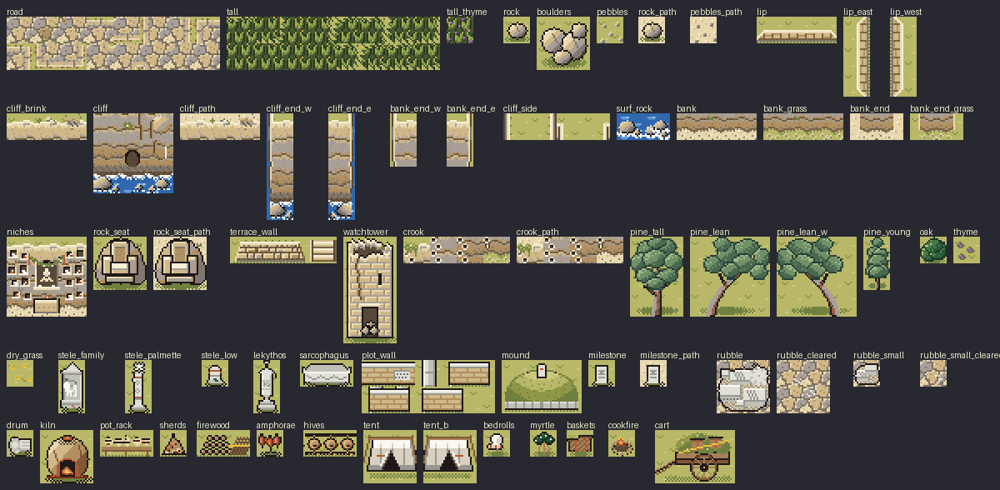

# Skiron tileset catalog

`gTileset_Skiron` is the secondary for Act I's mainland road after the geography revision:

- **Route 4, the Isthmus road**, out of Emporion (Corinth): the old paved road, Corinthian potters' kilns, the dead lining both verges in family plots, the Titans' rockslide (a toppled tomb in heaps across the road), the procession's camp, and a terrace orchard behind a thicket.
- **Route 5, the Skironian cliffs**, from Hecate's Hollow to Eleusa: a narrow road cut along sea cliffs, pines and scrub on the mountain above, the sea far below, the rock seat on a shoulder of the edge, Aphrodite's votive niches cut into the bank, a thyme meadow with hives, a ruined watchtower.

Pair it with the `aethos` primary, which supplies grass, plain tall grass, the limestone path, olives, cypresses, stone pines, the herm, signs and the animated sea. The name is Skiron's: the robber of the Skironian rocks, who made travellers wash his feet and kicked them off the cliff to a giant turtle below, until Theseus came along the road.

**The Diolkos, its ship and capstan are not here.** They are in the director's `gTileset_Isthmos` ([TILES_isthmos.md](TILES_isthmos.md)), with Lechaion and Isthmia. A Route 4 map that needs the Diolkos takes it from Isthmos's catalog, on Isthmos instead of Skiron, or keeps that stretch of the route on its own map.

**Thria and the Rheitoi are held.** They moved to Act II's Route 15, so the salt streams, the jesters' bridge, the grain shrine, the first wheat and Thria's inn, round house, farmhouse and peddler's cart aren't drawn. Nothing here has a door, but the tile budget still stops at 504 so door animations stay safe.

**Generated parts.** `tools/ichor/art/skiron_build.py` paints the tileset, compiles it, and rewrites the catalog between the `catalog` markers below. Everything else in this file is written by hand. Images:

| File | What |
|---|---|
| [`img/skiron_pieces.png`](img/skiron_pieces.png) | Every structure on its ground, by key |
| [`img/skiron_sheet.png`](img/skiron_sheet.png) | The numbered metatile sheet |
| [`img/skiron_road_tombs.png`](img/skiron_road_tombs.png) | Mock-up: Route 4, the paved road out of the city, kilns and tombs, the forced band |
| [`img/skiron_rockslide_camp.png`](img/skiron_rockslide_camp.png) | Mock-up: Route 4, the rockslide, the procession's camp, the terrace orchard |
| [`img/skiron_cliff_road.png`](img/skiron_cliff_road.png) | Mock-up: Route 5, the cliff road, the niches and the rock seat |
| [`img/skiron_headland.png`](img/skiron_headland.png) | Mock-up: Route 5, the thyme meadow, the hives, the watchtower, the coast stepping |



Regenerate everything with:

```
/usr/bin/python3 tools/ichor/art/skiron_build.py      # paint, compile, verify, catalog
/usr/bin/python3 tools/ichor/art/skiron_mockups.py    # the four mock-up scenes
```

## How to use it

**IDs.** Each grid lists metatile ids as Porymap shows them, row by row. Each section starts on a fixed sheet row (ground 0x200, stone 0x240, flora 0x300, tombs 0x340, works 0x390, camp 0x3C0), so adding to one section never renumbers another. Append new pieces at the end of their section. `build/skiron/catalog.json` carries every structure's ids, walk codes, ground and named parts (`names`). Place pieces by key and name, never by raw id. `skiron_mockups.py` is a worked example of a builder doing that.

**Walk codes.** The grid beside each structure gives what to set on each cell:

| Code | Meaning |
|---|---|
| `X` | Impassable: set collision 1. |
| `.` | Passable. |
| `T` | Passable, and drawn over the player, who walks behind it (crowns, a monument's top). |
| `G` | Tall grass: `MB_TALL_GRASS`. |
| `J` | Ledge, `MB_JUMP_SOUTH`. Set collision 1, as vanilla does. `lip_east` and `lip_west` are `X` in the grid but carry `MB_JUMP_EAST` / `MB_JUMP_WEST` (listed under Behaviors). |

**Borrowed ground.** Most cells sit on aethos ground and draw no ground of their own: `grass` 0x001, `path` 0x1D9 or `sea` 0x170. After Porytiles compiles, the build points each such cell's bottom layer at aethos's own tiles. So a stele meets the meadow seamlessly, the cliff's foot and the surf rocks stand in the animated sea, and the ground costs no tiles. The same art on another ground is a second metatile but no new tiles: `rock_path`, `pebbles_path`, `milestone_path`, `rock_seat_path`, `cliff_path`, `bank_grass` and `bank_end_grass` are such twins. These cells point into aethos by tile index: **rebuild Skiron whenever aethos's grass, path or sea is repainted.** The build checks every borrowed entry.

**Soft ground.** The paved road and tall grass are painted per cell from the cell's 3×3 neighborhood, keyed like agros's soft ground. The key is the cell's state then its neighbors' in the order N NE E SE S SW W NW: `1` in the region, `0` not, and a diagonal counts only when both its sides are in.
- A fully surrounded road cell is `mid`, or the worn `mid2` and `mid3`; a surrounded tall-grass cell is aethos 0x00D.
- The straight edges and corners have aliases (N, S, E, W, NW, NE, SW, SE, iNE, iSE, iSW, iNW).
- Other shapes are built only when listed in `tools/ichor/art/skiron_shapes.json`. A map builder lists the shapes it needs there (`skiron_mockups.py --shapes` does it for the mock-ups), then the tileset is rebuilt. Each new shape costs up to 4 tiles of the 15 left.
- A thyme meadow mixes `tall_thyme` with 0x00D inside `tall` edges.

**The sea cliff, stacked.** Under the road, from top to bottom:
1. a `cliff_brink` row (or `cliff_path` where the path runs to the edge; `bite` takes a crumbled bite out of it);
2. `cliff` face rows: `face_u`, `face_l`, and more `u`/`l` pairs for a taller drop;
3. a `foot` row on the sea;
4. open sea with `surf_rock` scattered.

Use face `A` for most cells and scatter `B` and `C` at random, about one cell in four, or the features beat out a rhythm. The cut bank on the uphill side is `cliff_brink`, then `face_u`, then a `bank` foot on the path. Close a run of bank with `bank_end_w`/`_e` (brink and face) over `bank_end` / `bank_end_grass` (foot).

**The coast stepping.**
- *South, going east* (the land juts further out): the higher plateau's last brink cell is followed by `cliff_side` `in_sw` on the lower plateau's row and `side_w` below it, and the lower plateau's brink row runs on. Mirror it with `in_se` / `side_e`.
- *A headland or a cliff ending in open sea*: `cliff_end_w` / `_e` round the face off over the sea. Use them only where the cells beside the face are sea. Beside another face, use the side pieces.

**Seams.** A connected neighbour is drawn with the tilesets of the map the player stands on (MAP_DESIGN.md §5), so keep Skiron's pieces out of the 6 rows nearest an up/down seam and the 8 columns nearest a left/right seam unless both maps use Skiron. The paved road is Skiron's: where Route 4 meets Emporion's gate, finish it with its kerbed end and carry the road on as aethos path, or as Emporion's own paving on the city side.

**Scripted swaps.** The build writes the ids scripts swap in to the `gTileset_Skiron` block at the end of `include/constants/metatile_labels.h`, so they never go stale. The block holds the rubble's four cells and their cleared road, and the one-cell heap and its cleared cell: `METATILE_Skiron_Rubble_TopLeft` … `_BottomRight`, `METATILE_Skiron_RubbleCleared_*`, `METATILE_Skiron_RubbleSmall`, `METATILE_Skiron_RubbleSmallCleared`. Beat 17's Bronze Hammer breaks each heap by swapping in its cleared cells (and clearing collision).

**Self-contained.** Apart from the borrowed ground, the tileset is compiled against an empty stand-in primary, so its metatiles use only its own tiles (0x200 and up) and palettes 6-12; the build verifies this. Tiles within 2 px of another are redrawn as that one so Porytiles stores them once (akti_build's merge).

## Palettes

Every 8×8 tile of every layer draws from one of seven color groups, one per secondary palette (`skiron_lib.GROUPS`), at most 15 colors each, all multiples of 8. Most groups carry aethos's four grass greens so shadows and tufts sit on the meadow.

| Group | Colors | Use |
|---|---|---|
| field | grass, barley (t0 t1 t3 tg), limestone path (p1 p2 p3 l0 l1), thyme (th1 th2) | tall grass and its soft edges, the thyme meadow, thyme, dry grass |
| rock | grass, limestone (l0 l1 p1 p2 p3), greys (k1 k2 k3), ink, white, terracotta red | the paved road, rocks, ledges, the sea cliff and its foam, the cut bank, the niches (white doves, red lamps), the seat, the terrace wall, the watchtower |
| marble | ink, white and four marble greys (m1–m4), grass, red ochre, myrtle green, poros (p1 l1), k2 | stelai, the lekythos, the sarcophagus, the plot walls (poros faces under marble coping), the mound and its marker, the milestone, the toppled tomb |
| pine | grass, Aleppo needles (pn0–pn3), red-grey bark (rb k1 k3), kermes oak (c1–c3), ink | the pines, oak scrub |
| clay | terracotta (tc0–tc2), wood (wd1 wd2 k1), pale clay (l1 p1 p2), grass, ink, gold | the kiln, pots and sherds, amphorae, firewood, the hives, the cookfire, the cart |
| linen | ink, linen (w0 w1 m3), wood, myrtle (c1–c3), grass, red wool | tents, bedrolls, myrtle staves, the sacred baskets |
| bloom | grass, greens, k1, thyme, pinks, gold, ink | held for the pomegranate (not in the set today; see below) |

## What it holds, and what it doesn't

**In the set:**
- **Route 4:** the paved road, tall grass, the family plots, the stelai, the lekythos, the sarcophagus, the burial mound and the milestone; the kiln, the drying rack, the sherds, the amphorae and the firewood; the toppled tomb and its cleared road; the camp (tents, cart, cookfire, bedrolls, myrtle, baskets); the terrace wall and its steps; terrace lips jumping south, east or west.
- **Route 5:** the sea cliff kit and the cut bank, the niches, the rock seat, the surf rocks, the thyme meadow, the hives and the watchtower.
- **Both:** Aleppo pines (tall, leaning both ways, young), kermes oak, thyme, dry grass, rocks, boulders and pebbles.

**Drawn in code but held for the tile budget** (each is a line in its `build()`; add it back if a map needs it and the budget allows):
- a cold kiln, a single hive;
- a windswept pine, the pomegranate tree, a scrub thicket, a lentisk bush;
- a second thyme and a second dry-grass cell;
- a split rock, a second pebbles cell, a fallen marble block.

**Not drawn, for a later set:**
- Thria and the Rheitoi (now Route 15).
- The great herm and its desecrated look: Emporion has a great herm; aethos has the small roadside herm at 0x01B.
- The orchard's Sickle thicket: an object event, like cut trees. The mock-up stands an oak in its place on the steps.
- The column drum of the Girdle gates: an object. The `drum` here is lying debris.

**Budget.** 489 of 504 tiles. The 15 left are for the extra road and grass shapes the Route 4 and Route 5 maps will list.

## Critique passes on the mock-ups

Each pass: render all four scenes at 2×, look at them and at the 15×10 screen crops and the collision overlay (`build/render/skiron/`), write down what's wrong, fix, repeat.

**Pass 1** (first layouts, first art):
- *The paved road's kerb* was bright white over a dark joint, so it read as a low wall. That was worst where the forced grass band cut the paving: the band looked walled in. **Fix:** a flush kerb a shade paler than the flags (p1/p2), with a grey joint.
- *Family plot walls* were stark white brick boxes. **Fix:** warm poros ashlar faces under a white marble coping.
- *The rubble* was a few small white blocks with road showing through. It read as tombs, not a barrier, and didn't fill the road. **Fix:** an earth-and-marble heap filling each cell, with bigger blocks and a drum on it, and shovel marks on two blocks (Alethea's clue). The one-cell heap was redrawn the same way.
- *The hives* read as goggles or crabs. **Fix:** clay tubes end-on, each with a pale clay plug, a low door and a shading stone, three on a bench.
- *The cliff face* first looked like stacked masonry. Then every cell carried a cave or a guano streak, so the face beat a regular rhythm. **Fix** (carried into pass 2): columnar rock masses.
- *The pines* read as savanna acacias: flat crowns on thin trunks. **Fix:** fuller round crowns of more clumps, needle tufts bristling all round, a thicker trunk.
- *Layouts were sparse,* with acres of flat grass. **Fix:** tombs crowd both verges; two walled plots force the band; olives, cypresses and scrub fill the edges.
- *The coast step* in the headland scene used the end pieces where the cells beside the face were land, so a blue stripe of sea cut the cliff. **Fix:** `in_sw` and `side_w`. The rule for when to use which is written above.
- *The rock seat* sat in a hole in the cliff on a square of grass. **Fix:** the road runs three wide past it and the seat stands on the path at the edge (`rock_seat_path`). It narrows the road to one tile, which suits "the narrow ledge below Xerxes's seat".

**Pass 2:**
- *The columnar cliff face* read as a palisade: identical columns every 16 px. **Fix:** soft horizontal strata, each band lit along its top with a dark overhang line. The variants carry the cracks, a caper bush, a jutting boss, a gull's streak and a sea cave. Variant `A` is plain, and the builder scatters `B`/`C` at random about one cell in four.
- *Foot rocks* lined up like beads, because the variant choice cycled. **Fix:** three foot variants of different weight, chosen by hash.
- *The rock seat* read as a carved letter "B". **Fix:** redrawn as a chair: a tall round-topped back with a shadowed inner face, blocky arms (the west one lit, the east one in shade), a lit seat, a step.
- *The loose column drum* read as a white ball. **Fix:** drawn lying on its side, fluted along its length.
- *The thyme meadow* was plain barley. **Fix:** `tall_thyme`, barley threaded with flowering thyme, mixed into the meadow.
- *Path autotile:* placed pieces made the path skip its edge (teeth in the path). **Fix:** the mock-up builder counts only path cells and pieces on borrowed path as path.
- *The camp* was scattered across the slope. **Fix:** tents in an arc round the cookfire, bedrolls by the fire, myrtle and baskets at the tent doors, the cart and the milestone (Alethea's seat) by the road. The verge rocks were in rows and are now staggered.

**Pass 3:**
- *The cliff* now reads as one natural limestone face across the whole run. *The niches* are the screen's focus, *the seat* reads as a throne, and *the walk overlay* is right: the road three wide, one wide past the seat, the brink and bank blocked.
- *The cut bank in the rockslide scene* stopped dead in the grass. **Fix:** `bank_end_w`/`_e` (the cliff's ends regrounded on grass) and `bank_end_grass`.
- *A pebbles-on-path piece* sat on the path's edge row and showed as a square. Pieces on path go on its interior rows only (noted for map builders).
- *The tombs scene's terrace lip* floated with nothing above it. **Fix:** scrub, rock and a young pine on the terrace above.
- *The cliff road's mountainside* was thin. **Fix:** a second staggered row of scrub and a patch of long grass.
- *The 15×10 screens* each show a landmark: the plot, the kilns, the mound, the olives, the niches, the seat, the tower, the hives.

**What still isn't ideal:**
- The camp's ground is meadow. A trampled-earth patch would need path-grounded camp pieces with non-green shadows: new tiles.
- The cliff's E end and the `side_e`/`in_se` pieces are mirrors of the W ones, so they're lit from the wrong side. That's subtle at 1×.
- The plot walls' north–south runs show only their white coping, so they're paler than the warm east–west faces.

<!-- catalog -->

**Tile budget.** 497 of 504 tiles are used (tiles 504-511 belong to the door animations). The build fails past 504.

## Ground (from 0x200)

The old paved road and tall grass, both with soft, shape-keyed edges.

### The old paved road

`road`, 8 wide by 2 tall. Flagstones in long kerbs, a grass verge outside them. Pieces are named by shape key (and N, S, E, W, NW, NE, SW, SE, iNE, iSE, iSW, iNW for the straight edges and corners); `mid` is the open road, `mid2` and `mid3` worn variants of it (weeds in the joints, a cracked stone). Walkable.

| Piece | Id | Walk |
|---|---|---|
| `mid` | 0x200 | . |
| `mid2` | 0x201 | . |
| `mid3` | 0x202 | . |
| `1|00111110` | 0x203 | . |
| `N` | 0x203 | . |
| `1|11100011` | 0x204 | . |
| `S` | 0x204 | . |
| `1|11111000` | 0x205 | . |
| `W` | 0x205 | . |
| `1|10001111` | 0x206 | . |
| `E` | 0x206 | . |
| `1|00111000` | 0x207 | . |
| `NW` | 0x207 | . |
| `1|00001110` | 0x208 | . |
| `NE` | 0x208 | . |
| `1|11100000` | 0x209 | . |
| `SW` | 0x209 | . |
| `1|10000011` | 0x20A | . |
| `SE` | 0x20A | . |
| `1|10111111` | 0x20B | . |
| `iNE` | 0x20B | . |
| `1|11101111` | 0x20C | . |
| `iSE` | 0x20C | . |
| `1|11111011` | 0x20D | . |
| `iSW` | 0x20D | . |
| `1|11111110` | 0x20E | . |
| `iNW` | 0x20E | . |

### Tall grass with soft edges

`tall`, 8 wide by 2 tall. The aethos barley meadow (0x00D in the middle) with soft, wobbly edges. Each piece is named by its shape key and keeps MB_TALL_GRASS, so encounters follow the cells while the outline stays soft.

| Piece | Id | Walk |
|---|---|---|
| `1|00111110` | 0x210 | G |
| `1|11100011` | 0x211 | G |
| `1|11111000` | 0x212 | G |
| `1|10001111` | 0x213 | G |
| `1|00111000` | 0x214 | G |
| `1|00001110` | 0x215 | G |
| `1|11100000` | 0x216 | G |
| `1|10000011` | 0x217 | G |
| `1|10111111` | 0x218 | G |
| `1|11101111` | 0x219 | G |
| `1|11111011` | 0x21A | G |
| `1|11111110` | 0x21B | G |
| `1|00000010` | 0x21C | G |
| `1|00100000` | 0x21D | G |
| `1|00100010` | 0x21E | G |
| `1|10100011` | 0x21F | G |
| `N` | 0x210 | G |
| `S` | 0x211 | G |
| `W` | 0x212 | G |
| `E` | 0x213 | G |
| `NW` | 0x214 | G |
| `NE` | 0x215 | G |
| `SW` | 0x216 | G |
| `SE` | 0x217 | G |
| `iNE` | 0x218 | G |
| `iSE` | 0x219 | G |
| `iSW` | 0x21A | G |
| `iNW` | 0x21B | G |

### Tall grass with thyme in flower

`tall_thyme`, 1 wide by 1 tall. The meadow cell for Route 5's thyme meadow: aethos barley threaded with purple thyme. MB_TALL_GRASS. Mix it with plain 0x00D inside a meadow whose edges are `tall` pieces.

| Piece | Id | Walk |
|---|---|---|

## Stone (from 0x240)

Rocks, ledges, the Skironian sea cliff and the road's cut bank, Aphrodite's niches, the rock seat, the orchard's terrace wall and the ruined watchtower.

### A grey rock

`rock`, 1 wide by 1 tall. One rounded limestone rock. Every cell sits on borrowed aethos grass.

```text
ids     walk
0x240   X
```

### Boulders, 2 by 2

`boulders`, 2 wide by 2 tall. A heap of rocks broken off the mountain: hillsides, the rockslide's flanks, the cliff top. Every cell sits on borrowed aethos grass.

```text
ids           walk
0x241 0x242   X X
0x249 0x24A   X X
```

### Pebbles in the grass

`pebbles`, 1 wide by 1 tall. Walkable: stones in the turf. Every cell sits on borrowed aethos grass.

```text
ids     walk
0x243   .
```

### A grey rock, on the path

`rock_path`, 1 wide by 1 tall. One rounded limestone rock. Every cell sits on borrowed aethos path.

```text
ids     walk
0x244   X
```

### Pebbles on the path

`pebbles_path`, 1 wide by 1 tall. Walkable: stones in the turf. Every cell sits on borrowed aethos path.

```text
ids     walk
0x245   .
```

### Terrace lip: a ledge to jump down (south)

`lip`, 3 wide by 1 tall. One-way, MB_JUMP_SOUTH: grass above, a course of stone and its shadow below. West end, run, east end. Every cell sits on borrowed aethos grass.

```text
ids                 walk
0x250 0x251 0x252   J J J
```

Behaviors: 0x250 `MB_JUMP_SOUTH`, 0x251 `MB_JUMP_SOUTH`, 0x252 `MB_JUMP_SOUTH`.

Pieces: `W` 0x250, `run` 0x251, `E` 0x252.

### Terrace lip facing east (jump east)

`lip_east`, 1 wide by 3 tall. One-way, MB_JUMP_EAST: the terrace's east edge, for a road that climbs westward (the drop is back toward the east). North end, run, south end. Every cell sits on borrowed aethos grass.

```text
ids     walk
0x253   X
0x25B   X
0x263   X
```

Behaviors: 0x253 `MB_JUMP_EAST`, 0x25B `MB_JUMP_EAST`, 0x263 `MB_JUMP_EAST`.

Pieces: `N` 0x253, `run` 0x25B, `S` 0x263.

### Terrace lip facing west (jump west)

`lip_west`, 1 wide by 3 tall. One-way, MB_JUMP_WEST: the mirror of lip_east, for a road that climbs eastward. North end, run, south end. Every cell sits on borrowed aethos grass.

```text
ids     walk
0x254   X
0x25C   X
0x264   X
```

Behaviors: 0x254 `MB_JUMP_WEST`, 0x25C `MB_JUMP_WEST`, 0x264 `MB_JUMP_WEST`.

Pieces: `N` 0x254, `run` 0x25C, `S` 0x264.

### Sea cliff: the brink

`cliff_brink`, 3 wide by 1 tall. The top row of the sea cliff and of the cut bank: borrowed grass above a lit stone lip, the face beginning below it. There is no rail. `bite` is a crumbled edge biting into the ground above. Impassable. `cliff_path` is the same art with the aethos path above the lip: the railless road running right to the drop. Every cell sits on borrowed aethos grass.

```text
ids                 walk
0x255 0x256 0x257   X X X
```

Pieces: `A` 0x255, `B` 0x256, `bite` 0x257.

### Sea cliff: face and foot

`cliff`, 3 wide by 3 tall. The cliff under a `cliff_brink` row: `face_u`, `face_l` (stack more face rows for a taller drop: u, l, u, l...), then `foot`, fallen rocks and foam on the animated sea. Any variant of a row meets any other. `A` is plain strata: use it for most cells and scatter `B` (a caper bush and a crack; a sea cave) and `C` (a jutting boss; a gull's white streak) at random, about one cell in four. Impassable. Cells on borrowed aethos ground: sea (0,2, 1,2, 2,2).

```text
ids                 walk
0x268 0x269 0x26A   X X X
0x270 0x271 0x272   X X X
0x278 0x279 0x27A   X X X
```

Pieces: `face_u_A` 0x268, `face_u_B` 0x269, `face_u_C` 0x26A, `face_l_A` 0x270, `face_l_B` 0x271, `face_l_C` 0x272, `foot_A` 0x278, `foot_B` 0x279, `foot_C` 0x27A.

### Sea cliff brink, on the path

`cliff_path`, 3 wide by 1 tall. `cliff_brink` with the aethos limestone path (0x1D9) above the lip. Every cell sits on borrowed aethos path.

```text
ids                 walk
0x26B 0x26C 0x26D   X X X
```

Pieces: `A` 0x26B, `B` 0x26C, `bite` 0x26D.

### Sea cliff, west end

`cliff_end_w`, 1 wide by 4 tall. Where the cliff turns away north (a headland's corner): the face rounds off to the west, over the sea. Use it only where the cells west of the face are sea; beside another face use `cliff_side`. Impassable. Every cell sits on borrowed aethos sea.

```text
ids     walk
0x26E   X
0x276   X
0x27E   X
0x286   X
```

Pieces: `brink` 0x26E, `face_u` 0x276, `face_l` 0x27E, `foot` 0x286.

### Sea cliff, east end

`cliff_end_e`, 1 wide by 4 tall. The mirror of cliff_end_w: the face rounds off to the east. Every cell sits on borrowed aethos sea.

```text
ids     walk
0x26F   X
0x277   X
0x27F   X
0x287   X
```

Pieces: `brink` 0x26F, `face_u` 0x277, `face_l` 0x27F, `foot` 0x287.

### Cut bank, west end

`bank_end_w`, 1 wide by 2 tall. The cliff's west end on grass instead of sea, to close a run of cut bank: its brink and face_u over a `bank_end` foot. Every cell sits on borrowed aethos grass.

```text
ids     walk
0x288   X
0x290   X
```

Pieces: `brink` 0x288, `face_u` 0x290.

### Cut bank, east end

`bank_end_e`, 1 wide by 2 tall. The cliff's east end on grass instead of sea, to close a run of cut bank: its brink and face_u over a `bank_end` foot. Every cell sits on borrowed aethos grass.

```text
ids     walk
0x289   X
0x291   X
```

Pieces: `brink` 0x289, `face_u` 0x291.

### Sea cliff: the plateau's sides and inner corners

`cliff_side`, 4 wide by 1 tall. `side_w`: land whose west edge drops to the sea (the cell to its west is face or sea). `side_e` the mirror. `in_sw`: the land cell east of a brink run, where the brink's lip turns south into a side_w below it; `in_se` the mirror. On borrowed grass; impassable (the edge). Every cell sits on borrowed aethos grass.

```text
ids                       walk
0x28A 0x28B 0x28C 0x28D   X X X X
```

Pieces: `side_w` 0x28A, `side_e` 0x28B, `in_sw` 0x28C, `in_se` 0x28D.

### Rocks in the surf

`surf_rock`, 2 wide by 1 tall. Wet rocks ringed with foam, on the animated sea: scatter them off the cliff foot and use them in the map's border so the sea below the cliff never looks empty. Impassable. Every cell sits on borrowed aethos sea.

```text
ids           walk
0x28E 0x28F   X X
```

Pieces: `A` 0x28E, `B` 0x28F.

### Cut bank above the road

`bank`, 3 wide by 1 tall. The rock the road was cut from, on its uphill side. Stack `cliff` brink, then face_u, then a `bank` foot (scree on the path below the face); or brink straight onto a foot for a low bank. The foot borrows the aethos path; `bank_grass` has grass below instead. Every cell sits on borrowed aethos path.

```text
ids                 walk
0x298 0x299 0x29A   X X X
```

Pieces: `foot_A` 0x298, `foot_B` 0x299, `foot_C` 0x29A.

### Cut bank above grass

`bank_grass`, 3 wide by 1 tall. The rock the road was cut from, on its uphill side. Stack `cliff` brink, then face_u, then a `bank` foot (scree on the path below the face); or brink straight onto a foot for a low bank. The foot borrows the aethos path; `bank_grass` has grass below instead. Every cell sits on borrowed aethos grass.

```text
ids                 walk
0x29B 0x29C 0x29D   X X X
```

Pieces: `foot_A` 0x29B, `foot_B` 0x29C, `foot_C` 0x29D.

### Cut bank ends

`bank_end`, 2 wide by 1 tall. Where the bank runs out into the hillside, under `cliff_end_w` / `cliff_end_e` brink and face_u regrounded on grass (`bank_end_w`, `bank_end_e`). On the path. Every cell sits on borrowed aethos path.

```text
ids           walk
0x29E 0x29F   X X
```

Pieces: `foot_w` 0x29E, `foot_e` 0x29F.

### Cut bank ends, above grass

`bank_end_grass`, 2 wide by 1 tall. Where the bank runs out into the hillside, under `cliff_end_w` / `cliff_end_e` brink and face_u regrounded on grass (`bank_end_w`, `bank_end_e`). On the path. Every cell sits on borrowed aethos grass.

```text
ids           walk
0x2A0 0x2A1   X X
```

Pieces: `foot_w` 0x2A0, `foot_e` 0x2A1.

### Aphrodite's niches: the votive rock face

`niches`, 3 wide by 3 tall. A stretch of the cut bank three cells wide (brink, face_u, foot), cut with a dozen and a half niches holding clay doves and lamps, names scratched between, the goddess's arched niche in the middle with a myrtle garland swagged over it, and a low altar stone at the foot. The altar of Aphrodite: put the bg event on the foot row's middle cell. The brink borrows grass, the foot the path. Place it in a run of cut bank. Cells on borrowed aethos ground: grass (0,0, 1,0, 2,0), path (0,2, 1,2, 2,2).

```text
ids                 walk
0x2A2 0x2A3 0x2A4   X X X
0x2AA 0x2AB 0x2AC   X X X
0x2B2 0x2B3 0x2B4   X X X
```

### The rock seat

`rock_seat`, 2 wide by 2 tall. Xerxes's seat: a rough throne cut into a knob of rock, its high back and arms facing out over the bay. Put the bg event on either bottom cell. On borrowed grass; `rock_seat_path` sits on the path. Every cell sits on borrowed aethos grass.

```text
ids           walk
0x2A5 0x2A6   X X
0x2AD 0x2AE   X X
```

### The rock seat, on the path

`rock_seat_path`, 2 wide by 2 tall. Xerxes's seat: a rough throne cut into a knob of rock, its high back and arms facing out over the bay. Put the bg event on either bottom cell. On borrowed grass; `rock_seat_path` sits on the path. Every cell sits on borrowed aethos path.

```text
ids           walk
0x2B8 0x2B9   X X
0x2C0 0x2C1   X X
```

### The orchard's terrace wall

`terrace_wall`, 4 wide by 1 tall. A dry-stone retaining wall one row high: the terrace's grass above, the wall's face, its shadow on the grass below. West end, run, east end, and steps up through it (walkable). For the terrace orchard behind the Sickle thicket, and any terraced hillside. Every cell sits on borrowed aethos grass.

```text
ids                       walk
0x2BA 0x2BB 0x2BC 0x2BD   X X X .
```

Pieces: `W` 0x2BA, `run` 0x2BB, `E` 0x2BC, `steps` 0x2BD.

### The ruined watchtower

`watchtower`, 2 wide by 4 tall. A square stone tower, a pyrgos for watching the road, its top fallen in. The broken crown is drawn over the player (walk behind it); the rest is impassable. The doorway is choked with fallen blocks. On borrowed grass. Every cell sits on borrowed aethos grass.

```text
ids           walk
0x2BE 0x2BF   T T
0x2C6 0x2C7   X X
0x2CE 0x2CF   X X
0x2D6 0x2D7   X X
```

### Pan's Crook's face: handholds up the cliff

`crook`, 4 wide by 1 tall. A climbable column for the cliff and the cut bank: `brink` (ivy over the lip), `face_u` and `face_l` (stack as many as the drop needs), then `foot` (the bank's foot, with the goat-hoof votive). Every cell is MB_ROCK_CLIMB and impassable: face it and press A to climb with Pan's Crook, up or down. Put walkable ground at both ends. `crook_path` borrows the path above the brink and below the foot instead of grass. Cells on borrowed aethos ground: grass (0,0, 3,0).

```text
ids                       walk
0x2D8 0x2D9 0x2DA 0x2DB   X X X X
```

Behaviors: 0x2D8 `MB_ROCK_CLIMB`, 0x2D9 `MB_ROCK_CLIMB`, 0x2DA `MB_ROCK_CLIMB`, 0x2DB `MB_ROCK_CLIMB`.

Pieces: `brink` 0x2D8, `face_u` 0x2D9, `face_l` 0x2DA, `foot` 0x2DB.

### Pan's Crook's face, on the path

`crook_path`, 4 wide by 1 tall. A climbable column for the cliff and the cut bank: `brink` (ivy over the lip), `face_u` and `face_l` (stack as many as the drop needs), then `foot` (the bank's foot, with the goat-hoof votive). Every cell is MB_ROCK_CLIMB and impassable: face it and press A to climb with Pan's Crook, up or down. Put walkable ground at both ends. `crook_path` borrows the path above the brink and below the foot instead of grass. Cells on borrowed aethos ground: path (0,0, 3,0).

```text
ids                       walk
0x2DC 0x2DD 0x2DE 0x2DF   X X X X
```

Behaviors: 0x2DC `MB_ROCK_CLIMB`, 0x2DD `MB_ROCK_CLIMB`, 0x2DE `MB_ROCK_CLIMB`, 0x2DF `MB_ROCK_CLIMB`.

Pieces: `brink` 0x2DC, `face_u` 0x2DD, `face_l` 0x2DE, `foot` 0x2DF.

## Pines and scrub (from 0x300)

Aleppo pines in three shapes, kermes oak, thyme and dry grass.

### Aleppo pine, tall

`pine_tall`, 2 wide by 3 tall. An upright Aleppo pine: two tiers of open, grey-green clumps over a straight grey trunk. The top row is crown the player walks behind. Every cell sits on borrowed aethos grass.

```text
ids           walk
0x300 0x301   T T
0x308 0x309   X X
0x310 0x311   X X
```

### Aleppo pine, leaning

`pine_lean`, 3 wide by 3 tall. A pine leaning east, its crown thrown out past its roots: for the cliff edge (lean it over the drop) and the slopes. `pine_lean_w` leans west. Its roots are the bottom-left two cells. Cells on borrowed aethos ground: grass (0,0, 1,0, 2,0, 0,1, 1,1, 0,2, 1,2, 2,2).

```text
ids                 walk
0x302 0x303 0x304   T T T
0x30A 0x30B 0x30C   T X T
0x312 0x313 0x314   X X .
```

### Aleppo pine, leaning west

`pine_lean_w`, 3 wide by 3 tall. The mirror of pine_lean. Cells on borrowed aethos ground: grass (2,0, 1,0, 0,0, 2,1, 1,1, 2,2, 1,2, 0,2).

```text
ids                 walk
0x305 0x306 0x307   T T T
0x30D 0x30E 0x30F   T X T
0x315 0x316 0x317   . X X
```

### Aleppo pine, young

`pine_young`, 1 wide by 2 tall. A young pine, still conical. Scatter among the others and on the cliff top. Every cell sits on borrowed aethos grass.

```text
ids     walk
0x318   T
0x320   X
```

### Kermes oak

`oak`, 1 wide by 1 tall. A low, prickly kermes oak, the hill scrub of the Isthmus. Impassable. Every cell sits on borrowed aethos grass.

```text
ids     walk
0x319   X
```

### Thyme in flower

`thyme`, 1 wide by 1 tall. Low cushions of wild thyme in purple flower; walkable. The bees' pasture. Every cell sits on borrowed aethos grass.

```text
ids     walk
0x31A   .
```

### Dry grass

`dry_grass`, 1 wide by 1 tall. Sun-dried tufts and bare earth on the grass; walkable. Breaks up open ground on the hills and the cliff top. Every cell sits on borrowed aethos grass.

```text
ids     walk
0x31B   .
```

## Tombs (from 0x340)

Grave stelai, a lekythos, a sarcophagus, the family plot's walls, a burial mound, a milestone, and the toppled tomb (the rubble and the road it leaves).

### Grave stele: the seated woman

`stele_family`, 1 wide by 2 tall. A pedimented marble stele carved with a seated woman holding a small girl's hand (the mourner's grandmother, Route 4). The pediment is drawn over the player. Every cell sits on borrowed aethos grass.

```text
ids     walk
0x340   T
0x348   X
```

### Grave stele: the palmette shaft

`stele_palmette`, 1 wide by 2 tall. A tall slender shaft crowned with a carved palmette, two rosettes and a painted name band. A red ribbon is tied round it. The finial is drawn over the player. Every cell sits on borrowed aethos grass.

```text
ids     walk
0x341   T
0x349   X
```

### A small grave marker

`stele_low`, 1 wide by 1 tall. A low rounded marker for a poorer grave, a ribbon and a sprig of myrtle laid on it. Impassable. Every cell sits on borrowed aethos grass.

```text
ids     walk
0x342   X
```

### Marble lekythos on its plinth

`lekythos`, 1 wide by 2 tall. A marble oil flask taller than a child, set on a stepped plinth over a grave: the mourners' vase made permanent. A relief band of a farewell handshake runs round its belly. The neck is drawn over the player. Every cell sits on borrowed aethos grass.

```text
ids     walk
0x343   T
0x34B   X
```

### A sarcophagus by the road

`sarcophagus`, 2 wide by 1 tall. A marble chest under a gabled lid with corner acroteria, a garland carved along its side. Impassable. Every cell sits on borrowed aethos grass.

```text
ids           walk
0x344 0x345   X X
```

### Family plot walls: poros under a marble coping

`plot_wall`, 5 wide by 2 tall. The walls of a family burial plot (a peribolos), fine ashlar under a white coping, named by the sides they join (N E S W). The front wall faces the road: run it east-west with `EW`, and `EW2` for the panel carved with the family's name; `E`/`W` end it at a gateway. On borrowed grass. Impassable. Every cell sits on borrowed aethos grass.

```text
ids                             walk
0x350 0x351 0x352 0x353 0x354   X X X X X
0x358 0x359 0x35A 0x35B 0x35C   X X X X X
```

Pieces: `EW` 0x350, `EW2` 0x351, `NS` 0x352, `ES` 0x353, `SW` 0x354, `NE` 0x358, `NW` 0x359, `E` 0x35A, `W` 0x35B.

### Burial mound

`mound`, 3 wide by 2 tall. An old tumulus, grassed over: a ring of kerbstones round its foot and a small marker on its crown. Older than the road. Impassable. Every cell sits on borrowed aethos grass.

```text
ids                 walk
0x355 0x356 0x357   X X X
0x35D 0x35E 0x35F   X X X
```

### A milestone

`milestone`, 1 wide by 1 tall. A squat marble post cut with the miles to the city. Alethea sits on one at the procession's camp. Impassable. `milestone_path` sits on the path. Every cell sits on borrowed aethos grass.

```text
ids     walk
0x360   X
```

### A milestone, on the path

`milestone_path`, 1 wide by 1 tall. A squat marble post cut with the miles to the city. Alethea sits on one at the procession's camp. Impassable. `milestone_path` sits on the path. Every cell sits on borrowed aethos path.

```text
ids     walk
0x361   X
```

### The toppled tomb: a heap of rubble

`rubble`, 2 wide by 2 tall. Route 4's rockslide: a marble tomb pulled down across the road in heaps: cornice blocks, a column drum, the pediment's palmette, dust, and fresh shovel marks. The Bronze Hammer breaks it; swap in `rubble_cleared`. Its floor is the paved road's `mid`.

```text
ids           walk
0x362 0x363   X X
0x36A 0x36B   X X
```

### The road where the rubble was

`rubble_cleared`, 2 wide by 2 tall. Swapped in for `rubble` once it's broken: the paved road, white with marble dust and chips. Walkable.

```text
ids           walk
0x364 0x365   . .
0x36C 0x36D   . .
```

### A small heap of rubble

`rubble_small`, 1 wide by 1 tall. One cell of marble rubble on the road; `rubble_small_cleared` replaces it.

```text
ids     walk
0x366   X
```

### Where the small heap was

`rubble_small_cleared`, 1 wide by 1 tall. The road with marble chips; walkable.

```text
ids     walk
0x367   .
```

### A fallen column drum

`drum`, 1 wide by 1 tall. Debris from the toppled tomb, lying in the grass. Impassable. Every cell sits on borrowed aethos grass.

```text
ids     walk
0x370   X
```

## The potters' works and the hives (from 0x390)

Kilns, the drying rack, the wasters' heap, firewood, amphorae and beehives.

### Potter's kiln, firing

`kiln`, 2 wide by 2 tall. A round updraft kiln of mud-plastered brick, soot-black round its vent, the stoke-hole glowing: Corinth's black glaze is fired here, the vents closed at the end to starve the fire. Impassable. Every cell sits on borrowed aethos grass.

```text
ids           walk
0x390 0x391   X X
0x398 0x399   X X
```

### Drying rack of Corinthian pots

`pot_rack`, 2 wide by 1 tall. A plank on trestles crowded with pale Corinthian ware drying before the kiln: round aryballoi, cups, a jug, banded in black and purple. Impassable. Every cell sits on borrowed aethos grass.

```text
ids           walk
0x392 0x393   X X
```

### Wasters' heap

`sherds`, 1 wide by 1 tall. Pots that cracked in the firing, thrown on a heap: every kiln yard has one. Impassable. Every cell sits on borrowed aethos grass.

```text
ids     walk
0x394   X
```

### Firewood stack

`firewood`, 2 wide by 1 tall. Split pine logs stacked end-out and bundles of brushwood: a kiln eats a hillside a year. Impassable. Every cell sits on borrowed aethos grass.

```text
ids           walk
0x395 0x396   X X
```

### Amphorae, leaning

`amphorae`, 1 wide by 1 tall. Three amphorae propped together. Impassable. Every cell sits on borrowed aethos grass.

```text
ids     walk
0x397   X
```

### Beehives on a bench

`hives`, 2 wide by 1 tall. Three clay hives stacked on a stone bench in the thyme: a beekeeper's row. Impassable. Every cell sits on borrowed aethos grass.

```text
ids           walk
0x3A0 0x3A1   X X
```

## The procession's camp (from 0x3C0)

Tents, bedrolls, myrtle, the sacred baskets, the cookfire and the cart.

### Pilgrims' tent

`tent`, 2 wide by 2 tall. A linen ridge tent of the procession, its door flap tied back, guy ropes pegged out. `tent_b` is its mirror. Impassable. Every cell sits on borrowed aethos grass.

```text
ids           walk
0x3C0 0x3C1   X X
0x3C8 0x3C9   X X
```

### Pilgrims' tent, mirrored

`tent_b`, 2 wide by 2 tall. The mirror of `tent`. Every cell sits on borrowed aethos grass.

```text
ids           walk
0x3C2 0x3C3   X X
0x3CA 0x3CB   X X
```

### Bedrolls and a bundle

`bedrolls`, 1 wide by 1 tall. Striped blankets rolled up for the day, a linen bundle. Impassable. Every cell sits on borrowed aethos grass.

```text
ids     walk
0x3C4   X
```

### Myrtle bundles on staves

`myrtle`, 1 wide by 1 tall. The initiates' myrtle: bundles of flowering branches on their walking staves, leaning together. Impassable. Every cell sits on borrowed aethos grass.

```text
ids     walk
0x3C5   X
```

### The sacred baskets

`baskets`, 1 wide by 1 tall. Lidded wicker kistai, the sacred things the procession carries to Eleusa, tied shut with red wool. Nobody looks inside. Impassable. Every cell sits on borrowed aethos grass.

```text
ids     walk
0x3C6   X
```

### The camp's cookfire

`cookfire`, 1 wide by 1 tall. A ring of stones round a cooking fire, a pot of barley on the embers. Impassable. Every cell sits on borrowed aethos grass.

```text
ids     walk
0x3C7   X
```

### The procession's cart

`cart`, 3 wide by 2 tall. A two-wheeled cart piled with myrtle, the sacred baskets roped on top, its shafts down to the west where the pack donkey stands. Impassable. Every cell sits on borrowed aethos grass.

```text
ids                 walk
0x3D0 0x3D1 0x3D2   X X X
0x3D8 0x3D9 0x3DA   X X X
```

<!-- /catalog -->
