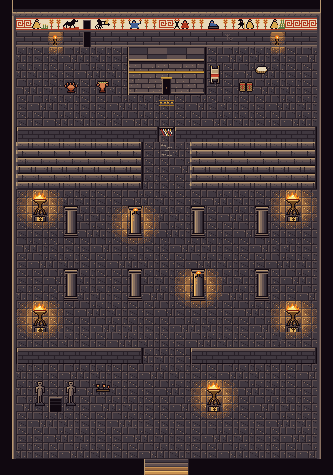

# Temple of Demeter tileset: `temple_demeter`

`gTileset_TempleDemeter` is the Temple of Demeter's interior at Eleusa: an underground
megaron modelled on the Telesterion, where Hierophant Chloe the Mystagogue keeps the
Lesser Mysteries (SYSTEMS.md §12, Laurel 3). A forest of columns in near-darkness, lit by
torches; rock-cut tiers along the walls; the Descent of Persephone painted round the
frieze; tripod braziers and wall torches, cold and lit; the Anaktoron with the
Hierophant's throne by its door; kykeon and the baskets of the holy things; the
draughty doorway hung with ribbons; the crypt's stone sentinels; and the wreck the
Titans leave in it (STORY.md §6.2).

**This file is generated** by `tools/ichor/art/temple_demeter_build.py`. The art is in
`temple_demeter_art.py`; the sample rooms in `temple_demeter_scene.py`.

| Image | Shows |
|---|---|
| [`img/temple_demeter_lit.png`](img/temple_demeter_lit.png) | The sample rite, every brazier and torch lit |
| [`img/temple_demeter_dark.png`](img/temple_demeter_dark.png) | The same in the dark: the torch's radius round the player, the vestibule's lit zone |
| [`img/temple_demeter_doused.png`](img/temple_demeter_doused.png) | Doused: the `glow/` palettes, only the seeds, the chalk and the flames |
| [`img/temple_demeter_raid.png`](img/temple_demeter_raid.png) | The robbed Telesterion: overturned braziers, bootprints, one lamp on the steps |
| [`img/temple_demeter_sheet.png`](img/temple_demeter_sheet.png) | The numbered sheet, rendered from the compiled tileset on oikos |
| [`img/temple_demeter_pieces.png`](img/temple_demeter_pieces.png) | Every structure |



## How it works

**Primary.** Pair it with `oikos`, the interior primary. Like the Temple of Hestia it uses
only its own tiles (0x200 and up) and palettes 6-12, so it renders the same on any
primary. Every metatile is COVERED: an opaque bottom layer and objects in the middle
layer. Nothing draws over the player.

**Collision.** Walk codes below: `X` blocks (collision 1), `.` walkable, `D`
`MB_NON_ANIMATED_DOOR` (put a warp there), `S` `MB_SOUTH_ARROW_WARP` (the stair out,
like a door mat: the map's bottom row, a warp event on each cell).

**The rite's four verbs, in tiles.**

- **Light.** Every light has a cold and a lit metatile, **the lit one = the cold one + 1**:
  the brazier bowls and legs, the wall sconces, the niche lamps, the column torches, the
  lamp on the steps. Swap both cells of a brazier together and keep them impassable. A lit
  light stands in a pool of warmed floor: swap the `glow` ring in round it (on cells that
  hold plain `floor`) and `floor` back when it goes out, as the Hearth Trial does. A
  season brazier lights a quarter of the hall for good: that is a lit zone (flash level 0,
  SYSTEMS.md §2), and swapping its quarter's sconces to lit makes the change visible.
- **Douse.** Persephone's pomegranate seeds (`floor` `seed`, `seeds`) and Hecate's chalk
  (`chalk_fork`, `chalk_trail_*`, `wall` `lower_chalk`) are painted in two latent colors.
  The build sets those palette entries to the stone they sit on, so by torchlight they are
  invisible. `porytiles_bin/glow/06.pal`-`12.pal` is the doused set: black everywhere,
  except the seeds (pomegranate red), the chalk (a pale violet) and the flames, so lit
  braziers stay landmarks. The engine loads it over palettes 6-12, with flash level 0,
  when the torch is doused, and restores the normal set on relighting.
  `gTilesetPalettes_TempleDemeterGlow` in `src/data/tilesets/graphics.h` is that set,
  ready for the engine (unused until it is wired). The primary's palettes 0-5 should go
  black too.
- **Wind.** `partition` `door_draught` / `door_draught_b`: a doorway in a low wall with
  ribbons streaming through it, both walkable. Alternate the two to make them flutter.
  `floor` `draught` shows dust running toward it.
- **Reveal.** `wall_lights` `door_top_painted` over `door_bottom_painted` is a doorway in
  the fresco; `_open` (+1 each) is the same wall opened, its bottom a door.

**Darkness rules** (SYSTEMS.md §2): the wall top's lip and the side walls carry a rim
light, so the wall line reads inside a 3.5-tile torch radius; give every mandatory
acolyte a lamp or brazier.

**Palettes.** Six color groups (`temple_demeter_art.GROUPS`), one per secondary palette:
`floor` (stone, warmed stone, the seed latent, gilt), `wall` (stone, the fresco, the
chalk latent), `fire` (bronze, flame, ash), `marble` (the dais, throne and altar), `clay`
(vessels, baskets, ribbons) and `warm` (the fresco and stone under firelight). Slot 12 is
free.

**Tile budget.** 395 of 504 tiles are used (153 metatiles). The door animations own
tiles 504-511.

**Labels.** The build writes `METATILE_TempleDemeter_*` for everything a script swaps to
the end of `include/constants/metatile_labels.h`: the braziers, the glow ring, the
sconces, niches, column torches, the lamp, the painted door, the altar and the draught
doorway.

## Catalog

### Floor: flagstones, the trail and the wreck

`floor`, 7 wide by 2 tall. Walkable flagstones (`floor`, `floor_b`, `floor_c` to break up a run, `floor_cracked`), the Titans' `bootprints`, and `draught`: dust streaming toward a draughty doorway. `seed` and `seeds` are Persephone's pomegranate seeds and `chalk_fork`, `chalk_trail_h`/`_v` Hecate's chalk, painted in the latent color: plain floor by torchlight, glowing when the torch is doused (the `glow/` palettes). `rubble` blocks; `void` is black, for the border; `floor_inlay` is the Anaktoron's gilt threshold.

```text
ids                                         walk
0x200 0x201 0x202 0x203 0x204 0x205 0x206   . . . . . . .
0x208 0x209 0x20A 0x20B 0x20C 0x20D 0x20E   . . . . X X .
```

Pieces: `floor` 0x200, `floor_b` 0x201, `floor_c` 0x202, `floor_cracked` 0x203, `bootprints` 0x204, `draught` 0x205, `seed` 0x206, `seeds` 0x208, `chalk_fork` 0x209, `chalk_trail_h` 0x20A, `chalk_trail_v` 0x20B, `rubble` 0x20C, `void` 0x20D, `floor_inlay` 0x20E.

### Warmed floor round a lit light

`glow`, 4 wide by 2 tall. Swap these in round a brazier or torch when it lights, on cells that hold plain `floor`; swap `floor` back when it goes out. Around a 1 x 2 light at (x, y)-(x, y+1): `l0` (x-1, y), `r0` (x+1, y), `l1` (x-1, y+1), `r1` (x+1, y+1), `bl` `b` `br` along row y+2. `pool` is floor warmed all over, for a lit zone's heart.

```text
ids                       walk
0x210 0x211 0x212 0x213   . . . .
0x218 0x219 0x21A 0x21B   . . . .
```

Pieces: `l0` 0x210, `r0` 0x211, `l1` 0x212, `r1` 0x213, `bl` 0x218, `b` 0x219, `br` 0x21A, `pool` 0x21B.

### Walls: the rim-lit top, corners, side walls, the lower wall

`wall`, 8 wide by 1 tall. A room shows three wall rows: `top` (the dark under the roof, its rim-lit lip marking the wall in the dark), the frieze, then `lower`. Side walls run down both edges of the map. `lower_chalk` carries Hecate's chalk (latent: it glows when doused); `lower_cracked` is for the Titans' wreck.

```text
ids                                               walk
0x220 0x221 0x222 0x223 0x224 0x225 0x226 0x227   X X X X X X X X
```

Pieces: `top` 0x220, `corner_l` 0x221, `corner_r` 0x222, `side_l` 0x223, `side_r` 0x224, `lower` 0x225, `lower_chalk` 0x226, `lower_cracked` 0x227.

### The frieze: the Descent of Persephone

`frieze`, 5 wide by 2 tall. The wall's middle row, painted round the hall. Read left to right: `maiden` (she gathers the narcissus), `horses` (the earth opens), `seized` (Hades's chariot), `search` (Demeter with her torches), `hecate` (Hecate meets her), `grief` (Demeter at the Maiden's Well), `hermes` (Hermes leads Persephone up), `return` (the pomegranate, and the wheat springs). `wheat` and `key` are plain bands between the scenes.

```text
ids                             walk
0x228 0x229 0x22A 0x22B 0x22C   X X X X X
0x230 0x231 0x232 0x233 0x234   X X X X X
```

Pieces: `maiden` 0x228, `horses` 0x229, `seized` 0x22A, `search` 0x22B, `hecate` 0x22C, `grief` 0x230, `hermes` 0x231, `return` 0x232, `wheat` 0x233, `key` 0x234.

### Wall torches, the painted door, the niche

`wall_lights`, 8 wide by 2 tall. Lower-wall cells. `sconce_lit` is `sconce_cold` + 1: a bronze torch bracket, its flame warming the wall round it; put `floor_sconce` on the floor cell below a lit sconce, and `lower_lit` / `frieze_lit` beside it to spread the light. `niche_lit` is `niche_cold` + 1: a clay lamp in a niche. The Reveal: `door_top_painted` (frieze row) over `door_bottom_painted` (lower row) is a doorway painted in the fresco; in a lit brazier's light swap each for its `_open` (painted + 1, the bottom is MB_NON_ANIMATED_DOOR): a real door into the dark.

```text
ids                                               walk
0x238 0x239 0x23A 0x23B 0x23C 0x23D 0x23E 0x23F   X X X X . X X X
0x240 0x241 0x242 0x243 0x244 0x245 0x246 0x247   X X X X X X X D
```

Pieces: `sconce_cold` 0x238, `sconce_lit` 0x239, `niche_cold` 0x23A, `niche_lit` 0x23B, `floor_sconce` 0x23C, `door_top_painted` 0x23D, `door_top_open` 0x23E, `lower_lit` 0x23F, `frieze_lit` 0x240, `door_bottom_painted` 0x246, `door_bottom_open` 0x247, `lower_2` 0x241.

### The rock-cut tiers

`tiers`, 3 wide by 3 tall. Walkable steps, three rows: `top_*` against the wall, `low_*` meeting the floor. L and R end each run with its cut side. Run them along the north wall below the wall rows, as the Telesterion's were on all four sides.

```text
ids                 walk
0x248 0x249 0x24A   . . .
0x250 0x251 0x252   . . .
0x258 0x259 0x25A   . . .
```

Pieces: `top_L` 0x248, `top_M` 0x249, `top_R` 0x24A, `mid_L` 0x250, `mid_M` 0x251, `mid_R` 0x252, `low_L` 0x258, `low_M` 0x259, `low_R` 0x25A.

### The forest of columns

`columns`, 5 wide by 2 tall. A column is `top` over `bottom` (both block). `torch_lit` is `torch_cold` + 1: an iron bracket and torch on the column; with it lit put `bottom_lit` under it and the `glow` ring round it. `broken_top` is a column the Titans cracked; `drum` and `drum_b` are fallen drums on the floor (block).

```text
ids                             walk
0x24B 0x24C 0x24D 0x24E 0x24F   X X X X X
0x253 0x254 0x255 0x256 0x257   X X X X X
```

Pieces: `top` 0x24B, `torch_cold` 0x24C, `torch_lit` 0x24D, `broken_top` 0x24E, `drum` 0x24F, `bottom` 0x253, `bottom_b` 0x254, `bottom_lit` 0x255, `drum_b` 0x257, `broken_bottom` 0x256.

### Tripod braziers: the vestibule's and the four seasons'

`braziers`, 6 wide by 2 tall. A brazier is a bowl (`top_*`) over legs on a plinth whose bronze plaque names it: `vestibule` (Hecate's crossroads), and the season braziers of the hall's four quarters: `spring` (a flower), `summer` (an ear of wheat), `autumn` (the pomegranate), `winter` (a bare branch). **Each lit metatile is its cold one + 1.** Swap both cells together and keep them impassable, then swap the `glow` ring in round it.

```text
ids                                   walk
0x260 0x261 0x262 0x263 0x264 0x265   X X X X X X
0x268 0x269 0x26A 0x26B 0x26C 0x26D   X X X X X X
```

Pieces: `top_cold` 0x260, `top_lit` 0x261, `vestibule_cold` 0x262, `vestibule_lit` 0x263, `spring_cold` 0x264, `spring_lit` 0x265, `summer_cold` 0x268, `summer_lit` 0x269, `autumn_cold` 0x26A, `autumn_lit` 0x26B, `winter_cold` 0x26C, `winter_lit` 0x26D.

### An overturned brazier, kicked over in the raid

`overturned`, 2 wide by 1 tall. The Titans' wreck (STORY.md §6.2): a tripod on its side, its coals spilled cold across the floor.

```text
ids           walk
0x214 0x215   X X
```

### Partition wall and the draughty doorway

`partition`, 6 wide by 1 tall. A low wall across the hall, one row: `W` `M` ... `E`. The doorway's ribbons stream through it on the draught (SYSTEMS.md §2, the wind verb: it blows out a carried flame). `door_draught` streams south, `door_draught_b` sways the other way: alternate them to make the ribbons flutter. Both are walkable. `post` ends a wall standing alone.

```text
ids                                   walk
0x270 0x271 0x272 0x273 0x274 0x275   X X X . . X
```

Pieces: `W` 0x270, `M` 0x271, `E` 0x272, `door_draught` 0x273, `door_draught_b` 0x274, `post` 0x275.

### The Anaktoron: the inner shrine in the hall

`anaktoron`, 5 wide by 3 tall. The small, ancient stone house at the heart of the Telesterion, where the holy things were kept. A rough slab roof, walls of old limestone with a gilt band, and one door (MB_NON_ANIMATED_DOOR): warp to the inner shrine, where Chloe waits. Put the Hierophant's `throne` on the floor beside the door, as at Eleusis.

```text
ids                             walk
0x278 0x279 0x27A 0x27B 0x27C   X X X X X
0x280 0x281 0x282 0x283 0x284   X X X X X
0x288 0x289 0x28A 0x28B 0x28C   X X D X X
```

### The Hierophant's throne

`throne`, 1 wide by 2 tall. Marble, with a red cushion and gilt finials. Beside the Anaktoron's door.

```text
ids     walk
0x207   X
0x20F   X
```

### The Mystagogue's dais

`dais`, 4 wide by 2 tall. Marble floor (`L` `M` ... `R`, walkable) over a front riser (`riser_*`, blocks) with `steps` up. `altar_empty` (blocks) is the altar the Mysteries' last secret appears on: swap in the vessels set's `altar_ear` for Chloe's reveal, a single reaped ear of grain (METATILE_TempleDemeter_Altar_Empty / _Ear).

```text
ids                       walk
0x290 0x291 0x292 0x293   . . . X
0x298 0x299 0x29A 0x29B   X X . X
```

Pieces: `L` 0x290, `M` 0x291, `R` 0x292, `altar_empty` 0x293, `riser_L` 0x298, `riser_M` 0x299, `steps` 0x29A, `riser_R` 0x29B.

### Kykeon, the sacred baskets, lamps

`vessels`, 5 wide by 2 tall. On the floor, all blocking. `kykeon` a krater of the barley-and-mint drink the initiates broke their fast with; `kylikes` cups set out on a board; `kernos` the many-cupped offering vessel; `kistai` two lidded baskets of the holy things, tied with red fillets; `liknon` the winnowing basket under its cloth; `kiste_smashed` one the Titans broke open. `lamp_lit` is `lamp_cold` + 1: the one lamp on the steps in the robbed Telesterion. `altar_ear` is the dais's `altar_empty` with the single reaped ear of grain on it.

```text
ids                             walk
0x2A0 0x2A1 0x2A2 0x2A3 0x2A4   X X X X .
0x2A8 0x2A9 0x2AA 0x2AB 0x2AC   X X X X X
```

Pieces: `kykeon` 0x2A0, `kylikes` 0x2A1, `kernos` 0x2A2, `kistai` 0x2A3, `floor_spare` 0x2A4, `liknon` 0x2A8, `kiste_smashed` 0x2A9, `lamp_cold` 0x2AA, `lamp_lit` 0x2AB, `altar_ear` 0x2AC.

### Stairs: up to the daylight, down to the crypt

`stairs`, 5 wide by 1 tall. The megaron is underground: its way out is a stair rising south to the temple above, lit by the daylight at its head. Put the stair on the map's bottom row (`up_L` `up_M` ... `up_R`, or `up_single`); each cell is MB_SOUTH_ARROW_WARP with a warp event, like a door mat. `crypt` is the dark stair down past the sentinels (MB_NON_ANIMATED_DOOR).

```text
ids                             walk
0x25B 0x25C 0x25D 0x25E 0x25F   S S S S D
```

Pieces: `up_L` 0x25B, `up_M` 0x25C, `up_R` 0x25D, `up_single` 0x25E, `crypt` 0x25F.

### A stone sentinel of the crypt

`sentinel`, 1 wide by 2 tall. Grey kouroi with blank eyes, who turn back the uninitiated (the Helm of Darkness gate, SYSTEMS.md §1). Stand two either side of the crypt stair.

```text
ids     walk
0x216   X
0x21E   X
```

### Hera's serpent pits

`serpent_pit`, 8 wide by 2 tall. Sunken pits for the Seat of Hera, where Hera's serpents (the Hydra's kin, Ladon's) keep their dens between the columns. Pieces by row (`top`, `bot` of a two-row pit, or `one`) and column (`l`, `m`, `r`, or `s` for a one-wide pit), e.g. `top_l`; `bot_l_snake`, `bot_s_snake`, `one_m_snake` and `top_m_snake` show a coiled serpent.

```text
ids                                               walk
0x2B0 0x2B1 0x2B2 0x2B3 0x2B4 0x2B5 0x2B6 0x2B7   X X X X X X X X
0x2B8 0x2B9 0x2BA 0x2BB 0x2BC 0x2BD 0x2BE 0x2BF   X X X X X X X X
```

Pieces: `top_l` 0x2B0, `top_m` 0x2B1, `top_r` 0x2B2, `top_s` 0x2B3, `bot_l` 0x2B4, `bot_m` 0x2B5, `bot_r` 0x2B6, `bot_s` 0x2B7, `one_l` 0x2B8, `one_m` 0x2B9, `one_r` 0x2BA, `one_s` 0x2BB, `bot_l_snake` 0x2BC, `bot_s_snake` 0x2BD, `one_m_snake` 0x2BE, `top_m_snake` 0x2BF.

## The sample rite (`temple_demeter_scene.py`)

The renders come from one sample layout, 21 x 30, built from the pieces above to show the
kit doing the rite, not to fix the map (the Phase 2 script and geography are still being
written):

- **Teach (the vestibule, south).** The stair down from the temple, one brazier already
  lit (`vestibule`), one seed by the player's feet that only shows doused.
- **Test (the hall).** A forest of columns, tiers along the side walls, four season
  braziers, one in each quarter, each beside a seed; column torches and wall sconces to
  light with each quarter. Two acolytes' spots are marked by lit column torches.
- **Master (the Anaktoron, north).** A partition wall across the hall with the draughty
  doorway, chalk marks that show only doused, and the Anaktoron with the throne beside
  its door; the frieze tells the Descent of Persephone round the walls.

The raid render swaps braziers for `overturned`, scatters `bootprints`, `rubble` and a
`kiste_smashed`, and leaves one `lamp_lit` on the tiers: the robbed Telesterion of
STORY.md §6.2.
