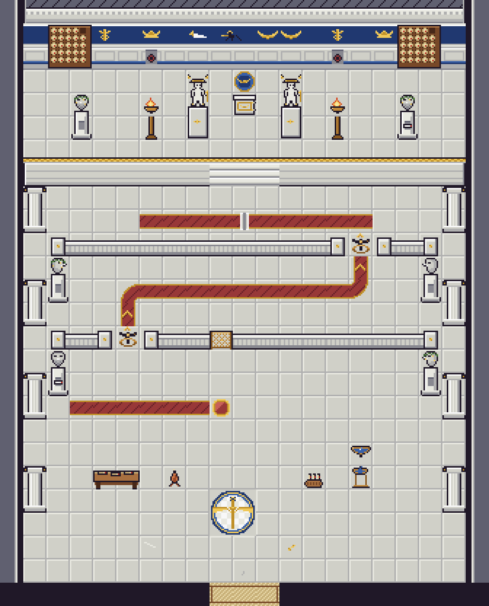

# Temple of Hermes tileset: `temple_hermes`

The interior of Emporion's Temple of Hermes, home of the Herald's Run (SYSTEMS.md §12;
Laurel 2, Hierophant Kerykos the Herald, Flying). It is Ionic, cool and bright: white
marble under a frieze of golden wings on Aegean blue, a racetrack inlaid in red porphyry
and gold across the floor, bronze turnstiles and gates, relay torches, and the herald's
rostrum at the head of the stoa's steps. Hestia's hall is warm and lit by fire; this one
is the open air and the road.



| Image | Shows |
|---|---|
| `img/emporion_scene_temple_interior.png` | A mock of the Herald's Run (porch, switchback stoa, upper colonnade, rostrum) at 3x, rendered on `oikos` |
| `img/temple_hermes_pieces.png` | Every structure as drawn |
| `img/temple_hermes_sheet.png` | Every metatile with its id, from the compiled tileset, on `oikos` |

## How it is made

- `tools/ichor/art/temple_hermes.py` holds every pixel and the palette plan.
- `tools/ichor/art/emporion_build.py temple_hermes` draws it, compiles it with Porytiles in a
  scratch project against an empty stand-in primary, verifies it and rewrites this file.

**Works on any primary.** Like the Temple of Hestia, it uses only its own tiles and
palettes 6-12, and every bottom layer is opaque, so the primary's backdrop never shows.
The build checks both. It is drawn for `oikos` and renders the same on any primary.

**Layers.** Floors and walls fill the bottom layer; every object stands in the middle
layer over the floor. Nothing is drawn over sprites: a sprite north of an object never
overlaps it, and one south of it stands in front, which is right.

**Collision and behaviors.** The walk grids below give the collision to paint (`X`
blocks). `MB_COUNTER` is on the lectern and `MB_SOUTH_ARROW_WARP` on the doormat; every
other metatile is `MB_NORMAL`. The turnstiles' one-way rule and the herms' turning are
scripts (a step hook and `setmetatile`, SYSTEMS.md §12); the tiles carry no behavior.

**Palettes.** Every 8x8 tile draws from one of five groups (`temple_hermes.GROUPS`), all
colors multiples of 8:

| Group | For |
|---|---|
| floor | Marble slabs, the porphyry racetrack and its gold, the mosaic |
| marble | Columns, herms (with their oil and laurel), the balustrade, the rostrum, the statue |
| frieze | The walls and the painted frieze |
| bronze | Turnstiles, gates, torches and their fire, the step-glass |
| wood | Pigeonholes, scrolls and their seals, the table, the anointing oil, the doormat |

**Tile budget.** 288 of 504 tiles are used (the door animations own 504-511).

## The Herald's Run, piece by piece

| The trial needs (SYSTEMS.md §12) | Pieces |
|---|---|
| Sealed scrolls handed out by Kerykos | `scroll_table` (full and emptied), the scroll basket in `props` |
| Herald-herms to deliver them to | `herm`: heads facing four ways, plain or anointed; shafts plain or holding a delivered scroll |
| "One herm head swivels to point the way once you anoint it (a second use of oil)" | swap a head for its anointed version facing the next herm; the stand of oil in `props` |
| The step-glass | the bronze klepsydra in `props` (the counter itself is UI) |
| Hermes's one-way turnstiles; the upper colonnade's turnstiles reverse | `turnstile` (four directions): swap a turnstile for the opposite one to reverse it |
| A switchback stoa, a side colonnade with a shortcut | `balustrade` (sixteen joins), `column`, the lattice `gate`s |
| The entry porch, the main stoa, the upper colonnade | the floor, the lanes, the rostrum's platform, risers and steps for each level |
| Kerykos on the herald's rostrum at the head of the stoa's steps | `rostrum`: the platform, its roundel and its lectern (`MB_COUNTER`); `column` holds the statue of Hermes to flank him |
| Messenger props: pigeonholes, relay torches, the racetrack | `pigeonholes` (in the wall and as a cabinet), the torches in `props`, `lane` |

## Catalog

Each grid lists metatile ids as Porymap shows them, with the collision beside it. Ids run from 0x200 in the order of `temple_hermes.build()`; add new pieces at the end so they keep their places. `build/temple_hermes/catalog.json` names every part (`names`), so a map builder can place them by name.

### Floor: cool Ionic marble

`floor`, 6 wide by 1 tall. (0) the void, near-black, for the layout's border (block it); (1) marble slab; (2), (3) veined slabs to scatter; (4) a worn, cracked slab for the walked lines; (5) a slab inlaid with a small gold wing, where the temple's people stand.

```text
ids                                   walk
0x200 0x201 0x202 0x203 0x204 0x205   X . . . . .
```

Parts: `void` 0x200, `slab` 0x201, `vein_a` 0x202, `vein_b` 0x203, `worn` 0x204, `wing` 0x205.

### The racetrack inlay: lanes, turns, the starting sill, chevrons

`lane`, 8 wide by 2 tall. A lane of red porphyry edged in gold, inlaid in the floor. Row 0: east-west run, north-south run, the four turns (joining N-E, E-S, S-W, W-N), a crossing, and the starting sill across an east-west lane (white stone, two grooves). Row 1: chevrons pointing north, east, south and west (the way the run goes, or a turnstile's way), the starting sill across a north-south lane, a turning post's disc (the kampter, where the lane turns at the stadium's end), and two plain slabs. All walkable.

```text
ids                                               walk
0x208 0x209 0x20A 0x20B 0x20C 0x20D 0x20E 0x20F   . . . . . . . .
0x210 0x211 0x212 0x213 0x214 0x215 0x216 0x217   . . . . . . . .
```

Parts: `h` 0x208, `v` 0x209, `ne` 0x20A, `es` 0x20B, `sw` 0x20C, `wn` 0x20D, `cross` 0x20E, `start_h` 0x20F, `arrow_n` 0x210, `arrow_e` 0x211, `arrow_s` 0x212, `arrow_w` 0x213, `start_v` 0x214, `post` 0x215, `slab` 0x216, `slab2` 0x217.

### Walls: cornice, the winged frieze, the lower wall, the doormat

`wall`, 8 wide by 4 tall. A room shows three wall rows: the cornice (row 0 of the map), the frieze, then the lower wall. Row 0: cornice, its west and east corners, the side walls' tops (west, east) for the map's edges, the void's border, and two cornice variants with a gilded acroterion. Row 1, the frieze: gold on Aegean blue: spread wings, the caduceus, the petasos, the winged sandals, the tortoise lyre, Hermes running (two cells, left then right), and the plain blue band. Row 2, the lower wall: plain, a wall torch burning, a niche with a little herm bust, a plaque, and the side walls' faces. Row 3: the doormat (west, middle, east, single; MB_SOUTH_ARROW_WARP: put it on the map's bottom row with warps), and four more plain lower walls.

```text
ids                                               walk
0x218 0x219 0x21A 0x21B 0x21C 0x21D 0x21E 0x21F   X X X X X X X X
0x220 0x221 0x222 0x223 0x224 0x225 0x226 0x227   X X X X X X X X
0x228 0x229 0x22A 0x22B 0x22C 0x22D 0x22E 0x22F   X X X X X X X X
0x230 0x231 0x232 0x233 0x234 0x235 0x236 0x237   . . . . X X X X
```

Parts: `cornice` 0x218, `cornice_w` 0x219, `cornice_e` 0x21A, `side_w` 0x21B, `side_e` 0x21C, `void_wall` 0x21D, `cornice_acro` 0x21E, `frieze_wings` 0x220, `frieze_caduceus` 0x221, `frieze_petasos` 0x222, `frieze_talaria` 0x223, `frieze_lyre` 0x224, `frieze_runner_l` 0x225, `frieze_runner_r` 0x226, `frieze` 0x227, `lower` 0x228, `lower_torch` 0x229, `lower_niche` 0x22A, `lower_plaque` 0x22B, `side_face_w` 0x22E, `side_face_e` 0x22F, `mat_l` 0x230, `mat_m` 0x231, `mat_r` 0x232, `mat_single` 0x233.

### Herald-herms: heads that turn, plain and anointed

`herm`, 8 wide by 2 tall. The posts the sealed scrolls are delivered to. A herm is a head cell over a shaft cell, both blocking. Row 0, the heads: plain, facing south, east, north and west, then anointed (oil-bright, a laurel wreath) facing the same four ways. An anointed head turned to face the next herm is how it 'points the way' (SYSTEMS.md §12). Row 1, the shafts: (0) plain, (1) with a delivered scroll in its niche, (2)-(7) plain again (any shaft goes under any head). Swap heads and shafts with setmetatile; the west heads are the east heads' tiles flipped.

```text
ids                                               walk
0x238 0x239 0x23A 0x23B 0x23C 0x23D 0x23E 0x23F   X X X X X X X X
0x240 0x241 0x242 0x243 0x244 0x245 0x246 0x247   X X X X X X X X
```

Parts: `head_s` 0x238, `head_e` 0x239, `head_n` 0x23A, `head_w` 0x23B, `head_oiled_s` 0x23C, `head_oiled_e` 0x23D, `head_oiled_n` 0x23E, `head_oiled_w` 0x23F, `shaft` 0x240, `shaft_scroll` 0x241.

### One-way turnstiles and lattice gates

`turnstile`, 8 wide by 1 tall. (0)-(3) Hermes's turnstiles, each letting you through one way only: the gold chevron shows the way (north, east, south, west). The one-way rule and the reversing turnstiles of the upper colonnade are scripts (a step hook); to reverse one, swap in the opposite direction's metatile. (4)-(7) bronze lattice gates in a gap of the balustrade: across an east-west run shut (block it) and open, across a north-south run shut and open. Set the turnstiles' collision in the scripts' terms; the gates block when shut.

```text
ids                                               walk
0x248 0x249 0x24A 0x24B 0x24C 0x24D 0x24E 0x24F   . . . . X . X .
```

Parts: `turn_n` 0x248, `turn_e` 0x249, `turn_s` 0x24A, `turn_w` 0x24B, `gate_h_shut` 0x24C, `gate_h_open` 0x24D, `gate_v_shut` 0x24E, `gate_v_open` 0x24F.

### The switchback stoa's balustrade, every join

`balustrade`, 8 wide by 2 tall. A low marble parapet with balusters, for the walls of the switchback stoa. Sixteen pieces named by the sides they join (N E S W), so it runs, turns, branches and ends anywhere; a gilded pedestal stands at every end and turn. Set them all impassable. Pieces: `NS` (0,0), `N` (1,0), `S` (2,0), `EW` (3,0), `E` (4,0), `W` (5,0), `ES` (6,0), `SW` (7,0), `NE` (0,1), `NW` (1,1), `NES` (2,1), `ESW` (3,1), `NSW` (4,1), `NEW` (5,1), `NESW` (6,1), `post` (7,1).

```text
ids                                               walk
0x250 0x251 0x252 0x253 0x254 0x255 0x256 0x257   X X X X X X X X
0x258 0x259 0x25A 0x25B 0x25C 0x25D 0x25E 0x25F   X X X X X X X X
```

Parts: `NS` 0x250, `N` 0x251, `S` 0x252, `EW` 0x253, `E` 0x254, `W` 0x255, `ES` 0x256, `SW` 0x257, `NE` 0x258, `NW` 0x259, `NES` 0x25A, `ESW` 0x25B, `NSW` 0x25C, `NEW` 0x25D, `NESW` 0x25E, `post` 0x25F.

### Relay torches, the step-glass and the anointing oil

`props`, 5 wide by 2 tall. (0) a relay torch's bowl, lit, (1) the same cold, over (0,1) its bronze stand: the torches of the torch race, lit as the run goes on; swap the bowl to light one. (2) the step-glass: a bronze klepsydra, water running from its upper bowl to its lower, over (2,1) its stand (Kerykos's glass of steps, SYSTEMS.md §12). (3) a stand of anointing oil, a clay lekythos on a cedar tripod, one cell, over (3,1) plain floor. (4) a scroll basket with sealed scrolls, over (4,1) the same basket emptied.

```text
ids                             walk
0x260 0x261 0x262 0x263 0x264   X X X X X
0x268 0x269 0x26A 0x26B 0x26C   X X X . X
```

Parts: `torch_lit` 0x260, `torch_cold` 0x261, `torch_stand` 0x268, `glass_top` 0x262, `glass_stand` 0x26A, `oil` 0x263, `floor` 0x26B, `basket_full` 0x264, `basket_empty` 0x26C.

### Scroll pigeonholes, in the wall and as a cabinet

`pigeonholes`, 6 wide by 2 tall. (0)-(1) pigeonholes set in the wall: put the pair over the frieze and lower-wall rows (rows 1-2 of the wall), two cells wide. (2)-(3) a free-standing cedar cabinet of pigeonholes, full of sealed scrolls, two cells wide by two tall. (4)-(5) the same cabinet with its scrolls taken: swap its top row in once the scrolls go out. All impassable.

```text
ids                                   walk
0x270 0x271 0x272 0x273 0x274 0x275   X X X X X X
0x278 0x279 0x27A 0x27B 0x27C 0x27D   X X X X X X
```

Parts: `wall_tl` 0x270, `wall_tr` 0x271, `wall_bl` 0x278, `wall_br` 0x279, `cab_tl` 0x272, `cab_tr` 0x273, `cab_bl` 0x27A, `cab_br` 0x27B, `cab_empty_tl` 0x274, `cab_empty_tr` 0x275, `cab_empty_bl` 0x27C, `cab_empty_br` 0x27D.

### Kerykos's table of sealed scrolls

`scroll_table`, 4 wide by 1 tall. (0)-(1) a cedar table laid with sealed scrolls, red wax and ribbons, where Kerykos hands them out; (2)-(3) the same table once they're taken.

```text
ids                       walk
0x280 0x281 0x282 0x283   X X X X
```

Parts: `full_l` 0x280, `full_r` 0x281, `empty_l` 0x282, `empty_r` 0x283.

### Ionic column and the statue of Hermes

`column`, 3 wide by 3 tall. (0,0) over (0,1): a free-standing Ionic column, both cells blocking; (0,2) a column's base alone, for a broken colonnade. (1,0)-(1,2): the statue of Hermes on his plinth, the petasos on his head and the caduceus in his hand, three cells tall: flank the rostrum with him. (2,0)-(2,2): plain floor, kept to align the sheet.

```text
ids                 walk
0x284 0x285 0x286   X X .
0x28C 0x28D 0x28E   X X .
0x294 0x295 0x296   X X .
```

Parts: `col_top` 0x284, `col_bot` 0x28C, `col_base` 0x294, `statue_top` 0x285, `statue_mid` 0x28D, `statue_bot` 0x295.

### The herald's rostrum: platform, risers, steps, lectern

`rostrum`, 8 wide by 2 tall. A raised marble platform at the head of the stoa's steps, for Kerykos and for the upper colonnade. Row 0: (0) the platform's floor, (1) the same with a gold-and-blue winged roundel for under Kerykos, (2) its front lip with a gold key (walkable), (3) its west edge and (4) east edge (block them, so no one climbs on from the side), (5) the lectern, MB_COUNTER: Kerykos stands north of it and the player speaks across it, (6) the platform's floor with a cold lampstand, (7) the stair's head. Row 1: (0) the riser's face, (1) its west and (2) east corners (all block), (3) steps climbing north through the riser (walkable), (4)-(7) a winged caduceus mosaic for the hall's floor, a 2x2 roundel laid as (4) (5) over (6) (7).

```text
ids                                               walk
0x298 0x299 0x29A 0x29B 0x29C 0x29D 0x29E 0x29F   . . . X X . X .
0x2A0 0x2A1 0x2A2 0x2A3 0x2A4 0x2A5 0x2A6 0x2A7   X X X . . . . .
```

Counter metatiles (`MB_COUNTER`): 0x29D.

Parts: `dais` 0x298, `dais_roundel` 0x299, `dais_lip` 0x29A, `edge_w` 0x29B, `edge_e` 0x29C, `lectern` 0x29D, `dais_lamp` 0x29E, `stair_head` 0x29F, `riser` 0x2A0, `riser_w` 0x2A1, `riser_e` 0x2A2, `steps` 0x2A3, `mosaic_tl` 0x2A4, `mosaic_tr` 0x2A5, `mosaic_bl` 0x2A6, `mosaic_br` 0x2A7.
