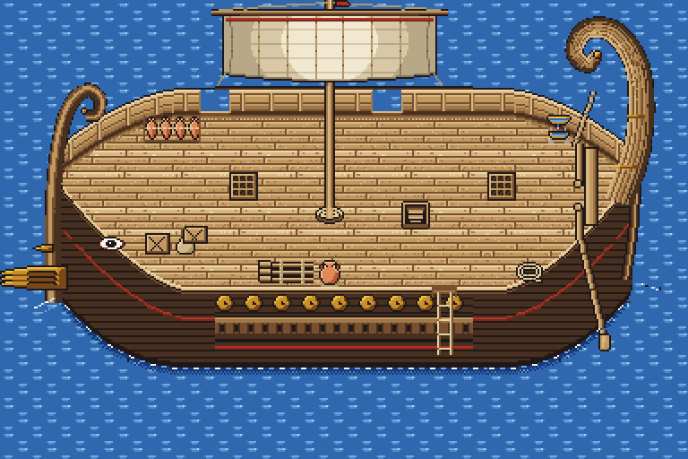

# Trireme tileset catalog

`gTileset_Trireme` is the *Euploia*'s deck and hold, a secondary on the `aethos`
primary for `MAP_TRIREME_EUPLOIA_DECK` and `MAP_TRIREME_EUPLOIA_HOLD`.

<!-- generated: trireme_build.py -->
**This section is generated** by `tools/ichor/art/trireme_build.py`, which draws the tileset
(`trireme_deck.py`, `trireme_hold.py`), compiles it and rewrites the catalog between these
markers. The passes below the markers are written by hand.



## How it works

**Scenes, not structures.** The ship is drawn as two whole pictures, the deck (24×16 cells)
and the hold (18×9), each in three layers. The build slices them into 16×16 cells and keeps
one metatile per distinct cell, so the maps are the scenes cell for cell
(`build/trireme/catalog.json`, `scenes`). `tools/ichor/maps/trireme.py` writes the layouts
from there and places events by the named pieces below, never by raw id.

**Variants.** The deck is also drawn in five other states. Only the cells that differ from the
plain deck become metatiles, and the catalog lists them as `(x, y, id)` for `setmetatile`:
`sail_sag` (the halcyon calm), `sail_fill` (casting off; the wind coming back), `oars_out`
(the port bank rowing), `klepsydra_up` (the water clock running backward) and `coast` (the
mainland ahead of the bow, beat 10C). `tools/ichor/maps/trireme.py` writes them into the
deck's `scripts.pory` as small scripts (`TriremeDeck_EventScript_SailSag` and the rest),
between generated markers.

**Borrowed sea.** Every cell on the water points its bottom layer at aethos's open sea
(`0x170`), so the sea round the hull animates with aethos's water and costs no tiles. Open
water with nothing on it is `0x170` itself. Rebuild the trireme whenever aethos is repainted.

**Mirrored hull.** The hull is symmetric about the ship's middle, so the stern's curves are the
bow's tiles flipped. The ram, eye and stem, and the aphlaston and steering oars, are drawn
after the mirror and are their own.

**Walk codes.** In the grids below: `X` solid; `.` walkable; `~` open sea (solid); `f` sea you
fish into from the deck (`MB_OCEAN_WATER`, walkable collision at water elevation, so only the
rod and a surfer's single step reach it); `w` the hatch and the ladder (`MB_LADDER`: the warps).

## Palettes

Seven groups, one per secondary palette (6-12). Every 8×8 tile draws from one group.

| Group | Colors | Use |
|---|---|---|
| wood | 15: `ink` (32, 24, 24), `wd0` (72, 48, 32), `wd1` (120, 80, 48), `pk1` (160, 120, 72), `pk2` (192, 152, 96), `pk3` (216, 184, 128), `pk4` (240, 216, 168), `rp` (224, 208, 160), `rd` (184, 48, 32), `rd0` (120, 40, 32), `br` (120, 72, 24), `g0` (200, 144, 40), `g1` (240, 192, 64), `w0` (248, 248, 240), `b1` (48, 104, 176) | Deck planks, bulwarks, the hull's side, the mast, the stern timbers, bronze shields, the eye and the wale |
| water | 15: `ink` (32, 24, 24), `wd0` (72, 48, 32), `wd1` (120, 80, 48), `pk2` (192, 152, 96), `pk3` (216, 184, 128), `br` (120, 72, 24), `g0` (200, 144, 40), `g1` (240, 192, 64), `b0` (24, 56, 120), `b1` (48, 104, 176), `wr` (80, 136, 200), `b2` (112, 168, 224), `b3` (176, 216, 240), `w0` (248, 248, 240), `rd` (184, 48, 32) | Where the ship meets the sea: waterline foam, shadow on the water, oar blades, the ram, the steering oar's blade |
| sail | 15: `ink` (32, 24, 24), `w0` (248, 248, 240), `ln1` (240, 232, 208), `ln2` (216, 200, 168), `ln3` (184, 168, 136), `ln4` (136, 120, 96), `rd` (184, 48, 32), `rd0` (120, 40, 32), `wd0` (72, 48, 32), `wd1` (120, 80, 48), `pk2` (192, 152, 96), `rp` (224, 208, 160), `rp1` (176, 152, 104), `b1` (48, 104, 176), `g1` (240, 192, 64) | The linen sail, its yard, lifts, sheets and red head band |
| cargo | 15: `ink` (32, 24, 24), `w0` (248, 248, 240), `tc0` (120, 48, 24), `tc1` (184, 88, 48), `tc2` (224, 136, 88), `tc3` (240, 184, 136), `wd0` (72, 48, 32), `wd1` (120, 80, 48), `pk2` (192, 152, 96), `pk3` (216, 184, 128), `rp` (224, 208, 160), `rp1` (176, 152, 104), `s3` (208, 184, 136), `ol1` (96, 112, 48), `ol2` (144, 160, 72) | Amphorae, crates, sacks, the stowed oars, the water jar, coiled rope |
| bronze | 15: `ink` (32, 24, 24), `w0` (248, 248, 240), `br` (120, 72, 24), `g0` (200, 144, 40), `g1` (240, 192, 64), `b0` (24, 56, 120), `b1` (48, 104, 176), `b2` (112, 168, 224), `b3` (176, 216, 240), `m2` (200, 192, 176), `m3` (168, 160, 152), `m4` (128, 120, 112), `hz1` (152, 168, 184), `hz2` (120, 136, 160), `hz3` (192, 200, 208) | The klepsydra's bronze bowls and water; the far coast's haze, walls and town |
| hold | 15: `ink` (32, 24, 24), `hd0` (48, 32, 24), `wd0` (72, 48, 32), `wd1` (120, 80, 48), `pk1` (160, 120, 72), `pk2` (192, 152, 96), `pk3` (216, 184, 128), `fc` (248, 232, 160), `lt1` (224, 184, 112), `rd` (184, 48, 32), `rd0` (120, 40, 32), `b0` (24, 56, 120), `b1` (48, 104, 176), `rp` (224, 208, 160), `w0` (248, 248, 240) | The hold's dark timber, the rowers and their cushions, the daylight in the ports |
| stores | 15: `ink` (32, 24, 24), `hd0` (48, 32, 24), `wd0` (72, 48, 32), `wd1` (120, 80, 48), `pk1` (160, 120, 72), `pk2` (192, 152, 96), `pk3` (216, 184, 128), `pk4` (240, 216, 168), `fc` (248, 232, 160), `lt1` (224, 184, 112), `tc0` (120, 48, 24), `tc1` (184, 88, 48), `tc2` (224, 136, 88), `rp` (224, 208, 160), `rp1` (176, 152, 104) | The hold's ladder and light, its jars, pithos, lamp and rope |

## Tile budget

**496 of 504 tiles**, 287 metatiles (of 512). The door animations own tiles 504-511, so the build fails past 504. Neither map has a door, but the rule holds for every secondary. Tiles within four pixels of another are redrawn as that one before Porytiles dedups them.

## Pieces

### The bow: ram, eye and stem post

`bow`, deck (0, 4), 5 wide by 8 tall. The bronze ram at the waterline with the proembolion above it, the painted eye on the port bow, the stem post curling back into a gilded scroll, and the foredeck narrowing between the bulwarks. Walkable to x = 3.

```text
0x170 0x239 0x23A 0x23B 0x23C   ~ ~ ~ ~ X
0x170 0x248 0x249 0x24A 0x24B   ~ ~ X . .
0x170 0x254 0x255 0x256 0x257   ~ ~ . . .
0x170 0x260 0x261 0x262 0x24B   ~ ~ X . .
0x170 0x26A 0x26B 0x26C 0x26D   ~ ~ X X .
0x275 0x276 0x277 0x278 0x279   ~ ~ X X X
0x285 0x286 0x287 0x288 0x289   ~ ~ ~ X X
0x170 0x170 0x297 0x298 0x288   ~ ~ ~ ~ X
```

### Midship cross-section

`midship`, deck (8, 3), 2 wide by 10 tall. Starboard bulwark from inside (row 3), the deck (rows 4-9, oak planks on a 32 px repeat), the port rail with bronze shields (row 10), the oarbox with its ports (row 11), the black hull and red wale down to the waterline (row 12), shadow and foam on the water (row 13).

```text
0x22D 0x22E   X X
0x240 0x23F   . .
0x24B 0x24C   . .
0x258 0x256   . .
0x24B 0x24C   . .
0x257 0x256   . .
0x24B 0x27C   . X
0x28D 0x28D   X X
0x29B 0x29B   X X
0x2A6 0x2A7   ~ ~
```

### The stern: aphlaston, steering oars, helm

`stern`, deck (20, 0), 4 wide by 13 tall. The aphlaston's six timbers fanning up and curling forward with gilded tips, the port steering oar through the quarter with its blade in the water, both tillers, and the helmsman's bench at x = 20, where the tillers' knobs rest: (20,6) and (20,7). Solid.

```text
0x209 0x20A 0x170 0x170   ~ ~ ~ ~
0x215 0x216 0x217 0x170   ~ ~ ~ ~
0x224 0x225 0x226 0x170   ~ ~ ~ ~
0x236 0x237 0x238 0x170   ~ ~ ~ ~
0x245 0x246 0x247 0x170   ~ ~ ~ ~
0x251 0x252 0x253 0x170   X X ~ ~
0x25D 0x25E 0x25F 0x170   X X ~ ~
0x267 0x268 0x269 0x170   X X ~ ~
0x272 0x273 0x274 0x170   X X ~ ~
0x282 0x283 0x284 0x170   X X ~ ~
0x293 0x294 0x295 0x296   X ~ ~ ~
0x29F 0x2A0 0x170 0x170   ~ ~ ~ ~
0x2AE 0x2AF 0x170 0x170   ~ ~ ~ ~
```

### Mast and sail

`sail`, deck (8, 0), 7 wide by 3 tall. The yard, the lifts, the square linen sail with its red head band and brails, and the pennant, on the top layer over the sea. Variants: sail_sag, sail_fill.

```text
0x201 0x202 0x203 0x204 0x205 0x206 0x207   ~ ~ ~ ~ ~ ~ ~
0x20C 0x20D 0x20E 0x20F 0x210 0x211 0x212   ~ ~ ~ ~ ~ ~ ~
0x21B 0x21C 0x21D 0x21E 0x21F 0x220 0x221   ~ ~ ~ ~ ~ ~ ~
```

### Mast pole and foot

`mast`, deck (11, 3), 1 wide by 5 tall. The pole through the bulwark row and over the deck (top layer, walk behind it) and the collar at its foot with the halyards belayed. The foot (11,7) is solid.

```text
0x22F   X
0x241   .
0x24D   .
0x259   .
0x265   X
```

### Hatch to the hold

`hatch`, deck (14, 7), 1 wide by 1 tall. A raised coaming round the ladder down. MB_LADDER: put the warp here.

```text
0x266   w
```

### Gap in the starboard bulwark

`gap_starboard`, deck (7, 3), 1 wide by 1 tall. An opening onto the sea. MB_OCEAN_WATER, walkable collision at water elevation: face it from the deck to fish. Also at x = 13 (the entry port).

```text
0x22C   f
```

### Port gap with a rope ladder

`gap_port`, deck (15, 10), 1 wide by 1 tall. The rail opens over a rope ladder down the hull. MB_OCEAN_WATER, fishable.

```text
0x28E   f
```

### Amphorae lashed in a rack

`amphorae`, deck (5, 4), 2 wide by 1 tall. Solid.

```text
0x23D 0x23E   X X
```

### Crates and a sack

`crates`, deck (5, 8), 2 wide by 1 tall. Solid.

```text
0x26E 0x26F   X X
```

### Spare oars lashed along the rail

`oars_stowed`, deck (9, 9), 2 wide by 1 tall. Solid.

```text
0x27C 0x27D   X X
```

### Grating over the rowers

`grating`, deck (8, 6), 1 wide by 1 tall. Walkable. Also at (17,6).

```text
0x258   .
```

### The crew's water jar

`water_jar`, deck (11, 9), 1 wide by 1 tall. Solid.

```text
0x27E   X
```

### The captain's klepsydra

`klepsydra`, deck (19, 4), 1 wide by 1 tall. A bronze bowl dripping into a second bowl. Variant klepsydra_up: the drops climb.

```text
0x244   X
```

### A coil of rope

`rope_coil`, deck (18, 9), 1 wide by 1 tall. Solid. The Heart Scale is hidden in it.

```text
0x280   X
```

### The starboard hull from inside

`hold_wall`, hold (1, 0), 2 wide by 2 tall. Deck beams, strakes, frames every 32 px, two rows of oar ports with the daylight in them. Solid.

```text
0x2F5 0x2F6   X X
0x2FA 0x2FB   X X
```

### The three tiers of rowers' benches

`benches`, hold (1, 2), 2 wide by 3 tall. Thranites (row 2), zygites (row 3), thalamites (row 4): a seat with its cushion every 16 px, its oar's loom angled up through the tiers to its port. Solid. Row 7 is the port bank's bottom tier, its looms angled down; row 8 the bilge.

```text
0x2FF 0x300   X X
0x304 0x305   X X
0x306 0x308   X X
```

### A seat without its oar

`empty_seat`, hold (5, 4), 1 wide by 1 tall. A cushion and no loom: a talkable rower's object event sits here. Also at (13,4), (9,7) and (14,7).

```text
0x309   X
```

### The port bottom bench with a gap under it

`seat_potion`, hold (3, 7), 1 wide by 1 tall. The Potion's item jar goes here.

```text
0x318   X
```

### The gangway

`gangway`, hold (3, 5), 2 wide by 2 tall. Walkable, rows 5-6.

```text
0x30E 0x30E   . .
0x312 0x312   . .
```

### The ladder up to the hatch

`ladder`, hold (11, 2), 1 wide by 4 tall. Daylight down the ladder's column. The foot (11,5) is MB_LADDER: the warp.

```text
0x2FE   X
0x2FE   X
0x2FE   X
0x310   w
```

### The mast and its step

`hold_mast`, hold (8, 0), 1 wide by 7 tall. The step (8,6) is solid.

```text
0x2F7   X
0x2FC   X
0x303   X
0x307   X
0x30A   X
0x30F   .
0x314   X
```

### Water jars and rope

`hold_stores`, hold (1, 5), 2 wide by 2 tall. Solid.

```text
0x30C 0x30D   X X
0x312 0x313   X X
```

### A pithos and a hanging lamp

`pithos_lamp`, hold (15, 4), 2 wide by 3 tall. Solid.

```text
0x30B 0x308   X X
0x30E 0x311   . X
0x312 0x312   . X
```

### The dark beyond the hold

`void`, void (0, 0), 1 wide by 1 tall. The hold's border.

```text
0x31E   X
```

## Variants

| Variant | Cells | (x, y) → metatile |
|---|---|---|
| `sail_sag` | 22 | (11,0)→0x2B4, (12,0)→0x2B5, (7,1)→0x2B6, (8,1)→0x2B7, (9,1)→0x2B8, (10,1)→0x2B9, (11,1)→0x2BA, (12,1)→0x2BB, (13,1)→0x2BC, (14,1)→0x2BD, (15,1)→0x2BE, (7,2)→0x2BF, (8,2)→0x2C0, (9,2)→0x2C1, (10,2)→0x2C2, (11,2)→0x2C3, (12,2)→0x2C4, (13,2)→0x2C5, (14,2)→0x2C6, (15,2)→0x2C7, (7,3)→0x2C8, (15,3)→0x2C9 |
| `sail_fill` | 19 | (12,0)→0x2B5, (7,1)→0x2CA, (8,1)→0x2CB, (9,1)→0x2CC, (10,1)→0x2CD, (11,1)→0x2CE, (12,1)→0x2CF, (13,1)→0x2D0, (14,1)→0x2D1, (15,1)→0x2D2, (7,2)→0x2D3, (8,2)→0x2D4, (9,2)→0x2D5, (10,2)→0x2D6, (11,2)→0x2D7, (12,2)→0x2D8, (13,2)→0x2D9, (14,2)→0x2DA, (15,2)→0x2DB |
| `oars_out` | 40 | (7,11)→0x2DC, (8,11)→0x2DD, (9,11)→0x2DD, (10,11)→0x2DD, (11,11)→0x2DD, (12,11)→0x2DD, (13,11)→0x2DD, (14,11)→0x2DD, (15,11)→0x2DE, (16,11)→0x2DF, (7,12)→0x2E0, (8,12)→0x2E1, (9,12)→0x2E2, (10,12)→0x2E3, (11,12)→0x2E1, (12,12)→0x2E2, (13,12)→0x2E3, (14,12)→0x2E1, (15,12)→0x2E4, (16,12)→0x2E5, (6,13)→0x2E6, (7,13)→0x2E7, (8,13)→0x2E7, (9,13)→0x2E7, (10,13)→0x2E7, (11,13)→0x2E7, (12,13)→0x2E7, (13,13)→0x2E7, (14,13)→0x2E7, (15,13)→0x2E8, (6,14)→0x2E9, (7,14)→0x2EA, (8,14)→0x2EA, (9,14)→0x2EA, (10,14)→0x2EA, (11,14)→0x2EA, (12,14)→0x2EA, (13,14)→0x2EA, (14,14)→0x2EA, (15,14)→0x2EB |
| `klepsydra_up` | 0 |  |
| `coast` | 8 | (1,0)→0x2EC, (2,0)→0x2ED, (3,0)→0x2EE, (4,0)→0x2EF, (1,1)→0x2F0, (2,1)→0x2F1, (3,1)→0x2F2, (4,1)→0x2F3 |

<!-- end generated -->

## Render-and-critique passes

Every pass was a render (`tools/ichor/maps/trireme.py --render`, 2x) or an in-game screenshot from
`tools/ichor/tests/trireme.sh`, looked at, criticised and fixed. The renders are in `img/`:
`trireme_deck.png`, `trireme_hold.png`, the deck in its states (`trireme_deck_calm.png`,
`trireme_deck_cast_off.png`, `trireme_deck_last_leg.png`), GBA-screen crops along the voyage
(`trireme_screens.png`), the scenes in game (`trireme_scenes.png` and `trireme_scene_*.png`) and
the numbered sheet (`trireme_sheet.png`).

### Pass 0: the first deck

- **What was wrong.**
  - The ship read as a barge: a hexagon with a blunt bow, a flat-cut stern and a tall, even hull side.
  - The aphlaston was a broom of thin lines, and the stem post a stick.
  - The ram was too small to find and the eye a dot.
  - The deck was one empty field of planks, and the sail small for the ship.
- **What changed.**
  - The outline became three curves (the deck's north edge, the port rail, the waterline). They taper over 74 px to a stem at the waterline, with the rail rising in a sheer to bow and stern.
  - The stem post and the aphlaston became tapering timbers drawn along splines. The stem curls back into a gilded volute. The aphlaston is five bound timbers that rise and curl forward over the helm, with bronze bands and a gilded tip.
  - The ram grew to a three-finned bronze beak 38 px long, with the proembolion above it, and the eye doubled in size.

### Pass 1: the budget, and a deck worth walking

- **What was wrong.**
  - The first full build needed 756 tiles against a limit of 504.
  - The deck planks repeated every 128 px instead of 32: the plank row index wasn't wrapped.
  - The bow's and stern's planking followed the curving rail, so every tile there was unique.
  - The sail's seams and brail rings ran on 9 and 6 px steps, which never line up with the tiles.
  - On deck, the sea of planks still had nothing in it.
- **What changed.**
  - The hull is symmetric about the ship's middle (x = 191.5), and the build mirrors the bow's body onto the stern, so the stern's curves are the bow's tiles, flipped. The ram, eye, stem, aphlaston and steering oars are drawn after the mirror. Strakes, seams and brails now sit on the 8 px grid. The hold's rowers went to two tunic colours, and near-duplicate tiles merge within 4 px. The result is 496 tiles.
  - The deck gained gratings over the rowers, spare oars lashed along the port rail, the crew's water jar and wider sails.
  - The helm moved to x = 20, so the stern's planking behind the tillers reads as out of reach.
  - The coast moved ahead of the bow (see below).

### Pass 2: the GBA screen, and the hold

- **The screens** (`trireme_screens.png`): every 15×10 view has a landmark.
  - Boarding: the sail and the mast.
  - The bow: the ram, the eye and the stem.
  - Midships: the hatch, the gratings and the ladder down the side.
  - The stern: the aphlaston, the tillers and the klepsydra.
  - The gaps in the rail read as openings onto the water.
- **What was wrong in the hold.** The first hold drew a rower on every seat, 8 px tall. Beside the 16×32 rower NPCs they were half scale, a crowd of dolls. The second hold had cushions on long shelves and read as a cupboard.
- **What changed.** Under sail the rowers rest ("Oars in, lads!"), so the hold shows the oars at rest instead.
  - Each seat is a block with its cushion, red and blue alternating.
  - Each oar's loom is angled up through the tiers to a port in the hull, bright with daylight. On the port bank the looms angle down.
  - The talkable rowers sit on seats drawn without a loom.
  - The light falls down the ladder's column onto the gangway.

### Pass 3: in game

- **Kleon never walked to the hatch.** He was off screen from the helm, so the object was despawned and the movement went nowhere. Every scripted move of someone who may be off screen now sets the template, sets the live object and adds it. Kleon's pose swaps follow SPRITES.md's recipe.
- **The sail sagged off screen.** The helm's view showed only its corner. The calm now pans the camera forward along the deck, so the whole sail sags in view, Kleon walks to the hatch in shot, and the camera comes back before the player is free.
- **The dark trireme was a smudge.** Our sail hid most of its pass. The camera now follows the sailors' eyes forward past the sail, and the dark ship slides out from behind it along ten cells of open sea. Its furled sail carries a pale sickle.
- **Beat 10C ended on a black map.** Fading to black before calling the stub, which fades again, saved a black palette: `FadeSelectedPals` copies faded over unfaded on every fade out. The deck now leaves the fade to the stub.

## Scene objects (`tools/ichor/art/trireme_objects.py`)

Drawn in the "Ichor cast" OBJ palette, so they cost no palette slot on the deck, which shows the cast.

| Object | Size | What |
|---|---|---|
| `OBJ_EVENT_GFX_ICHOR_NEST_EGGS` | 32×32 | The floating nest: a raft of woven seaweed on the flat sea, a rim of weed and white feathers, three eggs |
| `OBJ_EVENT_GFX_ICHOR_NEST_HATCHING` | 32×32 | Two eggs cracked; a chick's blue head and bronze beak out of the third |
| `OBJ_EVENT_GFX_ICHOR_NEST_EMPTY` | 32×32 | The nest with only broken shells |
| `OBJ_EVENT_GFX_ICHOR_DARK_TRIREME_BOW`, `_STERN` | 64×32 each | A trireme with no lamps, black and low, oars muffled, a pale sickle on its furled sail; the two halves move together |

## The deck's fixed places

| What | Where |
|---|---|
| Boarding (warp 0, not a door) | (13,4), the starboard entry port: `warp(MAP_TRIREME_EUPLOIA_DECK, 0)` |
| The hatch (warp 1, `MB_LADDER`) | (14,7), to the hold's warp 0 |
| The hold's ladder (warp 0, `MB_LADDER`) | (11,5), to the deck's warp 1 |
| The helm | the player at (19,6) facing the tiller's knob at (20,6); Nausikles at (19,7) |
| Fishing | the gaps at (7,3) and (13,3) in the starboard bulwark, and the rope ladder at (15,10) on the port side |
| The bow's trigger line | x = 8, rows 4-9, in the calm only |

**The coast is ahead, not astern.** SCRIPT.md beat 10C has the coastline "in the east". On this map the bow points west, so a coast drawn in the east would sit astern, and the ship would seem to be sailing away from Emporion. It is drawn low on the north-western horizon, ahead of the bow and in view from the starboard rail. The scene walks the player there.
