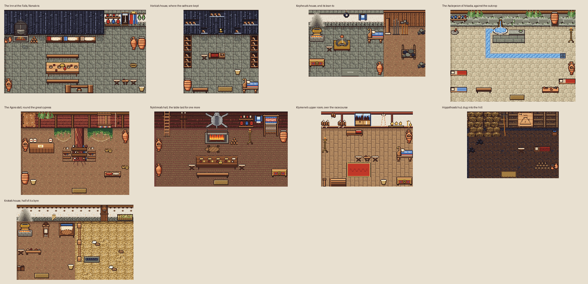
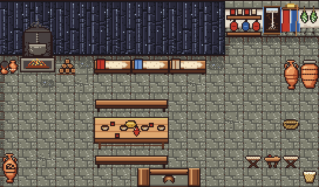
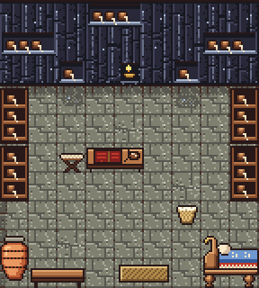
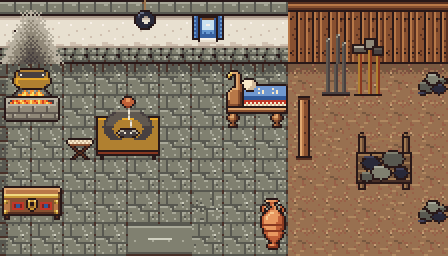
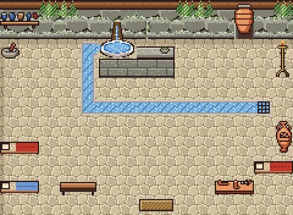
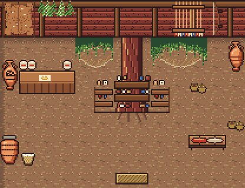
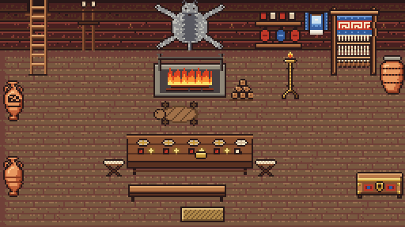
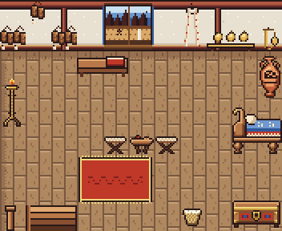
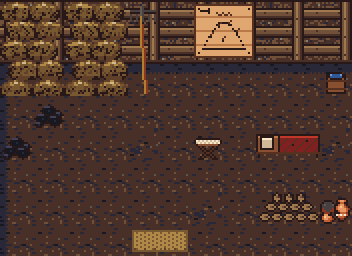
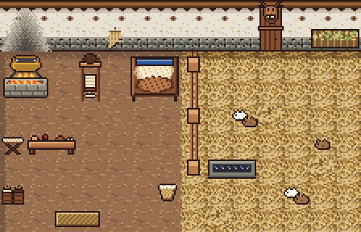

# The interiors of Styx Falls and Arkadia

Act II batch 3's nine rooms (the rooms3 agent): the three houses of Nonakris at Styx Falls (beat 39), the inn, Horkia's house of oaths and Kepheus's house; and Arkadia's six (beat 41), the Asclepeion, the Agora stall, Nyktimos's hall, Klymene's upper room, Hippothoos's charcoal hut and Krotos's house and byre. Each room is drawn for whoever lives or works in it, and each carries its SCRIPT.md Part 2 roster: its people, their lines, and their gift, trade or quest. No two share a layout, and none copies a batch 1, batch 2 or Act I room.

The one-sheet overview: `design/phase3/img/arkadia_interiors_overview.png`.



## Files and rebuilding

| What | Where |
|---|---|
| Palettes, the drawing canvas, floors, walls, the stamp registry; oikia's pieces reused as drawn | `tools/ichor/art/arkrooms_art.py` |
| Nonakris's pieces: the cliff hearth, the hoof door, the hoof-cups, the sledge, the cirque model | `tools/ichor/art/arkrooms_styx.py` |
| Arkadia's public rooms and Klymene's: the spring and its channel, the cypress stall, the track window | `tools/ichor/art/arkrooms_civic.py` |
| Arkadia's homes: the wolf pelt and the guest's place, the charcoal sacks, the byre | `tools/ichor/art/arkrooms_homes.py` |
| Composer, near-duplicate merging, Porytiles, checks (batch 1's, pointed at these modules) | `tools/ichor/art/arkrooms_build.py` |
| The rooms: grids, stamps, events; the driver | `tools/ichor/maps/arkrooms.py` |
| Scripts | `data/maps/<Map>/scripts.pory` |
| In-game check | `tools/ichor/tests/act2_arkrooms.sh` (screenshots in `build/test_arkrooms/shots/`) |

```bash
/usr/bin/python3 tools/ichor/maps/arkrooms.py               # compose, compile, check, write layouts, events, renders, this file's tables
/usr/bin/python3 tools/ichor/maps/arkrooms.py --no-compile --preview DIR   # previews from source only
tools/ichor/tests/act2_arkrooms.sh                          # after make
```

The driver writes each room's `map.bin` and `border.bin`, its `layouts.json` entry and its `map.json` events (people, warps, signs, hidden items) from the spots listed with the room, so the coordinates live in one place; `scripts.pory` is written by hand. The run checks that every warp, person, sign and hidden item is reachable from the door and read from the tile in front of it, that every 8x8 tile takes its colors from one palette, and that each room renders from the compiled tiles over `gTileset_Oikos` exactly as composed. It also writes the overview sheet.

`arkrooms_build.py` is a copy of batch 1's `thyrsa_rooms_build.py` with one change: a wall n cells tall draws its style's first course on its top row and its last on its bottom row (the middle courses between), so a three-course cliff and a two-course plaster wall can stand side by side, as they do in the inn.

## Three secondaries

Nine rooms of new art came to about 1,280 unique tiles; a secondary holds 504 (door animations own 504-511). So the rooms are split by the art they share, as batch 1's were:

| Secondary | Directory | Rooms | Why together |
|---|---|---|---|
| `gTileset_StyxRooms` | `styx_rooms` | the inn, Horkia's, Kepheus's | the black cliff, Nonakris's whitewash under slab ceilings, slate floors, hoof-cups |
| `gTileset_ArkadiaRooms` | `arkadia_rooms` | the Asclepeion, the Agora, Klymene's | grey limestone, cypress timber, the bright whitewash, the boards |
| `gTileset_ArkadiaHomes` | `arkadia_homes` | Nyktimos's hall, the charcoal hut, Krotos's | smoked logs, earth and log shoring, straw, the hearths |

All three are on the `oikos` primary, use only their own tiles and palettes 6-12, and are compiled by the same script against an empty stand-in primary. The budget line for each is in the generated section below.

## Palettes

Seven, shared by the three sets, all multiples of 8 and none an aethos color. Four are oikia's unchanged (floor, wood, clay, bronze), so its floors and pieces (the kline, stools, tables, the chest, the loom, amphorae, the pithos, the hearth and its soot, the lampstand, the window, herbs, the doormat) are reused exactly as drawn.

| Palette | Colors for |
|---|---|
| wall | beams, whitewash and its damp shades, oikia's blue shutters and sky; **cypress heartwood** (lit, mid, smoked) and sapwood ochre in place of oikia's red dado |
| floor | oikia's terracotta, boards and limestone; packed earth and the hall's dark planks are drawn from its browns |
| wood | oikia's furniture woods, linen, red and blue cloth, gold |
| clay | oikia's pottery, hearth, ash, fire; the iron of tools and cauldrons |
| nature | leaves and cypress, fleece, wicker and straw, rope and linen; **goat browns and wolf greys** in place of oikia's fish silvers |
| bronze | oikia's bronze, flame, water and marble: the spring, its channel, the lamps, the gilded apples |
| rock | the Styx's **black cliff** (four blue-blacks and a wet glint), Arkadia's grey limestone and its moss, earth, logs |

## The looks

- **Nonakris:** low stone houses roofed with slabs; inside, the slab ends show as a grey band under the black ceiling, the walls are whitewashed against the damp, and the footing is rubble with the wet creeping up it. Floors are big slabs of grey mountain stone. The inn and Horkia's house are built back into the cirque, so their back walls are the cliff itself: sheer, split into tall slabs, black, with wet streaks running down and puddles at its foot.
- **Arkadia:** a town in a cypress forest. Timber the red of cypress heartwood, grey limestone with moss in it, hunters' herbs and nets and hides. Klymene's upper room is the bright one: whitewash between red posts.
- **The homes:** Nyktimos's hall of squared logs smoked nearly black; Hippothoos's hut, half of it earth held back by logs, the floor trodden black with charcoal dust; Krotos's daub-and-wattle byre on a footing of field stones, straw on the byre side.

<!-- arkrooms: begin generated -->

- `gTileset_StyxRooms` (`data/tilesets/secondary/styx_rooms`): **136** metatiles of 512, **404** tiles of 504, palettes 6-12. Sheet: `design/phase3/img/styx_rooms_sheet.png`.
- `gTileset_ArkadiaRooms` (`data/tilesets/secondary/arkadia_rooms`): **160** metatiles of 512, **438** tiles of 504, palettes 6-12. Sheet: `design/phase3/img/arkadia_rooms_sheet.png`.
- `gTileset_ArkadiaHomes` (`data/tilesets/secondary/arkadia_homes`): **152** metatiles of 512, **443** tiles of 504, palettes 6-12. Sheet: `design/phase3/img/arkadia_homes_sheet.png`.

### The Inn at the Falls, Nonakris

- Map `MAP_STYX_FALLS_INN`, layout `LAYOUT_STYX_FALLS_INN`: **17x10**, `gTileset_Oikos` + `gTileset_StyxRooms`.
- Render: `design/phase3/img/StyxFalls_Inn.png` (2x).



A long, low room built back into the cirque: the back wall is the cliff itself, black and running wet, and the hearth is cut into it. The rest is whitewashed against the damp. The sleeping benches stand against the rock under their blankets; the long table takes the middle of the room. A window looks across the black pool at the falls, and over the door hangs a horse's hoof on a nail, the house's luck.

Walk map: `#` blocked, `.` open; digits and letters are the spots below (a bg event is marked on its furniture).

```
    01234567890123456
  0 #################
  1 ##############7##
  2 ###########9.....
  3 #8##.######..2.##
  4 ...............##
  5 .....####........
  6 .....####.....34.
  7 ....5####........
  8 #....####....###.
  9 #......#116.....#
```

| # | Kind | Tile | Detail | What |
|---|---|---|---|---|
| 1 | warp | (8,9), (9,9) | to `MAP_STYX_FALLS` warp 0 | the exit |
| 2 | npc | (13,3) | faces south, `OBJ_EVENT_GFX_ICHOR_ELDER_M` | Aroanios the innkeeper, by his cup shelf |
| 3 | npc | (14,6) | faces east, `OBJ_EVENT_GFX_ICHOR_SHEPHERD` | Eubouleus the swineherd, from Eleusa |
| 4 | npc | (15,6) | faces west, `OBJ_EVENT_GFX_SPECIES(KAPLET)`, hidden by `FLAG_ICHOR_GOT_GRYLLOS` | Gryllos the Kaplet, in his basket (until he's given) |
| 5 | npc | (4,7) | faces east, `OBJ_EVENT_GFX_ICHOR_ALETHEA`, hidden by `FLAG_TEMP_1` | Alethea, at the long table (her first visit only) |
| 6 | bg | (10,9) | read from (10,8) facing south | the hoof over the door |
| 7 | bg | (14,1) | read from (14,2) facing north | the window |
| 8 | bg | (1,3) | read from (1,4) facing north | the hearth in the rock |
| 9 | bg | (11,2) | read from (11,3) facing north | the wet rock |

### Horkia's house, where the oaths are kept

- Map `MAP_STYX_FALLS_OATH_HOUSE`, layout `LAYOUT_STYX_FALLS_OATH_HOUSE`: **9x10**, `gTileset_Oikos` + `gTileset_StyxRooms`.
- Render: `design/phase3/img/StyxFalls_OathHouse.png` (2x).



A narrow house whose back wall is the cliff, black and wet. Ledges are cut into it and racks stand down both sides, and on every one stand hoof-cups, dozens, each tied with a scrap of linen with a name scratched on it. In the middle, the table with the wax tablet of the day's oaths; in the rock, the lamp that is never put out.

Walk map: `#` blocked, `.` open; digits and letters are the spots below (a bg event is marked on its furniture).

```
    012345678
  0 #########
  1 #########
  2 ####6####
  3 #.......#
  4 3.......4
  5 #.#5#2..#
  6 #.......#
  7 ......#..
  8 #......##
  9 ###.11.##
```

| # | Kind | Tile | Detail | What |
|---|---|---|---|---|
| 1 | warp | (4,9), (5,9) | to `MAP_STYX_FALLS` warp 1 | the exit |
| 2 | npc | (5,5) | faces west, `OBJ_EVENT_GFX_ICHOR_ELDER_F` | Horkia, keeper of the oaths |
| 3 | bg | (0,4) | read from (1,4) facing west | the hoof-cups |
| 4 | bg | (8,4) | read from (7,4) facing east | the hoof-cups (east) |
| 5 | bg | (3,5) | read from (3,6) facing north | the wax tablet |
| 6 | bg | (4,2) | read from (4,3) facing north | the lamp |

### Kepheus's house, and its lean-to

- Map `MAP_STYX_FALLS_STONE_HOUSE`, layout `LAYOUT_STYX_FALLS_STONE_HOUSE`: **14x8**, `gTileset_Oikos` + `gTileset_StyxRooms`.
- Render: `design/phase3/img/StyxFalls_StoneHouse.png` (2x).



A squat stone house under its slabs, and through the posts at its east end a lean-to of rough planks full of crowbars, mattocks and the stone-sledge on its runners, loaded again. On the trestle, his clay model of the cirque: the falls a dribble from a jug he tops up, the pool a dish that never quite fills. From the ceiling hangs a black stone with a hole worn through it.

Walk map: `#` blocked, `.` open; digits and letters are the spots below (a bg event is marked on its furniture).

```
    01234567890123
  0 ##############
  1 ####4#########
  2 ##.....##.6#.#
  3 ##.##..##.....
  4 ..###2...#.##.
  5 ##..3......5#.
  6 ##......#....7
  7 ....11..#.....
```

| # | Kind | Tile | Detail | What |
|---|---|---|---|---|
| 1 | warp | (4,7), (5,7) | to `MAP_STYX_FALLS` warp 2 | the exit |
| 2 | npc | (5,4) | faces west, `OBJ_EVENT_GFX_ICHOR_MAN` | Kepheus, at his model |
| 3 | bg | (4,5) | read from (4,6) facing north | the clay model of the cirque |
| 4 | bg | (4,1) | read from (4,2) facing north | the black stone with a hole in it |
| 5 | bg | (11,5) | read from (10,5) facing east | the stone-sledge |
| 6 | bg | (10,2) | read from (10,3) facing north | the crowbars |
| 7 | hidden | (13,6) | `ITEM_EVERSTONE`, `FLAG_ICHOR_HIDDEN_STYX_KEPHEUS_EVERSTONE` | an Everstone in the rubble |

### The Asclepeion of Arkadia, against the outcrop

- Map `MAP_ARKADIA_ASCLEPEION`, layout `LAYOUT_ARKADIA_ASCLEPEION`: **15x11**, `gTileset_Oikos` + `gTileset_ArkadiaRooms`.
- Render: `design/phase3/img/Arkadia_Asclepeion.png` (2x).



A mountain Asclepeion built against the town's rock outcrop, so the back wall is bare grey limestone and the spring comes out of a cleft in it, into a basin beside the healer. From the basin it runs in a stone channel across the floor to a grating, and the room is full of the sound of water; patients step over it. Hunters' herbs dry under the beam, the Pithos stands in a dry niche cut in the rock, and the healer's Panacoil lies along the channel, where it's cool.

Walk map: `#` blocked, `.` open; digits and letters are the spots below (a bg event is marked on its furniture).

```
    012345678901234
  0 ###############
  1 ##a#########7##
  2 #....##2#.....#
  3 ....8####.6...#
  4 ...............
  5 .............9.
  6 ..........3...#
  7 ##4...........#
  8 ............5##
  9 ##.##......##..
 10 .......11......
```

| # | Kind | Tile | Detail | What |
|---|---|---|---|---|
| 1 | warp | (7,10), (8,10) | to `MAP_ARKADIA` warp 0 | the exit |
| 2 | npc | (7,2) | faces south, `OBJ_EVENT_GFX_ICHOR_HEALER` | the healer, behind the counter |
| 3 | npc | (10,6) | faces west, `OBJ_EVENT_GFX_SPECIES(PANACOIL)` | Panacoil, along the channel where it's cool |
| 4 | npc | (2,7) | faces west, `OBJ_EVENT_GFX_ICHOR_HUNTRESS` | the huntress with a bandaged arm |
| 5 | npc | (12,8) | faces east, `OBJ_EVENT_GFX_ICHOR_CHARCOALER` | the old charcoal-burner |
| 6 | npc | (10,3) | faces west, `OBJ_EVENT_GFX_ICHOR_ACOLYTE_F` | the young healer |
| 7 | bg | (12,1) | read from (12,2) facing north | the Pithos |
| 8 | bg | (4,3) | read from (3,3) facing east | the spring's channel |
| 9 | bg | (13,5) | read from (13,6) facing north | the grating |
| a | bg | (2,1) | read from (2,2) facing north | the herbs under the beam |

### The Agora stall, round the great cypress

- Map `MAP_ARKADIA_AGORA`, layout `LAYOUT_ARKADIA_AGORA`: **13x10**, `gTileset_Oikos` + `gTileset_ArkadiaRooms`.
- Render: `design/phase3/img/Arkadia_Agora.png` (2x).



A timber stall built round the foot of the town's biggest cypress, so the trunk stands in the middle of the shop with the shelves built round it, and its boughs are the roof. Hunting nets hang from them. On the wall, a rack of arrows (for show) and a deer's hide; on the counter, clay jars of moon-cakes for the goddess.

Walk map: `#` blocked, `.` open; digits and letters are the spots below (a bg event is marked on its furniture).

```
    0123456789012
  0 #############
  1 #########4###
  2 ............#
  3 ##2#........#
  4 #3##.####.#..
  5 .....#5##....
  6 ............#
  7 #.........##.
  8 ##...........
  9 ......11.....
```

| # | Kind | Tile | Detail | What |
|---|---|---|---|---|
| 1 | warp | (6,9), (7,9) | to `MAP_ARKADIA` warp 1 | the exit |
| 2 | npc | (2,3) | faces south, `OBJ_EVENT_GFX_ICHOR_WOMAN` | the stallkeeper, behind her counter |
| 3 | bg | (1,4) | read from (1,5) facing north | the jars of moon-cakes |
| 4 | bg | (9,1) | read from (9,2) facing north | the rack of arrows |
| 5 | bg | (6,5) | read from (6,6) facing north | the great cypress |

### Nyktimos's hall, the table laid for one more

- Map `MAP_ARKADIA_NYKTIMOS_HALL`, layout `LAYOUT_ARKADIA_NYKTIMOS_HALL`: **16x9**, `gTileset_Oikos` + `gTileset_ArkadiaHomes`.
- Render: `design/phase3/img/Arkadia_NyktimosHall.png` (2x).



A long hearth hall of the oldest family in Arkadia, dark wood and smoke. Over the hearth hangs a great grey wolf pelt, and nobody sits under it. The long table is laid for one more guest than there are people in the house: at its end a bowl and a cup wait at an empty place. The old woman's loom stands by the window; a ladder climbs to the sleeping loft.

Walk map: `#` blocked, `.` open; digits and letters are the spots below (a bg event is marked on its furniture).

```
    0123456789012345
  0 ################
  1 ################
  2 .6....###..#.###
  3 #....2#5##.#.3.#
  4 #...............
  5 .....####4......
  6 #...#######...##
  7 #....####.....##
  8 .......11.......
```

| # | Kind | Tile | Detail | What |
|---|---|---|---|---|
| 1 | warp | (7,8), (8,8) | to `MAP_ARKADIA` warp 2 | the exit |
| 2 | npc | (5,3) | faces south, `OBJ_EVENT_GFX_ICHOR_ELDER_M` | Nyktimos, the xenia host, by his hearth |
| 3 | npc | (13,3) | faces north, `OBJ_EVENT_GFX_ICHOR_ELDER_F` | his old mother, at the loom |
| 4 | bg | (9,5) | read from (10,5) facing west | the empty place |
| 5 | bg | (7,3) | read from (7,4) facing north | the wolf pelt over the hearth |
| 6 | bg | (1,2) | read from (1,3) facing north | the ladder to the loft |

### Klymene's upper room, over the racecourse

- Map `MAP_ARKADIA_KLYMENE_HOUSE`, layout `LAYOUT_ARKADIA_KLYMENE_HOUSE`: **11x9**, `gTileset_Oikos` + `gTileset_ArkadiaRooms`.
- Render: `design/phase3/img/Arkadia_KlymeneHouse.png` (2x).



A bright upstairs room over the old racecourse, with a wide window onto the track and a bench under it where she watches the runners. On the walls, old running sandals hang in pairs by date, a victor's ribbon has gone pale, and three wooden apples painted gold sit on their shelf. You come up into it by the stair.

Walk map: `#` blocked, `.` open; digits and letters are the spots below (a bg event is marked on its furniture).

```
    01234567890
  0 ###########
  1 ##5##4#67##
  2 ...##.2...#
  3 #.........#
  4 #......3.##
  5 ....###..##
  6 ...........
  7 .........##
  8 #11....#.##
```

| # | Kind | Tile | Detail | What |
|---|---|---|---|---|
| 1 | warp | (1,8), (2,8) | to `MAP_ARKADIA` warp 3 | the exit |
| 2 | npc | (6,2) | faces west, `OBJ_EVENT_GFX_ICHOR_ELDER_F` | Klymene, by her window |
| 3 | npc | (7,4) | faces west, `OBJ_EVENT_GFX_ICHOR_YOUTH_M` | Parthenopaios, her grandson, stretching |
| 4 | bg | (5,1) | read from (5,2) facing north | the window on the track |
| 5 | bg | (2,1) | read from (2,2) facing north | the running sandals |
| 6 | bg | (7,1) | read from (7,2) facing north | the pale ribbon |
| 7 | bg | (8,1) | read from (8,2) facing north | the golden apples |

### Hippothoos's hut, dug into the hill

- Map `MAP_ARKADIA_CHARCOAL_HUT`, layout `LAYOUT_ARKADIA_CHARCOAL_HUT`: **11x8**, `gTileset_Oikos` + `gTileset_ArkadiaHomes`.
- Render: `design/phase3/img/Arkadia_CharcoalHut.png` (2x).



A charcoal-burner's hut dug half into the hillside, so the back wall is earth shored with logs. Sacks of charcoal are stacked to the roof; the long iron rake leans by them; on a board pegged to the logs he has drawn a kiln mound in soot with every vent marked. Everything, him included, is black to the elbows. His little bear sits by the door, out of the smoke.

Walk map: `#` blocked, `.` open; digits and letters are the spots below (a bg event is marked on its furniture).

```
    01234567890
  0 ###########
  1 ######4####
  2 ##5#6.....#
  3 .#....2....
  4 #.....#.##.
  5 ...........
  6 ..3.....###
  7 ....11.....
```

| # | Kind | Tile | Detail | What |
|---|---|---|---|---|
| 1 | warp | (4,7), (5,7) | to `MAP_ARKADIA` warp 4 | the exit |
| 2 | npc | (6,3) | faces south, `OBJ_EVENT_GFX_ICHOR_CHARCOALER` | Hippothoos, the charcoal-burner |
| 3 | npc | (2,6) | faces east, `OBJ_EVENT_GFX_SPECIES(ARKOBY)`, hidden by `FLAG_ICHOR_TRADED_ARKOBY` | the little bear, Arkas, by the door (until traded) |
| 4 | bg | (6,1) | read from (6,2) facing north | the soot drawing of a kiln |
| 5 | bg | (2,2) | read from (2,3) facing north | the charcoal sacks |
| 6 | bg | (4,2) | read from (4,3) facing north | the iron rake |

### Krotos's house, half of it a byre

- Map `MAP_ARKADIA_GOATHERD_HOUSE`, layout `LAYOUT_ARKADIA_GOATHERD_HOUSE`: **14x9**, `gTileset_Oikos` + `gTileset_ArkadiaHomes`.
- Render: `design/phase3/img/Arkadia_GoatherdHouse.png` (2x).



Half house, half byre, with a wooden rail down the middle. On the house side, his bed, the cheese press and the hearth, and his syrinx on its peg; on the other, the kids asleep on straw, the hay rack and the trough, and over the byre's back door a wooden mask of Pan, horned and grinning. When a lost kid comes home, it turns up in the pen.

Walk map: `#` blocked, `.` open; digits and letters are the spots below (a bg event is marked on its furniture).

```
    01234567890123
  0 ##############
  1 ####6#####7###
  2 ##.#.###......
  3 ##.9.###..3.4.
  4 .......#.8....
  5 ###.2..#....#.
  6 .......###....
  7 #.....#....#..
  8 ..11.....5....
```

| # | Kind | Tile | Detail | What |
|---|---|---|---|---|
| 1 | warp | (2,8), (3,8) | to `MAP_ARKADIA` warp 5 | the exit |
| 2 | npc | (4,5) | faces south, `OBJ_EVENT_GFX_ICHOR_GOATHERD` | Krotos the goatherd |
| 3 | npc | (10,3) | faces south, `OBJ_EVENT_GFX_SPECIES(KERAZAP)`, hidden by `FLAG_TEMP_11` | the first lost kid, home (after it's found) |
| 4 | npc | (12,3) | faces west, `OBJ_EVENT_GFX_SPECIES(KERAZAP)`, hidden by `FLAG_TEMP_12` | the second lost kid, home |
| 5 | npc | (9,8) | faces north, `OBJ_EVENT_GFX_SPECIES(KERAZAP)`, hidden by `FLAG_TEMP_13` | the third lost kid, home |
| 6 | bg | (4,1) | read from (4,2) facing north | the syrinx |
| 7 | bg | (10,1) | read from (10,2) facing north | Pan's mask over the byre door |
| 8 | bg | (9,4) | read from (8,4) facing east | the kids in the straw |
| 9 | bg | (3,3) | read from (3,4) facing north | the cheese press |

<!-- arkrooms: end generated -->
