# The interiors of Thyrsa and Eleutherai

Act II batch 1's thirteen rooms: Eleutherai's watch-house and two homes (beat 27), and Thyrsa's Asclepeion, Agora, the Kantharos tavern and seven households (beat 30). Each room is drawn for the person who lives or works in it, and each has its occupants, their SCRIPT.md lines and their gift, trade or quest. No two share a layout, and none copies an Act I room.

## Files and rebuilding

| What | Where |
|---|---|
| Palettes, floors, walls, the ivy festoon, the stamp registry; oikia's pieces reused as drawn | `tools/ichor/art/thyrsa_rooms_art.py` |
| Eleutherai's pieces | `tools/ichor/art/thyrsa_rooms_kithairon.py` |
| The Asclepeion, the Agora, the Kantharos; the masks | `tools/ichor/art/thyrsa_rooms_civic.py` |
| The seven households | `tools/ichor/art/thyrsa_rooms_homes.py` |
| Composer, near-duplicate merging, Porytiles, checks | `tools/ichor/art/thyrsa_rooms_build.py` |
| The rooms: grids, stamps, events; the driver | `tools/ichor/maps/thyrsa_rooms.py` |
| Scripts | `data/maps/<Map>/scripts.pory` |
| In-game check | `tools/ichor/tests/thyrsa_rooms.sh` (screenshots in `build/test_thyrsa_rooms/`) |

```bash
/usr/bin/python3 tools/ichor/maps/thyrsa_rooms.py               # compose, compile, check, write layouts, events, renders and this file's tables
/usr/bin/python3 tools/ichor/maps/thyrsa_rooms.py --no-compile --preview DIR   # previews from source only
tools/ichor/tests/thyrsa_rooms.sh                                # after make
```

The driver writes each room's `map.bin` and `border.bin`, its `layouts.json` entry and its `map.json` events (people, warps, signs, coord triggers) from the spots listed with the room, so the coordinates live in one place. `scripts.pory` is written by hand. The run checks that every warp, person and readable thing is reachable from the door and read from the tile in front of it, that every 8x8 tile takes its colors from one palette, and that each room renders from the compiled tiles over `gTileset_Oikos` exactly as composed.

## Three secondaries, not one

BUILD.md asks for one `thyrsa_rooms` secondary. Thirteen rooms of new art came to about 1,040 unique tiles before any economy, and a secondary holds 504 (door animations own 504-511). Cutting to one set would have meant stripping most rooms back to the shared generic furniture, which is the opposite of the brief ("let each room say who lives there"). So the rooms are split over three secondaries, grouped by the art they share, each with room to grow:

| Secondary | Directory | Rooms | Why together |
|---|---|---|---|
| `gTileset_ThyrsaRooms` | `thyrsa_rooms` | the Asclepeion, the Agora, Pindaros's, Polos's | plaster, masks, counters, couches |
| `gTileset_ThyrsaHomes` | `thyrsa_homes` | Staphylos's, Eudora's, Euthykles's workshop, Manto's | the vintner's press, the fig, the mask heads, the cages |
| `gTileset_ThyrsaStone` | `thyrsa_stone` | Eleutherai's watch-house, Oinoe's, Lysidike's, the Kantharos, Chthonia's | rough stone, earth and dark flags, spears and hearths |

All three are on the `oikos` primary, use only their own tiles and palettes 6-12, and are compiled by the same script against an empty stand-in primary (as `emporion_build.py` does). The budget line for each is in the generated section below.

Economies that got there: fills that repeat every 8 px (the grapes on the treading floor, the straw in the pen, the pit's floor, the pool's water); emporion's near-duplicate merge (tiles within 2 px of another are redrawn as it); floors and walls entered only in the variants the rooms use; and one scroll-pigeonhole design instead of two.

## Palettes

Seven per set, all multiples of 8, none an aethos color. Four are oikia's, so its floors and a few of its pieces (the kline, chairs, tables, amphorae, pithos, hearth, soot, window, chest, lampstand, herbs, the doormat) are reused exactly as drawn:

| Palette | Colors for |
|---|---|
| wall | Thyrsa's plaster: beam, whitewash, the **wine-dark dado** with an ochre running wave, shutters, sky |
| floor | oikia's terracotta, boards and limestone; packed earth is drawn from its browns |
| wood | oikia's furniture woods, linen, red and blue cloth, bronze fittings |
| clay | oikia's pottery, hearth, stone, fire and soot; the black-figure frieze |
| nature | ivy and vine greens, **grape purples** (in place of oikia's fish silvers), wicker, straw, rope, fleece |
| bronze | oikia's bronze, flame, water and marble, with an ivy green (the statue's staff) in place of the water glint; masks for paint |
| stone | rough stone, dark flags, timber and lichen for the fort, the cellar and the Kadmeia's oldest houses; lamp glow |

## The looks

- **Thyrsa:** lime plaster over a wine-dark dado carrying an ochre running wave, the city's ivy festooned along the beams (`ivy` in a room's spec), masks on walls and posts, grapes and wine everywhere.
- **Eleutherai:** a mountain border village. Whitewash rubbed thin over a rough fieldstone footing, round log beams with their cut ends showing, beaten-earth floors. The fort's barrack is bare ashlar of grey limestone.
- **The old stone of Thyrsa:** the Kantharos is a barrel vault with a black-figure frieze of satyrs chasing maenads (the maenads winning); Chthonia's house has Cyclopean walls of huge polygonal boulders; Manto's floor is old dark flags.

## Render-and-critique passes

Every room had three passes: source previews of the whole room (pass 1), the fixes from pass 1 re-rendered (pass 2), and the rooms in the game with their people, from `tools/ichor/tests/thyrsa_rooms.sh` (pass 3).

### Pass 0: the pieces, before any room

| Piece | What was wrong | What changed |
|---|---|---|
| dark flags | a reptile-skin Voronoi pattern, busier than the walls | one big square slab per cell, low-contrast joints, a worn variant |
| packed earth | fine-grain noise read as carpet | sparse soft patches, two pebbles, a hairline crack |
| fort floor | dark flags under ashlar walls: wall and floor read the same | the barrack takes packed earth |
| spear rack | picket fence: thick shafts, tiny heads | 2x3, thin ash shafts, leaf-shaped bronze heads, a rail and a footed base |
| hearth on a chain | a grey box with a lamp; the soot read as horns | an open stone hearth, a wide bronze cauldron of soup on its chain, a dithered plume |
| arrow slit | a grey pipe | a dark splayed embrasure narrowing to a bright slit, the road's hills in it |
| helmets | blobs | two Corinthian helmets, the captain's crested |
| the healer's counter | 3 wide, so the basin sat on it | 4 wide with the basin's two cells left open, so the basin is at the healer's x-2..x-1 where the heal drops the balls; the runnel's arch carved under it |
| the doorway | jambs drawn over plaster with no opening | a real gap in the partition, a lintel on the top layer |

### Pass 1: the rooms from source

| Room | What was wrong |
|---|---|
| Watch-house | the east half bare between the helmets and the chest |
| Oinoe's | the drying garlands read as two green triangles |
| Lysidike's | the lamb a white blob (a second fleece); the straw noisy |
| Asclepeion | the vine canopy pieces read as small bushes |
| Agora | a large empty floor between the counters and the vat |
| Kantharos | the sunken floor read as a raised slab with a stain; the knucklebones table illegible; both bottom corners empty |
| Manto's | birdcages too small to see on the dark flags; the room sparse |
| Staphylos's | right side and bottom thin |
| Chthonia's | bottom half empty |
| Pindaros's, Polos's, Eudora's, Euthykles's | read as intended |

### Pass 2: fixes, re-rendered

| Room | Change |
|---|---|
| Watch-house | a sheepskin on the floor by the cots |
| Oinoe's | the garlands redrawn as ivy wreaths, one under another, on a cord from the beam |
| Lysidike's | the pen redrawn: woven hurdles on three sides, clean straw, a curled lamb with its nose tucked in |
| Asclepeion | a denser vine canopy with grape bunches hanging through |
| Agora | herb bundles on the wall, sacks, a display table, a basket of grapes |
| Kantharos | the pit redrawn as a step down (north and west risers in shadow, the far lip lit); a round stone table worn into a bowl with four bones in it; a second table group and a jar |
| Manto's | domed wicker cages, doors open, a dark bird in one and a dove on another's roof; herbs and a wool basket |
| Staphylos's | baskets of black grapes by the treading floor |
| Chthonia's | a Theban club-shield on the boulders, a bench |

### Pass 3: in the game

Read from `build/test_thyrsa_rooms/` (a quickstart save, every room toured with its people, then the services played).

| Room | Finding | Change |
|---|---|---|
| Asclepeion | the heal works: the party's ball lands on the basin and the healer bows, and the respawn is set to Thyrsa. The heal's glow (the field effect's "monitor") flashes on bare wall above her. | a painted plaque of the rod of Asclepius, its serpent wound with ivy, at (7,0..1) for the glow to light, as Akti's relief does |
| Staphylos's | the test's own extra A press reopened his talk, so the first run never trod | the test fixed; stepping off the floor early now ends the treading as SCRIPT.md says, instead of re-arming it |
| all | rooms render over oikos as composed; people stand clear of furniture; every name fits the name box (ARISTOMACHE is 53 of 64 px) | none |

## Stubs and deviations

| Tag | Where | What waits |
|---|---|---|
| `ICHOR_STUB_KNUCKLEBONES` | the Kantharos | each match is one scripted throw with SCRIPT.md's lines: regulars lose two in three, the champion one in three |
| `ICHOR_STUB_OFFERINGS` | the Agora's wine counter (sells Berry Juice), Staphylos's two Wine, Pindaros's Laurel Sprig, the regulars' prizes | the offering items |
| `ICHOR_STUB_TMS` | Aristomache's TM Encore, Polos's TM Fake Tears | TM numbers from Balance (SCRIPT.md open question 17) |
| `ICHOR_STUB_XENIA_REST` | Pindaros's rest menu | the engine's same-day clock move (SYSTEMS.md §10); the menu offers only times still ahead today, fades, and leaves the clock |
| `ICHOR_STUB_DIG` | the turned earth under Eudora's fig | the dig API's fixed find, prophecy tablet #3 |
| `ICHOR_STUB_GARLAND` | Oinoe's ivy garland (the temple's scene uses the same tag) | `ITEM_IVY_GARLAND`; the flag carries the errand |
| `ICHOR_STUB_LEVEL_CHECK` | Zetes | a script check for a party Pokémon at level 30; the Mask Laurel stands in |
| `ICHOR_STUB_MUSIC` | every room but the Asclepeion and the Agora | Thyrsa's and Eleutherai's own cues |
| `ICHOR_STUB_AETHOS_DEX` | Panacoil, Prosomime, Gelasable, Chelonet, Chelyra | the dex |

Deviations, closest reading taken:
- **The xenia host is Pindaros**, per SCRIPT.md's Thyrsa roster; the watch-house's cook heals every visit as the rest point (Part 2, Eleutherai).
- **Pindaros's laurel lines** run on one bank var, `VAR_ICHOR_PINDAROS_LAURELS`: the highest laurel he has remarked on, 0 until the first visit.
- **Oinoe's Big Root has no flag of its own:** the errand runs on `FLAG_ICHOR_OINOE_GARLAND` and `FLAG_ICHOR_GARLAND_LAID` (see the script's header), to fit sixteen flags.
- **The Potter's Knucklebone, link 3** (Polos; a stretch) is not built: links 1 and 2 and their flags don't exist yet.
- **Kleon's later line** at Pindaros's waits for `FLAG_ICHOR_KLEON_JOINED_TITANS` (region B2).
- **Hippias** stands on his bed until the sprites agent's sleeping frame exists; he hides behind `FLAG_TEMP_1`, set on entry until `FLAG_ICHOR_GYPSOS_WENT_HOME`.
- **PATHOS's OT** is `EUTHYKL`: the OT field holds seven letters.
- The healer and the Pithos reuse Akti's shared texts; the Pithos's menu is written out locally because the shared one names Akti's jar.

## The rooms

The budgets, then each room: its idea, its walk map and its events. `tools/ichor/maps/thyrsa_rooms.py` rewrites everything between the markers below.

<!-- thyrsa_rooms: begin generated -->

- `gTileset_ThyrsaRooms` (`data/tilesets/secondary/thyrsa_rooms`): **144** metatiles of 512, **354** tiles of 504, palettes 6-11. Sheet: `design/phase3/img/thyrsa_rooms_sheet.png`.
- `gTileset_ThyrsaHomes` (`data/tilesets/secondary/thyrsa_homes`): **136** metatiles of 512, **335** tiles of 504, palettes 6-12. Sheet: `design/phase3/img/thyrsa_homes_sheet.png`.
- `gTileset_ThyrsaStone` (`data/tilesets/secondary/thyrsa_stone`): **184** metatiles of 512, **461** tiles of 504, palettes 6-12. Sheet: `design/phase3/img/thyrsa_stone_sheet.png`.

### The watch-house, Eleutherai

- Map `MAP_ELEUTHERAI_WATCH_HOUSE`, layout `LAYOUT_ELEUTHERAI_WATCH_HOUSE`: **16x8**, `gTileset_Oikos` + `gTileset_ThyrsaStone`.
- Render: `design/phase3/img/Eleutherai_WatchHouse.png` (2x).

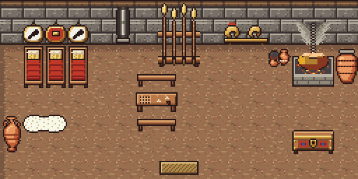

A long barrack inside the fort wall: bare ashlar, a beaten-earth floor. Three cots heads-to-the-wall under three shields; the spear rack and the captain's helmets; one arrow slit over the road; and at the far end the hearth, the soup cauldron on its chain. The dice table sits in the middle where the off-duty men can see the door.

Walk map: `#` blocked, `.` open; digits and letters are the spots below (a bg event is marked on its furniture).

```
    0123456789012345
  0 ################
  1 #####5##########
  2 .###...#64..####
  3 .###..##....2#8#
  4 ......7#........
  5 #.....##..3..##.
  6 #............##.
  7 .......11.......
```

| # | Kind | Tile | Detail | What |
|---|---|---|---|---|
| 1 | warp | (7,7), (8,7) | to `MAP_ELEUTHERAI` warp 0 | the exit |
| 2 | npc | (12,3) | faces south, `OBJ_EVENT_GFX_ICHOR_MAN` | Opsimos the cook, at the hearth |
| 3 | npc | (10,5) | faces west, `OBJ_EVENT_GFX_ICHOR_HOPLITE` | Captain Peneleos |
| 4 | npc | (9,2) | faces south, `OBJ_EVENT_GFX_ICHOR_YOUTH_M` | Timolaos, the recruit (TRAINER_ICHOR_TIMOLAOS) |
| 5 | bg | (5,1) | read from (5,2) facing north | arrow slit |
| 6 | bg | (8,2) | read from (8,3) facing north | spear rack |
| 7 | bg | (6,4) | read from (5,4) facing east | dice table |
| 8 | bg | (14,3) | read from (14,4) facing north | cauldron |

### Oinoe's house, Eleutherai

- Map `MAP_ELEUTHERAI_OINOE_HOUSE`, layout `LAYOUT_ELEUTHERAI_OINOE_HOUSE`: **9x7**, `gTileset_Oikos` + `gTileset_ThyrsaStone`.
- Render: `design/phase3/img/Eleutherai_OinoeHouse.png` (2x).

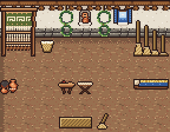

One whitewashed room beside the empty temple. Everything in it is for the god who left: the ivy band on the loom, the garlands drying on the beam, the little dog-faced god in his niche between them, and a row of brooms worn shorter one by one. Her own bed is a pallet.

Walk map: `#` blocked, `.` open; digits and letters are the spots below (a bg event is marked on its furniture).

```
    012345678
  0 #########
  1 ####3####
  2 #5#....4#
  3 .....2...
  4 #..##..##
  5 .........
  6 ...116...
```

| # | Kind | Tile | Detail | What |
|---|---|---|---|---|
| 1 | warp | (3,6), (4,6) | to `MAP_ELEUTHERAI` warp 1 | the exit |
| 2 | npc | (5,3) | faces south, `OBJ_EVENT_GFX_ICHOR_ELDER_F` | Oinoe |
| 3 | bg | (4,1) | read from (4,2) facing north | the god in his niche |
| 4 | bg | (7,2) | read from (7,3) facing north | the brooms |
| 5 | bg | (1,2) | read from (1,3) facing north | the loom |
| 6 | bg | (5,6) | read from (5,5) facing south | the stub of a broom |

### Lysidike's house, Eleutherai

- Map `MAP_ELEUTHERAI_LYSIDIKE_HOUSE`, layout `LAYOUT_ELEUTHERAI_LYSIDIKE_HOUSE`: **12x8**, `gTileset_Oikos` + `gTileset_ThyrsaStone`.
- Render: `design/phase3/img/Eleutherai_LysidikeHouse.png` (2x).

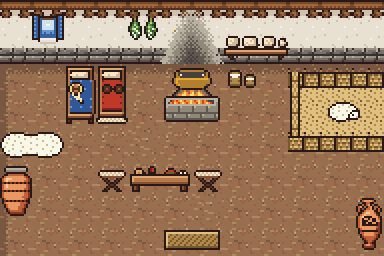

A herder's farmhouse: the lambing pen takes a whole corner, a lamb asleep in its straw; new cheeses dry on a board by the milk pails; the hearth is the middle of the house. The twins' cots stand side by side and could not be less alike: a lyre on one, lead weights on the other.

Walk map: `#` blocked, `.` open; digits and letters are the spots below (a bg event is marked on its furniture).

```
    012345678901
  0 ############
  1 ########6###
  2 ..##.###.###
  3 ..##.7#2.###
  4 ..34.....#5#
  5 #..####.....
  6 #..........#
  7 .....11....#
```

| # | Kind | Tile | Detail | What |
|---|---|---|---|---|
| 1 | warp | (5,7), (6,7) | to `MAP_ELEUTHERAI` warp 2 | the exit |
| 2 | npc | (7,3) | faces west, `OBJ_EVENT_GFX_ICHOR_WOMAN` | Lysidike, at the hearth |
| 3 | npc | (2,4) | faces south, `OBJ_EVENT_GFX_ICHOR_KID_M` | Amphis, by his cot |
| 4 | npc | (3,4) | faces south, `OBJ_EVENT_GFX_ICHOR_KID_M` | Zetes, by his |
| 5 | bg | (10,4) | read from (10,5) facing north | the lambing pen |
| 6 | bg | (8,1) | read from (8,2) facing north | the cheese board |
| 7 | bg | (5,3) | read from (5,4) facing north | the hearth |

### The Asclepeion of Thyrsa, round the spring of Dirke

- Map `MAP_THYRSA_CITY_ASCLEPEION`, layout `LAYOUT_THYRSA_CITY_ASCLEPEION`: **15x11**, `gTileset_Oikos` + `gTileset_ThyrsaRooms`.
- Render: `design/phase3/img/ThyrsaCity_Asclepeion.png` (2x).

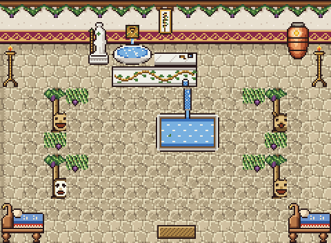

A courtyard, not a hall: the floor dappled under a vine pergola, the spring of Dirke in a sunken pool in the middle, its runnel carried under the healer's carved counter to the basin beside her. Asclepius stands at the basin's head with ivy on his staff, and every pergola post wears an actor's thank-offering mask.

Walk map: `#` blocked, `.` open; digits and letters are the spots below (a bg event is marked on its furniture).

```
    012345678901234
  0 ###############
  1 ###############
  2 #...7##2#....8#
  3 #....####.5...#
  4 ...............
  5 ..#....###6.#..
  6 .......#9#.....
  7 ...............
  8 .3#.........#4.
  9 ##...........##
 10 ##.....11....##
```

| # | Kind | Tile | Detail | What |
|---|---|---|---|---|
| 1 | warp | (7,10), (8,10) | to `MAP_THYRSA_CITY` warp 0 | the exit |
| 2 | npc | (7,2) | faces south, `OBJ_EVENT_GFX_ICHOR_HEALER` | the healer, behind the counter |
| 3 | npc | (1,8) | faces south, `OBJ_EVENT_GFX_ICHOR_SATYR` | the satyr-actor with a bandaged ankle |
| 4 | npc | (13,8) | faces south, `OBJ_EVENT_GFX_ICHOR_MAN` | the pilgrim with a headache |
| 5 | npc | (10,3) | faces west, `OBJ_EVENT_GFX_ICHOR_ACOLYTE_F` | the young healer |
| 6 | npc | (10,5) | faces west, `OBJ_EVENT_GFX_SPECIES(PANACOIL)` | Panacoil, coiled at the pool's rim |
| 7 | bg | (4,2) | read from (4,3) facing north | statue of Asclepius |
| 8 | bg | (13,2) | read from (13,3) facing north | the Pithos |
| 9 | bg | (8,6) | read from (8,7) facing north | the spring of Dirke |

### The Agora of Thyrsa, a covered market hall

- Map `MAP_THYRSA_CITY_AGORA`, layout `LAYOUT_THYRSA_CITY_AGORA`: **14x10**, `gTileset_Oikos` + `gTileset_ThyrsaRooms`.
- Render: `design/phase3/img/ThyrsaCity_Agora.png` (2x).

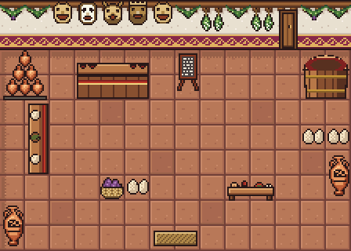

Two counters meet at right angles round a pyramid of amphorae: goods down the west side, wine and offerings along the north wall under a row of festival masks. The day's prices are chalked on a board; the treading vat waits empty by the back door for the vintage.

Walk map: `#` blocked, `.` open; digits and letters are the spots below (a bg event is marked on its furniture).

```
    01234567890123
  0 ##############
  1 ##############
  2 ##.#3#.#....##
  3 #8.###.6.4..7#
  4 .#............
  5 2#..........##
  6 .#....5......#
  7 ....##...##..#
  8 #.............
  9 #.....11......
```

| # | Kind | Tile | Detail | What |
|---|---|---|---|---|
| 1 | warp | (6,9), (7,9) | to `MAP_THYRSA_CITY` warp 1 | the exit |
| 2 | npc | (0,5) | faces east, `OBJ_EVENT_GFX_ICHOR_MERCHANT` | the general stallkeeper, behind the goods counter |
| 3 | npc | (4,2) | faces south, `OBJ_EVENT_GFX_ICHOR_HARVESTER_THYRSA` | the wine-and-offerings stallkeeper |
| 4 | npc | (9,3) | faces south, `OBJ_EVENT_GFX_ICHOR_ACTOR` | the mask-seller (until the Dionysia is done) |
| 5 | npc | (6,6) | faces wander, `OBJ_EVENT_GFX_ICHOR_WOMAN` | a customer |
| 6 | bg | (7,3) | read from (7,4) facing north | the chalk board |
| 7 | bg | (12,3) | read from (12,4) facing north | the treading vat |
| 8 | bg | (1,3) | read from (2,3) facing west | the amphora pyramid |

### The Kantharos, a cellar tavern

- Map `MAP_THYRSA_CITY_TAVERN`, layout `LAYOUT_THYRSA_CITY_TAVERN`: **13x10**, `gTileset_Oikos` + `gTileset_ThyrsaStone`.
- Render: `design/phase3/img/ThyrsaCity_Tavern.png` (2x).

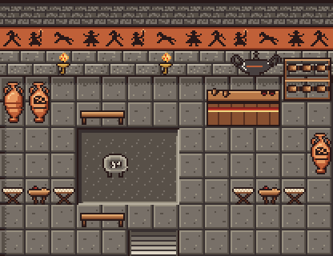

Down five steps into a barrel vault: cool, dim, lamp-lit. A black-figure frieze runs round the walls, satyrs chasing maenads and the maenads winning. The great cup hangs over the bar; the floor sinks into a worn bowl round the knucklebones table, benches at its lip.

Walk map: `#` blocked, `.` open; digits and letters are the spots below (a bg event is marked on its furniture).

```
    0123456789012
  0 #############
  1 #############
  2 ###5#########
  3 ##......#2#7#
  4 ##.##...###..
  5 ............#
  6 ...364......#
  7 ###......###.
  8 ...##........
  9 .....11......
```

| # | Kind | Tile | Detail | What |
|---|---|---|---|---|
| 1 | warp | (5,9), (6,9) | to `MAP_THYRSA_CITY` warp 2 | the exit |
| 2 | npc | (9,3) | faces south, `OBJ_EVENT_GFX_ICHOR_WOMAN` | Aristomache, Thyrsa's champion, behind the bar |
| 3 | npc | (3,6) | faces east, `OBJ_EVENT_GFX_ICHOR_ELDER_M` | Phaidimos, at the table |
| 4 | npc | (5,6) | faces west, `OBJ_EVENT_GFX_ICHOR_YOUTH_F` | Glauke, at the table |
| 5 | bg | (3,2) | read from (3,3) facing north | the frieze |
| 6 | bg | (4,6) | read from (4,5) facing south | the knucklebones table |
| 7 | bg | (11,3) | read from (11,4) facing north | the great cup (from the bar's end) |

### Pindaros's house: the poet's upper room

- Map `MAP_THYRSA_CITY_PINDAROS_HOUSE`, layout `LAYOUT_THYRSA_CITY_PINDAROS_HOUSE`: **12x9**, `gTileset_Oikos` + `gTileset_ThyrsaRooms`.
- Render: `design/phase3/img/ThyrsaCity_PindarosHouse.png` (2x).

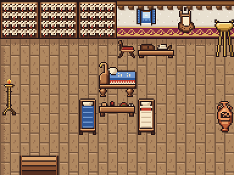

An upper room up a stair from the courtyard. Half the back wall is pigeonholes of odes, each tagged with a victor; the writing table stands at the window with the lyre on its peg beside it. Three couches make a U round the table, one always made up for a guest. His own victor's tripod, won for a song, has the corner.

Walk map: `#` blocked, `.` open; digits and letters are the spots below (a bg event is marked on its furniture).

```
    012345678901
  0 ############
  1 #3#######5##
  2 ......#4#..6
  3 .....##.....
  4 #....##.2...
  5 #...####...#
  6 ....#..7...#
  7 ............
  8 .11.........
```

| # | Kind | Tile | Detail | What |
|---|---|---|---|---|
| 1 | warp | (1,8), (2,8) | to `MAP_THYRSA_CITY` warp 8 | the exit |
| 2 | npc | (8,4) | faces south, `OBJ_EVENT_GFX_ICHOR_ELDER_M` | Pindaros, the host |
| 3 | bg | (1,1) | read from (1,2) facing north | the pigeonholes of odes |
| 4 | bg | (7,2) | read from (7,3) facing north | the writing table |
| 5 | bg | (9,1) | read from (9,2) facing north | the lyre |
| 6 | bg | (11,2) | read from (11,3) facing north | the victor's tripod |
| 7 | bg | (7,6) | read from (7,7) facing north | the guest's couch |

### Manto's house, on the Kadmeia wall

- Map `MAP_THYRSA_CITY_MANTO_HOUSE`, layout `LAYOUT_THYRSA_CITY_MANTO_HOUSE`: **10x8**, `gTileset_Oikos` + `gTileset_ThyrsaHomes`.
- Render: `design/phase3/img/ThyrsaCity_MantoHouse.png` (2x).

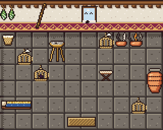

A dim room of old dark flags with one window, and it faces the sky. Birdcages hang from the beams with their doors open; the birds come and go. A tripod stands over a brazier long cold. Teiresias's cornel staff leans by the door, and feathers wait in pots, sorted by a woman who cannot see their colors.

Walk map: `#` blocked, `.` open; digits and letters are the spots below (a bg event is marked on its furniture).

```
    0123456789
  0 ##########
  1 ##5##3####
  2 #..#...6#.
  3 ...4.2....
  4 ......#..#
  5 .........#
  6 ##........
  7 ....11....
```

| # | Kind | Tile | Detail | What |
|---|---|---|---|---|
| 1 | warp | (4,7), (5,7) | to `MAP_THYRSA_CITY` warp 7 | the exit |
| 2 | npc | (5,3) | faces south, `OBJ_EVENT_GFX_ICHOR_MANTO` | Manto |
| 3 | bg | (5,1) | read from (5,2) facing north | the window to the sky |
| 4 | bg | (3,3) | read from (3,4) facing north | the cold brazier |
| 5 | bg | (2,1) | read from (2,2) facing north | the cornel staff |
| 6 | bg | (7,2) | read from (7,3) facing north | the feather pots |

### Staphylos's house: the vintner's press-house

- Map `MAP_THYRSA_CITY_VINTNER_HOUSE`, layout `LAYOUT_THYRSA_CITY_VINTNER_HOUSE`: **14x10**, `gTileset_Oikos` + `gTileset_ThyrsaHomes`.
- Render: `design/phase3/img/ThyrsaCity_VintnerHouse.png` (2x).

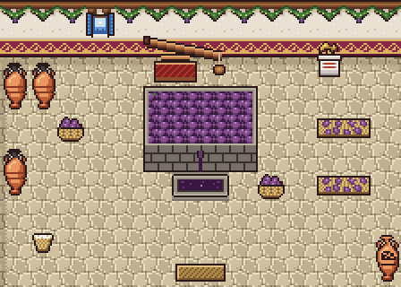

A farmhouse built round its own press. The treading floor stands waist-high in the middle, heaped with grapes, its spout running into the vat sunk before it; the beam press leans out of the back wall. Pitch-sealed jars line the west side, raisins dry on mats along the east, and the bronze panther keeps the family shrine.

Walk map: `#` blocked, `.` open; digits and letters are the spots below (a bg event is marked on its furniture).

```
    01234567890123
  0 ##############
  1 ##############
  2 ##...#5#j..4..
  3 ##..f789ah3...
  4 ..#.gbcdei.##.
  5 #....####.....
  6 #...2.#6.#.##.
  7 ..............
  8 .#...........#
  9 ......11.....#
```

| # | Kind | Tile | Detail | What |
|---|---|---|---|---|
| 1 | warp | (6,9), (7,9) | to `MAP_THYRSA_CITY` warp 10 | the exit |
| 2 | npc | (4,6) | faces east, `OBJ_EVENT_GFX_ICHOR_VINTNER` | Staphylos |
| 3 | npc | (10,3) | faces west, `OBJ_EVENT_GFX_ICHOR_YOUTH_F_THYRSA` | Erigone |
| 4 | bg | (11,2) | read from (11,3) facing north | the panther shrine |
| 5 | bg | (6,2) | read from (6,3) facing north | the beam press |
| 6 | bg | (7,6) | read from (7,7) facing north | the vat |
| 7 | coord | (5,3), (6,3), (7,3), (8,3), (5,4), (6,4), (7,4), (8,4) | `VAR_TEMP_2` = 1 | treading floor: a step |
| f | coord | (4,3), (4,4), (9,3), (9,4), (8,2) | `VAR_TEMP_2` = 1 | off the floor: the treading ends |

### Polos's house: the old actor's narrow house

- Map `MAP_THYRSA_CITY_ACTOR_HOUSE`, layout `LAYOUT_THYRSA_CITY_ACTOR_HOUSE`: **7x10**, `gTileset_Oikos` + `gTileset_ThyrsaRooms`.
- Render: `design/phase3/img/ThyrsaCity_ActorHouse.png` (2x).

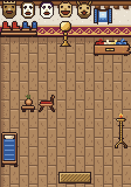

Narrow and tall, and the back wall is faces: every mask he wore, labelled with the part, Elektra's among them. His boots stand on their shelf, the costume trunk sits under the window, the bronze mirror is worn bright. The urn stands alone on its own small table.

Walk map: `#` blocked, `.` open; digits and letters are the spots below (a bg event is marked on its furniture).

```
    0123456
  0 #######
  1 4#3####
  2 ...5.6#
  3 .......
  4 ....2..
  5 .7#....
  6 ......#
  7 #.....#
  8 #......
  9 ...11..
```

| # | Kind | Tile | Detail | What |
|---|---|---|---|---|
| 1 | warp | (3,9), (4,9) | to `MAP_THYRSA_CITY` warp 5 | the exit |
| 2 | npc | (4,4) | faces south, `OBJ_EVENT_GFX_ICHOR_ACTOR` | Polos |
| 3 | bg | (2,1) | read from (2,2) facing north | the wall of masks |
| 4 | bg | (0,1) | read from (0,2) facing north | the boots |
| 5 | bg | (3,2) | read from (3,3) facing north | the bronze mirror |
| 6 | bg | (5,2) | read from (5,3) facing north | the costume trunk |
| 7 | bg | (1,5) | read from (1,6) facing north | the urn |

### Eudora's house, and its courtyard

- Map `MAP_THYRSA_CITY_EUDORA_HOUSE`, layout `LAYOUT_THYRSA_CITY_EUDORA_HOUSE`: **13x11**, `gTileset_Oikos` + `gTileset_ThyrsaHomes`.
- Render: `design/phase3/img/ThyrsaCity_EudoraHouse.png` (2x).

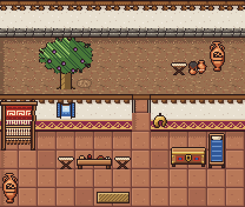

Two rooms' worth of house under a partition wall, and through its doorway a walled courtyard of bare earth where the old fig stands over a patch of turned earth. Indoors, the soldier's cloak half-mended on the loom, his father's helmet on its peg by the door, and a bed made up that nobody sleeps in.

Walk map: `#` blocked, `.` open; digits and letters are the spots below (a bg event is marked on its furniture).

```
    0123456789012
  0 #############
  1 #############
  2 ...........#.
  3 .........###.
  4 ...54........
  5 #######.#####
  6 #######.6####
  7 #72......###.
  8 ...####..##3.
  9 #............
 10 #....11......
```

| # | Kind | Tile | Detail | What |
|---|---|---|---|---|
| 1 | warp | (5,10), (6,10) | to `MAP_THYRSA_CITY` warp 6 | the exit |
| 2 | npc | (2,7) | faces west, `OBJ_EVENT_GFX_ICHOR_WOMAN_THYRSA` | Eudora, at the loom |
| 3 | npc | (11,8) | faces south, `OBJ_EVENT_GFX_ICHOR_YOUTH_M` | Hippias, asleep on his bed in his boots (after FLAG_ICHOR_GYPSOS_WENT_HOME) |
| 4 | bg | (4,4) | read from (5,4) facing west | the turned earth under the fig (ICHOR_STUB_DIG) |
| 5 | bg | (3,4) | read from (2,4) facing east | the fig |
| 6 | bg | (8,6) | read from (8,7) facing north | the helmet on its peg |
| 7 | bg | (1,7) | read from (1,8) facing north | the loom |

### Euthykles's workshop, the mask-maker's

- Map `MAP_THYRSA_CITY_MASK_WORKSHOP`, layout `LAYOUT_THYRSA_CITY_MASK_WORKSHOP`: **16x7**, `gTileset_Oikos` + `gTileset_ThyrsaHomes`.
- Render: `design/phase3/img/ThyrsaCity_MaskWorkshop.png` (2x).

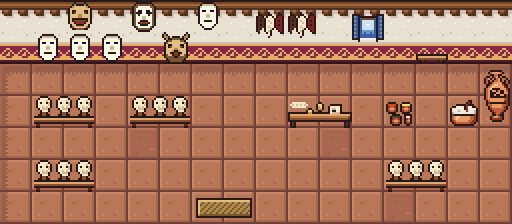

Long and low, and every surface has a face on it: blank linen masks drying on rows of wooden heads, painted ones pinned up to set, wigs on pegs, plaster and paint by the cutting bench. At the back, alone on a high shelf, one mask that is looking at you.

Walk map: `#` blocked, `.` open; digits and letters are the spots below (a bg event is marked on its furniture).

```
    0123456789012345
  0 ################
  1 ########4####3##
  2 ...............#
  3 .5#.##...##.6.##
  4 ..........2.....
  5 .##.........##..
  6 ......11........
```

| # | Kind | Tile | Detail | What |
|---|---|---|---|---|
| 1 | warp | (6,6), (7,6) | to `MAP_THYRSA_CITY` warp 4 | the exit |
| 2 | npc | (10,4) | faces north, `OBJ_EVENT_GFX_ICHOR_MERCHANT_THYRSA` | Euthykles, at the cutting bench |
| 3 | npc | (13,1) | faces south, `OBJ_EVENT_GFX_ICHOR_MASK` | the mask on the high shelf (an object) |
| 4 | bg | (8,1) | read from (8,2) facing north | the wigs |
| 5 | bg | (1,3) | read from (1,4) facing north | the masks drying on heads |
| 6 | bg | (12,3) | read from (12,4) facing north | the paint pots |

### Chthonia's house, of the Sown Men

- Map `MAP_THYRSA_CITY_SOWN_HOUSE`, layout `LAYOUT_THYRSA_CITY_SOWN_HOUSE`: **11x8**, `gTileset_Oikos` + `gTileset_ThyrsaStone`.
- Render: `design/phase3/img/ThyrsaCity_SownHouse.png` (2x).

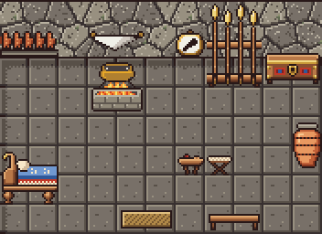

The oldest house in the city: walls of huge rough stones, dark flags worn smooth. Over the hearth hangs the dragon's tooth; the family's old spears stand in their rack; five clay soldiers line the shelf, the five who were left standing.

Walk map: `#` blocked, `.` open; digits and letters are the spots below (a bg event is marked on its furniture).

```
    01234567890
  0 ###########
  1 5#7########
  2 ...##..6###
  3 ...4#2.....
  4 ......3...#
  5 ##....##..#
  6 ##.........
  7 ....11.##..
```

| # | Kind | Tile | Detail | What |
|---|---|---|---|---|
| 1 | warp | (4,7), (5,7) | to `MAP_THYRSA_CITY` warp 9 | the exit |
| 2 | npc | (5,3) | faces west, `OBJ_EVENT_GFX_ICHOR_MOM_THYRSA` | Chthonia, by the hearth |
| 3 | npc | (6,4) | faces south, `OBJ_EVENT_GFX_ICHOR_KID_M_THYRSA` | Udaios, her grandson |
| 4 | bg | (3,3) | read from (3,4) facing north | the hearth and the tooth over it |
| 5 | bg | (0,1) | read from (0,2) facing north | the five clay men |
| 6 | bg | (7,2) | read from (7,3) facing north | the old spears |
| 7 | bg | (2,1) | read from (2,2) facing north | the wall stones |

<!-- thyrsa_rooms: end generated -->
