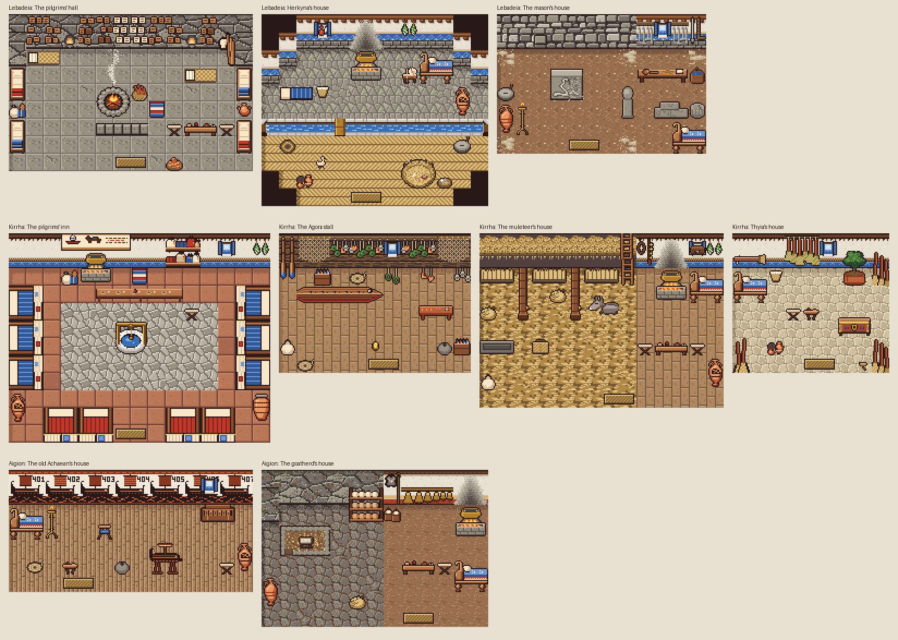
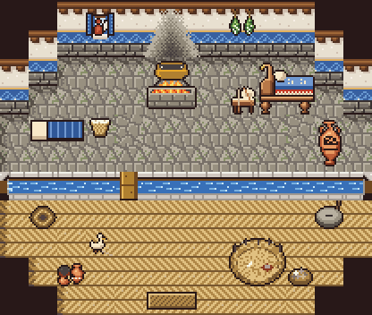
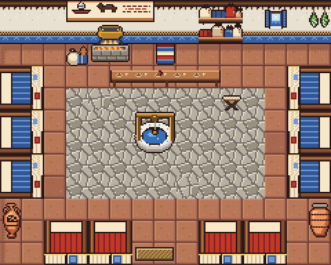
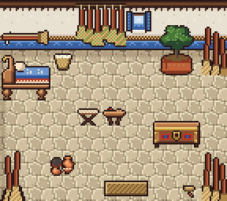
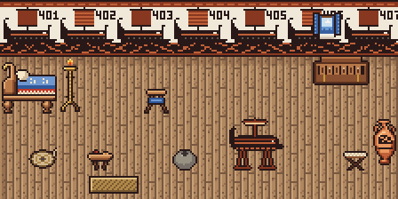

# The interiors of the road west

Act II batch 2's nine rooms (beats 35–37): Lebadeia's pilgrims' hall, Herkyna's house and the mason's; Kirrha's pilgrims' inn, Agora stall, the muleteer's and the old sweeper's houses; Aigion's old Achaean's and goatherd's houses. Each room is drawn for whoever lives or works in it, and each has its occupants, their SCRIPT.md lines and their gift, trade, service or quest. No two share a layout, and none copies a batch 1 or Act I room.

## Files and rebuilding

| What | Where |
|---|---|
| Palettes, floors, walls, the stamp registry; oikia's pieces reused as drawn | `tools/ichor/art/westrooms_art.py` |
| Lebadeia's pieces (and the rush mats, bundles and offcuts the others borrow) | `tools/ichor/art/westrooms_lebadeia.py` |
| Kirrha's pieces | `tools/ichor/art/westrooms_kirrha.py` |
| Aigion's pieces and the ship frieze | `tools/ichor/art/westrooms_aigion.py` |
| Composer, near-duplicate merging, Porytiles, checks | `tools/ichor/art/westrooms_build.py` (from batch 1's `thyrsa_rooms_build.py`) |
| The rooms: grids, stamps, events, music; the driver | `tools/ichor/maps/westrooms.py` |
| Scripts | `data/maps/<Map>/scripts.pory` |
| In-game check | `tools/ichor/tests/act2_westrooms.sh` (screenshots in `build/test_westrooms/shots/`) |

```bash
/usr/bin/python3 tools/ichor/maps/westrooms.py                       # compose, compile, check, write layouts, events, renders, the overview and this file's tables
/usr/bin/python3 tools/ichor/maps/westrooms.py --no-compile --preview DIR [--only A,B]   # previews from source only
tools/ichor/tests/act2_westrooms.sh                                  # after make
```

The driver writes each room's `map.bin` and `border.bin`, its `layouts.json` entry, and its `map.json` events and music from the spots listed with the room, so the coordinates live in one place. `scripts.pory` is written by hand. The run checks that every warp, person and readable thing is reachable from the door and read from the tile in front of it, that each healer can be talked to only across the counter in front of them (so the heal's balls land where they're drawn for), that every 8x8 tile takes its colors from one palette, and that each room renders from the compiled tiles over `gTileset_Oikos` exactly as composed. It also writes the one-sheet overview, `design/phase3/img/west_interiors_overview.png`.



## Three secondaries, grouped by what the rooms share

Nine rooms of new art come to about 1,200 tiles, and a secondary holds 504 (door animations own 504-511). Grouping by town put Lebadeia's three rooms at 483 with no room to grow, so the rooms are grouped by the art they share instead, as batch 1's were:

| Secondary | Directory | Rooms | Why together |
|---|---|---|---|
| `gTileset_WestStone` | `west_stone` | Lebadeia's pilgrims' hall, the mason's house | the living rock, the rough-laid rubble, cut stone and its dust, votive tablets |
| `gTileset_WestHarbor` | `west_harbor` | Kirrha's inn, Agora stall, the muleteer's and Thyia's | harbor whitewash with the rope moulding, sailcloth, boats and rope, straw and hay, brooms |
| `gTileset_WestHomes` | `west_homes` | Herkyna's river house, Tisamenos's and Helike's houses | the three households by the water: river pebbles and reeds, the ship frieze, the hillside |

All three are on the `oikos` primary, use only their own tiles and palettes 6-12, and are compiled by the same script against an empty stand-in primary. The near-duplicate merge (tiles within 2 px of another are redrawn as it) skips two walls whose small differences are the point: the frieze's ship numbers (merged, 402 became 406) and the mason's loose stone.

## Palettes

Seven, shared by all three sets, all multiples of 8 and none an aethos color. Four are oikia's, so its floors and a few of its pieces (the kline, stools, tables, amphorae, pithos, hearth and soot, window, chest, lampstand, herbs, the doormat) are reused exactly as drawn.

| Palette | Colors for |
|---|---|
| wall | oikia's plaster, beams, red-ochre dado, shutter blue and sky; Kirrha's sea-blue dado and rope moulding, Lebadeia's river-wave band |
| floor | oikia's terracotta, boards and limestone; packed earth, the mason's stone dust and Tisamenos's ship's planking are drawn from it |
| wood | furniture, linen and sailcloth, red and blue cloth, bronze fittings; votive tablets, bundles, the painted sign |
| clay | pottery, the hearth's stone and fire, soot, white slip; the fire pit and kerb, the black-figure ship frieze, clay votives |
| nature | leaves, wicker, straw and hay, rope and wool, and three mule greys (in place of oikia's fish silvers) |
| bronze | oikia's bronze, flame, water and marble: the mill-race and the well, the goat bells, the ship's lantern |
| stone | rough stone and living rock, timber and tar, lichen, lamp glow: the rock walls, rubble, the shed's tarred planks, the goat pen |

## The looks

- **Lebadeia:** whitewash over a band of Herkyna's river in blue running waves, on a footing of grey Parnassian limestone. The pilgrims' hall is cut into the hill: its back wall is bare rock, every inch of it hung with wooden tablets. The mason's back wall is his own rough-laid rubble.
- **Kirrha:** harbor whitewash under a tarred, rope-lashed beam, a twisted rope moulding over a sea-blue dado. The stall is a fishing shed of tarred planks; the muleteer's stable end is the underside of his hay loft.
- **Aigion:** Tisamenos's walls are one long black-figure frieze of numbered ships, like a pot. Helike's house is half rough whitewash with an ochre band, half the living hillside, mossy in its cracks.

## Healing and the respawn

The pilgrims' hall and the inn heal the way the Asclepeion does: `EventScript_PkmnCenterNurse_TakeAndHealPkmn`, talked to across a counter, so the party's balls (placed at a fixed offset from the player) land on the fire: the hall's fire pit, and the inn's hearth. Each room sets its town's respawn on entry. `HEAL_LOCATION_LEBADEIA` respawns at (7,7) in front of the hall-keeper, `HEAL_LOCATION_KIRRHA` at (6,4) in front of Strophios. Their outdoor tiles in `src/data/heal_locations.json` are placeholders, (16,14) and (18,15), for the integrator to set below each door.

**The bow.** The heal scripts bow the healer with `nurse_joy_bow`, which plays a tenth walker frame only the healer walkers have (`sAnimTable_Nurse`); on any other walker it never ends and the game hangs (found by the in-game test). So the hall-keeper is `OBJ_EVENT_GFX_ICHOR_HEALER`, and bows. Strophios has his own sprite without that frame: his talk script nods instead, and the whiteout's heal (which bows whoever the respawn NPC is) points at `LOCALID_KIRRHA_INN_RESPAWN`, a stand-in object that never appears, so the bow is skipped. When the sprites agent gives Strophios a bow frame, point `respawn_npc` at `LOCALID_KIRRHA_INN_STROPHIOS` and drop the stand-in.

## Render-and-critique passes

Every room had at least three: source previews of the whole room (pass 1), the fixes re-rendered (pass 2), and the compiled rooms in the game with their people, from `tools/ichor/tests/act2_westrooms.sh` (pass 3).

### Pass 1: the rooms from source

| Room | What was wrong |
|---|---|
| Pilgrims' hall | the votive tablets a noisy scatter of orange chips, not rows; the sleeping benches read as cabinets; the smoke invisible; the rock-cut floor read as grey planks; both sides empty |
| Herkyna's | the pebble floor dark and busy; the reed mats a saturated checkerboard |
| Mason's | the rubble wall a regular block wall, the loose stone an obvious pale square; the chisels read as a barred window; the snake relief read as a "2"; the floor empty |
| Inn | the bundles on their shelf read as books; the blue dado busy with sparkles; the courtyard empty round the well |
| Agora stall | the upturned boat read as a fish; votives hung over the floor read as clutter lying on it |
| Muleteer's | the mule a grey blob; the hay loft a woven grid; the straw floor loud; a harness lying on the floor |
| Thyia's | sparse in the middle |
| Tisamenos's | the ships read as striped awnings: pale sails, no hulls |
| Helike's | the cave floor a gravel noise; the goat pen read as a crate of gold |

### Pass 2: fixes, re-rendered

| Room | Change |
|---|---|
| Pilgrims' hall | tablets in three tidy rows on pegs and strings, some darkened with age, the newest pale; benches redrawn as beds (pillow, tick, folded blanket); a wavering smoke column; the floor one broad slab per cell; bed rolls on the floor, bundles; the hall narrowed from 16 to 14 |
| Herkyna's | larger, calmer pebbles; reeds plaited in a herringbone, bound every half-cell; a toy goose and a basket of river stones by the pen |
| Mason's | rough-laid rubble of every size with pinning stones; the loose stone a stone like the rest with a darker gap round it; chisels hung point-down from a peg rail; the snake rising from its coil, its eye cut; a roughed-out herm and a spoiled drum; the room cut to 12x8 |
| Inn | squat knotted bundles and corded blanket rolls with name tags; one line of wave in a plain dado; a pilgrim waiting by the well |
| Agora stall | a full hull, keel up, red stripe at the gunwale, the eye on the bow; the votives on strings down the wall (wreaths in one 8-px column, clay in the other, so no tile mixes palettes), and a trestle table of clay feet and omphaloi |
| Muleteer's | the mule redrawn lying on its side, head down, long ears up; heaped hay; calmer straw; the harness back on the wall |
| Thyia's | a chest and a wool basket |
| Tisamenos's | bold black hulls with eyes and red strakes, dark sails, oars down into a black sea with red wave lines |
| Helike's | the cave floor worn plates with earth in the cracks; trodden brown straw; the cradle drawn into the pen in the stone palette (overlaid, it mixed palettes in its tiles) |

### Pass 3: in the game

Read from `build/test_westrooms/shots/` (a quickstart save, a Halcyling and a Lophops, every room toured with its people, every service played).

| Room | Finding | Change |
|---|---|---|
| Pilgrims' hall | the heal ran, then the game hung: `nurse_joy_bow` on the hall-keeper's walker, which has no bow frame | the hall-keeper wears `OBJ_EVENT_GFX_ICHOR_HEALER` (see Healing); heal, respawn at (7,7) and the whiteout heal all pass |
| Pilgrims' hall | a bed roll on the bottom row, beside the door, read as a second exit mat | moved to the top-left corner, under the tablets |
| Inn | the same hang waited for Strophios, at his own heal and at every whiteout | he nods; the respawn points at a stand-in that never appears; heal and respawn at (6,4) pass |
| Inn | Xenodike seemed missing once she came down: people only spawn near the camera, and the check was made from the door | the test checks from beside her place; she stands beside Pylades as she should |
| Tisamenos's | the numbers read 401, 406, 403, 404, 402…: the near-duplicate merge folded digits a few pixels apart | the frieze and the rubble wall are kept out of the merge; 401 to 407 in order |
| Tisamenos's | the floor still sparse round the model ship | an old anchor stone and a coil of rope |
| Hall, inn | the heal photographed mid-way (`*_balls*.png`): the party's balls glow on the hall's fire pit and on the inn's hearth, the healer turned toward them | none |
| all | every person stands clear of furniture, the real walkers (Strophios, Pylades, Xenodike, the muleteer, Thyia, Tisamenos, Helike, Herkyna, Agamedes, the blanketed pilgrims) read as themselves; Goose sits in the pen, the Kerazap kid in its cradle, the Melisseer by the window until traded; every name fits its box (HALL-KEEPER is 55 of 64 px) | none |

## Stubs and deviations

| Tag | Where | What waits |
|---|---|---|
| `ICHOR_STUB_KEY_ITEMS` | Pylades's fig | `ITEM_PYLADES_FIG`; `FLAG_ICHOR_PYLADES_FIG` carries it, with a received message |
| `ICHOR_STUB_RITES` | Thyia's laurel | Act II's laurel indices: `FLAG_ICHOR_THYIA_LAUREL_TODAY` (bank 0x1B5) stands in for her daily flag, so until the swap she gives one sprig in all |
| `ICHOR_STUB_AETHOS_DEX` | Halcyling (Goose), Melisseer, Lophops, Kerazap, Galenyon | the dex |

Deviations, closest reading taken:
- **Thyia's name box reads THYIA.** SCRIPT.md tagged her lines PHEMONIS, a draft name; the director confirms THYIA.
- **Aigion's Soothe Bell** sets `FLAG_ICHOR_GOT_SOOTHE_BELL_AIGION`, not SCRIPT.md's `FLAG_ICHOR_GOT_SOOTHE_BELL` (Act I's, Aigon's bell in Akti). Herkyna's Mystic Water likewise sets `FLAG_ICHOR_GOT_MYSTIC_WATER_HERKYNA`, not Act I's `FLAG_ICHOR_GOT_MYSTIC_WATER`.
- **KASSOTIS's level** is the offered Lophops's, as every in-game trade's is (SCRIPT.md says Lv 30). She is female (personality 0x2510) and holds a Mental Herb. The muleteer has no name in SCRIPT.md; her OT is OUREUS, Homer's word for a mule, the harbor's name for him.
- **Xenodike at the inn** is hidden by `FLAG_TEMP_1` (set on entry until `FLAG_ICHOR_XENODIKE_CAME_DOWN`), not Part 8's `FLAG_ICHOR_HIDE_XENODIKE_INN`, to save a bank flag; Goose in Herkyna's pen likewise.
- **Lines of my own,** short and in the rooms' voices, where SCRIPT.md gives none: the second pilgrim in the hall (a weaver), the inn's pilgrim by the well, Pylades's reminder and after-lines, Xenodike's two lines at the inn, Herkyna's after-line, Agamedes's line on the loose stone once found, the muleteer's refusals, the Melisseer's and Kerazap's cries, Helike's after-line, and every sign. The pilgrims' hall's three pilgrims of beat 35B sit outside on the steps (the parnassos agent's).
- **Two hidden items** the rooms' stories suggest (vanilla flags 0x334-0x335, the director's range): a pilgrim's coin down the inn's well (Relic Copper, the game's Bronze Obol), asked of the well instead of the god; and Stardust in the mason's drift of stone dust.
- **The hall-keeper wears the healer's walker,** for the bow (above).

<!-- westrooms: begin generated -->

- `gTileset_WestStone` (`data/tilesets/secondary/west_stone`): **120** metatiles of 512, **361** tiles of 504, palettes 6-12. Sheet: `design/phase3/img/west_stone_sheet.png`.
- `gTileset_WestHarbor` (`data/tilesets/secondary/west_harbor`): **176** metatiles of 512, **457** tiles of 504, palettes 6-12. Sheet: `design/phase3/img/west_harbor_sheet.png`.
- `gTileset_WestHomes` (`data/tilesets/secondary/west_homes`): **160** metatiles of 512, **421** tiles of 504, palettes 6-12. Sheet: `design/phase3/img/west_homes_sheet.png`.

### The pilgrims' hall, Lebadeia

- Map `MAP_LEBADEIA_PILGRIMS_HALL`, layout `LAYOUT_LEBADEIA_PILGRIMS_HALL`: **14x9**, `gTileset_Oikos` + `gTileset_WestStone`; music `MUS_ICHOR_ASCLEPEION`.
- Render: `design/phase3/img/Lebadeia_PilgrimsHall.png` (2x).


A long, low hall cut half into the hill, so the back wall is the living rock, and the rock is covered with rows of little wooden tablets on pegs: what every pilgrim saw below. Sleeping benches run down both sides with blankets folded at their feet. In the middle the fire burns in its pit, its smoke going up to a hole in the rock, and the hall-keeper tends it behind the stone kerb where the pilgrims sit to dry out. A basket of honey cakes waits by the door.

Walk map: `#` blocked, `.` open; digits and letters are the spots below (a bg event is marked on its furniture).

```
    01234567890123
  0 ##############
  1 ##5###67#8####
  2 #...........b#
  3 3............#
  4 #....9##.....#
  5 #..4.##2#....#
  6 #....###.#####
  7 #............#
  8 ......11.a....
```

| # | Kind | Tile | Detail | What |
|---|---|---|---|---|
| 1 | warp | (6,8), (7,8) | to `MAP_LEBADEIA` warp 0 | the exit |
| 2 | npc | (7,5) | faces south, `OBJ_EVENT_GFX_ICHOR_HEALER` | the hall-keeper, at the fire (heals) |
| 3 | npc | (0,3) | faces east, `OBJ_EVENT_GFX_ICHOR_PILGRIM_BLANKET` | a pilgrim on a bench, under a blanket |
| 4 | npc | (3,5) | faces east, `OBJ_EVENT_GFX_ICHOR_PILGRIM_BLANKET_2` | a pilgrim drying out by the fire |
| 5 | bg | (2,1) | read from (2,2) facing north | the votive wall |
| 6 | bg | (6,1) | read from (6,2) facing north | the votive wall (the newest tablets) |
| 7 | bg | (7,1) | read from (7,2) facing north | the votive wall (the newest tablets) |
| 8 | bg | (9,1) | read from (9,2) facing north | the votive wall |
| 9 | bg | (5,4) | read from (5,3) facing south | the fire |
| a | bg | (9,8) | read from (9,7) facing south | the honey cakes |
| b | bg | (12,2) | read from (11,2) facing east | the staffs and the white linen |

### Herkyna's house, by the river

- Map `MAP_LEBADEIA_HERKYNA_HOUSE`, layout `LAYOUT_LEBADEIA_HERKYNA_HOUSE`: **13x11**, `gTileset_Oikos` + `gTileset_WestHomes`; music `MUS_ICHOR_ROAD`.
- Render: `design/phase3/img/Lebadeia_HerkynaHouse.png` (2x).



A round river house, its wall curving away at both ends. The mill-race runs straight through it in a stone channel, in under the west wall and out under the east toward the mill, with one plank to step over. Pebbles from the river floor the back of the house, round the hearth and the grandmother's spinning stool; reed mats the front, where the empty goose pen of woven willow waits by the door. On the windowsill, a clay girl holds a clay goose.

Walk map: `#` blocked, `.` open; digits and letters are the spots below (a bg event is marked on its furniture).

```
    0123456789012
  0 #############
  1 ###5#########
  2 ##...##..####
  3 #....8#3###.#
  4 .###.......#.
  5 ...........#.
  6 ##6#.########
  7 .#.........#.
  8 ...#...2##...
  9 #.#.....74#.#
 10 ##...11....##
```

| # | Kind | Tile | Detail | What |
|---|---|---|---|---|
| 1 | warp | (5,10), (6,10) | to `MAP_LEBADEIA` warp 1 | the exit |
| 2 | npc | (7,8) | faces east, `OBJ_EVENT_GFX_ICHOR_HERKYNA` | Herkyna, by the empty pen |
| 3 | npc | (7,3) | faces east, `OBJ_EVENT_GFX_ICHOR_ELDER_F` | her grandmother, spinning by the hearth |
| 4 | npc | (9,9) | faces west, `OBJ_EVENT_GFX_SPECIES(HALCYLING)` | Goose, home in the pen (after FLAG_ICHOR_FOUND_HERKYNAS_GOOSE) |
| 5 | bg | (3,1) | read from (3,2) facing north | the clay girl and her goose |
| 6 | bg | (2,6) | read from (2,7) facing north | the mill-race |
| 7 | bg | (8,9) | read from (7,9) facing east | the empty pen |
| 8 | bg | (5,3) | read from (5,4) facing north | the hearth |

### The mason's house, Lebadeia

- Map `MAP_LEBADEIA_MASONS_HOUSE`, layout `LAYOUT_LEBADEIA_MASONS_HOUSE`: **12x8**, `gTileset_Oikos` + `gTileset_WestStone`; music `MUS_ICHOR_ROAD`.
- Render: `design/phase3/img/Lebadeia_MasonsHouse.png` (2x).


A stone-cutter's workroom. Agamedes built its back wall himself, rough-laid stones with no plaster, and left one loose for luck; he can't remember which. The rest is plastered and hung with his chisels in rows. In the middle of the floor a votive block: a snake coming up out of the rough stone, half carved. Stone dust lies in drifts in every corner.

Walk map: `#` blocked, `.` open; digits and letters are the spots below (a bg event is marked on its furniture).

```
    012345678901
  0 ############
  1 789abcde4###
  2 ............
  3 ...##...#5##
  4 #..3#2.#....
  5 ##.....#.###
  6 ##........##
  7 6...11....##
```

| # | Kind | Tile | Detail | What |
|---|---|---|---|---|
| 1 | warp | (4,7), (5,7) | to `MAP_LEBADEIA` warp 2 | the exit |
| 2 | npc | (5,4) | faces west, `OBJ_EVENT_GFX_ICHOR_AGAMEDES` | Agamedes, at his snake |
| 3 | bg | (3,4) | read from (3,5) facing north | the snake relief |
| 4 | bg | (8,1) | read from (8,2) facing north | the chisels |
| 5 | bg | (9,3) | read from (9,4) facing north | the workbench |
| 6 | hidden | (0,7) | `ITEM_STARDUST`, `FLAG_ICHOR_HIDDEN_LEBADEIA_MASON_STARDUST` | Stardust, glittering in the drift of stone dust in the corner |
| 7 | bg | (0,1) | read from (0,2) facing north | a rough stone |
| 8 | bg | (1,1) | read from (1,2) facing north | a rough stone |
| 9 | bg | (2,1) | read from (2,2) facing north | the loose stone (third from the left, bottom course) |
| a | bg | (3,1) | read from (3,2) facing north | a rough stone |
| b | bg | (4,1) | read from (4,2) facing north | a rough stone |
| c | bg | (5,1) | read from (5,2) facing north | a rough stone |
| d | bg | (6,1) | read from (6,2) facing north | a rough stone |
| e | bg | (7,1) | read from (7,2) facing north | a rough stone |

### The pilgrims' inn, Kirrha

- Map `MAP_KIRRHA_INN`, layout `LAYOUT_KIRRHA_INN`: **15x12**, `gTileset_Oikos` + `gTileset_WestHarbor`; music `MUS_ICHOR_ASCLEPEION`.
- Render: `design/phase3/img/Kirrha_Inn.png` (2x).



A square inn round an open courtyard, the well in the middle under the sky. Sleeping alcoves line three sides behind curtains of old patched sailcloth; the long table takes the fourth, with the hearth behind it and Strophios between, and over the hearth the big painted sign of a ship and a mule. The pilgrims' bundles wait on a shelf, every one with a name tag tied on.

Walk map: `#` blocked, `.` open; digits and letters are the spots below (a bg event is marked on its furniture).

```
    012345678901234
  0 ###############
  1 #########89####
  2 ...###2#...45..
  3 ##...7####...##
  4 #c........#..##
  5 ##....#d.....##
  6 ##....ab.6...##
  7 ##...........##
  8 ##...........##
  9 #.............#
 10 #.####...####.#
 11 ..####11.####..
```

| # | Kind | Tile | Detail | What |
|---|---|---|---|---|
| 1 | warp | (6,11), (7,11) | to `MAP_KIRRHA` warp 0 | the exit |
| 2 | npc | (6,2) | faces south, `OBJ_EVENT_GFX_ICHOR_STROPHIOS` | Strophios, behind the long table (heals) |
| 3 | npc | (6,2) | faces south, `OBJ_EVENT_GFX_ICHOR_STROPHIOS` | the whiteout heal's respawn NPC: never shown (Strophios's sprite has no bow frame) |
| 4 | npc | (11,2) | faces south, `OBJ_EVENT_GFX_ICHOR_PYLADES` | Pylades, by the bundles |
| 5 | npc | (12,2) | faces west, `OBJ_EVENT_GFX_ICHOR_XENODIKE` | Xenodike, beside Pylades (after FLAG_ICHOR_XENODIKE_CAME_DOWN) |
| 6 | npc | (9,6) | faces west, `OBJ_EVENT_GFX_ICHOR_PILGRIM_BLANKET_3` | a pilgrim sitting by the well, waiting |
| 7 | bg | (5,3) | read from (5,4) facing north | the painted sign, over the hearth (read across the table) |
| 8 | bg | (9,1) | read from (9,2) facing north | the bundles with their name tags |
| 9 | bg | (10,1) | read from (10,2) facing north | the bundles with their name tags |
| a | bg | (6,6) | read from (6,7) facing north | the well |
| b | bg | (7,6) | read from (7,7) facing north | the well |
| c | bg | (1,4) | read from (2,4) facing west | an alcove |
| d | hidden | (7,5) | `ITEM_RELIC_COPPER`, `FLAG_ICHOR_HIDDEN_KIRRHA_INN_RELIC_COPPER` | a pilgrim's coin down the well, asked of the well instead of the god |

### The Agora stall, Kirrha

- Map `MAP_KIRRHA_AGORA`, layout `LAYOUT_KIRRHA_AGORA`: **11x8**, `gTileset_Oikos` + `gTileset_WestHarbor`; music `MUS_ICHOR_AGORA`.
- Render: `design/phase3/img/Kirrha_Agora.png` (2x).


A fishing shed on the quay, its tarred planks still smelling of nets, turned into a pilgrims' stall. The counter is an upturned boat with its eye painted on the bow. From every beam hang votives on strings, laurel wreaths and little clay omphaloi and clay feet for the healing god; nobody is buying them, so there is a crate of potions. A ship's lantern hangs over the door.

Walk map: `#` blocked, `.` open; digits and letters are the spots below (a bg event is marked on its furniture).

```
    01234567890
  0 ###########
  1 #######3###
  2 #.#2#......
  3 .####4.....
  4 ........5#.
  5 ...........
  6 #........#6
  7 .#...11....
```

| # | Kind | Tile | Detail | What |
|---|---|---|---|---|
| 1 | warp | (5,7), (6,7) | to `MAP_KIRRHA` warp 1 | the exit |
| 2 | npc | (3,2) | faces south, `OBJ_EVENT_GFX_ICHOR_MERCHANT` | the stallkeeper, behind the boat |
| 3 | bg | (7,1) | read from (7,2) facing north | the votives on their strings |
| 4 | bg | (5,3) | read from (5,4) facing north | the eye on the boat |
| 5 | bg | (8,4) | read from (8,5) facing north | the table of votives |
| 6 | bg | (10,6) | read from (10,5) facing south | the crate of potions |

### The muleteer's house, Kirrha

- Map `MAP_KIRRHA_MULETEERS_HOUSE`, layout `LAYOUT_KIRRHA_MULETEERS_HOUSE`: **14x10**, `gTileset_Oikos` + `gTileset_WestHarbor`; music `MUS_ICHOR_ROAD`.
- Render: `design/phase3/img/Kirrha_MuleteersHouse.png` (2x).


Half house, half stable. Three mule stalls of rough boards stand under the hay loft, two of them empty for nine days and one with a mule asleep in the straw; a ladder leans up to the loft. The muleteer's end is squeezed in beside it: harness and bells on the wall, his bed in the corner by the hearth, and on the windowsill a wooden beehive that something came down off the mountain and moved into.

Walk map: `#` blocked, `.` open; digits and letters are the spots below (a bg event is marked on its furniture).

```
    01234567890123
  0 ##############
  1 ##############
  2 ###7####6.####
  3 ..#.####..##5#
  4 #.#..##4..2..3
  5 ..............
  6 ##.#.....####.
  7 .............#
  8 #............#
  9 .......11.....
```

| # | Kind | Tile | Detail | What |
|---|---|---|---|---|
| 1 | warp | (7,9), (8,9) | to `MAP_KIRRHA` warp 2 | the exit |
| 2 | npc | (10,4) | faces south, `OBJ_EVENT_GFX_ICHOR_MULETEER` | the muleteer, by his hearth |
| 3 | npc | (13,4) | faces west, `OBJ_EVENT_GFX_SPECIES(MELISSEER)` | the Melisseer from the beehive (until it is traded) |
| 4 | bg | (7,4) | read from (7,5) facing north | the sleeping mule |
| 5 | bg | (12,3) | read from (12,4) facing north | the bed, under the beehive on the sill |
| 6 | bg | (8,2) | read from (8,3) facing north | the ladder to the loft |
| 7 | bg | (3,2) | read from (3,3) facing north | an empty stall |

### Thyia's house, the old sweeper's

- Map `MAP_KIRRHA_SWEEPERS_HOUSE`, layout `LAYOUT_KIRRHA_SWEEPERS_HOUSE`: **9x8**, `gTileset_Oikos` + `gTileset_WestHarbor`; music `MUS_ICHOR_ROAD`.
- Render: `design/phase3/img/Kirrha_SweepersHouse.png` (2x).



A small whitewashed room full of brooms: stood in every corner, a bundle of new ones hung from the beam to dry, and over the bed, on two pegs like a sword, the old one she swept the god's floor with for forty years. The floor is spotless. By the window, in a big clay pot, a young laurel cut from the tree at the temple door.

Walk map: `#` blocked, `.` open; digits and letters are the spots below (a bg event is marked on its furniture).

```
    012345678
  0 #########
  1 ###5#####
  2 ###...3#6
  3 #4.......
  4 ...##2##.
  5 ......##.
  6 #.#.....#
  7 #...11.##
```

| # | Kind | Tile | Detail | What |
|---|---|---|---|---|
| 1 | warp | (4,7), (5,7) | to `MAP_KIRRHA` warp 3 | the exit |
| 2 | npc | (5,4) | faces west, `OBJ_EVENT_GFX_ICHOR_THYIA` | Thyia, at her table |
| 3 | bg | (6,2) | read from (6,3) facing north | the young laurel in its pot |
| 4 | bg | (1,3) | read from (2,3) facing west | the old broom over the bed |
| 5 | bg | (3,1) | read from (3,2) facing north | the new brooms drying |
| 6 | bg | (8,2) | read from (8,3) facing north | the brooms in the corner |

### The old Achaean's house, Aigion

- Map `MAP_AIGION_ACHAEANS_HOUSE`, layout `LAYOUT_AIGION_ACHAEANS_HOUSE`: **14x7**, `gTileset_Oikos` + `gTileset_WestHomes`; music `MUS_ICHOR_ROAD`.
- Render: `design/phase3/img/Aigion_AchaeansHouse.png` (2x).



A long narrow house, and its wall is one long frieze of black ships, every one with its number painted over its prow: the Catalogue of Ships, four hundred and one onward, as far as Tisamenos has got. His chair is turned to face it. A model trireme stands on its stand in the middle of the floor, and under the window a chest stands open, full of wax tablets. He has floored the house with ship's planking, because that is what he knows.

Walk map: `#` blocked, `.` open; digits and letters are the spots below (a bg event is marked on its furniture).

```
    01234567890123
  0 ##############
  1 ####3####4####
  2 ###...2....#6.
  3 ###..7........
  4 ........5#...#
  5 .#.#..#.##..##
  6 ...11.........
```

| # | Kind | Tile | Detail | What |
|---|---|---|---|---|
| 1 | warp | (3,6), (4,6) | to `MAP_AIGION` warp 0 | the exit |
| 2 | npc | (6,2) | faces north, `OBJ_EVENT_GFX_ICHOR_TISAMENOS` | Tisamenos, reciting to the frieze |
| 3 | bg | (4,1) | read from (4,2) facing north | the frieze of ships |
| 4 | bg | (9,1) | read from (9,2) facing north | the frieze of ships |
| 5 | bg | (8,4) | read from (8,3) facing south | the model ship |
| 6 | bg | (12,2) | read from (12,3) facing north | the chest of wax tablets |
| 7 | bg | (5,3) | read from (5,4) facing north | his chair |

### The goatherd's house, Aigion

- Map `MAP_AIGION_GOATHERDS_HOUSE`, layout `LAYOUT_AIGION_GOATHERDS_HOUSE`: **13x9**, `gTileset_Oikos` + `gTileset_WestHomes`; music `MUS_ICHOR_ROAD`.
- Render: `design/phase3/img/Aigion_GoatherdsHouse.png` (2x).


Half a house and half a cave: Helike built against the hillside, so the back wall of the cave end is living rock, mossy in the cracks. The goat pen is indoors there, a ring of dry stones round clean straw, with a baby's cradle in it and a Kerazap kid asleep in the cradle. Cheeses ripen on racks in the cool of the rock. The house end is whitewashed, and along its wall hangs a row of bronze goat bells, from big to tiny.

Walk map: `#` blocked, `.` open; digits and letters are the spots below (a bg event is marked on its furniture).

```
    0123456789012
  0 #############
  1 #6#######4###
  2 #....5##...##
  3 .###......2##
  4 .#37.........
  5 ........#####
  6 #..........##
  7 #....#.......
  8 ........11...
```

| # | Kind | Tile | Detail | What |
|---|---|---|---|---|
| 1 | warp | (8,8), (9,8) | to `MAP_AIGION` warp 1 | the exit |
| 2 | npc | (10,3) | faces west, `OBJ_EVENT_GFX_ICHOR_HELIKE` | Helike, by the hearth |
| 3 | npc | (2,4) | faces south, `OBJ_EVENT_GFX_SPECIES(KERAZAP)` | the Kerazap kid, asleep in the cradle |
| 4 | bg | (9,1) | read from (9,2) facing north | the goat bells |
| 5 | bg | (5,2) | read from (5,3) facing north | the cheese racks |
| 6 | bg | (1,1) | read from (1,2) facing north | the living rock |
| 7 | bg | (3,4) | read from (3,5) facing north | the goat pen |

<!-- westrooms: end generated -->
