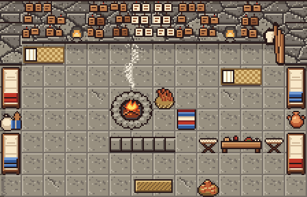
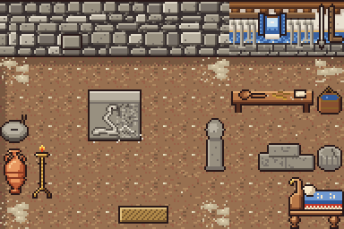
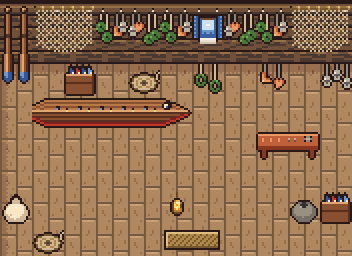
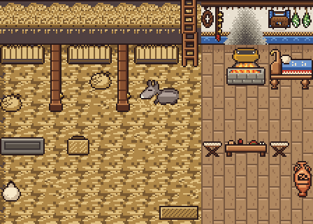
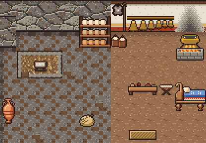

# The interiors of the road west

Act II batch 2's nine rooms (beats 35–37): Lebadeia's pilgrims' hall, Herkyna's house and the mason's; Kirrha's pilgrims' inn, Agora stall, the muleteer's and the old sweeper's houses; Aigion's old Achaean's and goatherd's houses. Each room is drawn for whoever lives or works in it, and each has its occupants, their SCRIPT.md lines and their gift, trade, service or quest. No two share a layout, and none copies a batch 1 or Act I room.

## Files and rebuilding

| What | Where |
|---|---|
| Palettes, floors, walls, the stamp registry; oikia's pieces reused as drawn | `tools/ichor/art/westrooms_art.py` |
| Lebadeia's pieces (and the rush mats, bundles and offcuts the others borrow) | `tools/ichor/art/westrooms_lebadeia.py` |
| Kirrha's pieces | `tools/ichor/art/westrooms_kirrha.py` |
| Aigion's pieces and the ship frieze | `tools/ichor/art/westrooms_aigion.py` |
| Composer, near-duplicate merging, Porytiles, checks | `tools/ichor/art/westrooms_build.py` (from batch 1's `thyrsa_rooms_build.py`) |
| The rooms: grids, stamps, events, music; the driver | `tools/ichor/maps/westrooms.py` |
| Scripts | `data/maps/<Map>/scripts.pory` |
| In-game check | `tools/ichor/tests/act2_westrooms.sh` (screenshots in `build/test_westrooms/shots/`) |

```bash
/usr/bin/python3 tools/ichor/maps/westrooms.py                       # compose, compile, check, write layouts, events, renders, the overview and this file's tables
/usr/bin/python3 tools/ichor/maps/westrooms.py --no-compile --preview DIR [--only A,B]   # previews from source only
tools/ichor/tests/act2_westrooms.sh                                  # after make
```

The driver writes each room's `map.bin` and `border.bin`, its `layouts.json` entry, and its `map.json` events and music from the spots listed with the room, so the coordinates live in one place. `scripts.pory` is written by hand. The run checks that every warp, person and readable thing is reachable from the door and read from the tile in front of it, that each healer can be talked to only across the counter in front of them (so the heal's balls land where they're drawn for), that every 8x8 tile takes its colors from one palette, and that each room renders from the compiled tiles over `gTileset_Oikos` exactly as composed.

<!-- westrooms: begin generated -->

- `gTileset_WestStone` (`data/tilesets/secondary/west_stone`): **120** metatiles of 512, **361** tiles of 504, palettes 6-12. Sheet: `design/phase3/img/west_stone_sheet.png`.
- `gTileset_WestHarbor` (`data/tilesets/secondary/west_harbor`): **176** metatiles of 512, **457** tiles of 504, palettes 6-12. Sheet: `design/phase3/img/west_harbor_sheet.png`.
- `gTileset_WestHomes` (`data/tilesets/secondary/west_homes`): **152** metatiles of 512, **399** tiles of 504, palettes 6-12. Sheet: `design/phase3/img/west_homes_sheet.png`.

### The pilgrims' hall, Lebadeia

- Map `MAP_LEBADEIA_PILGRIMS_HALL`, layout `LAYOUT_LEBADEIA_PILGRIMS_HALL`: **14x9**, `gTileset_Oikos` + `gTileset_WestStone`; music `MUS_ICHOR_ASCLEPEION`.
- Render: `design/phase3/img/Lebadeia_PilgrimsHall.png` (2x).



A long, low hall cut half into the hill, so the back wall is the living rock, and the rock is covered with rows of little wooden tablets on pegs: what every pilgrim saw below. Sleeping benches run down both sides with blankets folded at their feet. In the middle the fire burns in its pit, its smoke going up to a hole in the rock, and the hall-keeper tends it behind the stone kerb where the pilgrims sit to dry out. A basket of honey cakes waits by the door.

Walk map: `#` blocked, `.` open; digits and letters are the spots below (a bg event is marked on its furniture).

```
    01234567890123
  0 ##############
  1 ##5###67#8####
  2 #...........b#
  3 3............#
  4 #....9##.....#
  5 #..4.##2#....#
  6 #....###.#####
  7 #............#
  8 ......11.a....
```

| # | Kind | Tile | Detail | What |
|---|---|---|---|---|
| 1 | warp | (6,8), (7,8) | to `MAP_LEBADEIA` warp 0 | the exit |
| 2 | npc | (7,5) | faces south, `OBJ_EVENT_GFX_ICHOR_WOMAN` | the hall-keeper, at the fire (heals) |
| 3 | npc | (0,3) | faces east, `OBJ_EVENT_GFX_ICHOR_PILGRIM_BLANKET` | a pilgrim on a bench, under a blanket |
| 4 | npc | (3,5) | faces east, `OBJ_EVENT_GFX_ICHOR_PILGRIM_BLANKET_2` | a pilgrim drying out by the fire |
| 5 | bg | (2,1) | read from (2,2) facing north | the votive wall |
| 6 | bg | (6,1) | read from (6,2) facing north | the votive wall (the newest tablets) |
| 7 | bg | (7,1) | read from (7,2) facing north | the votive wall (the newest tablets) |
| 8 | bg | (9,1) | read from (9,2) facing north | the votive wall |
| 9 | bg | (5,4) | read from (5,3) facing south | the fire |
| a | bg | (9,8) | read from (9,7) facing south | the honey cakes |
| b | bg | (12,2) | read from (11,2) facing east | the staffs and the white linen |

### Herkyna's house, by the river

- Map `MAP_LEBADEIA_HERKYNA_HOUSE`, layout `LAYOUT_LEBADEIA_HERKYNA_HOUSE`: **13x11**, `gTileset_Oikos` + `gTileset_WestHomes`; music `MUS_ICHOR_ROAD`.
- Render: `design/phase3/img/Lebadeia_HerkynaHouse.png` (2x).


A round river house, its wall curving away at both ends. The mill-race runs straight through it in a stone channel, in under the west wall and out under the east toward the mill, with one plank to step over. Pebbles from the river floor the back of the house, round the hearth and the grandmother's spinning stool; reed mats the front, where the empty goose pen of woven willow waits by the door. On the windowsill, a clay girl holds a clay goose.

Walk map: `#` blocked, `.` open; digits and letters are the spots below (a bg event is marked on its furniture).

```
    0123456789012
  0 #############
  1 ###5#########
  2 ##...##..####
  3 #....8#3###.#
  4 .###.......#.
  5 ...........#.
  6 ##6#.########
  7 .#.........#.
  8 ...#...2##...
  9 #.#.....74#.#
 10 ##...11....##
```

| # | Kind | Tile | Detail | What |
|---|---|---|---|---|
| 1 | warp | (5,10), (6,10) | to `MAP_LEBADEIA` warp 1 | the exit |
| 2 | npc | (7,8) | faces east, `OBJ_EVENT_GFX_ICHOR_HERKYNA` | Herkyna, by the empty pen |
| 3 | npc | (7,3) | faces east, `OBJ_EVENT_GFX_ICHOR_ELDER_F` | her grandmother, spinning by the hearth |
| 4 | npc | (9,9) | faces west, `OBJ_EVENT_GFX_SPECIES(HALCYLING)` | Goose, home in the pen (after FLAG_ICHOR_FOUND_HERKYNAS_GOOSE) |
| 5 | bg | (3,1) | read from (3,2) facing north | the clay girl and her goose |
| 6 | bg | (2,6) | read from (2,7) facing north | the mill-race |
| 7 | bg | (8,9) | read from (7,9) facing east | the empty pen |
| 8 | bg | (5,3) | read from (5,4) facing north | the hearth |

### The mason's house, Lebadeia

- Map `MAP_LEBADEIA_MASONS_HOUSE`, layout `LAYOUT_LEBADEIA_MASONS_HOUSE`: **12x8**, `gTileset_Oikos` + `gTileset_WestStone`; music `MUS_ICHOR_ROAD`.
- Render: `design/phase3/img/Lebadeia_MasonsHouse.png` (2x).



A stone-cutter's workroom. Agamedes built its back wall himself, rough-laid stones with no plaster, and left one loose for luck; he can't remember which. The rest is plastered and hung with his chisels in rows. In the middle of the floor a votive block: a snake coming up out of the rough stone, half carved. Stone dust lies in drifts in every corner.

Walk map: `#` blocked, `.` open; digits and letters are the spots below (a bg event is marked on its furniture).

```
    012345678901
  0 ############
  1 789abcde4###
  2 ............
  3 ...##...#5##
  4 #..3#2.#....
  5 ##.....#.###
  6 ##........##
  7 6...11....##
```

| # | Kind | Tile | Detail | What |
|---|---|---|---|---|
| 1 | warp | (4,7), (5,7) | to `MAP_LEBADEIA` warp 2 | the exit |
| 2 | npc | (5,4) | faces west, `OBJ_EVENT_GFX_ICHOR_AGAMEDES` | Agamedes, at his snake |
| 3 | bg | (3,4) | read from (3,5) facing north | the snake relief |
| 4 | bg | (8,1) | read from (8,2) facing north | the chisels |
| 5 | bg | (9,3) | read from (9,4) facing north | the workbench |
| 6 | hidden | (0,7) | `ITEM_STARDUST`, `FLAG_ICHOR_HIDDEN_LEBADEIA_MASON_STARDUST` | Stardust, glittering in the drift of stone dust in the corner |
| 7 | bg | (0,1) | read from (0,2) facing north | a rough stone |
| 8 | bg | (1,1) | read from (1,2) facing north | a rough stone |
| 9 | bg | (2,1) | read from (2,2) facing north | the loose stone (third from the left, bottom course) |
| a | bg | (3,1) | read from (3,2) facing north | a rough stone |
| b | bg | (4,1) | read from (4,2) facing north | a rough stone |
| c | bg | (5,1) | read from (5,2) facing north | a rough stone |
| d | bg | (6,1) | read from (6,2) facing north | a rough stone |
| e | bg | (7,1) | read from (7,2) facing north | a rough stone |

### The pilgrims' inn, Kirrha

- Map `MAP_KIRRHA_INN`, layout `LAYOUT_KIRRHA_INN`: **15x12**, `gTileset_Oikos` + `gTileset_WestHarbor`; music `MUS_ICHOR_ASCLEPEION`.
- Render: `design/phase3/img/Kirrha_Inn.png` (2x).


A square inn round an open courtyard, the well in the middle under the sky. Sleeping alcoves line three sides behind curtains of old patched sailcloth; the long table takes the fourth, with the hearth behind it and Strophios between, and over the hearth the big painted sign of a ship and a mule. The pilgrims' bundles wait on a shelf, every one with a name tag tied on.

Walk map: `#` blocked, `.` open; digits and letters are the spots below (a bg event is marked on its furniture).

```
    012345678901234
  0 ###############
  1 #########78####
  2 ...###2#...34..
  3 ##...6####...##
  4 #b........#..##
  5 ##....#c.....##
  6 ##....9a.5...##
  7 ##...........##
  8 ##...........##
  9 #.............#
 10 #.####...####.#
 11 ..####11.####..
```

| # | Kind | Tile | Detail | What |
|---|---|---|---|---|
| 1 | warp | (6,11), (7,11) | to `MAP_KIRRHA` warp 0 | the exit |
| 2 | npc | (6,2) | faces south, `OBJ_EVENT_GFX_ICHOR_STROPHIOS` | Strophios, behind the long table (heals) |
| 3 | npc | (11,2) | faces south, `OBJ_EVENT_GFX_ICHOR_PYLADES` | Pylades, by the bundles |
| 4 | npc | (12,2) | faces west, `OBJ_EVENT_GFX_ICHOR_XENODIKE` | Xenodike, beside Pylades (after FLAG_ICHOR_XENODIKE_CAME_DOWN) |
| 5 | npc | (9,6) | faces west, `OBJ_EVENT_GFX_ICHOR_PILGRIM_BLANKET_3` | a pilgrim sitting by the well, waiting |
| 6 | bg | (5,3) | read from (5,4) facing north | the painted sign, over the hearth (read across the table) |
| 7 | bg | (9,1) | read from (9,2) facing north | the bundles with their name tags |
| 8 | bg | (10,1) | read from (10,2) facing north | the bundles with their name tags |
| 9 | bg | (6,6) | read from (6,7) facing north | the well |
| a | bg | (7,6) | read from (7,7) facing north | the well |
| b | bg | (1,4) | read from (2,4) facing west | an alcove |
| c | hidden | (7,5) | `ITEM_RELIC_COPPER`, `FLAG_ICHOR_HIDDEN_KIRRHA_INN_RELIC_COPPER` | a pilgrim's coin down the well, asked of the well instead of the god |

### The Agora stall, Kirrha

- Map `MAP_KIRRHA_AGORA`, layout `LAYOUT_KIRRHA_AGORA`: **11x8**, `gTileset_Oikos` + `gTileset_WestHarbor`; music `MUS_ICHOR_AGORA`.
- Render: `design/phase3/img/Kirrha_Agora.png` (2x).



A fishing shed on the quay, its tarred planks still smelling of nets, turned into a pilgrims' stall. The counter is an upturned boat with its eye painted on the bow. From every beam hang votives on strings, laurel wreaths and little clay omphaloi and clay feet for the healing god; nobody is buying them, so there is a crate of potions. A ship's lantern hangs over the door.

Walk map: `#` blocked, `.` open; digits and letters are the spots below (a bg event is marked on its furniture).

```
    01234567890
  0 ###########
  1 #######3###
  2 #.#2#......
  3 .####4.....
  4 ........5#.
  5 ...........
  6 #........#6
  7 .#...11....
```

| # | Kind | Tile | Detail | What |
|---|---|---|---|---|
| 1 | warp | (5,7), (6,7) | to `MAP_KIRRHA` warp 1 | the exit |
| 2 | npc | (3,2) | faces south, `OBJ_EVENT_GFX_ICHOR_MERCHANT` | the stallkeeper, behind the boat |
| 3 | bg | (7,1) | read from (7,2) facing north | the votives on their strings |
| 4 | bg | (5,3) | read from (5,4) facing north | the eye on the boat |
| 5 | bg | (8,4) | read from (8,5) facing north | the table of votives |
| 6 | bg | (10,6) | read from (10,5) facing south | the crate of potions |

### The muleteer's house, Kirrha

- Map `MAP_KIRRHA_MULETEERS_HOUSE`, layout `LAYOUT_KIRRHA_MULETEERS_HOUSE`: **14x10**, `gTileset_Oikos` + `gTileset_WestHarbor`; music `MUS_ICHOR_ROAD`.
- Render: `design/phase3/img/Kirrha_MuleteersHouse.png` (2x).



Half house, half stable. Three mule stalls of rough boards stand under the hay loft, two of them empty for nine days and one with a mule asleep in the straw; a ladder leans up to the loft. The muleteer's end is squeezed in beside it: harness and bells on the wall, his bed in the corner by the hearth, and on the windowsill a wooden beehive that something came down off the mountain and moved into.

Walk map: `#` blocked, `.` open; digits and letters are the spots below (a bg event is marked on its furniture).

```
    01234567890123
  0 ##############
  1 ##############
  2 ###7####6.####
  3 ..#.####..##5#
  4 #.#..##4..2..3
  5 ..............
  6 ##.#.....####.
  7 .............#
  8 #............#
  9 .......11.....
```

| # | Kind | Tile | Detail | What |
|---|---|---|---|---|
| 1 | warp | (7,9), (8,9) | to `MAP_KIRRHA` warp 2 | the exit |
| 2 | npc | (10,4) | faces south, `OBJ_EVENT_GFX_ICHOR_MULETEER` | the muleteer, by his hearth |
| 3 | npc | (13,4) | faces west, `OBJ_EVENT_GFX_SPECIES(MELISSEER)` | the Melisseer from the beehive (until it is traded) |
| 4 | bg | (7,4) | read from (7,5) facing north | the sleeping mule |
| 5 | bg | (12,3) | read from (12,4) facing north | the bed, under the beehive on the sill |
| 6 | bg | (8,2) | read from (8,3) facing north | the ladder to the loft |
| 7 | bg | (3,2) | read from (3,3) facing north | an empty stall |

### Thyia's house, the old sweeper's

- Map `MAP_KIRRHA_SWEEPERS_HOUSE`, layout `LAYOUT_KIRRHA_SWEEPERS_HOUSE`: **9x8**, `gTileset_Oikos` + `gTileset_WestHarbor`; music `MUS_ICHOR_ROAD`.
- Render: `design/phase3/img/Kirrha_SweepersHouse.png` (2x).


A small whitewashed room full of brooms: stood in every corner, a bundle of new ones hung from the beam to dry, and over the bed, on two pegs like a sword, the old one she swept the god's floor with for forty years. The floor is spotless. By the window, in a big clay pot, a young laurel cut from the tree at the temple door.

Walk map: `#` blocked, `.` open; digits and letters are the spots below (a bg event is marked on its furniture).

```
    012345678
  0 #########
  1 ###5#####
  2 ###...3#6
  3 #4.......
  4 ...##2##.
  5 ......##.
  6 #.#.....#
  7 #...11.##
```

| # | Kind | Tile | Detail | What |
|---|---|---|---|---|
| 1 | warp | (4,7), (5,7) | to `MAP_KIRRHA` warp 3 | the exit |
| 2 | npc | (5,4) | faces west, `OBJ_EVENT_GFX_ICHOR_THYIA` | Thyia, at her table |
| 3 | bg | (6,2) | read from (6,3) facing north | the young laurel in its pot |
| 4 | bg | (1,3) | read from (2,3) facing west | the old broom over the bed |
| 5 | bg | (3,1) | read from (3,2) facing north | the new brooms drying |
| 6 | bg | (8,2) | read from (8,3) facing north | the brooms in the corner |

### The old Achaean's house, Aigion

- Map `MAP_AIGION_ACHAEANS_HOUSE`, layout `LAYOUT_AIGION_ACHAEANS_HOUSE`: **14x7**, `gTileset_Oikos` + `gTileset_WestHomes`; music `MUS_ICHOR_ROAD`.
- Render: `design/phase3/img/Aigion_AchaeansHouse.png` (2x).


A long narrow house, and its wall is one long frieze of black ships, every one with its number painted over its prow: the Catalogue of Ships, four hundred and one onward, as far as Tisamenos has got. His chair is turned to face it. A model trireme stands on its stand in the middle of the floor, and under the window a chest stands open, full of wax tablets. He has floored the house with ship's planking, because that is what he knows.

Walk map: `#` blocked, `.` open; digits and letters are the spots below (a bg event is marked on its furniture).

```
    01234567890123
  0 ##############
  1 ####3####4####
  2 ###...2....#6.
  3 ###..7........
  4 ........5#...#
  5 ...#....##..##
  6 ...11.........
```

| # | Kind | Tile | Detail | What |
|---|---|---|---|---|
| 1 | warp | (3,6), (4,6) | to `MAP_AIGION` warp 0 | the exit |
| 2 | npc | (6,2) | faces north, `OBJ_EVENT_GFX_ICHOR_TISAMENOS` | Tisamenos, reciting to the frieze |
| 3 | bg | (4,1) | read from (4,2) facing north | the frieze of ships |
| 4 | bg | (9,1) | read from (9,2) facing north | the frieze of ships |
| 5 | bg | (8,4) | read from (8,3) facing south | the model ship |
| 6 | bg | (12,2) | read from (12,3) facing north | the chest of wax tablets |
| 7 | bg | (5,3) | read from (5,4) facing north | his chair |

### The goatherd's house, Aigion

- Map `MAP_AIGION_GOATHERDS_HOUSE`, layout `LAYOUT_AIGION_GOATHERDS_HOUSE`: **13x9**, `gTileset_Oikos` + `gTileset_WestHomes`; music `MUS_ICHOR_ROAD`.
- Render: `design/phase3/img/Aigion_GoatherdsHouse.png` (2x).



Half a house and half a cave: Helike built against the hillside, so the back wall of the cave end is living rock, mossy in the cracks. The goat pen is indoors there, a ring of dry stones round clean straw, with a baby's cradle in it and a Kerazap kid asleep in the cradle. Cheeses ripen on racks in the cool of the rock. The house end is whitewashed, and along its wall hangs a row of bronze goat bells, from big to tiny.

Walk map: `#` blocked, `.` open; digits and letters are the spots below (a bg event is marked on its furniture).

```
    0123456789012
  0 #############
  1 #6#######4###
  2 #....5##...##
  3 .###......2##
  4 .#37.........
  5 ........#####
  6 #..........##
  7 #....#.......
  8 ........11...
```

| # | Kind | Tile | Detail | What |
|---|---|---|---|---|
| 1 | warp | (8,8), (9,8) | to `MAP_AIGION` warp 1 | the exit |
| 2 | npc | (10,3) | faces west, `OBJ_EVENT_GFX_ICHOR_HELIKE` | Helike, by the hearth |
| 3 | npc | (2,4) | faces south, `OBJ_EVENT_GFX_SPECIES(KERAZAP)` | the Kerazap kid, asleep in the cradle |
| 4 | bg | (9,1) | read from (9,2) facing north | the goat bells |
| 5 | bg | (5,2) | read from (5,3) facing north | the cheese racks |
| 6 | bg | (1,1) | read from (1,2) facing north | the living rock |
| 7 | bg | (3,4) | read from (3,5) facing north | the goat pen |

<!-- westrooms: end generated -->
