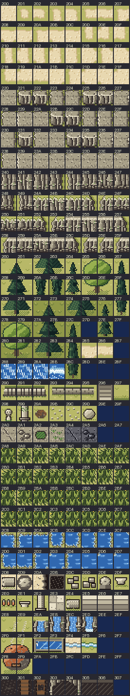
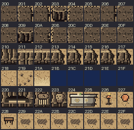
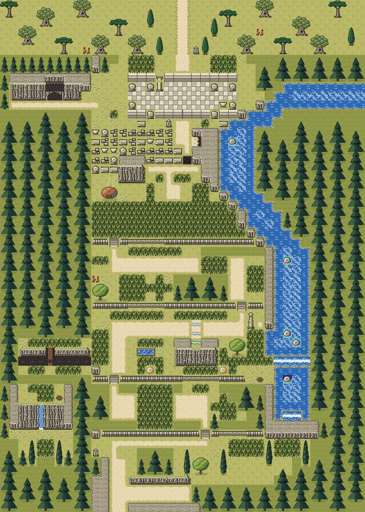
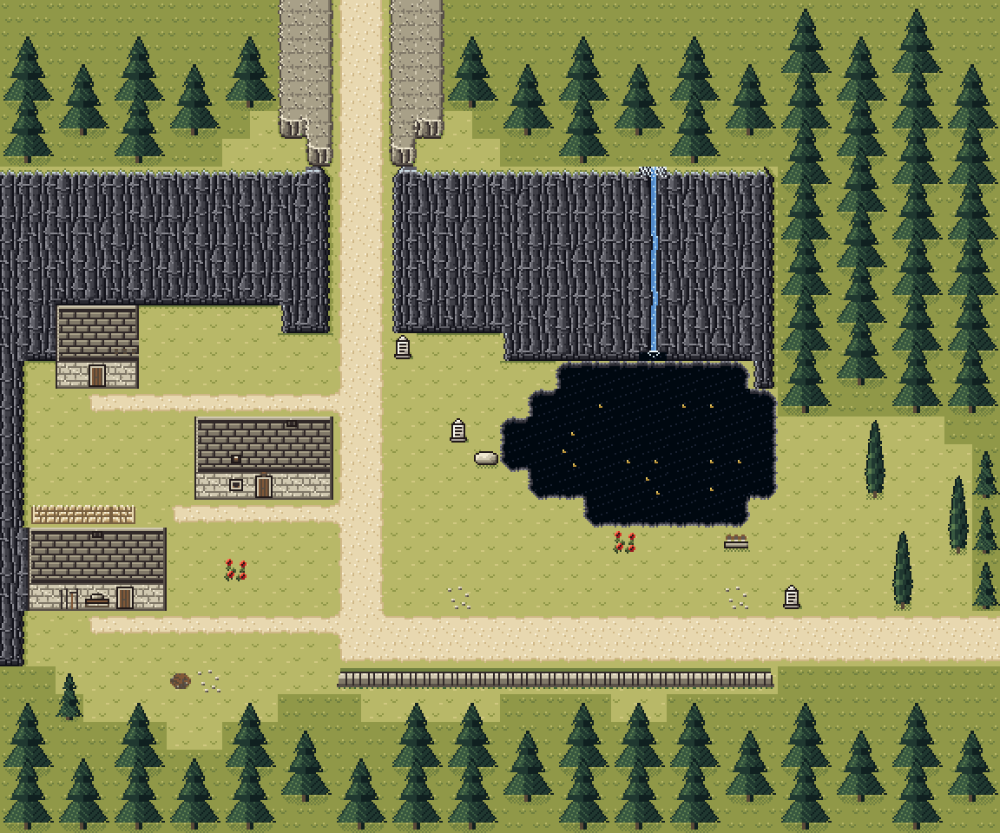
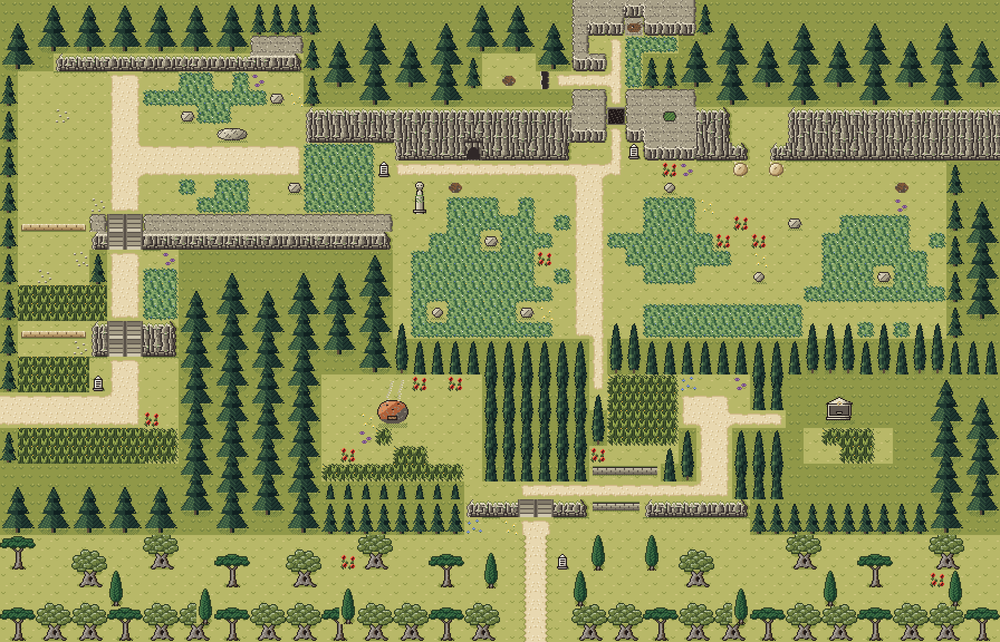
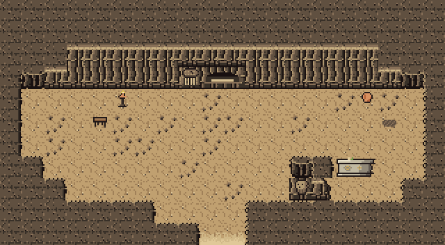

# The Arkadian climb's tilesets

Aigion to Arkadia: the Krathis gorge, its white water and its fallen temple of
Artemis; the Styx's black cliff and still black pool, and Nonakris's slab-roofed
houses; Kyllene's wind-combed meadow, its tortoise boulders, the hawk's cliff, and
the first cypresses. Four secondaries on the `aethos` primary:

| Tileset | Maps |
|---|---|
| `gTileset_ArkadiaHeights` | Route 11 (the Krathis Gorge) |
| `gTileset_StyxFalls` | Styx Falls and Nonakris |
| `gTileset_Kyllene` | Route 12 (the Cypress Road) |
| `gTileset_MaiaCave` | the Cave of Maia |

**This catalog is generated** by `tools/ichor/art/heights_build.py` (painters:
`heights_ground.py`, `_trees.py`, `_props.py`, `_cave.py`; palettes in `heights_lib.py`,
which reuses kithairon_lib's soft-shape engine and Kithairon's fir painters). The
render-and-critique passes at the end are written by hand and kept across rebuilds.

## How it fits together

**A shared core, three outdoor sets.** Everything the climb wanted didn't fit one
secondary's 504 tiles, so the outdoor art is split three ways: a **core** (the road,
limestone and its faces, the firs, oaks and cypresses, the terrace rims, the herms and
marks) and each map's own pieces. The core is painted once and packed first, at the same
metatile ids, in all three sets; after Porytiles compiles each set, `align_core` renumbers
its tiles so the core's come first in the same order, and the build asserts the core's
metatiles, tiles and palettes (6-12) match in all three. That matters at a seam: crossing
from one map to the next swaps the secondary tiles in VRAM without redrawing the screen,
so whatever was already on screen must find the same pixels in the next set. The map
builder keeps the strips at the climb's own seams (Route 11/Styx Falls, six rows each
side; Styx Falls/Route 12, eight columns each side) to core and aethos pieces. Route 11's
seam with Aigion (the `kirrha` set) and Route 12's with Arkadia (`arkadia`) are drawn in
aethos pieces only: `tools/ichor/maps/heights.py` keeps the six rows at each of those
seams to aethos metatiles and fails the build otherwise. Always rebuild all four sets
together (`--only` repacks the others for the labels but leaves this doc alone).

**Place pieces by key and cell name** from `build/heights/<dir>/catalog.json`, never by
raw id (`tools/ichor/maps/heights.py` does). Ids below are the current build's.

**Soft ground.** `tall`, `meadow_tall`, `path`, `rock`, `black`, `water`, `blackpool`,
`gravel` and the cave's `cwall` hold one piece per blob shape key: `1|` then the cell's
neighbors N NE E SE S SW W NW, `1` in the region and `0` not, a diagonal counting only
when both its sides are in. The map builder lists the keys its maps use in
`tools/ichor/art/heights_shapes.json` (`heights.py --shapes`), and only those are drawn.

**Cliffs with height.** Batch 1's crags showed a 14 px face on a one-row rise, and
Mt. Kithairon read flat. Here a cliff is two things: `rock` (or grass, or firs) on top,
and a band of `face` cells below it, one to four rows tall. A face cell's shape key is
`<lip><foot><west><east><variant>`: lip `g` (grass above), `r` (rock above) or `-` (more
face above), `f` on the band's bottom row (the dark foot and its fallen blocks), `w`/`e`
where a side is open to the ground, and one of three facet variants so a long band doesn't
repeat. A rock top with nothing of the rock south of it still shows its own short face, so
low crags work as before. `black`/`bface` are the same for the Styx's black rock.

**Climbing south.** Route 11 climbs south from Aigion, so its terraces' edges face north,
away from the camera. They are drawn as rims seen from above (`terraces`: a crevice,
then a lip of stones), and the ledges on them jump north (MB_JUMP_NORTH), so the way back
to Aigion is a quick hop. The faces the camera does see are on the side ravines, the
buttresses and the black cliff.

**Walk codes** in the grids: `X` blocks, `.` walkable, `T` walkable and drawn over the
player, `G` tall grass, `J` a ledge, `D` a door (MB_NON_ANIMATED_DOOR: put the warp there).

**Borrowed ground.** Cells marked *grass*, *path*, *sea*, *tall*, *shade* or *fall* draw
no ground of their own: the build points their bottom tiles at aethos's grass (`0x001`),
road (`0x1D9`), animated sea (`0x170`), tall grass (`0x00D`), deep shade (`0x01C`) or
animated waterfall (`0x0B3`). The white water's foam rides over the moving sea, and the
Styx's thread is aethos's waterfall seen through a slit in the black cliff. Rebuild these
sets whenever aethos is repainted.

**Palettes.** Seven groups, one per secondary palette; every 8x8 tile draws from one.

| Group | Use |
|---|---|
| field | tall barley grass, the road (agros's painters) |
| meadow | Kyllene's combed grass and its flowers |
| rock | the gorge's limestone, faces, rims, ledges, ravines, Nonakris's houses, boulders, the herm, the nest |
| black | the Styx's black rock and cliff, the black pool and its obols, the white thread |
| tree | firs, kermes oak, cypresses (Kithairon's group, so its painters work here) |
| water | white water, the pool's gravel bank, runnels, the spring, the side waterfall's foot |
| stone | the fallen temple's marble and drums, the kiln and its smoke, the shrine of Artemis |

The Cave of Maia has its own three: `cave` (warm brown rock, sand), `relic` (the lyre, the
cloth, the lamp), `altar` (marble and bronze).

**Drum buttons.** A drum pushed with the Girdle runs the coord event on the tile it
lands on when that tile is MB_STRENGTH_BUTTON (`HandleBoulderActivateVictoryRoadSwitch`);
the event's var condition (`VAR_TEMP_9` 99) never holds on foot, so only a drum sets it
off. The `ruins` piece's `lip` and `gap` (and the hawk spur's `gap`) are buttons, and the
`buttons` piece holds road shapes that are buttons too: `Map.button(x, y)` puts the road's
own shape there as a button.

**Scripted swaps** (`include/constants/metatile_labels.h`): `METATILE_ArkadiaHeights_DrumWedged`
(drum 2 in the gap), `_DrumRest` (drum 3 against the cliff, and the shepherd's cave drum),
`_Gap`, `_Lip` (shut once drum 1 has gone over), `METATILE_Kyllene_DrumWedged` (the hawk
spur's drum), and the shrine's `_Shrine_Top`, `_Shrine_TopR`, `_ShrineBad_Top`,
`_ShrineBad_TopR`.

## Budget

| Tileset | Tiles | Metatiles |
|---|---|---|
| `gTileset_ArkadiaHeights` | 393 of 504 | 264 of 512 |
| `gTileset_StyxFalls` | 337 of 504 | 232 of 512 |
| `gTileset_Kyllene` | 335 of 504 | 256 of 512 |
| `gTileset_MaiaCave` | 88 of 504 | 48 of 512 |

## `gTileset_ArkadiaHeights`: Route 11, the Krathis gorge



### Core: shared by all three outdoor sets at the same ids

#### The road with soft edges

`path`, 8 wide by 4 tall. The limestone road, scalloped where it meets the grass (agros's painter). Names are blob shape keys.

32 shapes, from 0x200.

#### The gorge's limestone, from above

`rock`, 8 wide by 4 tall. Arkadian limestone seen from above: plateaus, buttresses, the gorge's far wall. Where nothing of the rock lies south of a cell it shows a short face of its own; where a `face` band continues below, the top runs flush. Impassable. Names are blob shape keys.

27 shapes, from 0x220.

#### Cliff faces, any height

`face`, 8 wide by 4 tall. The gorge's tall cliff faces, seen from the south. One piece per shape key `<lip><foot><west><east>`: lip `g` (grass above), `r` (rock above) or `-` (face above); `f` the bottom row (the dark foot and fallen blocks); `w`/`e` an open side where ground shows. Stack rows for a cliff 1-4 cells tall. Impassable.

30 shapes, from 0x240.

#### Black fir (2 x 3 with its spire)

`fir`, 2 wide by 3 tall. A black fir. The top row is its spire over the grass of the row above: walkable, drawn over the player. Rows 1-2 block.

```text
0x260 0x261   T T
0x268 0x269   X X
0x270 0x271   X X
```

Borrowed ground: grass at 0,0, 0,1, 0,2, 1,0, 1,1, 1,2.

#### A fir's base with the next fir's spire over it

`fir_stack`, 2 wide by 1 tall. Between two firs in a column: the upper fir's base row, the lower fir's spire over it. Blocks.

```text
0x262 0x263   X X
```

Borrowed ground: grass at 0,0, 1,0.

#### Young fir (1 x 2)

`fir_young`, 1 wide by 2 tall. A sapling fir for gaps at the woods' edge. Its top half is drawn over the player.

```text
0x264   T
0x26C   X
```

Borrowed ground: grass at 0,0, 0,1.

#### Scrub oak (2 x 2)

`oak`, 2 wide by 2 tall. A low, wide kermes oak of the mountain's lower slopes.

```text
0x265 0x266   X X
0x26D 0x26E   X X
```

Borrowed ground: grass at 0,0, 0,1, 1,0, 1,1.

#### Cypress (1 x 3 with its spire)

`cypress`, 1 wide by 3 tall. A tall Arkadian cypress. The top row is its spire over the grass of the row above: walkable, drawn over the player.

```text
0x267   T
0x26F   X
0x277   X
```

Borrowed ground: grass at 0,0, 0,1, 0,2.

#### A cypress's foot with the next one's spire over it

`cypress_stack`, 1 wide by 1 tall. Between two cypresses in a column: the upper one's foot, the lower one's spire over it. Blocks.

```text
0x26A   X
```

Borrowed ground: grass at 0,0.

#### Black fir (2 x 3 with its spire), in the woods' shade

`fir_shade`, 2 wide by 3 tall. The same as `fir`, on aethos's deep-shade grass, for inside a wood. The spire row stays on plain grass: use `fir`'s top row there.

```text
0x272 0x273   T T
0x27A 0x27B   X X
0x282 0x283   X X
```

Borrowed ground: shade at 0,0, 0,1, 0,2, 1,0, 1,1, 1,2.

#### A fir's base with the next fir's spire over it, in the woods' shade

`fir_stack_shade`, 2 wide by 1 tall. The same as `fir_stack`, on aethos's deep-shade grass, for inside a wood. The spire row stays on plain grass: use `fir_stack`'s top row there.

```text
0x274 0x275   X X
```

Borrowed ground: shade at 0,0, 1,0.

#### Young fir (1 x 2), in the woods' shade

`fir_young_shade`, 1 wide by 2 tall. The same as `fir_young`, on aethos's deep-shade grass, for inside a wood. The spire row stays on plain grass: use `fir_young`'s top row there.

```text
0x276   T
0x27E   X
```

Borrowed ground: shade at 0,0, 0,1.

#### Scrub oak (2 x 2), in the woods' shade

`oak_shade`, 2 wide by 2 tall. The same as `oak`, on aethos's deep-shade grass, for inside a wood. The spire row stays on plain grass: use `oak`'s top row there.

```text
0x278 0x279   X X
0x280 0x281   X X
```

Borrowed ground: shade at 0,0, 0,1, 1,0, 1,1.

#### Cypress (1 x 3 with its spire), in the woods' shade

`cypress_shade`, 1 wide by 3 tall. The same as `cypress`, on aethos's deep-shade grass, for inside a wood. The spire row stays on plain grass: use `cypress`'s top row there.

```text
0x27C   T
0x284   X
0x28C   X
```

Borrowed ground: shade at 0,0, 0,1, 0,2.

#### A cypress's foot with the next one's spire over it, in the woods' shade

`cypress_stack_shade`, 1 wide by 1 tall. The same as `cypress_stack`, on aethos's deep-shade grass, for inside a wood. The spire row stays on plain grass: use `cypress_stack`'s top row there.

```text
0x26B   X
```

Borrowed ground: shade at 0,0.

#### Terrace rims and north ledges

`terraces`, 8 wide by 1 tall. Where a terrace stands higher to the south, its north edge: `rim_L`, `rim`, `rim_R` a rough rocky lip (blocks); `nl_L`, `nl`, `nl_R` a dry-stone ledge the player hops north off (MB_JUMP_NORTH), so the way back toward Aigion is quick. `stair` rock-cut steps up through a rim. `under` the grass in the rim's shadow, for the row north of it.

```text
0x290 0x291 0x292 0x293 0x294 0x295 0x296 0x297   X X X J J J . .
```

Pieces: `rim_L` 0x290, `rim` 0x291, `rim_R` 0x292, `nl_L` 0x293, `nl` 0x294, `nl_R` 0x295, `stair` 0x296, `under` 0x297.

Borrowed ground: grass at 0,0, 1,0, 2,0, 3,0, 4,0, 5,0, 7,0.

#### Herms, turned earth, scree, a boulder

`marks`, 6 wide by 1 tall. On borrowed grass. `herm_top` over `herm`: a great herm, Hermes's bearded head on a square pillar, hung with a garland. `dig` turned earth (walkable). `scree`/`scree_b` loose stones (walkable). `boulder` a grey rock.

```text
0x298 0x299 0x29A 0x29B 0x29C 0x29D   T X . . . X
```

Pieces: `herm_top` 0x298, `herm` 0x299, `dig` 0x29A, `scree` 0x29B, `scree_b` 0x29C, `boulder` 0x29D.

Borrowed ground: grass at 0,0, 1,0, 2,0, 3,0, 4,0, 5,0.

#### Rock detail: cracks, boulders, juniper, fern

`rock_detail`, 6 wide by 1 tall. Interior cells (blob key `1|11111111`) to scatter through a big rock top. `bcrack`, `bboulders` are the Styx's black rock.

```text
0x2A0 0x2A1 0x2A2 0x2A3 0x2A4 0x2A5   X X X X X X
```

Pieces: `crack` 0x2A0, `boulders` 0x2A1, `juniper` 0x2A2, `fern` 0x2A3, `bcrack` 0x2A4, `bboulders` 0x2A5.

### The Krathis gorge: white water, the fallen temple, the kiln, the ravine, the side waterfall, the spring

#### Tall grass with soft edges

`tall`, 8 wide by 4 tall. Barley tall grass on aethos grass, cut from one field so any outline works (agros's painter, as on Route 1). MB_TALL_GRASS. Names are blob shape keys (`1|NNEESESSWWNW`).

29 shapes, from 0x2A8.

#### A still pool with a gravel bank

`water`, 8 wide by 2 tall. Aethos's animated water under a bank of river gravel: the pool below the rapid on Route 11's spur. MB_POND_WATER: fish it. Names are blob shape keys.

15 shapes, from 0x2C8.

#### White water

`rapids`, 4 wide by 1 tall. Foam over aethos's animated water: `a`, `b` and `c` mix through the Krathis's channel, `lip` is a rapid's drop (a white curl across the stream). Not surfable: lay them at the walking elevation, blocked.

```text
0x288 0x289 0x28A 0x28B   X X X X
```

Pieces: `a` 0x288, `b` 0x289, `c` 0x28A, `lip` 0x28B.

Borrowed ground: sea at 0,0, 1,0, 2,0, 3,0.

#### The fallen temple of Artemis on the gorge shelf

`ruins`, 8 wide by 2 tall. The shelf's fallen Doric temple. `drum_rest` a drum at rest against the cliff, `drum_wedged` a drum flush in the road's gap (walkable), `lip` the shelf's crumbling edge (walkable: put drum 1's button there), `gap` the broken edge (walkable only at elevation 1: drum 2's button), `rubble`, `rubble_b` tumbled blocks, `stump` a column's stump, `capital` a fallen capital, `drum_lie` a drum fallen in the grass. `column_top` over `column`: the one column still standing. `slabs` the stylobate's paving, `steps_W`/`_E` its worn steps. `jars` the muleteer's empty jars, `hoofcups` the hoof-cups at Styx Falls.

```text
0x2D8 0x2D9 0x2DA 0x2DB 0x2DC 0x2DD 0x2DE 0x2DF   X . . . X X X X
0x2E0 0x2E1 0x2E2 0x2E3 0x2E4 0x2E5 0x2E6 0x2E7   X T X . X . . .
```

Pieces: `drum_rest` 0x2D8, `drum_wedged` 0x2D9, `lip` 0x2DA, `gap` 0x2DB, `rubble` 0x2DC, `rubble_b` 0x2DD, `stump` 0x2DE, `capital` 0x2DF, `jars` 0x2E0, `column_top` 0x2E1, `column` 0x2E2, `slabs` 0x2E3, `drum_lie` 0x2E4, `steps_W` 0x2E5, `steps_E` 0x2E6.

Borrowed ground: grass at 0,1, 1,1, 2,1, 4,0, 4,1, 5,0, 6,0, 7,0; path at 0,0, 1,0, 2,0, 3,1, 5,1, 6,1, 7,1.

#### Drum buttons on the road

`buttons`, 2 wide by 1 tall. Road cells that look like `path`'s shapes of the same names but are MB_STRENGTH_BUTTON: a drum pushed onto one runs the coord event there. The map builder puts them where a map asks for a button (Map.button).

```text
0x285 0x286   . .
```

Pieces: `1|00101010` 0x285, `1|00100010` 0x286.

#### A charcoal kiln, smoking

`kiln`, 2 wide by 3 tall. A charcoaler's earth-covered kiln mound, smoke leaking from its vents. The top row is the smoke, drawn over the player.

```text
0x2E8 0x2E9   T T
0x2F0 0x2F1   X X
0x2F8 0x2F9   X X
```

Pieces: `smoke_L` 0x2E8, `smoke_R` 0x2E9.

Borrowed ground: grass at 0,0, 0,1, 0,2, 1,0, 1,1, 1,2.

#### Ravines, the plank bridge, the cliff split, the shepherd's cave

`chasm`, 7 wide by 1 tall. `void` a ravine's dark floor, far below (blocks). `plank_face` and `plank` the plank bridge over a ravine's lit face and its dark floor (walkable); `plank_gap` its broken planks (MB_ICHOR_GAP: the Winged Talaria leap it). `split` a split in the cliff path (MB_ICHOR_GAP). The shepherd's cave: `mouth_L`/`_R` its arch, drawn over the player, `in_L`/`_R` the floor under the back wall, `in_dark` the floor deeper in.

```text
0x300 0x301 0x302 0x303 0x304 0x305 0x306   X . X T T . .
```

Pieces: `void` 0x300, `plank` 0x301, `plank_gap` 0x302, `mouth_L` 0x303, `mouth_R` 0x304, `in_L` 0x305, `in_R` 0x306.

#### The side waterfall

`falls`, 4 wide by 1 tall. Cliff faces with a slit where aethos's animated waterfall shows through: `fall_top`, `fall`, `fall_ledge` (a ledge halfway up, something glinting on it), `fall_foot`. MB_WATERFALL (the Horn of Achelous, Act III).

```text
0x2EA 0x2EB 0x2EC 0x2ED   X X X X
```

Pieces: `fall_top` 0x2EA, `fall` 0x2EB, `fall_ledge` 0x2EC, `fall_foot` 0x2ED.

Borrowed ground: fall at 0,0, 1,0, 2,0, 3,0.

#### Pelasgos's spring, snowmelt runnels

`spring`, 4 wide by 1 tall. `spring_W` + `_E`: Pelasgos's spring, a stone trough fed by a spout, on aethos's animated water (blocks). `runnel` snowmelt across the road, `runnel_g` across grass (walkable).

```text
0x2F2 0x2F3 0x2F4 0x2F5   X X . .
```

Pieces: `spring_W` 0x2F2, `spring_E` 0x2F3, `runnel` 0x2F4, `runnel_g` 0x2F5.

Borrowed ground: grass at 3,0; path at 2,0; sea at 0,0, 1,0.

## `gTileset_StyxFalls`: Styx Falls and Nonakris


### Core: shared by all three outdoor sets at the same ids

#### The road with soft edges

`path`, 8 wide by 4 tall. The limestone road, scalloped where it meets the grass (agros's painter). Names are blob shape keys.

32 shapes, from 0x200.

#### The gorge's limestone, from above

`rock`, 8 wide by 4 tall. Arkadian limestone seen from above: plateaus, buttresses, the gorge's far wall. Where nothing of the rock lies south of a cell it shows a short face of its own; where a `face` band continues below, the top runs flush. Impassable. Names are blob shape keys.

27 shapes, from 0x220.

#### Cliff faces, any height

`face`, 8 wide by 4 tall. The gorge's tall cliff faces, seen from the south. One piece per shape key `<lip><foot><west><east>`: lip `g` (grass above), `r` (rock above) or `-` (face above); `f` the bottom row (the dark foot and fallen blocks); `w`/`e` an open side where ground shows. Stack rows for a cliff 1-4 cells tall. Impassable.

30 shapes, from 0x240.

#### Black fir (2 x 3 with its spire)

`fir`, 2 wide by 3 tall. A black fir. The top row is its spire over the grass of the row above: walkable, drawn over the player. Rows 1-2 block.

```text
0x260 0x261   T T
0x268 0x269   X X
0x270 0x271   X X
```

Borrowed ground: grass at 0,0, 0,1, 0,2, 1,0, 1,1, 1,2.

#### A fir's base with the next fir's spire over it

`fir_stack`, 2 wide by 1 tall. Between two firs in a column: the upper fir's base row, the lower fir's spire over it. Blocks.

```text
0x262 0x263   X X
```

Borrowed ground: grass at 0,0, 1,0.

#### Young fir (1 x 2)

`fir_young`, 1 wide by 2 tall. A sapling fir for gaps at the woods' edge. Its top half is drawn over the player.

```text
0x264   T
0x26C   X
```

Borrowed ground: grass at 0,0, 0,1.

#### Scrub oak (2 x 2)

`oak`, 2 wide by 2 tall. A low, wide kermes oak of the mountain's lower slopes.

```text
0x265 0x266   X X
0x26D 0x26E   X X
```

Borrowed ground: grass at 0,0, 0,1, 1,0, 1,1.

#### Cypress (1 x 3 with its spire)

`cypress`, 1 wide by 3 tall. A tall Arkadian cypress. The top row is its spire over the grass of the row above: walkable, drawn over the player.

```text
0x267   T
0x26F   X
0x277   X
```

Borrowed ground: grass at 0,0, 0,1, 0,2.

#### A cypress's foot with the next one's spire over it

`cypress_stack`, 1 wide by 1 tall. Between two cypresses in a column: the upper one's foot, the lower one's spire over it. Blocks.

```text
0x26A   X
```

Borrowed ground: grass at 0,0.

#### Black fir (2 x 3 with its spire), in the woods' shade

`fir_shade`, 2 wide by 3 tall. The same as `fir`, on aethos's deep-shade grass, for inside a wood. The spire row stays on plain grass: use `fir`'s top row there.

```text
0x272 0x273   T T
0x27A 0x27B   X X
0x282 0x283   X X
```

Borrowed ground: shade at 0,0, 0,1, 0,2, 1,0, 1,1, 1,2.

#### A fir's base with the next fir's spire over it, in the woods' shade

`fir_stack_shade`, 2 wide by 1 tall. The same as `fir_stack`, on aethos's deep-shade grass, for inside a wood. The spire row stays on plain grass: use `fir_stack`'s top row there.

```text
0x274 0x275   X X
```

Borrowed ground: shade at 0,0, 1,0.

#### Young fir (1 x 2), in the woods' shade

`fir_young_shade`, 1 wide by 2 tall. The same as `fir_young`, on aethos's deep-shade grass, for inside a wood. The spire row stays on plain grass: use `fir_young`'s top row there.

```text
0x276   T
0x27E   X
```

Borrowed ground: shade at 0,0, 0,1.

#### Scrub oak (2 x 2), in the woods' shade

`oak_shade`, 2 wide by 2 tall. The same as `oak`, on aethos's deep-shade grass, for inside a wood. The spire row stays on plain grass: use `oak`'s top row there.

```text
0x278 0x279   X X
0x280 0x281   X X
```

Borrowed ground: shade at 0,0, 0,1, 1,0, 1,1.

#### Cypress (1 x 3 with its spire), in the woods' shade

`cypress_shade`, 1 wide by 3 tall. The same as `cypress`, on aethos's deep-shade grass, for inside a wood. The spire row stays on plain grass: use `cypress`'s top row there.

```text
0x27C   T
0x284   X
0x28C   X
```

Borrowed ground: shade at 0,0, 0,1, 0,2.

#### A cypress's foot with the next one's spire over it, in the woods' shade

`cypress_stack_shade`, 1 wide by 1 tall. The same as `cypress_stack`, on aethos's deep-shade grass, for inside a wood. The spire row stays on plain grass: use `cypress_stack`'s top row there.

```text
0x26B   X
```

Borrowed ground: shade at 0,0.

#### Terrace rims and north ledges

`terraces`, 8 wide by 1 tall. Where a terrace stands higher to the south, its north edge: `rim_L`, `rim`, `rim_R` a rough rocky lip (blocks); `nl_L`, `nl`, `nl_R` a dry-stone ledge the player hops north off (MB_JUMP_NORTH), so the way back toward Aigion is quick. `stair` rock-cut steps up through a rim. `under` the grass in the rim's shadow, for the row north of it.

```text
0x290 0x291 0x292 0x293 0x294 0x295 0x296 0x297   X X X J J J . .
```

Pieces: `rim_L` 0x290, `rim` 0x291, `rim_R` 0x292, `nl_L` 0x293, `nl` 0x294, `nl_R` 0x295, `stair` 0x296, `under` 0x297.

Borrowed ground: grass at 0,0, 1,0, 2,0, 3,0, 4,0, 5,0, 7,0.

#### Herms, turned earth, scree, a boulder

`marks`, 6 wide by 1 tall. On borrowed grass. `herm_top` over `herm`: a great herm, Hermes's bearded head on a square pillar, hung with a garland. `dig` turned earth (walkable). `scree`/`scree_b` loose stones (walkable). `boulder` a grey rock.

```text
0x298 0x299 0x29A 0x29B 0x29C 0x29D   T X . . . X
```

Pieces: `herm_top` 0x298, `herm` 0x299, `dig` 0x29A, `scree` 0x29B, `scree_b` 0x29C, `boulder` 0x29D.

Borrowed ground: grass at 0,0, 1,0, 2,0, 3,0, 4,0, 5,0.

#### Rock detail: cracks, boulders, juniper, fern

`rock_detail`, 6 wide by 1 tall. Interior cells (blob key `1|11111111`) to scatter through a big rock top. `bcrack`, `bboulders` are the Styx's black rock.

```text
0x2A0 0x2A1 0x2A2 0x2A3 0x2A4 0x2A5   X X X X X X
```

Pieces: `crack` 0x2A0, `boulders` 0x2A1, `juniper` 0x2A2, `fern` 0x2A3, `bcrack` 0x2A4, `bboulders` 0x2A5.

### Styx Falls: the black cliff, the black pool, the thread, Nonakris

#### The black cliff's faces

`bface`, 8 wide by 3 tall. The cirque's black cliff, wet and bare, with a pale sheen on its ledges. Shape keys as `face`. Impassable.

17 shapes, from 0x2A8.

#### The Styx's still black water

`blackpool`, 8 wide by 2 tall. Still black water, its own palette, no ripple animation: obols glint on the bottom. MB_POND_WATER, so a rod casts and gets "Not even a nibble" (Styx Falls has no fishing table). Names are blob shape keys.

12 shapes, from 0x2C0.

#### The Styx's black water, deep

`blackpool_deep`, 2 wide by 1 tall. Interior cells to mix through the black pool: `deep` bare black water, `glint` two obols on the bottom. MB_POND_WATER.

```text
0x285 0x286   X X
```

Pieces: `deep` 0x285, `glint` 0x286.

#### The Styx

`thread`, 4 wide by 1 tall. The Styx: one long thread of white water down the black cliff, aethos's animated waterfall seen through a slit. `thread_top` in mist, `thread`, `thread_b`, `thread_foot` meeting the black pool.

```text
0x288 0x289 0x28A 0x28B   X X X X
```

Pieces: `thread_top` 0x288, `thread` 0x289, `thread_b` 0x28A, `thread_foot` 0x28B.

Borrowed ground: fall at 0,0, 1,0, 2,0, 3,0.

#### Nonakris: low stone houses with slab roofs

`houses`, 8 wide by 3 tall. A roof is R0 (the ridge) over R1 (the eave), L, M repeated, R; under it a wall row W_L, W_M..., W_R, with any W cell swapped for `door` (a plank door), `door_hoof` (the inn's, a horse's hoof nailed over it), `window`, `lean_to` (Kepheus's lean-to of crowbars), `sledge` (his stone-sledge on runners). Doors are MB_NON_ANIMATED_DOOR: put the warps there. `chimney` an R0 cell with a smoke hole, `cups` an R1 cell with hoof-cups on the sill (Horkia's), `lamp` an R1 cell with the never-dark lamp in a niche.

```text
0x2D0 0x2D1 0x2D2 0x2D3 0x2D4 0x2D5 0x2D6 0x2D7   X X X X X X X X
0x2D8 0x2D9 0x2DA 0x2DB 0x2DC 0x2DD 0x2DE 0x2DF   X D D X X X X X
0x2E0 0x2E1 0x2E2 0x2E3 0x2E4 0x2E5 0x2E6 0x2E7   X X X X X X X X
```

Pieces: `R0_L` 0x2D0, `R0_M` 0x2D1, `R0_R` 0x2D2, `R1_L` 0x2D3, `R1_M` 0x2D4, `R1_R` 0x2D5, `W_L` 0x2D6, `W_M` 0x2D7, `W_R` 0x2D8, `door` 0x2D9, `door_hoof` 0x2DA, `window` 0x2DB, `lean_to` 0x2DC, `sledge` 0x2DD, `cups` 0x2DE, `lamp` 0x2DF, `chimney` 0x2E0.

#### The Oath Stone and the hoof-cups

`stones`, 2 wide by 1 tall. `oath` the Oath Stone, a flat-topped boulder worn smooth by hands; `hoofcups` a row of hoof-cups on a flat stone, each tied with a linen scrap. On borrowed grass; both block.

```text
0x28D 0x28E   X X
```

Pieces: `oath` 0x28D, `hoofcups` 0x28E.

Borrowed ground: grass at 0,0, 1,0.

## `gTileset_Kyllene`: Route 12, the cypress road over Kyllene


### Core: shared by all three outdoor sets at the same ids

#### The road with soft edges

`path`, 8 wide by 4 tall. The limestone road, scalloped where it meets the grass (agros's painter). Names are blob shape keys.

32 shapes, from 0x200.

#### The gorge's limestone, from above

`rock`, 8 wide by 4 tall. Arkadian limestone seen from above: plateaus, buttresses, the gorge's far wall. Where nothing of the rock lies south of a cell it shows a short face of its own; where a `face` band continues below, the top runs flush. Impassable. Names are blob shape keys.

27 shapes, from 0x220.

#### Cliff faces, any height

`face`, 8 wide by 4 tall. The gorge's tall cliff faces, seen from the south. One piece per shape key `<lip><foot><west><east>`: lip `g` (grass above), `r` (rock above) or `-` (face above); `f` the bottom row (the dark foot and fallen blocks); `w`/`e` an open side where ground shows. Stack rows for a cliff 1-4 cells tall. Impassable.

30 shapes, from 0x240.

#### Black fir (2 x 3 with its spire)

`fir`, 2 wide by 3 tall. A black fir. The top row is its spire over the grass of the row above: walkable, drawn over the player. Rows 1-2 block.

```text
0x260 0x261   T T
0x268 0x269   X X
0x270 0x271   X X
```

Borrowed ground: grass at 0,0, 0,1, 0,2, 1,0, 1,1, 1,2.

#### A fir's base with the next fir's spire over it

`fir_stack`, 2 wide by 1 tall. Between two firs in a column: the upper fir's base row, the lower fir's spire over it. Blocks.

```text
0x262 0x263   X X
```

Borrowed ground: grass at 0,0, 1,0.

#### Young fir (1 x 2)

`fir_young`, 1 wide by 2 tall. A sapling fir for gaps at the woods' edge. Its top half is drawn over the player.

```text
0x264   T
0x26C   X
```

Borrowed ground: grass at 0,0, 0,1.

#### Scrub oak (2 x 2)

`oak`, 2 wide by 2 tall. A low, wide kermes oak of the mountain's lower slopes.

```text
0x265 0x266   X X
0x26D 0x26E   X X
```

Borrowed ground: grass at 0,0, 0,1, 1,0, 1,1.

#### Cypress (1 x 3 with its spire)

`cypress`, 1 wide by 3 tall. A tall Arkadian cypress. The top row is its spire over the grass of the row above: walkable, drawn over the player.

```text
0x267   T
0x26F   X
0x277   X
```

Borrowed ground: grass at 0,0, 0,1, 0,2.

#### A cypress's foot with the next one's spire over it

`cypress_stack`, 1 wide by 1 tall. Between two cypresses in a column: the upper one's foot, the lower one's spire over it. Blocks.

```text
0x26A   X
```

Borrowed ground: grass at 0,0.

#### Black fir (2 x 3 with its spire), in the woods' shade

`fir_shade`, 2 wide by 3 tall. The same as `fir`, on aethos's deep-shade grass, for inside a wood. The spire row stays on plain grass: use `fir`'s top row there.

```text
0x272 0x273   T T
0x27A 0x27B   X X
0x282 0x283   X X
```

Borrowed ground: shade at 0,0, 0,1, 0,2, 1,0, 1,1, 1,2.

#### A fir's base with the next fir's spire over it, in the woods' shade

`fir_stack_shade`, 2 wide by 1 tall. The same as `fir_stack`, on aethos's deep-shade grass, for inside a wood. The spire row stays on plain grass: use `fir_stack`'s top row there.

```text
0x274 0x275   X X
```

Borrowed ground: shade at 0,0, 1,0.

#### Young fir (1 x 2), in the woods' shade

`fir_young_shade`, 1 wide by 2 tall. The same as `fir_young`, on aethos's deep-shade grass, for inside a wood. The spire row stays on plain grass: use `fir_young`'s top row there.

```text
0x276   T
0x27E   X
```

Borrowed ground: shade at 0,0, 0,1.

#### Scrub oak (2 x 2), in the woods' shade

`oak_shade`, 2 wide by 2 tall. The same as `oak`, on aethos's deep-shade grass, for inside a wood. The spire row stays on plain grass: use `oak`'s top row there.

```text
0x278 0x279   X X
0x280 0x281   X X
```

Borrowed ground: shade at 0,0, 0,1, 1,0, 1,1.

#### Cypress (1 x 3 with its spire), in the woods' shade

`cypress_shade`, 1 wide by 3 tall. The same as `cypress`, on aethos's deep-shade grass, for inside a wood. The spire row stays on plain grass: use `cypress`'s top row there.

```text
0x27C   T
0x284   X
0x28C   X
```

Borrowed ground: shade at 0,0, 0,1, 0,2.

#### A cypress's foot with the next one's spire over it, in the woods' shade

`cypress_stack_shade`, 1 wide by 1 tall. The same as `cypress_stack`, on aethos's deep-shade grass, for inside a wood. The spire row stays on plain grass: use `cypress_stack`'s top row there.

```text
0x26B   X
```

Borrowed ground: shade at 0,0.

#### Terrace rims and north ledges

`terraces`, 8 wide by 1 tall. Where a terrace stands higher to the south, its north edge: `rim_L`, `rim`, `rim_R` a rough rocky lip (blocks); `nl_L`, `nl`, `nl_R` a dry-stone ledge the player hops north off (MB_JUMP_NORTH), so the way back toward Aigion is quick. `stair` rock-cut steps up through a rim. `under` the grass in the rim's shadow, for the row north of it.

```text
0x290 0x291 0x292 0x293 0x294 0x295 0x296 0x297   X X X J J J . .
```

Pieces: `rim_L` 0x290, `rim` 0x291, `rim_R` 0x292, `nl_L` 0x293, `nl` 0x294, `nl_R` 0x295, `stair` 0x296, `under` 0x297.

Borrowed ground: grass at 0,0, 1,0, 2,0, 3,0, 4,0, 5,0, 7,0.

#### Herms, turned earth, scree, a boulder

`marks`, 6 wide by 1 tall. On borrowed grass. `herm_top` over `herm`: a great herm, Hermes's bearded head on a square pillar, hung with a garland. `dig` turned earth (walkable). `scree`/`scree_b` loose stones (walkable). `boulder` a grey rock.

```text
0x298 0x299 0x29A 0x29B 0x29C 0x29D   T X . . . X
```

Pieces: `herm_top` 0x298, `herm` 0x299, `dig` 0x29A, `scree` 0x29B, `scree_b` 0x29C, `boulder` 0x29D.

Borrowed ground: grass at 0,0, 1,0, 2,0, 3,0, 4,0, 5,0.

#### Rock detail: cracks, boulders, juniper, fern

`rock_detail`, 6 wide by 1 tall. Interior cells (blob key `1|11111111`) to scatter through a big rock top. `bcrack`, `bboulders` are the Styx's black rock.

```text
0x2A0 0x2A1 0x2A2 0x2A3 0x2A4 0x2A5   X X X X X X
```

Pieces: `crack` 0x2A0, `boulders` 0x2A1, `juniper` 0x2A2, `fern` 0x2A3, `bcrack` 0x2A4, `bboulders` 0x2A5.

### Kyllene: the combed meadow, tortoise boulders, the shrine of Artemis, the hawk's cliff

#### Kyllene's wind-combed grass

`meadow_tall`, 8 wide by 4 tall. Mount Kyllene's high meadow grass, combed east by the wind, with gentians and crocus in it: the climb's own tall grass. MB_TALL_GRASS. Names are blob shape keys.

31 shapes, from 0x2A8.

#### Tall grass with soft edges

`tall`, 8 wide by 4 tall. Barley tall grass on aethos grass, cut from one field so any outline works (agros's painter, as on Route 1). MB_TALL_GRASS. Names are blob shape keys (`1|NNEESESSWWNW`).

29 shapes, from 0x2C8.

#### Kyllene's flowers

`decor`, 4 wide by 1 tall. Walkable, for the open meadow: `gentian` blue gentians, `crocus` yellow crocus, `thyme` a cushion of wild thyme, `tuft` a combed tussock.

```text
0x288 0x289 0x28A 0x28B   . . . .
```

Pieces: `gentian` 0x288, `crocus` 0x289, `thyme` 0x28A, `tuft` 0x28B.

Borrowed ground: grass at 0,0, 1,0, 2,0, 3,0.

#### Kyllene's tortoise boulders, the hawk's nest

`tortoises`, 5 wide by 1 tall. On borrowed grass: `tort`, `tort_b`, `tort_big_L` + `_R`, gray boulders shaped like tortoise shells (some of them are Chelonet). `nest` the hawk's stick nest on its pinnacle (rock all round).

```text
0x2E8 0x2E9 0x2EA 0x2EB 0x2EC   X X X X X
```

Pieces: `tort` 0x2E8, `tort_b` 0x2E9, `tort_big_L` 0x2EA, `tort_big_R` 0x2EB, `nest` 0x2EC.

Borrowed ground: grass at 0,0, 1,0, 2,0, 3,0.

#### The forest shrine of Artemis

`shrine`, 4 wide by 2 tall. `top`, `top_R` over `base`, `base_R`: the little shrine, its gable with a bronze crescent moon. `bad_top`, `bad_top_R`: the gable with a sickle scratched across the moon (desecrated); swap them for `top`, `top_R` when it's cleansed (METATILE_ArkadiaHeights_Shrine_*). On deep-shade grass.

```text
0x2F0 0x2F1 0x2F2 0x2F3   T T T T
0x2F8 0x2F9 0x2FA 0x2FB   X X X X
```

Pieces: `top` 0x2F0, `top_R` 0x2F1, `base` 0x2F8, `base_R` 0x2F9, `bad_top` 0x2F2, `bad_top_R` 0x2F3.

Borrowed ground: shade at 0,0, 0,1, 1,0, 1,1, 2,0, 2,1, 3,0, 3,1.

#### A charcoal kiln, smoking

`kiln`, 2 wide by 3 tall. A charcoaler's earth-covered kiln mound, smoke leaking from its vents. The top row is the smoke, drawn over the player.

```text
0x2ED 0x2EE   T T
0x2F5 0x2F6   X X
0x2FD 0x2FE   X X
```

Pieces: `smoke_L` 0x2ED, `smoke_R` 0x2EE.

Borrowed ground: grass at 0,0, 0,1, 0,2, 1,0, 1,1, 1,2.

#### A split in the cliff path

`split`, 1 wide by 1 tall. A split across the goat path above the Cave of Maia, too wide to step (MB_ICHOR_GAP: the Winged Talaria leap it).

```text
0x27D   X
```

Pieces: `split` 0x27D.

#### The Cave of Maia's mouth

`cave_door`, 1 wide by 1 tall. A face cell (the foot row) with a cave's dark mouth: MB_NON_ANIMATED_DOOR, put the warp there.

```text
0x27F   D
```

Pieces: `door` 0x27F.

#### The hawk spur's drum and its gap

`hawk`, 2 wide by 1 tall. `gap` the break in the hawk spur's goat path (walkable only at elevation 1: the drum's button), `drum_wedged` the boundary drum dropped into it, a step (walkable).

```text
0x285 0x286   . .
```

Pieces: `gap` 0x285, `drum_wedged` 0x286.

Borrowed ground: path at 1,0.

## `gTileset_MaiaCave`: the Cave of Maia



### The Cave of Maia

#### The cave's rock, from above

`cwall`, 8 wide by 2 tall. The cave's warm brown rock seen from above, on the sandy floor. Impassable. Names are blob shape keys.

14 shapes, from 0x200.

#### The cave's back wall

`cface`, 8 wide by 1 tall. The back wall's faces, shape keys as the heights `face`. Impassable.

4 shapes, from 0x210.

#### The cave floor

`cfloor`, 3 wide by 1 tall. `plain` sand, `pebbles` a scatter of stones, `exit` the floor brightening toward daylight: MB_SOUTH_ARROW_WARP, the warp out on the bottom row.

```text
0x218 0x219 0x21A   . . .
```

Pieces: `plain` 0x218, `pebbles` 0x219, `exit` 0x21A.

#### The Cave of Maia: the god's things

`maia`, 8 wide by 2 tall. Back-wall cells (on the wall's foot row): `cradle_L` + `_R` a cradle-shaped niche cut in the rock, a scrap of old swaddling folded in it; `lyre` a tortoise shell strung with gut, hung on the wall, its crack mended with pitch; `herm_face` Hermes's bearded head carved straight out of the rock. On the floor: `altar_L` + `_R` the altar of Hermes, a caduceus cut in its side; `lamp` the priestess's lamp on its stand, never let go out; `jar` a water jar; `stool` her stool; `spring` a seep in the floor (walkable).

```text
0x220 0x221 0x222 0x223 0x224 0x225 0x226 0x227   X X X X X X X X
0x228 0x229 0x22A 0x22B 0x22C 0x22D 0x22E 0x22F   X X X X X X X X
```

Pieces: `cradle_L` 0x220, `cradle_R` 0x221, `lyre` 0x222, `herm_face` 0x223, `altar_L` 0x224, `altar_R` 0x225, `lamp` 0x226, `jar` 0x227, `stool` 0x228, `spring` 0x229.

## Render-and-critique passes

Written by hand and kept across rebuilds. Each map was rendered at 2x by
`tools/ichor/maps/heights.py` (`design/phase3/img/<Map>.png`), looked at, fixed and
rendered again; the last pass of each is in the game itself, through
`tools/ichor/tests/act2_heights.sh` and its screenshots.

### Route 11, the Krathis Gorge



1. **The climb read flat.** Route 11 climbs south, so every terrace edge faced away
   from the camera and drew as nothing: a stack of meadows. The edges became rims seen
   from above (`terraces`: a crevice, then a lip of stones) with north ledges for the
   hop back to Aigion, and the faces the camera can see went where they belong: the
   side ravine with its broken plank bridge, the buttresses either side of the drums,
   the side waterfall's wall, and the river's own cut. Now the gorge reads as a climb.
2. **Pieces that broke their palette or their walk codes.** The drum's gap and lip, the
   side fall's foot and Pelasgos's spring mixed two palette groups in one tile and drew
   with the wrong colors: repainted inside one group each. The fallen temple's slabs
   blocked the player (the ruins' walk codes, now `X...XXXX` / `XXTX.X..`). Azan stood
   in the cleft and plugged the road to Styx Falls (moved to (12,53)); two mules
   stood in the river (moved to the shelf).
3. **The route standard** (MAP_DESIGN §8). Grass was short of 224: optional patches went
   in along the land (either side of the temple's approach, on each terrace and at the
   feet of the rims, round the spur and the gorge's head), 229 cells, with every dead end
   paying out; the woods close every edge but the two seams.
4. **In the game.** The drums didn't trigger: the lip, the gap and the two road buttons
   had no MB_STRENGTH_BUTTON. The ruins' `lip` and `gap` are buttons now, and a new
   `buttons` piece gives the road's own shapes as buttons (`Map.button`) for drum 3's lane
   and the cave drum's ledge. After drum 1 went over, the player could step out onto the
   lip it fell from: the lip is shut (collision) when drum 1 falls and on every reload.
   Drum 3 is optional (the road opens when drums 1 and 2 are moved; the muleteer thanks
   the player then). Azan, coming up to battle, stood in the one-wide cut above the
   cleft and walled the road off until the map reloaded: the cut is two wide now, and the
   builder checks every trainer's walk-up against the map (TRAINER PLUGS THE WAY). Left
   as is: the tumbled-stone slope west of the drums is busy, on purpose (rubble).

### Styx Falls



1. **The falls faced the wrong way.** The first cirque put the Styx on a face the camera
   couldn't see. The black cliff now wraps the north of the hollow with the thread on
   its south face, falling into the black pool at its foot, and the cleft from Route 11
   comes down beside it, so the player walks out under it.
2. **Nonakris was mud.** The slab roofs and rubble walls were dark against the black
   rock: roofs repainted as pale gray slabs (`qr2`/`qr1`/`qr0`) and walls lightened. The
   Oath Stone reads as a worn white boulder by the water; the obols glint in the pool.
3. **In the game.** Beat 39 plays on the way down the cleft: the player is walked to the
   Oath Stone, Alethea speaks and walks to the inn. The pool's edge answers A (the black
   water), and the Conch's refusal when the player has it. Its 51 cells keep no wild
   table on purpose (SCRIPT Part 4: a rod gets "Not even a nibble"), which map_audit
   counts as a shortfall; see the report.

### Route 12, the Cypress Road



1. **Kyllene's meadow** wanted its own grass: the combed `meadow_tall`, with tortoise
   boulders in it (two stood in the core seam columns, moved out), the shrine in its
   glade, the hawk's spur and nest above the cave, and walls of cypress where the meadow
   drops into the forest.
2. **The route standard.** Grass was short of 202: optional patches on the climb out of
   Styx Falls, along the meadow's rim and above the descent, 235 cells; both forced bands
   are four deep and walled, and the west edge is open only where the road comes in.
3. **In the game.** Crossing from Styx Falls drew the terrace stair west of the road as
   garbage: the three outdoor sets share the core's metatile ids, but Porytiles numbered
   the core's tiles differently in each, and a seam crossing swaps the tiles without
   redrawing the screen. `align_core` renumbers every set's tiles so the core's come
   first in one order, and the build asserts the core is tile-for-tile identical. Coming
   up to battle, Telphousa stood on the one-wide track down and walled it off: she sees
   one tile now, the track's foot. The shrine's moon mends the moment it's cleansed
   (an ON_FRAME redraw), not only on the next visit.

### The Cave of Maia



1. **The back wall** carries the god's things in a row: the cradle niche with its cloth,
   the lyre on the wall, Hermes's face in a rock outcrop, the altar of Hermes; the lamp,
   stool and jar by the priestess; daylight brightening the floor toward the way out.
2. **The rock read as more floor.** The rock seen from above was the same warm brown as
   the sand, so the room had no shape: its top now paints a step darker (`TOP_RAMP`) than
   the faces, and the cave reads as a hollow in dark rock.
3. **In the game** the lyre's story plays on the way in (Alethea, then the priestess),
   the priestess plays Hermes's tune for a Chelyra, and the two dead ends each hold a
   pilgrim's leaving (the route standard's two items).
