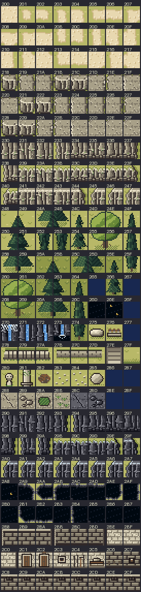
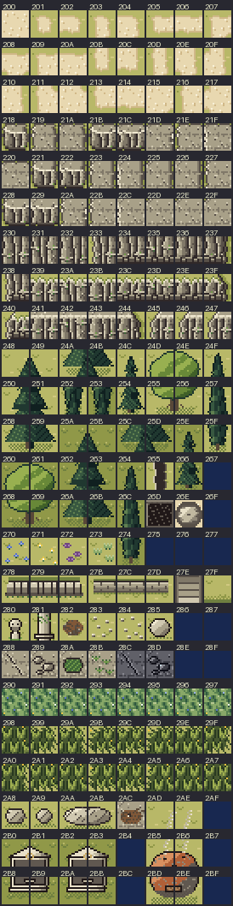

# The Arkadian climb's tilesets

Aigion to Arkadia: the Krathis gorge, its white water and its fallen temple of
Artemis; the Styx's black cliff and still black pool, and Nonakris's slab-roofed
houses; Kyllene's wind-combed meadow, its tortoise boulders, the hawk's cliff, and
the first cypresses. Two secondaries on the `aethos` primary:

| Tileset | Maps |
|---|---|
| `gTileset_ArkadiaHeights` | Route 11 (the Krathis Gorge), Styx Falls, Route 12 (the Cypress Road) |
| `gTileset_MaiaCave` | the Cave of Maia |

**This catalog is generated** by `tools/ichor/art/heights_build.py` (painters:
`heights_ground.py`, `_trees.py`, `_props.py`, `_cave.py`; palettes in `heights_lib.py`,
which reuses kithairon_lib's soft-shape engine and Kithairon's fir painters). The
render-and-critique passes at the end are written by hand and kept across rebuilds.

## How it fits together

**One set for the climb.** Route 11, Styx Falls and Route 12 share
`gTileset_ArkadiaHeights`, so their seams need no aethos-only strip. Route 11's seam
with Aigion (the `kirrha` set) and Route 12's with Arkadia (`arkadia`) are drawn in
aethos pieces: `tools/ichor/maps/heights.py` keeps the six rows at each of those seams
to aethos metatiles and fails the build otherwise.

**Place pieces by key and cell name** from `build/heights/<dir>/catalog.json`, never by
raw id (`tools/ichor/maps/heights.py` does). Ids below are the current build's.

**Soft ground.** `tall`, `meadow_tall`, `path`, `rock`, `black`, `water`, `blackpool`,
`gravel` and the cave's `cwall` hold one piece per blob shape key: `1|` then the cell's
neighbors N NE E SE S SW W NW, `1` in the region and `0` not, a diagonal counting only
when both its sides are in. The map builder lists the keys its maps use in
`tools/ichor/art/heights_shapes.json` (`heights.py --shapes`), and only those are drawn.

**Cliffs with height.** Batch 1's crags showed a 14 px face on a one-row rise, and
Mt. Kithairon read flat. Here a cliff is two things: `rock` (or grass, or firs) on top,
and a band of `face` cells below it, one to four rows tall. A face cell's shape key is
`<lip><foot><west><east><variant>`: lip `g` (grass above), `r` (rock above) or `-` (more
face above), `f` on the band's bottom row (the dark foot and its fallen blocks), `w`/`e`
where a side is open to the ground, and one of three facet variants so a long band doesn't
repeat. A rock top with nothing of the rock south of it still shows its own short face, so
low crags work as before. `black`/`bface` are the same for the Styx's black rock.

**Climbing south.** Route 11 climbs south from Aigion, so its terraces' edges face north,
away from the camera. They are drawn as rims seen from above (`terraces`: a crevice,
then a lip of stones), and the ledges on them jump north (MB_JUMP_NORTH), so the way back
to Aigion is a quick hop. The faces the camera does see are on the side ravines, the
buttresses and the black cliff.

**Walk codes** in the grids: `X` blocks, `.` walkable, `T` walkable and drawn over the
player, `G` tall grass, `J` a ledge, `D` a door (MB_NON_ANIMATED_DOOR: put the warp there).

**Borrowed ground.** Cells marked *grass*, *path*, *sea*, *tall*, *shade* or *fall* draw
no ground of their own: the build points their bottom tiles at aethos's grass (`0x001`),
road (`0x1D9`), animated sea (`0x170`), tall grass (`0x00D`), deep shade (`0x01C`) or
animated waterfall (`0x0B3`). The white water's foam rides over the moving sea, and the
Styx's thread is aethos's waterfall seen through a slit in the black cliff. Rebuild these
sets whenever aethos is repainted.

**Palettes.** Seven groups, one per secondary palette; every 8x8 tile draws from one.

| Group | Use |
|---|---|
| field | tall barley grass, the road (agros's painters) |
| meadow | Kyllene's combed grass and its flowers |
| rock | the gorge's limestone, faces, rims, ledges, ravines, Nonakris's houses, boulders, the herm, the nest |
| black | the Styx's black rock and cliff, the black pool and its obols, the white thread |
| tree | firs, kermes oak, cypresses (Kithairon's group, so its painters work here) |
| water | white water, the pool's gravel bank, runnels, the spring, the side waterfall's foot |
| stone | the fallen temple's marble and drums, the kiln and its smoke, the shrine of Artemis |

The Cave of Maia has its own three: `cave` (warm brown rock, sand), `relic` (the lyre, the
cloth, the lamp), `altar` (marble and bronze).

**Scripted swaps** (`include/constants/metatile_labels.h`): `METATILE_ArkadiaHeights_DrumWedged`
(drum 2 in the gap, and the hawk spur's drum), `_DrumRest` (drum 3 against the cliff, and the
shepherd's cave drum), `_Gap`, and the shrine's `_Shrine_Top`, `_Shrine_TopR`, `_ShrineBad_Top`,
`_ShrineBad_TopR`.

## Budget

| Tileset | Tiles | Metatiles |
|---|---|---|
| `gTileset_ArkadiaHeights` | 393 of 504 | 224 of 512 |
| `gTileset_StyxFalls` | 337 of 504 | 208 of 512 |
| `gTileset_Kyllene` | 317 of 504 | 192 of 512 |
| `gTileset_MaiaCave` | 63 of 504 | 40 of 512 |

## `gTileset_ArkadiaHeights`: Route 11, the Krathis gorge


### Core: shared by all three outdoor sets at the same ids

#### The road with soft edges

`path`, 8 wide by 3 tall. The limestone road, scalloped where it meets the grass (agros's painter). Names are blob shape keys.

24 shapes, from 0x200.

#### The gorge's limestone, from above

`rock`, 8 wide by 3 tall. Arkadian limestone seen from above: plateaus, buttresses, the gorge's far wall. Where nothing of the rock lies south of a cell it shows a short face of its own; where a `face` band continues below, the top runs flush. Impassable. Names are blob shape keys.

22 shapes, from 0x218.

#### Cliff faces, any height

`face`, 8 wide by 3 tall. The gorge's tall cliff faces, seen from the south. One piece per shape key `<lip><foot><west><east>`: lip `g` (grass above), `r` (rock above) or `-` (face above); `f` the bottom row (the dark foot and fallen blocks); `w`/`e` an open side where ground shows. Stack rows for a cliff 1-4 cells tall. Impassable.

22 shapes, from 0x230.

#### Black fir (2 x 3 with its spire)

`fir`, 2 wide by 3 tall. A black fir. The top row is its spire over the grass of the row above: walkable, drawn over the player. Rows 1-2 block.

```text
0x248 0x249   T T
0x250 0x251   X X
0x258 0x259   X X
```

Borrowed ground: grass at 0,0, 0,1, 0,2, 1,0, 1,1, 1,2.

#### A fir's base with the next fir's spire over it

`fir_stack`, 2 wide by 1 tall. Between two firs in a column: the upper fir's base row, the lower fir's spire over it. Blocks.

```text
0x24A 0x24B   X X
```

Borrowed ground: grass at 0,0, 1,0.

#### Young fir (1 x 2)

`fir_young`, 1 wide by 2 tall. A sapling fir for gaps at the woods' edge. Its top half is drawn over the player.

```text
0x24C   T
0x254   X
```

Borrowed ground: grass at 0,0, 0,1.

#### Scrub oak (2 x 2)

`oak`, 2 wide by 2 tall. A low, wide kermes oak of the mountain's lower slopes.

```text
0x24D 0x24E   X X
0x255 0x256   X X
```

Borrowed ground: grass at 0,0, 0,1, 1,0, 1,1.

#### Cypress (1 x 3 with its spire)

`cypress`, 1 wide by 3 tall. A tall Arkadian cypress. The top row is its spire over the grass of the row above: walkable, drawn over the player.

```text
0x24F   T
0x257   X
0x25F   X
```

Borrowed ground: grass at 0,0, 0,1, 0,2.

#### A cypress's foot with the next one's spire over it

`cypress_stack`, 1 wide by 1 tall. Between two cypresses in a column: the upper one's foot, the lower one's spire over it. Blocks.

```text
0x252   X
```

Borrowed ground: grass at 0,0.

#### Black fir (2 x 3 with its spire), in the woods' shade

`fir_shade`, 2 wide by 3 tall. The same as `fir`, on aethos's deep-shade grass, for inside a wood. The spire row stays on plain grass: use `fir`'s top row there.

```text
0x25A 0x25B   T T
0x262 0x263   X X
0x26A 0x26B   X X
```

Borrowed ground: shade at 0,0, 0,1, 0,2, 1,0, 1,1, 1,2.

#### A fir's base with the next fir's spire over it, in the woods' shade

`fir_stack_shade`, 2 wide by 1 tall. The same as `fir_stack`, on aethos's deep-shade grass, for inside a wood. The spire row stays on plain grass: use `fir_stack`'s top row there.

```text
0x25C 0x25D   X X
```

Borrowed ground: shade at 0,0, 1,0.

#### Young fir (1 x 2), in the woods' shade

`fir_young_shade`, 1 wide by 2 tall. The same as `fir_young`, on aethos's deep-shade grass, for inside a wood. The spire row stays on plain grass: use `fir_young`'s top row there.

```text
0x25E   T
0x266   X
```

Borrowed ground: shade at 0,0, 0,1.

#### Scrub oak (2 x 2), in the woods' shade

`oak_shade`, 2 wide by 2 tall. The same as `oak`, on aethos's deep-shade grass, for inside a wood. The spire row stays on plain grass: use `oak`'s top row there.

```text
0x260 0x261   X X
0x268 0x269   X X
```

Borrowed ground: shade at 0,0, 0,1, 1,0, 1,1.

#### Cypress (1 x 3 with its spire), in the woods' shade

`cypress_shade`, 1 wide by 3 tall. The same as `cypress`, on aethos's deep-shade grass, for inside a wood. The spire row stays on plain grass: use `cypress`'s top row there.

```text
0x264   T
0x26C   X
0x274   X
```

Borrowed ground: shade at 0,0, 0,1, 0,2.

#### A cypress's foot with the next one's spire over it, in the woods' shade

`cypress_stack_shade`, 1 wide by 1 tall. The same as `cypress_stack`, on aethos's deep-shade grass, for inside a wood. The spire row stays on plain grass: use `cypress_stack`'s top row there.

```text
0x253   X
```

Borrowed ground: shade at 0,0.

#### Terrace rims and north ledges

`terraces`, 8 wide by 1 tall. Where a terrace stands higher to the south, its north edge: `rim_L`, `rim`, `rim_R` a rough rocky lip (blocks); `nl_L`, `nl`, `nl_R` a dry-stone ledge the player hops north off (MB_JUMP_NORTH), so the way back toward Aigion is quick. `stair` rock-cut steps up through a rim. `under` the grass in the rim's shadow, for the row north of it.

```text
0x278 0x279 0x27A 0x27B 0x27C 0x27D 0x27E 0x27F   X X X J J J . .
```

Pieces: `rim_L` 0x278, `rim` 0x279, `rim_R` 0x27A, `nl_L` 0x27B, `nl` 0x27C, `nl_R` 0x27D, `stair` 0x27E, `under` 0x27F.

Borrowed ground: grass at 0,0, 1,0, 2,0, 3,0, 4,0, 5,0, 7,0.

#### Herms, turned earth, scree, a boulder

`marks`, 6 wide by 1 tall. On borrowed grass. `herm_top` over `herm`: a great herm, Hermes's bearded head on a square pillar, hung with a garland. `dig` turned earth (walkable). `scree`/`scree_b` loose stones (walkable). `boulder` a grey rock.

```text
0x280 0x281 0x282 0x283 0x284 0x285   T X . . . X
```

Pieces: `herm_top` 0x280, `herm` 0x281, `dig` 0x282, `scree` 0x283, `scree_b` 0x284, `boulder` 0x285.

Borrowed ground: grass at 0,0, 1,0, 2,0, 3,0, 4,0, 5,0.

#### Rock detail: cracks, boulders, juniper, fern

`rock_detail`, 6 wide by 1 tall. Interior cells (blob key `1|11111111`) to scatter through a big rock top. `bcrack`, `bboulders` are the Styx's black rock.

```text
0x288 0x289 0x28A 0x28B 0x28C 0x28D   X X X X X X
```

Pieces: `crack` 0x288, `boulders` 0x289, `juniper` 0x28A, `fern` 0x28B, `bcrack` 0x28C, `bboulders` 0x28D.

### The Krathis gorge: white water, the fallen temple, the kiln, the ravine, the side waterfall, the spring

#### Tall grass with soft edges

`tall`, 8 wide by 2 tall. Barley tall grass on aethos grass, cut from one field so any outline works (agros's painter, as on Route 1). MB_TALL_GRASS. Names are blob shape keys (`1|NNEESESSWWNW`).

15 shapes, from 0x290.

#### A still pool with a gravel bank

`water`, 8 wide by 2 tall. Aethos's animated water under a bank of river gravel: the pool below the rapid on Route 11's spur. MB_POND_WATER: fish it. Names are blob shape keys.

15 shapes, from 0x2A0.

#### White water

`rapids`, 4 wide by 1 tall. Foam over aethos's animated water: `a`, `b` and `c` mix through the Krathis's channel, `lip` is a rapid's drop (a white curl across the stream). Not surfable: lay them at the walking elevation, blocked.

```text
0x270 0x271 0x272 0x273   X X X X
```

Pieces: `a` 0x270, `b` 0x271, `c` 0x272, `lip` 0x273.

Borrowed ground: sea at 0,0, 1,0, 2,0, 3,0.

#### The fallen temple of Artemis on the gorge shelf

`ruins`, 8 wide by 2 tall. The shelf's fallen Doric temple. `drum_rest` a drum at rest against the cliff, `drum_wedged` a drum flush in the road's gap (walkable), `lip` the shelf's crumbling edge (walkable: put drum 1's button there), `gap` the broken edge (walkable only at elevation 1: drum 2's button), `rubble`, `rubble_b` tumbled blocks, `stump` a column's stump, `capital` a fallen capital, `drum_lie` a drum fallen in the grass. `column_top` over `column`: the one column still standing. `slabs` the stylobate's paving, `steps_W`/`_E` its worn steps. `jars` the muleteer's empty jars, `hoofcups` the hoof-cups at Styx Falls.

```text
0x2B0 0x2B1 0x2B2 0x2B3 0x2B4 0x2B5 0x2B6 0x2B7   X . . . X X X X
0x2B8 0x2B9 0x2BA 0x2BB 0x2BC 0x2BD 0x2BE 0x2BF   X T X . X . . .
```

Pieces: `drum_rest` 0x2B0, `drum_wedged` 0x2B1, `lip` 0x2B2, `gap` 0x2B3, `rubble` 0x2B4, `rubble_b` 0x2B5, `stump` 0x2B6, `capital` 0x2B7, `jars` 0x2B8, `column_top` 0x2B9, `column` 0x2BA, `slabs` 0x2BB, `drum_lie` 0x2BC, `steps_W` 0x2BD, `steps_E` 0x2BE.

Borrowed ground: grass at 0,1, 1,1, 2,1, 4,0, 4,1, 5,0, 6,0, 7,0; path at 0,0, 1,0, 2,0, 3,1, 5,1, 6,1, 7,1.

#### A charcoal kiln, smoking

`kiln`, 2 wide by 3 tall. A charcoaler's earth-covered kiln mound, smoke leaking from its vents. The top row is the smoke, drawn over the player.

```text
0x2C0 0x2C1   T T
0x2C8 0x2C9   X X
0x2D0 0x2D1   X X
```

Pieces: `smoke_L` 0x2C0, `smoke_R` 0x2C1.

Borrowed ground: grass at 0,0, 0,1, 0,2, 1,0, 1,1, 1,2.

#### Ravines, the plank bridge, the cliff split, the shepherd's cave

`chasm`, 7 wide by 1 tall. `void` a ravine's dark floor, far below (blocks). `plank_face` and `plank` the plank bridge over a ravine's lit face and its dark floor (walkable); `plank_gap` its broken planks (MB_ICHOR_GAP: the Winged Talaria leap it). `split` a split in the cliff path (MB_ICHOR_GAP). The shepherd's cave: `mouth_L`/`_R` its arch, drawn over the player, `in_L`/`_R` the floor under the back wall, `in_dark` the floor deeper in.

```text
0x2D8 0x2D9 0x2DA 0x2DB 0x2DC 0x2DD 0x2DE   X . X T T . .
```

Pieces: `void` 0x2D8, `plank` 0x2D9, `plank_gap` 0x2DA, `mouth_L` 0x2DB, `mouth_R` 0x2DC, `in_L` 0x2DD, `in_R` 0x2DE.

#### The side waterfall

`falls`, 4 wide by 1 tall. Cliff faces with a slit where aethos's animated waterfall shows through: `fall_top`, `fall`, `fall_ledge` (a ledge halfway up, something glinting on it), `fall_foot`. MB_WATERFALL (the Horn of Achelous, Act III).

```text
0x2C2 0x2C3 0x2C4 0x2C5   X X X X
```

Pieces: `fall_top` 0x2C2, `fall` 0x2C3, `fall_ledge` 0x2C4, `fall_foot` 0x2C5.

Borrowed ground: fall at 0,0, 1,0, 2,0, 3,0.

#### Pelasgos's spring, snowmelt runnels

`spring`, 4 wide by 1 tall. `spring_W` + `_E`: Pelasgos's spring, a stone trough fed by a spout, on aethos's animated water (blocks). `runnel` snowmelt across the road, `runnel_g` across grass (walkable).

```text
0x2CA 0x2CB 0x2CC 0x2CD   X X . .
```

Pieces: `spring_W` 0x2CA, `spring_E` 0x2CB, `runnel` 0x2CC, `runnel_g` 0x2CD.

Borrowed ground: grass at 3,0; path at 2,0; sea at 0,0, 1,0.

## `gTileset_StyxFalls`: Styx Falls and Nonakris



### Core: shared by all three outdoor sets at the same ids

#### The road with soft edges

`path`, 8 wide by 3 tall. The limestone road, scalloped where it meets the grass (agros's painter). Names are blob shape keys.

24 shapes, from 0x200.

#### The gorge's limestone, from above

`rock`, 8 wide by 3 tall. Arkadian limestone seen from above: plateaus, buttresses, the gorge's far wall. Where nothing of the rock lies south of a cell it shows a short face of its own; where a `face` band continues below, the top runs flush. Impassable. Names are blob shape keys.

22 shapes, from 0x218.

#### Cliff faces, any height

`face`, 8 wide by 3 tall. The gorge's tall cliff faces, seen from the south. One piece per shape key `<lip><foot><west><east>`: lip `g` (grass above), `r` (rock above) or `-` (face above); `f` the bottom row (the dark foot and fallen blocks); `w`/`e` an open side where ground shows. Stack rows for a cliff 1-4 cells tall. Impassable.

22 shapes, from 0x230.

#### Black fir (2 x 3 with its spire)

`fir`, 2 wide by 3 tall. A black fir. The top row is its spire over the grass of the row above: walkable, drawn over the player. Rows 1-2 block.

```text
0x248 0x249   T T
0x250 0x251   X X
0x258 0x259   X X
```

Borrowed ground: grass at 0,0, 0,1, 0,2, 1,0, 1,1, 1,2.

#### A fir's base with the next fir's spire over it

`fir_stack`, 2 wide by 1 tall. Between two firs in a column: the upper fir's base row, the lower fir's spire over it. Blocks.

```text
0x24A 0x24B   X X
```

Borrowed ground: grass at 0,0, 1,0.

#### Young fir (1 x 2)

`fir_young`, 1 wide by 2 tall. A sapling fir for gaps at the woods' edge. Its top half is drawn over the player.

```text
0x24C   T
0x254   X
```

Borrowed ground: grass at 0,0, 0,1.

#### Scrub oak (2 x 2)

`oak`, 2 wide by 2 tall. A low, wide kermes oak of the mountain's lower slopes.

```text
0x24D 0x24E   X X
0x255 0x256   X X
```

Borrowed ground: grass at 0,0, 0,1, 1,0, 1,1.

#### Cypress (1 x 3 with its spire)

`cypress`, 1 wide by 3 tall. A tall Arkadian cypress. The top row is its spire over the grass of the row above: walkable, drawn over the player.

```text
0x24F   T
0x257   X
0x25F   X
```

Borrowed ground: grass at 0,0, 0,1, 0,2.

#### A cypress's foot with the next one's spire over it

`cypress_stack`, 1 wide by 1 tall. Between two cypresses in a column: the upper one's foot, the lower one's spire over it. Blocks.

```text
0x252   X
```

Borrowed ground: grass at 0,0.

#### Black fir (2 x 3 with its spire), in the woods' shade

`fir_shade`, 2 wide by 3 tall. The same as `fir`, on aethos's deep-shade grass, for inside a wood. The spire row stays on plain grass: use `fir`'s top row there.

```text
0x25A 0x25B   T T
0x262 0x263   X X
0x26A 0x26B   X X
```

Borrowed ground: shade at 0,0, 0,1, 0,2, 1,0, 1,1, 1,2.

#### A fir's base with the next fir's spire over it, in the woods' shade

`fir_stack_shade`, 2 wide by 1 tall. The same as `fir_stack`, on aethos's deep-shade grass, for inside a wood. The spire row stays on plain grass: use `fir_stack`'s top row there.

```text
0x25C 0x25D   X X
```

Borrowed ground: shade at 0,0, 1,0.

#### Young fir (1 x 2), in the woods' shade

`fir_young_shade`, 1 wide by 2 tall. The same as `fir_young`, on aethos's deep-shade grass, for inside a wood. The spire row stays on plain grass: use `fir_young`'s top row there.

```text
0x25E   T
0x266   X
```

Borrowed ground: shade at 0,0, 0,1.

#### Scrub oak (2 x 2), in the woods' shade

`oak_shade`, 2 wide by 2 tall. The same as `oak`, on aethos's deep-shade grass, for inside a wood. The spire row stays on plain grass: use `oak`'s top row there.

```text
0x260 0x261   X X
0x268 0x269   X X
```

Borrowed ground: shade at 0,0, 0,1, 1,0, 1,1.

#### Cypress (1 x 3 with its spire), in the woods' shade

`cypress_shade`, 1 wide by 3 tall. The same as `cypress`, on aethos's deep-shade grass, for inside a wood. The spire row stays on plain grass: use `cypress`'s top row there.

```text
0x264   T
0x26C   X
0x274   X
```

Borrowed ground: shade at 0,0, 0,1, 0,2.

#### A cypress's foot with the next one's spire over it, in the woods' shade

`cypress_stack_shade`, 1 wide by 1 tall. The same as `cypress_stack`, on aethos's deep-shade grass, for inside a wood. The spire row stays on plain grass: use `cypress_stack`'s top row there.

```text
0x253   X
```

Borrowed ground: shade at 0,0.

#### Terrace rims and north ledges

`terraces`, 8 wide by 1 tall. Where a terrace stands higher to the south, its north edge: `rim_L`, `rim`, `rim_R` a rough rocky lip (blocks); `nl_L`, `nl`, `nl_R` a dry-stone ledge the player hops north off (MB_JUMP_NORTH), so the way back toward Aigion is quick. `stair` rock-cut steps up through a rim. `under` the grass in the rim's shadow, for the row north of it.

```text
0x278 0x279 0x27A 0x27B 0x27C 0x27D 0x27E 0x27F   X X X J J J . .
```

Pieces: `rim_L` 0x278, `rim` 0x279, `rim_R` 0x27A, `nl_L` 0x27B, `nl` 0x27C, `nl_R` 0x27D, `stair` 0x27E, `under` 0x27F.

Borrowed ground: grass at 0,0, 1,0, 2,0, 3,0, 4,0, 5,0, 7,0.

#### Herms, turned earth, scree, a boulder

`marks`, 6 wide by 1 tall. On borrowed grass. `herm_top` over `herm`: a great herm, Hermes's bearded head on a square pillar, hung with a garland. `dig` turned earth (walkable). `scree`/`scree_b` loose stones (walkable). `boulder` a grey rock.

```text
0x280 0x281 0x282 0x283 0x284 0x285   T X . . . X
```

Pieces: `herm_top` 0x280, `herm` 0x281, `dig` 0x282, `scree` 0x283, `scree_b` 0x284, `boulder` 0x285.

Borrowed ground: grass at 0,0, 1,0, 2,0, 3,0, 4,0, 5,0.

#### Rock detail: cracks, boulders, juniper, fern

`rock_detail`, 6 wide by 1 tall. Interior cells (blob key `1|11111111`) to scatter through a big rock top. `bcrack`, `bboulders` are the Styx's black rock.

```text
0x288 0x289 0x28A 0x28B 0x28C 0x28D   X X X X X X
```

Pieces: `crack` 0x288, `boulders` 0x289, `juniper` 0x28A, `fern` 0x28B, `bcrack` 0x28C, `bboulders` 0x28D.

### Styx Falls: the black cliff, the black pool, the thread, Nonakris

#### The black cliff's faces

`bface`, 8 wide by 3 tall. The cirque's black cliff, wet and bare, with a pale sheen on its ledges. Shape keys as `face`. Impassable.

17 shapes, from 0x290.

#### The Styx's still black water

`blackpool`, 8 wide by 2 tall. Still black water, its own palette, no ripple animation: obols glint on the bottom. MB_POND_WATER, so a rod casts and gets "Not even a nibble" (Styx Falls has no fishing table). Names are blob shape keys.

15 shapes, from 0x2A8.

#### The Styx's black water, deep

`blackpool_deep`, 2 wide by 1 tall. Interior cells to mix through the black pool: `deep` bare black water, `glint` two obols on the bottom. MB_POND_WATER.

```text
0x26D 0x26E   X X
```

Pieces: `deep` 0x26D, `glint` 0x26E.

#### The Styx

`thread`, 4 wide by 1 tall. The Styx: one long thread of white water down the black cliff, aethos's animated waterfall seen through a slit. `thread_top` in mist, `thread`, `thread_b`, `thread_foot` meeting the black pool.

```text
0x270 0x271 0x272 0x273   X X X X
```

Pieces: `thread_top` 0x270, `thread` 0x271, `thread_b` 0x272, `thread_foot` 0x273.

Borrowed ground: fall at 0,0, 1,0, 2,0, 3,0.

#### Nonakris: low stone houses with slab roofs

`houses`, 8 wide by 3 tall. A roof is R0 (the ridge) over R1 (the eave), L, M repeated, R; under it a wall row W_L, W_M..., W_R, with any W cell swapped for `door` (a plank door), `door_hoof` (the inn's, a horse's hoof nailed over it), `window`, `lean_to` (Kepheus's lean-to of crowbars), `sledge` (his stone-sledge on runners). Doors are MB_NON_ANIMATED_DOOR: put the warps there. `chimney` an R0 cell with a smoke hole, `cups` an R1 cell with hoof-cups on the sill (Horkia's), `lamp` an R1 cell with the never-dark lamp in a niche.

```text
0x2B8 0x2B9 0x2BA 0x2BB 0x2BC 0x2BD 0x2BE 0x2BF   X X X X X X X X
0x2C0 0x2C1 0x2C2 0x2C3 0x2C4 0x2C5 0x2C6 0x2C7   X D D X X X X X
0x2C8 0x2C9 0x2CA 0x2CB 0x2CC 0x2CD 0x2CE 0x2CF   X X X X X X X X
```

Pieces: `R0_L` 0x2B8, `R0_M` 0x2B9, `R0_R` 0x2BA, `R1_L` 0x2BB, `R1_M` 0x2BC, `R1_R` 0x2BD, `W_L` 0x2BE, `W_M` 0x2BF, `W_R` 0x2C0, `door` 0x2C1, `door_hoof` 0x2C2, `window` 0x2C3, `lean_to` 0x2C4, `sledge` 0x2C5, `cups` 0x2C6, `lamp` 0x2C7, `chimney` 0x2C8.

#### The Oath Stone and the hoof-cups

`stones`, 2 wide by 1 tall. `oath` the Oath Stone, a flat-topped boulder worn smooth by hands; `hoofcups` a row of hoof-cups on a flat stone, each tied with a linen scrap. On borrowed grass; both block.

```text
0x275 0x276   X X
```

Pieces: `oath` 0x275, `hoofcups` 0x276.

Borrowed ground: grass at 0,0, 1,0.

## `gTileset_Kyllene`: Route 12, the cypress road over Kyllene



### Core: shared by all three outdoor sets at the same ids

#### The road with soft edges

`path`, 8 wide by 3 tall. The limestone road, scalloped where it meets the grass (agros's painter). Names are blob shape keys.

24 shapes, from 0x200.

#### The gorge's limestone, from above

`rock`, 8 wide by 3 tall. Arkadian limestone seen from above: plateaus, buttresses, the gorge's far wall. Where nothing of the rock lies south of a cell it shows a short face of its own; where a `face` band continues below, the top runs flush. Impassable. Names are blob shape keys.

22 shapes, from 0x218.

#### Cliff faces, any height

`face`, 8 wide by 3 tall. The gorge's tall cliff faces, seen from the south. One piece per shape key `<lip><foot><west><east>`: lip `g` (grass above), `r` (rock above) or `-` (face above); `f` the bottom row (the dark foot and fallen blocks); `w`/`e` an open side where ground shows. Stack rows for a cliff 1-4 cells tall. Impassable.

22 shapes, from 0x230.

#### Black fir (2 x 3 with its spire)

`fir`, 2 wide by 3 tall. A black fir. The top row is its spire over the grass of the row above: walkable, drawn over the player. Rows 1-2 block.

```text
0x248 0x249   T T
0x250 0x251   X X
0x258 0x259   X X
```

Borrowed ground: grass at 0,0, 0,1, 0,2, 1,0, 1,1, 1,2.

#### A fir's base with the next fir's spire over it

`fir_stack`, 2 wide by 1 tall. Between two firs in a column: the upper fir's base row, the lower fir's spire over it. Blocks.

```text
0x24A 0x24B   X X
```

Borrowed ground: grass at 0,0, 1,0.

#### Young fir (1 x 2)

`fir_young`, 1 wide by 2 tall. A sapling fir for gaps at the woods' edge. Its top half is drawn over the player.

```text
0x24C   T
0x254   X
```

Borrowed ground: grass at 0,0, 0,1.

#### Scrub oak (2 x 2)

`oak`, 2 wide by 2 tall. A low, wide kermes oak of the mountain's lower slopes.

```text
0x24D 0x24E   X X
0x255 0x256   X X
```

Borrowed ground: grass at 0,0, 0,1, 1,0, 1,1.

#### Cypress (1 x 3 with its spire)

`cypress`, 1 wide by 3 tall. A tall Arkadian cypress. The top row is its spire over the grass of the row above: walkable, drawn over the player.

```text
0x24F   T
0x257   X
0x25F   X
```

Borrowed ground: grass at 0,0, 0,1, 0,2.

#### A cypress's foot with the next one's spire over it

`cypress_stack`, 1 wide by 1 tall. Between two cypresses in a column: the upper one's foot, the lower one's spire over it. Blocks.

```text
0x252   X
```

Borrowed ground: grass at 0,0.

#### Black fir (2 x 3 with its spire), in the woods' shade

`fir_shade`, 2 wide by 3 tall. The same as `fir`, on aethos's deep-shade grass, for inside a wood. The spire row stays on plain grass: use `fir`'s top row there.

```text
0x25A 0x25B   T T
0x262 0x263   X X
0x26A 0x26B   X X
```

Borrowed ground: shade at 0,0, 0,1, 0,2, 1,0, 1,1, 1,2.

#### A fir's base with the next fir's spire over it, in the woods' shade

`fir_stack_shade`, 2 wide by 1 tall. The same as `fir_stack`, on aethos's deep-shade grass, for inside a wood. The spire row stays on plain grass: use `fir_stack`'s top row there.

```text
0x25C 0x25D   X X
```

Borrowed ground: shade at 0,0, 1,0.

#### Young fir (1 x 2), in the woods' shade

`fir_young_shade`, 1 wide by 2 tall. The same as `fir_young`, on aethos's deep-shade grass, for inside a wood. The spire row stays on plain grass: use `fir_young`'s top row there.

```text
0x25E   T
0x266   X
```

Borrowed ground: shade at 0,0, 0,1.

#### Scrub oak (2 x 2), in the woods' shade

`oak_shade`, 2 wide by 2 tall. The same as `oak`, on aethos's deep-shade grass, for inside a wood. The spire row stays on plain grass: use `oak`'s top row there.

```text
0x260 0x261   X X
0x268 0x269   X X
```

Borrowed ground: shade at 0,0, 0,1, 1,0, 1,1.

#### Cypress (1 x 3 with its spire), in the woods' shade

`cypress_shade`, 1 wide by 3 tall. The same as `cypress`, on aethos's deep-shade grass, for inside a wood. The spire row stays on plain grass: use `cypress`'s top row there.

```text
0x264   T
0x26C   X
0x274   X
```

Borrowed ground: shade at 0,0, 0,1, 0,2.

#### A cypress's foot with the next one's spire over it, in the woods' shade

`cypress_stack_shade`, 1 wide by 1 tall. The same as `cypress_stack`, on aethos's deep-shade grass, for inside a wood. The spire row stays on plain grass: use `cypress_stack`'s top row there.

```text
0x253   X
```

Borrowed ground: shade at 0,0.

#### Terrace rims and north ledges

`terraces`, 8 wide by 1 tall. Where a terrace stands higher to the south, its north edge: `rim_L`, `rim`, `rim_R` a rough rocky lip (blocks); `nl_L`, `nl`, `nl_R` a dry-stone ledge the player hops north off (MB_JUMP_NORTH), so the way back toward Aigion is quick. `stair` rock-cut steps up through a rim. `under` the grass in the rim's shadow, for the row north of it.

```text
0x278 0x279 0x27A 0x27B 0x27C 0x27D 0x27E 0x27F   X X X J J J . .
```

Pieces: `rim_L` 0x278, `rim` 0x279, `rim_R` 0x27A, `nl_L` 0x27B, `nl` 0x27C, `nl_R` 0x27D, `stair` 0x27E, `under` 0x27F.

Borrowed ground: grass at 0,0, 1,0, 2,0, 3,0, 4,0, 5,0, 7,0.

#### Herms, turned earth, scree, a boulder

`marks`, 6 wide by 1 tall. On borrowed grass. `herm_top` over `herm`: a great herm, Hermes's bearded head on a square pillar, hung with a garland. `dig` turned earth (walkable). `scree`/`scree_b` loose stones (walkable). `boulder` a grey rock.

```text
0x280 0x281 0x282 0x283 0x284 0x285   T X . . . X
```

Pieces: `herm_top` 0x280, `herm` 0x281, `dig` 0x282, `scree` 0x283, `scree_b` 0x284, `boulder` 0x285.

Borrowed ground: grass at 0,0, 1,0, 2,0, 3,0, 4,0, 5,0.

#### Rock detail: cracks, boulders, juniper, fern

`rock_detail`, 6 wide by 1 tall. Interior cells (blob key `1|11111111`) to scatter through a big rock top. `bcrack`, `bboulders` are the Styx's black rock.

```text
0x288 0x289 0x28A 0x28B 0x28C 0x28D   X X X X X X
```

Pieces: `crack` 0x288, `boulders` 0x289, `juniper` 0x28A, `fern` 0x28B, `bcrack` 0x28C, `bboulders` 0x28D.

### Kyllene: the combed meadow, tortoise boulders, the shrine of Artemis, the hawk's cliff

#### Kyllene's wind-combed grass

`meadow_tall`, 8 wide by 1 tall. Mount Kyllene's high meadow grass, combed east by the wind, with gentians and crocus in it: the climb's own tall grass. MB_TALL_GRASS. Names are blob shape keys.

1 shapes, from 0x290.

#### Tall grass with soft edges

`tall`, 8 wide by 2 tall. Barley tall grass on aethos grass, cut from one field so any outline works (agros's painter, as on Route 1). MB_TALL_GRASS. Names are blob shape keys (`1|NNEESESSWWNW`).

15 shapes, from 0x298.

#### Kyllene's flowers

`decor`, 4 wide by 1 tall. Walkable, for the open meadow: `gentian` blue gentians, `crocus` yellow crocus, `thyme` a cushion of wild thyme, `tuft` a combed tussock.

```text
0x270 0x271 0x272 0x273   . . . .
```

Pieces: `gentian` 0x270, `crocus` 0x271, `thyme` 0x272, `tuft` 0x273.

Borrowed ground: grass at 0,0, 1,0, 2,0, 3,0.

#### Kyllene's tortoise boulders, the hawk's nest

`tortoises`, 5 wide by 1 tall. On borrowed grass: `tort`, `tort_b`, `tort_big_L` + `_R`, gray boulders shaped like tortoise shells (some of them are Chelonet). `nest` the hawk's stick nest on its pinnacle (rock all round).

```text
0x2A8 0x2A9 0x2AA 0x2AB 0x2AC   X X X X X
```

Pieces: `tort` 0x2A8, `tort_b` 0x2A9, `tort_big_L` 0x2AA, `tort_big_R` 0x2AB, `nest` 0x2AC.

Borrowed ground: grass at 0,0, 1,0, 2,0, 3,0.

#### The forest shrine of Artemis

`shrine`, 4 wide by 2 tall. `top`, `top_R` over `base`, `base_R`: the little shrine, its gable with a bronze crescent moon. `bad_top`, `bad_top_R`: the gable with a sickle scratched across the moon (desecrated); swap them for `top`, `top_R` when it's cleansed (METATILE_ArkadiaHeights_Shrine_*). On deep-shade grass.

```text
0x2B0 0x2B1 0x2B2 0x2B3   T T T T
0x2B8 0x2B9 0x2BA 0x2BB   X X X X
```

Pieces: `top` 0x2B0, `top_R` 0x2B1, `base` 0x2B8, `base_R` 0x2B9, `bad_top` 0x2B2, `bad_top_R` 0x2B3.

Borrowed ground: shade at 0,0, 0,1, 1,0, 1,1, 2,0, 2,1, 3,0, 3,1.

#### A charcoal kiln, smoking

`kiln`, 2 wide by 3 tall. A charcoaler's earth-covered kiln mound, smoke leaking from its vents. The top row is the smoke, drawn over the player.

```text
0x2AD 0x2AE   T T
0x2B5 0x2B6   X X
0x2BD 0x2BE   X X
```

Pieces: `smoke_L` 0x2AD, `smoke_R` 0x2AE.

Borrowed ground: grass at 0,0, 0,1, 0,2, 1,0, 1,1, 1,2.

#### A split in the cliff path

`split`, 1 wide by 1 tall. A split across the goat path above the Cave of Maia, too wide to step (MB_ICHOR_GAP: the Winged Talaria leap it).

```text
0x265   X
```

Pieces: `split` 0x265.

#### The hawk spur's drum and its gap

`hawk`, 2 wide by 1 tall. `gap` the break in the hawk spur's goat path (walkable only at elevation 1: the drum's button), `drum_wedged` the boundary drum dropped into it, a step (walkable).

```text
0x26D 0x26E   . .
```

Pieces: `gap` 0x26D, `drum_wedged` 0x26E.

Borrowed ground: path at 1,0.

## `gTileset_MaiaCave`: the Cave of Maia


### The Cave of Maia

#### The cave's rock, from above

`cwall`, 8 wide by 1 tall. The cave's warm brown rock seen from above, on the sandy floor. Impassable. Names are blob shape keys.

1 shapes, from 0x200.

#### The cave's back wall

`cface`, 8 wide by 1 tall. The back wall's faces, shape keys as the heights `face`. Impassable.

2 shapes, from 0x208.

#### The cave floor

`cfloor`, 3 wide by 1 tall. `plain` sand, `pebbles` a scatter of stones, `exit` the floor brightening toward daylight: MB_SOUTH_ARROW_WARP, the warp out on the bottom row.

```text
0x210 0x211 0x212   . . .
```

Pieces: `plain` 0x210, `pebbles` 0x211, `exit` 0x212.

#### The Cave of Maia: the god's things

`maia`, 8 wide by 2 tall. Back-wall cells (on the wall's foot row): `cradle_L` + `_R` a cradle-shaped niche cut in the rock, a scrap of old swaddling folded in it; `lyre` a tortoise shell strung with gut, hung on the wall, its crack mended with pitch; `herm_face` Hermes's bearded head carved straight out of the rock. On the floor: `altar_L` + `_R` the altar of Hermes, a caduceus cut in its side; `lamp` the priestess's lamp on its stand, never let go out; `jar` a water jar; `stool` her stool; `spring` a seep in the floor (walkable).

```text
0x218 0x219 0x21A 0x21B 0x21C 0x21D 0x21E 0x21F   X X X X X X X X
0x220 0x221 0x222 0x223 0x224 0x225 0x226 0x227   X X X X X X X X
```

Pieces: `cradle_L` 0x218, `cradle_R` 0x219, `lyre` 0x21A, `herm_face` 0x21B, `altar_L` 0x21C, `altar_R` 0x21D, `lamp` 0x21E, `jar` 0x21F, `stool` 0x220, `spring` 0x221.

## Render-and-critique passes

(Written by hand; see each map's passes below.)
