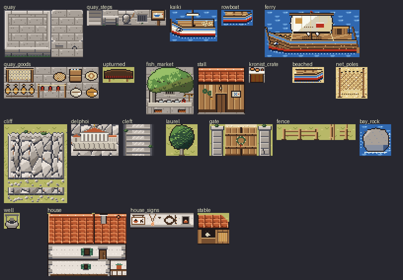
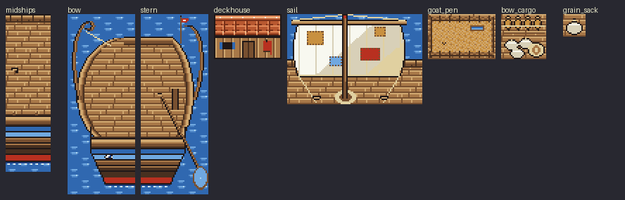
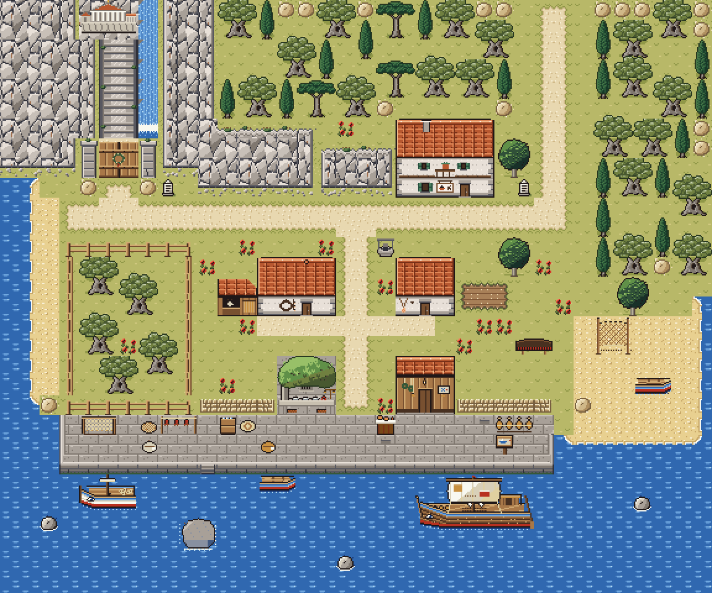
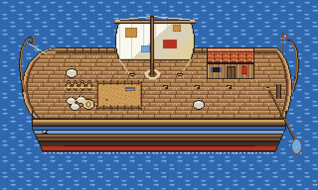
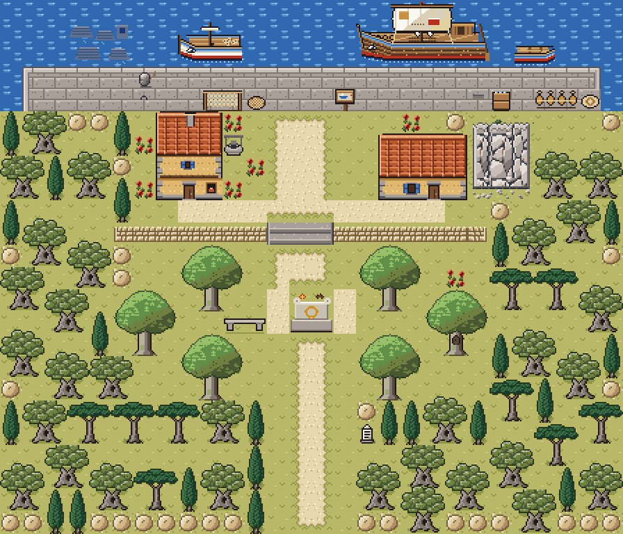

# Kirrha tileset catalog

Three secondaries on the `aethos` primary, for the Gulf crossing (SCRIPT.md beat 37), all
drawn by the same painters from one palette plan:

- **`gTileset_Kirrha`**: Kirrha, Delphoi's harbor at the head of the Krisaian gulf. The
  grey quay, moored boats, nets and the fish market under the fig, the Agora's shed, the
  houses (limewashed, from one kit), and the land around: the grey crags of Parnassos, the
  Phaidriades with Delphoi's roofs in their cleft, laurels, the pilgrims' gate, the fence
  of Apollo's plain, the rock in the bay.
- **`gTileset_Aigion`**: Aigion, the Achaean port across the gulf: the same quay, boats and
  crags, the houses in ochre, the ring of old planes round the altar of Zeus, the street's
  steps, Helike's drowned roofs. BUILD.md planned one `kirrha` set for both towns; one set
  came to some 610 tiles against the 504 the door animations leave, so Aigion has its own
  (the shared pieces cost ROM twice, a few KB, and nothing in looks).
- **`gTileset_GulfFerry`**: the deck of Panopeus's ferry (Route 10, `MAP_GULF_FERRY_DECK`).
  SCRIPT.md Part 10 says to reuse the `trireme` deck pieces; world-act1's Euploia isn't on
  this branch, so the deck is drawn here, small: one mast with a patched square sail, a low
  deckhouse and the steering oar at the stern, a goat pen amidships, rope and lashed
  amphorae at the bow. It is its own secondary so the towns keep their 504 tiles.

**This file is generated** above the passes section. `tools/ichor/art/kirrha_build.py
[kirrha|gulf_ferry|all]` draws both, compiles them and rewrites the catalog. The art is in
`kirrha_harbor.py` (the waterfront), `kirrha_land.py` (crags, trees, the sacred places),
`kirrha_town.py` (the house kit and the households' recipes) and `kirrha_deck.py` (the
ferry); the palette plan and the painters are in `kirrha_lib.py`. The maps are built by
`tools/ichor/maps/harbors.py`, which places every piece by key and part name from
`build/kirrha/catalog.json` and `build/gulf_ferry/catalog.json`.




The numbered sheets are [img/kirrha_sheet.png](img/kirrha_sheet.png) and
[img/gulf_ferry_sheet.png](img/gulf_ferry_sheet.png). The map renders are
[img/Kirrha.png](img/Kirrha.png), [img/GulfFerry_Deck.png](img/GulfFerry_Deck.png) and
[img/Aigion.png](img/Aigion.png).

## How to use it

**IDs.** Each grid lists metatile ids as Porymap shows them, row by row. Each section
starts on a fixed row of its sheet, so adding to one section never renumbers another.

**Collision and layers.** `X` impassable (collision 1), `.` passable, `D` a door (put the
warp here; `MB_NON_ANIMATED_DOOR`), `T` passable and drawn over the player.

**Ground.** *aethos ground* (`grass`, `path`, `sand`, `sea`): the cell draws no ground of
its own; the build points its bottom layer at aethos's metatile (grass `0x001`, path
`0x1D9`, sand `0x124`, sea `0x170`), so a boat's water animates with the gulf around it.
Rebuild whenever aethos is repainted. *quay*: the grey quay paving, drawn here, repeating
every cell. *deck*: the ferry's planks. *none*: the art fills the cell.

**Seams.** Keep these tilesets out of the strips the engine copies across a connection
(MAP_DESIGN.md §5). Kirrha's north edge joins Route 9 (`parnassos`) with offset +18:
`fieldmap.c` copies only Kirrha's columns 11 and up across that seam, so rows 0-5 are
aethos-only from column 11 east, and the Phaidriades stand in columns 0-10, which Route 9
never draws. Aigion's south edge (Route 11, batch 3) keeps its six southern rows aethos-only.

**Palettes.** Every 8x8 tile draws from one of seven groups (`kirrha_lib.GROUPS`):

| Group | Use |
|---|---|
| crag | Parnassos's grey limestone (aethos's own warm greys in the middle of the ramp, with the Phaidriades' rust): crags, cliffs, the quay, piers, steps; laurel scrub and algae; aethos's grass on rims |
| clay | Kirrha's houses: terracotta, limewash, laurel-green shutters, door timber, grey quoins |
| clay2 | Aigion's houses, slot for slot: ochre stucco, blue shutters |
| wood | Timber, rope, linen and paint: boats, nets, racks, the shed, the gate's leaves, the fence, the deck |
| sea | Foam, the rock in the bay, the drowned roofs under the water |
| grove | Laurels, figs' and planes' leaves, bark, on aethos grass |
| market | Marble and bronze, fish and bread, amphorae, the fig's grey bark: the fish market, Delphoi's roofs, the altar of Zeus |

**Tile budget.** gTileset_Kirrha uses 492 of 504 tiles, gTileset_Aigion 365 and gTileset_GulfFerry
213. Faces and pavings repeat on the 16 or 32 px grid, Aigion's houses are the
recolors of Kirrha's, and tiles within two pixels of another are redrawn as that tile.

## `gTileset_Kirrha`

### Section: The waterfront (from 0x200)

The grey quay and its steps, bollard and drain; moored boats on aethos's animated sea (a kaiki, a rowing boat, Panopeus's ferry with its patched sail); nets, crates, amphorae, an octopus line and the pilgrims' bundles; an upturned boat; the fish market under the old fig; the Agora stall in its fishing shed; the Kronist's crate.

#### The quay: grey ashlar paving, edges and corners

`quay`, 5 wide by 3 tall. Big grey limestone blocks in running bond. The water beyond is aethos's sea, placed next to these. Row 0: NW outer corner, north edge (water north: coping only), NE outer corner, inner corners NW and NE (water diagonally beyond). Row 1: west edge, plain quay, east edge, inner corners SW and SE. Row 2: SW outer corner, south edge (water south: the wet face shows), SE outer corner, then two plain alternates. All walkable; the water beside is the sea's.

```text
ids                             walk
0x200 0x201 0x202 0x203 0x204   . . . . .
0x208 0x209 0x20A 0x20B 0x20C   . . . . .
0x210 0x211 0x212 0x213 0x214   . . . . .
```

#### Quay steps, the bollard, the drain and the notice board

`quay_steps`, 5 wide by 1 tall. Left: steps down to the water north of the quay. Second: steps in the south face. Third: a stone bollard with a rope, on the north edge. Fourth: a drain grate in the paving (the fish market's drain, under the fig: the hidden Pearl). Fifth: a notice board on a post (the ferry's sign; impassable).

```text
ids                             walk
0x218 0x219 0x21A 0x21B 0x21C   . . . . X
```

#### Moored fishing kaiki

`kaiki`, 3 wide by 2 tall. A fishing kaiki moored side-on, bow to the left: white and blue hull, red boot-top, an eye on the bow, a short mast with the sail furled, nets heaped aft. On aethos's animated sea.

```text
ids                 walk
0x21D 0x21E 0x21F   X X X
0x225 0x226 0x227   X X X
```

Ground: all on aethos sea.

#### Moored rowing boat

`rowboat`, 2 wide by 1 tall. A small boat moored side-on, bow to the right, oars shipped. On aethos's animated sea.

```text
ids           walk
0x228 0x229   X X
```

Ground: all on aethos sea.

#### Panopeus's ferry, moored

`ferry`, 6 wide by 3 tall. The Gulf ferry alongside the quay, bow to the left: a square sail patched in ochre and red on one mast, the low deckhouse and the steering oar at the stern, a goat looking over the side. Row 0 is the sail's head over the water, drawn over the player; rows 1-2 the boat. Moor it with the quay along its north side (row 0 is open water, so it can stand in the sea north of a quay too).

```text
ids                                   walk
0x22A 0x22B 0x22C 0x22D 0x22E 0x22F   T T T T T T
0x232 0x233 0x234 0x235 0x236 0x237   X X X X X X
0x23A 0x23B 0x23C 0x23D 0x23E 0x23F   X X X X X X
```

Ground: all on aethos sea.

#### Nets, crates, amphorae and bundles on the quay

`quay_goods`, 6 wide by 2 tall. All on quay paving. Row 0: a net drying on a two-post rack (2 cells), plain quay, a heap of net with cork floats, a stack of fish crates, a coil of rope. Row 1: amphorae lashed in a stack (2 cells), an octopus drying line (2 cells), and two pilgrims' bundles with name tags.

```text
ids                                   walk
0x240 0x241 0x242 0x243 0x244 0x245   X X . X X X
0x248 0x249 0x24A 0x24B 0x24C 0x24D   X X X X X X
```

Ground: all on the quay paving.

#### Upturned boat on trestles

`upturned`, 2 wide by 1 tall. A boat turned keel-up on two trestles on aethos grass, being tarred.

```text
ids           walk
0x246 0x247   X X
```

Ground: all on aethos grass.

#### The fish market under the old fig

`fish_market`, 3 wide by 3 tall. Kirrha's fish market at the head of the quay: an old fig's crown over a long stone table laid with fish, an octopus and a scale, baskets beneath. Rows 0-1 are the fig's crown, drawn over the player (walk under it, in its shade); row 2 the table, on quay paving. The fishwife stands in front; put the drain (quay_steps) in front of the table.

```text
ids                 walk
0x250 0x251 0x252   T T T
0x258 0x259 0x25A   T T T
0x260 0x261 0x262   X X X
```

Ground: the quay paving at (0,2), (1,2), (2,2); the rest draws its own.

Parts: `drain` 0x259.

#### The Agora stall in a fishing shed

`stall`, 3 wide by 3 tall. Kirrha's Agora stall (warp 1): a plank shed on the quay with a pitched roof of old pan tiles, a ship's lantern over the door, votives hung beside it. Door at (1,2), on quay paving.

```text
ids                 walk
0x253 0x254 0x255   X X X
0x25B 0x25C 0x25D   X X X
0x263 0x264 0x265   X D X
```

Ground: all on the quay paving.

Door metatiles: 0x264.

#### The Kronist's crate of bread

`kronist_crate`, 1 wide by 1 tall. A crate at the quay's head turned into a table: a cloth, loaves and a jug. On quay paving. The Kronist stands behind it.

```text
ids     walk
0x256   X
```

Ground: all on the quay paving.

#### Boat hauled up on the beach

`beached`, 2 wide by 1 tall. A rowing boat drawn up on aethos sand, bow to the right, tilted on its keel, oars shipped. Impassable.

```text
ids           walk
0x268 0x269   X X
```

Ground: all on aethos sand.

#### Nets drying on poles on the beach

`net_poles`, 2 wide by 2 tall. Two driftwood poles on aethos sand with a net hung between them, cork floats along its head rope. Impassable.

```text
ids           walk
0x26A 0x26B   X X
0x272 0x273   X X
```

Ground: all on aethos sand.

### Section: Parnassos, the groves and the sacred places (from 0x2C0)

The grey cliff band and crags of Parnassos; Delphoi's roofs in the Phaidriades' cleft and the sacred road's steps; laurels and old planes; the pilgrims' gate; the fence of Apollo's plain; the altar of Zeus the Assembler; street steps; the rock in Kirrha's bay; Helike's drowned roofs.

#### Parnassos cliff band: rim, faces and feet

`cliff`, 4 wide by 5 tall. A grey limestone cliff, bedded and jointed, of any length and height. Columns: left end, mid (even map column), mid (odd map column), right end. Rows: 0 the rim (aethos grass above the lip); 1 face A, 2 face B (stack A, B, A, B... under the rim); 3 the foot after a B row, 4 the foot after an A row (scree on aethos grass). All impassable. tools/ichor/maps/harbors.py's cliff() picks the parts.

```text
ids                       walk
0x2C0 0x2C1 0x2C2 0x2C3   X X X X
0x2C8 0x2C9 0x2CA 0x2CB   X X X X
0x2D0 0x2D1 0x2D2 0x2D3   X X X X
0x2D8 0x2D9 0x2DA 0x2DB   X X X X
0x2E0 0x2E1 0x2E2 0x2E3   X X X X
```

Ground: aethos grass at (0,0), (1,0), (2,0), (3,0), (0,3), (1,3), (2,3), (3,3), (0,4), (1,4), (2,4), (3,4); the rest draws its own.

Parts: `rim_l` 0x2C0, `faceA_l` 0x2C8, `faceB_l` 0x2D0, `footB_l` 0x2D8, `footA_l` 0x2E0, `rim_m0` 0x2C1, `faceA_m0` 0x2C9, `faceB_m0` 0x2D1, `footB_m0` 0x2D9, `footA_m0` 0x2E1, `rim_m1` 0x2C2, `faceA_m1` 0x2CA, `faceB_m1` 0x2D2, `footB_m1` 0x2DA, `footA_m1` 0x2E2, `rim_r` 0x2C3, `faceA_r` 0x2CB, `faceB_r` 0x2D3, `footB_r` 0x2DB, `footA_r` 0x2E3.

#### Delphoi's roofs high in the cleft

`delphoi`, 3 wide by 2 tall. The distant sanctuary between the Phaidriades: Apollo's temple with its pediment and columns, a treasury, the polygonal terrace wall, on grey rock. Impassable; set it above the sacred road's steps.

```text
ids                 walk
0x2C4 0x2C5 0x2C6   X X X
0x2CC 0x2CD 0x2CE   X X X
```

#### The cleft: the sacred road's steps between the cliffs

`cleft`, 2 wide by 2 tall. The sacred road climbing the cleft between the Phaidriades in worn stone steps, the cliffs' inner walls in shadow on either side. Walkable; it runs from the pilgrims' gate up toward Delphoi.

```text
ids           walk
0x2E8 0x2E9   . .
0x2F0 0x2F1   . .
```

#### Laurel tree

`laurel`, 2 wide by 2 tall. Apollo's bay laurel on aethos grass: a dense dark crown, glossy lit leaves, a short grey trunk. The top row is drawn over the player.

```text
ids           walk
0x2EA 0x2EB   T T
0x2F2 0x2F3   X X
```

Ground: all on aethos grass.

#### The pilgrims' gate on the sacred road

`gate`, 4 wide by 2 tall. Route 28's closed gate at Kirrha's north edge: two dressed piers with laurel on their caps, two plank leaves barred shut, a wreath at the join. On aethos path (the road runs on behind it). All impassable until Act III. The right pier's foot has a crack (the hidden Bronze Obol).

```text
ids                       walk
0x2EC 0x2ED 0x2EE 0x2EF   X X X X
0x2F4 0x2F5 0x2F6 0x2F7   X X X X
```

Ground: aethos grass at (0,0), (3,0), (0,1), (3,1); aethos path at (1,0), (2,0), (1,1), (2,1); the rest draws its own.

#### Low fence of Apollo's plain

`fence`, 5 wide by 1 tall. Weathered post-and-rail on aethos grass. Cells: west end, run, east end, north-south run, south-west corner. Impassable.

```text
ids                             walk
0x2F8 0x2F9 0x2FA 0x2FB 0x2FC   X X X X X
```

Ground: all on aethos grass.

#### Rock in the bay

`bay_rock`, 2 wide by 2 tall. A flat-topped grey rock awash in the gulf, foam at its foot, on aethos's animated sea. Walkable from the water (Poseidon's Conch): the Big Pearl's item ball sits on it.

```text
ids           walk
0x2FD 0x2FE   . .
0x305 0x306   . .
```

Ground: all on aethos sea.

#### Village well

`well`, 1 wide by 1 tall. A round limestone well-head with a timber frame and a bucket, on aethos grass. Impassable.

```text
ids     walk
0x2FF   X
```

Ground: all on aethos grass.

### Section: Houses (from 0x370)

A kit of house parts (roof rows, storeys, doors, windows, a balcony) and the households' signs, in Kirrha's limewash and Aigion's ochre; the muleteer's stable.

#### House kit: roof, ground storey, upper storey

`house`, 5 wide by 4 tall. Limewashed walls, grey quoins and plinth, laurel-green shutters, a terracotta roof. Build a house left to right: roof rows (left end, mids, right end) over storeys (left corner, walls, windows, the door, right corner). The door is MB_NON_ANIMATED_DOOR: put the warp on it.

```text
ids                             walk
0x370 0x371 0x372 0x373 0x374   X X X X X
0x378 0x379 0x37A 0x37B 0x37C   X X X X X
0x380 0x381 0x382 0x383 0x384   X X X D X
0x388 0x389 0x38A 0x38B 0x38C   X X X X X
```

Ground: aethos grass at (0,0), (1,0), (2,0), (3,0), (4,0), (0,1), (1,1), (2,1), (3,1), (4,1); the rest draws its own.

Door metatiles: 0x383.

Parts: `roof_l` 0x370, `roof_m` 0x371, `roof_r` 0x372, `roof_chimney` 0x373, `roof_pot` 0x374, `eave_l` 0x378, `eave_m` 0x379, `eave_r` 0x37A, `eave_m2` 0x37B, `eave_m3` 0x37C, `wall_l` 0x380, `wall` 0x381, `window` 0x382, `door` 0x383, `wall_r` 0x384, `up_l` 0x388, `up` 0x389, `up_window` 0x38A, `up_r` 0x38B, `balcony` 0x38C.

#### House kit: the households' signs

`house_signs`, 4 wide by 1 tall. Ground-storey wall cells: the inn's sign (a ship and a mule, 'WE TAKE YOU ALL THE WAY'), the old sweeper's brooms leaning by her door, the muleteer's harness and bells, a niche with an oil lamp.

```text
ids                       walk
0x390 0x391 0x392 0x393   X X X X
```

Parts: `inn_sign` 0x390, `brooms` 0x391, `harness` 0x392, `niche` 0x393.

#### The muleteer's lean-to stable

`stable`, 2 wide by 2 tall. A timber lean-to with a pan-tile roof against the muleteer's house, a mule (Onotis) over the half-door, a hay rack. Row 0: roof; row 1: front.

```text
ids           walk
0x394 0x395   X X
0x39C 0x39D   X X
```

Ground: all on aethos grass.

#### House recipes

Households from the kit, as id grids (top row first).

**inn** (5 wide, 4 tall)

```text
0x370 0x373 0x371 0x371 0x372
0x378 0x379 0x37B 0x379 0x37A
0x388 0x38A 0x38C 0x38A 0x38B
0x380 0x382 0x390 0x383 0x384
```

**muleteer** (4 wide, 3 tall)

```text
0x370 0x371 0x374 0x372
0x378 0x379 0x37C 0x37A
0x380 0x392 0x383 0x384
```

**sweeper** (3 wide, 3 tall)

```text
0x370 0x371 0x372
0x378 0x379 0x37A
0x391 0x383 0x384
```

## `gTileset_Aigion`

### Section: The terrace quay (from 0x200)

The same grey quay, steps and bollard, the moored boats and Panopeus's ferry, the nets and crates (drawn by the same painters as Kirrha's).

#### The quay: grey ashlar paving, edges and corners

`quay`, 5 wide by 3 tall. Big grey limestone blocks in running bond. The water beyond is aethos's sea, placed next to these. Row 0: NW outer corner, north edge (water north: coping only), NE outer corner, inner corners NW and NE (water diagonally beyond). Row 1: west edge, plain quay, east edge, inner corners SW and SE. Row 2: SW outer corner, south edge (water south: the wet face shows), SE outer corner, then two plain alternates. All walkable; the water beside is the sea's.

```text
ids                             walk
0x200 0x201 0x202 0x203 0x204   . . . . .
0x208 0x209 0x20A 0x20B 0x20C   . . . . .
0x210 0x211 0x212 0x213 0x214   . . . . .
```

#### Quay steps, the bollard, the drain and the notice board

`quay_steps`, 5 wide by 1 tall. Left: steps down to the water north of the quay. Second: steps in the south face. Third: a stone bollard with a rope, on the north edge. Fourth: a drain grate in the paving (the fish market's drain, under the fig: the hidden Pearl). Fifth: a notice board on a post (the ferry's sign; impassable).

```text
ids                             walk
0x218 0x219 0x21A 0x21B 0x21C   . . . . X
```

#### Moored rowing boat

`rowboat`, 2 wide by 1 tall. A small boat moored side-on, bow to the right, oars shipped. On aethos's animated sea.

```text
ids           walk
0x21D 0x21E   X X
```

Ground: all on aethos sea.

#### Moored fishing kaiki

`kaiki`, 3 wide by 2 tall. A fishing kaiki moored side-on, bow to the left: white and blue hull, red boot-top, an eye on the bow, a short mast with the sail furled, nets heaped aft. On aethos's animated sea.

```text
ids                 walk
0x220 0x221 0x222   X X X
0x228 0x229 0x22A   X X X
```

Ground: all on aethos sea.

#### Panopeus's ferry, moored

`ferry`, 6 wide by 3 tall. The Gulf ferry alongside the quay, bow to the left: a square sail patched in ochre and red on one mast, the low deckhouse and the steering oar at the stern, a goat looking over the side. Row 0 is the sail's head over the water, drawn over the player; rows 1-2 the boat. Moor it with the quay along its north side (row 0 is open water, so it can stand in the sea north of a quay too).

```text
ids                                   walk
0x230 0x231 0x232 0x233 0x234 0x235   T T T T T T
0x238 0x239 0x23A 0x23B 0x23C 0x23D   X X X X X X
0x240 0x241 0x242 0x243 0x244 0x245   X X X X X X
```

Ground: all on aethos sea.

#### Nets, crates, amphorae and bundles on the quay

`quay_goods`, 6 wide by 2 tall. All on quay paving. Row 0: a net drying on a two-post rack (2 cells), plain quay, a heap of net with cork floats, a stack of fish crates, a coil of rope. Row 1: amphorae lashed in a stack (2 cells), an octopus drying line (2 cells), and two pilgrims' bundles with name tags.

```text
ids                                   walk
0x248 0x249 0x24A 0x24B 0x24C 0x24D   X X . X X X
0x250 0x251 0x252 0x253 0x254 0x255   X X X X X X
```

Ground: all on the quay paving.

### Section: The grove of Zeus and the hillside (from 0x2A0)

Old plane trees (one hollow, with wild bees), the altar of Zeus the Assembler, the street's stone steps, the grey cliff band the goatherd built against, laurels, Helike's drowned roofs under the water off the quay.

#### Parnassos cliff band: rim, faces and feet

`cliff`, 4 wide by 5 tall. A grey limestone cliff, bedded and jointed, of any length and height. Columns: left end, mid (even map column), mid (odd map column), right end. Rows: 0 the rim (aethos grass above the lip); 1 face A, 2 face B (stack A, B, A, B... under the rim); 3 the foot after a B row, 4 the foot after an A row (scree on aethos grass). All impassable. tools/ichor/maps/harbors.py's cliff() picks the parts.

```text
ids                       walk
0x2A0 0x2A1 0x2A2 0x2A3   X X X X
0x2A8 0x2A9 0x2AA 0x2AB   X X X X
0x2B0 0x2B1 0x2B2 0x2B3   X X X X
0x2B8 0x2B9 0x2BA 0x2BB   X X X X
0x2C0 0x2C1 0x2C2 0x2C3   X X X X
```

Ground: aethos grass at (0,0), (1,0), (2,0), (3,0), (0,3), (1,3), (2,3), (3,3), (0,4), (1,4), (2,4), (3,4); the rest draws its own.

Parts: `rim_l` 0x2A0, `faceA_l` 0x2A8, `faceB_l` 0x2B0, `footB_l` 0x2B8, `footA_l` 0x2C0, `rim_m0` 0x2A1, `faceA_m0` 0x2A9, `faceB_m0` 0x2B1, `footB_m0` 0x2B9, `footA_m0` 0x2C1, `rim_m1` 0x2A2, `faceA_m1` 0x2AA, `faceB_m1` 0x2B2, `footB_m1` 0x2BA, `footA_m1` 0x2C2, `rim_r` 0x2A3, `faceA_r` 0x2AB, `faceB_r` 0x2B3, `footB_r` 0x2BB, `footA_r` 0x2C3.

#### Small grey rocks

`rocks`, 2 wide by 1 tall. On aethos grass: a rounded grey boulder with a tuft of scrub; a low split slab.

```text
ids           walk
0x2A4 0x2A5   X X
```

Ground: all on aethos grass.

#### Laurel tree

`laurel`, 2 wide by 2 tall. Apollo's bay laurel on aethos grass: a dense dark crown, glossy lit leaves, a short grey trunk. The top row is drawn over the player.

```text
ids           walk
0x2A6 0x2A7   T T
0x2AE 0x2AF   X X
```

Ground: all on aethos grass.

#### Old plane tree

`plane`, 3 wide by 3 tall. One of the ring of old planes round the altar of Zeus at Aigion, on aethos grass. The crown's top row is drawn over the player; the roots' outer cells are walkable.

```text
ids                 walk
0x2C8 0x2C9 0x2CA   T T T
0x2D0 0x2D1 0x2D2   X X X
0x2D8 0x2D9 0x2DA   . X .
```

Ground: all on aethos grass.

#### Old plane tree, hollow

`plane_hollow`, 3 wide by 3 tall. One of the ring of old planes round the altar of Zeus at Aigion, on aethos grass. The crown's top row is drawn over the player; the roots' outer cells are walkable. A hollow in the trunk, bees at its mouth (the hidden Honey).

```text
ids                 walk
0x2CB 0x2CC 0x2CD   T T T
0x2D3 0x2D4 0x2D5   X X X
0x2DB 0x2DC 0x2DD   . X .
```

Ground: all on aethos grass.

#### Altar of Zeus the Assembler

`zeus_altar`, 2 wide by 2 tall. Aigion's altar in the ring of planes: a marble altar on a stepped base, a bronze eagle on the top, a fire burning, an oak wreath on its front. On aethos grass. The bg event runs EventScript_IchorAltar_Zeus.

```text
ids           walk
0x2CE 0x2CF   X X
0x2D6 0x2D7   X X
```

Ground: all on aethos grass.

#### Stone steps up the street

`steps`, 3 wide by 1 tall. Worn grey steps across a street that climbs southward: lit treads, dark risers. Walkable. West end, mid, east end (grass beyond the ends is aethos's).

```text
ids                 walk
0x2E0 0x2E1 0x2E2   . . .
```

#### Helike's drowned roofs under clear water

`drowned`, 3 wide by 2 tall. Roofs and a tower top under the water, seen through it: on aethos's animated sea, so the gulf ripples round them. Water: elevation 1 and surfable like the sea around (set by the map builder).

```text
ids                 walk
0x2E3 0x2E4 0x2E5   X X X
0x2EB 0x2EC 0x2ED   X X X
```

Ground: all on aethos sea.

#### Stone bench

`bench`, 2 wide by 1 tall. A long limestone bench on two blocks, on aethos grass, worn smooth. Impassable.

```text
ids           walk
0x2E6 0x2E7   X X
```

Ground: all on aethos grass.

#### Village well

`well`, 1 wide by 1 tall. A round limestone well-head with a timber frame and a bucket, on aethos grass. Impassable.

```text
ids     walk
0x2F0   X
```

Ground: all on aethos grass.

### Section: Houses (from 0x340)

The house kit and the households' signs in Aigion's ochre stucco and blue paint.

#### House kit, Aigion: ochre stucco, blue shutters

`house_aigion`, 5 wide by 4 tall. The kit, slot for slot, in Aigion's ochre and blue (the same tiles in the clay2 palette).

```text
ids                             walk
0x340 0x341 0x342 0x343 0x344   X X X X X
0x348 0x349 0x34A 0x34B 0x34C   X X X X X
0x350 0x351 0x352 0x353 0x354   X X X D X
0x358 0x359 0x35A 0x35B 0x35C   X X X X X
```

Ground: aethos grass at (0,0), (1,0), (2,0), (3,0), (4,0), (0,1), (1,1), (2,1), (3,1), (4,1); the rest draws its own.

Door metatiles: 0x353.

Parts: `roof_l` 0x340, `roof_m` 0x341, `roof_r` 0x342, `roof_chimney` 0x343, `roof_pot` 0x344, `eave_l` 0x348, `eave_m` 0x349, `eave_r` 0x34A, `eave_m2` 0x34B, `eave_m3` 0x34C, `wall_l` 0x350, `wall` 0x351, `window` 0x352, `door` 0x353, `wall_r` 0x354, `up_l` 0x358, `up` 0x359, `up_window` 0x35A, `up_r` 0x35B, `balcony` 0x35C.

#### House kit, Aigion: the households' signs

`house_signs_aigion`, 4 wide by 1 tall. The signs in Aigion's ochre and blue.

```text
ids                       walk
0x360 0x361 0x362 0x363   X X X X
```

Parts: `inn_sign` 0x360, `brooms` 0x361, `harness` 0x362, `niche` 0x363.

#### House recipes

Households from the kit, as id grids (top row first).

**achaean** (3 wide, 4 tall)

```text
0x340 0x343 0x342
0x348 0x349 0x34A
0x358 0x35A 0x35B
0x350 0x353 0x363
```

**goatherd** (4 wide, 3 tall)

```text
0x340 0x341 0x341 0x342
0x348 0x34C 0x349 0x34A
0x350 0x352 0x353 0x354
```

## `gTileset_GulfFerry`

### Section: Panopeus's ferry (from 0x200)

The hull amidships, the bow and the stern with its steering oar, the deckhouse, the mast and the patched sail, the goats' pen, the cargo at the bow.

#### The ferry's hull, a slice amidships

`midships`, 2 wide by 7 tall. Repeat along the boat. Row 0: the deck under the far gunwale (water north of it: fish from here). Rows 1-3: planks (row 2's left cell has a cleat). Row 4: the near gunwale (impassable: the rail). Row 5: the hull's painted side. Row 6: the waterline, on aethos's sea.

```text
ids           walk
0x200 0x201   . .
0x208 0x209   . .
0x210 0x211   . .
0x218 0x219   . .
0x220 0x221   X X
0x228 0x229   X X
0x230 0x231   X X
```

Ground: the deck's planks at (0,0), (1,0), (0,1), (1,1), (0,2), (1,2), (0,3), (1,3), (0,4), (1,4); aethos sea at (0,6), (1,6); the rest draws its own.

#### The ferry's bow, pointing west

`bow`, 3 wide by 8 tall. Row 0 is the water above the bow, where the stem post's curl rises (drawn over the player). Rows 1-7 match midships' rows 0-6. Its rightmost column joins midships.

```text
ids                 walk
0x202 0x203 0x204   X X X
0x20A 0x20B 0x20C   X X .
0x212 0x213 0x214   X . .
0x21A 0x21B 0x21C   X . .
0x222 0x223 0x224   X . .
0x22A 0x22B 0x22C   X X X
0x232 0x233 0x234   X X X
0x23A 0x23B 0x23C   X X X
```

Ground: all on aethos sea.

#### The ferry's stern and steering oar

`stern`, 3 wide by 8 tall. Row 0: water, the stern post's tip and the ensign over it. Rows 1-7 match midships'. Its leftmost column joins midships. The steering oar's post is at (1,3); Panopeus stands at (0,3).

```text
ids                 walk
0x205 0x206 0x207   X X X
0x20D 0x20E 0x20F   . . X
0x215 0x216 0x217   . . X
0x21D 0x21E 0x21F   . X X
0x225 0x226 0x227   . . X
0x22D 0x22E 0x22F   X X X
0x235 0x236 0x237   X X X
0x23D 0x23E 0x23F   X X X
```

Ground: all on aethos sea.

#### The ferry's deckhouse

`deckhouse`, 3 wide by 2 tall. On the deck's planks at the stern: row 0 the roof, row 1 the front with a door and a window. Impassable (the cabin is the captain's).

```text
ids                 walk
0x240 0x241 0x242   X X X
0x248 0x249 0x24A   X X X
```

Ground: all on the deck's planks.

#### The mast and the patched square sail

`sail`, 6 wide by 4 tall. Rows 0-1: the sail over open water (aethos's sea; impassable water). Row 2: the far-rail deck cells, the sail's foot drawn over the player (walkable). Row 3: deck, the mast's foot at (2,3) and the sheet cleats either side (impassable); the outer cells plain deck.

```text
ids                                   walk
0x250 0x251 0x252 0x253 0x254 0x255   X X X X X X
0x258 0x259 0x25A 0x25B 0x25C 0x25D   X X X X X X
0x260 0x261 0x262 0x263 0x264 0x265   . . . . . .
0x268 0x269 0x26A 0x26B 0x26C 0x26D   . X X . X .
```

Ground: the deck's planks at (0,2), (1,2), (2,2), (3,2), (4,2), (5,2), (0,3), (1,3), (2,3), (3,3), (4,3), (5,3); aethos sea at (0,0), (1,0), (2,0), (3,0), (4,0), (5,0), (0,1), (1,1), (2,1), (3,1), (4,1), (5,1); the rest draws its own.

#### The goats' pen

`goat_pen`, 3 wide by 2 tall. Hurdles of woven withies round a floor of straw, on the deck. The two goats (Kerazap) are objects standing in it; the hidden Heart Scale is under the straw at (2,1) ('A goat was sitting on it.').

```text
ids                 walk
0x270 0x271 0x272   X X X
0x278 0x279 0x27A   X X X
```

Ground: all on the deck's planks.

#### Cargo lashed at the bow

`bow_cargo`, 2 wide by 2 tall. Row 0: amphorae standing in a rack, roped. Row 1: grain sacks (Lamprias sits on the next one) and a coil of rope. On the deck; impassable.

```text
ids           walk
0x273 0x274   X X
0x27B 0x27C   X X
```

Ground: all on the deck's planks.

#### A grain sack to sit on

`grain_sack`, 1 wide by 1 tall. Lamprias's seat at the bow: a fat sack of Arkadian-bound grain on the deck.

```text
ids     walk
0x275   X
```

Ground: all on the deck's planks.

<!-- passes: hand-written below this line; kirrha_build.py keeps it -->

## The maps

`tools/ichor/maps/harbors.py` builds all three (`harbors_kirrha.py`, `harbors_deck.py`,
`harbors_aigion.py` hold each map's plan, events and checks); the scripts are each map's
`scripts.pory`; `tools/ichor/tests/act2_harbors.sh` plays beat 37 through, both ways across the
gulf. Renders: [img/Kirrha.png](img/Kirrha.png), [img/GulfFerry_Deck.png](img/GulfFerry_Deck.png),
[img/Aigion.png](img/Aigion.png); in-game screenshots: [img/harbors_ingame.png](img/harbors_ingame.png).



**Kirrha** (36×30, aethos + kirrha). The road from Route 9 comes in at the north-east (columns
26–29, verges 26 and 29: the seam BUILD.md fixed, `up` offset +18) through an olive slope, and runs
down past Strophios's inn (warp 0; the healer, heal tile (23,10)) and along the foot of Parnassos's
crags. West, the Phaidriades fill the map's top-left corner: the west cliff, the cleft with the sacred
road's steps climbing to Delphoi's temple, treasury and stoa high on their terrace, the Kastalian
falls (aethos's animated waterfall) pouring down beside the steps, and the pilgrims' gate across the
road at the cleft's mouth with the Pythia's two guards in the road's only two cells. Rocks either
side of them, so the player meets them head on; the right-hand rock is the crack with the pilgrim's
obol. Below the road, Apollo's plain behind its fence (wild olives, anemones, nobody's plough), the
fence-watcher and the beggar leaning on its east side, the dig spot "the edge is fine"; west of it a
strip of shore under the cliffs, a dead end with a Hyper Potion where it stops at a rock. The one
street drops south from the town's well between the muleteer's house and stable (warp 2) and the old
sweeper's house with its kitchen garden (warp 3), to the quay's head: the fish market under the old
fig (the drain with the Pearl in the fig's shade), the Kronist's crate of bread, the Agora's shed
(warp 1). Along the quay, nets, an octopus line, amphorae waiting for the ferry, the pilgrims on their
bundles, Alethea, and at the east end Panopeus at his gangplank with the ferry alongside, its patched
sail up. A beach under the eastern hill (nets on poles, a boat hauled up, a Net Ball at its end). In
the gulf a kaiki, a rowing boat, sea rocks, and the rock in the bay with the Big Pearl (the Conch).

**Seams.** Kirrha's columns 11 and up are what `FillSouthConnection` copies into Route 9's view
(offset −18 from Route 9: columns −11…−1 of Route 9's frame are dropped), so rows 0–5 are aethos-only
from column 11 east; the Phaidriades stand in columns 0–10, which Route 9 never draws.
`harbors_kirrha.check()` enforces exactly that, and that the north edge is open only at 26–29.
**Border:** the sea. The map is laid out so the camera only ever shows the border beyond water:
the gulf to the south and east, the gulf's west arm along the shore path.

### Kirrha: render-and-critique passes

**Pass 1** (`ThyrsaCity`-level bar; first render). *Wrong:* the crag texture read as a palisade of
grey slabs, then (second try) as masonry, not rock; the quay was four rows of empty grey; the beach
was a bare sand rectangle; the town between the houses was plain grass with flowers; the crag band
along the road was one rectangular wall; gaps in the olive slope left the north edge open in four
columns; the ferry's sail was a flat white box and its hull whitewashed like a kaiki. *Changed:* the
face texture is now Voronoi lumps on a 32 px torus (fluted, lit top-left, rust down two of them) with
both vertical phases in the kit; the quay is three rows with dry-stone walls at its back where it
meets the town; gaps at the north edge become cypresses or rocks; the sail is lit and shaded as if
filled, with panel seams, and the hull is tarred timber strakes.

**Pass 2.** *Wrong:* the crowd gave the quay life in game, but the rendered beach and the open grass
still read empty; the crags' one-height band; the anemone troughs and a laurel overlapped crag cells;
the shore path ended at nothing. *Changed:* the beach has nets drying on poles and a boat hauled up
(two new pieces), the upturned boat sits in the boatyard above it; the town has a well at the head
of the street and the sweeper's kitchen garden; the crag band steps down eastward (rim at row 6, then
7) with its ends properly flanked; the shore path ends at a rock with the Hyper Potion.

**Pass 3** (in game, from `act2_harbors.sh`'s screenshots). The arrival, the gate scene, the quay
crowd and the deck all read well at GBA size: the gate framed by the cliffs and the falls, the two
guards in the road, Alethea at the player's side. *Wrong:* the 2×2 aethos sea stack read as a grey
square with a dark blot; the crags' upper block ended without its east flank. *Changed:* single
foam-ringed sea rocks instead; the upper block ends with its right flank.



**The Gulf ferry** (20×12, aethos + gulf_ferry). Panopeus's boat lies west-east in the animated gulf,
bow toward Aigion. Row 3 is the deck under the far gunwale: fish over it into the water north of it
(`FLAG_ICHOR_NO_RELICS` on every arrival keeps the Conch and the Wings from working on a boat under
way). Amidships the mast and the patched square sail (ochre, red and blue patches, drawn over the
player on the far rail), the goats' pen (two Kerazap, the hidden Heart Scale "a goat was sitting
on it"); at the bow lashed amphorae, grain sacks and Lamprias facing the sea; at the stern the
deckhouse and the steering oar, Panopeus beside it, Alethea watching the wake. Kephisios fishes at the
rail amidships. The near rail carries the "color of wine" line.

### The Gulf ferry: render-and-critique passes

**Pass 1.** *Wrong:* the sail was gridded like a window; the pen's straw was noise (unique tiles in
every cell); the bow and stern were drawn one row off the midships slice. *Changed:* the sail is lit
and panelled; straw on an 8 px pattern; bow and stern share one hull outline (`_hull_end`) matched to
midships row for row.

**Pass 2.** *Wrong:* the goat pen and the bow cargo blocked the only reads of the hidden scale and the
rail signs; the stern's half of the deck was bare planks. *Changed:* pen and cargo moved so every bg
event is read from the deck; grain sacks by Lamprias and near the deckhouse.

**Pass 3** (in game). The deck reads at GBA size: "ROUTE 10" over the sail, goats in their pen, the
deckhouse's red cloak. Nothing to change but the sacks; the hull's long side is plain on purpose,
the water under it moving.



**Aigion** (28×24, aethos + aigion). The gulf along the north: Helike's drowned roofs off the quay's
west end (on aethos's animated sea, so the water moves over them), a kaiki, Panopeus's ferry alongside
once the gulf is crossed, a rowing boat. A two-row quay; the fisher at its west end over the roofs,
the hidden Pearl at its corner. The street climbs south past the old Achaean's narrow two-storey house
(warp 0) with the town's well beside it, and the goatherd's (warp 1) built against the grey crags of
the hill. Stone steps up through the terrace's dry-stone wall into the grove of Zeus the Assembler:
six old planes in a ring round the altar (`EventScript_IchorAltar_Zeus`), the grove-keeper who heals
beside it (`HEAL_LOCATION_AIGION`, (12,13)), a bench for the shorter meetings, the hollow plane with the
wild bees' Honey. South, the road into the gorge (Route 11, batch 3) between olives, pines and
cypresses, aethos-only for six rows, Alethea waiting at the edge.

### Aigion: render-and-critique passes

**Pass 1.** *Wrong:* a three-row quay, a huge flat grey slab; the planes scattered rather than a ring;
the clearing empty grass. *Changed:* a two-row quay, which gave the grove a seventh row; six planes in
a ring round the altar, the path from the steps into it, a bench, the well by the Achaean's door.

**Pass 2.** *Wrong:* a boulder on Alethea's walk from the quay to the street; the crag beside the
goatherd's house a six-cell block. *Changed:* the boulder moved; the crag narrowed to the hill's
shoulder, olives beyond it.

**Pass 3** (in game). The landing scene reads: Alethea steps off, speaks, walks up the street; the
ferry and Panopeus are on the quay behind. Every dead end pays: the quay's west end (Pearl), its east
end (a Super Repel by the amphorae), the hollow plane (Honey).
