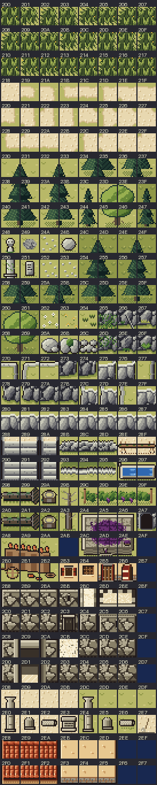
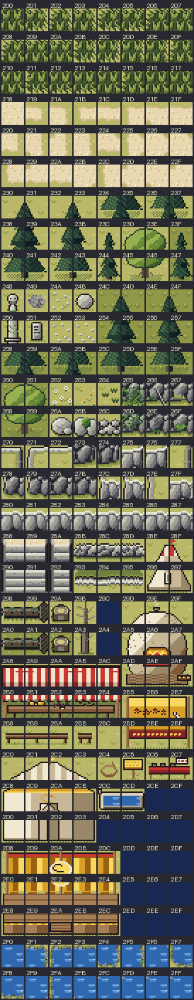
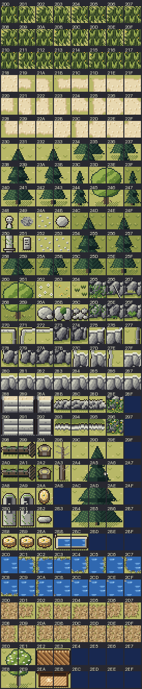
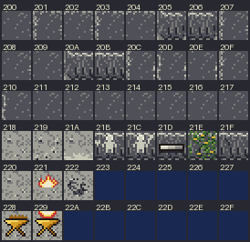
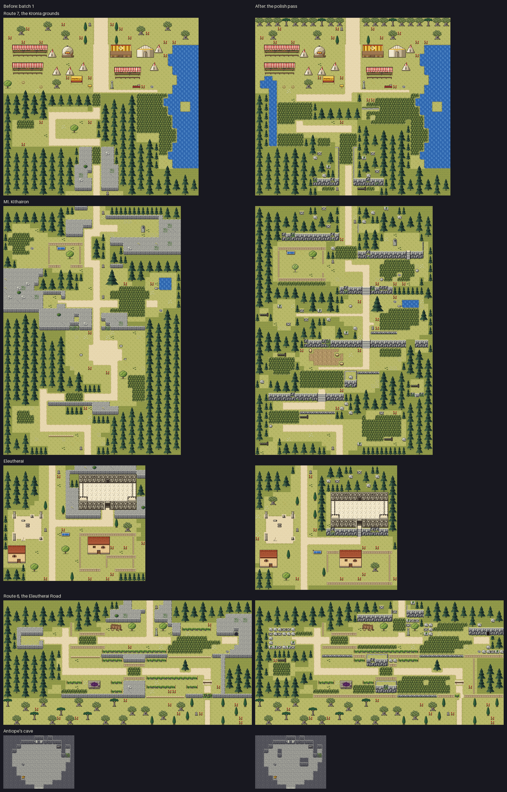

# The Kithairon crossing's tilesets

The road north from Eleusa over Mt. Kithairon to Thyrsa: vine terraces and dry stone,
black firs, grey rock and its cliffs, ivy, the border fort of Eleutherai with its
Cyclopean walls, the god's roofless temple, the maenads' mountain, and on the Asopos
plain below, the Kronia: red-and-cream awnings, bread, gold cloth. Four secondaries on
the `aethos` primary, drawn by one set of painters:

| Tileset | Maps |
|---|---|
| `gTileset_Kithairon` | Route 6, Eleutherai |
| `gTileset_KithaironPass` | Mt. Kithairon (the polish pass gave the climb its own set) |
| `gTileset_Kronia` | Route 7 and the Kronia grounds |
| `gTileset_KithaironCave` | Antiope's cave |

**This catalog is generated** by `tools/ichor/art/kithairon_build.py` (painters:
`kithairon_ground.py`, `_trees.py`, `_stone.py`, `_vines.py`, `_houses.py`, `_camp.py`,
`_cliffs.py`; palettes and the soft-shape engine in `kithairon_lib.py`). The
render-and-critique passes at the end are written by hand and kept across rebuilds.

## How it fits together

**Why four sets, not one.** BUILD.md asked for one `kithairon` secondary for all four
outdoor maps, so their seams need no aethos-only strip. Everything the crossing needs
is far more than a secondary's 504 tiles, so the art is split, and the seams still need
no aethos-only strip: Kithairon, KithaironPass and Kronia all begin with the same
**core** section (soft ground, firs and the oak, the cliffs and their faces, stairs,
ledges, rocks, deadfall, stones and markers), painted from the same pixels and packed at
the same metatile ids. The game draws a connected neighbor with the tilesets of the map
the player stands on, and a core metatile looks the same in any of the three. The map
builder keeps the six rows either side of the Eleutherai / Mt. Kithairon and
Mt. Kithairon / Route 7 seams to core and aethos metatiles. The cave is its own small set.

**Place pieces by key and cell name** from `build/kithairon/<dir>/catalog.json`, never by
raw id (`tools/ichor/maps/kithairon.py` does). Ids below are the current build's.

**Soft ground.** `tall`, `path`, `water`, `trampled` and `cave` hold one piece per blob
shape key: `1|` then the cell's neighbors N NE E SE S SW W NW, `1` in the region and `0`
not, a diagonal counting only when both its sides are in. `kithairon_lib.blob_key`
computes it. The map builder lists the keys its maps use in
`tools/ichor/art/kithairon_shapes.json` (`kithairon.py --shapes`), and only those are drawn.

**Tiers and cliffs** (the polish pass). The map builder gives every cell a height. A
raised tier is outlined by `cliff`: a rocky rim along its north, west and east edges,
and along its south edge a lit lip over a 24 px limestone face of tall slabs that takes
the tier's two southmost rows and darkens to a shadow at its foot. Its keys are blob keys
plus `|1` (the tier goes on two rows down) or `|0` (the face's upper row), and `|b` for
the face's second phase, so the slabs repeat every 32 px, not 16. Firs standing on a
boundary hide the cliff; elsewhere it shows. `cliff_face` dresses a face (ivy, a crack,
a tuft, a seep, a fern), `cliff_stair` cuts steps through it, `ledge` gives one-way rock
drops (south on Mt. Kithairon, north down Route 7's north face).

- `water` is aethos's animated sea under a pebbly bank with reeds: MB_POND_WATER,
  surfable and fishable. It is in the pass and Kronia sets, not the core.

**Walk codes** in the grids: `X` blocks, `.` walkable, `T` walkable and drawn over the
player, `G` tall grass, `J` a ledge (MB_JUMP_SOUTH), `D` a door (MB_NON_ANIMATED_DOOR: put
the warp there). The north ledges are `X` cells with MB_JUMP_NORTH.

**Borrowed ground.** Cells marked *grass*, *path*, *sea*, *shade* or *tall* draw no ground
of their own: the build points their bottom tiles at aethos's grass (`0x001`), road
(`0x1D9`), animated sea (`0x170`), deep shade (`0x01C`) or tall grass (`0x00D`). Rebuild
these sets whenever aethos is repainted.

**Palettes.** Seven groups, one per secondary palette; every 8x8 tile draws from one.

| Group | Use |
|---|---|
| field | tall grass, the road, its edges; the maenads' drums |
| rock | cliffs, ledges, rocks, the cave, ivy and the marked ivy, shrines, the herm |
| tree | firs, oaks, deadfall |
| vine | trellises, the wine-cart |
| house | Eleusa's house kit, verbatim |
| stone | Cyclopean walls, the temple, the wine press, troughs |
| camp | the Kronia's awnings, tables, tents, stage, banner, oven; the brazier |

**Scripted swaps** (`include/constants/metatile_labels.h`): `METATILE_Kithairon_Barrier_W`
and `_E` (the herald's pole, beat 26), `METATILE_KithaironPass_Shrine_Top`, `_Shrine`,
`_ShrineBad_Top`, `_ShrineBad` (the shrine once cleansed), and
`METATILE_KithaironCave_Brazier_ColdTop`, `_Cold`, `_LitTop`, `_Lit`.

## Budget

| Tileset | Tiles | Metatiles |
|---|---|---|
| `gTileset_Kithairon` | 480 of 504 | 248 of 512 |
| `gTileset_Kronia` | 480 of 504 | 256 of 512 |
| `gTileset_KithaironPass` | 405 of 504 | 240 of 512 |
| `gTileset_KithaironCave` | 62 of 504 | 48 of 512 |

## `gTileset_Kithairon`: Route 6 and Eleutherai



### Core: shared by Kithairon and Kronia at the same ids

#### Tall grass with soft edges

`tall`, 8 wide by 3 tall. Barley tall grass on aethos grass, cut from one field so any outline works (agros's painter, as on Route 1). MB_TALL_GRASS throughout. Names are blob shape keys (`1|NNEESESSWWNW`).

24 shapes, from 0x200; the first, `1|11111111`, is 0x200.

#### The road with soft edges

`path`, 8 wide by 3 tall. The limestone road and its goat-track branches, scalloped where they meet the grass (agros's painter). Names are blob shape keys.

24 shapes, from 0x218; the first, `1|11111111`, is 0x218.

#### Black fir (2 x 3 with its spire)

`fir`, 2 wide by 3 tall. A black fir. The top row is its spire over the grass of the row above: walkable, drawn over the player. Rows 1-2 block.

```text
0x230 0x231   T T
0x238 0x239   X X
0x240 0x241   X X
```

Borrowed ground: grass at 0,0, 0,1, 0,2, 1,0, 1,1, 1,2.

#### Slim fir (2 x 3 with its spire)

`fir_b`, 2 wide by 3 tall. A black fir. The top row is its spire over the grass of the row above: walkable, drawn over the player. Rows 1-2 block.

```text
0x232 0x233   T T
0x23A 0x23B   X X
0x242 0x243   X X
```

Borrowed ground: grass at 0,0, 0,1, 0,2, 1,0, 1,1, 1,2.

#### A fir's base with the next fir's spire over it

`fir_stack`, 2 wide by 1 tall. Between two firs in a column: the upper fir's base row, the lower fir's spire over it. Blocks.

```text
0x234 0x235   X X
```

Borrowed ground: grass at 0,0, 1,0.

#### A fir's base with the next fir's spire over it

`fir_stack_b`, 2 wide by 1 tall. Between two firs in a column: the upper fir's base row, the lower fir's spire over it. Blocks.

```text
0x236 0x237   X X
```

Borrowed ground: grass at 0,0, 1,0.

#### Young fir (1 x 2)

`fir_young`, 1 wide by 2 tall. A sapling fir for gaps at the woods' edge. Its top half is drawn over the player.

```text
0x23C   T
0x244   X
```

Borrowed ground: grass at 0,0, 0,1.

#### Scrub oak (2 x 2)

`oak`, 2 wide by 2 tall. A low, wide kermes oak of the mountain's lower slopes.

```text
0x23D 0x23E   X X
0x245 0x246   X X
```

Borrowed ground: grass at 0,0, 0,1, 1,0, 1,1.

#### Stones of the road: the herm, boundary stones, scree

`markers`, 4 wide by 2 tall. On borrowed grass. `herm_top` over `herm`: the great herm, hung with ivy. `boundary` a worn boundary stone, `boulder` a grey rock, `scree`/`scree_b` loose stones (walkable), `dig` turned earth on grass (walkable).

```text
0x248 0x249 0x24A 0x24B   T . . X
0x250 0x251 0x252 0x253   X X . .
```

Pieces: `herm_top` 0x248, `dig` 0x249, `scree_b` 0x24A, `boulder` 0x24B, `herm` 0x250, `boundary` 0x251, `scree` 0x252.

Borrowed ground: grass at 0,0, 0,1, 1,0, 1,1, 2,0, 2,1, 3,0, 3,1.

#### Black fir (2 x 3 with its spire), in the woods' shade

`fir_shade`, 2 wide by 3 tall. The same as `fir`, on aethos's deep-shade grass, for inside a wood. The spire row stays on plain grass: use `fir`'s top row there.

```text
0x24C 0x24D   T T
0x254 0x255   X X
0x25C 0x25D   X X
```

Borrowed ground: shade at 0,0, 0,1, 0,2, 1,0, 1,1, 1,2.

#### Slim fir (2 x 3 with its spire), in the woods' shade

`fir_b_shade`, 2 wide by 3 tall. The same as `fir_b`, on aethos's deep-shade grass, for inside a wood. The spire row stays on plain grass: use `fir_b`'s top row there.

```text
0x24E 0x24F   T T
0x256 0x257   X X
0x25E 0x25F   X X
```

Borrowed ground: shade at 0,0, 0,1, 0,2, 1,0, 1,1, 1,2.

#### A fir's base with the next fir's spire over it, in the woods' shade

`fir_stack_shade`, 2 wide by 1 tall. The same as `fir_stack`, on aethos's deep-shade grass, for inside a wood. The spire row stays on plain grass: use `fir_stack`'s top row there.

```text
0x258 0x259   X X
```

Borrowed ground: shade at 0,0, 1,0.

#### A fir's base with the next fir's spire over it, in the woods' shade

`fir_stack_b_shade`, 2 wide by 1 tall. The same as `fir_stack_b`, on aethos's deep-shade grass, for inside a wood. The spire row stays on plain grass: use `fir_stack_b`'s top row there.

```text
0x25A 0x25B   X X
```

Borrowed ground: shade at 0,0, 1,0.

#### Young fir (1 x 2), in the woods' shade

`fir_young_shade`, 1 wide by 2 tall. The same as `fir_young`, on aethos's deep-shade grass, for inside a wood. The spire row stays on plain grass: use `fir_young`'s top row there.

```text
0x23F   T
0x247   X
```

Borrowed ground: shade at 0,0, 0,1.

#### Scrub oak (2 x 2), in the woods' shade

`oak_shade`, 2 wide by 2 tall. The same as `oak`, on aethos's deep-shade grass, for inside a wood. The spire row stays on plain grass: use `oak`'s top row there.

```text
0x260 0x261   X X
0x268 0x269   X X
```

Borrowed ground: shade at 0,0, 0,1, 1,0, 1,1.

#### Meadow flowers and a tussock

`meadow`, 3 wide by 1 tall. Walkable. Scatter through open grass with aethos's red anemones (0x004): `white` narcissus, `yellow` mountain crocus, `tuft` a tussock.

```text
0x262 0x263 0x264   . . .
```

Pieces: `white` 0x262, `yellow` 0x263, `tuft` 0x264.

Borrowed ground: grass at 0,0, 1,0, 2,0.

#### Cliffs: the edges of a raised tier

`cliff`, 8 wide by 3 tall. The boundary of a raised tier, on borrowed grass: a rocky rim on its north, west and east edges, and on its south edge a lit lip over a 24 px limestone face that takes the tier's two southmost rows and darkens to a shadow at its foot. The tier's inside is ordinary ground. Names are blob shape keys plus `|1` (the tier goes on two rows down) or `|0` (this is the face's upper row). Blocks.

17 shapes, from 0x270; the first, `1|00001110|1`, is 0x270.

#### Cliff faces: ivy, a crack, a tuft, a seep, a fern

`cliff_face`, 3 wide by 2 tall. Mid-face cells to scatter along a cliff's south face: `_u` for its upper row, `_l` for its lower row. `ivy` hangs from the lip, `crack_u` splits the face with a fern, `tuft_u` a grass tuft on a ledgelet, `seep_l` a dark wet streak, `fern_l` a fern at the foot.

```text
0x265 0x266 0x267   X X X
0x26D 0x26E 0x26F   X X X
```

Pieces: `ivy_u` 0x265, `crack_u` 0x266, `tuft_u` 0x267, `ivy_l` 0x26D, `seep_l` 0x26E, `fern_l` 0x26F.

Borrowed ground: grass at 0,0, 0,1, 1,0, 1,1, 2,0, 2,1.

#### Rock steps cut through a cliff

`cliff_stair`, 3 wide by 2 tall. The road's way up a cliff: a two-row flight of rock steps cut through the face, on borrowed road. 2 wide: `TL`, `TR` over `BL`, `BR`; 1 wide: `T` over `B`. Put them in the face's two rows; the face's own cells either side stay as they are. Walkable.

```text
0x288 0x289 0x28A   . . .
0x290 0x291 0x292   . . .
```

Pieces: `TL` 0x288, `TR` 0x289, `BL` 0x290, `BR` 0x291, `T` 0x28A, `B` 0x292.

Borrowed ground: path at 0,0, 0,1, 1,0, 1,1, 2,0, 2,1.

#### Rock ledges: one way down

`ledge`, 3 wide by 2 tall. `S_*` drop south (MB_JUMP_SOUTH): a knee-high step of grey rock with grass above and its shadow below; the road home on Mt. Kithairon. `N_*` drop north (MB_JUMP_NORTH): the same seen from above, the land falling away beyond a rocky lip; the way down Route 7's north face. L, M, R: the ends taper into the grass.

```text
0x28B 0x28C 0x28D   J J J
0x293 0x294 0x295   X X X
```

Pieces: `S_L` 0x28B, `S_M` 0x28C, `S_R` 0x28D, `N_L` 0x293, `N_M` 0x294, `N_R` 0x295.

Borrowed ground: grass at 0,0, 0,1, 1,0, 1,1, 2,0, 2,1.

#### Rocky ground: boulders, a split crag, a scree heap

`rocks`, 3 wide by 1 tall. Impassable rock for a tier's top or a wood's floor: `pile` a heap of boulders, `split` a crag split by a juniper, `scree` a heap of broken stone. On borrowed grass.

```text
0x26A 0x26B 0x26C   X X X
```

Pieces: `pile` 0x26A, `split` 0x26B, `scree` 0x26C.

Borrowed ground: grass at 0,0, 1,0, 2,0.

#### Deadfall: a fallen fir, a stump, a dead snag

`deadfall`, 4 wide by 2 tall. `log_W` + `log_E`: a fallen fir lying east-west, its broken top to the west and its root plate to the east, moss along its back. `stump` a fir stump, `snag_top` over `snag` a dead fir standing grey (its top drawn over the player). `_s` copies stand on the woods' deep shade.

```text
0x298 0x299 0x29A 0x29B   X X X T
0x2A0 0x2A1 0x2A2 0x2A3   X X X X
```

Pieces: `log_W` 0x298, `log_E` 0x299, `stump` 0x29A, `snag_top` 0x29B, `snag` 0x2A3, `log_W_s` 0x2A0, `log_E_s` 0x2A1, `stump_s` 0x2A2.

Borrowed ground: grass at 0,0, 1,0, 2,0, 3,0, 3,1; shade at 0,1, 1,1, 2,1.

### The god's vines: trellises, the old vines, the press, the cart

#### Vine row on a trellis (east-west)

`trellis`, 4 wide by 1 tall. A row of the god's vines. `W` and `E` end the row with a post; `M` and `grapes` repeat between (mix them). Rows block: leave a lane between rows, or plant tall grass there.

```text
0x29C 0x29D 0x29E 0x29F   X X X X
```

Pieces: `W` 0x29C, `M` 0x29D, `grapes` 0x29E, `E` 0x29F.

Borrowed ground: grass at 0,0, 1,0, 2,0, 3,0.

#### Stone wine press and treading floor

`press`, 3 wide by 2 tall. A treading floor of dressed stone, purple with years of must, draining through a spout into a sunken vat. Its sign is the press ("Tread barefoot...").

```text
0x2A4 0x2A5 0x2A6   X X X
0x2AC 0x2AD 0x2AE   X X X
```

Borrowed ground: grass at 0,0, 0,1, 1,0, 1,1, 2,0, 2,1.

#### The wine-cart with the broken wheel

`cart`, 3 wide by 2 tall. Tipped onto its axle on the third terrace: a cart of amphorae for the Dionysia, its east wheel off and lying flat. The driver stands beside it.

```text
0x2A8 0x2A9 0x2AA   X X X
0x2B0 0x2B1 0x2B2   X X X
```

Borrowed ground: grass at 0,0, 0,1, 1,0, 1,1, 2,0, 2,1.

#### The herald's barrier pole across the road

`barrier`, 2 wide by 1 tall. On borrowed road, across a two-wide road: `W` then `E`. Blocks. When the herald lifts it, swap both cells back to road (METATILE_Kithairon_Barrier_W/_E, aethos's road 0x1D9).

```text
0x28E 0x28F   X X
```

Pieces: `W` 0x28E, `E` 0x28F.

Borrowed ground: path at 0,0, 1,0.

### Eleutherai's fort, the god's temple, troughs, Pentheus's fir

#### Eleutherai's Cyclopean walls, towers and gate

`fort`, 7 wide by 4 tall. A wall run is W0 over W1: L, then M repeated, then R. A tower (T0 over T1 over T2, 2 wide) stands in a run's place with its T0 row above the coping. The gate is gate_* over gateF_* (3 wide): the passage is the middle column, its lintel drawn over the player. `side` is a wall seen from above, running north; `side_foot` ends it. `door` (a W1 cell) is the watch-house's door; `slit` an arrow slit for W0. `court` is the parade ground's beaten earth (walkable).

```text
0x2B8 0x2B9 0x2BA 0x2BB 0x2BC 0x2BD 0x2BE   X X X X X X X
0x2C0 0x2C1 0x2C2 0x2C3 0x2C4 0x2C5 0x2C6   X X X D X X X
0x2C8 0x2C9 0x2CA 0x2CB 0x2CC 0x2CD 0x2CE   X T X . X X X
0x2D0 0x2D1 0x2D2 0x2D3 0x2D4 0x2D5 0x2D6   X . X X X X X
```

Pieces: `W0_L` 0x2B8, `W0_M` 0x2B9, `W0_R` 0x2BA, `slit` 0x2BB, `W1_L` 0x2C0, `W1_M` 0x2C1, `W1_R` 0x2C2, `door` 0x2C3, `side` 0x2BC, `side_foot` 0x2C4, `T0_L` 0x2BD, `T0_R` 0x2BE, `T1_L` 0x2C5, `T1_R` 0x2C6, `T2_L` 0x2CD, `T2_R` 0x2CE, `gate_L` 0x2C8, `gate_M` 0x2C9, `gate_R` 0x2CA, `gateF_L` 0x2D0, `gateF_M` 0x2D1, `gateF_R` 0x2D2, `court` 0x2CB.

#### The god's roofless temple: columns and the empty plinth

`temple`, 8 wide by 2 tall. On borrowed road paving (the floor is aethos's limestone patch), with `_g` copies on grass for the columns that stand outside it. A standing column is `col_top` over `col` (its capital drawn over the player). `plinth` is the empty plinth (beat 27): put its sign there. `broom` is Oinoe's swept step with her broom leaning on it.

```text
0x2D8 0x2D9 0x2DA 0x2DB 0x2DC 0x2DD 0x2DE 0x2DF   T . . . T . . .
0x2E0 0x2E1 0x2E2 0x2E3 0x2E4 0x2E5 0x2E6 0x2E7   X X X X X X X .
```

Pieces: `col_top` 0x2D8, `col` 0x2E0, `stump` 0x2E1, `drum` 0x2E2, `plinth` 0x2E3, `col_top_g` 0x2DC, `col_g` 0x2E4, `stump_g` 0x2E5, `drum_g` 0x2E6, `broom` 0x2E7.

Borrowed ground: grass at 4,0, 4,1, 5,0, 5,1, 6,0, 6,1, 7,0; path at 0,0, 0,1, 1,0, 1,1, 2,0, 2,1, 3,0, 3,1, 7,1.

#### Stone trough with spring water

`trough`, 2 wide by 1 tall. A long stone trough on borrowed (animated) water, fed by a spout at its west end: Eleutherai's spring, Phorbas's fold. Blocks.

```text
0x296 0x297   X X
```

Pieces: `W` 0x296, `E` 0x297.

Borrowed ground: sea at 0,0, 1,0.

#### A cave mouth in a cliff's lower row

`cliff_mouth`, 1 wide by 1 tall. A dark arch in a cliff's lower face row (MB_NON_ANIMATED_DOOR: put the warp there).

```text
0x2A7   D
```

Pieces: `mouth` 0x2A7.

Borrowed ground: grass at 0,0.

### Eleutherai's houses (Eleusa's kit)

#### Tiled roof: ridge row and eave row

`roof_tile`, 3 wide by 2 tall. Red Laconian tiles. Repeat the middle column for a wider house.

```text
0x2E8 0x2E9 0x2EA   X X X
0x2F0 0x2F1 0x2F2   X X X
```

Pieces: `R0_L` 0x2E8, `R0_M` 0x2E9, `R0_R` 0x2EA, `R1_L` 0x2F0, `R1_M` 0x2F1, `R1_R` 0x2F2.

#### Wall rows: upper and lower (on the socle)

`wall`, 3 wide by 2 tall. Plain plaster. Every window, door and extra below is a W0 or W1 M cell, so it can stand anywhere between the corners.

```text
0x2EB 0x2EC 0x2ED   X X X
0x2F3 0x2F4 0x2F5   X X X
```

Pieces: `W0_L` 0x2EB, `W0_M` 0x2EC, `W0_R` 0x2ED, `W1_L` 0x2F3, `W1_M` 0x2F4, `W1_R` 0x2F5.

#### Upper-wall cells: windows and garlic

`windows`, 2 wide by 1 tall. W0 cells. `shutters` is an open window with ox-blood shutters, `lattice` a small timber grille, `closed` shutters shut, `garlic` strings of garlic and onions on a peg.

```text
0x2B3 0x2B4   X X
```

Pieces: `shutters` 0x2B3, `lattice` 0x2B4.

#### Doors (lower-wall cells)

`doors`, 2 wide by 1 tall. W1 cells; every one is a door (MB_NON_ANIMATED_DOOR): put the warp there. `plank` a dark plank door in ox-blood jambs, `dutch` its top leaf open, `curtain` an arched doorway with a striped wool curtain, `barn_l` + `barn_r` a wide double door (warp on both).

```text
0x2B5 0x2B6   D D
```

Pieces: `plank` 0x2B5, `curtain` 0x2B6.

## `gTileset_Kronia`: Route 7 and the Kronia grounds



### Core

The same structures at the same ids as in `gTileset_Kithairon`'s core, above.

### The Kronia grounds

#### A long table under a striped awning, and benches

`feast_table`, 5 wide by 3 tall. Row 0, the awning: C_L, C_M (repeat, mixing C_M2 and C_M3 for the poles' sag), C_R. Row 1, the table under its hem: T_L, then any mix of T_bread, T_figs and T_jars, then T_R. Row 2 holds benches for the row below a table: B_L, B_M..., B_R, or B_one alone. Everything blocks; people sit on the benches (put the objects there).

```text
0x2A8 0x2A9 0x2AA 0x2AB 0x2AC   X X X X X
0x2B0 0x2B1 0x2B2 0x2B3 0x2B4   X X X X X
0x2B8 0x2B9 0x2BA 0x2BB 0x2BC   X X X X .
```

Pieces: `C_L` 0x2A8, `C_M` 0x2A9, `C_M2` 0x2AA, `C_M3` 0x2AB, `C_R` 0x2AC, `T_L` 0x2B0, `T_bread` 0x2B1, `T_figs` 0x2B2, `T_jars` 0x2B3, `T_R` 0x2B4, `B_L` 0x2B8, `B_M` 0x2B9, `B_R` 0x2BA, `B_one` 0x2BB.

Borrowed ground: grass at 0,0, 0,2, 1,0, 1,2, 2,0, 2,2, 3,0, 3,2, 4,0, 4,2.

#### The great domed bread oven

`oven`, 3 wide by 3 tall. A beehive oven of whitewashed daub on a stone ring, its mouth glowing, loaves on a board beside it. The baker stands by it. Its ash holds a hidden Charcoal ("still warm").

```text
0x29D 0x29E 0x29F   X X X
0x2A5 0x2A6 0x2A7   X X X
0x2AD 0x2AE 0x2AF   X X X
```

Borrowed ground: grass at 0,0, 0,1, 0,2, 1,0, 1,1, 1,2, 2,0, 2,1, 2,2.

#### A Kronist tent

`tent`, 2 wide by 2 tall. A round canvas tent with a striped crown and a pennant, its flap tied shut. Ring them round the stage.

```text
0x28E 0x28F   X X
0x296 0x297   X X
```

Borrowed ground: grass at 0,0, 0,1, 1,0, 1,1.

#### The stewards' big tent

`big_tent`, 4 wide by 3 tall. The stewards' tent behind the stage: wide cream canvas trimmed in gold, a gold sickle painted over the flap, which is shut. "Nobody goes in." The flap (bottom row, middle) is never a door.

```text
0x2C0 0x2C1 0x2C2 0x2C3   X X X X
0x2C8 0x2C9 0x2CA 0x2CB   X X X X
0x2D0 0x2D1 0x2D2 0x2D3   X X X X
```

Borrowed ground: grass at 0,0, 0,1, 0,2, 1,0, 1,1, 1,2, 2,0, 2,1, 2,2, 3,0, 3,1, 3,2.

#### The Kronist stage hung with gold cloth

`stage`, 5 wide by 3 tall. A raised wooden stage: a backdrop of gold cloth on posts with a golden sun-and-sickle, the planked floor where the Kronist speaks (put him on the middle row), steps down the middle of its front.

```text
0x2D8 0x2D9 0x2DA 0x2DB 0x2DC   X X X X X
0x2E0 0x2E1 0x2E2 0x2E3 0x2E4   X X X X X
0x2E8 0x2E9 0x2EA 0x2EB 0x2EC   X X X X X
```

Borrowed ground: grass at 0,0, 0,1, 0,2, 1,0, 1,1, 1,2, 2,0, 2,1, 2,2, 3,0, 3,1, 3,2, 4,0, 4,1, 4,2.

#### The painted banner: NO MORE HOURS

`banner`, 3 wide by 2 tall. A big banner on two poles: a golden field, people dancing, no one old, a smashed water clock in the corner and gold letters along the foot (beat 29). Its sign is on the bottom middle cell.

```text
0x2B5 0x2B6 0x2B7   X X X
0x2BD 0x2BE 0x2BF   X X X
```

Borrowed ground: grass at 0,0, 0,1, 1,0, 1,1, 2,0, 2,1.

#### Hoops, the gold sign and the reader's table

`camp_small`, 4 wide by 1 tall. `hoop` a child's hoop and stick lying in the grass (it blocks; put them out of the road), `board` the gold-painted sign on its post, `reader_L` + `reader_R` the reader's little table with wax tablets and his painted sign (TRUE READINGS. FREE.).

```text
0x2C4 0x2C5 0x2C6 0x2C7   X X X X
```

Pieces: `hoop` 0x2C4, `board` 0x2C5, `reader_L` 0x2C6, `reader_R` 0x2C7.

Borrowed ground: grass at 0,0, 1,0, 2,0, 3,0.

#### Stone trough with spring water

`trough`, 2 wide by 1 tall. A long stone trough on borrowed (animated) water, fed by a spout at its west end: Eleutherai's spring, Phorbas's fold. Blocks.

```text
0x2CC 0x2CD   X X
```

Pieces: `W` 0x2CC, `E` 0x2CD.

Borrowed ground: sea at 0,0, 1,0.

#### Water with a pebbly bank (pools, the Asopos)

`water`, 8 wide by 2 tall. Aethos's animated sea under a bank of grey pebbles and reeds. MB_POND_WATER: surf it with the Conch and fish it. Names are blob shape keys; the interior is `1|11111111`.

13 shapes, from 0x2F0; the first, `1|11111111`, is 0x2F0.

## `gTileset_KithaironPass`: Mt. Kithairon, the maenads' pass



### Core

The same structures at the same ids as in `gTileset_Kithairon`'s core, above.

### The maenads' pass: Pentheus's fir, the shrine, the dancing floor

#### Pentheus's fir: the enormous one

`pentheus_fir`, 3 wide by 4 tall. An enormous old fir, one great branch torn away high up (beat 28). The top row is its spire, drawn over the player. Put the landmark's sign on its bottom middle cell.

```text
0x29C 0x29D 0x29E   T T T
0x2A4 0x2A5 0x2A6   X X X
0x2AC 0x2AD 0x2AE   X X X
0x2B4 0x2B5 0x2B6   X X X
```

Borrowed ground: grass at 0,0, 0,1, 0,2, 0,3, 1,0, 1,1, 1,2, 1,3, 2,0, 2,1, 2,2, 2,3.

#### The mountain's shrine, Aktaion's seat, the maenads' drums

`shrine`, 3 wide by 3 tall. On borrowed grass. `shrine_top` over `shrine`: the little rock shrine of Dionysus with its stone cup; `shrine_bad_*` the same with a sickle scratched across the cup (desecrated). `seat` Aktaion's rock seat. `drum` a maenad's frame drum lying on its back, `drum_b` one stood on its rim with a beater: a skin over a deep wooden hoop, an ochre ring, bronze jingles.

```text
0x2A8 0x2A9 0x2AA   T T X
0x2B0 0x2B1 0x2B2   X X X
0x2B8 0x2B9 0x2BA   X X X
```

Pieces: `shrine_top` 0x2A8, `shrine_bad_top` 0x2A9, `drum_b` 0x2AA, `shrine` 0x2B0, `shrine_bad` 0x2B1, `seat` 0x2B2, `drum` 0x2B8.

Borrowed ground: grass at 0,0, 0,1, 0,2, 1,0, 1,1, 1,2, 2,0, 2,1, 2,2.

#### The marked ivy of the Thyrsus walls

`cliff_marked`, 1 wide by 2 tall. Thick ivy with gold-marked leaves from lip to foot, `marked_u` over `marked_l`: Dionysus's Thyrsus (gift II) climbs it. Put the wall's sign on the lower cell.

```text
0x28E   X
0x296   X
```

Pieces: `marked_u` 0x28E, `marked_l` 0x296.

Borrowed ground: grass at 0,0, 0,1.

#### Stone trough with spring water

`trough`, 2 wide by 1 tall. A long stone trough on borrowed (animated) water, fed by a spout at its west end: Eleutherai's spring, Phorbas's fold. Blocks.

```text
0x2BB 0x2BC   X X
```

Pieces: `W` 0x2BB, `E` 0x2BC.

Borrowed ground: sea at 0,0, 1,0.

#### Water with a pebbly bank (pools, the Asopos)

`water`, 8 wide by 2 tall. Aethos's animated sea under a bank of grey pebbles and reeds. MB_POND_WATER: surf it with the Conch and fish it. Names are blob shape keys; the interior is `1|11111111`.

13 shapes, from 0x2C0; the first, `1|11111111`, is 0x2C0.

#### The dancing floor: trampled earth with soft edges

`trampled`, 8 wide by 2 tall. Grass beaten to bare earth by dancing feet. Walkable; names are blob shape keys.

14 shapes, from 0x2D0; the first, `1|11111111`, is 0x2D0.

#### Wild pear in flower (2 x 2)

`pear`, 2 wide by 2 tall. A wild pear, white with blossom: the mountain's spring.

```text
0x2E0 0x2E1   X X
0x2E8 0x2E9   X X
```

Borrowed ground: grass at 0,0, 0,1, 1,0, 1,1.

#### The shepherds' lean-to

`leanto`, 2 wide by 2 tall. Brush thatch on four poles over straw and a sheepskin, against the fold wall. Phorbas sits on the wall beside it.

```text
0x2E2 0x2E3   X X
0x2EA 0x2EB   X X
```

Borrowed ground: grass at 0,0, 0,1, 1,0, 1,1.

## `gTileset_KithaironCave`: Antiope's cave



### Antiope's cave

#### Antiope's cave: walls on the cave floor

`cave`, 8 wide by 3 tall. The crag's rock as cave walls, on the cave floor. Impassable. Names are blob shape keys; `cave_floor` below is the open floor.

18 shapes, from 0x200; the first, `1|11111111`, is 0x200.

#### Antiope's cave: the floor

`cave_floor`, 3 wide by 1 tall. `plain` the packed floor, `pebbles` a scatter of stones, `exit` the floor brightening toward daylight: MB_SOUTH_ARROW_WARP, put the warp out there on the cave's bottom row.

```text
0x218 0x219 0x21A   . . .
```

Pieces: `plain` 0x218, `pebbles` 0x219, `exit` 0x21A.

#### The cave's walls: carving, shelf, marked ivy

`cave_detail`, 5 wide by 1 tall. South-face cells of the cave walls (blob key `1|11100011`): the twins' carving, 2 wide (`cave_carving_L`, `_R`), a rock shelf for the PP Up, the marked ivy to the Star Piece's ledge, a crack.

```text
0x21B 0x21C 0x21D 0x21E 0x21F   X X X X X
```

Pieces: `cave_carving_L` 0x21B, `cave_carving_R` 0x21C, `cave_shelf` 0x21D, `cave_marked` 0x21E, `cave_crack` 0x21F.

#### The bronze brazier, cold and lit

`brazier`, 2 wide by 2 tall. A bronze bowl on a tripod, on the cave floor: `cold_top` over `cold`, and lit (`lit_top` over `lit`). Swap both cells to light it: METATILE_Kithairon_Brazier_*.

```text
0x220 0x221   X X
0x228 0x229   X X
```

Pieces: `cold_top` 0x220, `cold` 0x228, `lit_top` 0x221, `lit` 0x229.

#### Turned earth on the cave floor

`dig_cave`, 1 wide by 1 tall. A fixed dig spot on the cave floor (walkable).

```text
0x222   .
```

Pieces: `dig_cave` 0x222.

## Render-and-critique passes

Written by hand, kept across rebuilds. Each map was rendered with
`tools/ichor/maps/kithairon.py` (plain 2x, a review copy with collision and events, and
15 x 10 GBA screens along the road, in `build/render/kithairon/`), compared with
MAP_DESIGN.md and Act I's best maps (Route 1's final pass, Eleusa's scene), and fixed. The
final 2x renders are in `img/<Map>.png`; in-game screenshots of every scene are from
`tools/ichor/tests/kithairon.sh` (`build/test_kithairon/shots/`).

| Render | Map |
|---|---|
| [`img/kithairon_crossing.png`](img/kithairon_crossing.png) | The whole crossing, 1x, stitched as the maps connect: Route 7 at the top, Route 6 at the bottom (`kithairon.py` writes it) |
| [`img/kithairon_polish_before_after.png`](img/kithairon_polish_before_after.png) | Each map before and after the polish pass (`kithairon_before_after.py`) |
| [`img/Route6_EleutheraiRoad.png`](img/Route6_EleutheraiRoad.png) | Route 6, the Eleutherai Road (56 x 28) |
| [`img/Route6_AntiopesCave.png`](img/Route6_AntiopesCave.png) | Antiope's cave (16 x 12) |
| [`img/Eleutherai.png`](img/Eleutherai.png) | Eleutherai (32 x 28 since the polish pass) |
| [`img/MtKithairon.png`](img/MtKithairon.png) | Mt. Kithairon, the maenads' pass (40 x 56) |
| [`img/Route7_KroniaGrounds.png`](img/Route7_KroniaGrounds.png) | Route 7, the Kronia grounds (44 x 40) |

The builder also checks each map: every person, sign and trigger can be reached from the
entry (relic-gated items excepted), and which grass bands are forced. Today, after the
polish pass: Route 6's three, Mt. Kithairon's three, Route 7's two. The passes below this
paragraph are batch 1's; the polish pass (batch 2) follows them.

### The art (all maps)

1. **First paint.** The crag top was a 16 px Voronoi of small plates: it read as cobbled
   paving, not a mountain, and its 7 px face was too short to read as a cliff. Firs were
   right; Pentheus's torn branch was a black box. The whole kit came to about 700 tiles
   against 504.
2. **Second.** The crag top is now a plain weathered grey with sparse pits, and the detail
   moved into `crag_detail` cells (a crack, boulders, a tuft, a juniper, ivy) that the
   builder scatters through any crag; the face is 14 px of columns darkening to the foot,
   so a one-row crag reads as a retaining wall and a deep one as a cliff. The torn branch is
   a bitten-out gap with a pale stump. The Cyclopean masonry went from a 32 px to a 16 px
   repeat (64 tiles instead of 87). Three sets with a shared core replaced one set.
3. **Third.** Fir woods read as a plantation: identical firs in ranks on bright grass. The
   woods now stand on aethos's deep-shade grass (new metatiles, no new tiles), every other
   column pair is a row lower, and two-row runs are young firs, not oaks. Open grass was
   bare: `meadow` (narcissus, crocus, a tussock) and aethos's red anemones are scattered
   through it. The wine press was a purple slab; it is now dressed stone with the must's
   stain in its middle. The cave's walls were lighter than its floor (wrong for a cave):
   they are dark now, the floor paler, and the twins' carving is cut in light lines.

### Route 6, the Eleutherai Road

1. **Draft** (road at Eleusa's placeholder 26–29). Correct beats but flat: the terraces
   didn't read as terraces, and a huge flat crag filled the east side.
2. **Pass 1** (road moved to Eleusa's real 44–47). Redrawn as an exact grid. The terrace
   risers are one-row crags, so the hillside steps up in three visible terraces: the olive
   band (aethos only, the Eleusa seam), the vine terrace, terrace 2. The zigzag is mirrored
   (west along the vine terrace, the stair at the west end, east along terrace 2), because
   the road now arrives on the east side; the rhythm is SCRIPT.md's.
3. **Pass 2.** Woods on top of the east crag instead of bare rock, the spur's grass given an
   irregular edge, the first riser (row 21) made rock so the vines are the only way up.
4. **Pass 3.** Meadow flowers through the terraces; the press redrawn. Left as is: the
   aethos dry-stone walls are thin lines next to the crag risers; they mark terrace edges
   where the risers would be too heavy.

### Antiope's cave

1. **Draft.** Light grey wall tops over a dark floor: the cave looked inverted, and the
   carving was invisible.
2. **Pass 1.** Walls darkened, the floor lightened; the carving, the shelf (PP Up) and the
   marked ivy (Star Piece) each sit on a south face where they can be seen.
3. **Pass 2.** The exit mat is the floor brightening toward daylight, on the bottom row.

### Eleutherai

1. **Draft.** The road was drawn over by the town's ground and vanished; the temple paving
   had holes where the columns stood.
2. **Pass 1.** Exact grid: the road runs straight past the crag's foot, the fort is stamped
   whole (south wall with towers and the gate, side walls, the north wall with the
   watch-house door), the temple's paving counts its column cells as paving.
3. **Pass 2.** The empty plinth and Oinoe's broom were painted a row too high in the
   temple piece and didn't show; fixed. A row of oaks crowned the fort; the fort now stands
   on its rock (crag behind and beside it), firs on the rock's flanks. An olive and
   cypresses break up the open ground; the south side's path round the pens was opened.
4. **Pass 3.** Flowers through the grass. Left as is: the court is plain beaten earth.

### Mt. Kithairon

1. **Draft.** Mostly open grass with a straight road; the rows of firs looked planted.
2. **Pass 1.** Exact grid with the switchbacks, the fir clearing's band, the glade, the fork,
   the fold, the shrine ledge.
3. **Pass 2.** Woods closed in round the fold and below the shrine ledge; the dancing floor
   became a ring of trampled earth in the glade instead of a square; scree on the slopes.
4. **Pass 3.** Woods staggered and on shade; young firs where the woods are two rows
   deep.
5. **Pass 4.** The north half's road ran straight for thirty rows: it now bends west round
   the fold's wall, between the fold and a clump of firs. In game the maenads' ring stood
   above the camera when the dance began; the ring moved two rows south and the trigger to
   the glade's first row (37), so the whole dance is on screen. Left as is: the drums read
   as pale stones, not drums.

### Route 7, the Kronia grounds

1. **Draft.** The camp read as a camp, but sparse; the Asopos was a wide blue block; the
   defile's two crags were large flat slabs; band 2's walls (aethos's north-south wall)
   looked like ladders.
2. **Pass 1.** Exact grid: the north face's defile, switchbacks and pasture; the camp's
   tables, oven, stage, stewards' tent, banner and tents; the herm at the mountain's foot.
3. **Pass 2.** The Asopos narrowed, its west bank wandering, the reed islet midstream;
   band 2 fenced by scrub (firs) instead of walls.
4. **Pass 3.** The defile's rock narrowed with firs on its shoulders; three more tents in
   the ring; an olive in the west meadow. Known weakness: the west meadow is still open.

### Deviations

- **Four secondaries, not one** (above, *How it fits together*). The seams are covered by
  the shared core. Mt. Kithairon's own set (the polish pass) moved Eleutherai's fort four
  rows south, so the town's six north rows are core.
- **Eleutherai is 32 x 28**, two rows taller than SCRIPT.md's "about 32 x 26", to keep the
  pens and both houses under the fort's new rock.
- **Route 6's zigzag is mirrored** (Eleusa's road arrives at x 44-47, on the east side).
- **The vines are one thicket**, in a one-tile gap beside an old vine stock: two thicket
  objects sharing the one hide flag would leave the second standing until the map reloads.
- **Route 7's ledges drop north** (SCRIPT.md's open question 1), drawn in the core as rock
  ledges with MB_JUMP_NORTH. On a descent a north ledge is a shortcut forward, so they sit
  only in optional ground (the riverside pasture), never past a forced band.
- **Komos faces across the defile**, not up the road: one trainer facing up a two-wide road
  covers one column. He stands in the defile's third column, his sight covering the road.
- **Arimnestos guards the drum's path** at the fork rather than standing west of the fold:
  SCRIPT.md puts the boundary stone at the fork and the drum west of the fold, and he
  stands by both.
- **Pushed drums stay moved by vanishing.** A column drum is the engine's Strength boulder;
  vanilla puts a boulder back on reload, so a trigger on the tile where it lay sets its
  hide flag once the player stands there. On the next load the drum is gone, not where it
  was pushed.

## Polish pass (batch 2)

Batch 1's crossing worked but read flat. The integrator's critique: Mt. Kithairon was
large blocks of identical firs and grey slabs that read as floor, not cliffs; the
maenads' drums read as pale stones; Route 7's west meadow was open and empty. The
director then asked for far more grass: two or three forced bands per section, optional
grass with a reason to go in, and every dead end paying. This pass answers all of it,
then swaps batch 1's stubs for the engine's systems.



### The art

1. **Cliffs with height** (`kithairon_cliffs.py`). The old `crag` was one soft region with
   a 14 px face: a grey slab with a lip. It is gone. In its place, the map builder gives
   every cell a tier (a height), and `cliff` outlines each raised tier: a bevelled rock lip
   on its north, west and east edges, and on its south edge a lit lip over a 24 px face of
   limestone slabs that takes the tier's two southmost rows and darkens to a cast shadow.
   - *First draw:* vertical cracks every few pixels: it read as a picket fence.
   - *Second:* rounded blocks lit on their upper left: better, but a cobbled wall with a
     16 px repeat.
   - *Third:* tall slabs on a 32 px repeat (a face cell's phase, `|b`, picks which half),
     joints offset course to course, so the face reads as rock and the repeat hides. The
     rims went from a chain of pebbles to a plain bevel, which reads as an edge.
   - Firs standing on a tier's boundary hide the cliff, so cliffs emerge from the woods
     instead of running as walls across the whole map.
2. **Stairs, ledges, faces.** `cliff_stair` cuts rock steps through a face (2 wide for the
   road, 1 wide for goat paths); `ledge` gives knee-high rock drops, south (MB_JUMP_SOUTH)
   and north (MB_JUMP_NORTH, for Route 7's descent); `cliff_face` scatters ivy, a cracked
   fern, a tuft, a seep and a fern at the foot along plain faces; the cave mouth and the
   marked ivy are face cells too.
3. **Rocks and deadfall.** `#` is no longer a crag but rocky ground: a big boulder, a crag
   split by a juniper, a scree heap. Three small stones a cell read as cobbles in bulk, so
   each cell now holds one big rock; masses are firs with rocks among them. `deadfall`
   adds a fallen fir with its root plate, a stump and a dead snag.
4. **The drums.** Redrawn as frame drums: a pale skin with an ochre ring and an ivy leaf
   painted on it, a deep dark hoop with bronze jingles; one lying on its back with a
   ribbon, one stood on its rim with a beater.
5. **A fourth set.** Kithairon was at 479 of 504 tiles; the cliffs alone needed a hundred.
   Mt. Kithairon now has `gTileset_KithaironPass` (core, Pentheus's fir, the shrine, the
   drums, the dancing floor, the marked ivy, the wild pear, water); the old vines, now a
   thicket object, left Kithairon. Budgets: Kithairon 480, Kronia 480, KithaironPass 405,
   the cave 62, each of 504.

### Mt. Kithairon

1. **Pass 1.** Redrawn as a climb in five tiers: the foot, the glade, the fork, the high
   meadow, and the two shoulders of the pass. Each step up is a cliff with a stair cut in
   it. Three forced bands (the first switchback's leg, the fir clearing below the glade,
   the high meadow under the shoulders), rock ledges home along the switchbacks. *Critique:*
   the cliffs ran wall to wall like a stepped pyramid; boulder fields read as cobbles; the
   shepherds' lean-to was a brown box; the dancing floor's track ended at the trigger.
2. **Pass 2.** Firs hide the cliffs' ends; rock masses became firs with rocks among them;
   the lean-to became an oak; a goat track runs round the dancing floor to the glade's
   stair; the east shoulder comes down to the meadow, so band 3 lies between the fold's
   wall and its cliff. *Critique:* the rock pillar beside the clearing's band was a framed
   lawn; the east woods were one block; the fork was bare.
3. **Pass 3.** The pillar's top is rock; clearings with deadfall and stones break the east
   and west woods; boulders on the fork and the high meadow. The pass now narrows to four
   tiles between the shoulders' lips, the meadow opens wide below them, and the climb
   reads from any screen. Left as is: the drums are small at 1x.

### Route 6, the Eleutherai Road

1. **Pass 1.** The terrace risers were rows of crag: they are dry stone (as SCRIPT.md
   says, every terrace is walled with dry stone), with rock ledges where the zigzag lets
   you hop home. Antiope's crag is a tier with the cave mouth in its cliff; the cutting
   under Eleutherai is two shoulders with cliffs; an outcrop stands in each terrace's
   vines. The vines are a thorn-thicket object in the road's gap, beside an old stock too
   thick to cut. *Critique:* only two forced bands; boulder rows on the cutting.
2. **Pass 2.** A third band across the road under the cutting, Astylos just past it; long
   grass between the vine rows; a clearing in the west woods with deadfall and a hidden
   Revive; the boulder rows became firs with rocks.
3. **Pass 3.** Checked screen by screen against the road's rhythm: the vines and the
   herald, Ikarios, band 1, the stair, Pythodoros and band 2, the herm, the spur's grass
   and the cave, band 3 and Astylos, the fort in view. Left as is: the outcrops are
   small, box-like rises; they read as rock in the vines.

### Eleutherai

1. **Pass 1.** Mt. Kithairon's new set means Eleutherai's six north rows must be core:
   the fort moved four rows south, onto its own rock, a tier whose cliff rises under the
   south wall, with a stair cut up to the gate. The map is two rows taller (32 x 28) to
   keep the pens and both houses. *Critique:* a cobbled boulder field over the fort.
2. **Pass 2.** Firs with a few rocks on the fort's rock. Oinoe's door had been walled in
   by woods; opened.
3. **Pass 3.** The fort on its cliff is the town's landmark from the road; the spring's
   trough hides a Bronze Obol. Left as is: the parade ground is plain beaten earth.

### Route 7, the Kronia grounds

1. **Pass 1.** The north face redrawn: the defile is two rock walls (tiers) whose cliffs
   face you as you come over the pass; Komos's band below him; the road winds west past
   Hagnon, north through the **west meadow**, which now has its purpose: a mountain brook
   runs down its west side into a pond at the camp's corner (the river's edge, fishable),
   band 2 forces itself across the road from the brook to the scrub, and the meadow's dead
   end holds the Full Heal in long grass. East, the riverside pasture has long grass and a
   north-dropping rock ledge toward the beach. *Critique:* the road was cut in two by a
   later rectangle; boulder fields on the walls.
2. **Pass 2.** Roads drawn last, so nothing cuts them; the walls' tops are firs and rocks.
   Hagnon's sight (3) now covers his whole leg, so he is a real checkpoint.
3. **Pass 3.** The defile's inner lips show along the road, so it reads as a passage cut
   between two rocks. Left as is: the camp itself has no grass (SCRIPT.md: nobody stops
   you at the feast).

### Antiope's cave

1. **Pass 1.** The brazier is the engine's: Hecate's Torch lights it, and the whole cave
   is its lit zone (FLAG_ICHOR_BRAZIERS_START + 0x20), lit again on every load.
2. **Pass 2.** The floor was one bare grey blob: two rock pillars now stand in it, one by
   the carving and one before the shelf, so the room has corners to round.
3. **Pass 3.** Checked that the carving, the shelf, the brazier and the dig spot are all
   still reached and seen from the floor. Left as is: the cave's palette and walls.

### Pass 4: the route standard (MAP_DESIGN section 8)

`tools/ichor/map_audit.py` measures every route against Emerald's numbers for the middle
band: 15 grass cells a screen, 8 forced grass cells between the ends, 0.6 trainers a
screen (at least 6), 0.2 item balls a screen (at least 3), 3 hidden items; a town 2 hidden
and 1 ball; a one-floor cave 1 trainer and 2 hidden. Its first run on the polished
crossing failed 13 ways. What changed:

- **Grass.** Long grass between the vine rows and on the spur's upper meadow (Route 6),
  a wider clearing at the foot, the hidden clearing, the high meadow and the fold's south
  wall (Mt. Kithairon), the riverside pasture, the meadow's dead end and the bend below the
  defile (Route 7). Band 2 on Route 7 is 4 deep now. A first try on Route 6 laid grass over
  a vine row and a wall cell and opened a way round band 2; the forced-band check caught it.
- **Trainers SCRIPT.md doesn't name**, eight of them, at the bands and narrows, in
  `design/phase3/parties/kithairon.party` and at the end of `ORDER.txt`: Route 6, HARVESTER
  Dorkis on the vine terrace's road and PILGRIM Philinna on the spur; Mt. Kithairon,
  SHEPHERD Damoitas at band 1's top (sight 5, the whole leg), SATYR Skirtos at Aktaion's
  spring, PILGRIM Euphron at the high meadow's bend, MAENAD Kissia in the pass between the
  shoulders; Route 7, SATYR Simos where the road enters the camp; Antiope's cave, AUGUR
  Ianthos reading the stones. Route 7's four Titanborn at the tables count too: they are
  trainers now with sight 0, so they still fight only when asked.
- **Items.** A Net Ball in the riverside pasture (Route 7), Fresh Water in the dead end by
  Eleutherai's fort stair (the old man at the trough wants some), hidden Stardust in Route
  6's vines and at Eleutherai's plinth, a hidden Hard Stone in the cave. The cave's PP Up
  sits on the floor below its shelf now (it was on a solid cell).
- **Edges.** Each map's edge is open only where its neighbor's is: Eleutherai's south row
  and north corner, Mt. Kithairon's south row and Route 7's south row close round the
  roads; Route 7's north edge, which walked into Thyrsa's wall along its whole width, is a
  hedge of olives and pines but for the road (x 20-23). Eleutherai's pens open west now,
  since their south gate faced the seam row.

**`map_audit.py Route6_EleutheraiRoad Route6_AntiopesCave Eleutherai MtKithairon Route7_KroniaGrounds`**
(2026-11-14, `NOTE` lines about `_Day` tables left out):

```text
Route6_EleutheraiRoad  [route, Thyrsa, middle]
  56x28 = 10.5 screens; grass 159 (15/screen, 10%); forced grass 8; trainers 6; items 3 + 3 hidden; signs 6; NPCs 6; wild: land MN (11/10 spp), Lv 21–24
Route6_AntiopesCave  [dungeon, Thyrsa, middle]
  16x12 = 1.3 screens; grass 0 (0/screen, 0%); trainers 1; items 2 + 1 hidden; signs 6; NPCs 0; wild: none
  WARN  reach: can't stand next to OBJ_EVENT_GFX_ITEM_BALL at (14,3) (Common_EventScript_FindItem)
Eleutherai  [town, Thyrsa, middle]
  32x28 = 6.0 screens; grass 0 (0/screen, 0%); trainers 0; items 1 + 2 hidden; signs 4; NPCs 8; wild: none
MtKithairon  [route, Thyrsa, middle]
  40x56 = 14.9 screens; grass 241 (16/screen, 11%); water 0%; forced grass 10; trainers 9; items 6 + 3 hidden; signs 13; NPCs 8; wild: land MN (10/9 spp), Lv 22–26
  WARN  reach: can't stand next to OBJ_EVENT_GFX_ITEM_BALL at (16,28) (Common_EventScript_FindItem)
Route7_KroniaGrounds  [route, Thyrsa, middle]
  44x40 = 11.7 screens; grass 178 (15/screen, 10%); water 12%; forced grass 9; trainers 7; items 3 + 3 hidden; signs 9; NPCs 14; wild: land MN (12/8 spp), surf M (5 spp), fish M (4 spp), Lv 23–27
Route6_AntiopesCave  [whole dungeon, 1 floor(s)]
  FAIL  hidden items in the whole dungeon: 1 < 2

5 map(s): 1 hard shortfall(s) in 0 map(s), 2 warning(s)
```

- **The two reach warnings are relic gates**, as SCRIPT.md wants: the Star Piece on the
  cave's ivy ledge and the Max Elixir above the dancing floor wait for Dionysus's Thyrsus.
- **The one FAIL is a flag, not the map.** The cave's second hidden item (an Ether at
  (11,9), `FLAG_ICHOR_HIDDEN_ANTIOPE_ETHER`) needs a 13th vanilla flag; this agent's twelve
  (0x300-0x30B) all hold hidden items the standard requires elsewhere. It is written,
  commented out, in `kithairon.py`'s `cave()`, behind `ICHOR_STUB_FLAGS`.

### Grass and rewards, after the passes

| Map | Forced bands | Optional grass (and its reason) | Items |
|---|---|---|---|
| Route 6 | 3: band 1 (3 deep) on the vine terrace, band 2 (4 deep) after Pythodoros, band 3 (3 deep) under the cutting | the spur and its upper meadow (the cave, the Super Potion, a dig, Philinna), the vine rows (Stardust; a Revive in the west woods' clearing) | Super Repel, Max Ether (the Girdle), Super Potion; hidden Wine, Revive, Stardust |
| Mt. Kithairon | 3: the first switchback (3 deep), the fir clearing (4 deep), the high meadow (3 deep) | the foot's east clearing (Hyper Potion), the hidden clearing west of the glade (Ultra Ball), the glade's back (Bromia), the spring meadow (Skirtos, the TM, the spring's finds), the high meadow (a dig) | Revive, Max Elixir (the Thyrsus), Max Revive (the Girdle), TM Venoshock, Hyper Potion, Ultra Ball; hidden Pretty Feather, Honey, Ether |
| Route 7 | 2: Komos's (4 deep, with the bend below it), the west meadow's (4 deep) | the meadow's dead end (Full Heal), the riverside pasture and bank (Net Ball; a Pearl at the bank's end), the defile's mouth | Full Heal, Big Pearl (the Conch), Net Ball; hidden Bronze Obol, Charcoal, Pearl |
| Eleutherai | none (a town) | none | Fresh Water; hidden Bronze Obol, Stardust |
| Antiope's cave | none | none | PP Up, Star Piece (the Thyrsus); hidden Hard Stone |

### The engine swaps

| Was | Now |
|---|---|
| The vines: metatiles and a sign | A thorn-thicket object (`OBJ_EVENT_GFX_CUTTABLE_TREE`) running `EventScript_CutTree`, hidden for good by `FLAG_ICHOR_HIDE_ELEUTHERAI_VINES`, in a one-tile gap beside an old vine stock |
| The column drums: scripted rolls | `OBJ_EVENT_GFX_PUSHABLE_BOULDER` running `EventScript_StrengthBoulder`; a trigger where each drum lay sets its hide flag once it has been pushed away, so it stays moved |
| The great herms: signs | Their line, then `EventScript_IchorAnointHerm`; rows `HERM_AETHOS_ROUTE_6` and `_7` in `src/data/ichor_herms.h`, landings at Route 6 (34,8) and Route 7 (24,16) |
| The desecrated shrine | After Ilys, `EventScript_IchorDesecratedAltar` (Dionysus, altar 8); once cleansed, the clean shrine on load |
| The decoy at Eleutherai | `FLAG_ICHOR_THEOXENIA_START + 0x20`, Zeus +1 Favor through `Ichor_AddFavor`; the old bank flag is gone |
| Antiope's brazier | `EventScript_IchorBrazier` with `FLAG_ICHOR_BRAZIERS_START + 0x20`; the cave is its lit zone |
| The Kronist's bread | `giveitem(ITEM_BARLEY_CAKE)` under `FLAG_DAILY_ICHOR_KRONIST_BREAD`, at the greeting and from the greeter |
| Dig spots | Still stubbed (`ICHOR_STUB_DIG`), each with the call it becomes in a comment |

