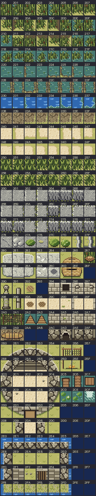

# The Kopais shore's tileset

Route 8 runs west from Thyrsa along the south shore of Lake Kopais: open water, a
broad band of reed beds, the road, and the grey foot of Mount Phikion. One secondary on
the `aethos` primary, `gTileset_Kopais`.

**This catalog is generated** by `tools/ichor/art/kopais_build.py` (painters:
`kopais_marsh.py`, `kopais_stone.py`, `kopais_gear.py`; palettes, class keys and phases
in `kopais_lib.py`). The render-and-critique passes at the end are written by hand and
kept across rebuilds.

## How it fits together

**Place pieces by key and cell name** from `build/kopais/catalog.json`, never by raw id
(`tools/ichor/maps/kopais.py` does). Ids below are the current build's.

**Soft ground with class keys.** `reeds`, `marsh`, `lake`, `mud`, `path`, `barley` and
`crag` hold one piece per key the map uses: `1|` then the class of each neighbor N NE E
SE S SW W NW (`1` the same ground, `g` grass and anything dry, `w` marsh water, `m` mud,
`r` reeds, `L` the lake, `s` stonework standing in the water). The visible shape comes
from the binary key; every pixel outside it is painted as whatever the neighbor it lies
in is, so a reed bed fades into water on one side and stops at grass on another. Each
set decides which classes count as its own ground: the marsh counts reeds, the lake and
stonework as water (their own pieces draw the meeting); mud counts water and reeds as
mud. `tools/ichor/maps/kopais.py --shapes` lists the keys in
`tools/ichor/art/kopais_shapes.json`, and only those are drawn.

- `reeds` are the marsh's tall grass: **MB_LONG_GRASS**, so they hold encounters and the
  long-grass field effect (cut from aethos's reeds) parts round the player. They are
  taller than meadow grass: stems run the whole tile and their heads scatter.
- `marsh` is shallow, murky water, `lake` the open lake on aethos's animated water: both
  MB_POND_WATER (the Conch surfs them, rods fish them).
- `crag` is Phikion's grey limestone, Kithairon's painter, so the two mountains match.

**The tile animation.** Every animated piece (the reeds, the marsh water and the lake's
rim, and the gear standing in them, and the eel-smoker's fire) is painted for four
phases: the reeds lean east, rest, lean west; the water's ripples and glints drift. The
build finds the tiles each animated cell compiled to and writes their frames
(`data/tilesets/secondary/kopais/anim/`, indexed PNGs that `make` turns into `.4bpp`) and
`src/data/tilesets/kopais_anims.h`, which `src/tileset_anims.c` includes. The tileset's
callback is `InitTilesetAnim_Kopais`. A phase lasts 24 frames.

**Walk codes** in the grids: `X` blocks, `.` walkable, `T` walkable and drawn over the
player, `G` grass (MB_LONG_GRASS in `reeds`, MB_TALL_GRASS in `barley`).

**Borrowed ground.** Cells marked *grass*, *path* or *sea* draw no ground of their own:
the build points their bottom tiles at aethos's grass (`0x001`), road (`0x1D9`) or
animated sea (`0x170`). The dike's road, the Treasury's floor and the lake's interior
cost no tiles that way. Rebuild this set whenever aethos is repainted.

**Palettes.** Seven groups, one per secondary palette; every 8x8 tile draws from one.

| Group | Use |
|---|---|
| reed | reed beds on dry ground: reeds, cattails, grass, mud at their feet |
| reedw | reed beds standing in water |
| marsh | marsh water, mud banks, mudflats, lily pads, the lake's rim |
| field | the road, barley on the spur, turned earth |
| rock | Phikion's rock, scrub, the ledges, the Sphinx's ledge and its feathers |
| stone | the dike, the sluice, the Treasury, Gla's wall, the herm, the racing post |
| gear | the hide, nets, eel traps, the smoking rack and fire, the reed boat, the jetty |

## Budget

| Tileset | Tiles | Metatiles | Animated tiles |
|---|---|---|---|
| `gTileset_Kopais` | 411 of 504 | 256 of 512 | 93, in 5 runs |

## `gTileset_Kopais`: Route 8, the Kopais shore



### Soft ground: reeds, marsh water, the lake, mudflats, the road, barley, rock

#### Reed beds: the marsh's tall grass

`reeds`, 8 wide by 4 tall. Tall reeds with cattails and plumes, swaying on four phases (a tile animation). MB_LONG_GRASS: wild encounters, and the long-grass field effect parts round the player. Names are class keys (`1|` then N NE E SE S SW W NW: `1` reeds, `g` grass, `m` mud, `w` water).

29 shapes, from 0x200; the interior `1|11111111` is 0x200.

#### Marsh water with mud banks

`marsh`, 8 wide by 2 tall. Shallow, murky marsh water whose glints drift on four phases. MB_POND_WATER: surf it with the Conch and fish it. Banks of wet mud, then grass. Reeds, the lake and stonework count as water here (their own pieces draw the meeting).

12 shapes, from 0x220; the interior `1|11111111` is 0x220.

#### The open lake

`lake`, 8 wide by 1 tall. Aethos's animated water, borrowed, ringed by marsh water. MB_POND_WATER. Its interior is pure borrowed water.

8 shapes, from 0x230; the interior `1|11111111` is 0x230.

#### Mudflats

`mud`, 8 wide by 1 tall. Cracked mud with damp patches, meeting grass. Walkable.

3 shapes, from 0x238; the interior `1|11111111` is 0x238.

#### The road with soft edges

`path`, 8 wide by 2 tall. The limestone road, scalloped where it meets the grass (agros's painter).

11 shapes, from 0x240; the interior `1|11111111` is 0x240.

#### Barley on the Phikion spur

`barley`, 8 wide by 2 tall. Barley tall grass on aethos grass (agros's painter), for the spur's rocky grass. MB_TALL_GRASS.

16 shapes, from 0x250; the interior `1|11111111` is 0x250.

#### Phikion's grey rock

`crag`, 8 wide by 3 tall. Mount Phikion's grey limestone, seen from above with its south face showing, on aethos grass (Kithairon's painter, so the two mountains match). Impassable. Names are class keys; only `1` counts.

21 shapes, from 0x260; the interior `1|11111111` is 0x260.

### Phikion's rock and the Minyans' stonework

#### Rock detail, scrub and the goat path's ledges

`rock_bits`, 8 wide by 1 tall. `crack`, `boulders`, `scrub_rock`, `tuft`: interior crag cells to scatter. `bush`, `bush_b`: maquis on grass (blocks). `ledge_e`: a rock step on the goat path, MB_JUMP_EAST (jump east, down toward Thyrsa); `ledge_e_foot` the same step where the path's south side meets rock.

```text
0x278 0x279 0x27A 0x27B 0x27C 0x27D 0x27E 0x27F   X X X X X X X X
```

Pieces: `crack` 0x278, `boulders` 0x279, `scrub_rock` 0x27A, `tuft` 0x27B, `bush` 0x27C, `bush_b` 0x27D, `ledge_e` 0x27E, `ledge_e_foot` 0x27F.

#### The Sphinx's ledge

`sphinx`, 5 wide by 2 tall. A flat slab of pale rock on the spur's top, scattered with big old feathers: `NW` `N`... `NE` over `SW` `S`... `SE` (repeat the middle; `N_feathers`, `S_feathers` are middle cells with feathers, `S_dig` one with scraped grit, the daily dig). Walkable. The Enigmaw sits on it by day; the Hyper Potion and the dig go here.

```text
0x280 0x281 0x282 0x283 0x284   . . . . .
0x288 0x289 0x28A 0x28B 0x28C   . . . . .
```

Pieces: `NW` 0x280, `N` 0x281, `NE` 0x282, `SW` 0x288, `S` 0x289, `SE` 0x28A, `N_feathers` 0x283, `S_feathers` 0x28B, `S_dig` 0x28C.

#### The herm, the racing post, turned earth

`markers`, 4 wide by 2 tall. On borrowed grass. `herm_top` over `herm`: the great herm at the spur fork, hung with reed garlands. `post_top` over `post`: the Onchestos marker, Atalanta's worn racing post. `dig` turned earth on grass, `dig_floor` on the Treasury's floor, `dig_dike` on the dike's road (all walkable).

```text
0x290 0x291 0x292 0x293   T T . .
0x298 0x299 0x29A 0x29B   X X . .
```

Pieces: `herm_top` 0x290, `herm` 0x298, `post_top` 0x291, `post` 0x299, `dig` 0x292, `dig_floor` 0x29A, `dig_dike` 0x29B.

Borrowed ground: grass at 0,0, 0,1, 1,0, 1,1, 2,0; path at 2,1, 3,1.

#### The Minyan dike

`dike`, 4 wide by 4 tall. The Minyans' causeway across the inlet, as columns: `cope` (the north edge's paving) over `top` (aethos's road, borrowed; repeat it, the dike is four tiles wide) over `kerb` (the south edge's paving), all walkable, over `face` (the south face, down into the water; blocks). `cope_sluice` over `face_sluice` is the sluice: the gate's grating and the culvert's arch. `top_reeds`, `kerb_reeds` have reed tufts. `_W` and `_E` end the dike where it meets the land.

```text
0x294 0x295 0x296 0x297   . . . .
0x29C 0x29D 0x29E 0x29F   . . . .
0x2A4 0x2A5 0x2A6 0x2A7   . . . .
0x2AC 0x2AD 0x2AE 0x2AF   X X X X
```

Pieces: `cope` 0x294, `top` 0x29C, `kerb` 0x2A4, `face` 0x2AC, `cope_sluice` 0x295, `top_reeds` 0x29D, `kerb_reeds` 0x2A5, `face_sluice` 0x2AD, `cope_W` 0x296, `top_W` 0x29E, `kerb_W` 0x2A6, `face_W` 0x2AE, `cope_E` 0x297, `top_E` 0x29F, `kerb_E` 0x2A7, `face_E` 0x2AF.

Borrowed ground: path at 0,1, 1,1, 2,1, 3,1.

#### The Treasury of Minyas

`tholos`, 5 wide by 6 tall. A 5 x 6 stamp. Row 0: the ring wall's north arc; row 1: the inner face of the north wall, its corbelled courses stepping in and darkening up into shadow; rows 2-3: the chamber's floor (3 x 2, walkable); row 4: the south wall with the doorway (2,4), its cracked lintel drawn over the player; row 5: the dromos between its two short walls. Put the column drum (the Girdle) in the dromos at (2,5).

```text
0x2B0 0x2B1 0x2B2 0x2B3 0x2B4   X X X X X
0x2B8 0x2B9 0x2BA 0x2BB 0x2BC   X X X X X
0x2C0 0x2C1 0x2C2 0x2C3 0x2C4   X . . . X
0x2C8 0x2C9 0x2CA 0x2CB 0x2CC   X . . . X
0x2D0 0x2D1 0x2D2 0x2D3 0x2D4   X X T X X
0x2D8 0x2D9 0x2DA 0x2DB 0x2DC   . X . X .
```

Borrowed ground: grass at 0,5, 4,5; path at 1,2, 1,3, 2,2, 2,3, 2,5, 3,2, 3,3.

#### Gla, the walled islet

`gla`, 6 wide by 4 tall. A 6 x 4 stamp: the ring wall (row 0 its north side, rows 1-2 its west and east sides, row 2 its south face with the great gate at (3,2) and a breach at (2,2)), grass inside (row 1), and the islet's rocky south shore (row 3), where you land with the Conch. The Revive goes on the shore, the dig inside the wall.

```text
0x2E0 0x2E1 0x2E2 0x2E3 0x2E4 0x2E5   X X X X X X
0x2E8 0x2E9 0x2EA 0x2EB 0x2EC 0x2ED   X . . . . X
0x2F0 0x2F1 0x2F2 0x2F3 0x2F4 0x2F5   X X . X X X
0x2F8 0x2F9 0x2FA 0x2FB 0x2FC 0x2FD   X . . . . X
```

Borrowed ground: grass at 1,1, 2,1, 2,2, 3,1, 4,1; sea at 0,0, 0,1, 0,2, 0,3, 1,0, 1,2, 1,3, 2,0, 2,3, 3,0, 3,2, 3,3, 4,0, 4,2, 4,3, 5,0, 5,1, 5,2, 5,3.

### The marsh people's gear, and things in the water

#### A fowler's reed hide

`hide`, 2 wide by 2 tall. A fowler's hide of bundled reeds on grass, its peep-slot facing the water. Blocks.

```text
0x285 0x286   X X
0x28D 0x28E   X X
```

Pieces: `NW` 0x285, `NE` 0x286, `SW` 0x28D, `SE` 0x28E.

Borrowed ground: grass at 0,0, 0,1, 1,0, 1,1.

#### Fowlers' nets on poles

`nets`, 2 wide by 1 tall. A fowlers' net strung between two poles over the reeds. Blocks.

```text
0x2A0 0x2A1   X X
```

Pieces: `W` 0x2A0, `E` 0x2A1.

#### Eel traps in the water

`traps`, 2 wide by 1 tall. Wicker eel traps standing in the marsh water. Block.

```text
0x2A2 0x2A3   X X
```

Pieces: `trap` 0x2A2, `trap_b` 0x2A3.

#### The eel-smoker's rack and fire

`rack`, 2 wide by 2 tall. A timber smoking rack hung with eels over a smouldering reed fire. The flames and smoke move with the marsh's phases. Blocks.

```text
0x2B5 0x2B6   X X
0x2BD 0x2BE   X X
```

Pieces: `NW` 0x2B5, `NE` 0x2B6, `SW` 0x2BD, `SE` 0x2BE.

Borrowed ground: grass at 0,0, 0,1, 1,0, 1,1.

#### A reed boat pulled up

`boat`, 2 wide by 1 tall. A little boat of bundled reeds pulled up on the shore mud. The reed-boat boy sits in it. Blocks.

```text
0x2A8 0x2A9   X X
```

Pieces: `W` 0x2A8, `E` 0x2A9.

#### A heron's nest in the reeds

`nest`, 1 wide by 1 tall. A heron's nest of sticks in the reeds. Blocks.

```text
0x287   X
```

Pieces: `nest` 0x287.

#### The fishing jetty and step

`jetty`, 3 wide by 1 tall. Planks over the water on posts: `end` the jetty's far end, `mid` its run (stack north from the dike), `step` the little fishing step where Ismenias stands. Walkable.

```text
0x2C5 0x2C6 0x2C7   . . .
```

Pieces: `end` 0x2C5, `mid` 0x2C6, `step` 0x2C7.

#### Lily pads and the sluice's outflow

`water_bits`, 3 wide by 1 tall. Marsh water with lily pads (`lilies`, `lilies_b`, scatter them), and `outflow`, the sluice's water foaming out under the dike's culvert arch. MB_POND_WATER.

```text
0x2CD 0x2CE 0x2CF   X X X
```

Pieces: `lilies` 0x2CD, `lilies_b` 0x2CE, `outflow` 0x2CF.

## Render-and-critique passes

Written by hand, kept across rebuilds. The map was rendered with `tools/ichor/maps/kopais.py`
(plain 2x, a review copy with collision and events, and 15 x 10 GBA screens along the road,
in `build/render/kopais/`), compared with MAP_DESIGN.md, batch 1's crossing (Route 7) and
Eleusa's scene, and fixed. The final 2x render is [`img/Route8_Kopais.png`](img/Route8_Kopais.png);
in-game screenshots of every scene are from `tools/ichor/tests/act2_route8.sh`
(`build/test_route8/shots/`).

The builder also checks the map each time: every person, sign and item can be reached from
Thyrsa's side (Gla's two excepted: the Conch), which reed patches are forced, whether each
trainer's sight line is mandatory, and that a trainer who walks up to the player never ends up
blocking the road. Today: three forced bands (band 1 at x 46-48, band 2 at x 27-29, band 3 at
x 8-11, each the full height between the water and the rock), 216 grass cells of which 194 are
reeds; Ismenias and Perses are mandatory, Gorgidas, Pelopidas, Megareus, Timoxena and
Euphrosyne optional (each of those still stands where most players walk).

### The art

1. **Mock 1** (a test grid of reeds, marsh, lake, mud and road, before the map). The reeds read
   as a stripy hedge: their heads sat in one row a tile, so the bed banded every 16 px, and
   the cattails made a row of red dots. The marsh water was dark and speckled, more moss than
   water. The reed beds' edges were straight lines.
2. **Mock 2.** Stems now run the whole tile and each brightens just under its own head, which
   sit at ten different heights: the bed reads as one continuous mass, the cattails scatter.
   The water lost its noise: plain murky green with three drifting ripple dashes and three
   glints. Edges still straight, because the soft-edge wobble was larger than its margin and
   got clipped flat.
3. **Mock 3-5.** Margin raised over the wobble; feathery tops (stems poking a pixel or three
   above the bed's top edge). A yellow-green line ran along every reed/water edge: the margin
   inside a reed cell was painted as grass, because the class of a pixel inside the cell was
   the cell's own. `kopais_lib.class_canvas` now gives those pixels the class of the nearest
   neighbor, so a bed fades straight into water.
4. **Tile budget.** The first full paint came to 478 tiles before any edge piece. The Treasury
   (142 tiles) and Gla (92) were cut from mirrored and repeating cells (44 and 42), the dike's
   middle borrows aethos's road, and class keys are made canonical in the map builder (a key
   that would paint the same piece is the same key): the soft sets went from 249 shapes to 103.

### Route 8, the Kopais shore

1. **Pass 1** (first render). Read well: the lake, the shallows, the reed beds, the sluice, the
   jetty, the tholos, Gla. Wrong: Phikion's foot was two huge flat grey slabs, with face
   fragments round the bushes buried in it; the dike's top was a pale sand rectangle; the
   goat path's ledges looked like posts; the Enigmaw and the Hyper Potion stood on the only
   way down the spur, so the descent was cut off by day; note 4 was walled in by the boat and
   Euphrosyne.
2. **Pass 2.** The ground became one explicit grid. Phikion's foot is scrub woodland now
   (olives, stone pines and maquis, filled in column pairs, crowns poking over the grass above)
   with rock where a wall is needed: under band 3, the narrows, band 2's south side, the
   lagoon's south shore, the gully. The dike has a course of dressed paving along each edge,
   aethos's road between, bollards at the ends. The Sphinx's ledge moved off the path to the
   map's south edge (rows 24-25), and the west shore was rearranged (Euphrosyne faces the
   channel; note 4 stands by the boat).
3. **Pass 3.** A grass rectangle sat above Gla (the islet's first grid row wasn't lake); small
   rock outcrops in the scrub looked like crates; the scrub stood in ranks like an orchard; the
   marsh between the reeds and the open lake was a wide flat band. Fixed: Gla's row is lake;
   the outcrops are gone and the rock is a band along the map's south edge, Phikion's mass;
   the scrub's column pairs start a random row lower and mix more pines; reed islets stand in
   the shallows (Conch country); the ledges are a narrow lip with a dark face and a shadow,
   as Gen 3 draws an east-facing ledge, not a slab of rock.
4. **Pass 4** (in game). The test found that Perses, walking up to a player he'd seen at
   (16,14), stopped on the narrows' one-tile jog and walled the road off until the map
   reloaded. The jog is two tiles wide now ((16,13) is road), and the builder checks every
   trainer's stopping place against the road. Left as is: the scrub east of band 1 still reads
   a little planted at 2x; it reads as a hillside at GBA scale.
5. **Pass 5** (the route standard, MAP_DESIGN section 8, `tools/ichor/map_audit.py`). An
   11.1-screen middle route needs seven trainers: two more stand on the road now, Pelopidas
   (a fowler crouched in band 2, watching it, sight 5) and Megareus (a runner at the
   Onchestos post, watching the road). The audit's edge check found the west and east edges
   open the whole height, walking into the neighbors' rock and trees: both edges are closed
   now by a column of olives, except Lebadeia's road and verges (rows 11-14) and Thyrsa's
   gate road (rows 14-15). Route 8's `right` connection to Thyrsa is in its map.json, so the
   audit can measure forced grass between the ends: 10 cells (bands of 3, 3 and 4).

**`map_audit.py Route8_Kopais`** (2026-11-14):

```text
Route8_Kopais  [route, Arkadia, middle]
  64x26 = 11.1 screens; grass 216 (19/screen, 13%); water 24%; forced grass 10; trainers 7; items 6 + 4 hidden; signs 13; NPCs 9; wild: land MN (10/9 spp), surf M (4 spp), fish M (4 spp), Lv 27–30
  WARN  edge: open edge cells (0, 11)-(0, 14) walk left into solid Lebadeia (27, 11)-(27, 14)
  NOTE  wild: no _Day land table (day falls back to morning)
```

The one warning is Lebadeia's placeholder layout (a copy of an Act I map): the parnassos
agent's Lebadeia opens its road and verges on those rows.

### Deviations

- **The Treasury of Minyas has no interior map.** BUILD.md registers no map for it and the
  Part 10 list puts "its corbelled interior" in this tileset, so the chamber is on Route 8:
  the beehive tomb with its dome fallen in, as the real one at Orchomenos is, so you look
  down into the round chamber (the north wall's corbelled courses darkening up into shadow).
  The doorway faces south, the way every door in this projection faces; you reach the dromos
  from the spur's path. SCRIPT.md's "the tomb's only light comes in through the door" can't
  hold for a roofless chamber.
- **The reeds are MB_LONG_GRASS,** not MB_TALL_GRASS: the long-grass field effect is cut from
  aethos's reeds and hides more of the player, which is SCRIPT.md's "taller than meadow grass".
  It means no running in the reeds, as in Emerald's long grass.
- **The herm's bg event runs its own line, then `EventScript_IchorAnointHerm`** (ENGINE_API.md
  section 4's way for a herm that doubles as a sign), so SCRIPT.md's reed garlands and
  directions are kept.
- **The goat path is a gully through the rock, and the loop runs to the eel-smoker's fire.**
  Faces only show on the south side of rock in this projection, so the high path reads as a
  path between rocks. Its three ledges jump east; the way down lands by the fire, past band 2
  and the dike: "a quick way home".
- **Gorgidas is optional.** He nets birds at the reed edge facing the road (sight 3 covers
  the road), but the reed bed behind him lets a player go round.
- **Two trainers SCRIPT.md doesn't name,** for the route standard: FOWLER Pelopidas (Gorgidas's
  partner: the two founded Thebes's Sacred Band) and RUNNER Megareus (named for Onchestos's
  king, Hippomenes's father), Lv 30-31, in `design/phase3/parties/kopais.party`.
- **Extra rewards** beyond Part 6's list, for MAP_DESIGN's "every dead end pays" and the
  user's call for optional grass with a reason: an Ultra Ball deep in Timoxena's reeds, a
  Full Heal on the reed-boat shore, a hidden Nugget in the Treasury's wall ("a king so rich he
  built his gold a house"), a hidden Big Mushroom under the goat path's last ledge (the dead
  end you reach from the fire).
- **TM Ancient Power** isn't numbered: the Treasury's ball holds TM Rock Tomb as a stand-in
  (`ICHOR_STUB_TMS`).
