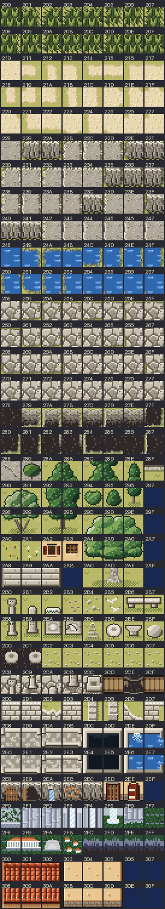

# Parnassos's tileset: Lebadeia and Route 9

The road west under Parnassos: Lebadeia in its gorge, where the Herkyna comes out of
the rock beside the springs of Lethe and Mnemosyne and the oracle's bronze grille; then
the Split Road, climbing through pale limestone, bay laurel and wild olive to the
crossroads where three roads meet, the lookout under Delphoi's cliffs, and the fallen
Phokian treasury above the cutting. One secondary on the `aethos` primary:

| Tileset | Maps |
|---|---|
| `gTileset_Parnassos` | `MAP_LEBADEIA`, `MAP_ROUTE9_SCHISTE` |

Both maps share it, so their seam (Lebadeia's west edge, Route 9's east edge) needs no
aethos-only strip. Kirrha and Aigion are on the harbors agent's own `kirrha` set
(BUILD.md), so this set carries only these two maps.

**This catalog is generated** by `tools/ichor/art/parnassos_build.py` (painters:
`parnassos_ground.py`, `_trees.py`, `_stone.py`, `_springs.py`, `_far.py`, `_houses.py`;
palettes in `parnassos_lib.py`, the soft-shape engine and crag painter borrowed from
Kithairon's). The render-and-critique passes at the end are written by hand and kept
across rebuilds.

**Place pieces by key and cell name** from `build/parnassos/catalog.json`, never by raw
id (`tools/ichor/maps/parnassos.py` does). Ids below are the current build's.

**Soft ground.** `tall`, `path`, `crag`, `water`, `pave` and `gully` hold one piece per
blob shape key: `1|` then the cell's neighbors N NE E SE S SW W NW. The map builder lists
the keys its maps use in `tools/ichor/art/parnassos_shapes.json`
(`parnassos.py --shapes`), and only those are drawn.

**Walk codes** in the grids: `X` blocks, `.` walkable, `T` walkable and drawn over the
player, `G` tall grass, `D` a door (MB_NON_ANIMATED_DOOR: put the warp there).

**Borrowed ground.** Cells on *grass*, *path*, *sea* or *tall* draw no ground of their own:
the build points their bottom tiles at aethos's grass (`0x001`), road (`0x1D9`), animated
water (`0x170`) or tall grass (`0x00D`). Rebuild the set whenever aethos is repainted.

**Palettes.** Seven groups, one per secondary palette; every 8x8 tile draws from one.

| Group | Use |
|---|---|
| field | tall grass, the road, the broken bridge's timber |
| rock | crags and their details, the Herkyna's banks, gullies, the grille, the spout, the ravine |
| tree | laurels, wild olives, planes, scrub |
| stone | paving, the herm, the boundary stone, altars, the ruin, drums, steps, bridges, the bench, the chair |
| water | the springs of Lethe and Mnemosyne |
| house | Eleusa's house kit, verbatim |
| far | the Phaidriades, Delphoi's roofs, the Kastalian falls |

**Scripted swaps** (`include/constants/metatile_labels.h`): `METATILE_Parnassos_Grille` and
`_GrilleOpen` (the oracle's grille, beat 35B), `_DrumGully`, `_DrumGully_B` and `_Drum` (the
treasury's drums at rest, beat 36C), and `_AltarApollo` (the shrine once cleansed).

## Budget

| Tileset | Tiles | Metatiles |
|---|---|---|
| `gTileset_Parnassos` | 497 of 504 | 272 of 512 |



## Soft ground: grass, road, crags, the Herkyna, paving, gullies

### Tall grass with soft edges

`tall`, 8 wide by 2 tall. Barley tall grass on aethos grass, cut from one field so any outline works (agros's painter, as on every route). MB_TALL_GRASS throughout. Names are blob shape keys (`1|NNEESESSWWNW`).

15 shapes, from 0x200; the interior `1|11111111` is 0x200.

### The road with soft edges

`path`, 8 wide by 3 tall. The limestone road and its goat tracks, scalloped where they meet the grass (agros's painter). Names are blob shape keys.

23 shapes, from 0x210; the interior `1|11111111` is 0x210.

### Crags: pale limestone with a south face

`crag`, 8 wide by 4 tall. Parnassos's limestone seen from above, its south face showing, on aethos grass. Fill any region: the face appears along every south edge, with a shadow on the grass below. Impassable. Kithairon's painter, recolored. Names are blob shape keys.

28 shapes, from 0x228; the interior `1|11111111` is 0x228.

### The Herkyna: water with a pebbly bank

`water`, 8 wide by 2 tall. Aethos's animated water under a bank of pale pebbles and reeds. MB_POND_WATER: surf it with the Conch and fish it. Names are blob shape keys; the interior is `1|11111111`.

13 shapes, from 0x248; the interior `1|11111111` is 0x248.

### Paving: polygonal limestone flags

`pave`, 8 wide by 4 tall. Old polygonal flags, worn into the grass at their edges: the crossroads' triangle, Lebadeia's precinct, the treasury's floor. Walkable. Where paving meets the road, count the road as paving (and the paving as road) so they join without a grass seam. Names are blob shape keys.

25 shapes, from 0x258; the interior `1|11111111` is 0x258.

### Gullies: a dry ravine from above

`gully`, 8 wide by 2 tall. A dry gully: its far wall's face falls into a dark floor, the near lips catch the light. Impassable. The treasury's drums roll into one; the broken bridge spans another. Names are blob shape keys.

16 shapes, from 0x278; the interior `1|11111111` is 0x278.

### Crag detail: cracks, boulders, tufts, juniper

`crag_detail`, 2 wide by 1 tall. Interior crag cells to scatter through a big crag (Kithairon's, recolored): `crack`, `boulders`, `tuft`, `juniper`. Block.

```text
0x288 0x289   X X
```

Pieces: `crack` 0x288, `juniper` 0x289.

## Laurels, wild olives, plane trees, scrub, flowers

### Bay laurel (2 x 3)

`laurel`, 2 wide by 3 tall. Apollo's tree: a dense dark egg of glossy leaves on a slim grey trunk. The top row is drawn over the player.

```text
0x28A 0x28B   T T
0x292 0x293   X X
0x29A 0x29B   X X
```

### A laurel's base with the next laurel's crown over it

`laurel_stack`, 2 wide by 1 tall. Between two laurels in a column: the upper laurel's base row, the lower laurel's crown top over it. Blocks.

```text
0x28C 0x28D   X X
```

### Young laurel (1 x 2)

`laurel_young`, 1 wide by 2 tall. A sapling laurel for gaps in the scrub. Its top half is drawn over the player.

```text
0x28E   T
0x296   X
```

### Wild olive (2 x 2)

`wild_olive`, 2 wide by 2 tall. The oleaster of Parnassos's terraces: a gnarled two-stemmed trunk under thin silver-green leaves. The top row is drawn over the player.

```text
0x290 0x291   T T
0x298 0x299   X X
```

### Plane tree (3 x 3)

`plane`, 3 wide by 3 tall. The oriental plane of Lebadeia's grove: a great spreading crown over a pale mottled trunk. The top row and the bottom corners are drawn over the player; the trunk and the crown's middle row block.

```text
0x29C 0x29D 0x29E   T T T
0x2A4 0x2A5 0x2A6   X X X
0x2AC 0x2AD 0x2AE   T X T
```

### Scrub: kermes oak and laurel bushes

`scrub`, 2 wide by 1 tall. Low bushes for the laurel scrub along the road: `oak` a round kermes oak, `laurel` a young bay, `pair` two small bushes. Block.

```text
0x294 0x295   X X
```

Pieces: `oak` 0x294, `laurel` 0x295.

### Mountain flowers and a tussock

`meadow`, 2 wide by 1 tall. Walkable. Scatter through open grass with aethos's red anemones (0x004): `broom` yellow Spanish broom, `white` asphodel, `tuft` a tussock.

```text
0x2A0 0x2A1   . .
```

Pieces: `broom` 0x2A0, `white` 0x2A1.

## Worked stone: the herm, altars, the treasury's ruin, steps, bridges

### Stones and shrines of the Split Road

`markers`, 8 wide by 3 tall. On borrowed grass except the gully drums. `herm_top` over `herm`: the great herm. `stone_top` over `boundary`: the old boundary stone of the crossroads. `altar_top` over `altar` (or `altar_bad`, the god's face scratched with a sickle): Apollo's little marble altar. `cairn` the pilgrims' cairn; `bench_L`, `bench_R` the lookout's bench; `chair` the stone chair of Mnemosyne (walkable: the reading's seat); `drum` a column drum at rest; `drum_gully*` drums fallen into a gully (on the gully's floor, for the treasury's push puzzle); `capital`, `stump` Doric pieces; `rubble`, `feathers`, `dig`, `scree`, `scree_b` walkable; `boulder` a grey rock; `drum_b` a drum lying on its side.

```text
0x2B0 0x2B1 0x2B2 0x2B3 0x2B4 0x2B5 0x2B6 0x2B7   T T T . . . X X
0x2B8 0x2B9 0x2BA 0x2BB 0x2BC 0x2BD 0x2BE 0x2BF   X X X X X X X X
0x2C0 0x2C1 0x2C2 0x2C3 0x2C4 0x2C5 0x2C6 0x2C7   X X . . . . . .
```

Pieces: `herm_top` 0x2B0, `stone_top` 0x2B1, `altar_top` 0x2B2, `dig` 0x2B3, `rubble` 0x2B4, `feathers` 0x2B5, `bench_L` 0x2B6, `bench_R` 0x2B7, `herm` 0x2B8, `boundary` 0x2B9, `altar` 0x2BA, `altar_bad` 0x2BB, `cairn` 0x2BC, `drum` 0x2BD, `capital` 0x2BE, `boulder` 0x2BF, `drum_gully` 0x2C0, `drum_gully_b` 0x2C1, `scree` 0x2C2.

### The herm, the boundary stone and the chair, on paving

`pmarkers`, 5 wide by 1 tall. `markers`' `herm_top` over `herm`, `stone_top` over `boundary`, and `chair`, on the paving's flags instead of grass.

```text
0x2C8 0x2C9 0x2CA 0x2CB 0x2CC   T X T X .
```

Pieces: `herm_top` 0x2C8, `herm` 0x2C9, `stone_top` 0x2CA, `boundary` 0x2CB, `chair` 0x2CC.

### The treasury's broken walls

`ruin`, 8 wide by 1 tall. The Phokian treasury's ashlar, on borrowed grass. `W_L`, `W_M`, `W_R`: a west-east wall with its coping and south face; `W_low` the same broken low; `W_stub` a fallen end; `NS` a north-south wall seen from above, `NS_end` its south end with a bit of face; `door_L` a door jamb.

```text
0x2D0 0x2D1 0x2D2 0x2D3 0x2D4 0x2D5 0x2D6 0x2D7   X X X X X X X X
```

Pieces: `W_L` 0x2D0, `W_M` 0x2D1, `W_low` 0x2D2, `W_R` 0x2D3, `NS` 0x2D4, `NS_end` 0x2D5, `W_stub` 0x2D6, `door_L` 0x2D7.

### The pilgrims' steps

`steps`, 3 wide by 1 tall. Three pale limestone risers going down to the south: the steps of Lebadeia's precinct, where the pilgrims sit. West-east; walkable.

```text
0x2A8 0x2A9 0x2AA   . . .
```

Pieces: `L` 0x2A8, `M` 0x2A9, `R` 0x2AA.

### Stone bridges over the Herkyna

`bridge`, 4 wide by 2 tall. Over a river two cells wide. The road bridge is two rows: `N_L` `N_R` (its north parapet) over `S_L` `S_R` (its south parapet). The footbridge is one row, `F_L` `F_R`, parapets both sides. Walkable; count these cells as river when tiling the banks, so the water runs under.

```text
0x2D8 0x2D9 0x2DA 0x2DB   . . . .
0x2E0 0x2E1 0x2E2 0x2E3   . . . .
```

Pieces: `N_L` 0x2D8, `N_R` 0x2D9, `S_L` 0x2E0, `S_R` 0x2E1, `F_L` 0x2DA, `F_R` 0x2DB, `F_L2` 0x2E2, `F_R2` 0x2E3.

### The broken timber bridge

`timber`, 3 wide by 1 tall. A plank bridge over a gully three cells wide: `W`, `gap` (the middle planks fell: MB_ICHOR_GAP, so the Winged Talaria leap it at a run), `E`. Walkable but the gap. Count these cells as gully when tiling it.

```text
0x2CD 0x2CE 0x2CF   . X .
```

Pieces: `W` 0x2CD, `gap` 0x2CE, `E` 0x2CF.

## Lebadeia's precinct: the grille, the springs

### The oracle's rock: grille, spout, tablets

`face`, 5 wide by 1 tall. South-face cells of the crag (blob key `1|11100011`) over the precinct's paving, a shadowed foot at their base (`plain` the bare face). `grille` the bronze grille shut across Trophonios's cave mouth (blocks); `grille_open` swung back, MB_NON_ANIMATED_DOOR, the cave's warp (the map swaps it in when `FLAG_ICHOR_TROPHONIOS_GRILLE_OPEN` is set); `spout` the spring of Mnemosyne running out of the rock; `tablets` pilgrims' tablets hung on pegs.

```text
0x2E8 0x2E9 0x2EA 0x2EB 0x2EC   X D X X X
```

Pieces: `grille` 0x2E8, `grille_open` 0x2E9, `spout` 0x2EA, `tablets` 0x2EB, `plain` 0x2EC.

### The spring of Lethe (2 x 2)

`lethe`, 2 wide by 2 tall. A square stone basin of black, still water: forgetting. Blocks. A hidden item can sit in it (the Bronze Obol someone threw in to forget something).

```text
0x2DC 0x2DD   X X
0x2E4 0x2E5   X X
```

Pieces: `NW` 0x2DC, `NE` 0x2DD, `SW` 0x2E4, `SE` 0x2E5.

### The spring of Mnemosyne (2 x 2)

`mnemosyne`, 2 wide by 2 tall. Bright running water in a stone rim, fed from the spout above (put `face`'s `spout` over its west column) and spilling east through a notch into the Herkyna: put the river's water cells against its east side and count these cells as water when tiling the river. Blocks.

```text
0x2DE 0x2DF   X X
0x2E6 0x2E7   X X
```

Pieces: `NW` 0x2DE, `NE` 0x2DF, `SW` 0x2E6, `SE` 0x2E7.

## The lookout's view: the Phaidriades and Delphoi, the ravine

### The far side: the Phaidriades and Delphoi

`far`, 8 wide by 2 tall. A backdrop across the lookout's ravine, from the top: cliff tops (`top_a`, `top_b`), faces (`face_a`, `face_b`) with the Kastalian gorge and its falls between them (`gorge_top`, `gorge`, `gorge_foot`), the cliffs' foot (`foot`, `foot_b`), the slope with the sanctuary (`slope`, `slope_b`, `temple_L` `temple_R`, `theater`, `roofs`), and `slope_foot` falling into the ravine. All block.

```text
0x2F0 0x2F1 0x2F2 0x2F3 0x2F4 0x2F5 0x2F6 0x2F7   X X X X X X X X
0x2F8 0x2F9 0x2FA 0x2FB 0x2FC 0x2FD 0x2FE 0x2FF   X X X X X X X X
```

Pieces: `top_a` 0x2F0, `face_a` 0x2F1, `face_b` 0x2F2, `gorge_top` 0x2F3, `gorge` 0x2F4, `gorge_foot` 0x2F5, `foot` 0x2F6, `slope` 0x2F7, `temple_L` 0x2F8, `temple_R` 0x2F9, `theater` 0x2FA, `roofs` 0x2FB, `slope_foot` 0x2FC.

### The ravine, and the lookout's lip

`ravine`, 1 wide by 1 tall. `dark` the ravine's depth; `mist` the same with a thread of mist; `lip` the lookout's near edge (grass to the south, the drop to the north; walkable, the player stops at it).

```text
0x28F   .
```

Pieces: `lip` 0x28F.

## Lebadeia's houses (Eleusa's kit)

### Tiled roof: ridge row and eave row

`roof_tile`, 3 wide by 2 tall. Red Laconian tiles. Repeat the middle column for a wider house.

```text
0x300 0x301 0x302   X X X
0x308 0x309 0x30A   X X X
```

Pieces: `R0_L` 0x300, `R0_M` 0x301, `R0_R` 0x302, `R1_L` 0x308, `R1_M` 0x309, `R1_R` 0x30A.

### Wall rows: upper and lower (on the socle)

`wall`, 3 wide by 2 tall. Plain plaster. Every window, door and extra below is a W0 or W1 M cell, so it can stand anywhere between the corners.

```text
0x303 0x304 0x305   X X X
0x30B 0x30C 0x30D   X X X
```

Pieces: `W0_L` 0x303, `W0_M` 0x304, `W0_R` 0x305, `W1_L` 0x30B, `W1_M` 0x30C, `W1_R` 0x30D.

### Upper-wall cells: windows and garlic

`windows`, 2 wide by 1 tall. W0 cells. `shutters` is an open window with ox-blood shutters, `lattice` a small timber grille, `closed` shutters shut, `garlic` strings of garlic and onions on a peg.

```text
0x2A2 0x2A3   X X
```

Pieces: `shutters` 0x2A2, `lattice` 0x2A3.

### Doors (lower-wall cells)

`doors`, 2 wide by 1 tall. W1 cells; every one is a door (MB_NON_ANIMATED_DOOR): put the warp there. `plank` a dark plank door in ox-blood jambs, `dutch` its top leaf open, `curtain` an arched doorway with a striped wool curtain, `barn_l` + `barn_r` a wide double door (warp on both).

```text
0x2ED 0x2EE   D D
```

Pieces: `plank` 0x2ED, `curtain` 0x2EE.

## Render-and-critique passes

Renders: `design/phase3/img/Lebadeia.png` and `design/phase3/img/Route9_Schiste.png` (2x);
the 15 x 10 screen sheets and the collision review are in `build/render/parnassos/`
(`tools/ichor/maps/parnassos.py` writes all of them). Each pass below was judged against
MAP_DESIGN.md and batch 1's renders (Route 6, Thyrsa City), whose open flat rock the
polish agents are now fixing.

### Pass 1: the first layout

**Route 9.** Built rock-first: everything not road was crag, with laurel scrub and a few
olive groves cut into it.
- The crag interiors were the worst thing on the map: whole screens of plain grey rock
  top with a juniper or two, reading as concrete. This is exactly the flatness the user
  flagged on Kithairon.
- The far side of the lookout read as one grey wall with white specks along its top, and
  the slope under it as a dark green band speckled white, like flowers.
- The south seam's aethos olives stood in a strict grid, and odd-length runs left deep-shade
  squares behind.
- The crossroads' paving was a big stair-stepped blob, not a triangle.
- The terraces worked: a loop up the west stair, ledges down, the Super Potion at the end.

**Lebadeia.** Also rock-first.
- The Herkyna ran dead straight from top to bottom, two cells wide: a canal, not a river.
- The gorge's south wall was a flat grey field, and the north side above the hall the same.
- Only three planes, for a grove that's meant to shade the whole precinct.
- The east seam's olives stood in rows.

### Pass 2: woods first, a winding river, the far cliffs repainted

- **Both maps now start as laurel woods,** not rock. `PMap.laurels()` fills them with bay
  laurels in staggered column pairs, mixed with pairs of aethos's olives and cypresses
  (about a quarter and a tenth), so the slopes read as Parnassos's laurel scrub and wild
  olive and the colors vary. Crag is used where height is meant.
- **The far cliffs** (`parnassos_far.py`) became rounded buttresses on a 32 px period, lit on
  their left, with ledge lines and clefts, so two cells side by side read as one irregular
  wall. The tops are scrubby hazy rock with no white specks, the slope has dark cypress
  points instead of white ones, and the Kastalian falls drop through a dark slot between
  the two cliffs. The ravine's flat black band was replaced by the slope falling away into
  darkness (`slope_foot`), which reads as depth and cost fewer tiles.
- **The Herkyna winds:** it leaves Mnemosyne's notch at x 10-11, swings to 11-12 for the road
  bridge, back to 10-11 for the footbridge, and out to the south edge at 11-12. Planes
  stand along it (four now), and the gorge's sides are laurel woods.
- Still wrong: long straight crag bands two rows deep (a lit top row and a face row)
  crossing whole screens, and odd olive runs leaving pale shade squares, and in the seam,
  aethos boulders that look like loaves.

### Pass 3: rock as steps, staggered olives

- **Crag bands became one row deep:** a single crag row with open ground north and south
  draws a thin lit lip over a full south face, a low cliff step. Route 9's slope now
  climbs in steps between bands of woods, and the big grey tops are gone except the
  cutting's walls, the treasury's outcrop and the crossroads' shoulder.
- **Olive runs stagger only when their length is odd** (a crown tip on grass tops the run),
  so no leftover cell is needed and the shade squares and loaves are gone, except where a
  one-row gap was left, which the builder now avoids.
- **Two-row strips of woods** (between steps) alternate young laurels, cypresses and bushes
  instead of a hedge of identical saplings.
- **The crossroads** is a tighter triangle: its north point takes the fork, its east side
  the cleft, its south-west point the cutting; the boundary stone sits inside it with the
  old man beside it, the herm and Apollo's laurel shrine on its north edge.
- **Lebadeia:** scrub on the oracle's rock above the precinct, and the east seam's olive
  rows are left whole.

### What's left (honest)

- The paving (crossroads, precinct, the treasury's floor) reads busy, more cobble than
  polygonal flag. A calmer flag texture would need a repaint and its tiles are at the
  budget's edge (497 of 504).
- The terrace lips are aethos's ledges, which read as thin plank lines at this scale.
  They're the primary's terrace ledge everywhere, so they're kept for consistency.
- The precinct's rock face is one cell tall. The springs and chair read clearly, but the
  oracle's rock could feel higher; a taller face needs a second face row the crag
  painter doesn't draw.
- The cutting's walls are narrow crag tops, plain grey.
- The SE quadrant of Route 9 (below the east road) is olive groves and steps the road
  never enters. It's scenery seen from the road's edge, but it's a lot of map for that.

## Map notes

**Seams.**
- Lebadeia's east edge ↔ Route 8: road on rows 12-13 (verges 11, 14), `right` offset 0;
  Lebadeia's columns 24-31 are aethos-only (checked by the builder).
- Lebadeia's west edge ↔ Route 9's east edge: Lebadeia's road on rows 12-13, Route 9's on
  rows 20-21 (verges 19, 22). Lebadeia `left` offset −8, Route 9 `right` offset +8. Both
  maps are on `gTileset_Parnassos`, so there's no strip.
- Route 9's south edge → Kirrha's north edge: Route 9's road at columns 9-10 (verges 8,
  11), `down` offset −18; rows 38-43 are aethos-only (olives, the road's patch, a stele).

**Warps and scripted arrivals.** Lebadeia's warps 0, 1 and 2 are the pilgrims' hall door
(17,9), Herkyna's door (5,18) and the mason's door (18,19); warp 3 is the bronze grille
(6,2), shut by `Lebadeia_EventScript_SetGrille` (a blocking metatile) until
`FLAG_ICHOR_TROPHONIOS_GRILLE_OPEN`. The tile in front of the grille, (6,3), is the stone
chair of Mnemosyne, walkable: 35C's warp back lands the player on it, facing south.

**Story triggers.** Lebadeia's arrival pan runs on the first frame (`VAR_TEMP_6` 0); the
springs talk on the pilgrims' steps, row 6 (`VAR_TEMP_1` 0). Route 9's crossroads scene
fires at (34,16) and (34,17) (`VAR_TEMP_1`), the lookout scene at (11,7) and (11,8)
(`VAR_TEMP_6`), the drums' rolls at (17,23) and (18,19) (`VAR_TEMP_7`, `_4`), and Alethea
goes ahead to Kirrha at (9,36) and (10,36) (`VAR_TEMP_5`). Neither map uses `VAR_TEMP_2`
or `_3` (main's carried-flame code reads that pair).

**The drums (36C).** D1 (17,23) is pushed west from (18,23) onto the gully's lip (16,23);
stepping where it stood rolls it into the gully (15,23). D2 (19,21) is pushed east into
the alcove (20,21), where it stops against the rock. D3 (18,19) is pushed west from (19,19)
onto the lip (17,19); stepping where it stood rolls it in (16,19), sets
`FLAG_ICHOR_HIDE_SCHISTE_DRUMS`, and the way into the treasury, (18,18), is open. The drums
are `EventScript_StrengthBoulder` objects behind `FLAG_TEMP_11`-`13`, so walking off the map
resets them; the story flag keeps them gone, and the map draws them at rest in the gully
and the alcove. Every drum can only be pushed one way, so no arrangement traps the player.

**Herm.** Route 9's great herm stands at (30,13)-(30,14) beside the crossroads; its landing
tile is (30,15): `HERM_AETHOS_ROUTE_9` in `src/data/ichor_herms.h` and
`HEAL_LOCATION_HERM_AETHOS_ROUTE_9` in `src/data/heal_locations.json`.

**Forced grass** (the builder's check, on the main road): band A1 (x 42-44, rows 20-21) and
A2 (x 39-40) on the east road; B2 (x 22-23, rows 29-32, below the cutting) and B3 (x 9-10,
rows 35-37, among the olives) on the south-west road. On the north-west fork (a dead end):
F1 (x 21-23, rows 11-12) and F2 (x 15-17, rows 7-8). Optional grass: the goats' slope, the
Sphinx's seat track, both olive terraces, the bridge's far bank and the grove below the
crossroads.

**Items.** Visible: Max Revive (the lookout's tip, 1,7), PP Max (across the broken bridge,
26,8), TM (the treasury, 13,15: TM Rock Tomb stands in for Rock Slide, `ICHOR_STUB_TMS`),
Hard Stone (the treasury, 17,14), Super Potion (terrace 1's end, 12,25), Ultra Ball (the
grove below the crossroads, 31,27). Hidden: Ether (the cairn's foot, 10,7), Pretty
Feather (the Sphinx's seat, 40,10), Nugget (the treasury's floor, 12,14), Revival Herb
(terrace 1, 3,25); Lebadeia's Bronze Obol (Lethe, 3,4, as `ITEM_RELIC_COPPER`), Calcium
(behind the pilgrims' hall, 18,5) and Honey (the plane's hollow, 1,10).

**Deviations from SCRIPT.md** (each the closest reading):
- Saon's NO leaves the grille shut; asking him again offers the descent again. SCRIPT's
  "The grille is open whenever you're ready" is kept as his line.
- Drum 2 is pushed east into an alcove where it stops against rock, rather than south;
  drums 1 and 3 roll into the gully as written. The engine's own column-drum prompt
  replaces SCRIPT's drum text, and the engine's cleansing lines replace the shrine's.
- The Kastalian falls aren't animated (a static white rope): an animation needs a
  `src/tileset_anims.c` callback, an engine edit.
- The Sphinx's seat on Route 9 is a dead end above the crossroads (feathers, a hidden Pretty
  Feather); the omen's Enigmaw sits on the boundary stone, shown only once
  `FLAG_ICHOR_OMEN_SCHISTE_TOLD` is set (`ICHOR_STUB_OMENS`: the augurs aren't built).
- No sea glimpse in Route 9's far corner: Kirrha's map sits below that edge, and sea
  against its north rows would break the seam. The treasury's view sign carries the gulf.
- The pilgrims' hall is the Eleusa house kit, not a hall cut into the rock; rooms2 builds
  its rock-backed interior.
