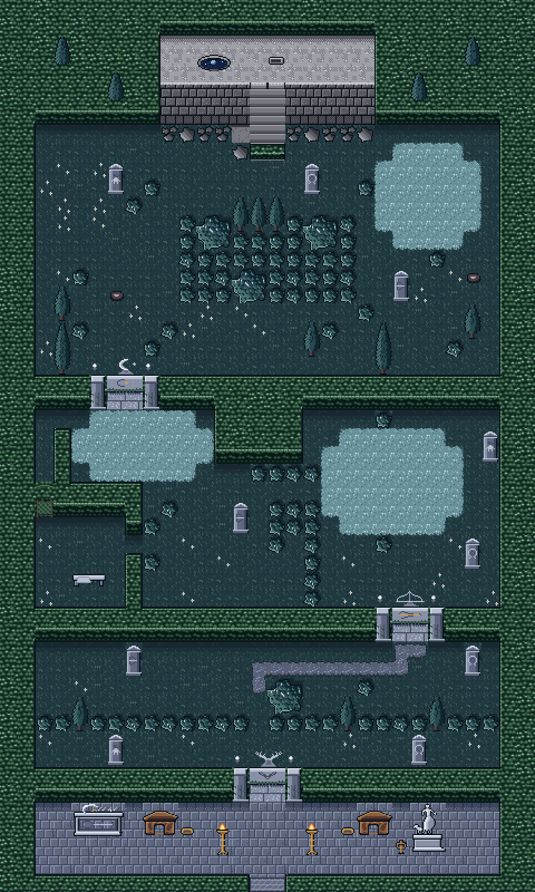

# Temple of Artemis: the `temple_artemis` tileset and the Hunt for the Hind

`gTileset_TempleArtemis` is the Temple of Artemis at Arkadia (Laurel 5, Hierophant Kallisto the
Moonlit Huntress), and `MAP_ARKADIA_TEMPLE_OF_ARTEMIS` is the garden built from it: the Hunt
for the Hind of design/phase3/SCRIPT.md beat 44 and Part 5, on the verb SYSTEMS.md §12 gives
Artemis, *stealth*.

The temple has no roof. Inside the door is a paved porch: the great altar, the goddess drawing
an arrow, two kennels and their bowls, two burning lampstands, and Phylonoe. North of it three
walled gardens climb the hill, each walled in clipped laurel and entered by a hunters' arch
(antlers, a bow, a crescent moon). Paths run between myrtle, stelae and cypresses, which stop a
hound's eye; pools of moonlight lie on the clearings, a clearly brighter ground. At the top a
grey rock stands in the brightest moonlight, a moon pool cut in its flat and a stair cut in
its face, a low laurel hedge across the stair's foot. Kallisto sits on the rock.

| Image | Shows |
|---|---|
| [`img/Arkadia_TempleOfArtemis.png`](img/Arkadia_TempleOfArtemis.png) | The map at 2x, as a player first finds it (compiled tileset on oikos) |
| [`img/temple_artemis_map_solved.png`](img/temple_artemis_map_solved.png) | After the hunt: the stair's hedge down, Anthia's gate open |
| [`img/temple_artemis_map_events.png`](img/temple_artemis_map_events.png) | The events: people, the seven hounds and their patrols, every tile a hound ever sees, the hind's clearings, triggers, signs, warps |
| `img/temple_artemis_pass{1,2,3}_{room,views,events}.png` | The render-and-critique passes below |
| [`img/temple_artemis_pieces.png`](img/temple_artemis_pieces.png), [`img/temple_artemis_sheet.png`](img/temple_artemis_sheet.png) | Every structure as drawn; the numbered sheet from the compiled tileset |



## How it is made

- `tools/ichor/art/temple_artemis_art.py` holds every pixel and the palette plan;
  `temple_artemis_build.py` draws it, checks every 8x8 tile against the palette groups,
  merges near-duplicate tiles, compiles with Porytiles against an empty stand-in primary,
  verifies the result, and writes the metatile labels the scripts swap
  (`METATILE_TempleArtemis_*`), `build/temple_artemis/catalog.json`, the sheet and the catalog
  below. It is batch 1's Temple of Dionysus build, retargeted.
- `tools/ichor/maps/temple_artemis.py` is the map: the garden as one character per cell, which
  it auto-tiles (hedges, moonlight and gravel walks by blob shape key; the lawn's variants and
  the shade under every hedge face; the rock from its cell types) into `map.bin`, the events in
  `map.json`, and the generated garden scripts in `scripts.pory` (between markers). It checks
  the map and the hunt (below) and writes the renders. `--review NAME` draws review sheets
  straight from the art; `--lua PATH` writes the hounds' patrols for the test.

**Why `oikos` and an indoor map, not `aethos`.** The garden is outdoors in the story, but its
night is the temple's own: "a sky that is always the same moonlit night, whatever the hour
outside". An outdoor map takes the clock's day-night tint (`OW_ENABLE_DNS`) on top of whatever
the tiles draw, so a night palette would go black at night and wash out at noon. On an indoor
map the tint never applies, and the tiles' own night is what the player sees at any hour. Like
the Temples of Hestia, Hermes, Demeter and Dionysus, the set uses only its own tiles and
palettes 6-12 with opaque bottoms, so the primary under it doesn't matter; it is paired with
`oikos`.

**Palettes.** Seven groups, one per secondary palette, every colour a multiple of 8: `ground`
(the night lawn, gravel walks, asphodel), `moon` (the moonlit lawn and where it fades into the
night lawn), `leaf` (clipped laurel, myrtle with its silver rim and white flowers, cypress),
`stone` (marble: arches, stelae, the altar, the goddess, the porch's paving, its garlands and
gilding), `rock` (the hill's own grey rock and the lawn at its foot), `warm` (kennels, bronze,
the lamps' flame) and `water` (the moon pool). The moon stands high in the south-west, behind
the player's shoulder: tops and south faces catch a cool silver light, and shadows fall
north-east.

**Layers.** Floors, hedges and the rock fill the bottom layer; bushes, posts, kennels, the
altar and the goddess stand in the middle layer; the arches' lintels and crowns, the tops of
stelae, cypresses and lampstands, and Anthia's arbor are drawn over the player.

**Tile budget.** 458 of 504 tiles (the door animations own 504-511). The ground, moonlight,
gravel and hedge sets are all 47 blob shapes each, cut from 16-periodic textures, so their
8x8 quarters repeat and the four sets cost about 120 tiles together.

## The garden

30 x 50, `oikos` + `temple_artemis`, `MAPSEC_ARKADIA`, indoor, music `MUS_ICHOR_TEMPLE`
(`ICHOR_STUB_MUSIC`: `MUS_ICHOR_HUNT`, SCRIPT.md Part 9 cue 20, isn't composed). From north to
south:

| Rows | What |
|---|---|
| 0-6 | The north hedge, and the rock (x 9-20): its moonlit flat (rows 2-4) with the moon pool (11-12,3) and Kallisto's seat (15,3), the stair (14-15, 4-7) cut through its cliff, the landing (13,7) where Prokris stands. Cypress spires rise out of the hedge masses beside it |
| 7-20 | **Stage III, the Hind's Run.** Clearing A (12,17) at the stage's foot; the west band with clearing B (4,11) and H5's line across it (row 14); the central grove of myrtle and cypress (x 10-19, rows 12-16); the north band past H6's stele loop (16-18, 9-11) to the stair's foot, the hedge across it at (14-15,8); moonlit clearing C (x 21-26, rows 8-13) with H7 turning at its heart and the hind's third place (23,12) |
| 21-22 | The wall, and the third arch (the crescent moon), opening at (6-7) |
| 23-33 | **Stage II, the Moonlit Clearings.** The court inside the second arch (SE); moonlit clearing 1 with H2 turning at (21,27), its west side a one-row passage along H2's own line; the shade between, where H3 circles a stele (13,29); moonlit clearing 2 (NW) with H4 walking its middle row in front of the third arch; Anthia's grove (SW) behind a bush, her bench and the feather beside it, her hedge gate (2,27-28) opening a lane north to the third arch |
| 34-35 | The wall, and the second arch (the bow), opening at (22-23) |
| 36-42 | **Stage I, the Glade of the Bush.** The forecourt inside the first arch, a myrtle hedge across it with one gap (14,40); H1's line across the glade (row 39, x 8-13), the great myrtle (15-16, 38-39) beside the crossing; a gravel walk to Kyrene (20,36) and the second arch |
| 43-44 | The wall, and the first arch (the antlers), opening at (14-15) |
| 45-49 | **The porch**: the great altar (4-6, 45-46), Artemis (23-24, 45-47), the kennels (8-9, 20-21) and bowls, the lampstands (12,47) and (17,47), Phylonoe (16,46), the doormat (14-15,49), warps 0-1 to `MAP_ARKADIA` warp 6 |

**Every dead end pays.** Hidden: Stardust in the forecourt's asphodel (2,41), a Dusk Ball in
Stage II's dark north-east corner (27,23), a Star Piece on the rock's flat (20,3). Visible: the
Pretty Feather beside Anthia's bench (6,32). Seven stelae carry a myth of the place each:
the hound with the rubbed nose, the little bears, Aktaion, Atalanta and the she-bear, the
Keryneian hind, the worn stele the hound circles, Orion and the scorpion.

## The hunt

**The hounds.** Seven temple hounds (`OBJ_EVENT_GFX_ICHOR_TEMPLE_HOUND`) are objects with
`TRAINER_TYPE_NORMAL`, a sight range, and this map's `Hound` script, which isn't a
`trainerbattle`. The engine's own trainer check (`CheckForTrainersWantingBattle`,
`src/trainer_see.c`) sends such an object through `EventScript_ObjectApproachPlayer`: the "!",
the walk to the player, then the script: the bay, "The hound trots you back to the arch", the
return counted, the screen black, and a warp to the current stage's arch, facing in. Sight is
the trainer's: a straight line along the hound's facing, stopped by any blocking tile or object
(hedges, myrtle, stelae, trunks, other hounds, the hind). It is polled every frame the player
has control, against the tile the player is stepping into, so a hound that turns or walks onto
a waiting player still sees them. No engine code was added.

| | Where | Patrol (engine movement type) | Sight |
|---|---|---|---|
| H1 | Stage I, row 39 | a 6-tile line, x 8-13 (`WALK_LEFT_AND_RIGHT`, range 5) | 3 |
| H2 | clearing 1 (21,27) | turns in place, south, west, north, east (`ROTATE_CLOCKWISE`) | 6 |
| H3 | round the stele (13,29) | a loop of the 3 x 3 ring (`WALK_SEQUENCE_UP_RIGHT_DOWN_LEFT`, range 2) | 3 |
| H4 | clearing 2, row 25 | a 6-tile line, x 5-10 | 6 |
| H5 | Stage III's west, row 14 | a 6-tile line, x 4-9 | 3 |
| H6 | round the stele (17,10) | a loop of the 3 x 3 ring | 3 |
| H7 | clearing C (24,11) | turns in place | 6 |

Moonlit hounds' long lines are horizontal or cut by cover within 4 tiles vertically, so a hound
that sees the player is always on the screen. A turning hound also turns toward a player who
runs near it (the engine's own rule for rotating trainers), which Phylonoe's "Walk" covers.

**The simulator.** The builder models each patrol frame by frame (a walker steps a tile every
16 frames and turns at once at its line's end; `WalkBackAndForth` runs from its home tile to
home − range and back; a turner holds each facing about 49 frames) and walks every leg of the
hunt breadth-first over (tile, frame), never standing where a hound looks. It fails the build
if a leg can't be walked, or if a leg that should need timing has a path no hound could ever
see (Stage II's shortcut and the first walk to the hind may be free). Today: Stage I 14 steps;
Stage II 26 steps with waits, or 13 by Anthia's gate; Stage III 9 + 12 + 22 + 12 = 55 steps
(Part 5's "about 60").

**The hind** (`OBJ_EVENT_GFX_ICHOR_GOLDEN_HIND`) stands in the clearing her stage says
(`ON_TRANSITION`). The first and second touches throw her head up (`nurse_joy_bow`) and she
bolts at `walk_faster` along a run the builder finds over open ground no hound walks (the
hounds stand frozen somewhere on their patrols while she runs); the third gives Sagitta and
sinks the stair's hedge (+1 metatile). After the laurel she grazes in clearing A.

**Kallisto** (`MOVEMENT_TYPE_NONE`, turned up at load: facing up is her seated pose) speaks
when the player reaches the top of the stair, looks down (`nurse_joy_bow`), battles, climbs down
(`jump_in_place_down`), gives the laurel and her gifts, looks toward the gate for the boy in the
red cloak, and sits back facing the sky. She is never `faceplayer`ed.

## The script (`data/maps/Arkadia_TempleOfArtemis/scripts.pory`)

**State.** `VAR_ICHOR_HUNT` (bank var 0x00A): the tens are the hunt's stage (0 not yet welcomed,
10 Stage I, 20 Stage II, 30 Stage III with the hind at A, 40 at B, 50 at C, 60 the third touch,
70 the laurel), the units the hounds' walks back in this stage, 0-3, for Phylonoe's direct hint.
It stands in for Part 8's `FLAG_ICHOR_HUNT_STAGE_1`, `_STAGE_2`, `FLAG_ICHOR_HIND_TOUCH_1`,
`_TOUCH_2` (BUILD.md: hold the hunt's state in a var), and for SCRIPT.md's `VAR_TEMP_1`, which a
same-map warp would clear; the units count again from nothing when the player comes in by the
door. Anthia's shortcut (`FLAG_ICHOR_ANTHIA_GATE`) is her trainer flag. `FLAG_ICHOR_HUNT_DONE` is
set at the third touch and again with the laurel. The awake hounds hide at `FLAG_BADGE05_GET`;
the seven sleeping hounds (`_TEMPLE_HOUND_SLEEP`, in the awake ones' places) show then
(`FLAG_ICHOR_HIDE_TEMPLE_HOUNDS_ASLEEP`, set in `ON_TRANSITION` until the laurel). `VAR_TEMP_5`,
`_6` and `_4` keep the second arch's, the third arch's and the rock's triggers live
(never `VAR_TEMP_2` and `_3` together: main's carried-flame code reads that pair as a torch).

**The beats.** Phylonoe's welcome on the first step inside the door; her menu (HOW DOES IT
WORK? / WHERE AM I GOING? / NOTHING) and, after three walks back in a stage, her direct hint
first (SCRIPT.md's for Stage II; one each in her voice for Stages I and III). The great altar
runs `EventScript_IchorTempleAltar_Artemis`. Kyrene, Anthia (her battle opens her gate) and
Prokris as Part 3 writes them. Kallisto's scene, battle and rewards as beat 44 writes them:
the Moon Laurel (`FLAG_BADGE05_GET`), Artemis Favor +15 (`Ichor_AddFavor`), Ursa Major
(`FLAG_ICHOR_CONSTELLATIONS_START + 2`), TM Dark Pulse (`FLAG_ICHOR_GOT_TM_DARK_PULSE`), the rite
(`EventScript_IchorHierophantRite`: the Pretty Feather), `FLAG_ICHOR_KALLISTO_RITE`. Talking to
her again: her reading; the tablet lines, once, with prophecy tablet #5
(`FLAG_ICHOR_PROPHECY_START + 4`, read at `+ 12`; `FLAG_ICHOR_KALLISTO_TABLET`); and gift I at
Artemis Favor 30 through `EventScript_IchorHierophantGift` (the Night Slash lesson), with her
line and Orion (`+ 3`).

## Deviations from SCRIPT.md, and why

1. **The acolytes face across the way, not down it.** Part 5 has Kyrene and Prokris facing
   south. Kyrene stands beside the second arch's approach facing east, and Prokris on the landing
   beside the stair's foot facing east: each sight line covers the whole two-tile-wide way
   (MAP_DESIGN §1), and Prokris can't be reached until the hedge lowers, so her "Three times you
   touched her" is always true.
2. **Patrols have no pause at their ends, and no difficulty scaling.** Part 5's 2 s / 1 s / 0.5 s
   pauses need a patrol movement type the engine doesn't have; the stock `WALK_*_AND_*`,
   `WALK_SEQUENCE_*` and `ROTATE_CLOCKWISE` types are used. Lines are 6 tiles. Asked of
   ichor-engine: a pausing patrol type that reads the difficulty.
3. **The hunt's flags are one var** (above), and the returns survive the warp back.
4. **The rite's feather.** Kallisto's two lines frame the engine's rite call, whose own line
   ("Before you go: this is what Artemis loves best…") and Pretty Feather come between them.
5. **Gift I is a lesson**, as the engine builds it, not a TM: "received TM Night Slash" becomes the
   engine's teaching line; Kallisto's "She put a hunter in the sky for less" and Orion follow.
   The engine's gift call turns her to the player after the lesson; she is turned back up.
6. **The Pretty Feather lies beside Anthia's bench,** not on it: `map_audit.py` wants every item
   ball on a walkable cell, and the bench blocks.
7. **Added lines,** each short and measured: the hind's "She bolts…", the hedge sinking, Anthia's
   gate creaking open, Phylonoe's after-laurel line, her answers and her Stage I and III hints,
   the Orion line, the stelae, the kennels, the pool and the goddess.

## Stubs (by tag)

- `ICHOR_STUB_MUSIC`: the map plays `MUS_ICHOR_TEMPLE`; the hound's bay is a Lykopup's cry.
- `ICHOR_STUB_TMS`: TM Dark Pulse is a flag until Balance numbers the TM.
- `ICHOR_STUB_AETHOS_DEX`: the Skylaps and Kerdovix roamers that start with the laurel.

## Render-and-critique passes

**Pass 1** (`temple_artemis_pass1_*`). The structure read: three walled gardens climbing to the
rock, the arches (the best thing on the map: antlers, bow and moon read at a glance), the hunt's
patrols and sight shown in the events plan. Wrong:
- the hedges were flat, bright yellow-green slabs, more paper than laurel, and nothing like night;
- the moonlight was snow: a white noise of speckles in hard rectangles and crosses;
- the rock's flat was white noise, its cliff a grey smear; the moon pool a dark bat shape;
- the myrtles were dark blobs barely separate from the dark lawn; the great myrtle a square;
- Stage III's west and south were empty dark lawn; the hedge masses beside the rock empty carpet.

**Pass 2** (`temple_artemis_pass2_*`). A night palette throughout: the laurel deep blue-green,
its top a carpet of leaves each lit on its upper edge, its face darker, a moonlit lip where the
top turns down; the lawn calmer and a little lighter, so things on it read; the moonlight the
same lawn silvered, smooth, clearly brighter. Myrtles redrawn as clumps of leaves lit from the
south-west with a silver rim. The rock's flat smooth pale stone with hairline cracks, its cliff
two courses of laid stone; the moon pool an oval basin with a cut lip. Left: the first clearing
a hard rectangle; the hedge masses beside the rock and the long boundary hedges still a uniform
carpet; Stage III's bands still empty.

**Pass 3** (`temple_artemis_pass3_*`). The moonlight's edge softened (a wider, rounder fall-off)
and the first clearing's corners cut. A second grain for the hedge's top mixed through every big
mass, and cypress spires growing up out of the hedges beside the rock. Stage III furnished:
clearing B ringed with asphodel and given a stele, clearing A a ring of flowers and myrtle, the
west and east bands asphodel, stumps and a stele; Stage II's court and middle flowered, a stele
by the court. Every change re-run through the simulator (all legs still need timing and can be
walked). Left: the cliff still reads a little like masonry; the bench's fleece is very white.

**In game** (`tools/ichor/tests/act2_artemis.sh`, screenshots in `build/test_act2_artemis/shots/`):
the porch with Phylonoe and her welcome, her menu and hint, the hounds' walk-backs, each stage
crossed, the huntresses' battles, Anthia's gate, the hind's three touches and bolts, Sagitta,
the hedge sinking, Kallisto's scene, battle and laurel, and the solved garden on re-entry, all
looked at with batch 3's real sprites (the hounds, the hind, Kallisto, the huntresses,
Phylonoe).

## The test

`tools/ichor/tests/act2_artemis.sh` (on `engine_build.sh`, `engine_lib.lua` and `slice_lib.lua`):
a Quickstart, a level-100 test team, the first four laurels and `FLAG_ICHOR_KLEON_JOINED_TITANS`,
followers off (so the hounds' patrols run exactly as modelled), then the whole trial by key
presses. It crosses the hounds the way a player does: it watches each one, learns where it is
in its patrol (`temple_artemis.py --lua` writes the patrols; the test measures the engine's
periods itself and re-anchors on every step and turn it sees), plans the walk over time with
the same rules as the builder's simulator, takes one step, and plans again. The run:
Phylonoe's welcome and her answers; three walk-backs from H1 and her Stage I hint; past H1
behind the great myrtle; Kyrene; a walk-back by H2 to the second arch; past H2 along its own
line and past H3's stele; Anthia, her gate and the feather; the shortcut to the third arch;
the hind's three touches (A, B, C), past H5, H6 and H7, Sagitta and the hedge; Prokris;
Kallisto's scene and battle, the Moon Laurel, Ursa Major, the TM flag, the rite and its
feather; her after-lines and the pool; a re-entry with the garden solved, the hounds asleep and
the hind grazing in A; the great altar. 50 checks, 76 screenshots; it measured the engine's
periods as the builder models them (a step every 16 frames, a turn every 49). It found one real
bug on the way: the hind reappeared in clearing A whenever she scrolled off screen after a bolt
(her template now follows her, `copyobjectxytoperm`).

**`map_audit.py Arkadia_TempleOfArtemis`**: the cells are unique and the feather sits on a
walkable, reachable cell. Its two failures are the door's warps to `MAP_ARKADIA` warp 6, which
doesn't exist until the arkadia agent's town lands. Its seven warnings are the rock's top
(Prokris, Kallisto, the pool, the Star Piece, the rock's trigger), which the audit reads with
the stair's hedge up; it lowers at the hind's third touch.

## For the integrator

- **The door.** Warps 0-1 (the mat, (14,49) and (15,49)) go to `MAP_ARKADIA` warp 6, which the
  arkadia agent draws; `map_audit.py` fails them until Arkadia has seven warps. Arkadia's warp 6
  should land the player on the temple's warp 0.
- **Arkadia's cordon.** The east road's two huntresses can take `FLAG_BADGE05_GET` as their hide
  flag; this map sets nothing else for them. `FLAG_ICHOR_PHILOXENOS_LAUREL_5` (Phase 2's laurel
  flags) isn't defined on this branch; Philoxenos's line can read `FLAG_BADGE05_GET` too.
- **Nothing else shared** beyond the appended tileset entries (`headers.h`, `graphics.h`,
  `metatiles.h`), the layout's entry in `layouts.json`, the metatile labels, the claims below,
  and the bank var.
- **Claims.** Bank flags 0x1E4-0x1E8: `FLAG_ICHOR_KALLISTO_RITE`, `_GOT_TM_DARK_PULSE`,
  `_HIDE_TEMPLE_HOUNDS_ASLEEP`, `_KALLISTO_TABLET`, `_ITEM_TEMPLE_ARTEMIS_PRETTY_FEATHER`.
  Vanilla flags 0x35B-0x35D: `FLAG_ICHOR_HIDDEN_TEMPLE_ARTEMIS_STARDUST`, `_DUSK_BALL`,
  `_STAR_PIECE` (0x35A is Emerald's Wally flag, not free, so the visible feather takes a bank
  flag). Bank var 0x00A: `VAR_ICHOR_HUNT`.
- **Parties** are as staged (`design/phase3/parties/artemis.party`), unchanged.

<!-- catalog: written by tools/ichor/art/temple_artemis_build.py; do not edit by hand -->

## Catalog

279 metatiles from 0x200; **458 of 504 tiles used** (the door animations own 504-511). Walk codes: `X` blocks, `.` walkable, `T` walkable and drawn over the player, `S` MB_SOUTH_ARROW_WARP (the doormat). Every other metatile is MB_NORMAL; the hunt is all objects and script.

### Floors: the night lawn, the porch's paving, the door

`floor`, 8 wide by 2 tall. `lawn` is the clipped night lawn (`_b` a second grain; `_tuft` a darker tussock; `_flowers` white asphodel). `lawn_shade` is the lawn under a hedge's face, in its shadow: put it on the row south of every hedge face. `pave` is the porch's marble paving (`_b`, `_c`, `_worn` to break a run; `_moon` a slab in a pool of moonlight; `_shade` under a hedge). The doormat (`mat_l`, `mat_r`) is MB_SOUTH_ARROW_WARP: a warp on each. `void` blocks: the border.

```text
ids                                                walk
0x200 0x201 0x202 0x203 0x204 0x205 0x206 0x207   . . . . . . X .
0x208 0x209 0x20A 0x20B 0x20C 0x20D 0x20E 0x20F   . . . . S S . .
```

Pieces: `lawn` 0x200, `lawn_b` 0x201, `lawn_flowers` 0x202, `lawn_flowers_b` 0x203, `lawn_shade` 0x204, `lawn_shade_b` 0x205, `void` 0x206, `lawn_tuft` 0x207, `pave` 0x208, `pave_b` 0x209, `pave_c` 0x20A, `pave_moon` 0x20B, `mat_l` 0x20C, `mat_r` 0x20D, `pave_shade` 0x20E, `pave_worn` 0x20F.

### Moonlight: pools of pale ground, every shape

`moon`, 8 wide by 6 tall. The lawn where the moon lies on it, clearly brighter: a hound that patrols it sees 6 tiles, not 3. Every one of the 47 blob shapes, named by shape key (`eleusa_lib.blob_key`); `1|11111111` is the middle of a pool. Walkable.

```text
ids                                                walk
0x210 0x211 0x212 0x213 0x214 0x215 0x216 0x217   . . . . . . . .
0x218 0x219 0x21A 0x21B 0x21C 0x21D 0x21E 0x21F   . . . . . . . .
0x220 0x221 0x222 0x223 0x224 0x225 0x226 0x227   . . . . . . . .
0x228 0x229 0x22A 0x22B 0x22C 0x22D 0x22E 0x22F   . . . . . . . .
0x230 0x231 0x232 0x233 0x234 0x235 0x236 0x237   . . . . . . . .
0x238 0x239 0x23A 0x23B 0x23C 0x23D 0x23E 0x23F   . . . . . . . .
```

Pieces: `1|00000000` 0x210, `1|00000010` 0x211, `1|00001000` 0x212, `1|00001010` 0x213, `1|00001110` 0x214, `1|00100000` 0x215, `1|00100010` 0x216, `1|00101000` 0x217, `1|00101010` 0x218, `1|00101110` 0x219, `1|00111000` 0x21A, `1|00111010` 0x21B, `1|00111110` 0x21C, `1|10000000` 0x21D, `1|10000010` 0x21E, `1|10000011` 0x21F, `1|10001000` 0x220, `1|10001010` 0x221, `1|10001011` 0x222, `1|10001110` 0x223, `1|10001111` 0x224, `1|10100000` 0x225, `1|10100010` 0x226, `1|10100011` 0x227, `1|10101000` 0x228, `1|10101010` 0x229, `1|10101011` 0x22A, `1|10101110` 0x22B, `1|10101111` 0x22C, `1|10111000` 0x22D, `1|10111010` 0x22E, `1|10111011` 0x22F, `1|10111110` 0x230, `1|10111111` 0x231, `1|11100000` 0x232, `1|11100010` 0x233, `1|11100011` 0x234, `1|11101000` 0x235, `1|11101010` 0x236, `1|11101011` 0x237, `1|11101110` 0x238, `1|11101111` 0x239, `1|11111000` 0x23A, `1|11111010` 0x23B, `1|11111011` 0x23C, `1|11111110` 0x23D, `1|11111111` 0x23E.

### Gravel walks, every shape

`walk`, 8 wide by 6 tall. Raked gravel walks through the lawn, named by shape key like the moonlight. Walkable.

```text
ids                                                walk
0x240 0x241 0x242 0x243 0x244 0x245 0x246 0x247   . . . . . . . .
0x248 0x249 0x24A 0x24B 0x24C 0x24D 0x24E 0x24F   . . . . . . . .
0x250 0x251 0x252 0x253 0x254 0x255 0x256 0x257   . . . . . . . .
0x258 0x259 0x25A 0x25B 0x25C 0x25D 0x25E 0x25F   . . . . . . . .
0x260 0x261 0x262 0x263 0x264 0x265 0x266 0x267   . . . . . . . .
0x268 0x269 0x26A 0x26B 0x26C 0x26D 0x26E 0x26F   . . . . . . . .
```

Pieces: `1|00000000` 0x240, `1|00000010` 0x241, `1|00001000` 0x242, `1|00001010` 0x243, `1|00001110` 0x244, `1|00100000` 0x245, `1|00100010` 0x246, `1|00101000` 0x247, `1|00101010` 0x248, `1|00101110` 0x249, `1|00111000` 0x24A, `1|00111010` 0x24B, `1|00111110` 0x24C, `1|10000000` 0x24D, `1|10000010` 0x24E, `1|10000011` 0x24F, `1|10001000` 0x250, `1|10001010` 0x251, `1|10001011` 0x252, `1|10001110` 0x253, `1|10001111` 0x254, `1|10100000` 0x255, `1|10100010` 0x256, `1|10100011` 0x257, `1|10101000` 0x258, `1|10101010` 0x259, `1|10101011` 0x25A, `1|10101110` 0x25B, `1|10101111` 0x25C, `1|10111000` 0x25D, `1|10111010` 0x25E, `1|10111011` 0x25F, `1|10111110` 0x260, `1|10111111` 0x261, `1|11100000` 0x262, `1|11100010` 0x263, `1|11100011` 0x264, `1|11101000` 0x265, `1|11101010` 0x266, `1|11101011` 0x267, `1|11101110` 0x268, `1|11101111` 0x269, `1|11111000` 0x26A, `1|11111010` 0x26B, `1|11111011` 0x26C, `1|11111110` 0x26D, `1|11111111` 0x26E.

### Clipped laurel hedges, every shape

`hedge`, 8 wide by 6 tall. The garden's walls: clipped laurel, a flat moonlit top and a dark south face. Named by shape key of the hedge mass (`eleusa_lib.blob_key`). A cell whose south neighbor isn't hedge draws the face; give hedge walls two rows (top, face) so the face sits under a top. Blocks.

```text
ids                                                walk
0x270 0x271 0x272 0x273 0x274 0x275 0x276 0x277   X X X X X X X X
0x278 0x279 0x27A 0x27B 0x27C 0x27D 0x27E 0x27F   X X X X X X X X
0x280 0x281 0x282 0x283 0x284 0x285 0x286 0x287   X X X X X X X X
0x288 0x289 0x28A 0x28B 0x28C 0x28D 0x28E 0x28F   X X X X X X X X
0x290 0x291 0x292 0x293 0x294 0x295 0x296 0x297   X X X X X X X X
0x298 0x299 0x29A 0x29B 0x29C 0x29D 0x29E 0x29F   X X X X X X X X
```

Pieces: `1|00000000` 0x270, `1|00000010` 0x271, `1|00001000` 0x272, `1|00001010` 0x273, `1|00001110` 0x274, `1|00100000` 0x275, `1|00100010` 0x276, `1|00101000` 0x277, `1|00101010` 0x278, `1|00101110` 0x279, `1|00111000` 0x27A, `1|00111010` 0x27B, `1|00111110` 0x27C, `1|10000000` 0x27D, `1|10000010` 0x27E, `1|10000011` 0x27F, `1|10001000` 0x280, `1|10001010` 0x281, `1|10001011` 0x282, `1|10001110` 0x283, `1|10001111` 0x284, `1|10100000` 0x285, `1|10100010` 0x286, `1|10100011` 0x287, `1|10101000` 0x288, `1|10101010` 0x289, `1|10101011` 0x28A, `1|10101110` 0x28B, `1|10101111` 0x28C, `1|10111000` 0x28D, `1|10111010` 0x28E, `1|10111011` 0x28F, `1|10111110` 0x290, `1|10111111` 0x291, `1|11100000` 0x292, `1|11100010` 0x293, `1|11100011` 0x294, `1|11101000` 0x295, `1|11101010` 0x296, `1|11101011` 0x297, `1|11101110` 0x298, `1|11101111` 0x299, `1|11111000` 0x29A, `1|11111010` 0x29B, `1|11111011` 0x29C, `1|11111110` 0x29D, `1|11111111` 0x29E.

### The hedge's tops: a second grain, and cypress spires

`hedge2`, 3 wide by 2 tall. `top_b` is the middle of a hedge's top (`hedge` `1|11111111`) with its leaves laid another way; scatter it through big hedge masses. `spire_top` over `spire` (and `_b`): a cypress growing up through a hedge's top, both cells inside the mass. All block.

```text
ids                  walk
0x2A0 0x2A1 0x2A2   X X X
0x2A8 0x2A9 0x2AA   X X X
```

Pieces: `top_b` 0x2A0, `spire_top` 0x2A1, `spire_b_top` 0x2A2, `spire` 0x2A9, `spire_b` 0x2AA.

### The first hunters' arch: antlers

`arch_antlers`, 4 wide by 3 tall. Set it into a two-row hedge wall: row 0 over the lawn north of the wall (the crown, drawn over the player), row 1 in the wall's top row (the capitals and the lintel, walked under), row 2 in its face row (the posts and the opening). The lawn under the crown is plain `lawn`.

```text
ids                        walk
0x2A3 0x2A4 0x2A5 0x2A6   T T T T
0x2AB 0x2AC 0x2AD 0x2AE   X T T X
0x2B3 0x2B4 0x2B5 0x2B6   X . . X
```

Pieces: `crown_l` 0x2A3, `crown_ml` 0x2A4, `crown_mr` 0x2A5, `crown_r` 0x2A6, `cap_l` 0x2AB, `lintel_l` 0x2AC, `lintel_r` 0x2AD, `cap_r` 0x2AE, `post_l` 0x2B3, `open_l` 0x2B4, `open_r` 0x2B5, `post_r` 0x2B6.

### The second hunters' arch: the bow

`arch_bow`, 4 wide by 3 tall. Set it into a two-row hedge wall: row 0 over the lawn north of the wall (the crown, drawn over the player), row 1 in the wall's top row (the capitals and the lintel, walked under), row 2 in its face row (the posts and the opening). The lawn under the crown is plain `lawn`.

```text
ids                        walk
0x2B8 0x2B9 0x2BA 0x2BB   T T T T
0x2C0 0x2C1 0x2C2 0x2C3   X T T X
0x2C8 0x2C9 0x2CA 0x2CB   X . . X
```

Pieces: `crown_l` 0x2B8, `crown_ml` 0x2B9, `crown_mr` 0x2BA, `crown_r` 0x2BB, `cap_l` 0x2C0, `lintel_l` 0x2C1, `lintel_r` 0x2C2, `cap_r` 0x2C3, `post_l` 0x2C8, `open_l` 0x2C9, `open_r` 0x2CA, `post_r` 0x2CB.

### The third hunters' arch: the crescent moon

`arch_moon`, 4 wide by 3 tall. Set it into a two-row hedge wall: row 0 over the lawn north of the wall (the crown, drawn over the player), row 1 in the wall's top row (the capitals and the lintel, walked under), row 2 in its face row (the posts and the opening). The lawn under the crown is plain `lawn`.

```text
ids                        walk
0x2BC 0x2BD 0x2BE 0x2BF   T T T T
0x2C4 0x2C5 0x2C6 0x2C7   X T T X
0x2CC 0x2CD 0x2CE 0x2CF   X . . X
```

Pieces: `crown_l` 0x2BC, `crown_ml` 0x2BD, `crown_mr` 0x2BE, `crown_r` 0x2BF, `cap_l` 0x2C4, `lintel_l` 0x2C5, `lintel_r` 0x2C6, `cap_r` 0x2C7, `post_l` 0x2CC, `open_l` 0x2CD, `open_r` 0x2CE, `post_r` 0x2CF.

### Myrtle: small bushes and the big one

`bush`, 8 wide by 1 tall. Myrtle bushes on the lawn, dense enough to stop a hound's eye. `myrtle`, `_b`, `_flowers` (in white flower) are one cell. `big_*` is the great myrtle, 2 x 2: place `big_tl` `big_tr` over `big_bl` `big_br`. `stump` is an old cut laurel trunk. All block.

```text
ids                                                walk
0x2D0 0x2D1 0x2D2 0x2D3 0x2D4 0x2D5 0x2D6 0x2D7   X X X X X X X X
```

Pieces: `myrtle` 0x2D0, `myrtle_b` 0x2D1, `myrtle_flowers` 0x2D2, `big_tl` 0x2D3, `big_tr` 0x2D4, `big_bl` 0x2D5, `big_br` 0x2D6, `stump` 0x2D7.

### Stelae, cypresses, lamps: tall things on the lawn

`tall`, 6 wide by 2 tall. Each is a base (blocks) under a top drawn over the player in the cell above, which must be plain `lawn` (the lamp's, plain `pave`). Stelae carry a deer, a bow or a laurel wreath, and stop a hound's eye. `cypress` and `cypress_b` are a cypress two cells tall. `lamp` is a bronze lampstand, burning (the porch's).

```text
ids                                    walk
0x2D8 0x2D9 0x2DA 0x2DB 0x2DC 0x2DD   T T T T T T
0x2E0 0x2E1 0x2E2 0x2E3 0x2E4 0x2E5   X X X X X X
```

Pieces: `stele_deer_top` 0x2D8, `stele_bow_top` 0x2D9, `stele_wreath_top` 0x2DA, `cypress_top` 0x2DB, `cypress_b_top` 0x2DC, `lamp_top` 0x2DD, `stele_deer` 0x2E0, `stele_bow` 0x2E1, `stele_wreath` 0x2E2, `cypress` 0x2E3, `cypress_b` 0x2E4, `lamp` 0x2E5.

### A tall cypress

`tallcypress`, 1 wide by 3 tall. A cypress three cells tall: `top` over `mid` (both drawn over the player) over `base`, on plain `lawn`.

```text
ids      walk
0x2A7   T
0x2AF   T
0x2B7   X
```

Pieces: `top` 0x2A7, `mid` 0x2AF, `base` 0x2B7.

### The hounds' kennels, a bowl, Anthia's bench

`kennel`, 8 wide by 1 tall. By the porch: the temple hounds' kennels (2 x 2: `kennel_tl` `kennel_tr` over `kennel_bl` `kennel_br`), a bronze water `bowl`, a `leash` coiled on a post, all on the porch's paving. `bench_l` `bench_r`: a marble bench with a fleece thrown over it, on the lawn (Anthia's grove). All block.

```text
ids                                                walk
0x2E8 0x2E9 0x2EA 0x2EB 0x2EC 0x2ED 0x2EE 0x2EF   X X X X X X X X
```

Pieces: `kennel_tl` 0x2E8, `kennel_tr` 0x2E9, `kennel_bl` 0x2EA, `kennel_br` 0x2EB, `bowl` 0x2EC, `leash` 0x2ED, `bench_l` 0x2EE, `bench_r` 0x2EF.

### The great altar of Artemis

`altar`, 3 wide by 2 tall. The great altar (3 x 2) on the porch's paving: a marble table under a silver crescent, a bow and a quiver carved on its front, the first feathers of the hunt laid on top.

```text
ids                  walk
0x2F0 0x2F1 0x2F2   X X X
0x2F8 0x2F9 0x2FA   X X X
```

Pieces: `altar_tl` 0x2F0, `altar_tm` 0x2F1, `altar_tr` 0x2F2, `altar_bl` 0x2F8, `altar_bm` 0x2F9, `altar_br` 0x2FA.

### Artemis

`statue`, 2 wide by 3 tall. The goddess on her plinth, drawing an arrow from her quiver, on the porch's paving: `tl` `tr` (drawn over the player) over `ml` `mr` over `bl` `br`.

```text
ids            walk
0x2F3 0x2F4   T T
0x2FB 0x2FC   X X
0x303 0x304   X X
```

Pieces: `tl` 0x2F3, `tr` 0x2F4, `ml` 0x2FB, `mr` 0x2FC, `bl` 0x303, `br` 0x304.

### The moonlit rock

`rock`, 8 wide by 3 tall. Kallisto's rock, built from cell types. Row by row of the rock: the `flat` on top (`_b`; `_shade` under the hedge; `_w`/`_e` its sides, the lawn beyond; `corner_w`/`_e` lawn with the rock's rounded corner, blocking), the `lip` where it drops (`_w`, `_e`; `stair_top` where the stair begins), the `cliff` (`_b`, `_w`, `_e`; `stair`), the cliff's `foot` (`_w`, `_e`; `stair_foot`), and in front of it `rubble`, a `boulder` and a `landing` of flat rock. `seat` is the flat stone Kallisto sits on (walkable: she stands on it).

```text
ids                                                walk
0x308 0x309 0x30A 0x30B 0x30C 0x30D 0x30E 0x30F   . . . . . . X X
0x310 0x311 0x312 0x313 0x314 0x315 0x316 0x317   . . . . X X X .
0x318 0x319 0x31A 0x31B 0x31C 0x31D 0x31E 0x31F   X X X . X X . X
```

Pieces: `flat` 0x308, `flat_b` 0x309, `flat_shade` 0x30A, `flat_w` 0x30B, `flat_e` 0x30C, `seat` 0x30D, `corner_w` 0x30E, `corner_e` 0x30F, `lip` 0x310, `lip_w` 0x311, `lip_e` 0x312, `stair_top` 0x313, `cliff` 0x314, `cliff_w` 0x315, `cliff_e` 0x316, `stair` 0x317, `foot` 0x318, `foot_w` 0x319, `foot_e` 0x31A, `stair_foot` 0x31B, `rubble` 0x31C, `boulder` 0x31D, `landing` 0x31E, `cliff_b` 0x31F.

### The hedge across the stair, and Anthia's gate

`gates`, 8 wide by 1 tall. `hedge_l` `hedge_r`: the low laurel hedge across the foot of the rock's stair, on the rock's stair rock; `hedge_lowered_*` (= the hedge + 1) is the same hedge clipped to its roots, walkable. `gate_top` over `gate`: Anthia's woven laurel gate in a hedge wall's top and face rows; `gate_top_open` and `gate_open` (= the closed piece + 1) stand open.

```text
ids                                                walk
0x320 0x321 0x322 0x323 0x324 0x325 0x326 0x327   X . X . X . X .
```

Pieces: `hedge_l` 0x320, `hedge_lowered_l` 0x321, `hedge_r` 0x322, `hedge_lowered_r` 0x323, `gate_top` 0x324, `gate_top_open` 0x325, `gate` 0x326, `gate_open` 0x327.

### The moon pool on the rock

`pool`, 2 wide by 1 tall. A basin cut in the rock's flat, holding still black water and the moon's reflection. Blocks; place on the rock's flat.

```text
ids            walk
0x2B0 0x2B1   X X
```

Pieces: `pool_l` 0x2B0, `pool_r` 0x2B1.

<!-- end of catalog -->
