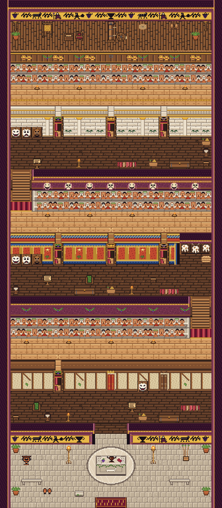

# Temple of Dionysus: the `temple_dionysus` tileset and the Three-Act Play

`gTileset_TempleDionysus` is the interior of Thyrsa's Temple of Dionysus (Laurel 4,
Hierophant Thespis the Masked Player), and `MAP_THYRSA_CITY_TEMPLE_OF_DIONYSUS` is the room
built from it: the Three-Act Play of design/phase3/SCRIPT.md beat 31 and Part 5, on the
verb SYSTEMS.md §12 gives Dionysus, *masks and roles*.

The temple is a theater turned inside out: a long hall running north from the door, three
stage sets one behind another, each grander than the last. Every act is one room in two
halves. The south half is the wings: dark backstage boards, the back of the set (the skene)
with its three doors and its mask rack, the act's program on a reading stand, the act's
actor, trunks and costume rails. Through the doors is the stage, honey-coloured and lit by
clay footlights, and beyond it the audience: two tiers of clay votive figures with their
mouths open. A curtained stair at the stage's far end climbs to the next act's wings. Above
Act III, the skene roof carries the god-machine's crane; Thespis waits there.

| Image | Shows |
|---|---|
| [`img/ThyrsaCity_TempleOfDionysus.png`](img/ThyrsaCity_TempleOfDionysus.png) | The map at 2x, as a player first finds it (compiled tileset on oikos) |
| [`img/temple_dionysus_map_solved.png`](img/temple_dionysus_map_solved.png) | After the play: both curtains drawn back, the crane's arm down over Act III |
| [`img/temple_dionysus_map_events.png`](img/temple_dionysus_map_events.png) | The events: people and sight lines, the door triggers, signs, warps, where a wrong entrance lands |
| `img/temple_dionysus_pass{1,2,3,4}_views.png`, `_room.png` | The four render-and-critique passes below: GBA-screen views along the route, and the whole room |
| [`img/temple_dionysus_pieces.png`](img/temple_dionysus_pieces.png) | Every structure as drawn |
| [`img/temple_dionysus_sheet.png`](img/temple_dionysus_sheet.png) | The numbered sheet, rendered from the compiled tileset |



## How it is made

- `tools/ichor/art/temple_dionysus_art.py` holds every pixel and the palette plan.
- `tools/ichor/art/temple_dionysus_build.py` draws it, checks every 8x8 tile against the
  palette groups, merges near-duplicate tiles, compiles with Porytiles in a scratch project
  against an empty stand-in primary, verifies the result, writes the metatile labels the
  scripts swap (`METATILE_TempleDionysus_*` in `include/constants/metatile_labels.h`),
  `build/temple_dionysus/catalog.json`, the sheet and the catalog below.
- `tools/ichor/maps/temple_dionysus.py` is the map: the room as a grid of two-letter codes,
  which it turns into `map.bin`, the events in `map.json`, and the generated stage scripts in
  `scripts.pory` (between markers). It checks the map (below) and writes the renders.
  `--review NAME` draws review sheets straight from the art, no compile needed.

**Works on any primary.** Like the Temples of Hestia, Hermes and Demeter it uses only its own
tiles and palettes 6-12, with opaque bottoms everywhere, so it renders the same on any
primary; it is paired with `oikos`.

**Layers.** Floors and walls fill the bottom layer, objects stand in the middle layer.
The only top-layer piece is the crane's boom over the roof's edge (`arm_lowered`), drawn
over the player's head.

**Palettes.** Seven groups, one per secondary palette (all colors multiples of 8):
`wood` (the boards, timber, stairs, the roof, the crane, the doors), `wall` (the temple's
wine plaster, ivy, grapes, gold, the black-figure frieze, the door signs), `clay` (the votive
audience, kraters, the kantharos), `mask` (the masks, curtains, robes, pelts), `paint`
(Act I's canvas, Act II's painted palace front), `marble` (warm limestone: the orchestra,
the altar, the tiers, Act III's skene) and `fire` (lamps, torches, potted ivy).

**Tile budget.** 444 of 504 tiles (the door animations own 504-511). The orchestra is drawn
symmetric, so its right half costs nothing.

## The play in tiles

| State | Pieces | How it changes |
|---|---|---|
| The mask worn | `rack` pegs, one per mask | The peg of the mask the player wears shows empty (`<mask>_empty`, the full peg + 1) |
| A door | the act's `cap_gap`, `<door>_upper`, `<door>` | Three walkable cells; the coord event on the doorway is the entrance. Act I's crown and goat doors are `*_painted` and block |
| An act done | `stair` `foot_closed_*` → `foot_open_*` | The curtain at the stage's end is drawn back and tied, and the stair goes up |
| The play done | `mast_top`, `mast`, `arm`, `deck_face_arm`, `back_arm`, `front_arm`, `hook` | Each swaps for its `_lowered` twin (+1): the boom swings forward over the audience and lets its rope and hook down onto Act III's stage |

## The map

21 x 48, `oikos` + `temple_dionysus`, `MAPSEC_THYRSA_CITY`, indoor, music
`MUS_ICHOR_TEMPLE_HERMES` (`ICHOR_STUB_MUSIC`: `MUS_ICHOR_TEMPLE_DIONYSUS`, SCRIPT.md Part 9
cue 17, isn't composed). From north to south:

| Rows | What |
|---|---|
| 0-1 | The temple's north wall and its frieze |
| 2-4 | **The skene roof**: weathered planks, the crane's mast and winch, the thunder machine, Thespis's empty chair and his empty mask crate, potted ivy. Thespis stands on the edge at (7,4). Reached only by the god-machine: the player is set down at (11,4) |
| 5-9 | **Act III's stage**: the gilt front of the roof (the audience's back wall), two tiers of audience, the stage with footlights and a gilt inlay. The hook hangs at (10,8) once the play is done |
| 10-15 | **Act III's wings**: the marble skene (ivy door (5,12), crown (10,12), goat (15,12)); the rack at (1-3,12); the torn program at (3,15); Theodoros at (4,15). Arrival from Act II's stair at (1-2,15) |
| 16-21 | Act II's back wall (painted masks), its audience, its stage; the curtained stair up at the stage's west end (1-2,16-19) |
| 22-27 | **Act II's wings**: the painted palace front (ivy (5,24), crown (10,24), goat (15,24)); the rack at (1-3,24); the program at (4,26); the satyrs' corner, a goatskin alcove at (17-19,23-24) where Thettalos stands facing the wall. Arrival from Act I's stair at (18-19,27) |
| 28-33 | Act I's back wall (ivy garlands), its audience, its stage; the curtained stair at the east end (18-19,28-31) |
| 34-39 | **Act I's wings**: the canvas-and-timber set (the real ivy door (5,36); the crown (10,36) and goat (15,36) only painted on); the one-peg rack at (13,36); the program at (12,38); Mynniskos at (8,39) |
| 40-41 | The wall between the wings and the entry, with the parodos (9-11) through it |
| 42-47 | **The god's orchestra**: a round dancing floor with the great altar of Dionysus at its heart (9-11,43-44); torches; the old wooden image on its low base (7,46); Lasos (13,46); the doormat (9-11,47), warps 0-2 to `MAP_THYRSA_CITY` warp 3 |

**The route.** In through the door, Lasos's welcome, through the parodos into Act I's wings.
Each act: read the program, take a mask, get past the act's actor, make the entrances; the
curtain opens and the stair climbs to the next act's wings, on alternate sides (east, then
west), so the hall is walked as a zigzag. Act III's last entrance brings the crane's hook
down; it lifts the player to the roof and Thespis.

**The actors and their sight.** Mynniskos and Theodoros stand at the back of the wings facing
the skene, watching across the whole width (3 rows) between their rack and the doors, so
no one reaches a door without crossing their sight. The map builder checks it. Thettalos
faces the wall of the satyrs' corner and never sees anyone: talk to him.

**Checks** (`temple_dionysus.py`, every run): people on walkable tiles; warps on the mat;
door triggers on doorways with their upper cell and cap gap above; every bg event on a
blocking tile someone can face; every walkable tile reachable once the play is done (the
roof only from the crane's landing, and never on foot); each act's wings shut until the
act before is done, and each act's stage reachable only through its doors; Mynniskos and
Theodoros impossible to walk round; the walks back to the racks clear; every
`setmetatile()` in `scripts.pory` putting a piece's own other state on its cell; and the
generated scripts current.

## The play's script (`data/maps/ThyrsaCity_TempleOfDionysus/scripts.pory`)

**State.** `VAR_ICHOR_THREE_ACT_PLAY` (bank var 6): 0 Act I open, 1 Act I done, 2 Act II
done, 3 the play done and the crane down (`FLAG_ICHOR_THREE_ACT_PLAY_DONE` set with it),
4 riding up to the roof, 5 the laurel given. It stands in for SCRIPT.md's
`FLAG_ICHOR_PLAY_ACT_1` and `_ACT_2` (BUILD.md: only four bank flags, so the trial's state
lives in vars). `VAR_ICHOR_PLAY_MISSES` (bank var 7) counts Act III's wrong entrances.
`VAR_TEMP_1` is the mask (0 none, 1 comic, 2 tragic, 3 satyr) and `VAR_TEMP_2` the entrances
made in the act, as SCRIPT.md has them; `VAR_TEMP_3` remembers which act's rack the mask
came from; `VAR_TEMP_4` and `_5` remember that Theodoros or Mynniskos waved the player through.

**Wearing a mask** (the choice BUILD.md left to this agent). The mask is `VAR_TEMP_1`, shown
in the world: the peg it came from hangs empty, and a line says so ("{PLAYER} put on the
comic mask."). The player's walker doesn't change; there is no masked player sheet, and the
start-menu info panel SCRIPT.md mentions isn't built (SYSTEMS.md §2's display rule waits on
the engine). Masks are kept from act to act, and every mask goes back on its peg when the
player leaves the temple (`VAR_TEMP_*` reset). The racks offer COMIC / TRAGIC / SATYR / NONE
(Act I's COMIC / NONE).

**Entrances.** Each real door's doorway carries a coord event, live while its act is being
played. Stepping in from the wings (facing north) checks the mask and the door against the
program's next entrance. Right: the player walks out onto the stage, the audience laughs
(`SE_APPLAUSE`; comic and satyr) or gasps (`SE_M_ENCORE2`; tragic), and the act moves on;
the act's last entrance draws its curtain back (`SE_PIKE_CURTAIN_OPEN`), or in Act III
brings the crane down (the camera looks up at it; `SE_ELEVATOR` for the creak). Wrong:
`SE_BOO`, the screen fades, and the player is walked back to the act's rack still wearing
the mask, the act's place kept. Stepping back off the stage just walks through.

**The safety valve.** Lasos repeats the rules when asked. From Act III's second wrong
entrance, the painted audience whispers "A tragedy needs its goats."; from the fourth,
Theodoros (if beaten) asks about the third door.

**The god-machine and Thespis.** The hook asks "Hold on?"; yes sets the var to 4 and warps
the player to the roof, where an ON_FRAME script plays Thespis's scene: he turns his back,
and the sprites agent's two sheets swap behind it (`OBJ_EVENT_GFX_VAR_0`: `THESPIS`, then
`THESPIS_COMIC`, by `copyobjectxytoperm`/`removeobject`/`addobject`), so he turns round in
the comic mask. Battle (`trainerbattle_no_intro`), the Mask Laurel (`FLAG_BADGE04_GET`), TM06
Toxic (`FLAG_ICHOR_GOT_TM_TOXIC`), the Crater on the Star Chart
(`FLAG_ICHOR_CONSTELLATIONS_START + 1`: SYSTEMS.md §8's constellation 2), the rite's lines;
he walks to the hook and is lowered away, and the player is set down inside the door, where
he now stands by the altar in the comic mask. Losing on the roof whites out; coming back in
by the door resets the var to 3, and the hook takes the player up again.

**After the laurel** every act stands solved: curtains open, the crane down, the actors
beaten and standing aside, the masks on their pegs, each program reading "ACT I. FIN." and
so on, and Lasos and Thespis have their after-lines.

**Text.** SCRIPT.md's lines as written. Added, each short and measured (no line wider than
the box in the test's text report; the longest speaker name, THEODOROS, is 44 of the name
box's 64 px): the rack lines and menu, the programs' "FIN.", the gasp line, the curtain
lines, the painted doors, the hook after the laurel, Lasos's "Shall I go over the rules
again?", and flavor for the altar, the krater, the thyrsoi and the thunder machine.

## Deviations from SCRIPT.md, and why

1. **The actors face the skene, not the rack.** Part 5 says Mynniskos and Theodoros face
   the rack. Standing in a three-row wings facing west, an actor's sight covers one row and
   anyone can walk past him. Standing at the back facing the doors, his sight covers the
   whole width between the rack and the doors (MAP_DESIGN §1: a mandatory trainer covers
   the full width of the narrow point). Both still stand between the rack and the doors.
2. **Act I's rack is east of Mynniskos and the ivy door west of him,** so he stops a player
   who has the comic mask on ("Wrong face for my scene! I'm waiting for the tragedy."). A
   player who heads for the door bare-faced meets him first; the line works either way.
3. **Act III's stair arrives at the west end, beside the rack,** not the east as in Part 5's
   sketch, so the player can take a mask before meeting Theodoros, and "the first entrance
   (comic) passes him, and the second (tragic) must battle him" holds. The stairs alternate
   sides: Act I's climbs at the east end, Act II's at the west.
4. **`FLAG_ICHOR_PLAY_ACT_1`/`_ACT_2` are `VAR_ICHOR_THREE_ACT_PLAY` 1/2** (BUILD.md's four
   bank flags).
5. **The skene roof is at the north end, above Act III's audience,** as Part 5's sketch
   draws it, rather than over the wings (a top-down map can't show a roof over a floor).
6. **The roof scene plays on arrival** (an ON_FRAME script), not when Thespis is talked to,
   so "An entrance from the machine!" greets the player as they land.
7. **Thespis stands** on the roof's edge: the sprites agent drew no seated Thespis.
8. **Masks carry between acts** instead of being hung back at each curtain; each act's
   racks remember where the worn mask came from.

## Stubs (by tag)

- `ICHOR_STUB_MUSIC`: the map plays `MUS_ICHOR_TEMPLE_HERMES`.
- `ICHOR_STUB_RITES`: the altar shows a line (later `EventScript_IchorTempleAltar_Dionysus`);
  Dionysus Favor +15 with the laurel; the rite (`EventScript_IchorHierophantRite`) and gift I,
  TM Swagger at Favor 30 (`EventScript_IchorHierophantGift`), with its line kept in a comment.
- `ICHOR_STUB_OFFERINGS`: the free Wine Thespis gives with the rite is skipped.
- `ICHOR_STUB_GARLAND`: Oinoe's garland at the god's image waits on the rooms agent's
  `FLAG_ICHOR_OINOE_GARLAND`/`FLAG_ICHOR_GARLAND_LAID` and the key item `ITEM_IVY_GARLAND`;
  the script for it is written out in a comment. `OBJ_EVENT_GFX_ICHOR_WOODEN_IMAGE_GARLAND`
  is ready for the swap.

## Render-and-critique passes

**Pass 1** (`temple_dionysus_pass1_*`). The structure read: three acts stacked, the racks
(the best thing on the map), the black-figure frieze, the orchestra's ring. Wrong:
- the wings, the stages and the roof were one striped brown, the joints a noisy herringbone;
- the audience was an orange smear: figures five pixels wide, packed edge to edge;
- the doors read as brown pillars: thin posts, a tan sliver for an opening, a tiny sign;
- the god-machine was invisible, a thin pole on a field of boards;
- the entry was cold grey stone, the altar a white box;
- Act II's little painted masks read as skulls.

**Pass 2** (`temple_dionysus_pass2_*`). Three floors with their own grain: dark narrow
backstage boards, wide honey stage boards, weathered roof planks laid north-south. Warm
limestone for the marble palette. Audience figures redrawn at 7 x 11, two to a seat, with
open mouths, white-painted faces, dark hair, wreaths and red robes. Doors redrawn as a
curtained doorway with the stage's light on its threshold. A real crane: a squared mast
with iron bands, a spoked winch, a boom that swings forward over the audience. A proper
altar with scrolled ends, the kantharos, grapes, ivy and the carved panther, and the
orchestra drawn symmetric (69 tiles to about 45). Act II's masks redrawn at 11 px. Left:
the doors' cap gaps read as dark chimneys, the signs were small on a brown lintel, and
nail marks made the stage a cross-stitch.

**Pass 3** (`temple_dionysus_pass3_*`). The gaps lit (the threshold seen from above, in each
act's own stone or wood), the signs on a dark, gilt-framed plaque, the stage nails gone.
Clay footlights along each stage's front edge, which make the stages read as stages. Roof
props: potted ivy, Thespis's empty mask crate beside his chair. The wings' worn tracks cut
to one path each. Left: the satyrs' corner's goatskins were brown blobs on a dark wall, and
the wings still had long empty stretches.

**Pass 4** (`temple_dionysus_pass4_*`). The satyrs' corner hung with piebald white pelts on
pegs under a pair of horns (a first try splayed their legs and read as skull and
crossbones; they now hang straight). A basket, a wig stand and a second costume rail fill
the emptiest stretches of the wings, every path kept open (the checks say so).

**In game** (`tools/ichor/tests/act2_temple.sh`, screenshots in
`build/test_act2_temple/shots/`): the entry with Lasos and the wooden image, each act's
wings and rack menu, the entrances and the audience's reactions, the wrong-entrance boo,
the crane's rope and hook over Act III's stage, the roof scene, the battles, the laurel and
the solved room on re-entry all looked at.

## The test

`tools/ichor/tests/act2_temple.sh` (on `engine_build.sh`, `engine_lib.lua` and `slice_lib.lua`):
a Quickstart, a level-100 test team and Act I's three laurels, then the whole trial by key
presses: Lasos's welcome and rules, the altar and the image; Act I's program, the painted
door, Mynniskos's battle, a wrong entrance with no mask, the comic mask, the ivy door;
Act II's stair, Thettalos, tragic by the crown door, back off the stage (no entrance), comic
by the ivy door; Act III's torn program, comic waved through by Theodoros, tragic battled,
two wrong entrances and the audience's whisper, satyr by the goat door, the crane coming
down; the hook, Thespis's scene and battle, the laurel, TM06, the Crater, the player set down
inside the door with Thespis by the altar; and a re-entry with every act still solved.
58 checks.

<!-- catalog: written by tools/ichor/art/temple_dionysus_build.py; do not edit by hand -->

## Catalog

176 metatiles from 0x200; **444 of 504 tiles used** (the door animations own 504-511). Walk codes: `X` blocks, `.` walkable, `S` MB_SOUTH_ARROW_WARP (the doormat). Every other metatile is MB_NORMAL; the puzzle is all script.

### Floors: the wings, the stage, the roof, the orchestra

`floor`, 8 wide by 3 tall. `planks` are the wings' dark backstage boards (`_b`, `_knot` and `_worn` to break a run). `stage` is the stage's wide honey-coloured boards (`stage_gilt` has a gilt inlay, for Act III; `stage_mark` a chalk cross where an actor stands); `stage_lamp` is a footlight, a clay lamp burning at the stage's front edge (blocks). `deck` is the skene roof's weathered planks, laid north-south; `deck_edge` is the roof's front row, its lip dropping to the audience; `deck_ivy` a pot of ivy and `deck_crate` Thespis's empty mask crate on the roof. `flag` paves the orchestra. `void` blocks: the border.

```text
ids                                                walk
0x200 0x201 0x202 0x203 0x204 0x205 0x206 0x207   . . . . . . . .
0x208 0x209 0x20A 0x20B 0x20C 0x20D 0x20E 0x20F   X . . . . . . .
0x210 0x211 0x212 0x213 0x214 0x215 0x216 0x217   X X X X X X X X
```

Pieces: `planks` 0x200, `planks_b` 0x201, `planks_knot` 0x202, `planks_worn` 0x203, `stage` 0x204, `stage_b` 0x205, `stage_gilt` 0x206, `stage_mark` 0x207, `void` 0x208, `flag` 0x209, `flag_b` 0x20A, `flag_c` 0x20B, `deck` 0x20C, `deck_b` 0x20D, `deck_edge` 0x20E, `deck_edge_b` 0x20F, `stage_lamp` 0x210, `deck_ivy` 0x211, `deck_crate` 0x212.

### The temple's walls: caps, corners, side walls

`wall`, 8 wide by 1 tall. `cap` is the top of a wall seen from above, with a gilt cornice on its south edge; every room's north wall starts with it. `side_l`/`side_r` run down the map's edges. `cap_end_l` is the cap ending with an opening to its left, `cap_end_r` an opening to its right (the parodos, a stair's top). `cap_gap` is the walkable floor of an opening through a cap row.

```text
ids                                                walk
0x218 0x219 0x21A 0x21B 0x21C 0x21D 0x21E 0x21F   X X X X X X X .
```

Pieces: `cap` 0x218, `cap_corner_l` 0x219, `cap_corner_r` 0x21A, `side_l` 0x21B, `side_r` 0x21C, `cap_end_l` 0x21D, `cap_end_r` 0x21E, `cap_gap` 0x21F.

### The frieze: the god's revel in black figure

`frieze`, 8 wide by 1 tall. The temple's wall face, a gold band painted in black figure like a wine cup: `ivy` and `grapes` between the revellers, `kantharos` (the god's cup), `panther`, `maenad` (with her thyrsus), `satyr`. Hang it under a `cap`. `jamb_l` ends the wall at an opening to its left, `jamb_r` to its right.

```text
ids                                                walk
0x220 0x221 0x222 0x223 0x224 0x225 0x226 0x227   X X X X X X X X
```

Pieces: `ivy` 0x220, `kantharos` 0x221, `panther` 0x222, `maenad` 0x223, `satyr` 0x224, `grapes` 0x225, `jamb_l` 0x226, `jamb_r` 0x227.

### Back walls behind the audience

`back`, 5 wide by 2 tall. The wall each act's audience sits against, under a `cap`. Act I's is plain wine plaster (`act1_garland` hung with an ivy garland); Act II's is hung with painted masks (`act2_masks` the comic, `_b` the tragic). Act III's is the front of the skene roof, carved and gilt (`deck_face`, with gilt masks); `deck_face_arm` is the cell under the god-machine, and `deck_face_arm_lowered` (+1) the same with the boom swung down over it, its pulley and rope.

```text
ids                              walk
0x228 0x229 0x22A 0x22B 0x22C   X X X X X
0x230 0x231 0x232 0x233 0x234   X X X X X
```

Pieces: `act1` 0x228, `act1_garland` 0x229, `act2` 0x22A, `act2_masks` 0x22B, `act2_masks_b` 0x22C, `deck_face` 0x230, `deck_face_masks` 0x231, `deck_face_garland` 0x232, `deck_face_arm` 0x233, `deck_face_arm_lowered` 0x234.

### Act I's set seen from the wings

`skene1`, 6 wide by 1 tall. Rough timber and canvas, the back of a travelling set. Three rows: `cap` (the top beam, seen from the stage), `upper`, `lower` (`_b` braced, or with ivy painted through the canvas). `cap_gap` is the way through the cap over a real door: walkable.

```text
ids                                    walk
0x238 0x239 0x23A 0x23B 0x23C 0x23D   X . X X X X
```

Pieces: `cap` 0x238, `cap_gap` 0x239, `upper` 0x23A, `upper_b` 0x23B, `lower` 0x23C, `lower_b` 0x23D.

### Act II's set seen from the wings

`skene2`, 8 wide by 1 tall. A painted palace front: red panels in ochre frames between blue bands (`_b` with a rosette or painted ivy). `upper_end` and `lower_end` finish the set's east end, by the satyrs' corner.

```text
ids                                                walk
0x240 0x241 0x242 0x243 0x244 0x245 0x246 0x247   X . X X X X X X
```

Pieces: `cap` 0x240, `cap_gap` 0x241, `upper` 0x242, `upper_b` 0x243, `lower` 0x244, `lower_b` 0x245, `upper_end` 0x246, `lower_end` 0x247.

### Act III's set seen from the wings

`skene3`, 6 wide by 1 tall. The marble skene, the grandest: ashlar under a gilt band, ivy carved low (`_b` is a fluted pilaster, upper and lower).

```text
ids                                    walk
0x248 0x249 0x24A 0x24B 0x24C 0x24D   X . X X X X
```

Pieces: `cap` 0x248, `cap_gap` 0x249, `upper` 0x24A, `upper_b` 0x24B, `lower` 0x24C, `lower_b` 0x24D.

### The three doors, and Act I's painted two

`doors`, 5 wide by 2 tall. A real door is `<kind>_upper` (its sign on the lintel: an ivy garland with grapes, a gilt crown, goat horns) over the doorway `<kind>`, both walkable: put the entrance's coord event on the doorway, and the act's `cap_gap` above the upper cell. The doorway is dark under a wine-red valance, its curtain tied back, and the stage's light lies on the boards beyond. Act I's crown and goat doors are only painted on its canvas (`*_painted_upper` over `*_painted`): both block.

```text
ids                              walk
0x250 0x251 0x252 0x253 0x254   . . . . .
0x258 0x259 0x25A 0x25B 0x25C   . X X X X
```

Pieces: `ivy_upper` 0x250, `crown_upper` 0x251, `goat_upper` 0x252, `ivy` 0x253, `crown` 0x254, `goat` 0x258, `crown_painted_upper` 0x259, `goat_painted_upper` 0x25A, `crown_painted` 0x25B, `goat_painted` 0x25C.

### The mask rack: pegs, full or empty

`rack`, 6 wide by 1 tall. Hang the rack on a skene's `lower` row, one cell per mask, faced from the wings. Each peg is a little oak board; `<mask>_empty` (= the full peg + 1) is the same peg with its mask gone, for the mask the player is wearing. Act I's rack is the comic peg alone.

```text
ids                                    walk
0x260 0x261 0x262 0x263 0x264 0x265   X X X X X X
```

Pieces: `comic` 0x260, `comic_empty` 0x261, `tragic` 0x262, `tragic_empty` 0x263, `satyr` 0x264, `satyr_empty` 0x265.

### The audience: clay votive figures on stone tiers

`audience`, 7 wide by 2 tall. Two tiers along each act's back wall: a `back_*` row against the wall and a `front_*` row before it, each in three arrangements. The audience is clay votives, two to a seat, with painted hair, white faces, ivy wreaths, red robes, and their mouths open. `*_end_l`/`*_end_r` finish a run beside a stair. Under the god-machine: `back_arm`/`front_arm`, and `*_lowered` (+1) with its rope hanging down over the figures.

```text
ids                                          walk
0x268 0x269 0x26A 0x26B 0x26C 0x26D 0x26E   X X X X X X X
0x270 0x271 0x272 0x273 0x274 0x275 0x276   X X X X X X X
```

Pieces: `back_a` 0x268, `back_b` 0x269, `back_c` 0x26A, `front_a` 0x26B, `front_b` 0x26C, `front_c` 0x26D, `back_end_l` 0x26E, `front_end_l` 0x270, `back_end_r` 0x271, `front_end_r` 0x272, `back_arm` 0x273, `back_arm_lowered` 0x274, `front_arm` 0x275, `front_arm_lowered` 0x276.

### The curtained stair: up from a stage to the next act's wings

`stair`, 2 wide by 5 tall. Two cells wide, five rows from the next act's wall `cap` (`top`) down through its back wall (`through`) and past the audience (`steps`) to the stage (`foot`). The curtain hangs at the foot: `foot_closed_*` blocks; `foot_open_*` is the same stair with the curtain drawn back and tied, walkable.

```text
ids            walk
0x278 0x279   . .
0x280 0x281   . .
0x288 0x289   . .
0x290 0x291   X X
0x298 0x299   . .
```

Pieces: `top_l` 0x278, `top_r` 0x279, `through_l` 0x280, `through_r` 0x281, `steps_l` 0x288, `steps_r` 0x289, `foot_closed_l` 0x290, `foot_closed_r` 0x291, `foot_open_l` 0x298, `foot_open_r` 0x299.

### The skene roof and the god-machine

`machine`, 8 wide by 2 tall. On the roof (`deck` boards): the crane's `mast_top` over `mast`, its `winch` beside it, and in front, on the roof's edge, `arm`. Each has a `_lowered` twin (+1): raised, the boom stands up against the mast; lowered, it swings forward over the audience, over the player's head on the edge (drawn in the top layer), past `deck_face_arm`, and lets its rope down the tiers' `*_arm` cells to `hook_lowered` on the stage (`hook` is plain stage boards; lowered, it blocks: face it to hold on). Props: the thunder machine (`bronteion_top` over `bronteion`), a `rope_coil`, `amphorae`, an `edge_post`, a `lamp_post`, and the Hierophant's `throne`.

```text
ids                                                walk
0x2A0 0x2A1 0x2A2 0x2A3 0x2A4 0x2A5 0x2A6 0x2A7   X X X X . . . X
0x2A8 0x2A9 0x2AA 0x2AB 0x2AC 0x2AD 0x2AE 0x2AF   X X X X X X X X
```

Pieces: `mast_top` 0x2A0, `mast_top_lowered` 0x2A1, `mast` 0x2A2, `mast_lowered` 0x2A3, `arm` 0x2A4, `arm_lowered` 0x2A5, `hook` 0x2A6, `hook_lowered` 0x2A7, `winch` 0x2A8, `bronteion_top` 0x2A9, `bronteion` 0x2AA, `rope_coil` 0x2AB, `amphorae` 0x2AC, `edge_post` 0x2AD, `lamp_post` 0x2AE, `throne` 0x2AF.

### The god's orchestra: the dancing floor round the great altar

`orchestra`, 5 wide by 4 tall. Five by four. A round dancing floor of pale marble, ringed in grey, on the orchestra's flags; the great altar of Dionysus stands in the middle (the inner 3 x 2, blocking): a marble table with scrolled ends, hung with ivy, its top stained with wine, a black kantharos and a bunch of grapes on it, a panther carved on its front. Place it whole; `r<row><col>` names each cell. The block is drawn symmetric, so its right half costs no tiles.

```text
ids                              walk
0x27A 0x27B 0x27C 0x27D 0x27E   . . . . .
0x282 0x283 0x284 0x285 0x286   . X X X .
0x28A 0x28B 0x28C 0x28D 0x28E   . X X X .
0x292 0x293 0x294 0x295 0x296   . . . . .
```

Pieces: `r00` 0x27A, `r01` 0x27B, `r02` 0x27C, `r03` 0x27D, `r04` 0x27E, `r10` 0x282, `r11` 0x283, `r12` 0x284, `r13` 0x285, `r14` 0x286, `r20` 0x28A, `r21` 0x28B, `r22` 0x28C, `r23` 0x28D, `r24` 0x28E, `r30` 0x292, `r31` 0x293, `r32` 0x294, `r33` 0x295, `r34` 0x296.

### The entry: the god's image's base, torches, the doormat

`entry`, 7 wide by 2 tall. `base` is the low stone base inside the door where the god's old wooden image stands (an object on top of it). `torch_top` over `torch`: a tall bronze torch, burning. `krater`: a wine krater painted in black figure. `ivy_pot`. `thyrsoi_top` over `thyrsoi`: a stand of ivy-tipped staves. `bench_l`/`bench_r` a marble bench. `jars` two wine jars. The doormat (`mat_l`, `mat`, `mat_r`) is MB_SOUTH_ARROW_WARP: a warp on each.

```text
ids                                          walk
0x2B0 0x2B1 0x2B2 0x2B3 0x2B4 0x2B5 0x2B6   X X X X X X X
0x2B8 0x2B9 0x2BA 0x2BB 0x2BC 0x2BD 0x2BE   S S S X X X .
```

Pieces: `base` 0x2B0, `torch_top` 0x2B1, `torch` 0x2B2, `krater` 0x2B3, `ivy_pot` 0x2B4, `thyrsoi_top` 0x2B5, `thyrsoi` 0x2B6, `mat_l` 0x2B8, `mat` 0x2B9, `mat_r` 0x2BA, `bench_l` 0x2BB, `bench_r` 0x2BC, `jars` 0x2BD.

### The wings: the program, trunks, rails and the satyrs' corner

`wings`, 8 wide by 2 tall. `program` is the act's program on a reading stand (`program_torn`: Act III's, the scroll torn off below). A costume `trunk_l`/`_r`, a costume `rail_l`/`_r` hung with robes, a `basket` of props, stacked scenery `flats`, an oil `lamp` on a stand, a `stool`, a `wigs` stand. The satyrs' corner (Act II's alcove): its back wall hung with goatskins (`goatskins_l`, `goatskins`, `goatskins_r`) under a `cap`, a `hay` bale, and `corner_planks` to walk on.

```text
ids                                                walk
0x2C0 0x2C1 0x2C2 0x2C3 0x2C4 0x2C5 0x2C6 0x2C7   X X X X X X X X
0x2C8 0x2C9 0x2CA 0x2CB 0x2CC 0x2CD 0x2CE 0x2CF   X X X X X X . X
```

Pieces: `program` 0x2C0, `program_torn` 0x2C1, `trunk_l` 0x2C2, `trunk_r` 0x2C3, `rail_l` 0x2C4, `rail_r` 0x2C5, `basket` 0x2C6, `flats` 0x2C7, `lamp` 0x2C8, `stool` 0x2C9, `goatskins_l` 0x2CA, `goatskins` 0x2CB, `goatskins_r` 0x2CC, `hay` 0x2CD, `corner_planks` 0x2CE, `wigs` 0x2CF.

<!-- end of catalog -->
