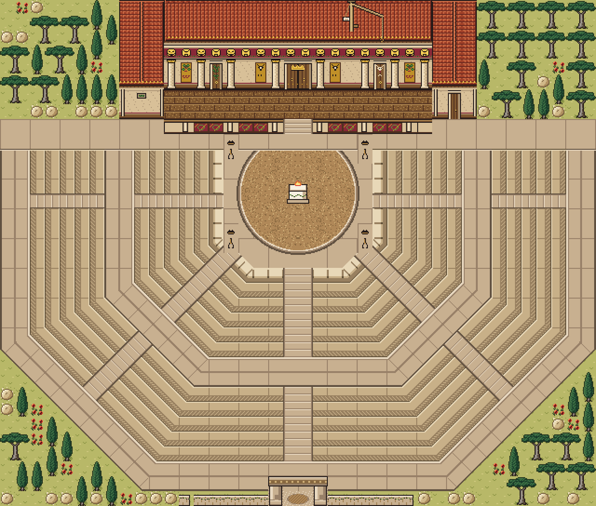

# Thyrsa's theater: tilesets, maps and the Dionysia's engine

The theater is Act II's centerpiece (design/phase3/SCRIPT.md, beats 32-34). This
file covers its two tilesets, its two maps, the trance's palette pulse, and the
render-and-critique passes that shaped them.

| Image | Shows |
|---|---|
| [`img/ThyrsaTheater.png`](img/ThyrsaTheater.png) | The theater at 2x, an ordinary day |
| [`img/ThyrsaTheater_Dionysia.png`](img/ThyrsaTheater_Dionysia.png) | The night of the play: every seat full |
| [`img/ThyrsaTheater_Skene.png`](img/ThyrsaTheater_Skene.png) | The skene at 2x: the wings, the prop room, the vestibule |
| [`img/ThyrsaTheater_ingame.png`](img/ThyrsaTheater_ingame.png) | Headless in-game frames of beats 32-34 |
| [`img/theater_pieces.png`](img/theater_pieces.png), [`img/theater_sheet.png`](img/theater_sheet.png) | The theater's stage-side kit, and its numbered sheet |
| [`img/skene_pieces.png`](img/skene_pieces.png), [`img/skene_sheet.png`](img/skene_sheet.png) | The skene's kit and sheet |
| [`img/theater_program.png`](img/theater_program.png) | The program Alethea shows (4x) |



## Rebuilding

```bash
/usr/bin/python3 tools/ichor/art/theater_build.py          # both tilesets (theater, skene)
/usr/bin/python3 tools/ichor/maps/theater.py               # both maps, the crowd table, the renders
/usr/bin/python3 tools/ichor/art/theater_program.py        # the program's picture
tools/ichor/tests/act2_dionysia.sh                         # beats 32-34, headless
```

Rebuild the theater tileset whenever aethos is repainted (the terrace's grass is
borrowed from aethos), and the maps whenever a tileset is rebuilt: the map builder
places cells by the tileset's catalog, `build/<tileset>/catalog.json`, never by
raw id.

| File | What |
|---|---|
| `tools/ichor/art/theater_lib.py` | Colors, palette groups, the cavea's geometry, the seated people |
| `tools/ichor/art/theater_cavea.py` | The cavea, the aisle, the orchestra and the parodoi, cell by cell |
| `tools/ichor/art/theater_stage.py` | The skene's front, roofs, doors, wings, stage, proskenion, gate, torches, thymele, props |
| `tools/ichor/art/theater_skene.py` | `gTileset_Skene`: the backstage and the prop room |
| `tools/ichor/art/theater_build.py` | Paints, packs, compiles (Porytiles), copies the crowd's palette, borrows grass, catalogs |
| `tools/ichor/art/theater_program.py` | `graphics/ichor/act2/program.png` |
| `tools/ichor/maps/theater.py` | Both layouts, their events, `src/data/ichor_act2_theater.h`, the renders |
| `src/ichor_act2_scene.c`, `include/ichor_act2_scene.h`, `include/constants/ichor_act2_scene.h` | Dusk, the crowd, the trance, the gaze, the program window (specials) |
| `data/maps/ThyrsaTheater/scripts.pory`, `data/maps/ThyrsaTheater_Skene/scripts.pory` | Beats 32-34 and Part 2's people |
| `data/scripts/ichor_act2.pory` | Act II's shared scene scripts: receiving the Girdle and Daedalus's page III |

## The theater in the GBA's view

The map is drawn in the oblique view every Ichor map uses, so a façade only shows
when it faces the camera (south). The skene therefore stands at the **top** of the
map with its painted front toward us, and the cavea fans out **below** the
orchestra: the audience sits with its back to us, facing the stage, and the player
comes in at the bottom, through the top gate of the cavea (warp 0, from Thyrsa's
warp 11), and walks down the tiers to the orchestra. Rows, top to bottom:

| Rows | What |
|---|---|
| 0-5 | The skene: its long roof (and the god-machine), the wings' hipped roofs, the cornice of masks, the front with its three doors (ivy x=14, the palace's crown x=19-20, the goat x=25; lower cells on row 5) |
| 6-7 | The stage (logeion), between the wings; the east wing's face has the skene's back door, (30,7), warp 1 |
| 8 | The proskenion's colonnade; the steps down at x=19-20 |
| 8-9 | The parodoi, west and east, under the cavea's capped ends |
| 9-16 | The orchestra's circle, the thymele at (19-20, 12-13), torches at (15,9) (24,9) (15,15) (24,15) |
| 10-32 | The cavea: 13 tiers of seats, the diazoma (tiers 6-7), the promenade (tiers 13-14) |
| 32-33 | The top gate's propylon and the terrace wall |

### The cavea's geometry

The cavea is a regular-looking octagon of tiers round the orchestra, built so its
art repeats on the cell grid:

- **South tiers** are rows (tier *k* on row 18 + *k*), running from x = 17 - k/2.
- **West and east tiers** are columns (tier *k* at x = 14 - *k*, mirrored), from
  the capped end at row 10 down to the corner, which moves half a row per tier.
- **Diagonal tiers** run at 45 degrees between them. Both corners move half a cell
  per tier, so every facet grows as a regular octagon's would, and a diagonal tier
  is 17 px thick, near the straight tiers' 16.

Every corner falls on a cell edge, so a cell of seats is one facet's pattern. The
stairs cut through it radially: the central stair (x=19-20), a stair down the
middle of each diagonal (cells x+y = 31, 32, mirrored: a two-cell staircase the
player walks like any stair), and a side stair along row 13, through the
orchestra's center. The diazoma and the promenade are two tiers deep, so they make
a walkable staircase on the diagonals too. The front row (tier 0) is the prohedria,
pale thrones for priests and guests.

**Six blocks** of seats, west to east, between the side, diagonal and central
stairs. The play pairs them: blocks 1 and 6 are the **low** pair (their ends come
down to the parodoi, at the stage's level), 2 and 5 the **mid** pair, 3 and 4 the
**top** pair (the back of the cavea).

### The audience and the trance

The layout is the empty theater. Each seat cell also has a **crowd cell**: the same
stone with the audience in the middle layer. `tools/ichor/maps/theater.py` writes
`src/data/ichor_act2_theater.h`, the crowd cell for each of the 410 seat cells
(the player's, Alethea's and Kleon's seats stay empty), and
`Ichor_TheaterFillSeats` sets them on the play's nights (ON_LOAD).

People are placed globally along each tier's seat line, at a spacing that repeats
with the cell lattice: two a cell on the south rows (from behind), one a cell on
the side columns (in profile, facing the orchestra), one each 8 px along the
diagonals (three-quarter back). A person is kept only if every 8x8 tile it touches
is all seating, so stone and people never share a tile, and never in a walkable
cell. The colors repeat on short periods, so a facet costs a handful of cells.

**Palettes.** Seat stone and stair stone never share an 8x8 tile, because they are
in different palettes: where a stair, a walkway or the aisle cuts a seat cell, the
seats are the bottom layer and the stone lies over them in the middle layer.
Porytiles fills four palettes from the four groups; the build then copies the
crowd's palette (slot 6, which never pulses) into the three spare slots and
points each pair's crowd cells at its own copy:

| Slot | Palette |
|---|---|
| 6 | crowd: seat stone, people, the empty seats and the seats under stairs (never pulses) |
| 7-9 | earth (paving, stairs, orchestra, stage floor, grass), skene (the painted front, roof), props (crane, torches, thymele, terrace wall) |
| 10, 11, 12 | copies of 6: the low, mid and top pairs' crowd cells |

`src/ichor_act2_scene.c` pulses a pair by tinting its slot toward violet and back
(a breath every 128 frames), worked out from the unfaded palette every frame and
passed through the day-and-night tint like every outdoor palette. A right entrance
drains its pair (`Ichor_TheaterTranceRelease`); the satyrs drain all three, top
first (`Ichor_TheaterTranceWake`); the masks' gaze runs a gold glint over each pair
in turn (`Ichor_TheaterGaze`). After a warp or a battle, `Ichor_TheaterTranceResume`
(ON_RESUME) restarts the pairs still entranced, from `VAR_ICHOR_DIONYSIA`.

**Dusk.** The play is held at dusk whatever the clock says: `Ichor_TheaterDusk`
sets the engine's own hours override (`SetTimeOfDay`, the start of the
evening-to-night blend, the evening tint at its fullest), which lasts until the
next warp; ON_TRANSITION and ON_RESUME call it while the play runs. This replaces
BUILD.md's "draw the sky at dusk" (`ICHOR_STUB_SCENE_HOURS`), since the override
exists on this branch.

## gTileset_Theater (on aethos)

472 metatiles; 472 of 504 tiles. Sections: `cavea` (193 cells, from row 0x200),
`crowd` (158 cells across the three pairs, from 0x2B8), `stage` (from 0x360),
`props` (from 0x3B0).

| Piece | Size | What |
|---|---|---|
| `roof` | 3x3 | The skene's Laconian roof: `ridge`, `tiles`, `eave` (gilt antefixes), L M R |
| `wing_roof` | 3x3 | The wings' hipped roofs, the ridge running back from the stage |
| `frieze` | 2x1 | The cornice: a gilt `comic` and `tragic` mask on dark red, an ivy swag |
| `facade` | 4x2 | `wall`, `column` (engaged Ionic), `pinax_vine`, `pinax_goat`, upper and lower rows |
| `door_ivy`, `door_crown`, `door_goat` | 2x2, 4x2, 2x2 | The three doors, shut and standing open |
| `wing_face`, `wing_door` | 3x2 | A wing's face; the east one with the skene's back door (MB_NON_ANIMATED_DOOR) |
| `stage` | 2x2 | Planks: `back_*` in the skene's shadow, `front_*` |
| `proskenion` | 5x1 | `column`, `panel`, `end`, `steps_L`/`steps_R` (walkable) |
| `parodos` | 2x2 | The parodoi's flagstones |
| `gate` | 4x2 | The propylon: two piers, an architrave drawn over the player, two thresholds (MB_SOUTH_ARROW_WARP, warps 0 and 2) with a pebble kantharos |
| `torch_lit_pave`, `torch_cold_pave` | 1x2 | A bronze torch stand on the aisle: the flame drawn over the player |
| `thymele`, `thymele_ink` | 2x2 | The god's altar, its fire and ivy; and with the inky handprint |
| `loom`, `loom_fallen` | 1x2 | The Fates' loom, standing and knocked flat |
| `vine`, `vine_cut` | 1x2 | The prop vine, with grapes and cut |
| `crane` | 3x3 | The god-machine on the roof: mast, counterweight, arm, rope, hook |
| `terrace_wall` | 2x1 | The terrace wall either side of the gate, on grass |

The scripts swap pieces through `METATILE_Theater_*` in
`include/constants/metatile_labels.h` (the doors, the torches, the thymele, the
loom, the vine), which the build rewrites every time.

## gTileset_Skene (on oikos)

272 metatiles; 181 of 504 tiles. Self-contained (its own tiles and palettes 6-12);
the exit mat and the vestibule's terracotta and furniture are oikos's.

| Piece | What |
|---|---|
| `void` | The dark above the walls, and the border (oikos's 0x000 shows garbage in-game) |
| `floor`, `wall` | Stage planking; timber-framed ochre plaster, posts, a lamp on a bracket |
| `openings` | The prop room's arch and the vestibule's doorway, their heads over the player |
| `door_back_ivy`, `_crown`, `_goat` | The doors from behind, chalked for the actors (an X of ivy, a crown, a goat), shut and open |
| `rack_empty`, `rack_two`, `rack_three`, `rack_full` | The mask rack: empty pegs; the comic and tragic masks; with Thespis's satyr mask; Prosomime on every peg |
| `rail`, `barrel` | A costume rail of robes; the chorus's water barrel |
| `girdle`, `girdle_empty` | The great leather girdle on its peg, and the empty peg |
| `sickle`, `gold_mask`, `crown_stars` | The painted wooden sickle; the gold mask with closed eyes; the crown of stars on cork |
| `chest_0`, `chest_1`, `lion_skin`, `wine_jar` | Costume chests (Silenos sits on one), Herakles's lion skin, the jar that is never empty |
| `winch_page`, `winch` | The god-machine's winch, its rope up through a hatch, with and without Daedalus's page |

## The maps

`MAP_THYRSA_THEATER` (40x34, `MAP_TYPE_CITY`, aethos + theater): see the rows
above. Objects: the workers (before the play), the cast (herald, chorus leader, the
three Fates, the bee-woman and her jar, the gold-masked king, the actor), Alethea
and Kleon in the front row, three floating masks, Thespis, Silenos, Kleon on the
stage's edge (beat 33), the cleaner (after). The Dionysia begins on the first step
down from the promenade (coord triggers at each stair's top and the promenade's
ends, `VAR_ICHOR_DIONYSIA` 0), so the workers inside are seen first; the city's
keeper turns the player away at the gate until the Mask Laurel.

`MAP_THYRSA_THEATER_SKENE` (20x12, indoor, oikos + skene): the wings' corridor
behind the doors (the doors' backs line up with the stage's, x + 10), the rack at
(6-7, 1-2), a second rack, rails and a barrel; the inner wall with the arch to the
prop room (west) and the doorway to the vestibule (east), whose exit mat (15,11) is
warp 0, back to the theater's warp 1. Every interior unique: this is the only
backstage in Aethos, timber and plaster where the houses are lime and terracotta.

### How the entrances work

`VAR_ICHOR_DIONYSIA` holds the play's stage (constants/ichor_act2_scene.h: 1 the
play, 2 backstage, 3-5 the entrances, 6 the trance breaking, 7 over, 8 empty);
`VAR_ICHOR_DIONYSIA_MASK` the mask worn, kept across the entrances' warps (bank
vars 8 and 9). In the wings the door cells open (collision off) and carry coord
triggers; walking into one warps the player out onto that door's cell on the stage.
The theater's ON_FRAME sees the player on a door cell and plays the entrance:
right (comic by ivy, then tragic by the crown, then satyr by the goat) or wrong
("Nobody laughs."), then warps them back to the wings in front of the same door.
The music carries across those warps (`FLAG_DONT_TRANSITION_MUSIC`).

## Render-and-critique passes

**Theater, pass 1 (the cavea alone, before any tiles).** The first octagon kept the
south tiers at a fixed width and let only the diagonals grow: the cavea read as a
funnel, a V of thin diagonal tiers (11 px) round a narrow south block, more
stadium than theater. *Changed:* the corners now move half a cell per tier, so all
the facets grow and the diagonal tiers are 17 px, near the straight ones' 16.

**Theater, pass 2 (the crowd).** The diagonals were nearly empty: one person a cell
fit, and only where the whole cell was seating, so the stairs' and walkway's cut
cells sat empty. The orchestra's earth, speckled by a per-pixel hash, cost 64
tiles. *Changed:* people placed globally along each tier's seat line and kept when
their 8x8 tiles are all seating (the middle layer can hold them there); the color
periods shortened so cells repeat; the earth's speckle repeats every two cells
(14 tiles). The cavea went from 247 tiles to about 180, and the diagonals fill.

**Theater, pass 3 (the whole map, empty and full).** Two torches had landed on the
proskenion and one on Kleon's front-row seat; the wings' roofs and the skene's
merged into one slab of red; the god-machine was a hairline; and the top gate,
where the player arrives, was a one-row sliver. *Changed:* torches moved into the
aisle at the orchestra's four corners; the wings got hipped roofs with their ridge
running back, so they stand apart; a sturdier crane with a counterweight and a stay;
a two-row propylon with an architrave the player walks under.

**Theater, pass 4 (GBA screens and in-game).** The 15x10 screens along the route
read: the gate with the cavea opening above it, the tiers from the diazoma, the
orchestra with the thymele, the painted front, the parodoi with the wings. In-game
at dusk the tint is warm and dark, the violet pulse on the crowd is plain, and the
program shows in its box. Left as is: the dusk is the evening tint, which is darker
than a painted dusk would be.

**Skene, pass 1.** The corridor read as a hallway, but the arch looked like a dark
window, the barrel like a jar, and the corridor was bare planks.

**Skene, pass 2 (in-game).** The wall tops and side columns, oikos's 0x000, showed
a blue pattern in-game, not black. *Changed:* the skene draws its own dark `void`
cell, as every other Ichor interior does with its secondary's.

**Skene, pass 3.** The corridor was still empty planking between the doors and the
inner wall. *Changed:* a second costume rail and a costume chest along it, so the
wings look used; the arch and doorway kept (they read as openings at 1x).

## Deviations and notes

- **The keeper is on the city side** (the thyrsa agent's gate, per the
  coordinator), so this map has none. The play begins on the first step down into
  the cavea, after a one-line transition ("Dusk. The torches are lit, and the whole
  city pours in."), which SCRIPT.md doesn't have.
- **Name boxes** hold 64 px in the small font: "GOLD-MASKED KING" is labelled
  THE KING. "CHORUS LEADER" fits.
- **Music** (`ICHOR_STUB_MUSIC`): the tragedy plays the Titan theme; the held drone
  the Hollow's cue; the satyr play Elaia's tune, from the first laugh (Part 9's
  "from the first laugh to the battle"); the theater's map music Emporion's.
  Beat 33 fades the music out on arrival, then the rival battle music plays.
- **Knucklebones** (`ICHOR_STUB_KNUCKLEBONES`): no playable game on this branch, so
  Silenos's bones are a scripted best-of-three of throws, his loaded (a six three
  times in ten); two of his sixes running put LOADED! in the menu, which wins at once.
- **The Girdle** is the engine's relic (polish pass, Act II batch 2):
  `EventScript_IchorAct2_ReceiveGirdle` gives it with `giveitem(ITEM_GIRDLE_OF_HERAKLES)`,
  which sets `FLAG_ICHOR_GOT_GIRDLE_OF_HERAKLES`. Daedalus's page III is
  `FLAG_ICHOR_PAGES_START + 2`.
- **The thymele** is the god's altar: its line, then `EventScript_IchorAltar_Dionysus`
  (polish pass).
- **The Honey under the front row** (Part 2's hidden item) is placed under the seat at
  (22,18), read from the orchestra's edge at (22,17), on
  `FLAG_ICHOR_HIDDEN_THEATER_HONEY` (vanilla 0x310; the seat's cell has elevation 0, so the
  event does too).
- **The Prosomime static** on the racks: after the Dionysia, in the evening and at
  night, once a day (`FLAG_DAILY_ICHOR_SKENE_MASK`), Lv 26 (Part 4).
- **The battle background** for the theater's stage (Part 10) isn't drawn: the
  battles use the default background.
- **The start menu's "Mask: COMIC"** panel (Part 5's display rule) isn't done; the
  mask is announced when worn.
