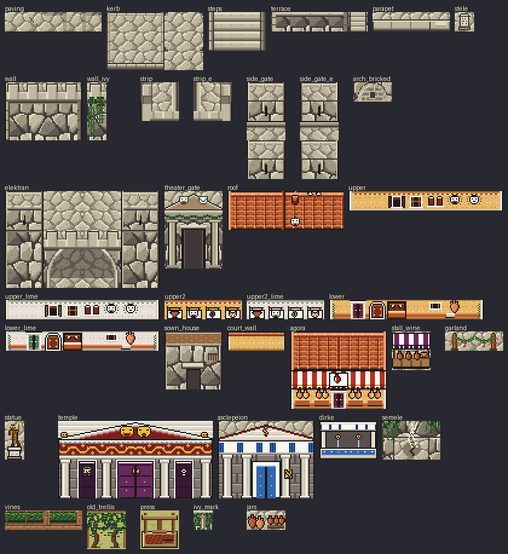
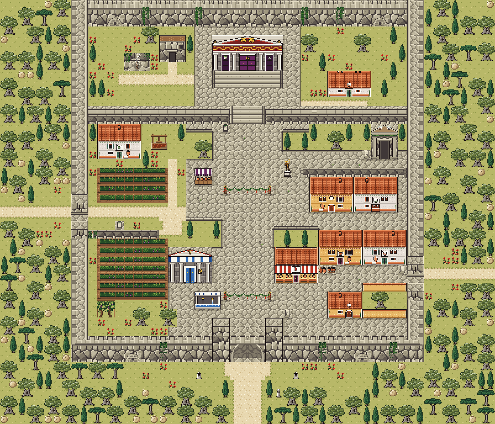

# Thyrsa tileset catalog

`gTileset_Thyrsa` is Thyrsa City, the god's own city: Thebes renamed, walled on a long
hill, older and greyer than Corinth. Pair it with the `aethos` primary, which supplies
grass, paths, olives, cypresses, pines and the hillside outside the walls. Thyrsa's
interiors are `gTileset_ThyrsaRooms` (the rooms agent), the temple's is
`gTileset_TempleDionysus` and the theater's is `gTileset_Theater`.

**This file is generated** above the passes section. `tools/ichor/art/thyrsa_build.py`
draws the tileset, compiles it and rewrites the catalog. The art is in `thyrsa_walls.py`
(streets, walls and gates), `thyrsa_town.py` (the house kit, the Agora, the market and
the garlands), `thyrsa_civic.py` (the temple, the Asclepeion, Dirke, Semele's chamber) and
`thyrsa_vines.py`; the palette plan, the masonry and the painters are in `thyrsa_lib.py`.
The map is built by `tools/ichor/maps/thyrsa.py`, which places every piece by key and
part name from `build/thyrsa/catalog.json`.



The numbered sheet is [img/thyrsa_sheet.png](img/thyrsa_sheet.png). The city's render is
[img/ThyrsaCity.png](img/ThyrsaCity.png).

## How to use it

**IDs.** Each grid lists metatile ids as Porymap shows them, row by row. Each section
starts on a fixed row of the sheet (streets at 0x200, the city walls and gates at 0x238, houses: the kit at 0x2D8, the agora, the temple and the sacred places at 0x330, the vineyards at 0x3C0), so adding to one section never renumbers
another. `build/thyrsa/catalog.json` carries every structure's ids, walk codes, ground and
named parts.

**Collision and layers.** `X` impassable (collision 1), `.` passable, `D` a door (put the
warp here; `MB_NON_ANIMATED_DOOR`), `T` passable and drawn over the player. The vine rows
are `MB_TALL_GRASS`.

**Ground.** *aethos ground* (`grass`, `path`): the cell draws no ground of its own; the
build points its bottom layer at aethos's metatile (grass `0x001`, path `0x1D9`), so
rebuild whenever aethos is repainted. *flags* (`pave`): the street flags, drawn into the
bottom layer; the texture repeats every cell, so a prop on the flags meets the street
around it. *earth*: the vineyards' furrows. *none*: the art fills the cell.

**The masonry.** The city wall, the towers and the terrace walls share one Cyclopean
texture that repeats every 32 px. Pieces that continue a wall come as an even/odd pair:
put the even one on even map columns, or the blocks break at the joint. Wall pieces are
drawn for a wall whose battlement row is an even map row.

**Seams.** Keep this tileset out of the six rows nearest an up/down seam and the eight
columns nearest a left/right seam (MAP_DESIGN.md §5). Thyrsa's walls stand inside those
strips; the hillside outside them is aethos.

**Palettes.** Every 8x8 tile draws from one of seven groups (`thyrsa_lib.GROUPS`):

| Group | Use |
|---|---|
| stone | Theban stone: the Cyclopean walls, gates and towers, the street flags, kerbs, steps, terrace walls, Semele's chamber, Chthonia's house; ivy and smoke |
| clay | Terracotta roofs, ochre stucco, wine-purple doors and shutters, masks over doors |
| clay2 | The same, slot for slot, with limewash and vine-green paint |
| marble | The temple and the Asclepeion: marble, gold, painted blue and red; Dirke's water |
| fest | The festival: masks, garlands, ribbons, the awnings, the temple's painted doors |
| vine | The vineyards: vines, grapes, trellises, tilled earth; the fig |
| wood | The press, jars, barrels and stalls: timber, warm limestone, terracotta |

**Tile budget.** 497 of 504 tiles are used. The door animations copy their frames into
tiles 504-511, so the build fails past 504. Symmetric fronts are mirrored about a tile
edge, the walls and flags repeat on the 16 or 32 px grid, ivy is an overlay on the wall's
own tiles, the limewashed houses are free recolors, and tiles within two pixels of
another are redrawn as that tile.

## Streets

The grey-buff street flags and their shaded variants, kerbs against grass, broad steps, the Cyclopean terrace walls that hold the city's levels, the Kadmeia's parapet, and steles for signs.

### Street flags

`paving`, 5 wide by 1 tall. Thyrsa's streets: irregular grey-buff flags, three or four to a cell. The texture repeats every cell, so any paving cell meets any other. (0) the flags, (1) a cracked slab with a tuft of weed (scatter it sparingly). (2)-(4) the flags in shadow: (2) along the north edge, for the row under a wall or a house's front, (3) along the west edge, for the column east of a building's end, (4) both, for the corner. All walkable.

```text
ids                             walk
0x200 0x201 0x202 0x203 0x204   . . . . .
```

Ground: all on the street flags.

Parts: `flag` 0x200, `crack` 0x201, `shade_n` 0x202, `shade_w` 0x203, `shade_nw` 0x204.

### Street flags' kerbed edge against grass

`kerb`, 5 wide by 3 tall. Columns 0-2 are the paved area's border: NW, N, NE / W, plain, E / SW, S, SE. Columns 3-4, rows 0-1, are inner corners (grass diagonally beyond): NW, NE / SW, SE. (3,2) and (4,2) are the plain flags and a cracked slab.

```text
ids                             walk
0x208 0x209 0x20A 0x20B 0x20C   . . . . .
0x210 0x211 0x212 0x213 0x214   . . . . .
0x218 0x219 0x21A 0x21B 0x21C   . . . . .
```

Parts: `NW` 0x208, `N` 0x209, `NE` 0x20A, `W` 0x210, `C` 0x211, `E` 0x212, `SW` 0x218, `S` 0x219, `SE` 0x21A, `inNW` 0x20B, `inNE` 0x20C, `inSW` 0x213, `inSE` 0x214, `C2` 0x21C.

### Broad steps

`steps`, 3 wide by 2 tall. Four worn treads climbing north, two per row: west cheek, run (repeat it for width), east cheek. The Kadmeia's broad stair, and the temple's and the Asclepeion's steps.

```text
ids                 walk
0x20D 0x20E 0x20F   . . .
0x215 0x216 0x217   . . .
```

Parts: `W` 0x20D, `run` 0x20E, `E` 0x20F, `W2` 0x215, `run2` 0x216, `E2` 0x217.

### Cyclopean terrace wall

`terrace`, 5 wide by 1 tall. A retaining wall one cell tall, the upper level to the north, in the city wall's masonry under a dressed coping: (0) west end, (1)-(2) the run, an even/odd pair (put (1) on even map columns), (3) east end, (4) a narrow stair up through the wall (walkable).

```text
ids                             walk
0x220 0x221 0x222 0x223 0x224   X X X X .
```

Parts: `W` 0x220, `run` 0x221, `run_odd` 0x222, `E` 0x223, `stair` 0x224.

### The Kadmeia's parapet

`parapet`, 4 wide by 1 tall. The top of the Kadmeia's retaining wall seen from above: a low parapet of squared blocks along the citadel's edge, with its wall-walk behind. Lay it as the row above a terrace wall: (0) west end, (1) run, (2) east end, (3) a run with a worn stone seat built into it (Manto's).

```text
ids                       walk
0x228 0x229 0x22A 0x22B   X X X X
```

Parts: `W` 0x228, `run` 0x229, `E` 0x22A, `seat` 0x22B.

### A stone stele on the flags

`stele`, 1 wide by 1 tall. A stone stele with a pediment, painted letters and an ivy wreath, for signs on the paving (aethos's 0x003 stands on grass).

```text
ids     walk
0x22C   X
```

Ground: all on the street flags.

Parts: `sign` 0x22C.

## The city walls and gates

The Cyclopean wall in one masonry texture: the north and south walls' battlement and face, ivy curtains, the north-south strips, the Elektran Gate, the side gates (the Neistan and the Proitid), the bricked-up gates, and the theater's high gate.

### City wall, north and south faces

`wall`, 4 wide by 3 tall. The wall's three rows: the battlement (wall-walk and merlons), then two rows of Cyclopean face. Columns: (0) west end, the face's corner, for an even map column; (1)-(2) the run, an even/odd pair, (1) on even map columns; (3) east end, for an odd map column. The battlement row is the same in every column but the corners. Where the north wall meets a north-south strip, the run simply stops against the strip.

```text
ids                       walk
0x238 0x239 0x23A 0x23B   X X X X
0x240 0x241 0x242 0x243   X X X X
0x248 0x249 0x24A 0x24B   X X X X
```

Parts: `W` 0x238, `run` 0x239, `run_odd` 0x23A, `E` 0x23B.

### City wall face under ivy

`wall_ivy`, 1 wide by 3 tall. A drop-in replacement for wall's even run cell (put it on an even map column), ivy pouring over the battlement and down the face.

```text
ids     walk
0x23C   X
0x244   X
0x24C   X
```

Parts: `run` 0x23C.

### City wall, west side, seen from above

`strip`, 2 wide by 2 tall. The west wall runs north-south as a strip two cells wide: merlons on its outer (west) edge, the wall-walk, and a lip on the inner edge. Row 0 is the run; repeat it. Row 1 is its south end, where it turns into the south wall's battlement (lay it in the battlement's row; the face below it is the wall's west end). strip_e is the east wall, mirrored.

```text
ids           walk
0x23D 0x23E   X X
0x245 0x246   X X
```

Parts: `run` 0x23D, `run_in` 0x23E, `end` 0x245, `end_in` 0x246.

### City wall, east side, seen from above

`strip_e`, 2 wide by 2 tall. The east wall: strip, mirrored (its tiles are the west wall's, flipped).

```text
ids           walk
0x250 0x251   X X
0x258 0x259   X X
```

Parts: `run` 0x251, `run_in` 0x250, `end` 0x259, `end_in` 0x258.

### A gate through the west wall

`side_gate`, 2 wide by 5 tall. A gate through a north-south strip, for the Neistan Gate: two square towers seen from above and from the south, and the road between them under the gate's lintel (row 2, walkable; the lintel draws over the player). Rows: 0 the north tower's top, 1 its face, 2 the passage, 3 the south tower's top, 4 its face. side_gate_e is the Proitid Gate, mirrored. Lay the strip's run above and below it.

```text
ids           walk
0x252 0x253   X X
0x25A 0x25B   X X
0x262 0x263   . .
0x26A 0x26B   X X
0x272 0x273   X X
```

Parts: `tower_top` 0x252, `tower_face` 0x25A, `passage` 0x262.

### A gate through the east wall

`side_gate_e`, 2 wide by 5 tall. The Proitid Gate: side_gate, mirrored.

```text
ids           walk
0x254 0x255   X X
0x25C 0x25D   X X
0x264 0x265   . .
0x26C 0x26D   X X
0x274 0x275   X X
```

Parts: `tower_top` 0x255, `tower_face` 0x25D, `passage` 0x265.

### A bricked-up gate in the wall's face

`arch_bricked`, 2 wide by 1 tall. One of Thyrsa's four shut gates, set in a wall face: a low round arch of dressed voussoirs, walled up with rubble, a votive niche in the fill. Lay it in the face's lower row (an even map row) at an even map column. 'A bricked-up gate. Thyrsa had seven. It uses three.'

```text
ids           walk
0x256 0x257   X X
```

### The Elektran Gate

`elektran`, 8 wide by 5 tall. Thyrsa's main gate, in the south wall: a wide arch of dressed voussoirs between two square towers that rise a row above the battlement, ivy and festival garlands on them, the gate's bronze-bound leaves folded back against the jambs. Lay it with its row 2 in the south wall's battlement row, at an even map column; rows 0-1 between the towers are the street inside the gate (paved). The passage, columns 2-5 of rows 2-4, is walkable; rows 2-3 draw the wall over the player.

```text
ids                                               walk
0x278 0x279 0x27A 0x27B 0x27C 0x27D 0x27E 0x27F   X X . . . . X X
0x280 0x281 0x282 0x283 0x284 0x285 0x286 0x287   X X . . . . X X
0x288 0x289 0x28A 0x28B 0x28C 0x28D 0x28E 0x28F   X X T T T T X X
0x290 0x291 0x292 0x293 0x294 0x295 0x296 0x297   X X T T T T X X
0x298 0x299 0x29A 0x29B 0x29C 0x29D 0x29E 0x29F   X X . . . . X X
```

Parts: `passage` 0x29A.

### The theater's high gate

`theater_gate`, 3 wide by 4 tall. The gate in the east wall onto the theater terrace: a little propylon of two Doric columns under a pediment, a comic and a tragic mask over the doorway, the doors standing open on the dark of the theater's upper passage. Door: bottom row, middle (MB_NON_ANIMATED_DOOR); the warp to MAP_THYRSA_THEATER goes there. Its top row stands on the flags.

```text
ids                 walk
0x2A0 0x2A1 0x2A2   X X X
0x2A8 0x2A9 0x2AA   X X X
0x2B0 0x2B1 0x2B2   X X X
0x2B8 0x2B9 0x2BA   X D X
```

Ground: the street flags at (0,0), (1,0), (2,0); the rest draws its own.

Door metatiles: 0x2B9.

Parts: `door` 0x2B9.

## Houses: the kit

One- and two-storey houses built from parts: a terracotta roof (two rows), an upper storey and a ground storey, each a strip of one-cell parts, in ochre with wine-purple paint or limewashed with vine-green paint. Masks hang over the doors for the festival. Also Chthonia's house of rough stones, and a yard wall with a fig.

### House roof: terracotta, two rows

`roof`, 6 wide by 2 tall. Row 0 is the ridge, row 1 the eaves with palmette antefixes. Columns: west end, run (repeat it), east end, then a ridge with a clay chimney pot, a ridge with doves on it, and, in the eaves row, (3) an eaves cell with a festival mask hung under it (for a one-storey house: put it over the door).

```text
ids                                   walk
0x2D8 0x2D9 0x2DA 0x2DB 0x2DC 0x2DD   X X X X X X
0x2E0 0x2E1 0x2E2 0x2E3 0x2E4 0x2E5   X X X X X X
```

Parts: `W` 0x2D8, `run` 0x2D9, `E` 0x2DA, `chimney` 0x2DB, `doves` 0x2DC, `eaves_W` 0x2E0, `eaves_run` 0x2E1, `eaves_E` 0x2E2, `eaves_mask` 0x2E3.

### House upper storey, ochre

`upper`, 8 wide by 1 tall. One-cell parts for the upper storey, under the roof's eaves: (0) west corner, (1) plain wall, (2) a window with wine-purple shutters, (3) a window with a wooden grille, (4) a pair of small arched windows, (5) a comic mask on an ivy-wreathed plaque and (6) a tragic one (put one over the door), (7) east corner.

```text
ids                                               walk
0x2E8 0x2E9 0x2EA 0x2EB 0x2EC 0x2ED 0x2EE 0x2EF   X X X X X X X X
```

Parts: `W` 0x2E8, `wall` 0x2E9, `shutters` 0x2EA, `grille` 0x2EB, `arched` 0x2EC, `mask` 0x2ED, `mask_tragic` 0x2EE, `E` 0x2EF.

### House upper storey, limewashed

`upper_lime`, 8 wide by 1 tall. One-cell parts for the upper storey, under the roof's eaves: (0) west corner, (1) plain wall, (2) a window with vine-green shutters, (3) a window with a wooden grille, (4) a pair of small arched windows, (5) a comic mask on an ivy-wreathed plaque and (6) a tragic one (put one over the door), (7) east corner. The limewashed parts are the ochre parts' own tiles in the clay2 palette.

```text
ids                                               walk
0x2F0 0x2F1 0x2F2 0x2F3 0x2F4 0x2F5 0x2F6 0x2F7   X X X X X X X X
```

Parts: `W` 0x2F0, `wall` 0x2F1, `shutters` 0x2F2, `grille` 0x2F3, `arched` 0x2F4, `mask` 0x2F5, `mask_tragic` 0x2F6, `E` 0x2F7.

### House upper storey: trade signs, ochre

`upper2`, 4 wide by 1 tall. Upper-storey cells with trade signs on iron brackets: (0) the tavern's kantharos, (1) the mask-maker's mask, (2) the vintner's grapes, (3) the poet's lyre.

```text
ids                       walk
0x2F8 0x2F9 0x2FA 0x2FB   X X X X
```

Parts: `tavern` 0x2F8, `mask_maker` 0x2F9, `vintner` 0x2FA, `poet` 0x2FB.

### House upper storey: trade signs, limewashed

`upper2_lime`, 4 wide by 1 tall. Upper-storey cells with trade signs on iron brackets: (0) the tavern's kantharos, (1) the mask-maker's mask, (2) the vintner's grapes, (3) the poet's lyre. The limewashed parts are the ochre parts' own tiles in the clay2 palette.

```text
ids                       walk
0x2FC 0x2FD 0x2FE 0x2FF   X X X X
```

Parts: `tavern` 0x2FC, `mask_maker` 0x2FD, `vintner` 0x2FE, `poet` 0x2FF.

### House ground storey, ochre

`lower`, 8 wide by 1 tall. One-cell parts for the ground storey: (0) west corner, (1) a double door painted wine-purple, (2) an arched wooden door, (3) an open workshop front, masks drying over its counter (a door too), (4) plain wall, (5) a low barred window, (6) a stone bench with an amphora, (7) east corner. (1)-(3) are MB_NON_ANIMATED_DOOR: put the warp there.

```text
ids                                               walk
0x300 0x301 0x302 0x303 0x304 0x305 0x306 0x307   X D D D X X X X
```

Door metatiles: 0x301, 0x302, 0x303.

Parts: `W` 0x300, `door` 0x301, `door_arched` 0x302, `shop` 0x303, `wall` 0x304, `window` 0x305, `bench` 0x306, `E` 0x307.

### House ground storey, limewashed

`lower_lime`, 8 wide by 1 tall. One-cell parts for the ground storey: (0) west corner, (1) a double door painted vine-green, (2) an arched wooden door, (3) an open workshop front, masks drying over its counter (a door too), (4) plain wall, (5) a low barred window, (6) a stone bench with an amphora, (7) east corner. (1)-(3) are MB_NON_ANIMATED_DOOR: put the warp there. The limewashed parts are the ochre parts' own tiles in the clay2 palette.

```text
ids                                               walk
0x308 0x309 0x30A 0x30B 0x30C 0x30D 0x30E 0x30F   X D D D X X X X
```

Door metatiles: 0x309, 0x30A, 0x30B.

Parts: `W` 0x308, `door` 0x309, `door_arched` 0x30A, `shop` 0x30B, `wall` 0x30C, `window` 0x30D, `bench` 0x30E, `E` 0x30F.

### Chthonia's house, of huge rough stones

`sown_house`, 3 wide by 3 tall. The oldest house in the city, on the Kadmeia: walls of huge rough stones under a flat roof of beaten earth edged with slabs, a squat doorway under one enormous lintel, and five clay figures of armed men set in a niche beside it. The family of the Sown Men lives here. Door: bottom row, middle. Its walls are the city wall's masonry: place it at an even map column with its roof on an even map row.

```text
ids                 walk
0x310 0x311 0x312   X X X
0x318 0x319 0x31A   X X X
0x320 0x321 0x322   X D X
```

Door metatiles: 0x321.

Parts: `door` 0x321.

### A courtyard wall

`court_wall`, 3 wide by 1 tall. A stucco yard wall under a tiled coping, one cell tall: (0) west end, (1) run (repeat it), (2) east end. Behind Eudora's house, with an aethos olive's crown over it.

```text
ids                 walk
0x313 0x314 0x315   X X X
```

Parts: `W` 0x313, `run` 0x314, `E` 0x315.

## House recipes

Houses from the kit, as id grids (top row first). The city map builds each of its households from these parts, every one different.

**1. The Kantharos, a tavern** (5 wide, 4 tall)

```text
0x2D8 0x2D9 0x2DB 0x2D9 0x2DA
0x2E0 0x2E1 0x2E1 0x2E1 0x2E2
0x2E8 0x2EC 0x2F8 0x2EA 0x2EF
0x300 0x305 0x301 0x306 0x307
```

**2. A one-storey house with a mask under its eaves** (5 wide, 3 tall)

```text
0x2D8 0x2D9 0x2DB 0x2D9 0x2DA
0x2E0 0x2E1 0x2E3 0x2E1 0x2E2
0x308 0x30D 0x30A 0x30E 0x30F
```

**3. The mask-maker's workshop** (4 wide, 4 tall)

```text
0x2D8 0x2D9 0x2D9 0x2DA
0x2E0 0x2E1 0x2E1 0x2E2
0x2E8 0x2F9 0x2EB 0x2EF
0x300 0x303 0x301 0x307
```

**4. A limewashed house with a mask over the door** (5 wide, 4 tall)

```text
0x2D8 0x2D9 0x2D9 0x2DB 0x2DA
0x2E0 0x2E1 0x2E1 0x2E1 0x2E2
0x2F0 0x2F2 0x2F5 0x2F3 0x2F7
0x308 0x30D 0x309 0x30C 0x30F
```

## The Agora, the temple and the sacred places

The Agora and the market stalls, the festival garlands, the Temple of Dionysus, the Asclepeion and the fountain house of Dirke, and Semele's chamber.

### Thyrsa's Agora

`agora`, 5 wide by 4 tall. The market hall off the square, a sibling of aethos's Agora (0x028): terracotta roof, a long awning striped red and white over the front, the Agora's painted jar on a pinax over the door, and counters either side stacked with wine jars and baskets. Door: bottom row, middle (MB_NON_ANIMATED_DOOR).

```text
ids                             walk
0x330 0x331 0x332 0x333 0x334   X X X X X
0x338 0x339 0x33A 0x33B 0x33C   X X X X X
0x340 0x341 0x342 0x343 0x344   X X X X X
0x348 0x349 0x34A 0x34B 0x34C   X X D X X
```

Door metatiles: 0x34A.

Parts: `door` 0x34A.

### Market stall: wine

`stall_wine`, 2 wide by 2 tall. Under a purple-and-white awning: a krater, jugs and a rack of amphorae of new wine. Free-standing on the flags; the seller stands beside it.

```text
ids           walk
0x335 0x336   X X
0x33D 0x33E   X X
```

Ground: all on the street flags.

### A festival garland across the street

`garland`, 3 wide by 1 tall. Ivy ropes and red ribbons strung between two ribboned poles, sagging over the street: (0) the west pole, (1) the swag (repeat it), (2) the east pole. The swags draw over the player, who walks under them.

```text
ids                 walk
0x350 0x351 0x352   X T X
```

Ground: all on the street flags.

Parts: `post_W` 0x350, `swag` 0x351, `post_E` 0x352.

### The god in bronze

`statue`, 1 wide by 2 tall. Dionysus in bronze on a marble plinth in the Agora square: young, ivy-crowned, a thyrsus (a fennel staff tipped with a pinecone) in his raised hand. The top cell draws over the player; give the bottom cell a bg event.

```text
ids     walk
0x353   T
0x35B   X
```

Ground: all on the street flags.

### Temple of Dionysus, the skene front

`temple`, 8 wide by 4 tall. The crown of Thyrsa, at the head of the main street on the Kadmeia: a temple whose front is a theater's skene. A low pediment with the god's masks, comic and tragic, in gold on wine-red; a frieze of golden vines on red; and three painted doors between grey columns: the comic door (ivy), the palace door (a gold crown on purple, double, the real door) and the satyr door (a goat). Doors: bottom row, columns 3-4 (MB_NON_ANIMATED_DOOR); give both the temple's warp. Lay the broad steps below it, eight cells wide.

```text
ids                                               walk
0x360 0x361 0x362 0x363 0x364 0x365 0x366 0x367   X X X X X X X X
0x368 0x369 0x36A 0x36B 0x36C 0x36D 0x36E 0x36F   X X X X X X X X
0x370 0x371 0x372 0x373 0x374 0x375 0x376 0x377   X X X X X X X X
0x378 0x379 0x37A 0x37B 0x37C 0x37D 0x37E 0x37F   X X X D D X X X
```

Door metatiles: 0x37B, 0x37C.

Parts: `door` 0x37B, `door_r` 0x37C.

### Thyrsa's Asclepeion

`asclepeion`, 5 wide by 4 tall. Thyrsa's healing house, a sibling of Act I's Asclepeion (aethos 0x048): a white pediment with the gold rod at its apex, a blue triglyph frieze, grey Doric columns, the rod of Asclepius on a gold plaque and a tall blue door. Door: bottom row, middle (MB_NON_ANIMATED_DOOR). The fountain house of Dirke stands in front of it. Its top row stands on the flags.

```text
ids                             walk
0x380 0x381 0x382 0x383 0x384   X X X X X
0x388 0x389 0x38A 0x38B 0x38C   X X X X X
0x390 0x391 0x392 0x393 0x394   X X X X X
0x398 0x399 0x39A 0x39B 0x39C   X X D X X
```

Ground: the street flags at (0,0), (1,0), (2,0), (3,0), (4,0); the rest draws its own.

Door metatiles: 0x39A.

Parts: `door` 0x39A.

### The fountain house of Dirke

`dirke`, 3 wide by 2 tall. The spring of Dirke's fountain house, before the Asclepeion: a white entablature on two short columns, two bronze lion heads pouring into a long marble basin. Give the basin a bg event (the Heart Scale is hidden here).

```text
ids                 walk
0x385 0x386 0x387   X X X
0x38D 0x38E 0x38F   X X X
```

Ground: all on the street flags.

Parts: `basin` 0x38E.

### Semele's chamber

`semele`, 3 wide by 2 tall. On the Kadmeia: the room where Zeus came to Semele as lightning, a roofless ruin of the city's Cyclopean stones, wrapped in ivy, open to the south. Smoke curls from a crack in its floor (row 1, middle: give it the crack's bg event, read from the flags below). Its stones are the wall's masonry: place it at an even map column with its top row on an even map row.

```text
ids                 walk
0x3A0 0x3A1 0x3A2   X X X
0x3A8 0x3A9 0x3AA   X X X
```

Parts: `crack` 0x3A9.

## The vineyards

Vine rows (the city's tall grass), the old trellises, the wine press, the marked ivy, and wine jars.

### Vine rows (the vineyards' tall grass)

`vines`, 4 wide by 1 tall. Rows of vines on low trellises over furrowed earth, one row to a cell, so a block of them reads as striped rows. All are MB_TALL_GRASS: wild encounters. (0) vines, (1) vines heavy with grapes (scatter it), (2) the row's west end, a stout post with the wire tied off, (3) its east end.

```text
ids                       walk
0x3C0 0x3C1 0x3C2 0x3C3   . . . .
```

Ground: all on tilled earth.

Tall grass (`MB_TALL_GRASS`): 0x3C0, 0x3C1, 0x3C2, 0x3C3.

Parts: `row` 0x3C0, `grapes` 0x3C1, `W` 0x3C2, `E` 0x3C3.

### The old trellises

`old_trellis`, 2 wide by 2 tall. In the vineyards' corner, vines older than anyone's grandmother: gnarled black trunks under a pergola of grey poles, heavy with leaves. 'The god planted these when he was a boy.' The rare-visitor omen puts a Thyrsivy beside them. The top row draws over the player.

```text
ids           walk
0x3C4 0x3C5   T T
0x3CC 0x3CD   X X
```

Ground: all on aethos grass.

### The old wine press

`press`, 2 wide by 2 tall. A stone treading floor, purple-stained, under a great wooden beam press on two posts, its spout over a stone vat. The Black Sludge lies beside it.

```text
ids           walk
0x3C6 0x3C7   X X
0x3CE 0x3CF   X X
```

Ground: all on aethos grass.

### Marked ivy on the old terrace wall

`ivy_mark`, 1 wide by 1 tall. The vineyards' old terrace wall under a thick fall of ivy, a thyrsus (a fennel staff tipped with a pinecone) scratched into a block behind it. Dionysus's Thyrsus (rite gift II) climbs it; until then it is a bg event. Lay it in a terrace wall run at an odd or even column.

```text
ids     walk
0x3D0   X
```

### Wine jars

`jars`, 2 wide by 1 tall. (0) two amphorae of this year's wine leaning together, (1) a rack of three: for the vintner's yard and the tavern's door. On the flags.

```text
ids           walk
0x3D1 0x3D2   X X
```

Ground: all on the street flags.

<!-- passes: hand-written below this line; thyrsa_build.py keeps it -->

## Thyrsa City, the map

`tools/ichor/maps/thyrsa.py` builds `MAP_THYRSA_CITY` (56×48, aethos + thyrsa): the layout, every
event in `data/maps/ThyrsaCity/map.json`, and the checks. Its scripts are
`data/maps/ThyrsaCity/scripts.pory`. The final render is [img/ThyrsaCity.png](img/ThyrsaCity.png);
screen-sized views along the player's route are [img/ThyrsaCity_screens.png](img/ThyrsaCity_screens.png),
and in-game screenshots from `tools/ichor/tests/thyrsa_city.sh` are
[img/ThyrsaCity_ingame.png](img/ThyrsaCity_ingame.png).



**The plan.** The Cyclopean walls stand just inside the seam strips (MAP_DESIGN §5), so every edge of
the map is aethos hillside: olives, pines, cypresses and rock, open only along the three roads.
- **The south wall** (battlement row 38, face rows 39–40) carries the **Elektran Gate** at columns 24–31:
  a four-cell arch between two towers, the road up from Route 7 at columns 26–29 (the agreed seam,
  offset +6). Two bricked gates are in its face at (14–15,40) and (40–41,40), read from the road outside.
  Outside it: the road, two old graves and a herm in the clearings, olive groves.
- **The west wall** (columns 8–9) has the **Neistan Gate**, a one-cell passage at (8–9,24) between two
  towers; the road runs out on rows 23–24. **The east wall** (46–47) has the **Proitid Gate** at (46–47,31),
  its guard sitting in the arch (shut until batch 7). **The north wall** (rows 0–2) faces the Kadmeia,
  with two more bricked gates; the one at (12–13,2) is the seventh, with the Rare Candy's niche.
- **The Kadmeia** (rows 3–11), up the broad stair at columns 26–29 through its parapet and terrace wall
  (rows 12–13): the Temple of Dionysus at the head of the main street (24–31, 4–7, its palace door at
  (27–28,7)), framed by the street all the way from the gate; Semele's chamber and Chthonia's house of
  rough stones in the west garden; Manto's house on the citadel's east edge, her seat on the parapet at
  (35,12) and Manto on the wall-walk above it at (35,11).
- **The square** at the city's heart (21–34, 14–24): the wine stall, the bronze god, a garland across the
  main street, garden plots with an olive and cypresses, the herald, the Kronist by the Agora.
- **The lower town** inside the gate: the Asclepeion (19–23, 28–31) with the fountain house of Dirke in
  front of it, the Agora (31–35, 28–31) under its striped awning, the Kantharos and Pindaros on the lane to
  the Proitid Gate, Eudora's house beside her walled yard with its old tree.
- **The east hill**: the theater's high gate (42–44, 14–17) on the upper terrace among cypresses, the
  terrace wall at row 19, Polos and Euthykles on the terrace below.
- **The vineyards** along the west wall: two blocks of vine rows (the city's tall grass) either side of
  the lane to the Neistan Gate, the old terrace wall with the marked ivy at (10,26) and the Big Nugget on
  the wall-walk beyond it (9,28), Staphylos's house and the wine press at their head, the old trellises in
  the south-west corner where the omen's Thyrsivy stands.

**Checks** (`thyrsa.py` runs them on every build): every warp sits on a door reachable from its
doorstep; every person stands on open ground the player can reach; every sign can be read; no thyrsa
metatile within six rows of the south seam or eight columns of the side edges; the south edge open
exactly at columns 26–29 and the side edges only on their road rows; with both side gates shut, the road
from Route 7 cannot reach the west or east road (the hillside is closed all round); the scenes' walking
paths stay open; row 0 is solid.

## Render-and-critique passes

### The tileset

**Pass 1** (the first full draw, about 710 distinct tiles, 666 after the limewash recolors): the art
read well (the Cyclopean wall, the skene-front temple, the Agora) but was 160 tiles over the 504 budget,
and the first masonry texture looked like mosaic: thick black joints round flat blocks. *Changed:* a new
masonry generator with bulging, shaded blocks and thin joints (seed chosen from five renders); street
flags on a 16 px texture so any prop meets the street; the art drawn in the bottom layer over the flags
moved up a layer so the flags' tiles stay shared.

**Pass 2** (budget): cut the pieces that cost most for least: the strip-shadow wall ends, a second ivy
curtain, the barrel, the mask stall, the herm on the flags, the drain grate, the ivy cell in the upper
storey, the fig (an aethos olive stands over Eudora's yard instead); Semele's chamber and Chthonia's house
redrawn in the city wall's own masonry, phased to the map, so they share its tiles; the temple's side
doors share one painted base; the fountain made symmetric; tiles within 3 px merged (Emporion merges at
2; the masonry speckle is noise). Porytiles still stored the limewashed parts separately: it sorts each
palette's colors by value, so the lime and vine-green colors were retuned to sort in step with the ochre
and wine ones, slot for slot (thyrsa_lib.py asserts it). 490 tiles.

**Pass 3** (the map's needs): mirrored east-wall pieces (free), and the bronze god for the square,
whose emptiness was the map's weakest point. **497 of 504 tiles.** No animated doors are used anywhere
in Thyrsa (every door is `MB_NON_ANIMATED_DOOR`), so the door-animation tiles 504–511 are never written.

### The map

**Pass 1** ([img/ThyrsaCity_pass1.png](img/ThyrsaCity_pass1.png)): the bones worked (the walls inside
the seam strips, the gate on the road's axis, the temple framed by the main street, the vineyards' rows),
but the inside was one sea of flags: the square, the street and the lanes merged into a 25×24 field with
nothing in it. The outside olives stood in a grid, and leftover cells were filled with evenly scattered
rocks; several edge cells under olive crowns were left walkable (the hillside leaked). The theater's gate
was unreachable behind its own sign. *Changed:* the flags now cover only the streets, the square and the
forecourts; everything else became gardens with kerbed edges: the square's corner plots, the Asclepeion's
grove, the garden behind the Agora, the theater's grove of cypresses. The outside forest is placed in a
shuffled order, olives, pines and cypresses mixed, and every hillside cell is solid. The sign moved.

**Pass 2** ([img/ThyrsaCity_pass2.png](img/ThyrsaCity_pass2.png)): the districts now read apart and
every 15×10 view has a landmark ([img/ThyrsaCity_screens.png](img/ThyrsaCity_screens.png)). Still weak:
the square's middle, a wide plain of flags between the stall and the lower terrace; a stair in the east
terrace wall that led onto Polos's roof; the approach outside the gate was bare grass. *Changed:* the
bronze god in the square, the dead-end stair removed (the terraces join round the square's east side),
graves and a herm along the road outside the gate (the dead buried outside the walls).

**Pass 3** (the final, [img/ThyrsaCity.png](img/ThyrsaCity.png), and in game,
[img/ThyrsaCity_ingame.png](img/ThyrsaCity_ingame.png)): played through headlessly: the welcome inside
the gate, the tour, Manto, the theater keeper, the Neistan Gate before and after, Alethea going west, the
omen's visitor. In game the flags are busy but read as an old paved city, the walls and towers carry the
screen, and the vineyards' rows read as vines. Left for a later pass: Eudora's yard reads as two plain
walls with a tree between (a small wall-corner piece would close it); Semele's chamber is a grey ruin
that could take more ivy; the smoke from its crack is drawn still (SCRIPT.md Part 10 asks for a 2-frame
animation, which needs a tileset callback in `src/tileset_anims.c`).

## Deviations

- **The theater keeper** stops the player at the high gate's doorstep before the laurel (beat 32's setup);
  so the workers sweeping the cavea before the Dionysia (Part 2, the theater) are only met if the scenes
  agent starts the Dionysia from a trigger inside rather than on entry. His name box reads KEEPER: "THEATER
  KEEPER" is 66 px in the name box's font, over its 64.
- **The Proitid Gate** is drawn open but its guard sits in the arch, so it is shut until batch 7.
- **The Neistan Gate's drum** rolls out of the arch and one cell aside onto the hillside, and is gone
  the next time the map loads (it carries its hide flag).
- **The Neistan road leaves on two rows** (23–24) through a one-cell gate: a Cyclopean gate is narrow.
- **Manto's omens** (ICHOR_STUB_OMENS): she gives the rare visitor once the Dionysia is over until it is
  met, otherwise the swarm or the fog at random; only the visitor has an effect here.
- **Alethea's tablet reading** checks the prophecy range by index (`FLAG_ICHOR_PROPHECY_START+3` found,
  `+11` read) until the engine names `FLAG_ICHOR_PROPHECY_3` and `_3_READ` (ICHOR_STUB_DIG).
- **One line of my own each** for the gatekeeper after the welcome, the theater keeper after the laurel and
  after the play, the beggar after he's helped, a fifth citizen ("Laurel-holders sit at the front. I've no
  laurel. I've a cushion."), the wine press, the bronze god, the temple front, the graves and the herm.
